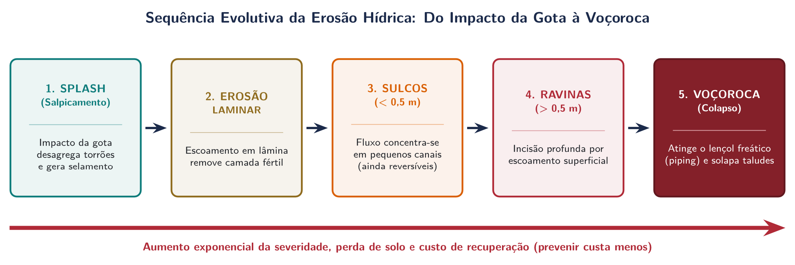
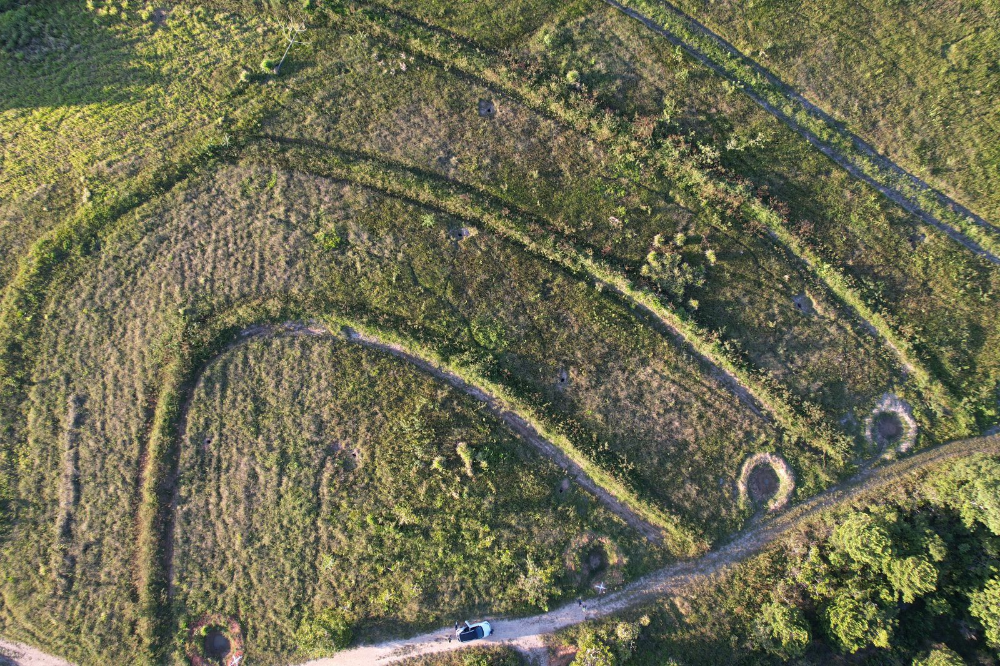
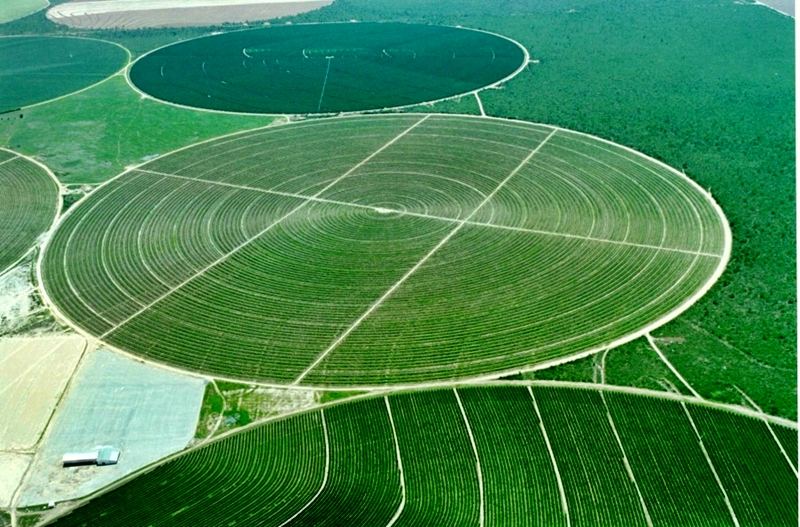

## [Abertura]{.pitch-tag} Visão Geral da Aula {#visao-geral .smaller-text .lesson-slide}

::: {.pitch-grid-50}
::: {.pitch-card}
[Roteiro da aula]{.pitch-card-index}
[Tópicos estruturantes]{.pitch-heading}

- [1]{.circle} Estrutura pedagógica, ementa e avaliação
- [2]{.circle} Atribuições legais do Geógrafo (Lei 6.664/1979 e CREA)
- [3]{.circle} Questão ambiental contemporânea e crise civilizatória
- [4]{.circle} Ciência das Mudanças de Uso da Terra (*Land-Change Science*)
- [5]{.circle} Dinâmica dos biomas brasileiros (MapBiomas) e Semiárido baiano
- [6]{.circle} Orientação para o Estudo Orientado nº 1
:::

::: {.pitch-stack-2}
::: {.pitch-card .pitch-card--gold}
[Objetivo da aula]{.pitch-card-index}
[Análise Ambiental no Bacharelado]{.pitch-heading}

Apresentar a arquitetura teórica, metodológica e profissional da disciplina **Análise Ambiental** no Bacharelado em Geografia, articulando as atribuições legais do geógrafo à compreensão das mudanças globais e regionais de uso e cobertura da terra.
:::

::: {.pitch-pill-row}
[60 h · 4 créditos]{.pitch-pill}
[SIG e Trabalho de Campo]{.pitch-pill .pitch-pill--gold}
[Estudo Orientado nº 1]{.pitch-pill}
:::

::: {.pitch-band .pitch-band--teal}
Do marco regulatório da profissão às dinâmicas territoriais da Bahia e do Semiárido.
:::
:::
:::

# 1 · Apresentação da Disciplina {.section-header rotulo="Disciplina"}

## [Disciplina]{.pitch-tag} Identificação, Ementa e Arquitetura do Curso {#identificacao-ementa .smaller-text .lesson-slide}

::: {.pitch-grid-55}
::: {.pitch-stack-2}
::: {.pitch-table-box}
| Campo | Detalhamento (UEFS · DCHF) |
|-------|----------------------------|
| **Componente** | Análise Ambiental (60 h · 4 créditos) |
| **Curso** | Bacharelado em Geografia (DCN CNE/CES 14/2002) |
| **Docente** | Prof. Dr. Luiz Diego Vidal Santos |
| **Natureza** | Teórico-prática (Sala, SIG e Trabalho de Campo) |
:::

::: {.pitch-card}
[Ementa sintética]{.pitch-card-index}
[Núcleos formativos]{.pitch-heading}

Fundamentos epistemológicos da relação sociedade-natureza e da Geografia Socioambiental. Conceitos operacionais de impacto, degradação, vulnerabilidade, fragilidade, risco e capacidade de suporte. Instrumentos da PNMA (AIA/EIA-RIMA e ZEE). Análise integrada de geossistemas, bacias hidrográficas e catenas morfopedológicas. Indicadores hidrossedimentológicos, capacidade de uso da terra, diagnóstico de áreas degradadas, soluções baseadas na natureza e legislação ambiental aplicada (APP, RL, SNUC e PRAD).
:::
:::

::: {.pitch-milestones}
::: {.pitch-milestone-item}
**Unidade I · Bases Teórico-Conceituais e Instrumentos (Semanas 1–5):** Epistemologia S↔N, Conceitos de Risco/Fragilidade, PNMA e AIA/EIA-RIMA.
:::

::: {.pitch-milestone-item}
**Unidade II · Análise Integrada do Meio Físico (Semanas 6–10):** Escalas, Bacias Hidrográficas, Morfopedologia, Ross (1994) e Crepani (2001).
:::

::: {.pitch-milestone-item}
**Unidade III · Diagnóstico, Recuperação e Legislação (Semanas 11–16):** Indicadores (DPSIR/IQA), Capacidade de Uso, Voçorocas, SbN e PRAD/SNUC.
:::
:::
:::

## [Disciplina]{.pitch-tag} Sistema de Avaliação e Cronograma de Atividades {#avaliacao-cronograma .smaller-text .lesson-slide}

::: {.pitch-table-box}
| Instrumento | Semanas | Peso | Escopo Técnico |
|-------------|---------|------|----------------|
| **Estudos Orientados (EO 1 a 4)** | 2, 3, 5 e 10 | **20%** | Fichamentos críticos e exercícios de matrizes/cálculos |
| **Avaliação Teórica Individual** | Semana 10 | **35%** | Prova discursiva e analítica (Unidades I e II) |
| **Relatório Técnico + Campo** | Semanas 10–15 | **25%** | Diagnóstico ambiental integrado de sub-bacia/área-piloto |
| **Seminário Final (Defesa)** | Semana 16 | **20%** | Apresentação oral em formato de audiência/parecer técnico |
:::

::: {.pitch-band .pitch-band--navy}
**Diretriz Pedagógica do Bacharelado:** em Análise Ambiental, o estudante não apenas descreve paisagens: aprende a **diagnosticar mecanismos causais**, **quantificar indicadores auditáveis**, **classificar fragilidades em SIG** e **propor medidas mitigadoras ou de recuperação** amparadas na legislação vigente.
:::

# 2 · O Geógrafo na Análise Ambiental {.section-header rotulo="Profissão"}

## [Lei]{.pitch-tag .pitch-tag--gold} Marco Regulatório da Profissão de Geógrafo {#marco-regulatorio .smaller-text .lesson-slide}

::: {.pitch-cards-2}
::: {.pitch-card}
[Lei Federal nº 6.664/1979 · Dec. 85.138/1980]{.pitch-card-index}
[Regulamentação profissional]{.pitch-heading}

Regulamentam o exercício da profissão de Geógrafo no Brasil e delimitam o campo legal de atuação técnica e científica.
:::

::: {.pitch-card .pitch-card--gold}
[Lei Federal nº 7.399/1985]{.pitch-card-index}
[Atuação plena do Bacharel]{.pitch-heading}

Altera dispositivos da regulamentação anterior e assegura ao Bacharel em Geografia atuação plena em levantamentos, planejamentos e estudos físico-territoriais e socioambientais.
:::

::: {.pitch-card .pitch-card--teal}
[Resolução CONFEA nº 218/1973 · Art. 6º]{.pitch-card-index}
[Atribuições no Sistema CONFEA/CREA]{.pitch-heading}

Define as atividades técnicas privativas e compartilhadas do Geógrafo em estudos ambientais, cartografia temática e ordenamento territorial.
:::

::: {.pitch-card .pitch-card--alert}
[Lei nº 6.496/1977 · ART]{.pitch-card-index}
[Anotação de Responsabilidade Técnica]{.pitch-heading}

Instrumento legal que vincula o Geógrafo à autoria e à responsabilidade civil e criminal por laudos, mapas, diagnósticos e projetos ambientais.
:::
:::

::: {.pitch-band}
A habilitação técnica exige rigor metodológico, base cartográfica auditável e rastreabilidade documental sob registro no CREA.
:::

## [Lei]{.pitch-tag .pitch-tag--gold} Onde o Geógrafo Analista Ambiental Atua? {#atuacao-geografo .smaller-text .lesson-slide}

::: {.pitch-table-box}
| Instrumento / Produto | Base Legal | Papel do Geógrafo |
|-----------------------|------------|-------------------|
| **EIA/RIMA, RAS, RCA e PBA** | CONAMA 01/1986 e 237/1997 | Coordenação de equipe multidisciplinar; diagnóstico dos meios físico e socioeconômico |
| **Zoneamento Ecológico-Econômico (ZEE)** | Decreto Federal 4.297/2002 | Modelagem de vulnerabilidade natural (Crepani) e fragilidade (Ross) |
| **Planos de Bacia e Enquadramento** | Lei Federal 9.433/1997 | Morfometria fluvial, balanço hídrico e cenários de uso da terra |
| **CAR, PRA e PRAD** | Lei 12.651/2012 e IN IBAMA 14/2024 | Delimitação de APPs/RL, diagnóstico de feições erosivas e projeto de restauração |
| **Mapeamento de Risco (R1–R4)** | Lei Federal 12.608/2012 (PNPDEC) | Setorização de risco geodinâmico e hidrológico em áreas urbanas |
:::

::: {.pitch-band .pitch-band--teal}
Da escala de vertente e bacia hidrográfica ao planejamento regional, o Geógrafo integra diagnóstico físico, cartografia e marco legal.
:::

# 3 · Questão Ambiental Contemporânea {.section-header rotulo="Crise"}

## [Epistemologia]{.pitch-tag} A Escala Planetária da Transformação Antrópica {#escala-planetaria .smaller-text .lesson-slide}

::: {.pitch-grid-50}
::: {.pitch-stack-2}
::: {.pitch-card}
[Holoceno → Grande Aceleração (Pós-1950)]{.pitch-card-index}
[Inflexão histórica]{.pitch-heading}

A partir de meados do século XX, a humanidade tornou-se a principal força geomorfológica e biogeoquímica ativa na superfície terrestre.
:::

::: {.pitch-card .pitch-card--alert}
[Rockström et al., 2009 · Richardson et al., 2023]{.pitch-card-index}
[Fronteiras Planetárias ultrapassadas]{.pitch-heading}

Limites já excedidos: integridade da biosfera (extinção e fragmentação), fluxos de **Nitrogênio ($N$)** e **Fósforo ($P$)**, mudanças climáticas, mudança no sistema terrestre (desmatamento) e novas entidades químicas.
:::

::: {.pitch-band}
**Imperativo analítico:** problemas globais manifestam-se localmente em **bacias hidrográficas, vertentes e territórios vividos**.
:::
:::

::: {.pitch-media-card .pitch-media-card--tall}

[Sequência evolutiva da erosão hídrica e piping]{.pitch-caption}
[Do salpicamento à voçoroca: manifestação local de pressões sobre o uso do solo]{.pitch-caption-sub}
:::
:::

## [Epistemologia]{.pitch-tag} Desigualdade Socioespacial e Crise Ambiental {#desigualdade-socioespacial .smaller-text .lesson-slide}

::: {.pitch-grid-50}
::: {.pitch-stack-2}
::: {.pitch-card}
[A crise não é homogênea]{.pitch-card-index}
[Metabolismo socioecológico desigual]{.pitch-heading}

Países centrais e cadeias globais de *commodities* externalizam custos ecológicos (água virtual, perda de solo, emissões e rejeitos) para territórios periféricos.
:::

::: {.pitch-card .pitch-card--gold}
[Dupla exposição no Sul Global]{.pitch-card-index}
[Fronteira rural e déficit urbano]{.pitch-heading}

1. **Pressão sobre recursos naturais:** expansão da fronteira agromineral sobre biomas tropicais (Amazônia, Cerrado e Caatinga).
2. **Déficit de infraestrutura urbana:** ocupação precária de fundos de vale (planícies de inundação) e encostas íngremes ($> 30\%$) sem drenagem pluvial ou esgotamento sanitário.
:::
:::

::: {.pitch-stack-2}
::: {.pitch-card .pitch-card--alert}
[Tese central da Análise Ambiental Geográfica]{.pitch-card-index}
[Não existem desastres puramente naturais]{.pitch-heading}

A **suscetibilidade física** do relevo e dos solos converte-se em **risco e dano socioambiental** quando combinada à **vulnerabilidade social** e à ausência de planejamento territorial.
:::

::: {.pitch-formula}
$$\text{Risco Socioambiental} = f(\text{Suscetibilidade Física},\; \text{Vulnerabilidade Social},\; \text{Ordenamento})$$

Diagnosticar a crise ambiental exige cruzar dinâmica morfopedológica, distribuição espacial da população e capacidade institucional.
:::
:::
:::

# 4 · Ciência das Mudanças de Uso da Terra {.section-header rotulo="Land-Change"}

## [Método]{.pitch-tag .pitch-tag--teal} Fundamentos de Land-Change Science (Leituras Obrigatórias) {#land-change-science .smaller-text .lesson-slide}

::: {.pitch-cards-2}
::: {.pitch-card}
[Lambin et al., 2001 · Global Environmental Change]{.pitch-card-index}
[Além dos mitos do desmatamento]{.pitch-heading}

Refutam o mito de que "população e pobreza" sejam as únicas causas do desmatamento tropical; demonstram que **mercados globais, políticas públicas e instituições** comandam a conversão da terra.
:::

::: {.pitch-card .pitch-card--gold}
[Lambin, Geist & Lepers, 2003 · Annu. Rev. Environ. Resour.]{.pitch-card-index}
[Modelo analítico em dois níveis]{.pitch-heading}

- **Causas próximas (diretas):** expansão agrícola, extração madeireira, infraestrutura viária/hídrica (escala local da parcela).
- **Forças motrizes subjacentes (indiretas):** fatores econômicos (*commodities*, crédito), tecnológicos, político-institucionais (grilagem, incentivos fiscais), culturais e demográficos.
:::

::: {.pitch-card .pitch-card--teal}
[Foley et al., 2005 · Science]{.pitch-card-index}
[Trade-offs ecossistêmicos]{.pitch-heading}

Analisam a compensação (*trade-off*) entre maximização de bens de provisão (alimentos, fibras, madeira) e degradação de serviços reguladores (regime hidrológico, qualidade da água, carbono no solo e biodiversidade).
:::

::: {.pitch-card}
[Turner, Lambin & Reenberg, 2007 · PNAS]{.pitch-card-index}
[Sistemas acoplados homem-ambiente]{.pitch-heading}

Consolidam a **Land-Change Science** como núcleo interdisciplinar para monitorar, modelar e avaliar a sustentabilidade de **sistemas terrestres acoplados homem-ambiente**.
:::
:::

## [Território]{.pitch-tag .pitch-tag--gold} Dinâmica do Uso e Cobertura da Terra no Brasil (MapBiomas) {#mapbiomas-brasil .smaller-text .lesson-slide}

::: {.pitch-grid-50}
::: {.pitch-stack-2}
::: {.pitch-card}
[Souza Jr. et al., 2020 · Remote Sensing]{.pitch-card-index}
[Três décadas de transformação (1985–presente)]{.pitch-heading}

Série histórica Landsat ($30\text{ m}$) com reconstrução anual das matrizes de transição de uso e cobertura nos 6 biomas brasileiros, revelando perda líquida superior a **80 milhões de hectares** de vegetação nativa desde 1985.
:::

::: {.pitch-card .pitch-card--gold}
[Vetores regionais por bioma]{.pitch-card-index}
[Amazônia, Cerrado e Caatinga]{.pitch-heading}

Avanço acelerado da agropecuária sobre a **Amazônia** (arco do desmatamento) e o **Cerrado** (**MATOPIBA**: Maranhão, Tocantins, Piauí e Oeste da Bahia). Na **Caatinga**, substituição arbóreo-arbustiva por pastagens degradadas e solo exposto acelera a erosão laminar.
:::
:::

::: {.pitch-media-card .pitch-media-card--photo .pitch-media-card--tall}

[Conservação do solo e manejo de enxurrada em área rural]{.pitch-caption}
[Vista aérea de terraços e bacias de captação: observar cobertura, caminhos da enxurrada e manutenção]{.pitch-caption-sub}
:::
:::

# 5 · Recorte Regional: Bahia e Semiárido {.section-header rotulo="Bahia"}

## [Território]{.pitch-tag .pitch-tag--gold} Desertificação no Semiárido: Conceito Técnico (UNCCD) {#desertificacao-unccd .smaller-text .lesson-slide}

::: {.pitch-grid-50}
::: {.pitch-stack-2}
::: {.pitch-formula}
**Índice de Aridez ($IA = P / ETP$)**

Áreas Suscetíveis à Desertificação (**ASD**): regiões onde $0{,}05 \le P/ETP \le 0{,}65$.
:::

::: {.pitch-card .pitch-card--gold}
[Convenção da ONU (UNCCD) · PAN-Brasil]{.pitch-card-index}
[Definição de desertificação]{.pitch-heading}

Degradação da terra nas zonas **áridas, semiáridas e subúmidas secas**, resultante de variações climáticas e, sobretudo, de atividades humanas.
:::
:::

::: {.pitch-milestones}
::: {.pitch-milestone-item}
**1. Supressão e sobrepastoreio:** desmatamento da Caatinga para lenha/carvão e pastejo caprino/ovino/bovino expõem solos rasos (**Luvissolos, Planossolos e Neossolos Litólicos**).
:::

::: {.pitch-milestone-item}
**2. Decapitação pedológica:** erosão laminar e em sulcos remove o horizonte $A$ e promove afloramento de pavimentos detríticos/rochosos.
:::

::: {.pitch-milestone-item}
**3. Salinização secundária:** em perímetros irrigados mal drenados, há acumulação de sais solúveis e sódio trocável na zona radicular.
:::
:::
:::

## [Território]{.pitch-tag .pitch-tag--gold} Polos Críticos no Estado da Bahia e MATOPIBA {#polos-criticos-bahia .smaller-text .lesson-slide}

::: {.pitch-grid-60}
::: {.pitch-stack-2}
::: {.pitch-table-box}
| Polo Baiano | Pressão Dominante | Processo Ambiental Crítico |
|-------------|-------------------|----------------------------|
| **Norte da Bahia** (Jeremoabo, Rodelas, Macururé, Chorrochó) | Sobrepastoreio extensivo e extração de lenha em solos rasos/arenosos | Núcleo de desertificação severa; perda irreversível de biodiversidade e capacidade produtiva |
| **Vale do São Francisco** (Juazeiro / Casa Nova) | Irrigação intensiva sem drenagem subsuperficial adequada | Salinização e sodificação de solos aluviais e Planossolos |
| **Oeste Baiano** (Barreiras / Luís Eduardo Magalhães) | Monocultura mecanizada sobre o Aquífero Urucuia (Cerrado) | Conflitos pelo uso da água (outorgas), redução da vazão de base dos rios Corrente e Grande |
:::

::: {.pitch-band .pitch-band--teal}
A transição de cobertura na Bahia exige cruzar dados orbitais com hidrogeologia, pedologia e gestão de outorgas.
:::
:::

::: {.pitch-media-card .pitch-media-card--photo .pitch-media-card--tall}

[Expansão irrigada no Cerrado (MATOPIBA)]{.pitch-caption}
[Oeste Baiano: pressão sobre o Aquífero Urucuia e os rios Corrente e Grande]{.pitch-caption-sub}
:::
:::

## [Método]{.pitch-tag .pitch-tag--teal} Ler as Mudanças do Uso da Terra {#ler-mudancas-terra .smaller-text .lesson-slide}

::: {.pitch-table-box}
| Leitura de referência | Pergunta orientadora |
|-----------------------|----------------------|
| **Lambin et al. (2001)** | Como diferenciar causas imediatas e determinantes subjacentes? |
| **Lambin, Geist e Lepers (2003)** | Quais transições e forças explicam mudanças de uso? |
| **Foley et al. (2005)** | Que funções ambientais são alteradas pelo uso da terra? |
| **Turner, Lambin e Reenberg (2007)** | Como integrar observação, explicação e cenários? |
| **Souza Jr. et al. (2020)** | Como avaliar uma série de mapas de cobertura e suas incertezas? |
:::

::: {.pitch-band .pitch-band--navy}
**Conexão empírica:** as leituras articulam decisões, usos e consequências ambientais. Escolha uma mudança na Bahia e construa uma **hipótese investigável com dados**.
:::

## [Campo]{.pitch-tag .pitch-tag--forest} Oficina: Mapa de Mudança não é Explicação Causal {#oficina-mapa-mudanca .smaller-text .lesson-slide}

::: {.pitch-grid-60}
::: {.pitch-milestones}
::: {.pitch-milestone-item}
**01 · Comparar datas:** verificar duas datas e a consistência temática das legendas.
:::

::: {.pitch-milestone-item}
**02 · Auditar transições:** identificar transições reais e possíveis erros de classificação espectral.
:::

::: {.pitch-milestone-item}
**03 · Cruzar vetores:** consultar dados de produção, infraestrutura, população e políticas públicas.
:::

::: {.pitch-milestone-item}
**04 · Validar em campo:** conferir evidências locais e versões divergentes entre atores.
:::

::: {.pitch-milestone-item}
**05 · Distinguir níveis:** separar rigorosamente observação empírica, hipótese explicativa e conclusão.
:::
:::

::: {.pitch-stack-2}
::: {.pitch-card .pitch-card--forest}
[Produto da oficina]{.pitch-card-index}
[Entregável da equipe]{.pitch-heading}

- Mapa comparativo de cobertura
- Quadro de matriz de transições
- Fontes documentais auditáveis
- Pergunta de pesquisa territorializada
:::

::: {.pitch-band}
Mudança espectral no pixel indica **onde** a cobertura mudou; explicar **por quê** exige cruzar economia, normas e território.
:::
:::
:::

# 6 · Síntese e Estudo Orientado nº 1 {.section-header rotulo="Atividade"}

## [Síntese]{.pitch-tag .pitch-tag--teal} Estudo Orientado nº 1: Tarefa Analítica Individual {#estudo-orientado-1 .smaller-text .lesson-slide}

::: {.pitch-cards}
::: {.pitch-card}
[Questão 1 · Conceito]{.pitch-card-index}
[Diferenciação operacional]{.pitch-heading}

Qual a diferença operacional entre *causas próximas* (*proximate causes*) e *forças motrizes subjacentes* (*underlying driving forces*) na mudança de uso da terra?
:::

::: {.pitch-card .pitch-card--gold}
[Questão 2 · Caso na Bahia]{.pitch-card-index}
[Aplicação MapBiomas]{.pitch-heading}

Escolha um município baiano em `plataforma.brasil.mapbiomas.org`, identifique a principal transição entre 1985 e o ano mais recente e classifique suas causas próximas e forças motrizes.
:::

::: {.pitch-card .pitch-card--teal}
[Questão 3 · Instrumento]{.pitch-card-index}
[Papel do Geógrafo]{.pitch-heading}

Qual instrumento da Política Nacional do Meio Ambiente ou de Recursos Hídricos caberia aplicar para ordenar esse território?
:::
:::

::: {.pitch-band .pitch-band--navy}
**Entrega:** síntese individual estruturada (máximo de **2 páginas**) com base em **Lambin, Geist & Lepers (2003)** e **Souza Jr. et al. (2020 — MapBiomas)**.
:::

## [Síntese]{.pitch-tag .pitch-tag--teal} Referências da Aula e Leituras Orientadas {#referencias-aula-1 .smaller-text .lesson-slide}

::: {.pitch-cards-2}
::: {.pitch-card}
[Bloco 1 · Mudanças de uso da terra]{.pitch-card-index}
[Causas e consequências globais]{.pitch-heading}

- FOLEY, J. A. et al. Global consequences of land use. **Science**, v. 309, n. 5734, p. 570–574, 2005.
- LAMBIN, E. F. et al. The causes of land-use and land-cover change: moving beyond the myths. **Global Environmental Change**, v. 11, p. 261–269, 2001.
- LAMBIN, E. F.; GEIST, H. J.; LEPERS, E. Dynamics of land-use and land-cover change in tropical regions. **Annual Review of Environment and Resources**, v. 28, p. 205–241, 2003.
:::

::: {.pitch-card .pitch-card--teal}
[Bloco 2 · Observação e integração]{.pitch-card-index}
[Monitoramento e sistemas acoplados]{.pitch-heading}

- SOUZA JR., C. M. et al. Reconstructing three decades of land use and land cover changes in Brazilian biomes with Landsat archive and Earth Engine. **Remote Sensing**, v. 12, n. 17, 2735, 2020.
- TURNER, B. L.; LAMBIN, E. F.; REENBERG, A. The emergence of land change science for global environmental change and sustainability. **PNAS**, v. 104, n. 52, p. 20666–20671, 2007.
:::
:::

::: {.pitch-band}
Usar as perguntas de leitura desta aula e os links disponíveis na biblioteca do portal para preparar o Estudo Orientado nº 1.
:::
