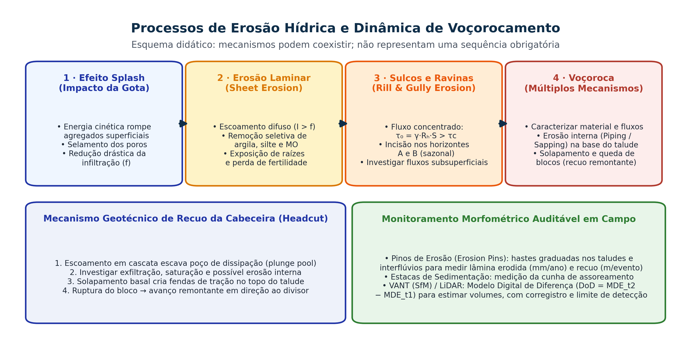

## Visão Geral da Aula {.smaller-text .lesson-slide}

::: {.columns}
::: {.column width="50%"}
### Tópicos

- [1]{.circle} Estrutura pedagógica, ementa e avaliação
- [2]{.circle} Atribuições legais do Geógrafo (Lei 6.664/1979 e CREA)
- [3]{.circle} Questão ambiental contemporânea e crise civilizatória
- [4]{.circle} Ciência das Mudanças de Uso da Terra (*Land-Change Science*)
- [5]{.circle} Dinâmica dos biomas brasileiros (MapBiomas) e Semiárido baiano
- [6]{.circle} Orientação para o Estudo Orientado nº 1
:::

::: {.column width="50%"}
::: {.info-box}
**Objetivo da Aula**

Apresentar a arquitetura teórica, metodológica e profissional da disciplina **Análise Ambiental** no Bacharelado em Geografia, articulando as atribuições legais do geógrafo à compreensão das mudanças globais e regionais de uso e cobertura da terra.
:::
:::
:::

# 1 · Apresentação da Disciplina {.section-header rotulo="Disciplina"}

## Identificação, Ementa e Arquitetura do Curso {.smaller-text .lesson-slide}

::: {.columns}
::: {.column width="50%"}
### Ficha Técnica (UEFS · DCHF)

| Campo | Detalhamento |
|-------|-------------|
| **Componente** | Análise Ambiental (60 h · 4 créditos) |
| **Curso** | Bacharelado em Geografia (DCN CNE/CES 14/2002) |
| **Docente** | Prof. Dr. Luiz Diego Vidal Santos |
| **Natureza** | Teórico-prática (Sala, SIG e Trabalho de Campo) |

### Ementa Sintética

Fundamentos epistemológicos da relação sociedade-natureza e da Geografia Socioambiental. Conceitos operacionais de impacto, degradação, vulnerabilidade, fragilidade, risco e capacidade de suporte. Instrumentos da PNMA (AIA/EIA-RIMA e ZEE). Análise integrada de geossistemas, bacias hidrográficas e catenas morfopedológicas. Indicadores hidrossedimentológicos, capacidade de uso da terra, diagnóstico de áreas degradadas, soluções baseadas na natureza e legislação ambiental aplicada (APP, RL, SNUC e PRAD).
:::

::: {.column width="50%"}
### Organização em Três Unidades

```text
Unidade I · Bases Teórico-Conceituais e Instrumentos (Semanas 1–5)
Epistemologia S↔N, Conceitos de Risco/Fragilidade, PNMA e AIA/EIA-RIMA
↓
Unidade II · Análise Integrada do Meio Físico (Semanas 6–10)
Escalas, Bacias Hidrográficas, Morfopedologia, Ross (1994) e Crepani (2001)
↓
Unidade III · Diagnóstico, Recuperação e Legislação (Semanas 11–16)
Indicadores (DPSIR/IQA), Capacidade de Uso, Voçorocas, SbN e PRAD/SNUC
```
:::
:::

## Sistema de Avaliação e Cronograma de Atividades {.smaller-text .lesson-slide}

::: {.columns}
::: {.column width="52%"}
### Instrumentos Avaliativos

| Instrumento | Semanas | Peso | Escopo Técnico |
|-------------|---------|------|----------------|
| **Estudos Orientados (EO 1 a 4)** | 2, 3, 5 e 10 | **20%** | Fichamentos críticos e exercícios de matrizes/cálculos |
| **Avaliação Teórica Individual** | Semana 10 | **35%** | Prova discursiva e analítica (Unidades I e II) |
| **Relatório Técnico + Campo** | Semanas 10–15 | **25%** | Diagnóstico ambiental integrado de sub-bacia/área-piloto |
| **Seminário Final (Defesa)** | Semana 16 | **20%** | Apresentação oral em formato de audiência/parecer técnico |
:::

::: {.column width="48%"}
::: {.highlight-box}
**Diretriz Pedagógica do Bacharelado**

Em Análise Ambiental, o estudante não apenas descreve paisagens: ele aprende a **diagnosticar mecanismos causais**, **quantificar indicadores auditáveis**, **classificar fragilidades em SIG** e **propor medidas mitigadoras ou de recuperação** amparadas na legislação vigente.
:::
:::
:::

# 2 · O Geógrafo na Análise Ambiental {.section-header rotulo="Profissão"}

## Marco Regulatório da Profissão de Geógrafo {.smaller-text}

- **Lei Federal nº 6.664/1979** e **Decreto nº 85.138/1980**: regulamentam a profissão de Geógrafo no Brasil.
- **Lei Federal nº 7.399/1985**: altera dispositivos e assegura a atuação plena do Bacharel em Geografia em levantamentos, planejamentos e estudos físico-territoriais e socioambientais.
- **Resolução CONFEA nº 218/1973** (Art. 6º): define as atividades técnicas privativas e compartilhadas no Sistema CONFEA/CREA.
- **ART (Anotação de Responsabilidade Técnica — Lei 6.496/1977)**: instrumento legal que vincula o Geógrafo à autoria e responsabilidade civil/criminal por laudos, mapas, diagnósticos e projetos ambientais.

## Onde o Geógrafo Analista Ambiental Atua? {.smaller-text}

| Instrumento / Produto | Base Legal | Papel do Geógrafo |
|-----------------------|------------|-------------------|
| **EIA/RIMA, RAS, RCA e PBA** | CONAMA 01/1986 e 237/1997 | Coordenação de equipe multidisciplinar; diagnóstico dos meios físico e socioeconômico |
| **Zoneamento Ecológico-Econômico (ZEE)** | Decreto Federal 4.297/2002 | Modelagem de vulnerabilidade natural (Crepani) e fragilidade (Ross) |
| **Planos de Bacia e Enquadramento** | Lei Federal 9.433/1997 | Morfometria fluvial, balanço hídrico e cenários de uso da terra |
| **CAR, PRA e PRAD** | Lei 12.651/2012 e IN IBAMA 14/2024 | Delimitação de APPs/RL, diagnóstico de feições erosivas e projeto de restauração |
| **Mapeamento de Risco (R1–R4)** | Lei Federal 12.608/2012 (PNPDEC) | Setorização de risco geodinâmico e hidrológico em áreas urbanas |

# 3 · Questão Ambiental Contemporânea {.section-header rotulo="Crise"}

## A Escala Planetária da Transformação Antrópica {.smaller-text .lesson-slide}

::: {.columns}
::: {.column width="50%"}
### Do Holoceno à Grande Aceleração (Pós-1950)

- **Inflexão histórica**: a partir de meados do século XX, a humanidade tornou-se a principal força geomorfológica e biogeoquímica ativa na superfície terrestre.
- **Fronteiras Planetárias (*Planetary Boundaries* — Rockström et al., 2009; Richardson et al., 2023)**:
  - **Limites já ultrapassados**: integridade da biosfera (extinção e fragmentação), fluxos biogeoquímicos de **Nitrogênio ($N$)** e **Fósforo ($P$)**, mudanças climáticas, mudança no sistema terrestre (desmatamento) e novas entidades químicas.
- **Imperativo analítico**: problemas ambientais globais manifestam-se localmente em **bacias hidrográficas, vertentes e territórios vividos**.
:::

::: {.column width="50%"}
{.fig-col}
:::
:::

## Desigualdade Socioespacial e Crise Ambiental {.smaller-text .lesson-slide}

::: {.columns}
::: {.column width="50%"}
### A Crise não é Homogênea

- **Metabolismo socioecológico desigual**: países centrais e cadeias globais de *commodities* externalizam custos ecológicos (água virtual, perda de solo, emissões e rejeitos) para territórios periféricos.
- **Dupla exposição no Sul Global**:
  1. **Pressão sobre recursos naturais**: expansão da fronteira agromineral sobre biomas tropicais (Amazônia, Cerrado e Caatinga).
  2. **Déficit de infraestrutura urbana**: ocupação precária de fundos de vale (planícies de inundação) e encostas íngremes ($> 30\%$) sem drenagem pluvial ou esgotamento sanitário.
:::

::: {.column width="50%"}
::: {.info-box}
**Tese Central da Análise Ambiental Geográfica**

Não existem desastres puramente naturais: a **suscetibilidade física** do relevo e dos solos converte-se em **risco e dano socioambiental** quando combinada à **vulnerabilidade social** e à ausência de planejamento territorial.
:::
:::
:::

# 4 · Ciência das Mudanças de Uso da Terra {.section-header rotulo="Land-Change"}

## Fundamentos de *Land-Change Science* (Leituras Obrigatórias) {.smaller-text .lesson-slide}

::: {.columns}
::: {.column width="52%"}
### Causas Próximas vs. Forças Motrizes Subjacentes

- **Lambin et al. (2001)** (*Global Environmental Change*): refutam o mito de que "população e pobreza" sejam as únicas causas do desmatamento tropical; demonstram que **mercados globais, políticas públicas e instituições** comandam a conversão da terra.
- **Lambin, Geist & Lepers (2003)** (*Annual Review of Environment and Resources*): estruturam o modelo analítico em dois níveis:
  - **Causas próximas (diretas)**: expansão agrícola, extração madeireira, infraestrutura viária/hídrica (atuam na escala local da parcela/propriedade).
  - **Forças motrizes subjacentes (indiretas)**: fatores econômicos (preço de *commodities*, crédito), tecnológicos, político-institucionais (grilagem, incentivos fiscais), culturais e demográficos.
:::

::: {.column width="48%"}
### Sistemas Socioecológicos e Serviços Ecossistêmicos

- **Foley et al. (2005)** (*Science* — *Global consequences of land use*):
  - Analisam o **trade-off (compensação)** entre a maximização de bens de provisão (alimentos, fibras, madeira) e a degradação de serviços reguladores (regime hidrológico, qualidade da água, estoque de carbono no solo e biodiversidade).
- **Turner, Lambin & Reenberg (2007)** (*PNAS*):
  - Consolidam a **Land-Change Science** como núcleo interdisciplinar para monitorar, modelar e avaliar a sustentabilidade de **sistemas terrestres acoplados homem-ambiente**.
:::
:::

## Dinâmica do Uso e Cobertura da Terra no Brasil (MapBiomas) {.smaller-text .lesson-slide}

::: {.columns}
::: {.column width="52%"}
### Três Décadas de Transformação (Souza Jr. et al., 2020)

- **Série histórica Landsat (30 m, 1985–presente)**: reconstrução anual das matrizes de transição de uso e cobertura nos 6 biomas brasileiros (*Remote Sensing*, 2020).
- **Tendências estruturais identificadas**:
  - Perda líquida superior a **80 milhões de hectares** de vegetação nativa desde 1985.
  - Avanço acelerado da agropecuária sobre a **Amazônia** (arco do desmatamento) e o **Cerrado** (região do **MATOPIBA**: Maranhão, Tocantins, Piauí e Oeste da Bahia).
  - Na **Caatinga**, substituição de vegetação arbóreo-arbustiva por pastagens degradadas e solo exposto, acelerando a perda de solo por erosão laminar.
:::

::: {.column width="48%"}
{.fig-col}
:::
:::

# 5 · Recorte Regional: Bahia e Semiárido {.section-header rotulo="Bahia"}

## Conceito Técnico (UNCCD e PAN-Brasil) {.smaller-text}

- **Desertificação (Convenção da ONU — UNCCD)**: degradação da terra nas zonas **áridas, semiáridas e subúmidas secas**, resultante de variações climáticas e, sobretudo, de atividades humanas.
- **Critério Climático — Índice de Aridez ($IA = P / ETP$)**:
  - **Áreas Suscetíveis à Desertificação (ASD)**: regiões onde $0{,}05 \le P/ETP \le 0{,}65$.
- **Mecanismos no Semiárido Baiano**:
  1. Desmatamento da Caatinga para lenha/carvão e sobrepastoreio caprino/ovino/bovino → exposição de solos rasos (**Luvissolos, Planossolos e Neossolos Litólicos**).
  2. Erosão laminar e em sulcos → decapitação do horizonte $A$ e afloramento de pavimentos detríticos/rochosos.
  3. **Salinização secundária** em perímetros irrigados mal drenados (acumulação de sais solúveis e sódio trocável na zona radicular).

## Polos Críticos no Estado da Bahia {.smaller-text}

| Região / Polo Baiano | Pressão Dominante | Processo Ambiental Crítico |
|----------------------|-------------------|----------------------------|
| **Norte da Bahia (Polo de Jeremoabo, Rodelas, Macururé, Chorrochó)** | Sobrepastoreio extensivo e extração de lenha em solos rasos/arenosos | Núcleo de desertificação severa; perda irreversível de biodiversidade e capacidade produtiva |
| **Vale do São Francisco (Juazeiro / Casa Nova)** | Irrigação intensiva sem drenagem subsuperficial adequada | Salinização e sodificação de solos aluviais e Planossolos |
| **Oeste Baiano (Barreiras / Luís Eduardo Magalhães)** | Monocultura mecanizada sobre o Aquífero Urucuia (Cerrado) | Conflitos pelo uso da água (outorgas), redução da vazão de base dos rios Corrente e Grande |

## Ler as mudanças do uso da terra {.smaller-text}

As leituras de Lambin e colaboradores, Foley e colaboradores e Turner e colaboradores conectam decisões, usos e consequências ambientais.

| Leitura | Pergunta orientadora |
|---|---|
| Lambin et al. (2001) | Como diferenciar causas imediatas e determinantes subjacentes? |
| Lambin, Geist e Lepers (2003) | Quais transições e forças explicam mudanças de uso? |
| Foley et al. (2005) | Que funções ambientais são alteradas pelo uso da terra? |
| Turner, Lambin e Reenberg (2007) | Como integrar observação, explicação e cenários? |
| Souza Jr. et al. (2020) | Como avaliar uma série de mapas de cobertura e suas incertezas? |

Escolha uma mudança na Bahia e construa uma hipótese que possa ser investigada com dados.

## Oficina: mapa de mudança não é explicação causal {.smaller-text}

1. Comparar duas datas e a consistência das legendas.
2. Identificar transições e possíveis erros de classificação.
3. Consultar dados de produção, infraestrutura, população e políticas.
4. Conferir evidências locais e versões divergentes.
5. Separar observação, hipótese e conclusão.

**Produto:** mapa, quadro de transições, fontes e pergunta de pesquisa.

# 6 · Síntese e Estudo Orientado nº 1 {.section-header rotulo="Atividade"}

## Tarefa Analítica Individual {.smaller-text}

Com base na leitura de **Lambin, Geist & Lepers (2003)** e **Souza Jr. et al. (2020 — MapBiomas)**, elabore uma síntese estruturada (máximo de 2 páginas) respondendo:

1. **Diferenciação conceitual**: Qual a diferença operacional entre *causas próximas* (*proximate causes*) e *forças motrizes subjacentes* (*underlying driving forces*) na mudança de uso da terra?
2. **Estudo de caso aplicado à Bahia**: Escolha um município baiano (usando a plataforma pública `plataforma.brasil.mapbiomas.org`), identifique a principal transição de cobertura entre 1985 e o ano mais recente e classifique suas causas próximas e forças motrizes.
3. **Papel do Geógrafo**: Qual instrumento da Política Nacional do Meio Ambiente ou de Recursos Hídricos caberia aplicar para ordenar esse território?

## Referências da Aula {.smaller-text}

- FOLEY, J. A. et al. Global consequences of land use. **Science**, v. 309, n. 5734, p. 570–574, 2005.
- LAMBIN, E. F. et al. The causes of land-use and land-cover change: moving beyond the myths. **Global Environmental Change**, v. 11, p. 261–269, 2001.
- LAMBIN, E. F.; GEIST, H. J.; LEPERS, E. Dynamics of land-use and land-cover change in tropical regions. **Annual Review of Environment and Resources**, v. 28, p. 205–241, 2003.
- SOUZA JR., C. M. et al. Reconstructing three decades of land use and land cover changes in Brazilian biomes with Landsat archive and Earth Engine. **Remote Sensing**, v. 12, n. 17, 2735, 2020.
- TURNER, B. L.; LAMBIN, E. F.; REENBERG, A. The emergence of land change science for global environmental change and sustainability. **PNAS**, v. 104, n. 52, p. 20666–20671, 2007.


## Leituras de referência: mudanças de uso da terra {.smaller-text}

- LAMBIN, E. F. et al. The causes of land-use and land-cover change: moving beyond the myths. **Global Environmental Change**, 11, 261–269, 2001.
- LAMBIN, E. F.; GEIST, H. J.; LEPERS, E. Dynamics of land-use and land-cover change in tropical regions. **Annual Review of Environment and Resources**, 28, 205–241, 2003.
- FOLEY, J. A. et al. Global consequences of land use. **Science**, 309, 570–574, 2005.

## Leituras de referência: observação e integração {.smaller-text}

- TURNER, B. L.; LAMBIN, E. F.; REENBERG, A. The emergence of land change science for global environmental change and sustainability. **PNAS**, 104, 20666–20671, 2007.
- SOUZA JR., C. M. et al. Reconstructing three decades of land use and land cover changes in Brazilian biomes with Landsat archive and Earth Engine. **Remote Sensing**, 12, 2735, 2020.

Usar as perguntas de leitura desta aula e os links disponíveis na biblioteca do portal.
