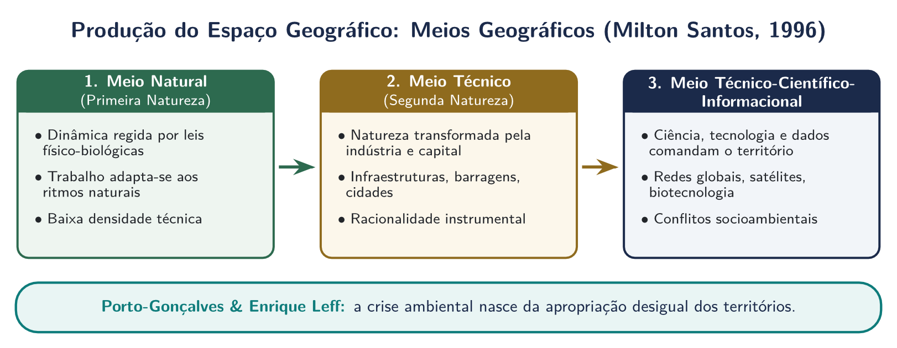
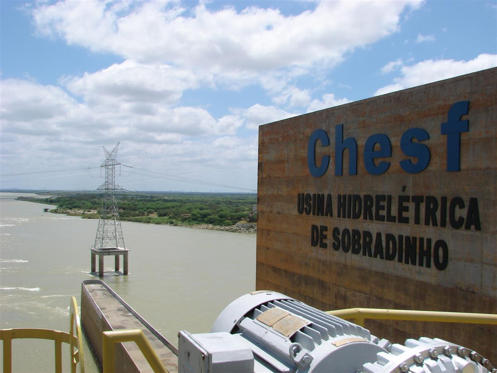

## [Abertura]{.pitch-tag} Visão Geral da Aula {#visao-geral .smaller-text .lesson-slide}

::: {.pitch-grid-50}
::: {.pitch-card}
[Roteiro da aula]{.pitch-card-index}
[Tópicos da Aula 2.1]{.pitch-heading}

- [1]{.circle} Modernidade, razão instrumental e crise ambiental
- [2]{.circle} A ideia de natureza na história do pensamento (Porto-Gonçalves e Casseti)
- [3]{.circle} Primeira e Segunda Natureza e os Meios Geográficos (Milton Santos)
- [4]{.circle} Racionalidade Econômica vs. Racionalidade Ambiental (Enrique Leff)
- [5]{.circle} Conflitos socioambientais e Justiça Ambiental no Brasil e na Bahia
- [6]{.circle} Discussão e entrega do Estudo Orientado nº 1
:::

::: {.pitch-stack-2}
::: {.pitch-card .pitch-card--gold}
[Objetivo da aula]{.pitch-card-index}
[Dicotomia Sociedade–Natureza]{.pitch-heading}

Analisar a constituição histórica e filosófica da dicotomia Sociedade–Natureza na modernidade ocidental e compreender como a Geografia crítica e socioambiental explica a produção técnica do espaço, a apropriação desigual dos recursos naturais e os conflitos territoriais.
:::

::: {.pitch-pill-row}
[Razão Instrumental]{.pitch-pill}
[Meios Geográficos]{.pitch-pill .pitch-pill--gold}
[Justiça Ambiental]{.pitch-pill}
:::
:::
:::

# 1 · Modernidade e Questão Ambiental {.section-header rotulo="Modernidade"}

## [Epistemologia]{.pitch-tag} Gênese Histórica da Cisão Sociedade–Natureza {#genese-cisao .smaller-text .lesson-slide}

::: {.pitch-grid-60}
::: {.pitch-table-box}
| Período | Marco Histórico-Epistemológico | Consequência para a Natureza |
|---------|--------------------------------|------------------------------|
| **Séc. XVI–XVII** | Revolução Científica (Bacon, Descartes, Galileu, Newton) | **Dessacralização e mecanicismo**: natureza como *res extensa* (objeto mensurável, exterior ao sujeito) |
| **Séc. XVIII–XIX** | Revolução Industrial (carvão, máquina a vapor, urbanização) | Subordinação dos ciclos biogeoquímicos e do tempo geológico ao **tempo abstrato do capital** |
| **Séc. XIX** | Ciência parcelar e Positivismo | Separação rígida entre **Ciências da Natureza** e **Ciências do Homem** (cisma na Geografia) |
| **Pós-1945** | Grande Aceleração (petroquímica, Revolução Verde, nuclear) | Escala global de poluição transfronteiriça, erosão genética e esgotamento de estoques |
| **1972–presente** | Estocolmo (1972), Brundtland (1987), Rio-92, Rio+20 | Institucionalização da **questão ambiental** como arena geopolítica e científica |
:::

::: {.pitch-stack-2}
::: {.pitch-card .pitch-card--gold}
[Porto-Gonçalves, 1989]{.pitch-card-index}
[Os (des)caminhos do meio ambiente]{.pitch-heading}

Toda sociedade institui um conceito de natureza a partir de suas relações sociais. Na modernidade capitalista, o postulado da **dominação da natureza pelo homem** oculta a **dominação de determinados grupos sociais sobre outros** por meio do controle territorial dos recursos.
:::

::: {.pitch-band}
A crise ecológica moderna nasce como crise de civilização e de modelo de apropriação espacial.
:::
:::
:::

## [Epistemologia]{.pitch-tag} A Crítica à Razão Instrumental {#critica-razao-instrumental .smaller-text .lesson-slide}

::: {.pitch-cards}
::: {.pitch-card}
[Ilusão 01 · Sources]{.pitch-card-index}
[Inesgotabilidade das fontes]{.pitch-heading}

Crença de que jazidas minerais, solos férteis, água doce e florestas seriam infinitos ou integralmente substituíveis por capital artificial.
:::

::: {.pitch-card .pitch-card--gold}
[Ilusão 02 · Sinks]{.pitch-card-index}
[Capacidade infinita dos sumidouros]{.pitch-heading}

Suposição de que a atmosfera, os oceanos e as bacias hidrográficas absorveriam indefinidamente efluentes, agrotóxicos e gases de efeito estufa.
:::

::: {.pitch-card .pitch-card--alert}
[Ilusão 03 · Tecnocracia]{.pitch-card-index}
[Neutralidade da técnica]{.pitch-heading}

Mito de que qualquer dano ecológico gerado por uma tecnologia seria automaticamente resolvido por outra tecnologia futura, sem alterar o padrão de acumulação.
:::
:::

::: {.pitch-cards-2}
::: {.pitch-card .pitch-card--teal}
[Consequência 1 · Mecanismo biofísico]{.pitch-card-index}
[Como o sistema natural funciona?]{.pitch-heading}

Avaliar dinâmica de fluxos, capacidade de suporte e resposta morfodinâmica à intervenção (sem reduzir o diagnóstico a inventário físico-químico neutro).
:::

::: {.pitch-card}
[Consequência 2 · Intencionalidade social]{.pitch-card-index}
[Quem decide e quem arca?]{.pitch-heading}

Identificar *quem* se apropria do recurso, *quem* define a localização do empreendimento e *quem* suporta o passivo ambiental no território.
:::
:::

# 2 · Produção do Espaço e Meios Geográficos {.section-header rotulo="Espaço"}

## [Epistemologia]{.pitch-tag} Da Natureza Primária ao Meio Técnico-Científico-Informacional {#meios-geograficos-diagrama .smaller-text .lesson-slide}

::: {.pitch-media-card .pitch-media-card--wide}

[Sucessão dos Meios Geográficos (Milton Santos, 1996)]{.pitch-caption}
[Da Primeira Natureza ao Meio Técnico-Científico-Informacional; síntese com Porto-Gonçalves e Enrique Leff]{.pitch-caption-sub}
:::

::: {.pitch-band .pitch-band--navy}
A sucessão histórica dos meios altera a densidade técnica e informacional do território, acentuando conflitos quando a apropriação dos recursos é desigual.
:::

## [Território]{.pitch-tag .pitch-tag--gold} Primeira e Segunda Natureza e Sucessão dos Meios {#primeira-segunda-natureza .smaller-text .lesson-slide}

::: {.pitch-grid-55}
::: {.pitch-stack-2}
::: {.pitch-card}
[Marx · Casseti (1991) · Suertegaray (2001)]{.pitch-card-index}
[Primeira vs. Segunda Natureza]{.pitch-heading}

- **Primeira Natureza:** anterior à ação humana ou regida por leis biofísicas e geológicas originais.
- **Segunda Natureza:** transformada pelo trabalho social (cidades, represas, solos corrigidos, canais). **Não anula a Primeira:** um canal em concreto segue regido pela gravidade e pela vazão de pico!
:::

::: {.pitch-milestones}
::: {.pitch-milestone-item}
**1. Meio Natural:** dependência direta dos ritmos biofísicos; técnicas simbióticas adaptadas aos ecossistemas locais.
:::

::: {.pitch-milestone-item}
**2. Meio Técnico (Revoluções Industriais):** mecanização e objetos técnicos (ferrovias, barragens, monoculturas) superpostos à natureza.
:::

::: {.pitch-milestone-item}
**3. Meio Técnico-Científico-Informacional (Pós-1970):** ciência, tecnologia e informação comandam o território (transgênicos, agricultura de precisão, hidrelétricas, satélites e financeirização).
:::
:::
:::

::: {.pitch-media-card .pitch-media-card--photo .pitch-media-card--tall}

[Usina Hidrelétrica de Sobradinho (BA)]{.pitch-caption}
[Segunda Natureza e Meio Técnico-Científico-Informacional reconfigurando o Rio São Francisco]{.pitch-caption-sub}
:::
:::

## [Epistemologia]{.pitch-tag} Racionalidade Econômica vs. Racionalidade Ambiental {#racionalidade-leff .smaller-text .lesson-slide}

::: {.pitch-grid-50}
::: {.pitch-stack-2}
::: {.pitch-card .pitch-card--alert}
[Enrique Leff (2001, 2006)]{.pitch-card-index}
[Racionalidade Econômica Instrumental]{.pitch-heading}

- Tempo curto do giro do capital e da taxa de desconto financeiro.
- Homogeneização ecológica (monoculturas em larga escala) para maximizar produtividade imediata por hectare.
- Danos hidrossedimentológicos e sociais tratados como meras **externalidades negativas**.
:::

::: {.pitch-card .pitch-card--forest}
[Saber Ambiental]{.pitch-card-index}
[Racionalidade Ambiental]{.pitch-heading}

- Respeito aos **tempos de regeneração biogeoquímica e pedogenética** (formar $1\text{ cm}$ de solo leva séculos).
- Valorização da diversidade ecológica e das **territorialidades tradicionais** (produtividade ecotecnológica).
:::
:::

::: {.pitch-table-box}
| Dimensão | Lógica Setorial-Mercantil | Análise Ambiental Integrada |
|----------|---------------------------|-----------------------------|
| **Unidade de gestão** | Lote / Propriedade isolada | **Bacia Hidrográfica / Geossistema** |
| **Horizonte temporal** | Safra anual ou mandato (1–4 anos) | Ciclos extremos ($TR = 25\text{ a }100\text{ anos}$) e sucessão ecológica |
| **Solo e Água** | Substrato inerte e insumo produtivo | Sistema trifásico vivo e bem de uso comum (Lei 9.433/97) |
| **Indicador de sucesso** | Rentabilidade líquida ($\text{R\$}/\text{ha}$) | Estabilidade morfodinâmica, IQA, APP/RL e equidade social |
:::
:::

# 3 · Conflitos Socioambientais e Justiça Ambiental {.section-header rotulo="Conflitos"}

## [Risco]{.pitch-tag .pitch-tag--alert} Ecologia Política e Injustiça Ambiental (Acselrad, 2004) {#injustica-ambiental .smaller-text .lesson-slide}

::: {.pitch-cards}
::: {.pitch-card}
[Acselrad, 2004 · Zhouri & Laschefski, 2010]{.pitch-card-index}
[Conflito Socioambiental]{.pitch-heading}

Disputa entre grupos sociais com modos distintos de apropriação, uso e significação simbólica do território e dos recursos naturais (água, solo, subsolo e biodiversidade).
:::

::: {.pitch-card .pitch-card--alert}
[Desigualdade dos passivos]{.pitch-card-index}
[Injustiça Ambiental]{.pitch-heading}

Mecanismo pelo qual sociedades desiguais destinam a maior carga dos **danos ambientais do desenvolvimento** (poluição química, rejeitos, lixões, deslizamentos) a baixa renda e trabalhadores.
:::

::: {.pitch-card .pitch-card--gold}
[Dimensão étnico-racial]{.pitch-card-index}
[Racismo Ambiental]{.pitch-heading}

Expressão étnico-racial da injustiça sobre territórios indígenas, quilombolas, ribeirinhos, marisqueiras, geraizeiros e comunidades de fundo e fecho de pasto.
:::
:::

::: {.pitch-band .pitch-band--navy}
**Implicação Prática no Licenciamento (EIA/RIMA):** a delimitação da **AID** e da **AII** no diagnóstico socioeconômico não pode ignorar territórios tradicionais e usos múltiplos a jusante (ex.: pescadores artesanais afetados por alteração de vazão ou turbidez).
:::

## [Território]{.pitch-tag .pitch-tag--gold} Conflitos Socioambientais Emblemáticos na Bahia {#conflitos-bahia .smaller-text .lesson-slide}

::: {.pitch-table-box}
| Caso na Bahia | Localização / Bioma | Agentes e Pressão | Impacto Físico-Ambiental e Conflito Territorial |
|---------------|---------------------|-------------------|------------------------------------------------|
| **1. Águas do Aquífero Urucuia** | Oeste Baiano (Correntina, Jaborandi, São Desidério) · Cerrado | Agronegócio irrigado (pivôs centrais e grandes captações) vs. Fecho de Pasto e ribeirinhos | Rebaixamento piezométrico do Aquífero Urucuia, redução da vazão de base dos rios Arrojado e Corrente e disputa por outorgas (INEMA) |
| **2. Eólicas e Mineração nas Serras** | Chapada Diamantina e Piemonte Norte (Campo Formoso, Sento Sé, Caetité) · Caatinga | Parques eólicos/mineradoras em topos de serra vs. Fundo de Pasto e Quilombolas | Supressão vegetal, abertura de acessos em encostas íngremes (erosão e assoreamento de nascentes), cercamento de áreas comunais e ruído |
| **3. Passivo Metalúrgico no Subaé** | Santo Amaro e Baía de Todos-os-Santos · Recôncavo Baiano | Antiga fundição de chumbo (Plumbum/Cobrac) vs. Pescadores, marisqueiras e moradores | Contaminação crônica de solos aluviais, sedimentos estuarinos e biota por metais pesados ($\text{Pb}$ e $\text{Cd}$ — CONAMA 420/2009) |
:::

::: {.pitch-band .pitch-band--teal}
Em todos os estudos de caso baianos, o passivo físico-químico ou hidrológico é inseparável dos direitos territoriais das comunidades afetadas.
:::

## [Campo]{.pitch-tag .pitch-tag--forest} Oficina de Conflito Socioambiental na Bahia {#oficina-conflito-bahia .smaller-text .lesson-slide}

::: {.pitch-table-box}
| Dimensão analítica | Pergunta orientadora |
|--------------------|----------------------|
| **Atores e território** | Quem decide, utiliza e controla os recursos? |
| **Distribuição** | Quem recebe os benefícios e quem suporta os impactos? |
| **Conhecimento** | Quais dados técnicos e saberes locais são reconhecidos? |
| **Escala** | Como decisões econômicas ou regulatórias externas chegam ao lugar? |
| **Justiça ambiental** | Quais direitos, alternativas e formas de participação existem? |
:::

::: {.pitch-band .pitch-band--navy}
**Procedimento:** escolher um caso de água, mineração, energia ou uso comum da terra; usar documentos e fontes identificáveis; distinguir alegações dos atores, fatos documentados e interpretação.
:::

# 4 · Fechamento e Referências {.section-header rotulo="Síntese"}

## [Síntese]{.pitch-tag .pitch-tag--teal} Síntese da Aula, EO nº 1 e Referências {#sintese-referencias-2 .smaller-text .lesson-slide}

::: {.pitch-grid-50}
::: {.pitch-stack-2}
::: {.pitch-milestones}
::: {.pitch-milestone-item}
**1. Contradição estrutural:** a crise ambiental decorre do choque entre a escala de reprodução do capital/técnica e os limites biofísicos e temporais dos sistemas naturais.
:::

::: {.pitch-milestone-item}
**2. Meio Técnico-Científico-Informacional:** a categoria de Milton Santos explica como ciência e técnica remodelam bacias, solos e climas urbanos sem revogar leis físicas e geomorfológicas.
:::

::: {.pitch-milestone-item}
**3. Diagnóstico integrado:** em EIA, ZEE e Planos de Bacia, análise biofísica e análise de conflitos socioambientais são indissociáveis.
:::
:::

::: {.pitch-band}
**Entrega da semana:** discussão e entrega do **Estudo Orientado nº 1**.
:::
:::

::: {.pitch-card .pitch-card--teal}
[Bibliografia da aula]{.pitch-card-index}
[Referências Bibliográficas]{.pitch-heading}

- ACSELRAD, H. (Org.). **Conflitos Ambientais no Brasil**. Rio de Janeiro: Relume Dumará, 2004.
- CASSETI, V. **Ambiente e apropriação do relevo**. São Paulo: Contexto, 1991.
- LEFF, E. **Saber ambiental: sustentabilidade, racionalidade, complexidade, poder**. Petrópolis: Vozes, 2001.
- PORTO-GONÇALVES, C. W. **Os (des)caminhos do meio ambiente**. São Paulo: Contexto, 1989.
- SANTOS, M. **A Natureza do Espaço: Técnica e Tempo, Razão e Emoção**. São Paulo: Hucitec, 1996.
- ZHOURI, A.; LASCHEFSKI, K. (Orgs.). **Desenvolvimento e conflitos ambientais**. Belo Horizonte: Ed. UFMG, 2010.
:::
:::
