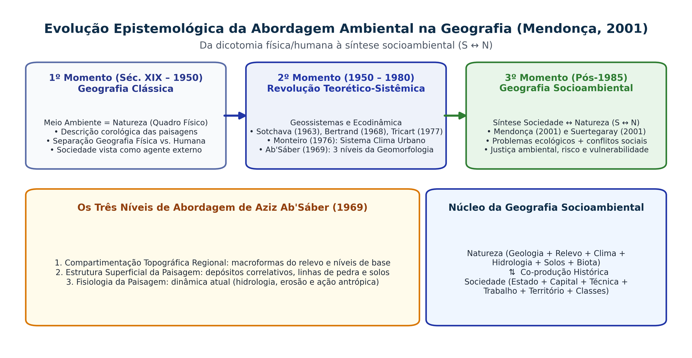

## Visão Geral da Aula {.smaller-text}

::: {.columns}
::: {.column width="50%"}
### Tópicos

- [1]{.circle} Matrizes histórico-epistemológicas da temática ambiental na Geografia
- [2]{.circle} Os três momentos de Francisco Mendonça ($N \rightarrow S \leftrightarrow N$)
- [3]{.circle} A contribuição de Aziz Ab'Sáber (1969): os 3 níveis e os Domínios Morfoclimáticos
- [4]{.circle} Carlos Augusto de Figueiredo Monteiro: Geossistemas e Sistema Clima Urbano (SCU)
- [5]{.circle} Dirce Suertegaray: Natureza, Ambiente, Paisagem e Território
- [6]{.circle} Entrega e debate do Estudo Orientado nº 2
:::

::: {.column width="50%"}
::: {.info-box}
**Objetivo da Aula**

Examinar as matrizes teórico-metodológicas que estruturam a Análise Ambiental na Geografia brasileira (Ab'Sáber, Monteiro, Mendonça e Suertegaray) e distinguir operacionalmente as categorias **Natureza, Paisagem, Ambiente, Geossistema e Território**.
:::
:::
:::

# 1 · Evolução do Pensamento Geográfico Ambiental {.section-header rotulo="Matrizes"}

## Matrizes Epistemológicas da Relação Homem–Meio {.smaller-text}

::: {.columns}
::: {.column width="55%"}
### Da Geografia Tradicional à Síntese Contemporânea

| Matriz Epistemológica | Período | Autores de Referência | Concepção de Ambiente |
|-----------------------|---------|-----------------------|-----------------------|
| **Determinismo Ambiental** | Finais Séc. XIX | F. Ratzel, E. Semple | O quadro físico-climático determina o desenvolvimento social e o Estado. |
| **Possibilismo Francês** | Início Séc. XX | P. Vidal de la Blache, L. Febvre | A natureza oferece possibilidades; o grupo humano cria seu *gênero de vida* e molda a *paisagem regional*. |
| **Ecologia da Paisagem** | 1939–1960 | Carl Troll | Articulação horizontal (espacial/geográfica) e vertical (funcional/ecológica) dos ecótopos. |
| **Teorético-Sistêmica (Geossistêmica)** | 1960–1980 | Sotchava (1963), Bertrand (1968), Tricart (1977), Monteiro (1976) | O ambiente como **sistema aberto** com fluxos de matéria, energia e ação antrópica. |
| **Geografia Crítica e Socioambiental** | Pós-1980 | Milton Santos, Mendonça (1993), Suertegaray (2001) | Síntese **Sociedade $\leftrightarrow$ Natureza**; foco em conflitos, riscos, vulnerabilidade e justiça ambiental. |
:::

::: {.column width="45%"}
::: {.highlight-box}
**Por que conhecer essas matrizes?**

Cada instrumento prático da Análise Ambiental nasceu de uma dessas matrizes:
- **ZEE e Cartas de Fragilidade**: matriz geossistêmica e ecodinâmica (Bertrand, Tricart, Ross, Crepani).
- **Conflitos Hídricos e Justiça Ambiental no EIA**: matriz crítica e socioambiental (Santos, Mendonça, Acselrad).
:::
:::
:::

## Os Três Momentos da Geografia Ambiental (Mendonça, 2001) {.smaller-text}

{.fig-full}

# 2 · Escola Brasileira de Análise Ambiental {.section-header rotulo="Escola BR"}

## Aziz Ab'Sáber (1969): Os Três Níveis da Pesquisa Geomorfológica e Ambiental {.smaller-text}

::: {.columns}
::: {.column width="52%"}
### Metodologia Clássica de Ab'Sáber (*Geomorfologia*, IGEOG-USP, 1969)

1. **1º Nível — Compartimentação Topográfica Regional**:
   - Caracterização das macroformas do relevo (planaltos, depressões interplanálticas, chapadas, planícies costeiras) e dos níveis de base erosivos.
2. **2º Nível — Estrutura Superficial da Paisagem**:
   - Análise dos **depósitos correlativos**, mantos de intemperismo, *stone-lines* (linhas de seixos) e horizontes pedológicos que registram a evolução paleoclimática quaternária.
3. **3º Nível — Fisiologia da Paisagem**:
   - Compreensão da **dinâmica atual** (morfodinâmica em tempo real): ação das chuvas intensas, escoamento superficial, processos erosivos e **intervenção antrópica** (desmatamento, agricultura, urbanização).
:::

::: {.column width="48%"}
### Domínios Morfoclimáticos e Fitogeográficos (Ab'Sáber, 2003)

- **Seis grandes domínios espaciais no Brasil**: Amazônico, Mares de Morros, Cerrados, Caatingas, Araucárias e Pradarias, entremeados por **Faixas de Transição (Ecótonos)**.
- **Relevância direta na Bahia**:
  - A Bahia abriga **três grandes domínios** (Mata Atlântica/Mares de Morros no litoral, Caatingas na depressão sertaneja e Cerrados nos chapadões do Oeste) e extensas **faixas de transição (Agreste/Paraguaçu/Feira de Santana)**, exigindo critérios distintos de diagnóstico ambiental.
:::
:::

## Carlos Augusto de Figueiredo Monteiro: Geossistemas e Clima Urbano {.smaller-text}

::: {.columns}
::: {.column width="50%"}
### *Teoria e Clima Urbano* (1976) e *Geossistemas* (2000)

- Pioneiro na introdução crítica da teoria geossistêmica no Brasil e criador da **Análise Rítmica** em Climatologia Geográfica.
- Propôs o **Sistema Clima Urbano (SCU)** como sistema aberto, complexo e adaptativo, estruturado em **três canais de percepção ambiental**:
  1. **Canal I — Conforto Térmico (Termodinâmico)**: ilhas de calor urbanas, albedo de materiais construtivos, arborização e ventilação.
  2. **Canal II — Qualidade do Ar (Físico-Químico)**: dispersão de poluentes atmosféricos, inversão térmica e saúde respiratória.
  3. **Canal III — Impacto Meteórico (Hidrometeórico)**: episódios pluviais extremos concentrados, impermeabilização do solo, alagamentos, inundações e escorregamentos de encosta.
:::

::: {.column width="50%"}
::: {.info-box}
**Aplicação Direta em Cidades Baianas (Salvador, Feira de Santana, Ilhéus)**

O **Canal Hidrometeórico (Canal III)** de Monteiro explica perfeitamente como um evento pluvial (input natural) interage com a impermeabilização de lagoas e nascentes urbanas (como nas lagoas de Feira de Santana) ou com encostas ocupadas (Salvador), gerando desastres hidrometeorológicos.
:::
:::
:::

## Francisco Mendonça: A Geografia Socioambiental ($S \leftrightarrow N$) {.smaller-text}

::: {.columns}
::: {.column width="50%"}
### Superação da Redução do "Meio Ambiente" à "Natureza"

- Em *Geografia e Meio Ambiente* (1993) e *Geografia Socioambiental* (*Terra Livre*, 2001), Mendonça identifica uma distorção histórica:
  - Durante mais de um século, quando geógrafos falavam em "meio ambiente", referiam-se exclusivamente ao **quadro físico-natural** (relevo, clima, vegetação, hidrografia), tratando a sociedade apenas como "fator antrópico perturbador".
- **A virada socioambiental (pós-1985)**:
  - O conceito de **Ambiente** passa a englobar indissociavelmente a **Natureza** e a **Sociedade** em suas múltiplas determinações econômicas, políticas e culturais.
:::

::: {.column width="50%"}
### OObjeto da Geografia Socioambiental

```text
Problemas Ecológicos (Erosão, Poluição, Perda de Biota)
+
Problemas Sociais (Pobreza, Segregação Urbana, Conflito Agrário)
↓
Problemática Socioambiental
↓
Exige método multiescalar que articule processos
físico-naturais (Geografia Física) e processos de
produção do espaço (Geografia Humana).
```
:::
:::

# 3 · Categorias Analíticas na Prática {.section-header rotulo="Categorias"}

## Distinção Operacional: Natureza, Paisagem, Ambiente e Território {.smaller-text}

::: {.columns}
::: {.column width="100%"}
### Síntese Conceitual (Suertegaray, 2001; Bertrand, 1968; Raffestin, 1993)

| Categoria | Definição Operacional na Análise Ambiental | Pergunta Norteadora no Diagnóstico | Exemplo Prático (Sub-bacia do Rio Jacuípe - BA) |
|-----------|-------------------------------------------|------------------------------------|-------------------------------------------------|
| **Natureza** | Conjunto de elementos e processos físicos, químicos e biológicos regidos por leis termodinâmicas e evolutivas. | *Quais são os atributos litológicos, morfométricos, climáticos e pedológicos originais?* | Substrato cristalino (gnaisses/migmatitos), regime pluvial semiárido/subúmido e Planossolos/Argissolos. |
| **Paisagem** | Expressão morfológica, visível e funcional da combinação dinâmica de elementos físicos, biológicos e antrópicos em uma porção do espaço. | *Qual é a fisionomia atual, o mosaico de cobertura e a estrutura superficial observável?* | Mosaico de pastagens extensivas em colinas suaves, fragmentos de caatinga arbustiva e mata ciliar descontínua. |
| **Geossistema** | Unidade sistêmica de organização espacial definida pelo potencial ecológico, exploração biológica e ação antrópica. | *Como funcionam os fluxos de água, energia e sedimento entre os compartimentos?* | Sistema depressionário sertanejo com escoamento intermitente, alta taxa de evapotranspiração e pedogênese restrita. |
| **Território** | Espaço apropriado, delimitado e controlado por relações de poder (Estado, empresas, comunidades, marcos legais). | *Quem detém a posse da terra, as outorgas hídricas e quais normas legais incidem?* | Limites municipais, perímetro da APA do Lago de Pedra do Cavalo, imóveis rurais no CAR e outorgas da Embasa/INEMA. |
| **Ambiente** | Categoria transescalar que sintetiza a totalidade das interações entre o meio biofísico e a vida social (qualidade de vida, riscos e sustentabilidade). | *Qual é a qualidade ambiental resultante para os ecossistemas e para as populações humanas?* | Eutrofização do reservatório, assoreamento de nascentes, vulnerabilidade hídrica rural e necessidade de PRAD/PSA. |
:::
:::


## A mesma área, quatro entradas analíticas {.smaller-text}

Escolha uma vertente urbana ou uma microbacia rural.

- **Ab'Sáber:** compartimentos, estrutura superficial e fisiologia da paisagem.
- **Monteiro:** funcionamento sistêmico e respostas climáticas.
- **Mendonça:** interações sociedade–natureza e produção dos problemas.
- **Suertegaray:** articulação entre categorias do espaço geográfico.

**Entrega:** uma pergunta, um dado e um procedimento de campo para cada entrada. Evitar transformar autores em listas de termos sem operação analítica.

# 4 · Síntese e Referências {.section-header rotulo="Síntese"}

## Fechamento da Aula 3.1 {.smaller-text}

::: {.columns}
::: {.column width="48%"}
### Ideias-Chave para Provas e Concursos

- **Ab'Sáber (1969)**: 1º Compartimentação topográfica; 2º Estrutura superficial (depósitos/solos); 3º Fisiologia da paisagem (processos atuais + homem).
- **Monteiro (1976)**: Sistema Clima Urbano (SCU) e seus 3 canais (Termodinâmico, Físico-Químico e Hidrometeórico).
- **Mendonça (2001)**: Passagem da Geografia Física Clássica ($N$) para a Geografia Socioambiental ($S \leftrightarrow N$).
- **Suertegaray (2001)**: O conceito de **Ambiente** transgride a dicotomia física/humana e articula Paisagem, Geossistema e Território.
:::

::: {.column width="52%"}
### Referências Bibliográficas

- AB'SÁBER, A. N. Um conceito de geomorfologia a serviço das pesquisas sobre o Quaternário. **Geomorfologia** (IGEOG-USP), n. 18, p. 1–23, 1969.
- AB'SÁBER, A. N. **Os domínios de natureza no Brasil: potencialidades paisagísticas**. São Paulo: Ateliê Editorial, 2003.
- MENDONÇA, F. **Geografia e meio ambiente**. São Paulo: Contexto, 1993.
- MENDONÇA, F. Geografia socioambiental. **Terra Livre**, São Paulo, n. 16, p. 113–132, 2001.
- MONTEIRO, C. A. F. **Teoria e Clima Urbano**. São Paulo: IGEOG-USP, 1976.
- MONTEIRO, C. A. F. **Geossistemas: a história de uma procura**. São Paulo: Contexto, 2000.
- SUERTEGARAY, D. M. A. Espaço geográfico uno e múltiplo. **Scripta Nova**, Barcelona, n. 93, 2001.
:::
:::
