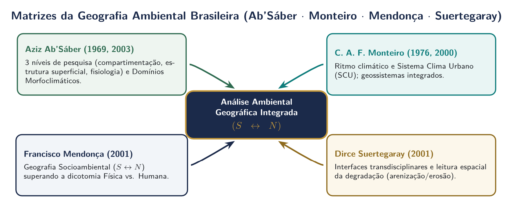
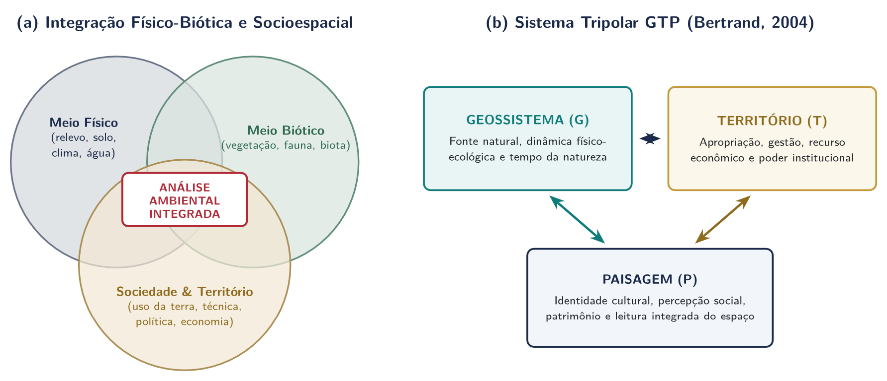

## [Abertura]{.pitch-tag} Visão Geral da Aula {#visao-geral .smaller-text .lesson-slide}

::: {.pitch-grid-50}
::: {.pitch-card}
[Roteiro da aula]{.pitch-card-index}
[Tópicos da Aula 3.1]{.pitch-heading}

- [1]{.circle} Matrizes histórico-epistemológicas da temática ambiental na Geografia
- [2]{.circle} Os três momentos de Francisco Mendonça ($N \rightarrow S \leftrightarrow N$)
- [3]{.circle} Aziz Ab'Sáber (1969): os 3 níveis e os Domínios Morfoclimáticos
- [4]{.circle} Carlos Augusto de Figueiredo Monteiro: Geossistemas e Sistema Clima Urbano (SCU)
- [5]{.circle} Dirce Suertegaray: Natureza, Ambiente, Paisagem e Território
- [6]{.circle} Entrega e debate do Estudo Orientado nº 2
:::

::: {.pitch-stack-2}
::: {.pitch-card .pitch-card--gold}
[Objetivo da aula]{.pitch-card-index}
[Escola Brasileira de Análise Ambiental]{.pitch-heading}

Examinar as matrizes teórico-metodológicas que estruturam a Análise Ambiental na Geografia brasileira (Ab'Sáber, Monteiro, Mendonça e Suertegaray) e distinguir operacionalmente as categorias **Natureza, Paisagem, Ambiente, Geossistema e Território**.
:::

::: {.pitch-pill-row}
[Ab'Sáber]{.pitch-pill}
[Monteiro]{.pitch-pill .pitch-pill--gold}
[Mendonça]{.pitch-pill}
[Suertegaray]{.pitch-pill .pitch-pill--gold}
:::
:::
:::

# 1 · Evolução do Pensamento Geográfico Ambiental {.section-header rotulo="Matrizes"}

## [Epistemologia]{.pitch-tag} Matrizes Epistemológicas da Relação Homem–Meio {#matrizes-epistemologicas .smaller-text .lesson-slide}

::: {.pitch-grid-60}
::: {.pitch-table-box}
| Matriz Epistemológica | Período | Autores de Referência | Concepção de Ambiente |
|-----------------------|---------|-----------------------|-----------------------|
| **Determinismo Ambiental** | Finais Séc. XIX | F. Ratzel, E. Semple | O quadro físico-climático determina o desenvolvimento social e o Estado. |
| **Possibilismo Francês** | Início Séc. XX | P. Vidal de la Blache, L. Febvre | A natureza oferece possibilidades; o grupo cria seu *gênero de vida* e molda a *paisagem regional*. |
| **Ecologia da Paisagem** | 1939–1960 | Carl Troll | Articulação horizontal (espacial) e vertical (funcional/ecológica) dos ecótopos. |
| **Teorético-Sistêmica (Geossistêmica)** | 1960–1980 | Sotchava (1963), Bertrand (1968), Tricart (1977), Monteiro (1976) | Ambiente como **sistema aberto** com fluxos de matéria, energia e ação antrópica. |
| **Geografia Crítica e Socioambiental** | Pós-1980 | Milton Santos, Mendonça (1993), Suertegaray (2001) | Síntese **Sociedade $\leftrightarrow$ Natureza**; foco em conflitos, riscos, vulnerabilidade e justiça ambiental. |
:::

::: {.pitch-stack-2}
::: {.pitch-card .pitch-card--gold}
[Aplicação instrumental]{.pitch-card-index}
[Por que conhecer essas matrizes?]{.pitch-heading}

Cada instrumento prático da Análise Ambiental nasceu de uma dessas matrizes:

- **ZEE e Cartas de Fragilidade:** matriz geossistêmica e ecodinâmica (Bertrand, Tricart, Ross, Crepani).
- **Conflitos Hídricos e Justiça Ambiental no EIA:** matriz crítica e socioambiental (Santos, Mendonça, Acselrad).
:::

::: {.pitch-band}
A escolha do método define quais processos e sujeitos aparecem no diagnóstico.
:::
:::
:::

## [Epistemologia]{.pitch-tag} Matrizes da Geografia Ambiental Brasileira (Mendonça, 2001) {#matrizes-brasileiras .smaller-text .lesson-slide}

::: {.pitch-media-card .pitch-media-card--wide}

[Convergência da Geografia Ambiental Brasileira]{.pitch-caption}
[Ab'Sáber (1969, 2003), Monteiro (1976, 2000), Mendonça (2001) e Suertegaray (2001) na Análise Ambiental Integrada (S ↔ N)]{.pitch-caption-sub}
:::

::: {.pitch-band .pitch-band--navy}
Da Geografia Física naturalista à Geografia Socioambiental: a integração entre dinâmica físico-ecológica e produção social do espaço.
:::

# 2 · Escola Brasileira de Análise Ambiental {.section-header rotulo="Escola BR"}

## [Método]{.pitch-tag .pitch-tag--teal} Aziz Ab'Sáber (1969): Os Três Níveis e os Domínios {#absaber-tres-niveis .smaller-text .lesson-slide}

::: {.pitch-grid-55}
::: {.pitch-milestones}
::: {.pitch-milestone-item}
**1º Nível — Compartimentação Topográfica Regional:** caracterização das macroformas do relevo (planaltos, depressões interplanálticas, chapadas, planícies costeiras) e dos níveis de base erosivos.
:::

::: {.pitch-milestone-item}
**2º Nível — Estrutura Superficial da Paisagem:** análise dos **depósitos correlativos**, mantos de intemperismo, *stone-lines* (linhas de seixos) e horizontes pedológicos que registram a evolução paleoclimática quaternária.
:::

::: {.pitch-milestone-item}
**3º Nível — Fisiologia da Paisagem:** compreensão da **dinâmica atual** (morfodinâmica em tempo real): chuvas intensas, escoamento superficial, erosão e **intervenção antrópica** (desmatamento, agricultura, urbanização).
:::
:::

::: {.pitch-stack-2}
::: {.pitch-card .pitch-card--forest}
[Ab'Sáber, 2003 · IGEOG-USP (1969)]{.pitch-card-index}
[Domínios Morfoclimáticos e Fitogeográficos]{.pitch-heading}

Seis grandes domínios espaciais no Brasil: Amazônico, Mares de Morros, Cerrados, Caatingas, Araucárias e Pradarias, entremeados por **Faixas de Transição (Ecótonos)**.
:::

::: {.pitch-card .pitch-card--gold}
[Relevância direta na Bahia]{.pitch-card-index}
[Três domínios e ecótonos]{.pitch-heading}

A Bahia abriga Mata Atlântica/Mares de Morros (litoral), Caatingas (depressão sertaneja) e Cerrados (chapadões do Oeste), além de faixas de transição (**Agreste/Paraguaçu/Feira de Santana**), exigindo critérios distintos de diagnóstico.
:::
:::
:::

## [Método]{.pitch-tag .pitch-tag--teal} Carlos Augusto de Figueiredo Monteiro: Geossistemas e SCU {#monteiro-scu .smaller-text .lesson-slide}

::: {.pitch-cards}
::: {.pitch-card .pitch-card--gold}
[Canal I · Termodinâmico]{.pitch-card-index}
[Conforto Térmico]{.pitch-heading}

Ilhas de calor urbanas, albedo de materiais construtivos, arborização e circulação de ventilação em áreas edificadas.
:::

::: {.pitch-card .pitch-card--teal}
[Canal II · Físico-Químico]{.pitch-card-index}
[Qualidade do Ar]{.pitch-heading}

Dispersão de poluentes atmosféricos, episódios de inversão térmica e impactos diretos na saúde respiratória.
:::

::: {.pitch-card .pitch-card--alert}
[Canal III · Hidrometeórico]{.pitch-card-index}
[Impacto Meteórico]{.pitch-heading}

Episódios pluviais extremos concentrados, impermeabilização do solo, alagamentos, inundações e escorregamentos de encosta.
:::
:::

::: {.pitch-band .pitch-band--navy}
**Monteiro (*Teoria e Clima Urbano*, 1976; *Geossistemas*, 2000) e Análise Rítmica:** o **Canal III** explica como eventos pluviais interagem com a impermeabilização de lagoas e nascentes urbanas (**Feira de Santana**) ou com encostas ocupadas (**Salvador** e **Ilhéus**), deflagrando desastres hidrometeorológicos.
:::

## [Epistemologia]{.pitch-tag} Francisco Mendonça: Geografia Socioambiental ($S \leftrightarrow N$) {#mendonca-socioambiental .smaller-text .lesson-slide}

::: {.pitch-grid-50}
::: {.pitch-stack-2}
::: {.pitch-card}
[Mendonça (1993, 2001 · Terra Livre)]{.pitch-card-index}
[Superação da redução naturalista]{.pitch-heading}

Durante mais de um século, quando geógrafos falavam em "meio ambiente", referiam-se exclusivamente ao **quadro físico-natural** (relevo, clima, vegetação, hidrografia), tratando a sociedade apenas como "fator antrópico perturbador".
:::

::: {.pitch-card .pitch-card--teal}
[Virada socioambiental (pós-1985)]{.pitch-card-index}
[Indissociabilidade Sociedade–Natureza]{.pitch-heading}

O conceito de **Ambiente** passa a englobar indissociavelmente a **Natureza** e a **Sociedade** em suas múltiplas determinações econômicas, políticas e culturais.
:::
:::

::: {.pitch-stack-2}
::: {.pitch-formula}
$$\text{Problemas Ecológicos} + \text{Problemas Sociais} \longrightarrow \text{Problemática Socioambiental}$$

Erosão, poluição e perda de biota combinam-se a pobreza, segregação urbana e conflito agrário.
:::

::: {.pitch-band .pitch-band--navy}
**Objeto da Geografia Socioambiental:** exige método multiescalar que articule processos físico-naturais (Geografia Física) e processos de produção do espaço (Geografia Humana).
:::
:::
:::

# 3 · Categorias Analíticas na Prática {.section-header rotulo="Categorias"}

## [Método]{.pitch-tag .pitch-tag--teal} Integração Socioambiental e Sistema Tripolar GTP {#triade-gtp .smaller-text .lesson-slide}

::: {.pitch-media-card .pitch-media-card--wide}

[Análise Ambiental Integrada e Sistema Tripolar GTP (Bertrand, 2004)]{.pitch-caption}
[Articulação entre Geossistema (tempo da natureza), Território (apropriação e poder) e Paisagem (identidade e percepção social)]{.pitch-caption-sub}
:::

::: {.pitch-band}
A Análise Ambiental Integrada opera na interseção entre meio físico, meio biótico e sociedade/território, evitando diagnósticos setoriais fragmentados.
:::

## [Território]{.pitch-tag .pitch-tag--gold} Distinção Operacional: Natureza, Paisagem, Ambiente e Território {#categorias-operacionais .smaller-text .lesson-slide}

::: {.pitch-table-box}
| Categoria | Definição Operacional (Suertegaray, 2001; Bertrand, 1968; Raffestin, 1993) | Pergunta Norteadora no Diagnóstico | Exemplo (Sub-bacia do Rio Jacuípe - BA) |
|-----------|------------------------------------------------------------------------------|------------------------------------|----------------------------------------|
| **Natureza** | Elementos e processos físicos, químicos e biológicos sob leis termodinâmicas e evolutivas. | *Quais os atributos litológicos, morfométricos, climáticos e pedológicos originais?* | Substrato cristalino (gnaisses/migmatitos), regime semiárido/subúmido e Planossolos/Argissolos. |
| **Paisagem** | Expressão morfológica, visível e funcional da combinação dinâmica físico-biológico-antrópica. | *Qual a fisionomia atual, o mosaico de cobertura e a estrutura superficial?* | Mosaico de pastagens em colinas suaves, caatinga arbustiva e mata ciliar descontínua. |
| **Geossistema** | Unidade sistêmica definida pelo potencial ecológico, exploração biológica e ação antrópica. | *Como funcionam os fluxos de água, energia e sedimento entre compartimentos?* | Sistema depressionário sertanejo com escoamento intermitente, alta ET e pedogênese restrita. |
| **Território** | Espaço apropriado, delimitado e controlado por relações de poder (Estado, empresas, comunidades). | *Quem detém posse da terra, outorgas hídricas e quais normas legais incidem?* | Limites municipais, APA do Lago de Pedra do Cavalo, imóveis no CAR e outorgas Embasa/INEMA. |
| **Ambiente** | Categoria transescalar que sintetiza interações entre meio biofísico e vida social. | *Qual a qualidade ambiental resultante para ecossistemas e populações humanas?* | Eutrofização do reservatório, assoreamento de nascentes, vulnerabilidade hídrica e PRAD/PSA. |
:::

## [Campo]{.pitch-tag .pitch-tag--forest} Oficina: A Mesma Área, Quatro Entradas Analíticas {#quatro-entradas .smaller-text .lesson-slide}

::: {.pitch-cards-2}
::: {.pitch-card .pitch-card--forest}
[Entrada 01 · Morfopedologia e Dinâmica]{.pitch-card-index}
[Aziz Ab'Sáber]{.pitch-heading}

Operacionalizar compartimentos topográficos, estrutura superficial da paisagem e fisiologia da paisagem na área escolhida.
:::

::: {.pitch-card .pitch-card--teal}
[Entrada 02 · Geossistema e Ritmo]{.pitch-card-index}
[C. A. F. Monteiro]{.pitch-heading}

Analisar o funcionamento sistêmico de fluxos de matéria/energia e as respostas climáticas e hidrometeorológicas locais.
:::

::: {.pitch-card}
[Entrada 03 · Relação S ↔ N]{.pitch-card-index}
[Francisco Mendonça]{.pitch-heading}

Identificar como interações sociedade–natureza e desigualdades espaciais produzem o problema socioambiental observado.
:::

::: {.pitch-card .pitch-card--gold}
[Entrada 04 · Categorias do Espaço]{.pitch-card-index}
[Dirce Suertegaray]{.pitch-heading}

Articular Natureza, Paisagem, Geossistema, Território e Ambiente sem isolar processos físicos e sociais.
:::
:::

::: {.pitch-band .pitch-band--navy}
**Entrega (vertente urbana ou microbacia rural):** uma pergunta, um dado e um procedimento de campo para cada entrada — evitar transformar autores em listas de termos sem operação analítica.
:::

# 4 · Síntese e Referências {.section-header rotulo="Síntese"}

## [Síntese]{.pitch-tag .pitch-tag--teal} Fechamento da Aula 3.1 e Referências {#fechamento-aula-3 .smaller-text .lesson-slide}

::: {.pitch-grid-50}
::: {.pitch-stack-2}
::: {.pitch-milestones}
::: {.pitch-milestone-item}
**Ab'Sáber (1969):** 1º Compartimentação topográfica; 2º Estrutura superficial (depósitos/solos); 3º Fisiologia da paisagem (processos atuais + homem).
:::

::: {.pitch-milestone-item}
**Monteiro (1976):** Sistema Clima Urbano (SCU) e seus 3 canais (Termodinâmico, Físico-Químico e Hidrometeórico).
:::

::: {.pitch-milestone-item}
**Mendonça (2001):** Passagem da Geografia Física Clássica ($N$) para a Geografia Socioambiental ($S \leftrightarrow N$).
:::

::: {.pitch-milestone-item}
**Suertegaray (2001):** O conceito de **Ambiente** transgride a dicotomia física/humana e articula Paisagem, Geossistema e Território.
:::
:::

::: {.pitch-band}
**Atividade:** entrega e debate do **Estudo Orientado nº 2**.
:::
:::

::: {.pitch-card .pitch-card--teal}
[Bibliografia básica]{.pitch-card-index}
[Referências Bibliográficas]{.pitch-heading}

- AB'SÁBER, A. N. Um conceito de geomorfologia a serviço das pesquisas sobre o Quaternário. **Geomorfologia** (IGEOG-USP), n. 18, p. 1–23, 1969.
- AB'SÁBER, A. N. **Os domínios de natureza no Brasil: potencialidades paisagísticas**. São Paulo: Ateliê Editorial, 2003.
- MENDONÇA, F. **Geografia e meio ambiente**. São Paulo: Contexto, 1993.
- MENDONÇA, F. Geografia socioambiental. **Terra Livre**, São Paulo, n. 16, p. 113–132, 2001.
- MONTEIRO, C. A. F. **Teoria e Clima Urbano**. São Paulo: IGEOG-USP, 1976.
- MONTEIRO, C. A. F. **Geossistemas: a história de uma procura**. São Paulo: Contexto, 2000.
- SUERTEGARAY, D. M. A. Espaço geográfico uno e múltiplo. **Scripta Nova**, Barcelona, n. 93, 2001.
:::
:::
