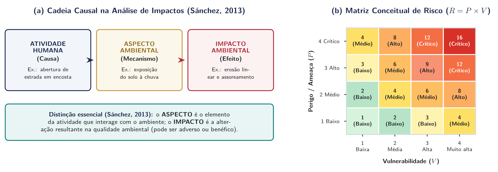
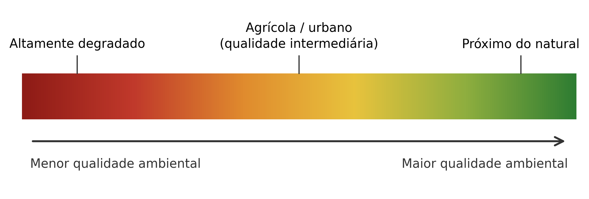
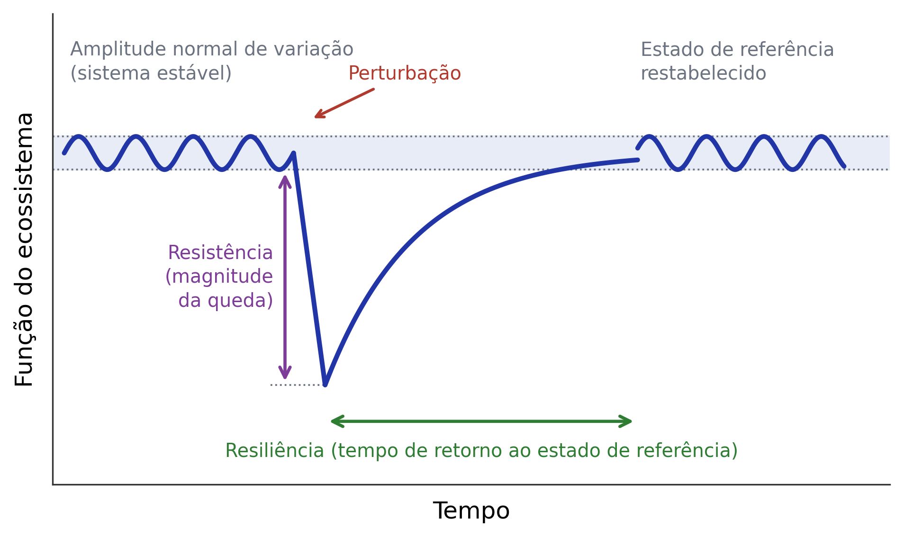
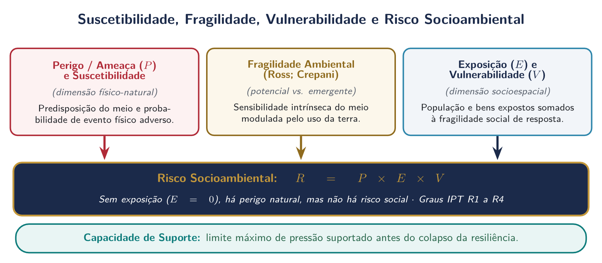
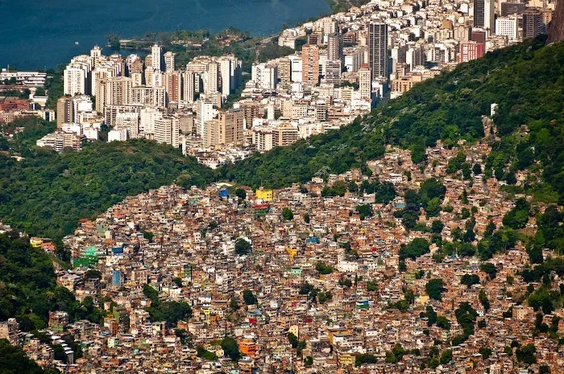

## [Abertura]{.pitch-tag} Visão Geral da Aula {#visao-geral .smaller-text .lesson-slide}

::: {.pitch-grid-50}
::: {.pitch-card}
[Roteiro da aula]{.pitch-card-index}
[Tópicos da Aula 4.1]{.pitch-heading}

- [1]{.circle} Aspecto Ambiental, Impacto Ambiental e Poluição (Lei 6.938/1981 e CONAMA 01/1986)
- [2]{.circle} Qualidade Ambiental, Degradação e Passivo Ambiental (Sánchez, 2020)
- [3]{.circle} Resistência, Resiliência, Estabilidade e Capacidade de Suporte
- [4]{.circle} Perigo, Suscetibilidade, Fragilidade, Vulnerabilidade e Risco ($R = P \times E \times V$)
- [5]{.circle} Graus de Risco Urbano (R1 a R4 — PNPDEC Lei 12.608/2012 e IPT)
- [6]{.circle} Preservação, Conservação, Mitigação, Recuperação, Reabilitação e Restauração
:::

::: {.pitch-stack-2}
::: {.pitch-card .pitch-card--gold}
[Objetivo da aula]{.pitch-card-index}
[Rigor conceitual e normativo]{.pitch-heading}

Dominar com rigor técnico e legal o vocabulário conceitual da Análise Ambiental exigido na prática profissional do Geógrafo (EIA/RIMA, ZEE, PRAD, Cartas de Risco) e nos exames nacionais (ENADE e concursos para Analista Ambiental).
:::

::: {.pitch-pill-row}
[ABNT ISO 14001]{.pitch-pill}
[PNMA 6.938/81]{.pitch-pill .pitch-pill--gold}
[R = P × E × V]{.pitch-pill}
[Protocolo R1–R4]{.pitch-pill .pitch-pill--gold}
:::
:::
:::

# 1 · Aspecto, Impacto, Poluição e Degradação {.section-header rotulo="Impacto"}

## [Método]{.pitch-tag .pitch-tag--teal} Cadeia Causal: Causa (Aspecto) vs. Efeito (Impacto) {#aspecto-vs-impacto .smaller-text .lesson-slide}

::: {.pitch-media-card .pitch-media-card--compact}

[Cadeia Causal Aspecto–Impacto (ISO 14001 · Sánchez, 2013, 2020) e Matriz de Risco]{.pitch-caption}
[Distinção entre elemento da atividade que interage com o meio (Aspecto) e alteração resultante na qualidade ambiental (Impacto)]{.pitch-caption-sub}
:::

::: {.pitch-flow-4}
::: {.pitch-card}
[01 · Atividade]{.pitch-card-index}
[Empreendimento]{.pitch-heading}

Implantação de rodovia ou loteamento em encosta.
:::

::: {.pitch-card .pitch-card--gold}
[02 · Aspecto]{.pitch-card-index}
[Causa direta]{.pitch-heading}

Supressão de mata ciliar, impermeabilização ou efluente.
:::

::: {.pitch-card .pitch-card--teal}
[03 · Processo]{.pitch-card-index}
[Mecanismo alterado]{.pitch-heading}

Aumento da enxurrada e perda de retenção de sedimentos.
:::

::: {.pitch-card .pitch-card--alert}
[04 · Impacto]{.pitch-card-index}
[Alteração líquida]{.pitch-heading}

Assoreamento fluvial, perda de ictiofauna e cheias a jusante.
:::
:::

## [Lei]{.pitch-tag .pitch-tag--gold} Definições Legais no Brasil (PNMA e CONAMA) {#definicoes-legais-impacto .smaller-text .lesson-slide}

::: {.pitch-cards}
::: {.pitch-card .pitch-card--gold}
[Lei 6.938/1981 · Art. 3º, II]{.pitch-card-index}
[Degradação Ambiental]{.pitch-heading}

*Alteração adversa das características do meio ambiente* — categoria ampla que pode decorrer de processos naturais extremos ou de ações antrópicas.
:::

::: {.pitch-card .pitch-card--alert}
[Lei 6.938/1981 · Art. 3º, III]{.pitch-card-index}
[Poluição]{.pitch-heading}

Degradação resultante de **atividades humanas** que prejudiquem saúde, segurança, bem-estar, biota, condições estéticas/sanitárias ou lancem matérias/energia em desacordo com padrões (ex.: CONAMA 357/2005 e 506/2024).
:::

::: {.pitch-card .pitch-card--teal}
[CONAMA 01/1986 · Art. 1º]{.pitch-card-index}
[Impacto Ambiental]{.pitch-heading}

Alteração das propriedades físicas, químicas e biológicas do meio ambiente causada por matéria ou energia resultante de **atividades humanas** (pode ser **adverso** ou **benéfico**).
:::
:::

::: {.pitch-band .pitch-band--navy}
**Distinção em laudos técnicos:** toda poluição configura degradação ambiental, mas o conceito de impacto ambiental exige nexo causal antrópico e admite valoração positiva ou negativa.
:::

## [Método]{.pitch-tag .pitch-tag--teal} Dinâmica da Qualidade Ambiental ao Longo do Tempo {#dinamica-qualidade-ambiental .smaller-text .lesson-slide}

::: {.pitch-grid-50}
::: {.pitch-stack-2}
::: {.pitch-formula}
$$\text{Impacto}(t_1) = Q_{\text{com}}(t_1) - Q_{\text{sem}}(t_1)$$

Não é a simples diferença "antes vs. depois" ($Q_{t_1} - Q_{t_0}$): o impacto é a **diferença líquida** em $t_1$ entre a evolução **com** a ação humana ($Q_{\text{com}}$) e a projeção tendencial **sem** a ação ($Q_{\text{sem}}$ — linha de base dinâmica, Sánchez, 2020).
:::

::: {.pitch-card .pitch-card--alert}
[Responsabilidade acumulada]{.pitch-card-index}
[Passivo Ambiental]{.pitch-heading}

Conjunto de obrigações legais, dívidas sociais e custos financeiros acumulados para reparar danos pretéritos não mitigados (ex.: solo contaminado, talude instável, déficit de Reserva Legal).
:::
:::

::: {.pitch-media-card .pitch-media-card--tall}

[Escala de Qualidade Ambiental (Sánchez, 2020)]{.pitch-caption}
[Referencial contínuo entre ambientes altamente degradados e condições próximas do natural]{.pitch-caption-sub}
:::
:::

# 2 · Estabilidade, Resiliência e Capacidade de Suporte {.section-header rotulo="Resiliência"}

## [Método]{.pitch-tag .pitch-tag--teal} Resistência, Resiliência e Limiares Críticos (Tipping Points) {#resistencia-resiliencia .smaller-text .lesson-slide}

::: {.pitch-grid-50}
::: {.pitch-milestones}
::: {.pitch-milestone-item}
**Inércia / Resistência (Holling, 1973):** capacidade de um sistema ambiental manter sua estrutura e funções inalteradas quando submetido a um tensor (distúrbio externo).
:::

::: {.pitch-milestone-item}
**Elasticidade / Resiliência:** velocidade e capacidade de o sistema **retornar ao estado de equilíbrio dinâmico** após cessar a perturbação, reorganizando seus fluxos.
:::

::: {.pitch-milestone-item}
**Limiar de Ruptura (*Tipping Point*):** limite crítico além do qual a degradação torna-se **irreversível na escala de tempo humana**, levando a um novo estado degradado (ex.: desertificação ou voçorocamento com rebaixamento freático).
:::
:::

::: {.pitch-media-card .pitch-media-card--tall}

[Resistência e Resiliência Frente a Tensores]{.pitch-caption}
[Magnitude da queda funcional sob perturbação e tempo de retorno ao estado de referência]{.pitch-caption-sub}
:::
:::

## [Método]{.pitch-tag .pitch-tag--teal} Capacidade de Suporte (Carrying Capacity) {#capacidade-de-suporte .smaller-text .lesson-slide}

::: {.pitch-band .pitch-band--navy}
**Definição operacional:** carga máxima de uso, extração de recursos ou lançamento de efluentes que um compartimento ambiental (bacia hidrográfica, aquífero, solo ou UC) suporta sem comprometer suas funções ecológicas e sua resiliência.
:::

::: {.pitch-cards}
::: {.pitch-card .pitch-card--teal}
[01 · Recursos Hídricos]{.pitch-card-index}
[Autodepuração de rios]{.pitch-heading}

Carga máxima de $\text{DBO}_5$ ($\text{kg/dia}$) que o curso d'água dilui e oxida sem cair abaixo de Oxigênio Dissolvido $\text{OD} \ge 5\text{ mg/L}$ (Classe 2).
:::

::: {.pitch-card .pitch-card--gold}
[02 · Semiárido]{.pitch-card-index}
[Suporte de pastagens]{.pitch-heading}

Taxa de lotação animal ($\text{UA/ha/ano}$) compatível com a fitomassa da Caatinga sem expor o solo à erosão laminar.
:::

::: {.pitch-card .pitch-card--forest}
[03 · Unidades de Conservação]{.pitch-card-index}
[Carga turística (Cifuentes)]{.pitch-heading}

Limite de visitantes/dia em trilhas de UCs sem provocar compactação do solo ou afugentamento da fauna.
:::
:::

## [Epistemologia]{.pitch-tag} Sustentabilidade Forte vs. Sustentabilidade Fraca {#sustentabilidade-forte-fraca .smaller-text .lesson-slide}

::: {.pitch-cards-2}
::: {.pitch-card .pitch-card--alert}
[Economia Neoclássica · Solow]{.pitch-card-index}
[Sustentabilidade Fraca]{.pitch-heading}

- **Premissa teórica:** o "capital natural" e o "capital construído/tecnológico" são perfeitamente substituíveis entre si.
- **Crítica geográfica:** ignora a irreversibilidade termodinâmica e funções ecossistêmicas vitais insubstituíveis.
:::

::: {.pitch-card .pitch-card--forest}
[Economia Ecológica · Daly; Georgescu-Roegen]{.pitch-card-index}
[Sustentabilidade Forte]{.pitch-heading}

- **Premissa teórica:** o **capital natural crítico** (ciclo hidrológico, solos, biodiversidade, clima) é complementar e **insubstituível** pelo capital humano.
- **Aplicação legal:** base das restrições de **APPs**, **Unidades de Proteção Integral** e **enquadramento hídrico**.
:::
:::

::: {.pitch-band}
A definição da capacidade de suporte parte da **Sustentabilidade Forte**: processos ecológicos críticos impõem tetos não negociáveis de intervenção.
:::

# 3 · Perigo, Fragilidade, Vulnerabilidade e Risco {.section-header rotulo="Risco"}

## [Risco]{.pitch-tag .pitch-tag--alert} Equação Conceitual e Distinção Operacional {#equacao-risco .smaller-text .lesson-slide}

::: {.pitch-media-card .pitch-media-card--wide}

[Arquitetura Conceitual do Risco Socioambiental (R = P × E × V)]{.pitch-caption}
[Integração entre predisposição física (P e Fragilidade) e exposição/vulnerabilidade socioespacial (E e V)]{.pitch-caption-sub}
:::

::: {.pitch-band .pitch-band--navy}
Sem exposição ($E = 0$), existe perigo natural e suscetibilidade do terreno, mas **não há risco socioambiental**; a fragilidade (Ross; Crepani) modula a sensibilidade física pelo uso da terra.
:::

## [Risco]{.pitch-tag .pitch-tag--alert} Tabela Comparativa para Concursos e Laudos Técnicos {#tabela-cinco-conceitos .smaller-text .lesson-slide}

::: {.pitch-table-box}
| Conceito | Natureza Dominante | Definição Exata | Exemplo Aplicado |
|----------|--------------------|-----------------|------------------|
| **Suscetibilidade** | Físico-Natural (Intrínseca) | Propensão estática do terreno a desenvolver processo geodinâmico por litologia, relevo e solo. | Encosta com $38^\circ$ em Cambissolo raso sobre gnaisse fraturado. |
| **Perigo / Ameaça (*Hazard*)** | Físico-Temporal (Probabilística) | Probabilidade de ocorrência de fenômeno potencialmente danoso com dada magnitude e $TR$. | Chuva extrema de $120\text{ mm/24h}$ ($TR = 50\text{ anos}$) deflagrando escorregamento. |
| **Fragilidade Ambiental** | Ecodinâmica Integrada (Ross, 1994) | Instabilidade morfogenética natural (**Potencial**) combinada à proteção da cobertura (**Emergente**). | Classe 5 (Muito Forte) em vertente íngreme com Argissolo sob pastagem degradada. |
| **Vulnerabilidade** | Social, Institucional e Estrutural | Grau de incapacidade de resistir, lidar e se recuperar de um perigo (Cutter, 1996; Marandola & Hogan, 2005). | Famílias de baixa renda em autoconstruções sem arrimo, drenagem ou alerta. |
| **Risco ($R = P \times E \times V$)** | Socioambiental (Probabilidade de Perda) | Probabilidade de **danos humanos, materiais ou ambientais** quando $P$ incide sobre $E$ e $V$. | Setor de risco **R4 (Muito Alto)** com risco iminente de soterramento de moradias. |
:::

## [Risco]{.pitch-tag .pitch-tag--alert} Graus de Risco Urbano (MCidades / IPT / SGB-CPRM) {#graus-risco-urbano .smaller-text .lesson-slide}

::: {.pitch-grid-55}
::: {.pitch-milestones}
::: {.pitch-milestone-item}
**R1 · Risco Baixo:** condicionantes geológico-geotécnicos e topográficos favoráveis; ausência de feições de instabilidade (trincas, degraus de abatimento, árvores inclinadas).
:::

::: {.pitch-milestone-item}
**R2 · Risco Médio:** condicionantes de média potencialidade; início de processos erosivos superficiais ou drenagem deficiente, sem evidências de ruptura iminente.
:::

::: {.pitch-milestone-item}
**R3 · Risco Alto:** condicionantes desfavoráveis (cortes verticais de talude, lançamento de águas servidas/fossas) e **feições de instabilidade significativas**; exige monitoramento e contenção.
:::

::: {.pitch-milestone-item}
**R4 · Risco Muito Alto:** movimentação ativa evidente (trincas no piso/paredes e terreno, embarrigamento de muros, cicatrizes frescas); maior criticidade no protocolo; requer avaliação urgente da Defesa Civil e medidas de proteção.
:::
:::

::: {.pitch-media-card .pitch-media-card--photo .pitch-media-card--tall}

[Segregação socioespacial e risco em encosta urbana]{.pitch-caption}
[Setorização R1–R4 (MCidades/IPT): exposição e vulnerabilidade concentram-se em taludes ocupados sem infraestrutura]{.pitch-caption-sub}
:::
:::

## [Campo]{.pitch-tag .pitch-tag--forest} Checklist de Campo: Instabilidade de Taludes (MCidades/IPT) {#checklist-campo-taludes .smaller-text .lesson-slide}

::: {.pitch-grid-50}
::: {.pitch-stack-2}
::: {.pitch-card}
[Indicador 01 · Morfometria e contexto]{.pitch-card-index}
[Geometria da encosta]{.pitch-heading}

Avaliar inclinação, altura do corte, curvaturas, tipo de material e posição das edificações em relação à crista e à base do talude. **Nenhum limiar isolado define o grau de risco.**
:::

::: {.pitch-band .pitch-band--teal}
A setorização integra geotecnia, hidrologia de drenagem e condições construtivas das moradias expostas.
:::
:::

::: {.pitch-card .pitch-card--alert}
[Indicador 02 · Sinais de movimentação (Creep / Ruptura)]{.pitch-card-index}
[Feições diagnósticas em vistoria]{.pitch-heading}

- Fendas de tração na crista do talude;
- Degraus de abatimento no terreno;
- Árvores, postes e cercas inclinados ("floresta bêbada");
- Muros de contenção estufados ("embarrigados") ou com drenos (*barbacãs*) entupidos;
- Surgência de água (exfiltração) na base do corte.
:::
:::

# 4 · Categorias de Intervenção Ambiental {.section-header rotulo="Intervenção"}

## [Lei]{.pitch-tag .pitch-tag--gold} Preservação, Conservação e Recomposição (SNUC · IN IBAMA 14/2024) {#modalidades-recomposicao .smaller-text .lesson-slide}

::: {.pitch-cards}
::: {.pitch-card .pitch-card--forest}
[01 · Lei 9.985/2000]{.pitch-card-index}
[Preservação]{.pitch-heading}

Garantir **integridade e perenidade sem uso direto**. **Objetivo:** manter processos evolutivos. **Ex.:** ESEC, REBIO e APPs de nascentes.
:::

::: {.pitch-card .pitch-card--teal}
[02 · Lei 9.985/2000]{.pitch-card-index}
[Conservação]{.pitch-heading}

Manejo do uso humano com maior benefício atual e potencial futuro. **Objetivo:** conciliar produção e proteção. **Ex.:** Reserva Legal, FLONA, RESEX e SAFs.
:::

::: {.pitch-card}
[03 · Licenciamento]{.pitch-card-index}
[Mitigação]{.pitch-heading}

Medidas para **evitar, minimizar ou atenuar** impactos adversos previstos. **Objetivo:** reduzir dano na obra/operação. **Ex.:** bacias de decantação na terraplenagem.
:::

::: {.pitch-card .pitch-card--gold}
[04 · Uso futuro estável]{.pitch-card-index}
[Reabilitação]{.pitch-heading}

Restitui **forma e função produtiva ou social estável**, distinta da original. **Objetivo:** estabilidade geotécnica e novo uso seguro. **Ex.:** cava de mineração convertida em parque/lago.
:::

::: {.pitch-card .pitch-card--alert}
[05 · Art. 2º, XIII, SNUC]{.pitch-card-index}
[Recuperação]{.pitch-heading}

Restitui ecossistema degradado a **condição não degradada** (pode diferir da original). **Objetivo:** estabilidade morfodinâmica e edáfica. **Ex.:** voçoroca com paliçadas, retaludamento e cobertura mista.
:::

::: {.pitch-card .pitch-card--forest}
[06 · IN IBAMA 14/2024]{.pitch-card-index}
[Restauração Ecológica]{.pitch-heading}

Restitui o ecossistema **o mais próximo possível da condição original**. **Objetivo:** sucessão autossustentável nativa. **Ex.:** mata ciliar com alta diversidade regional da Caatinga/Mata Atlântica.
:::
:::

## [Risco]{.pitch-tag .pitch-tag--alert} Aplicação: Do Perigo à Decisão Territorial {#perigo-decisao-territorial .smaller-text .lesson-slide}

::: {.pitch-table-box}
| Dimensão | Registro necessário em uma encosta ocupada |
|----------|--------------------------------------------|
| **Suscetibilidade** | Material, geometria, drenagem e processos que favorecem ruptura |
| **Perigo** | Processo, intensidade e possibilidade de ocorrência em um período |
| **Exposição** | Pessoas, moradias e infraestrutura no alcance do processo |
| **Vulnerabilidade** | Condições que ampliam perdas e dificultam a resposta |
| **Risco** | Integração dessas dimensões, com método explícito e incertezas |
:::

::: {.pitch-band .pitch-band--navy}
O produto $P \times E \times V$ é uma representação conceitual: a quantificação exige unidades, probabilidades e funções de dano. A **Lei 12.608/2012** institui a PNPDEC; **R1–R4** pertencem aos protocolos técnicos de setorização.
:::

# 5 · Síntese e Estudo Orientado nº 3 {.section-header rotulo="Síntese"}

## [Síntese]{.pitch-tag .pitch-tag--teal} Estudo Orientado nº 3 (Entrega na Aula 5.1) {#estudo-orientado-3 .smaller-text .lesson-slide}

::: {.pitch-cards-2}
::: {.pitch-card .pitch-card--alert}
[Caso 1 · Urbano (Feira de Santana ou Salvador - BA)]{.pitch-card-index}
[Cadeia de risco em área precária]{.pitch-heading}

Diferencie **Aspecto Ambiental**, **Processo**, **Impacto**, **Perigo**, **Vulnerabilidade** e **Risco** em uma ocupação residencial de baixa renda situada na planície de inundação de um córrego urbano ou em encosta de corte íngreme.
:::

::: {.pitch-card .pitch-card--forest}
[Caso 2 · Rural (Código Florestal e SNUC)]{.pitch-card-index}
[Enquadramento de recomposição]{.pitch-heading}

Uma propriedade teve sua mata ciliar suprimida, gerando uma voçoroca ativa. Indique se a intervenção exigida pelo Código Florestal configura **reabilitação**, **recuperação** ou **restauração ecológica**, justificando com base na **Lei 9.985/2000** e na **Lei 12.651/2012**.
:::
:::

::: {.pitch-band .pitch-band--navy}
**Entrega na Aula 5.1:** resolva os dois estudos de caso analíticos articulando definição normativa, mecanismo físico e recorte territorial.
:::

## [Síntese]{.pitch-tag .pitch-tag--teal} Referências Bibliográficas {#referencias-aula-4 .smaller-text .lesson-slide}

::: {.pitch-cards-2}
::: {.pitch-card}
[Marco legal e protocolos técnicos]{.pitch-card-index}
[Legislação e setorização de risco]{.pitch-heading}

- BRASIL. **Lei nº 6.938, de 31 de agosto de 1981** (Política Nacional do Meio Ambiente).
- BRASIL. **Lei nº 9.985, de 18 de julho de 2000** (Sistema Nacional de Unidades de Conservação — SNUC).
- BRASIL. **Lei nº 12.608, de 10 de abril de 2012** (Política Nacional de Proteção e Defesa Civil — PNPDEC).
- CONAMA. **Resolução nº 01, de 23 de janeiro de 1986** (Critérios básicos e diretrizes gerais para a AIA).
- MINISTÉRIO DAS CIDADES; IPT. **Mapeamento de Riscos em Encostas e Margens de Rios**. Brasília: Ministério das Cidades; IPT, 2007.
:::

::: {.pitch-card .pitch-card--teal}
[Fundamentação teórico-metodológica]{.pitch-card-index}
[Vulnerabilidade e Avaliação de Impacto]{.pitch-heading}

- CUTTER, S. L. Vulnerability to environmental hazards. **Progress in Human Geography**, v. 20, n. 4, p. 529–539, 1996.
- SÁNCHEZ, L. E. **Avaliação de Impacto Ambiental: conceitos e métodos**. 3. ed. São Paulo: Oficina de Textos, 2020.
:::
:::

::: {.pitch-band}
Dominar a distinção precisa desses conceitos é requisito direto para EIA/RIMA, ZEE, PRAD, Cartas de Risco e concursos da área ambiental.
:::
