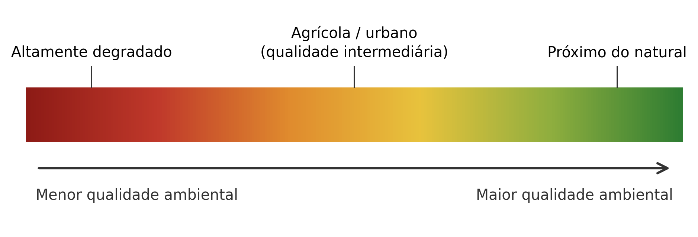
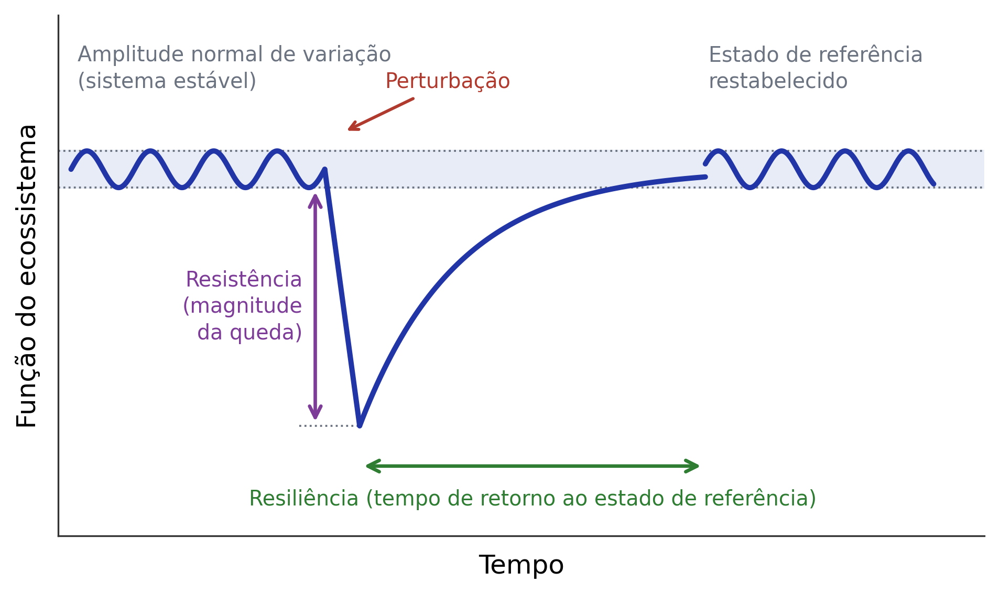
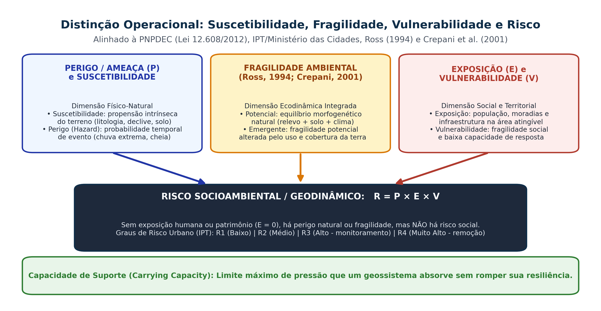

## Visão Geral da Aula {.smaller-text}

::: {.columns}
::: {.column width="50%"}
### Tópicos

- [1]{.circle} Aspecto Ambiental, Impacto Ambiental e Poluição (Lei 6.938/1981 e CONAMA 01/1986)
- [2]{.circle} Qualidade Ambiental, Degradação e Passivo Ambiental (Sánchez, 2020)
- [3]{.circle} Resistência, Resiliência, Estabilidade e Capacidade de Suporte
- [4]{.circle} Perigo, Suscetibilidade, Fragilidade, Vulnerabilidade e Risco ($R = P \times E \times V$)
- [5]{.circle} Graus de Risco Urbano (R1 a R4 — PNPDEC Lei 12.608/2012 e IPT)
- [6]{.circle} Preservação, Conservação, Mitigação, Recuperação, Reabilitação e Restauração
:::

::: {.column width="50%"}
::: {.info-box}
**Objetivo da Aula**

Dominar com rigor técnico e legal o vocabulário conceitual da Análise Ambiental exigido na prática profissional do Geógrafo (EIA/RIMA, ZEE, PRAD, Cartas de Risco) e nos exames nacionais (ENADE e concursos para Analista Ambiental).
:::
:::
:::

# 1 · Aspecto, Impacto, Poluição e Degradação {.section-header rotulo="Impacto"}

## Distinção Técnica: Causa (Aspecto) vs. Efeito (Impacto) {.smaller-text}

::: {.columns}
::: {.column width="52%"}
### Cadeia Causal (ABNT NBR ISO 14001 e Sánchez, 2020)

```text
Atividade Humana / Empreendimento
(Ex.: Implantação de rodovia ou loteamento)
↓
Aspecto Ambiental (Elemento da atividade que interage com o meio)
(Ex.: Supressão de mata ciliar; impermeabilização; emissão de efluente)
↓
Processo Ambiental (Mecanismo biofísico / socioeconômico alterado)
(Ex.: Aumento do escoamento superficial e perda de retenção de sedimentos)
↓
Impacto Ambiental (Alteração líquida da qualidade ambiental)
(Ex.: Assoreamento do rio, perda de ictiofauna e aumento de cheias a jusante)
```
:::

::: {.column width="48%"}
### Definições Legais no Brasil

- **Degradação da Qualidade Ambiental** (Lei 6.938/1981, Art. 3º, II): *alteração adversa das características do meio ambiente* (pode decorrer de processos naturais extremos ou antrópicos).
- **Poluição** (Lei 6.938/1981, Art. 3º, III): degradação resultante de **atividades humanas** que prejudiquem a saúde, a segurança, o bem-estar, a biota, as condições estéticas/sanitárias ou lancem matérias/energia em desacordo com os padrões ambientais estabelecidos (ex.: CONAMA 357/2005 e 506/2024).
- **Impacto Ambiental** (CONAMA 01/1986, Art. 1º): alteração das propriedades físicas, químicas e biológicas do meio ambiente, causada por qualquer forma de matéria ou energia resultante das **atividades humanas** (pode ser **negativo/adverso** ou **positivo/benéfico**).
:::
:::

## Dinâmica da Qualidade Ambiental ao Longo do Tempo {.smaller-text}

::: {.columns}
::: {.column width="48%"}
### Conceito Dinâmico de Impacto (Sánchez, 2020)

- O impacto ambiental **não é a simples diferença entre "antes" e "depois"** da obra ($Q_{t1} - Q_{t0}$), pois os sistemas ambientais mudam mesmo sem o empreendimento.
- **Definição rigorosa**: o impacto é a **diferença líquida** no instante futuro $t_1$ entre a evolução da qualidade ambiental **com a ação humana ($Q_{\text{com}}$)** e a projeção tendencial **sem a ação humana ($Q_{\text{sem}}$ — linha de base dinâmica)**.
- **Passivo Ambiental**: conjunto de obrigações legais, dívidas sociais e custos financeiros acumulados para reparar danos ambientais pretéritos não mitigados (ex.: solo contaminado, talude instável, déficit de Reserva Legal).
:::

::: {.column width="52%"}
{.fig-col}
:::
:::

# 2 · Estabilidade, Resiliência e Capacidade de Suporte {.section-header rotulo="Resiliência"}

## Resistência, Resiliência e Limiares Críticos (*Tipping Points*) {.smaller-text}

::: {.columns}
::: {.column width="50%"}
### Propriedades Dinâmicas dos Geossistemas (Holling, 1973)

- **Inércia / Resistência**: capacidade de um sistema ambiental manter sua estrutura e funções inalteradas quando submetido a um tensor (distúrbio externo).
- **Elasticidade / Resiliência**: velocidade e capacidade de o sistema **retornar ao estado de equilíbrio dinâmico** após cessar a perturbação, reorganizando seus fluxos.
- **Limiar de Ruptura (*Tipping Point*)**: limite crítico além do qual a degradação torna-se **irreversível na escala de tempo humana**, conduzindo o sistema a um novo estado estacionário degradado (ex.: desertificação ou voçorocamento com rebaixamento do lençol freático).
:::

::: {.column width="50%"}
{.fig-col}
:::
:::

## Capacidade de Suporte (*Carrying Capacity*) {.smaller-text}

- **Definição operacional**: carga máxima de uso, extração de recursos ou lançamento de efluentes que um compartimento ambiental (bacia hidrográfica, aquífero, solo ou unidade de conservação) suporta sem comprometer suas funções ecológicas e sua resiliência.
- **Exemplos práticos para o Geógrafo**:
  1. **Capacidade de autodepuração de um rio**: carga máxima de $\text{DBO}_5$ ($\text{kg/dia}$) que o curso d'água dilui e oxida sem cair abaixo do limite de Oxigênio Dissolvido ($\text{OD} \ge 5\text{ mg/L}$ para Classe 2).
  2. **Capacidade de suporte de pastagens no Semiárido**: taxa de lotação animal ($\text{UA/ha/ano}$) compatível com a fitomassa da Caatinga sem expor o solo à erosão laminar.
  3. **Capacidade de carga turística em trilhas de UCs** (Metodologia Cifuentes): limite de visitantes/dia sem compactar o solo ou afugentar a fauna.

## Sustentabilidade Forte vs. Sustentabilidade Fraca {.smaller-text}

| Corrente | Premissa Teórica | Crítica Geográfica |
|----------|------------------|--------------------|
| **Sustentabilidade Fraca** (Economia Neoclássica — Solow) | O "capital natural" e o "capital construído/tecnológico" são perfeitamente substituíveis entre si. | Ignora a irreversibilidade termodinâmica e funções ecossistêmicas vitais insubstituíveis. |
| **Sustentabilidade Forte** (Economia Ecológica — Daly; Georgescu-Roegen) | O **capital natural crítico** (ciclo hidrológico, solos, biodiversidade, clima) é complementar e **insubstituível** pelo capital humano. | Base das restrições legais de **APPs**, **Unidades de Proteção Integral** e **enquadramento hídrico**. |

# 3 · Perigo, Fragilidade, Vulnerabilidade e Risco {.section-header rotulo="Risco"}

## Equação Conceitual e Distinção Operacional {.smaller-text}

{.fig-full}

## Tabela Comparativa para Concursos e Laudos Técnicos {.smaller-text}

::: {.columns}
::: {.column width="100%"}
### Nunca Confunda estes Cinco Conceitos!

| Conceito | Natureza Dominante | Definição Exata | Exemplo Aplicado |
|----------|--------------------|-----------------|------------------|
| **Suscetibilidade** | Físico-Natural (Intrínseca) | Propensão estática do terreno a desenvolver um processo geodinâmico em função de litologia, relevo e solo. | Encosta com declividade de $38^\circ$ em Cambissolo raso sobre rocha gnáissica fraturada. |
| **Perigo / Ameaça (*Hazard*)** | Físico-Temporal (Probabilística) | Probabilidade de ocorrência de um fenômeno potencialmente danoso com determinada magnitude e tempo de retorno ($TR$). | Evento pluvial extremo de $120\text{ mm/24h}$ ($TR = 50\text{ anos}$) capaz de deflagrar escorregamento. |
| **Fragilidade Ambiental** | Ecodinâmica Integrada (Ross, 1994) | Grau de instabilidade morfogenética do sistema natural (**Potencial**) combinado ao grau de proteção da cobertura da terra (**Emergente**). | Classe 5 (Muito Forte) em vertente íngreme com Argissolo sob pastagem degradada. |
| **Vulnerabilidade** | Social, Institucional e Estrutural | Grau de incapacidade de uma comunidade ou estrutura resistir, lidar e se recuperar do impacto de um perigo (Cutter, 1996; Marandola & Hogan, 2005). | Famílias de baixa renda em autoconstruções precárias sem muros de arrimo, drenagem ou sistema de alerta. |
| **Risco ($R = P \times E \times V$)** | Socioambiental (Probabilidade de Perda) | Probabilidade de ocorrência de **danos humanos, materiais ou ambientais** quando o Perigo ($P$) incide sobre elementos Expostos ($E$) e Vulneráveis ($V$). | Setor de risco **R4 (Muito Alto)** com possibilidade iminente de soterramento de moradias nas próximas chuvas. |
:::
:::

## Metodologia do Ministério das Cidades / IPT / SGB-CPRM {.smaller-text}

Na setorização de risco geológico e hidrológico em áreas urbanas (Movimentos de Massa e Inundações), o Geógrafo classifica cada polígono em **4 Graus de Risco**:

- **R1 · Risco Baixo**: condicionantes geológico-geotécnicos e topográficos favoráveis; ausência de feições de instabilidade (trincas, degraus de abatimento, árvores inclinadas).
- **R2 · Risco Médio**: condicionantes de média potencialidade; presença de início de processos erosivos superficiais ou drenagem deficiente, sem evidências de ruptura iminente.
- **R3 · Risco Alto**: condicionantes desfavoráveis (cortes verticais de talude, lançamento de águas servidas/fossas na encosta) e presença de **feições de instabilidade significativas**; exige monitoramento constante e obras de contenção.
- **R4 · Risco Muito Alto**: evidências claras de movimentação ativa (trincas no piso/paredes e no terreno, embarrigamento de muros, cicatrizes frescas); maior criticidade no protocolo; requer avaliação urgente da Defesa Civil e medidas de proteção definidas para o setor.

## Classificação dos Graus de Risco Urbano (protocolo Ministério das Cidades/IPT) · 2 {.smaller-text}

::: {.highlight-box}
**Indicadores de Campo de Instabilidade de Taludes (Checklist do Geógrafo)**

1. **Geometria da encosta**: inclinação, altura do corte, curvaturas, material e posição das edificações; nenhum limiar isolado define o grau de risco.
2. **Sinais de movimentação (*Creep* / Ruptura)**:
   - Fendas de tração na crista do talude;
   - Degraus de abatimento;
   - Árvores, postes e cercas inclinados ("floresta bêbada");
   - Muros de contenção estufados ("embarrigados") ou com drenos (*barbacãs*) entupidos;
   - Surgência de água (exfiltração) na base do corte.
:::

# 4 · Categorias de Intervenção Ambiental {.section-header rotulo="Intervenção"}

## Preservação, Conservação e Modalidades de Recomposição {.smaller-text}

::: {.columns}
::: {.column width="100%"}
### Definições Legais (Lei 9.985/2000 — SNUC e IN IBAMA 14/2024)

| Termo Técnico-Legal | Definição Normativa | Objetivo Final | Exemplo Prático |
|---------------------|---------------------|----------------|-----------------|
| **Preservação** | Conjunto de métodos e políticas que visam garantir a **integridade e perenidade** dos atributos naturais, **sem uso direto** de recursos. | Manutenção integral dos processos evolutivos naturais. | Estação Ecológica (ESEC), Reserva Biológica (REBIO) e APPs de nascentes. |
| **Conservação** | Manejo do uso humano da natureza de modo que produza o maior benefício atual, mantendo seu potencial para as gerações futuras. | Conciliar produção sustentável e proteção ecológica. | Manejo florestal em Reserva Legal, FLONA, RESEX e sistemas agroflorestais. |
| **Mitigação** | Medidas destinadas a **evitar, minimizar ou atenuar** impactos adversos previstos em um empreendimento licenciado. | Reduzir a magnitude do dano durante a implantação/operação. | Instalação de bacias de decantação de sedimentos durante terraplenagem. |
| **Reabilitação** | Intervenção que restitui ao local degradado uma **forma e função produtiva ou social estável**, diferente do ecossistema original. | Estabilidade geotécnica e novo uso socioeconômico seguro. | Cava de mineração exaurida convertida em parque urbano ou lago de lazer. |
| **Recuperação** | Restituição de um ecossistema ou população silvestre degradada a uma **condição não degradada**, que pode ser diferente de sua condição original (Art. 2º, XIII, Lei 9.985/2000). | Retorno da estabilidade morfodinâmica, edáfica e funcional. | Controle de voçoroca com paliçadas, retaludamento e cobertura vegetal mista. |
| **Restauração Ecológica** | Restituição do ecossistema degradado **o mais próximo possível da sua condição original** (composição florística, estrutura trófica e funções). | Sucessão ecológica autossustentável de espécies nativas regionais. | Restauração de mata ciliar com alta diversidade de espécies nativas da Caatinga/Mata Atlântica. |
:::
:::


## Aplicação: do perigo à decisão territorial {.smaller-text}

| Dimensão | Registro necessário em uma encosta ocupada |
|---|---|
| Suscetibilidade | Material, geometria, drenagem e processos que favorecem ruptura |
| Perigo | Processo, intensidade e possibilidade de ocorrência em um período |
| Exposição | Pessoas, moradias e infraestrutura no alcance do processo |
| Vulnerabilidade | Condições que ampliam perdas e dificultam a resposta |
| Risco | Integração dessas dimensões, com método e incertezas |

O produto $P \times E \times V$ é uma representação conceitual. A quantificação exige unidades, probabilidades e funções de dano. A Lei 12.608/2012 institui a PNPDEC; R1–R4 pertencem aos protocolos técnicos de setorização.

# 5 · Síntese e Estudo Orientado nº 3 {.section-header rotulo="Síntese"}

## Estudo Orientado nº 3 (Entrega na Aula 5.1) {.smaller-text}

Resolva os dois estudos de caso analíticos:

1. **Caso Urbano (Feira de Santana ou Salvador - BA)**: Diferencie **Aspecto Ambiental**, **Processo**, **Impacto**, **Perigo**, **Vulnerabilidade** e **Risco** em uma ocupação residencial de baixa renda situada na planície de inundação de um córrego urbano ou em encosta de corte íngreme.
2. **Caso Rural**: Uma propriedade teve sua mata ciliar suprimida, gerando uma voçoroca ativa. Indique se a intervenção exigida pelo Código Florestal configura **reabilitação**, **recuperação** ou **restauração ecológica**, justificando com base na Lei 9.985/2000 e na Lei 12.651/2012.

## Referências Bibliográficas {.smaller-text}

- BRASIL. **Lei nº 6.938, de 31 de agosto de 1981** (Política Nacional do Meio Ambiente).
- BRASIL. **Lei nº 9.985, de 18 de julho de 2000** (Sistema Nacional de Unidades de Conservação — SNUC).
- BRASIL. **Lei nº 12.608, de 10 de abril de 2012** (Política Nacional de Proteção e Defesa Civil — PNPDEC).
- CONAMA. **Resolução nº 01, de 23 de janeiro de 1986** (Critérios básicos e diretrizes gerais para a AIA).
- CUTTER, S. L. Vulnerability to environmental hazards. **Progress in Human Geography**, v. 20, n. 4, p. 529–539, 1996.
- MINISTÉRIO DAS CIDADES; IPT. **Mapeamento de Riscos em Encostas e Margens de Rios**. Brasília: Ministério das Cidades; IPT, 2007.
- SÁNCHEZ, L. E. **Avaliação de Impacto Ambiental: conceitos e métodos**. 3. ed. São Paulo: Oficina de Textos, 2020.
