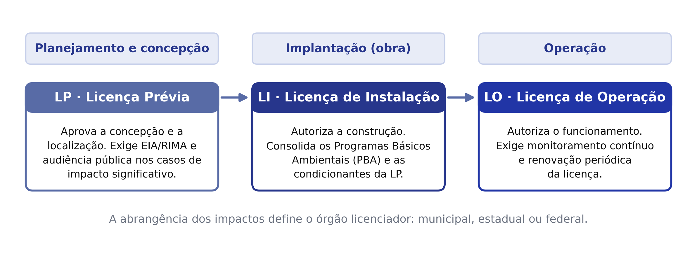
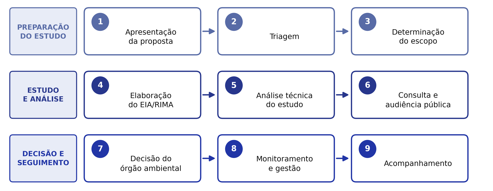
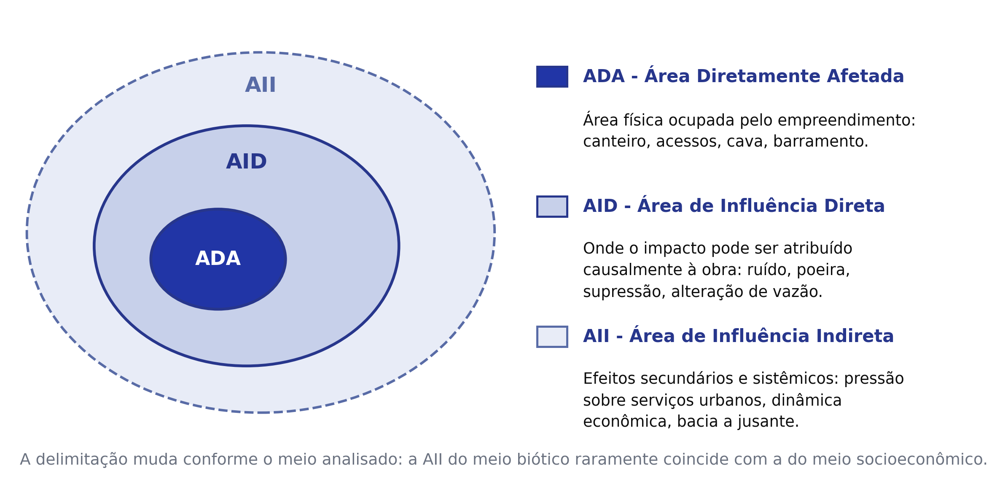
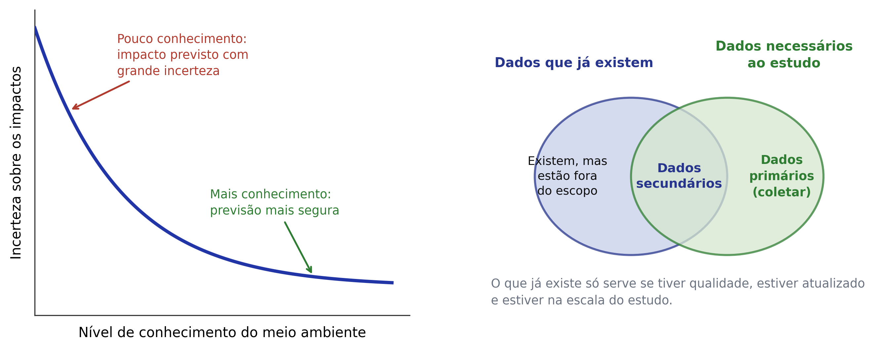
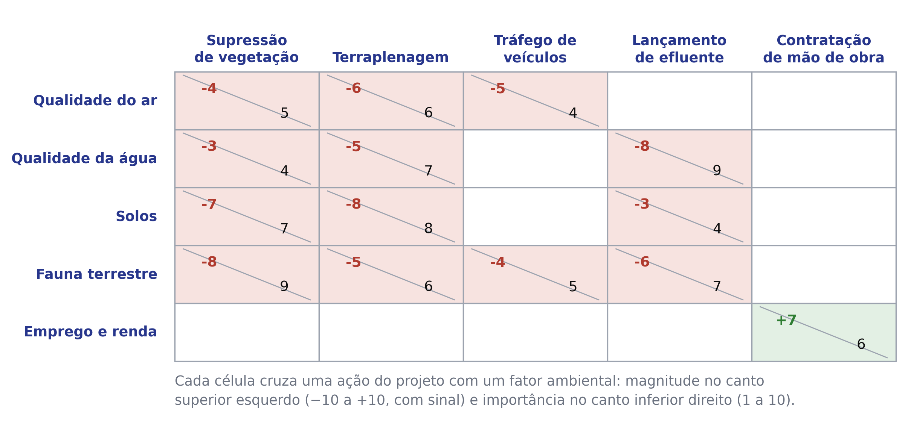
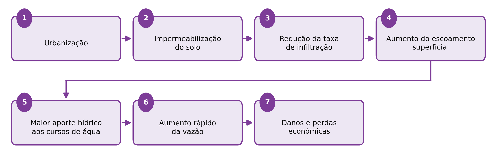
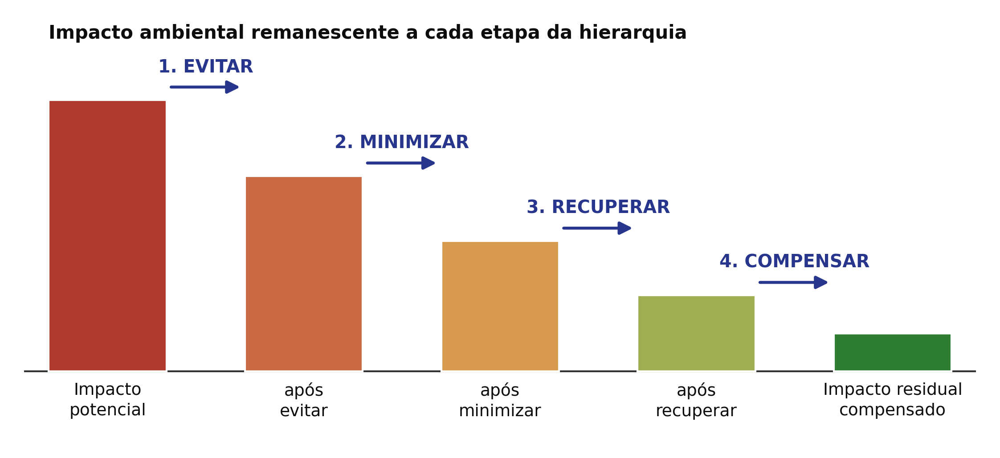

## Visão Geral da Aula {.smaller-text}

::: {.columns}
::: {.column width="50%"}
### Tópicos

- [1]{.circle} Política Nacional do Meio Ambiente (Lei 6.938/1981): SISNAMA e os 13 Instrumentos
- [2]{.circle} Competências Federativas (LC 140/2011) e Licenciamento na Bahia (INEMA/CEPRAM)
- [3]{.circle} O Processo de AIA, Tipos de Estudo (EIA/RIMA, RAS, PBA, AAE) e Licenças (LP, LI, LO)
- [4]{.circle} As Nove Etapas da AIA: Triagem, Escopo, Termo de Referência (TR) e Plano de Trabalho
- [5]{.circle} Diagnóstico de Base e Áreas de Influência (ADA, AID e AII)
- [6]{.circle} Métodos de AIA (Checklists, Matriz de Leopold, Redes de Interação, SIG)
- [7]{.circle} Mitigação, Compensação (SNUC Art. 36), Monitoramento e Audiência Pública
:::

::: {.column width="50%"}
::: {.info-box}
**Objetivo da Aula**

Dominar a arquitetura institucional e normativa da Política Nacional do Meio Ambiente (Lei 6.938/1981, CONAMA 01/1986 e 237/1997, LC 140/2011, Lei 15.190/2025 e Lei Estadual BA 10.431/2006) e operar todas as etapas metodológicas da Avaliação de Impacto Ambiental (AIA) e do EIA/RIMA.
:::

::: {.highlight-box}
**Leitura de apoio**

SÁNCHEZ, L. E. (2020), capítulos 4 a 12 (processo de AIA, escopo, estudos de base, métodos de identificação/previsão e plano de gestão ambiental).
:::
:::
:::

# 1 · PNMA, SISNAMA e Competências Legais {.section-header rotulo="PNMA e SISNAMA"}

## Estrutura do SISNAMA (Art. 6º) {.smaller-text}

| Nível no SISNAMA | Órgão / Entidade | Função Principal |
|------------------|------------------|------------------|
| **1. Órgão Superior** | Conselho de Governo | Assessorar o Presidente na formulação de diretrizes nacionais |
| **2. Órgão Consultivo e Deliberativo** | **CONAMA** | Estabelecer normas, padrões e critérios (ex.: Res. 01/86, 237/97, 357/05) |
| **3. Órgão Central** | **MMA** (Ministério do Meio Ambiente) | Planejar, coordenar e supervisionar a política nacional |
| **4. Órgãos Executores** | **IBAMA** e **ICMBio** | Licenciamento federal, fiscalização (IBAMA) e gestão das UCs federais (ICMBio) |
| **5. Órgãos Seccionais** | Órgãos Estaduais (na Bahia: **SEMA / CEPRAM / INEMA**) | Licenciamento estadual, outorga hídrica e fiscalização |
| **6. Órgãos Locais** | Secretarias e Conselhos Municipais | Licenciamento e controle de impacto ambiental de âmbito local |

## Os 13 Instrumentos da PNMA (Art. 9º) {.smaller-text}

1. Estabelecimento de **padrões de qualidade ambiental**;
2. **Zoneamento Ambiental** (regulamentado pelo Dec. 4.297/2002 como **ZEE**);
3. **Avaliação de Impactos Ambientais (AIA)**;
4. **Licenciamento** e revisão de atividades efetiva ou potencialmente poluidoras;
5. Incentivos à produção e instalação de equipamentos e tecnologias limpas;
6. Criação de **espaços territoriais especialmente protegidos** (UCs — Lei 9.985/2000);
7. Sistema Nacional de Informações sobre o Meio Ambiente (**SINIMA**);
8. Cadastro Técnico Federal de Atividades e Instrumentos de Defesa Ambiental;
9. Penalidades disciplinares ou compensatórias;
10. Relatório de Qualidade do Meio Ambiente (**RQMA**);
11. Garantia da prestação de informações relativas ao Meio Ambiente;
12. Cadastro Técnico Federal de atividades potencialmente poluidoras (**CTF/APP**);
13. Instrumentos econômicos (concessão florestal, servidão ambiental, seguro ambiental e **PSA**).

## Competências Federativas no Licenciamento (LC nº 140/2011) {.smaller-text}

::: {.columns}
::: {.column width="52%"}
### Regra de Ouro da Lei Complementar nº 140/2011

- **Unicidade do licenciamento (Art. 13)**: os empreendimentos são licenciados ou autorizados ambientalmente por **um único ente federativo** (vedada a duplicidade).
- **Critério definidor**:
  - **União (IBAMA — Art. 7º)**: empreendimentos localizados no Brasil e país limítrofe; mar territorial/plataforma continental; terras indígenas; Unidades de Conservação instituídas pela União (exceto APA); em **2 ou mais Estados**; caráter militar; material radioativo/nuclear.
  - **Municípios (Art. 9º)**: empreendimentos que causem **impacto ambiental de âmbito local** (tipologias definidas pelo Conselho Estadual de Meio Ambiente — na Bahia, **CEPRAM**), desde que o município possua órgão ambiental capacitado e Conselho Municipal ativo.
  - **Estados (Art. 8º — competência residual geral)**: todos os demais empreendimentos, além daqueles em 2 ou mais municípios ou em UCs estaduais (exceto APA).
:::

::: {.column width="48%"}
::: {.highlight-box}
**Responsabilidade Objetiva (Art. 14, § 1º da Lei 6.938/1981)**

No Direito Ambiental brasileiro, a responsabilidade civil por dano ambiental é **objetiva** (Teoria do Risco Integral): **independe da existência de culpa**, bastando comprovar o **dano** e o **nexo de causalidade** entre a atividade do poluidor e a degradação diagnosticada pela perícia geográfica/ambiental.
:::
:::
:::

---

# 2 · O Processo de AIA e o Licenciamento {.section-header rotulo="AIA e Licenciamento"}

## O que é a AIA {.smaller-text}

::: {.columns}
::: {.column width="52%"}
### Definições

- **Sánchez (2020)**: conjunto de procedimentos voltados a **prever**, **analisar** e **comunicar** as consequências ambientais prováveis de uma ação proposta antes que a decisão seja tomada.
- **Bitar & Ortega (1998)**: série de procedimentos legais, institucionais e técnico-científicos para **caracterizar impactos potenciais** e **prever magnitude e importância**.

### Objetivos e abordagem

- **Impedir a degradação**, **reduzir a degradação** e **promover o desenvolvimento sustentável**.
- Abordagem **interdisciplinar**: meios físico, biótico e socioeconômico integrados.
:::

::: {.column width="48%"}
::: {.info-box}
**Funções da AIA**

- **Técnica** - identificar e quantificar impactos.
- **Decisória** - subsidiar a autorização ou a negação do projeto.
- **De negociação** - estabelecer medidas mitigadoras e compensatórias.
- **De aprendizado social** - produzir conhecimento territorial público.
:::

> A AIA não é um documento: é um processo que atravessa todo o ciclo de vida do empreendimento.
:::
:::

---

## Marco regulatório: consultar a versão consolidada {.smaller-text}

| Referência | Função no estudo ambiental |
|---|---|
| CF/1988, art. 225, §1º, IV | Estudo prévio de impacto para atividades de significativa degradação, com publicidade |
| Lei 6.938/1981 | PNMA, SISNAMA e instrumentos |
| LC 140/2011 | Distribuição de ações administrativas entre os entes |
| Lei 15.190/2025, com alterações da Lei 15.300/2025 | Marco geral do licenciamento; modalidades, estudos e procedimentos |
| CONAMA 01/1986 e 237/1997 | Referenciais de AIA e licenciamento, lidos em compatibilidade com a legislação posterior |
| Lei BA 10.431/2006, Decreto 14.024/2012 e atos posteriores | Política e procedimentos estaduais; verificar o enquadramento aplicável no INEMA/SEIA e CEPRAM |

**Base de consulta:** novembro de 2026. O estudo deve registrar a norma e sua versão aplicáveis ao processo.

## Enquadramento na Bahia: um roteiro de consulta {.smaller-text}

1. Identificar atividade, localização, porte e potencial poluidor.
2. Verificar competência federal, estadual ou municipal nos termos da LC 140/2011.
3. Consultar as tipologias e atos vigentes do INEMA/SEIA e do CEPRAM.
4. Conferir restrições e manifestações relativas a vegetação, água, patrimônio e territórios protegidos.
5. Obter o termo de referência e registrar estudos e autorizações exigidos.

Não transpor automaticamente uma matriz de outro estado. LP/LI/LO é um procedimento possível; a modalidade depende do enquadramento legal da atividade e do processo.

## Licenciamento trifásico: LP, LI e LO {.smaller-text}

{.fig-full}

O esquema representa o rito trifásico. Verificar os estudos, condicionantes e autorizações de cada etapa.

## Outras modalidades previstas no marco geral {.smaller-text}

O art. 5º da Lei 15.190/2025 também prevê:

| Sigla | Modalidade |
|---|---|
| LAU | Licença Ambiental Única |
| LAC | Licença por Adesão e Compromisso |
| LOC | Licença de Operação Corretiva |
| LAE | Licença Ambiental Especial |

As hipóteses e requisitos variam por modalidade. A existência de procedimento simplificado não dispensa as demais exigências legalmente cabíveis.

[Texto consolidado da Lei 15.190/2025](https://www2.camara.leg.br/legin/fed/lei/2025/lei-15190-8-agosto-2025-797833-normaatualizada-pl.html).

## As nove etapas do processo de AIA {.smaller-text}

{.fig-full fig-alt="As nove etapas do processo de AIA, da apresentação da proposta ao acompanhamento, agrupadas em preparação, estudo e análise, decisão e seguimento" width="90%" fig-align="center"}

::: {.columns}
::: {.column width="50%"}
- [1]{.circle} **Apresentação da proposta** - descrição geral, localização e características técnicas.
- [2]{.circle} **Triagem** - selecionar as ações com potencial de causar alterações significativas e decidir se há necessidade de estudos aprofundados.
- [3]{.circle} **Determinação do escopo** - abrangência e profundidade; preparação do termo de referência ou das instruções técnicas.
- [4]{.circle} **Elaboração do EIA** - avaliar os componentes do projeto e os elementos e processos ambientais que podem ser alterados.
- [5]{.circle} **Análise técnica** - conformidade ao termo de referência e aos requisitos aplicáveis; grau de magnitude dos impactos e adequação das medidas propostas.
:::

::: {.column width="50%"}
- [6]{.circle} **Consulta pública** - durante a realização do estudo ou após a sua conclusão.
- [7]{.circle} **Decisão** - realizada pelo órgão ambiental.
- [8]{.circle} **Monitoramento e gestão** - reduzir, eliminar e compensar impactos negativos, potencializar os positivos e confirmar as previsões feitas, com ajustes e correções.
- [9]{.circle} **Acompanhamento** - fiscalização, supervisão e/ou auditoria e monitoramento.

> As nove etapas são uma organização didática do processo de AIA. Os procedimentos administrativos variam conforme a modalidade e o enquadramento.
:::
:::

---

## Triagem e determinação do escopo {.smaller-text}

::: {.columns}
::: {.column width="50%"}
### Triagem

- Selecionar as ações que tenham potencial de causar **alterações ambientais significativas**.
- Decidir sobre a necessidade ou não de **estudos aprofundados**, ou de avaliação prévia.

### Determinação do escopo

- Estabelecer a **abrangência** (temas e questões abordados) e a **profundidade** dos estudos (nível de detalhamento).
- Preparar o **termo de referência** ou as instruções técnicas.
- Identificar, prever, avaliar e gerenciar os impactos **significativos**, e só eles.
:::

::: {.column width="50%"}
::: {.info-box}
**O que define o foco do escopo**

- Importância dos **recursos ambientais ou culturais** envolvidos, ou vulnerabilidade das comunidades humanas.
- **Experiência profissional** dos analistas.
- **Opinião do público** e conhecimento local.
:::

> Escopo mal definido produz os dois erros clássicos: estudo volumoso sobre o que não importa e silêncio sobre o impacto decisivo.
:::
:::

---

## Termo de referência e plano de trabalho {.smaller-text}

::: {.columns}
::: {.column width="55%"}
### Fluxo do estudo

1. Apresentação da **proposta**, das características técnicas e da **justificativa locacional**.
2. Seleção das **ações** potencialmente causadoras de alterações.
3. **Triagem e escopo**: abrangência, profundidade e questões prioritárias.
4. Preparação do **Termo de Referência**.
5. **Plano de trabalho** e **estudos de base** (diagnóstico).
6. Identificação e **previsão** dos impactos.
7. Análise técnica, **consulta pública** e decisão do órgão ambiental.
8. **Monitoramento** e plano de gestão.
:::

::: {.column width="45%"}
::: {.info-box}
**Termo de Referência**

Roteiro do órgão ambiental com o conteúdo mínimo do EIA/RIMA (meios físico, biótico e socioeconômico). A empresa pode detalhar além do mínimo, jamais reduzi-lo.
:::

::: {.highlight-box}
**Resposta aos impactos**

Evitar → Reduzir → Corrigir → Compensar
:::
:::
:::

---

# 3 · Diagnóstico, dados e áreas de influência {.section-header rotulo="Diagnóstico"}

## Estudos de base: o que o diagnóstico entrega {.smaller-text}

::: {.columns}
::: {.column width="52%"}
### Função dos estudos de base

Obter as informações necessárias à identificação e à previsão de impactos **específicas daquele empreendimento**.

- Mostram a **dinâmica ambiental** da área afetada.
- Utilizam **indicadores apropriados** para descrever as condições ambientais.
- Descrevem e analisam a **situação atual** da área de estudo.
- Levantam componentes e processos dos meios **físico, biótico e antrópico** e, sobretudo, as **interações** entre eles.
:::

::: {.column width="48%"}
::: {.info-box}
**Produto do planejamento dos estudos**

1. Definir o tipo de informação que se pretende coletar.
2. Definir se serão necessários dados primários e secundários.
3. Estabelecer as escalas temporal e espacial dos estudos.
4. Estabelecer os métodos de coleta.
5. Verificar a necessidade de análises laboratoriais e os procedimentos de coleta.
6. Tratar e interpretar os dados.
:::

> Os resultados precisam possibilitar a comparação **multitemporal**: antes e depois da implantação do projeto.
:::
:::

---

## Áreas de influência: ADA, AID e AII {.smaller-text}

::: {.columns}
::: {.column width="62%"}
{.fig-col fig-alt="Áreas de influência representadas como círculos concêntricos: ADA no centro, AID intermediária e AII externa" width="100%"}
:::

::: {.column width="38%"}
- **ADA** - área que sofre a ação direta do planejamento, da implantação, da operação e da desativação; área de consequências mais significativas dos impactos diretos ou de primeira ordem.
- **AID** - implantação de obras e atividades, infraestrutura, transporte e distribuição de produtos, insumos e água.
- **AII** - conjunto ou parte dos municípios envolvidos e bacia hidrográfica abrangida.

::: {.highlight-box}
**Importante**

A delimitação **varia com a categoria do impacto**: socioeconômico, físico e biótico exigem recortes próprios e justificados.
:::
:::
:::

---

## Dados primários e secundários {.smaller-text}

{.fig-full fig-alt="À esquerda, incerteza sobre os impactos decrescendo com o nível de conhecimento do meio; à direita, diagrama de conjuntos entre dados existentes, secundários e primários" width="88%" fig-align="center"}

::: {.columns}
::: {.column width="50%"}
### Dados primários, por ordem de prioridade

- Diagnóstico dos elementos que **sofrerão maior impacto**.
- **Lacunas** de dados.
- **Especificidades locais**.
:::

::: {.column width="50%"}
### Dados secundários, condições de uso

- **Alta qualidade**.
- **Atualizados**.
- **Escala apropriada** ao estudo.
:::
:::

---

## Desenho da amostragem {.smaller-text}

::: {.columns}
::: {.column width="52%"}
| Decisão | Alternativas | Quando usar cada uma |
|---------|--------------|----------------------|
| **Cobertura** | Inventário ou amostragem | Inventário quando a área é pequena ou o elemento é raro; amostragem no restante |
| **Tempo** | Séries temporais ou amostragens únicas | Amostragem única quando a qualidade ou o elemento é **estável**, com pouca variação temporal |
| **Regime** | Contínua ou discreta | A **contínua** é mais empregada no monitoramento operacional; a **discreta** cobre a maior parte dos estudos de base |

: {.striped .hover}
:::

::: {.column width="48%"}
::: {.info-box}
**Quando a área vale mais que o tempo**

Para elementos estáveis e de pouca variação temporal, **a área amostrada é mais importante que a temporalidade**: cobre-se mais espaço em menos campanhas.
:::

> O inverso vale para qualidade da água e ruído, em que a variação intra-anual é o próprio objeto da medição.
:::
:::

# 4 · Identificação e avaliação de impactos {.section-header rotulo="Impactos"}

## Identificação preliminar dos impactos {.smaller-text}

::: {.columns}
::: {.column width="52%"}
### Prováveis alterações no meio causadas pelo empreendimento

- Degradação dos recursos hídricos.
- Perda de solo.
- Degradação da vegetação.
- Poluição sonora.
- Degradação da qualidade do ar.

### Como se chega a essa lista

- **Analogia** com casos similares.
- **Experiência e opinião** de especialistas.
- **Consulta ao público**.
- Análise das questões definidas previamente **por via legal** (espécies raras e áreas protegidas).
:::

::: {.column width="48%"}
::: {.highlight-box}
**Nem todo impacto pesa igual**

Alguns impactos deverão ser considerados **mais importantes que outros** e receber mais atenção no EIA. A identificação preliminar existe justamente para hierarquizar o esforço antes de gastá-lo.
:::

::: {.info-box}
**Fonte do conhecimento**

Analogia com situações similares e experiência da **equipe multidisciplinar** ou de consultores externos são as duas vias mais usadas quando ainda não há dado primário.
:::
:::
:::

---

## Identificação por fase do ciclo de vida {.smaller-text}

::: {.columns}
::: {.column width="55%"}
### Fases do empreendimento

| Fase | Exemplos de impacto |
|------|---------------------|
| **Planejamento** | Tensão social e expectativa fundiária |
| **Implantação** | Supressão de vegetação, poeira, ruído, resíduos de construção |
| **Operação** | Efluentes, emissões, consumo de água, tráfego |
| **Desativação** | Demolição, reabilitação ou recuperação da área |

: {.striped .hover}

- O mesmo impacto pode ocorrer em mais de uma fase, com gravidade diferente em cada uma.
:::

::: {.column width="45%"}
### Exemplo: transposição do rio São Francisco

| Impacto | Fases em que ocorre |
|---------|---------------------|
| Tensões e riscos sociais | Planejamento e construção |
| Aumento da emissão de poeira | Construção e operação |
| Aumento ou aparecimento de doenças | Construção e operação |
| Demanda por infraestrutura de saúde | Construção |
| Perda de terras agricultáveis | Construção |
| Geração de renda e empregos | Construção e operação |

: {.striped .hover}
:::
:::

---

## Métodos de identificação: panorama {.smaller-text}

::: {.columns}
::: {.column width="50%"}
### Os seis métodos clássicos

1. Métodos **ad hoc**.
2. **Listas de verificação** (*checklists*).
3. **Matrizes de interação**.
4. **Redes de interação** (diagramas de sistema).
5. **Superposição de cartas**.
6. **Modelos de simulação**.

E, na prática, a **combinação de métodos**, com dois ou mais aplicados em conjunto.
:::

::: {.column width="50%"}
::: {.info-box}
**Como relacionar os impactos**

- **Com empreendimento definido**: relacionar os impactos com **cada atividade** do empreendimento.
- **Sem empreendimento definido**: relacionar com **áreas modelo**, de alta qualidade ambiental.
:::

> Nenhum método isolado dá conta do estudo. A escolha depende do que se quer enxergar: impactos diretos, encadeamentos, conflitos espaciais ou dinâmica temporal.
:::
:::

---

## Matriz de Leopold {.smaller-text}

::: {.columns}
::: {.column width="58%"}
{.fig-col fig-alt="Esquema de matriz de interação com ações do projeto nas colunas e fatores ambientais nas linhas, magnitude e importância em cada célula" width="100%"}
:::

::: {.column width="42%"}
- Cruza **componentes do projeto** (colunas) com **elementos do meio** (linhas).
- Cada célula recebe **magnitude** e **importância**, em escala de **0 a 10**, com sinal positivo ou negativo.
- É a matriz **mais utilizada** na prática brasileira.
- Objetiva e permite **hierarquizar** impactos.
- Não capta impactos indiretos nem a dinâmica temporal.
- A pontuação **não é transferível** entre empreendimentos ou locais.
:::
:::

---

## Redes de interação: o caso da urbanização {.smaller-text}

{.fig-full fig-alt="Cadeia de impacto da urbanização: impermeabilização do solo, redução da infiltração, aumento do escoamento superficial, maior aporte hídrico, aumento da vazão e danos econômicos" width="92%" fig-align="center"}

A rede expõe o que a matriz não mostra: o impacto economicamente relevante, **danos e perdas**, está a **seis elos** da ação inicial. Mitigar no elo 7 é indenização; mitigar nos elos 2 e 3, com manutenção de áreas permeáveis, é prevenção.

---

## Classificação dos impactos {.smaller-text}

::: {.columns}
::: {.column width="50%"}
| Atributo | O que expressa |
|----------|----------------|
| **Magnitude** | Estimativa qualitativa ou quantitativa da intensidade do impacto |
| **Duração** | Período de tempo que o impacto, se ocorrer, deverá durar |
| **Reversibilidade** | Natural ou por intermédio de ação humana |
| **Relevância** | De acordo com leis locais, nacionais ou tratados internacionais |
| **Probabilidade de ocorrência** | Estimativas qualitativas ou quantitativas de que o impacto ocorra |
| **Distribuição social dos riscos e benefícios** | De que maneira o empreendimento impõe repartição desigual de riscos e benefícios ambientais |

: {.striped .hover}
:::

::: {.column width="50%"}
### Exemplo de valoração justificada

| Elemento | Valor | Justificativa |
|----------|-------|---------------|
| Vegetação terrestre | Pequeno | Vegetação é comum |
| Ictiofauna | Grande | Habitats aquáticos de qualidade; espécies utilizadas para alimentação da população |
| Avifauna terrestre | Pequeno | Espécies comuns, não utilizadas para alimentação |
| Lazer e turismo | Médio | Uso atual limitado, sem atrativos particulares; há potencial de desenvolvimento que favorece a economia local |
| Arqueologia | Grande | Sítios relativamente raros, importantes para a história das populações locais |

: {.striped .hover}
:::
:::

---

# 5 · Mitigação, monitoramento e participação {.section-header rotulo="Mitigação"}

## Hierarquia da mitigação {.smaller-text}

{.fig-full fig-alt="Hierarquia da mitigação: barras decrescentes do impacto potencial ao impacto residual compensado, com as etapas evitar, minimizar, recuperar e compensar" width="72%" fig-align="center"}

::: {.columns}
::: {.column width="50%"}
1. **Evitar** - impactos e prevenir riscos.
2. **Reduzir / minimizar** - impactos negativos.
3. **Corrigir / recuperar** - depois da ocorrência, ao final de cada etapa do ciclo de vida.
4. **Compensar** - impactos que não podem ser evitados ou reduzidos.
:::

::: {.column width="50%"}
> Evitar impactos adversos é **uma das principais funções da AIA**, e a ordem da hierarquia é uma ordem de **preferência**, não uma lista de opções equivalentes.

> Compensação é **último recurso**: ela não desfaz o impacto, apenas o contrabalança em outro lugar (Art. 36 da Lei 9.985/2000 — SNUC).
:::
:::

---

## Medidas mitigadoras típicas {.smaller-text}

::: {.columns}
::: {.column width="57%"}
| Categoria | Exemplo |
|-----------|---------|
| Construtivas | Cortinas de drenagem, *sed-traps*, passagens de fauna |
| Operacionais | Programa de educação ambiental, gestão de resíduos e efluentes |
| Compensatórias | Unidades de Conservação (SNUC Art. 36), reposição florestal obrigatória |
| Reparadoras | PRAD, recomposição de APP e desassoreamento |
| Valorização de benefícios | Priorizar contratação e capacitação da mão de obra local |

: {.striped .hover}
:::

::: {.column width="43%"}
::: {.highlight-box}
**O que não é medida mitigadora**

Exigências legais (licenças, outorga) e **monitoramento** não mitigam: mitigar é **agir sobre o impacto**. Monitorar apenas informa se a medida adotada está funcionando.
:::

> Medidas copiadas de outros empreendimentos costumam falhar; a medida precisa ser ajustada ao contexto local.
:::
:::

---

## Monitoramento e PBA {.smaller-text}

::: {.columns}
::: {.column width="55%"}
### Plano de Monitoramento

- Indicadores específicos para cada impacto previsto.
- **Linha de base** estabelecida antes da implantação.
- Fases **pré-operacional**, **operacional** e **pós-operacional**.
- Frequência compatível com a dinâmica do processo monitorado.
- Limiares de alerta e de ação corretiva.

### Programas Básicos Ambientais (PBA)

Detalham as condicionantes da LP. Exemplos típicos:

- **Gestão e supervisão**: PGA, PCS, PEA e gerenciamento de riscos (PGR).
- **Monitoramento biofísico**: qualidade da água, fauna, flora, processos erosivos e ruído.
- **Recuperação e compensação**: PRAD e programas de reassentamento.
:::

::: {.column width="45%"}
::: {.info-box}
**Estudo Orientado nº 4** (entrega na Aula 10.1)

Selecionar um EIA/RIMA público (IBAMA ou INEMA-BA) e identificar:

1. Áreas de influência (ADA, AID, AII).
2. Três principais impactos previstos (meios físico, biótico e socioeconômico).
3. Lacunas no diagnóstico ambiental.
4. Coerência da hierarquia de mitigação.
5. Adequação do plano de monitoramento.
:::
:::
:::

---

## Participação pública {.smaller-text}

::: {.columns}
::: {.column width="50%"}
### Audiência e consulta pública (CONAMA 09/1987)

- Envolve indivíduos e grupos afetados, positiva ou negativamente, pela intervenção proposta.
- A **audiência pública** é convocada pelo órgão licenciador sempre que julgar necessário, ou quando solicitada por **entidade civil**, pelo **Ministério Público** ou por **50 ou mais cidadãos** (Res. CONAMA nº 09/1987).
- Legitima a decisão, reduz conflitos e incorpora saberes territoriais locais.

### Contribuições do público

- Proposição de medidas mitigadoras adequadas à realidade local.
- Identificação de usos tradicionais e comunidades invisibilizadas nos dados secundários.
:::

::: {.column width="50%"}
::: {.info-box}
**Quem participa**

Poder Executivo e Legislativo, Ministério Público, órgãos públicos, conselhos (CONAMA/CEPRAM/COMDEMA), entidades da sociedade civil, comunidades tradicionais e cidadãos afetados.

> Caso não seja realizada audiência pública regularmente solicitada, a licença concedida **não terá validade** (Art. 2º, § 2º da Res. CONAMA 09/1987).
:::
:::
:::

---

## Exercício: ler o impacto na imagem {.smaller-text}

::: {.columns}
::: {.column width="52%"}
### Roteiro (em dupla, 20 minutos)

Abra o **Google Earth** e localize, em imagens **anteriores e posteriores** à obra, uma destas usinas:

- **UHE Pedra do Cavalo / Itapebi** (Bahia) ou **UHE Serra do Facão** (Goiás).
- **UHE Jirau** (rio Madeira, Rondônia) ou **Complexo Eólico no Piemonte da Diamantina** (Bahia).

Depois responda:

1. Você consegue delimitar a **ADA, AID e AII** pelos processos visíveis?
2. Quais **atividades** e quais **aspectos** geraram esses impactos?
3. Quantos impactos diretos e indiretos você consegue identificar?
4. Quais medidas mitigadoras e compensatórias são exigíveis?
:::

::: {.column width="48%"}
::: {.highlight-box}
**O que o exercício treina**

Passar da leitura descritiva da imagem para a **cadeia causal**: a mancha de água ou a clareira de terraplenagem é o aspecto visível, não o impacto. O impacto está na perda de hábitat ripário, na alteração hidrossedimentológica a jusante e no deslocamento de populações ribeirinhas.
:::
:::
:::

## Oficina: de uma ação ao programa de acompanhamento {.smaller-text}

Caso hipotético: abertura de estrada em vertente com drenagem intermitente.

| Encadeamento | O que registrar |
|---|---|
| Ação / aspecto | Corte, solo exposto e concentração do escoamento |
| Impacto previsto | Alteração do aporte de sedimentos ao curso d'água |
| Alternativas | Traçado, travessia e fases de implantação |
| Medidas | Evitar área sensível, controlar drenagem e proteger a superfície |
| Monitoramento | Chuva, turbidez, inspeções e comparação a montante/jusante |
| Decisão | Responsável, gatilho de manutenção e revisão do programa |

Comparar o cenário com o projeto ao cenário sem o projeto. Uma nota de matriz não substitui evidência, previsão e justificativa.

# Referências {.section-header rotulo="Referências"}

## Bibliografia da aula {.smaller-text}

- BAHIA. **Lei Estadual nº 10.431, de 20 de dezembro de 2006** e **Decreto nº 14.024/2012** (Política de Meio Ambiente e de Proteção à Biodiversidade do Estado da Bahia — SEIA/INEMA/CEPRAM).
- BITAR, O. Y.; ORTEGA, R. D. Gestão ambiental. In: OLIVEIRA, A. M. S.; BRITO, S. N. A. (Orgs.). **Geologia de Engenharia**. São Paulo: ABGE, 1998.
- BRASIL. **Lei nº 6.938, de 31 de agosto de 1981** (Política Nacional do Meio Ambiente).
- BRASIL. **Lei Complementar nº 140, de 8 de dezembro de 2011** (Competências federativas no licenciamento ambiental).
- CONAMA. **Resoluções nº 01/1986, nº 09/1987 e nº 237/1997**.
- SÁNCHEZ, L. E. **Avaliação de impacto ambiental**: conceitos e métodos. 3. ed. São Paulo: Oficina de Textos, 2020.
