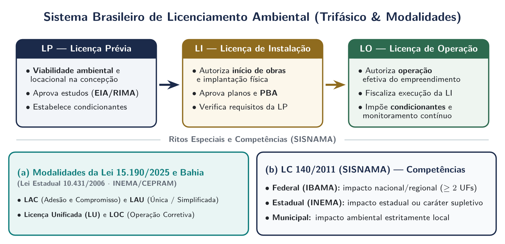
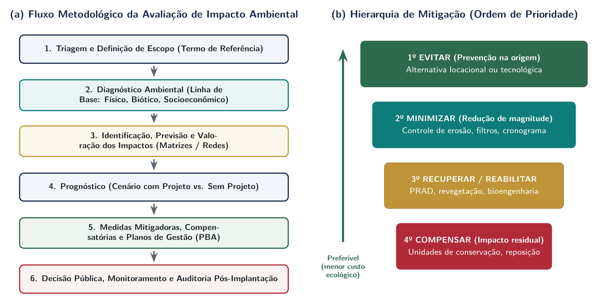
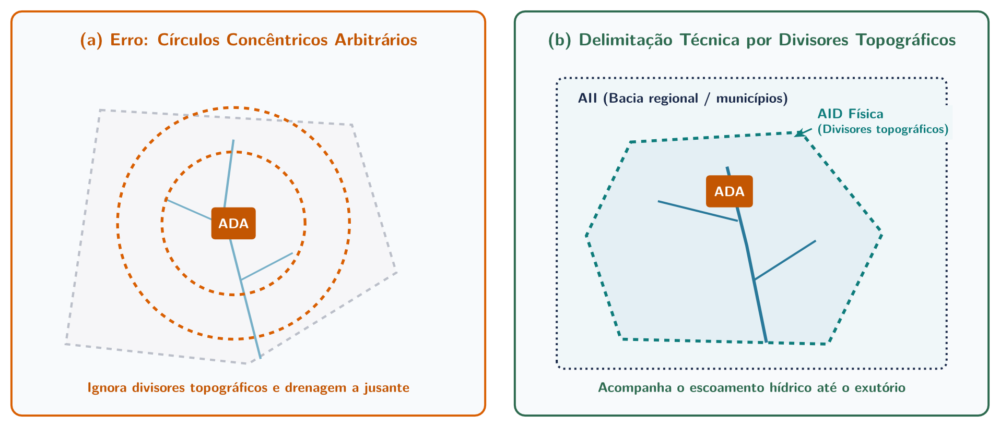
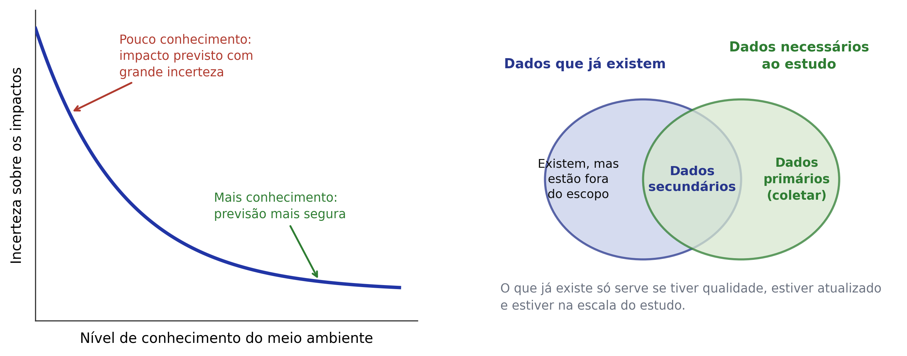
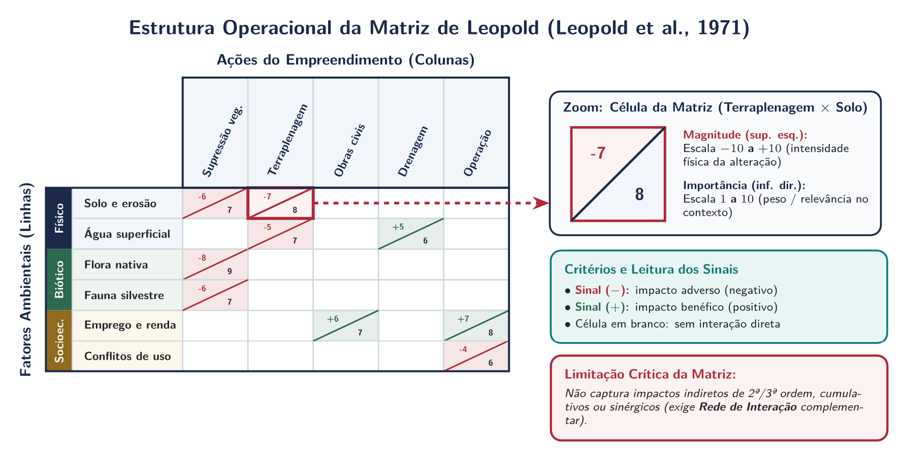
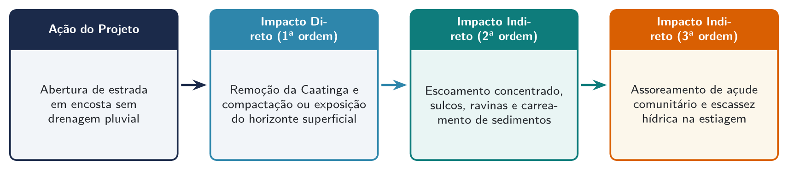
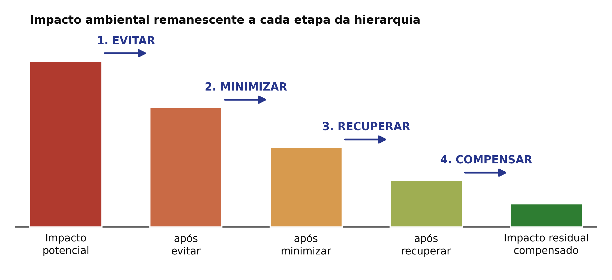

## [Abertura]{.pitch-tag} Visão Geral da Aula {#visao-geral .smaller-text .lesson-slide}

::: {.pitch-grid-55}
::: {.pitch-card}
[Roteiro da aula]{.pitch-card-index}
[Tópicos estruturantes]{.pitch-heading}

- [1]{.circle} Política Nacional do Meio Ambiente (Lei 6.938/1981): SISNAMA e os 13 Instrumentos
- [2]{.circle} Competências Federativas (LC 140/2011) e Licenciamento na Bahia (INEMA/CEPRAM)
- [3]{.circle} Processo de AIA, Tipos de Estudo (EIA/RIMA, RAS, PBA, AAE) e Licenças (LP, LI, LO)
- [4]{.circle} As Nove Etapas da AIA: Triagem, Escopo, Termo de Referência (TR) e Plano de Trabalho
- [5]{.circle} Diagnóstico de Base e Áreas de Influência (ADA, AID e AII)
- [6]{.circle} Métodos de AIA (Checklists, Matriz de Leopold, Redes de Interação, SIG)
- [7]{.circle} Mitigação, Compensação (SNUC Art. 36), Monitoramento e Audiência Pública
:::

::: {.pitch-stack-2}
::: {.pitch-card .pitch-card--gold}
[Objetivo da aula]{.pitch-card-index}
[Arquitetura normativa e técnica]{.pitch-heading}

Dominar a arquitetura institucional e normativa da Política Nacional do Meio Ambiente (Lei 6.938/1981, CONAMA 01/1986 e 237/1997, LC 140/2011, Lei 15.190/2025 e Lei Estadual BA 10.431/2006) e operar todas as etapas metodológicas da Avaliação de Impacto Ambiental (AIA) e do EIA/RIMA.
:::

::: {.pitch-card .pitch-card--teal}
[Leitura de apoio]{.pitch-card-index}
[Referência principal]{.pitch-heading}

SÁNCHEZ, L. E. (2020), capítulos 4 a 12 (processo de AIA, escopo, estudos de base, métodos de identificação/previsão e plano de gestão ambiental).
:::
:::
:::

# 1 · PNMA, SISNAMA e Competências Legais {.section-header rotulo="PNMA e SISNAMA"}

## [PNMA]{.pitch-tag} Por que existe uma Política Nacional e um Sistema de Licenciamento? {#fundamentos-pnma .smaller-text .lesson-slide}

::: {.pitch-cards}
::: {.pitch-card}
[01 · Ruptura histórica]{.pitch-card-index}
[Do controle pontual à prevenção]{.pitch-heading}

Antes da **Lei nº 6.938/1981 (PNMA)**, a atuação pública ambiental era fragmentada e majoritariamente reativa após a ocorrência do dano.
:::

::: {.pitch-card .pitch-card--gold}
[02 · Princípios basilares]{.pitch-card-index}
[Preventivo e poluidor-pagador]{.pitch-heading}

Empreendimentos com potencial degradador passam a ser avaliados **antes** da instalação, vinculando o desenvolvimento econômico à conservação e à reparação de danos.
:::

::: {.pitch-card .pitch-card--teal}
[03 · Arranjo federativo]{.pitch-card-index}
[Por que organizar no SISNAMA?]{.pitch-heading}

Em uma federação, é preciso separar claramente quem formula normas técnicas (CONAMA), quem coordena a política (MMA) e quem licencia ou fiscaliza em cada esfera (União, estados e municípios).
:::
:::

::: {.pitch-band .pitch-band--navy}
A PNMA institui a prevenção prévia ao licenciamento e articula os três entes federativos sob diretrizes técnicas comuns.
:::

## [SISNAMA]{.pitch-tag} Estrutura do SISNAMA (Art. 6º) {#estrutura-sisnama .smaller-text .lesson-slide}

::: {.pitch-table-box}
| Nível no SISNAMA | Órgão / Entidade | Função Principal |
|------------------|------------------|------------------|
| **1. Órgão Superior** | Conselho de Governo | Assessorar o Presidente na formulação de diretrizes nacionais |
| **2. Órgão Consultivo e Deliberativo** | **CONAMA** | Estabelecer normas, padrões e critérios (ex.: Res. 01/86, 237/97, 357/05) |
| **3. Órgão Central** | **MMA** (Ministério do Meio Ambiente) | Planejar, coordenar e supervisionar a política nacional |
| **4. Órgãos Executores** | **IBAMA** e **ICMBio** | Licenciamento federal, fiscalização (IBAMA) e gestão das UCs federais (ICMBio) |
| **5. Órgãos Seccionais** | Órgãos Estaduais (na Bahia: **SEMA / CEPRAM / INEMA**) | Licenciamento estadual, outorga hídrica e fiscalização |
| **6. Órgãos Locais** | Secretarias e Conselhos Municipais | Licenciamento e controle de impacto ambiental de âmbito local |
:::

::: {.pitch-band}
Na Bahia, a política estadual integra **SEMA** (formulação), **CEPRAM** (deliberação normativa e tipologias) e **INEMA** (execução do licenciamento e outorga).
:::

## [Instrumentos]{.pitch-tag .pitch-tag--gold} Os 13 Instrumentos da PNMA (Art. 9º) {#instrumentos-pnma .smaller-text .lesson-slide}

::: {.pitch-cards-2}
::: {.pitch-card}
[Incisos I a VII]{.pitch-card-index}
[Normatização, planejamento e controle]{.pitch-heading}

1. Estabelecimento de **padrões de qualidade ambiental**;
2. **Zoneamento Ambiental** (regulamentado pelo Dec. 4.297/2002 como **ZEE**);
3. **Avaliação de Impactos Ambientais (AIA)**;
4. **Licenciamento** e revisão de atividades efetiva ou potencialmente poluidoras;
5. Incentivos à produção e instalação de equipamentos e tecnologias limpas;
6. Criação de **espaços territoriais especialmente protegidos** (UCs — Lei 9.985/2000);
7. Sistema Nacional de Informações sobre o Meio Ambiente (**SINIMA**).
:::

::: {.pitch-card .pitch-card--gold}
[Incisos VIII a XIII]{.pitch-card-index}
[Cadastro, sanção e incentivos]{.pitch-heading}

8. Cadastro Técnico Federal de Atividades e Instrumentos de Defesa Ambiental;
9. Penalidades disciplinares ou compensatórias;
10. Relatório de Qualidade do Meio Ambiente (**RQMA**);
11. Garantia da prestação de informações relativas ao Meio Ambiente;
12. Cadastro Técnico Federal de atividades potencialmente poluidoras (**CTF/APP**);
13. Instrumentos econômicos (concessão florestal, servidão ambiental, seguro ambiental e **PSA**).
:::
:::

## [Federativo]{.pitch-tag} Competências Federativas no Licenciamento (LC nº 140/2011) {#competencias-lc140 .smaller-text .lesson-slide}

::: {.pitch-grid-60}
::: {.pitch-stack-2}
::: {.pitch-card}
[Art. 13 · Regra de Ouro]{.pitch-card-index}
[Unicidade do licenciamento]{.pitch-heading}

Os empreendimentos são licenciados ou autorizados ambientalmente por **um único ente federativo**, sendo vedada a duplicidade de licenciamento.
:::

::: {.pitch-card .pitch-card--teal}
[Arts. 7º, 8º e 9º]{.pitch-card-index}
[Critério definidor por ente]{.pitch-heading}

- **União (IBAMA — Art. 7º):** Brasil e país limítrofe; mar territorial/plataforma continental; terras indígenas; UCs instituídas pela União (exceto APA); em **2 ou mais Estados**; caráter militar; material radioativo/nuclear.
- **Municípios (Art. 9º):** **impacto ambiental de âmbito local** (tipologias do Conselho Estadual — na Bahia, **CEPRAM**), com órgão capacitado e Conselho Municipal ativo.
- **Estados (Art. 8º — residual geral):** demais empreendimentos, em 2 ou mais municípios ou em UCs estaduais (exceto APA).
:::
:::

::: {.pitch-card .pitch-card--alert}
[Art. 14, § 1º · Lei 6.938/1981]{.pitch-card-index}
[Responsabilidade Objetiva]{.pitch-heading}

No Direito Ambiental brasileiro, a responsabilidade civil por dano ambiental é **objetiva** (**Teoria do Risco Integral**): **independe da existência de culpa**, bastando comprovar o **dano** e o **nexo de causalidade** entre a atividade do poluidor e a degradação diagnosticada pela perícia geográfica/ambiental.
:::
:::

# 2 · O Processo de AIA e o Licenciamento {.section-header rotulo="AIA e Licenciamento"}

## [AIA]{.pitch-tag .pitch-tag--gold} O que é a AIA {#conceito-aia .smaller-text .lesson-slide}

::: {.pitch-grid-50}
::: {.pitch-stack-2}
::: {.pitch-card}
[Definições clássicas]{.pitch-card-index}
[Previsão e magnitude]{.pitch-heading}

- **Sánchez (2020):** conjunto de procedimentos voltados a **prever**, **analisar** e **comunicar** as consequências ambientais prováveis de uma ação proposta antes que a decisão seja tomada.
- **Bitar & Ortega (1998):** série de procedimentos legais, institucionais e técnico-científicos para **caracterizar impactos potenciais** e **prever magnitude e importância**.
:::

::: {.pitch-card .pitch-card--teal}
[Objetivos e abordagem]{.pitch-card-index}
[Síntese interdisciplinar]{.pitch-heading}

- **Impedir a degradação**, **reduzir a degradação** e **promover o desenvolvimento sustentável**.
- Abordagem **interdisciplinar**: meios físico, biótico e socioeconômico integrados.
:::
:::

::: {.pitch-stack-2}
::: {.pitch-card .pitch-card--gold}
[Quatro papéis]{.pitch-card-index}
[Funções da AIA]{.pitch-heading}

- **Técnica:** identificar e quantificar impactos.
- **Decisória:** subsidiar a autorização ou a negação do projeto.
- **De negociação:** estabelecer medidas mitigadoras e compensatórias.
- **De aprendizado social:** produzir conhecimento territorial público.
:::

::: {.pitch-band .pitch-band--navy}
A AIA não é um documento: é um **processo** que atravessa todo o ciclo de vida do empreendimento.
:::
:::
:::

## [Normas]{.pitch-tag} Marco regulatório: consultar a versão consolidada {#marco-regulatorio .smaller-text .lesson-slide}

::: {.pitch-table-box}
| Referência | Função no estudo ambiental |
|---|---|
| CF/1988, art. 225, §1º, IV | Estudo prévio de impacto para atividades de significativa degradação, com publicidade |
| Lei 6.938/1981 | PNMA, SISNAMA e instrumentos |
| LC 140/2011 | Distribuição de ações administrativas entre os entes |
| Lei 15.190/2025, com alterações da Lei 15.300/2025 | Marco geral do licenciamento; modalidades, estudos e procedimentos |
| CONAMA 01/1986 e 237/1997 | Referenciais de AIA e licenciamento, lidos em compatibilidade com a legislação posterior |
| Lei BA 10.431/2006, Decreto 14.024/2012 e atos posteriores | Política e procedimentos estaduais; verificar o enquadramento aplicável no INEMA/SEIA e CEPRAM |
:::

::: {.pitch-band}
**Base de consulta:** novembro de 2026. O estudo deve registrar a norma e sua versão aplicáveis ao processo.
:::

## [Bahia]{.pitch-tag .pitch-tag--teal} Enquadramento na Bahia: um roteiro de consulta {#enquadramento-bahia .smaller-text .lesson-slide}

::: {.pitch-milestones}
::: {.pitch-milestone-item}
**01 · Atividade e porte:** identificar atividade, localização, porte e potencial poluidor do empreendimento.
:::

::: {.pitch-milestone-item}
**02 · Competência federativa:** verificar competência federal, estadual ou municipal nos termos da **LC 140/2011**.
:::

::: {.pitch-milestone-item}
**03 · Normativa baiana:** consultar as tipologias e atos vigentes do **INEMA/SEIA** e do **CEPRAM**.
:::

::: {.pitch-milestone-item}
**04 · Restrições territoriais:** conferir restrições e manifestações relativas a vegetação, água, patrimônio e territórios protegidos.
:::

::: {.pitch-milestone-item}
**05 · Termo de referência:** obter o termo de referência e registrar estudos e autorizações exigidos.
:::
:::

::: {.pitch-band}
Não transpor automaticamente uma matriz de outro estado. **LP/LI/LO** é um procedimento possível; a modalidade depende do enquadramento legal da atividade e do processo.
:::

## [Licenciamento]{.pitch-tag .pitch-tag--gold} Licenciamento trifásico: LP, LI e LO {#licenciamento-trifasico .smaller-text .lesson-slide}

::: {.pitch-media-card .pitch-media-card--wide}

[Sistema brasileiro de licenciamento: rito trifásico, modalidades e competências]{.pitch-caption}
[Elaboração própria (TikZ) · verificar os estudos, condicionantes e autorizações exigidos em cada etapa]{.pitch-caption-sub}
:::

::: {.pitch-band}
O esquema representa o rito trifásico (**LP → LI → LO**) em articulação com os ritos especiais e as competências do SISNAMA.
:::

## [Modalidades]{.pitch-tag .pitch-tag--gold} Outras modalidades previstas no marco geral {#modalidades-lei-15190 .smaller-text .lesson-slide}

::: {.pitch-grid-55}
::: {.pitch-table-box}
| Sigla | Modalidade (Art. 5º da Lei 15.190/2025) |
|---|---|
| **LAU** | Licença Ambiental Única |
| **LAC** | Licença por Adesão e Compromisso |
| **LOC** | Licença de Operação Corretiva |
| **LAE** | Licença Ambiental Especial |
:::

::: {.pitch-stack-2}
::: {.pitch-card .pitch-card--gold}
[Condições de aplicação]{.pitch-card-index}
[Enquadramento específico]{.pitch-heading}

As hipóteses e requisitos variam por modalidade. A existência de procedimento simplificado não dispensa as demais exigências legalmente cabíveis (outorga, supressão vegetal, patrimônio).
:::

::: {.pitch-card .pitch-card--teal}
[Referência normativa]{.pitch-card-index}
[Consulta ao texto vigente]{.pitch-heading}

[Texto consolidado da Lei 15.190/2025 (Câmara dos Deputados)](https://www2.camara.leg.br/legin/fed/lei/2025/lei-15190-8-agosto-2025-797833-normaatualizada-pl.html).
:::
:::
:::

::: {.pitch-pill-row}
[LAU · Única]{.pitch-pill}
[LAC · Adesão e Compromisso]{.pitch-pill .pitch-pill--gold}
[LOC · Corretiva]{.pitch-pill}
[LAE · Especial]{.pitch-pill .pitch-pill--gold}
:::

## [Etapas]{.pitch-tag .pitch-tag--gold} Fluxo metodológico da AIA e hierarquia de mitigação {#fluxo-aia-visao .smaller-text .lesson-slide}

::: {.pitch-media-card .pitch-media-card--wide}

[Fluxo metodológico da AIA (a) e ordem de prioridade na mitigação (b)]{.pitch-caption}
[Elaboração própria (TikZ) · articulação entre triagem, diagnóstico, previsão, prognóstico, gestão e auditoria]{.pitch-caption-sub}
:::

::: {.pitch-band}
A sequência metodológica vincula o **diagnóstico** e a **previsão de impactos** à ordem decrescente de preferência da mitigação: evitar é sempre menos custoso ecologicamente do que compensar.
:::

## [Etapas]{.pitch-tag .pitch-tag--gold} As nove etapas do processo de AIA {#nove-etapas-aia .smaller-text .lesson-slide}

::: {.pitch-cards-2}
::: {.pitch-card}
[Etapas 1 a 5]{.pitch-card-index}
[Preparação, estudo e análise]{.pitch-heading}

- [1]{.circle} **Apresentação da proposta** — descrição geral, localização e características técnicas.
- [2]{.circle} **Triagem** — selecionar ações com potencial de alterações significativas e decidir pela necessidade de estudos aprofundados.
- [3]{.circle} **Determinação do escopo** — abrangência e profundidade; preparação do termo de referência ou instruções técnicas.
- [4]{.circle} **Elaboração do EIA** — avaliar componentes do projeto e processos ambientais alteráveis.
- [5]{.circle} **Análise técnica** — conformidade ao TR, magnitude dos impactos e adequação das medidas propostas.
:::

::: {.pitch-card .pitch-card--teal}
[Etapas 6 a 9]{.pitch-card-index}
[Decisão e seguimento]{.pitch-heading}

- [6]{.circle} **Consulta pública** — durante a realização do estudo ou após a sua conclusão.
- [7]{.circle} **Decisão** — realizada pelo órgão ambiental competente.
- [8]{.circle} **Monitoramento e gestão** — reduzir, eliminar e compensar impactos negativos, potencializar positivos e confirmar previsões com ajustes.
- [9]{.circle} **Acompanhamento** — fiscalização, supervisão, auditoria e monitoramento contínuo.
:::
:::

::: {.pitch-band}
As nove etapas são uma organização didática do processo de AIA. Os procedimentos administrativos variam conforme a modalidade e o enquadramento.
:::

## [Escopo]{.pitch-tag .pitch-tag--gold} Triagem e determinação do escopo {#triagem-escopo .smaller-text .lesson-slide}

::: {.pitch-grid-50}
::: {.pitch-stack-2}
::: {.pitch-card}
[Etapa 2]{.pitch-card-index}
[Triagem]{.pitch-heading}

- Selecionar as ações que tenham potencial de causar **alterações ambientais significativas**.
- Decidir sobre a necessidade ou não de **estudos aprofundados**, ou de avaliação prévia.
:::

::: {.pitch-card .pitch-card--teal}
[Etapa 3]{.pitch-card-index}
[Determinação do escopo]{.pitch-heading}

- Estabelecer a **abrangência** (temas e questões) e a **profundidade** dos estudos (nível de detalhamento).
- Preparar o **termo de referência** ou as instruções técnicas.
- Identificar, prever, avaliar e gerenciar os impactos **significativos**, e só eles.
:::
:::

::: {.pitch-stack-2}
::: {.pitch-card .pitch-card--gold}
[Critérios de focalização]{.pitch-card-index}
[O que define o foco do escopo]{.pitch-heading}

- Importância dos **recursos ambientais ou culturais** envolvidos, ou vulnerabilidade das comunidades humanas.
- **Experiência profissional** dos analistas.
- **Opinião do público** e conhecimento local.
:::

::: {.pitch-band}
Escopo mal definido produz os dois erros clássicos: **estudo volumoso sobre o que não importa** e **silêncio sobre o impacto decisivo**.
:::
:::
:::

## [Planejamento]{.pitch-tag .pitch-tag--gold} Termo de referência e plano de trabalho {#termo-referencia .smaller-text .lesson-slide}

::: {.pitch-grid-55}
::: {.pitch-card}
[Sequência operacional]{.pitch-card-index}
[Fluxo do estudo]{.pitch-heading}

1. Apresentação da **proposta**, características técnicas e **justificativa locacional**.
2. Seleção das **ações** potencialmente causadoras de alterações.
3. **Triagem e escopo**: abrangência, profundidade e questões prioritárias.
4. Preparação do **Termo de Referência**.
5. **Plano de trabalho** e **estudos de base** (diagnóstico).
6. Identificação e **previsão** dos impactos.
7. Análise técnica, **consulta pública** e decisão do órgão ambiental.
8. **Monitoramento** e plano de gestão.
:::

::: {.pitch-stack-2}
::: {.pitch-card .pitch-card--teal}
[Roteiro oficial]{.pitch-card-index}
[Termo de Referência (TR)]{.pitch-heading}

Roteiro do órgão ambiental com o conteúdo mínimo do EIA/RIMA (meios físico, biótico e socioeconômico). A empresa pode detalhar além do mínimo, **jamais reduzi-lo**.
:::

::: {.pitch-card .pitch-card--forest}
[Lógica decisória]{.pitch-card-index}
[Resposta aos impactos]{.pitch-heading}

**Evitar → Reduzir → Corrigir → Compensar**
:::
:::
:::

# 3 · Diagnóstico, dados e áreas de influência {.section-header rotulo="Diagnóstico"}

## [Diagnóstico]{.pitch-tag .pitch-tag--teal} Estudos de base: o que o diagnóstico entrega {#estudos-de-base .smaller-text .lesson-slide}

::: {.pitch-grid-50}
::: {.pitch-card}
[Função dos estudos de base]{.pitch-card-index}
[Dinâmica e interações]{.pitch-heading}

Obter as informações necessárias à identificação e à previsão de impactos **específicas daquele empreendimento**.

- Mostram a **dinâmica ambiental** da área afetada.
- Utilizam **indicadores apropriados** para descrever as condições ambientais.
- Descrevem e analisam a **situação atual** da área de estudo.
- Levantam componentes e processos dos meios **físico, biótico e antrópico** e, sobretudo, as **interações** entre eles.
:::

::: {.pitch-stack-2}
::: {.pitch-card .pitch-card--gold}
[Planejamento dos estudos]{.pitch-card-index}
[Produto do plano de trabalho]{.pitch-heading}

1. Definir o tipo de informação que se pretende coletar.
2. Definir se serão necessários dados primários e secundários.
3. Estabelecer as escalas temporal e espacial dos estudos.
4. Estabelecer os métodos de coleta.
5. Verificar a necessidade de análises laboratoriais e procedimentos de coleta.
6. Tratar e interpretar os dados.
:::

::: {.pitch-band}
Os resultados precisam possibilitar a comparação **multitemporal**: antes e depois da implantação do projeto.
:::
:::
:::

## [Território]{.pitch-tag .pitch-tag--teal} Áreas de influência: ADA, AID e AII {#areas-influencia .smaller-text .lesson-slide}

::: {.pitch-grid-60}
::: {.pitch-media-card .pitch-media-card--tall}

[Delimitação técnica por divisores topográficos vs. círculos arbitrários]{.pitch-caption}
[Elaboração própria (TikZ) · ADA, AID e AII devem acompanhar o escoamento hídrico e os vetores de impacto]{.pitch-caption-sub}
:::

::: {.pitch-stack-2}
::: {.pitch-card}
[Recortes espaciais]{.pitch-card-index}
[ADA, AID e AII]{.pitch-heading}

- **ADA:** área que sofre a ação direta do planejamento, implantação, operação e desativação (impactos diretos de 1ª ordem).
- **AID:** obras e atividades, infraestrutura, transporte e distribuição de produtos, insumos e água.
- **AII:** conjunto ou parte dos municípios envolvidos e bacia hidrográfica abrangida.
:::

::: {.pitch-card .pitch-card--gold}
[Importante]{.pitch-card-index}
[Especificidade por meio]{.pitch-heading}

A delimitação **varia com a categoria do impacto**: socioeconômico, físico e biótico exigem recortes próprios e justificados.
:::
:::
:::

## [Dados]{.pitch-tag .pitch-tag--teal} Dados primários e secundários {#dados-primarios-secundarios .smaller-text .lesson-slide}

::: {.pitch-media-card .pitch-media-card--compact}

[Redução da incerteza preditiva e triagem entre dados secundários e primários]{.pitch-caption}
[Dados existentes só entram no diagnóstico se tiverem qualidade, atualização e escala compatível]{.pitch-caption-sub}
:::

::: {.pitch-cards-2}
::: {.pitch-card}
[Coleta de campo]{.pitch-card-index}
[Dados primários, por ordem de prioridade]{.pitch-heading}

- Diagnóstico dos elementos que **sofrerão maior impacto**.
- **Lacunas** de dados.
- **Especificidades locais**.
:::

::: {.pitch-card .pitch-card--teal}
[Acervo existente]{.pitch-card-index}
[Dados secundários, condições de uso]{.pitch-heading}

- **Alta qualidade**.
- **Atualizados**.
- **Escala apropriada** ao estudo.
:::
:::

## [Amostragem]{.pitch-tag .pitch-tag--teal} Desenho da amostragem {#desenho-amostragem .smaller-text .lesson-slide}

::: {.pitch-grid-55}
::: {.pitch-table-box}
| Decisão | Alternativas | Quando usar cada uma |
|---------|--------------|----------------------|
| **Cobertura** | Inventário ou amostragem | Inventário quando a área é pequena ou o elemento é raro; amostragem no restante |
| **Tempo** | Séries temporais ou amostragens únicas | Amostragem única quando a qualidade ou o elemento é **estável**, com pouca variação temporal |
| **Regime** | Contínua ou discreta | A **contínua** é mais empregada no monitoramento operacional; a **discreta** cobre a maior parte dos estudos de base |
:::

::: {.pitch-stack-2}
::: {.pitch-card .pitch-card--gold}
[Estratégia espacial]{.pitch-card-index}
[Quando a área vale mais que o tempo]{.pitch-heading}

Para elementos estáveis e de pouca variação temporal, **a área amostrada é mais importante que a temporalidade**: cobre-se mais espaço em menos campanhas.
:::

::: {.pitch-band}
O inverso vale para qualidade da água e ruído, em que a variação intra-anual é o próprio objeto da medição.
:::
:::
:::

# 4 · Identificação e avaliação de impactos {.section-header rotulo="Impactos"}

## [Impactos]{.pitch-tag .pitch-tag--alert} Identificação preliminar dos impactos {#identificacao-preliminar .smaller-text .lesson-slide}

::: {.pitch-grid-50}
::: {.pitch-stack-2}
::: {.pitch-card}
[Alterações prováveis]{.pitch-card-index}
[Impactos típicos no meio]{.pitch-heading}

- Degradação dos recursos hídricos.
- Perda de solo e degradação da vegetação.
- Poluição sonora e degradação da qualidade do ar.
:::

::: {.pitch-card .pitch-card--teal}
[Procedimentos de triagem]{.pitch-card-index}
[Como se chega a essa lista]{.pitch-heading}

- **Analogia** com casos similares e **experiência** de especialistas.
- **Consulta ao público** e restrições definidas **por via legal** (espécies raras e áreas protegidas).
:::
:::

::: {.pitch-stack-2}
::: {.pitch-card .pitch-card--alert}
[Critério de esforço]{.pitch-card-index}
[Nem todo impacto pesa igual]{.pitch-heading}

Alguns impactos deverão ser considerados **mais importantes que outros** e receber mais atenção no EIA. A identificação preliminar existe justamente para hierarquizar o esforço antes de gastá-lo.
:::

::: {.pitch-card .pitch-card--gold}
[Fonte do conhecimento]{.pitch-card-index}
[Equipe multidisciplinar]{.pitch-heading}

Analogia com situações similares e experiência da **equipe multidisciplinar** ou de consultores externos são as duas vias mais usadas quando ainda não há dado primário.
:::
:::
:::

## [Ciclo de Vida]{.pitch-tag .pitch-tag--alert} Identificação por fase do ciclo de vida {#fases-ciclo-vida .smaller-text .lesson-slide}

::: {.pitch-grid-50}
::: {.pitch-stack-2}
::: {.pitch-table-box}
| Fase | Exemplos de impacto |
|------|---------------------|
| **Planejamento** | Tensão social e expectativa fundiária |
| **Implantação** | Supressão de vegetação, poeira, ruído, resíduos de construção |
| **Operação** | Efluentes, emissões, consumo de água, tráfego |
| **Desativação** | Demolição, reabilitação ou recuperação da área |
:::

::: {.pitch-band}
O mesmo impacto pode ocorrer em mais de uma fase, com gravidade diferente em cada uma.
:::
:::

::: {.pitch-table-box}
| Transposição do São Francisco | Fases em que ocorre |
|-------------------------------|---------------------|
| Tensões e riscos sociais | Planejamento e construção |
| Aumento da emissão de poeira | Construção e operação |
| Aumento ou aparecimento de doenças | Construção e operação |
| Demanda por infraestrutura de saúde | Construção |
| Perda de terras agricultáveis | Construção |
| Geração de renda e empregos | Construção e operação |
:::
:::

## [Métodos]{.pitch-tag .pitch-tag--gold} Métodos de identificação: panorama {#metodos-panorama .smaller-text .lesson-slide}

::: {.pitch-grid-50}
::: {.pitch-card}
[Catálogo metodológico]{.pitch-card-index}
[Os seis métodos clássicos]{.pitch-heading}

1. Métodos **ad hoc**.
2. **Listas de verificação** (*checklists*).
3. **Matrizes de interação**.
4. **Redes de interação** (diagramas de sistema).
5. **Superposição de cartas** (SIG).
6. **Modelos de simulação**.

E, na prática, a **combinação de métodos**, com dois ou mais aplicados em conjunto.
:::

::: {.pitch-stack-2}
::: {.pitch-card .pitch-card--teal}
[Referencial comparativo]{.pitch-card-index}
[Como relacionar os impactos]{.pitch-heading}

- **Com empreendimento definido:** relacionar os impactos com **cada atividade** do empreendimento.
- **Sem empreendimento definido:** relacionar com **áreas modelo**, de alta qualidade ambiental.
:::

::: {.pitch-band}
Nenhum método isolado dá conta do estudo. A escolha depende do que se quer enxergar: impactos diretos, encadeamentos, conflitos espaciais ou dinâmica temporal.
:::
:::
:::

## [Leopold]{.pitch-tag .pitch-tag--gold} Matriz de Leopold {#matriz-leopold .smaller-text .lesson-slide}

::: {.pitch-grid-60}
::: {.pitch-media-card .pitch-media-card--tall}

[Estrutura operacional da Matriz de Leopold (Leopold et al., 1971)]{.pitch-caption}
[Elaboração própria (TikZ) · magnitude (−10 a +10) no canto superior esquerdo e importância (1 a 10) no inferior direito]{.pitch-caption-sub}
:::

::: {.pitch-stack-2}
::: {.pitch-card}
[Leitura da célula]{.pitch-card-index}
[Objetividade e hierarquização]{.pitch-heading}

- Cruza **componentes do projeto** (colunas) com **elementos do meio** (linhas).
- Cada célula recebe **magnitude** ($-10\text{ a }+10$) e **importância** ($1\text{ a }10$).
- É a matriz **mais utilizada** na prática brasileira para hierarquizar impactos diretos.
:::

::: {.pitch-card .pitch-card--alert}
[Restrições metodológicas]{.pitch-card-index}
[Limitações críticas]{.pitch-heading}

- **Não capta impactos indiretos** (2ª/3ª ordem), cumulativos nem a dinâmica temporal.
- A pontuação **não é transferível** entre empreendimentos ou locais.
:::
:::
:::

## [Redes]{.pitch-tag .pitch-tag--alert} Redes de interação: cadeia de impactos indiretos {#redes-interacao .smaller-text .lesson-slide}

::: {.pitch-media-card .pitch-media-card--compact}

[Cadeia causal em rede de interação: da ação inicial ao impacto indireto de 3ª ordem]{.pitch-caption}
[Elaboração própria (TikZ) · o mesmo encadeamento ocorre na impermeabilização urbana até cheias e perdas econômicas]{.pitch-caption-sub}
:::

::: {.pitch-cards-2}
::: {.pitch-card}
[Encadeamento causal]{.pitch-card-index}
[O que a matriz não enxerga]{.pitch-heading}

A rede expõe o efeito em cascata até o dano socioambiental relevante (assoreamento do açude comunitário ou perdas econômicas por cheia urbana a vários elos da ação inicial).
:::

::: {.pitch-card .pitch-card--forest}
[Prevenção na origem]{.pitch-card-index}
[Onde mitigar]{.pitch-heading}

Mitigar no elo final equivale a indenização ou desassoreamento corretivo; mitigar nos **elos iniciais** (drenagem adequada e manutenção de áreas permeáveis) é prevenção.
:::
:::

## [Valoração]{.pitch-tag .pitch-tag--gold} Classificação dos impactos {#classificacao-impactos .smaller-text .lesson-slide}

::: {.pitch-grid-50}
::: {.pitch-table-box}
| Atributo | O que expressa |
|----------|----------------|
| **Magnitude** | Intensidade qualitativa ou quantitativa da alteração |
| **Duração** | Período de tempo em que o impacto deverá durar |
| **Reversibilidade** | Natural ou por intermédio de ação humana |
| **Relevância** | Conforme leis locais, nacionais ou tratados internacionais |
| **Probabilidade** | Estimativa de ocorrência do impacto |
| **Distribuição social** | Repartição desigual de riscos e benefícios ambientais |
:::

::: {.pitch-table-box}
| Elemento | Valor | Justificativa (exemplo) |
|----------|-------|-------------------------|
| Vegetação terrestre | Pequeno | Vegetação é comum |
| Ictiofauna | Grande | Habitats aquáticos de qualidade; alimentação da população |
| Avifauna terrestre | Pequeno | Espécies comuns, não utilizadas para alimentação |
| Lazer e turismo | Médio | Uso atual limitado, com potencial para economia local |
| Arqueologia | Grande | Sítios relativamente raros e relevantes à história local |
:::
:::

# 5 · Mitigação, monitoramento e participação {.section-header rotulo="Mitigação"}

## [Mitigação]{.pitch-tag .pitch-tag--forest} Hierarquia da mitigação {#hierarquia-mitigacao .smaller-text .lesson-slide}

::: {.pitch-grid-55}
::: {.pitch-media-card .pitch-media-card--tall}

[Redução progressiva do impacto remanescente na hierarquia de mitigação]{.pitch-caption}
[Ordem de preferência técnica e legal, do maior efeito preventivo ao último recurso]{.pitch-caption-sub}
:::

::: {.pitch-stack-2}
::: {.pitch-milestones}
::: {.pitch-milestone-item}
**1. Evitar:** prevenir riscos e impactos alterando concepção ou traçado.
:::

::: {.pitch-milestone-item}
**2. Reduzir / minimizar:** atenuar magnitude ou duração dos impactos negativos.
:::

::: {.pitch-milestone-item}
**3. Corrigir / recuperar:** reabilitar após a ocorrência, ao final de cada etapa do ciclo de vida.
:::

::: {.pitch-milestone-item}
**4. Compensar:** contrabalançar apenas o **impacto residual** inevitável (Art. 36 da Lei 9.985/2000 — SNUC).
:::
:::

::: {.pitch-band}
A hierarquia é uma **ordem de preferência**, não um cardápio equivalente: compensação é **último recurso**.
:::
:::
:::

## [Medidas]{.pitch-tag .pitch-tag--forest} Medidas mitigadoras típicas {#medidas-mitigadoras .smaller-text .lesson-slide}

::: {.pitch-grid-60}
::: {.pitch-table-box}
| Categoria | Exemplo |
|-----------|---------|
| **Construtivas** | Cortinas de drenagem, *sed-traps*, passagens de fauna |
| **Operacionais** | Educação ambiental, gestão de resíduos e efluentes |
| **Compensatórias** | Unidades de Conservação (SNUC Art. 36), reposição florestal |
| **Reparadoras** | PRAD, recomposição de APP e desassoreamento |
| **Valorização de benefícios** | Priorizar contratação e capacitação de mão de obra local |
:::

::: {.pitch-stack-2}
::: {.pitch-card .pitch-card--alert}
[Distinção essencial]{.pitch-card-index}
[O que não é medida mitigadora]{.pitch-heading}

Exigências legais (licenças, outorga) e **monitoramento** não mitigam: mitigar é **agir sobre o impacto**. Monitorar apenas informa se a medida adotada está funcionando.
:::

::: {.pitch-band}
Medidas copiadas de outros empreendimentos costumam falhar; cada medida precisa ser ajustada ao contexto local.
:::
:::
:::

## [Gestão]{.pitch-tag .pitch-tag--forest} Monitoramento e PBA {#monitoramento-pba .smaller-text .lesson-slide}

::: {.pitch-grid-55}
::: {.pitch-stack-2}
::: {.pitch-card}
[Acompanhamento]{.pitch-card-index}
[Plano de Monitoramento]{.pitch-heading}

- Indicadores específicos para cada impacto previsto e **linha de base** prévia.
- Fases **pré-operacional**, **operacional** e **pós-operacional**, com frequência compatível e limiares de alerta e ação corretiva.
:::

::: {.pitch-card .pitch-card--teal}
[Programas executivos]{.pitch-card-index}
[Programas Básicos Ambientais (PBA)]{.pitch-heading}

Detalham as condicionantes da LP: **gestão e supervisão** (PGA, PCS, PEA, PGR), **monitoramento biofísico** (água, fauna, flora, erosão, ruído) e **recuperação/compensação** (PRAD e reassentamento).
:::
:::

::: {.pitch-card .pitch-card--gold}
[Atividade avaliativa]{.pitch-card-index}
[Estudo Orientado nº 4 (entrega Aula 10.1)]{.pitch-heading}

Selecionar um EIA/RIMA público (**IBAMA** ou **INEMA-BA**) e identificar:

1. Áreas de influência (**ADA, AID, AII**).
2. Três principais impactos previstos (físico, biótico e socioeconômico).
3. Lacunas no diagnóstico ambiental.
4. Coerência da hierarquia de mitigação.
5. Adequação do plano de monitoramento.
:::
:::

## [Participação]{.pitch-tag .pitch-tag--teal} Participação pública {#participacao-publica .smaller-text .lesson-slide}

::: {.pitch-grid-50}
::: {.pitch-stack-2}
::: {.pitch-card}
[CONAMA nº 09/1987]{.pitch-card-index}
[Audiência e consulta pública]{.pitch-heading}

- Envolve grupos afetados positiva ou negativamente pela intervenção.
- Convocada pelo órgão licenciador sempre que julgar necessário, ou solicitada por **entidade civil**, **Ministério Público** ou **50 ou mais cidadãos**.
- Legitima a decisão, reduz conflitos e incorpora saberes territoriais locais.
:::

::: {.pitch-card .pitch-card--teal}
[Qualificação do estudo]{.pitch-card-index}
[Contribuições do público]{.pitch-heading}

Proposição de medidas mitigadoras adequadas à realidade local e identificação de usos tradicionais e comunidades invisibilizadas nos dados secundários.
:::
:::

::: {.pitch-stack-2}
::: {.pitch-card .pitch-card--gold}
[Atores envolvidos]{.pitch-card-index}
[Quem participa]{.pitch-heading}

Poder Executivo e Legislativo, Ministério Público, órgãos públicos, conselhos (**CONAMA / CEPRAM / COMDEMA**), entidades da sociedade civil, comunidades tradicionais e cidadãos afetados.
:::

::: {.pitch-card .pitch-card--alert}
[Efeito jurídico]{.pitch-card-index}
[Art. 2º, § 2º · Res. CONAMA 09/1987]{.pitch-heading}

Caso não seja realizada audiência pública regularmente solicitada, a licença concedida **não terá validade**.
:::
:::
:::

## [Prática]{.pitch-tag .pitch-tag--teal} Exercício: ler o impacto na imagem {#exercicio-imagem .smaller-text .lesson-slide}

::: {.pitch-grid-55}
::: {.pitch-card}
[Em dupla · 20 minutos]{.pitch-card-index}
[Roteiro no Google Earth]{.pitch-heading}

Localize, em imagens **anteriores e posteriores** à obra, uma destas instalações:

- **UHE Pedra do Cavalo / Itapebi** (BA) ou **UHE Serra do Facão** (GO);
- **UHE Jirau** (RO) ou **Complexo Eólico no Piemonte da Diamantina** (BA).

Responda: (1) delimitação de **ADA, AID e AII**; (2) **atividades e aspectos** geradores; (3) impactos **diretos e indiretos**; (4) **medidas mitigadoras e compensatórias** exigíveis.
:::

::: {.pitch-card .pitch-card--gold}
[Objetivo analítico]{.pitch-card-index}
[O que o exercício treina]{.pitch-heading}

Passar da leitura descritiva da imagem para a **cadeia causal**: a mancha de água ou a clareira de terraplenagem é o aspecto visível, não o impacto.

O impacto está na perda de hábitat ripário, na alteração hidrossedimentológica a jusante e no deslocamento de populações ribeirinhas.
:::
:::

## [Oficina]{.pitch-tag .pitch-tag--teal} Oficina: de uma ação ao programa de acompanhamento {#oficina-acompanhamento .smaller-text .lesson-slide}

::: {.pitch-band}
**Caso hipotético:** abertura de estrada em vertente com drenagem intermitente.
:::

::: {.pitch-table-box}
| Encadeamento | O que registrar |
|---|---|
| **Ação / aspecto** | Corte, solo exposto e concentração do escoamento |
| **Impacto previsto** | Alteração do aporte de sedimentos ao curso d'água |
| **Alternativas** | Traçado, travessia e fases de implantação |
| **Medidas** | Evitar área sensível, controlar drenagem e proteger a superfície |
| **Monitoramento** | Chuva, turbidez, inspeções e comparação a montante/jusante |
| **Decisão** | Responsável, gatilho de manutenção e revisão do programa |
:::

::: {.pitch-band .pitch-band--navy}
Comparar o cenário **com o projeto** ao cenário **sem o projeto**. Uma nota de matriz não substitui evidência, previsão e justificativa.
:::

# Referências {.section-header rotulo="Referências"}

## [Referências]{.pitch-tag} Bibliografia da aula {#bibliografia .smaller-text .lesson-slide}

::: {.pitch-cards-2}
::: {.pitch-card}
[Marco legal e normativo]{.pitch-card-index}
[Legislação e resoluções]{.pitch-heading}

- BAHIA. **Lei Estadual nº 10.431, de 20 de dezembro de 2006** e **Decreto nº 14.024/2012** (SEIA/INEMA/CEPRAM).
- BRASIL. **Lei nº 6.938, de 31 de agosto de 1981** (Política Nacional do Meio Ambiente).
- BRASIL. **Lei Complementar nº 140, de 8 de dezembro de 2011** (Competências federativas).
- BRASIL. **Lei nº 15.190, de 8 de agosto de 2025** (Marco geral do licenciamento ambiental).
- CONAMA. **Resoluções nº 01/1986, nº 09/1987 e nº 237/1997**.
:::

::: {.pitch-card .pitch-card--gold}
[Literatura técnica]{.pitch-card-index}
[Referências conceituais e metodológicas]{.pitch-heading}

- BITAR, O. Y.; ORTEGA, R. D. Gestão ambiental. In: OLIVEIRA, A. M. S.; BRITO, S. N. A. (Orgs.). **Geologia de Engenharia**. São Paulo: ABGE, 1998.
- SÁNCHEZ, L. E. **Avaliação de impacto ambiental**: conceitos e métodos. 3. ed. São Paulo: Oficina de Textos, 2020.
:::
:::
