## Visão Geral da Aula {.smaller-text}

::: {.columns}
::: {.column width="50%"}
### Tópicos

- [1]{.circle} Ambiente, impacto e degradação
- [2]{.circle} Cadeia causal: atividade, aspecto e impacto
- [3]{.circle} Qualidade ambiental, poluição e resiliência
- [4]{.circle} AIA, licenciamento e as nove etapas do processo
- [5]{.circle} Escopo, termo de referência e plano de trabalho
- [6]{.circle} Estudos de base, dados e áreas de influência
- [7]{.circle} Métodos de identificação e avaliação de impactos
- [8]{.circle} Mitigação, compensação e monitoramento
- [9]{.circle} Participação pública; entrega do Estudo Orientado nº 3 e proposição do nº 4
:::

::: {.column width="50%"}
::: {.info-box}
**Objetivo da Aula**

Consolidar os conceitos e fundamentos da AIA (ambiente, impacto, degradação, qualidade ambiental, resistência e resiliência), percorrer o processo completo da avaliação, da apresentação da proposta ao acompanhamento, e operar os métodos de identificação, previsão, mitigação e monitoramento de impactos.
:::

::: {.highlight-box}
**Leitura de apoio**

SÁNCHEZ (2013), capítulos 6 e 7 (etapas e escopo) e 8 e 9 (identificação e previsão de impactos).
:::
:::
:::

# 1 · Conceitos e fundamentos {.section-header rotulo="Conceitos"}
## Ambiente, impacto e degradação {.smaller-text}

::: {.columns}
::: {.column width="50%"}
### Ambiente

- Conjunto de condições, leis e influências de ordem **física, química e biológica** que permite, abriga e rege a vida em todas as suas formas.
- O recorte do ambiente depende da **escala de estudo** (local, regional, global) e do objetivo da avaliação.
- Níveis de organização considerados: população, comunidade, ecossistema.

### Impacto ambiental (CONAMA 01/1986)

- Alteração das propriedades físicas, químicas ou biológicas do meio, causada por matéria ou energia resultante de atividades humanas.
- Afeta a saúde, a segurança e o bem-estar da população, as atividades sociais e econômicas, as condições estéticas e sanitárias e a qualidade dos recursos ambientais.
- Pode ser **positivo** ou **negativo**; a AIA se concentra nos negativos.
:::

::: {.column width="50%"}
::: {.highlight-box}
**Encadeamento**

Impacto ambiental → Degradação ambiental → Redução da qualidade ambiental

A degradação é **sempre negativa** e **sempre causada pelo homem**; o impacto pode ser benéfico.
:::

### EIA × RIMA

- **EIA**: estudo completo, linguagem técnica, construído por equipe multidisciplinar.
- **RIMA**: relatório do mesmo empreendimento em linguagem acessível aos afetados direta ou indiretamente.
:::
:::

---

## Da atividade à degradação: a cadeia causal {.smaller-text}

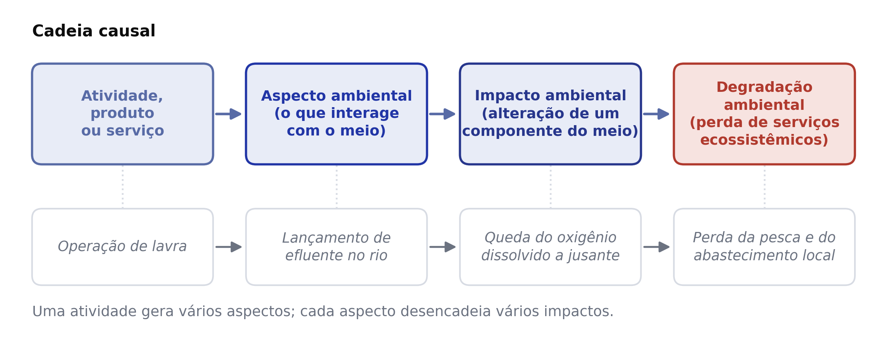{.fig-full fig-alt="Cadeia causal da atividade ao aspecto ambiental, ao impacto e à degradação, com um exemplo aplicado" width="80%" fig-align="center"}

::: {.columns}
::: {.column width="50%"}
### Aspecto × impacto

- **Atividade, produto ou serviço** gera um **aspecto ambiental**, o elemento que interage com o meio.
- O aspecto desencadeia o **impacto**, a alteração sobre um componente do meio.
- Identificar o aspecto é o passo que impede listar impactos sem causa definida.
:::

::: {.column width="50%"}
### Impactos cumulativos e sinérgicos

- **Cumulativo**: soma de impactos de mesma natureza ao longo do tempo.
- **Sinérgico**: efeito conjunto **maior** que a soma das partes.
- Ambos só aparecem quando a análise percorre toda a cadeia, e não apenas o impacto imediato.
:::
:::

---

## Causa, efeito e consequência {.smaller-text}

::: {.columns}
::: {.column width="55%"}
### Qual é a causa de um impacto ambiental?

Uma ação ou um conjunto de ações e atividades humanas.

| Elo | O que é | Exemplo |
|-----|---------|---------|
| **Causa** | Ações ou atividades do empreendimento | Escavação e terraplenagem |
| **Efeito** | Aspectos ou processos ambientais acionados | Exposição do solo e erosão |
| **Consequência** | O que é sofrido pelos receptores ambientais | Assoreamento do rio e perda de pesca |

: {.striped .hover}
:::

::: {.column width="45%"}
::: {.info-box}
**Por que separar os três elos**

A medida mitigadora age sobre a **causa** ou sobre o **efeito**. Quando o estudo descreve apenas a consequência, não há onde intervir, e a resposta acaba sendo compensatória por falta de alternativa.
:::

> Impactos indiretos só aparecem quando a análise segue a cadeia além do primeiro efeito.
:::
:::

---

## Qualidade ambiental {.smaller-text}

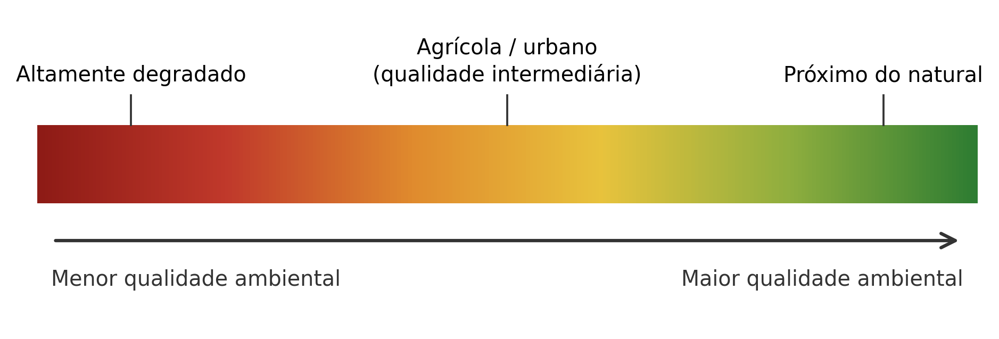{.fig-full fig-alt="Escala contínua de qualidade ambiental, do ambiente altamente degradado ao ambiente próximo do natural" width="82%" fig-align="center"}

::: {.columns}
::: {.column width="50%"}
### Definição

- Medida da condição de um ambiente relativa aos requisitos de uma ou mais espécies e de qualquer necessidade ou objetivo humano.
- Quanto **mais próximo do natural**, maior a qualidade; ambientes agrícolas e urbanos ocupam a faixa **intermediária**.
:::

::: {.column width="50%"}
::: {.info-box}
**Por que a escala importa na AIA**

O impacto é dimensionado como a **perda de qualidade** entre o estado de referência e o estado projetado. Quando o empreendimento não tem um local de referência, compara-se com **áreas modelo**, de alta qualidade ambiental, que funcionam como padrão.
:::
:::
:::

---

## Poluição e serviços ecossistêmicos {.smaller-text}

::: {.columns}
::: {.column width="50%"}
### Poluição (Lei 6.938/1981)

- Introdução, pelo homem, direta ou indiretamente, de substâncias ou energia no ambiente capazes de pôr em risco a saúde humana e causar danos aos recursos vivos e aos ecossistemas.
- Poluentes típicos: elementos químicos nas águas, material particulado, gases, ruído, vibrações, luz, radiações ionizantes.
- **Toda poluição é uma forma de degradação**; há padrões legais de tolerância.
:::

::: {.column width="50%"}
### Serviços ecossistêmicos

| Categoria | Exemplos |
|-----------|----------|
| **Provisão** | Água, alimentos, madeira, fibras |
| **Regulação** | Clima, erosão, polinização, pragas |
| **Suporte** | Ciclagem de nutrientes, formação do solo |
| **Cultural** | Lazer, espiritualidade, paisagem |

: {.striped .hover}

> Impactos ambientais reduzem a oferta de serviços ecossistêmicos; mensurar essa perda é a principal forma de dimensionar os efeitos.
:::
:::

---

## Resistência e resiliência {.smaller-text}

::: {.columns}
::: {.column width="46%"}
### Resistência

- Capacidade do ecossistema de **permanecer em equilíbrio apesar dos distúrbios**, resistindo a modificações (espécies exóticas, degradação de habitat).
- Lê-se na figura como a **magnitude da queda** da função do ecossistema.

### Resiliência

- Capacidade de **retornar ao estado original após a degradação**.
- Lê-se como o **tempo de retorno** ao estado de referência.
- Quanto mais lenta a recuperação, menor a resiliência e mais significativo o impacto.
:::

::: {.column width="54%"}
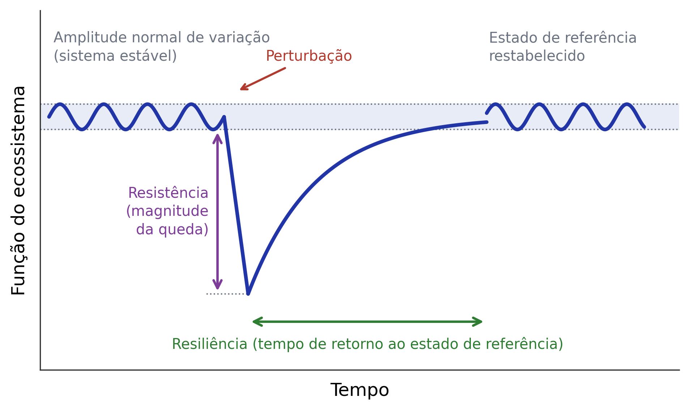{.fig-col fig-alt="Função do ecossistema ao longo do tempo: amplitude normal de variação, perturbação, magnitude da queda (resistência) e tempo de retorno (resiliência)" width="100%"}
:::
:::

---

## Limiares e áreas de baixa resiliência {.smaller-text}

::: {.columns}
::: {.column width="50%"}
### Limiar de mudança de estado

- Um ambiente muito resistente suporta impactos **até o limiar**; ultrapassado esse limite, a degradação é profunda.
- Resiliência é o limite da perturbação que o sistema suporta **retendo função, estrutura e identidade**, antes de mudar de estado.
- Acima do limiar, o retorno ao estado anterior pode simplesmente não ocorrer, e a medida mitigadora perde eficácia.
:::

::: {.column width="50%"}
::: {.highlight-box}
**Áreas de baixa resiliência (APP)**

- Topos de morros, montes, montanhas e serras.
- Encostas com declividade superior a 45°.
- Nascentes (raio mínimo de 50 m).
- Matas ciliares (30 a 500 m de cada margem, conforme a largura do curso d'água).

Impactos nessas áreas costumam ser altamente significativos.
:::
:::
:::

---

## Recuperação ambiental {.smaller-text}

::: {.columns}
::: {.column width="55%"}
| Modalidade | Significado |
|------------|-------------|
| **Restauração** | Retorno às condições anteriores |
| **Reabilitação** | Ecossistema alternativo para outro uso |
| **Revitalização** | Recuperação de ambientes urbanos e rios degradados |
| **Remediação** | Remoção ou contenção de contaminantes |

: {.striped .hover}

> Recuperar é manejar para um objetivo; restaurar é voltar ao estado original, o que nem sempre é possível.
:::

::: {.column width="45%"}
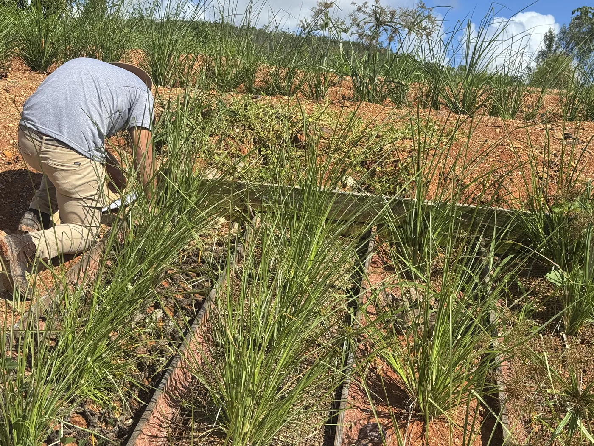{.fig-col fig-alt="Área em processo de revegetação, exemplo de recuperação ambiental" width="100%"}
:::
:::

---

## O impacto depende do projeto e do lugar {.smaller-text}

::: {.columns}
::: {.column width="50%"}
### Duas assimetrias que o estudo precisa reconhecer

- O **mesmo projeto** instalado em **locais diferentes** produz impactos ambientais diferentes.
- O **mesmo local** receptor de **projetos diferentes** também produz impactos diferentes.
- Por isso a pontuação de um estudo **não é transferível** para outro empreendimento nem para outro sítio.
:::

::: {.column width="50%"}
::: {.highlight-box}
**Percepção do risco**

Os impactos e os riscos ambientais **não são percebidos da mesma forma** por pessoas ou grupos sociais diferentes. O que para o empreendedor é um efeito marginal pode ser, para a comunidade afetada, a perda do meio de vida.
:::

> A consulta pública não serve apenas para informar: é o instrumento que traz essa diferença de percepção para dentro do estudo.
:::
:::

# 2 · O processo de AIA e o licenciamento {.section-header rotulo="Processo de AIA"}
## O que é a AIA {.smaller-text}

::: {.columns}
::: {.column width="52%"}
### Definições

- **Sánchez (2013)**: conjunto de procedimentos voltados a **prever**, **analisar** e **comunicar** as consequências ambientais prováveis de uma ação proposta.
- **Bitar & Ortega (1998)**: série de procedimentos legais, institucionais e técnico-científicos para **caracterizar impactos potenciais** e **prever magnitude e importância**.

### Objetivos e abordagem

- **Impedir a degradação**, **reduzir a degradação** e **promover o desenvolvimento sustentável**.
- Abordagem **multidisciplinar**: meio físico e ecológico somados às dimensões econômica, social e cultural.
:::

::: {.column width="48%"}
::: {.info-box}
**Funções da AIA**

- **Técnica** - identificar e quantificar impactos.
- **Decisória** - subsidiar a autorização ou a negação do projeto.
- **De negociação** - estabelecer medidas mitigadoras e compensatórias.
- **De aprendizado social** - produzir conhecimento territorial público.
:::

> A AIA não é um documento: é um processo que atravessa todo o ciclo de vida do empreendimento.
:::
:::

---

## Marco regulatório e tipos de estudo {.smaller-text}

::: {.columns}
::: {.column width="46%"}
### Marco regulatório (Brasil)

| Norma | Conteúdo |
|-------|----------|
| Lei 6.938/1981 | PNMA, institui a AIA como instrumento |
| Res. CONAMA 01/1986 | Define impacto e exige EIA/RIMA |
| Res. CONAMA 237/1997 | Procedimentos do licenciamento (LP/LI/LO) |
| LC 140/2011 | Competências federativas |

: {.striped .hover}
:::

::: {.column width="54%"}
### Tipos de estudo

| Estudo | Quando se aplica |
|--------|------------------|
| **EIA/RIMA** | Atividades de **significativo** impacto |
| **RAS / RCA** | Atividades de médio porte (varia por UF) |
| **PRAD** | Recuperação de áreas degradadas |
| **PBA** | Programas Básicos Ambientais (condicionantes da LP) |
| **AAE** | Avaliação Ambiental Estratégica (planos e políticas) |

: {.striped .hover}

> A AAE atua em escala mais ampla (políticas, planos e programas); o EIA atua em escala de projeto.
:::
:::

---

## Enquadramento: porte, potencial poluidor e localização {.smaller-text}

::: {.columns}
::: {.column width="55%"}
### Porte × potencial poluidor

- A **tipologia** do empreendimento cruza o **porte** (pequeno, médio, grande) com o **potencial poluidor** (pequeno, médio, grande) para água, solo e ar.
- Em Minas Gerais, a DN COPAM nº 217/2017 define **seis classes** (1 a 6), que determinam o tipo de estudo exigido.
- Classes menores admitem **licenciamento simplificado** ou **RAS**; classes maiores exigem **EIA/RIMA**.
:::

::: {.column width="45%"}
### Critérios locacionais

- Recebem **peso** os critérios de localização: unidades de conservação, supressão em APP, reserva da biosfera.
- Fatores de **restrição ou vedação** podem inviabilizar o empreendimento naquele local.

::: {.info-box}
**Leitura-chave**

O enquadramento define quanto estudo será exigido; a localização pode, sozinha, encerrar a discussão.
:::
:::
:::

---

## As três licenças ambientais {.smaller-text}

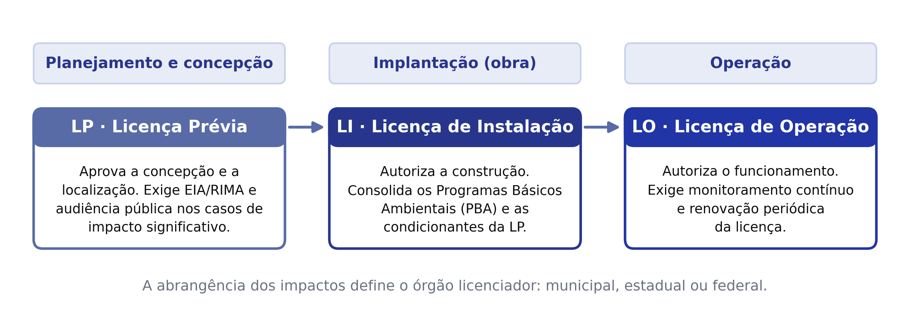{.fig-full fig-alt="Sequência das licenças ambientais LP, LI e LO associada às fases de planejamento, implantação e operação" width="88%" fig-align="center"}

> As licenças são **sequenciais e condicionadas**: a LI só é emitida se as condicionantes da LP forem atendidas, e a LO depende da execução dos programas firmados na LI.

---

## As nove etapas do processo de AIA {.smaller-text}

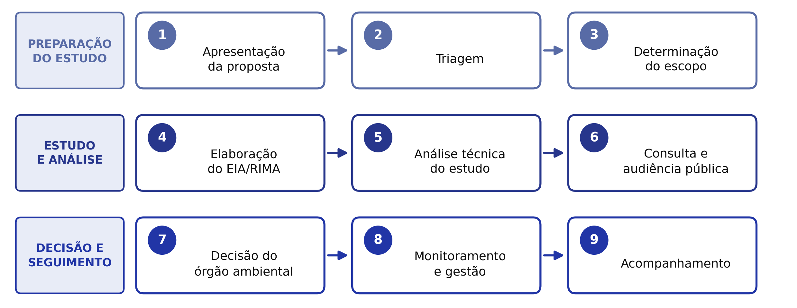{.fig-full fig-alt="As nove etapas do processo de AIA, da apresentação da proposta ao acompanhamento, agrupadas em preparação, estudo e análise, decisão e seguimento" width="90%" fig-align="center"}

::: {.columns}
::: {.column width="50%"}
- [1]{.circle} **Apresentação da proposta** - descrição geral, localização e características técnicas.
- [2]{.circle} **Triagem** - selecionar as ações com potencial de causar alterações significativas e decidir se há necessidade de estudos aprofundados.
- [3]{.circle} **Determinação do escopo** - abrangência e profundidade; preparação do termo de referência ou das instruções técnicas.
- [4]{.circle} **Elaboração do EIA** - avaliar os componentes do projeto e os elementos e processos ambientais que podem ser alterados.
- [5]{.circle} **Análise técnica** - conformidade ao termo de referência e aos requisitos aplicáveis; grau de magnitude dos impactos e adequação das medidas propostas.
:::

::: {.column width="50%"}
- [6]{.circle} **Consulta pública** - durante a realização do estudo ou após a sua conclusão.
- [7]{.circle} **Decisão** - realizada pelo órgão ambiental.
- [8]{.circle} **Monitoramento e gestão** - reduzir, eliminar e compensar impactos negativos, potencializar os positivos e confirmar as previsões feitas, com ajustes e correções.
- [9]{.circle} **Acompanhamento** - fiscalização, supervisão e/ou auditoria e monitoramento.

> A sequência é a mesma em qualquer rito; o que muda entre estados e tipologias é a profundidade exigida em cada etapa.
:::
:::

---

## Planejamento e execução do estudo {.smaller-text}

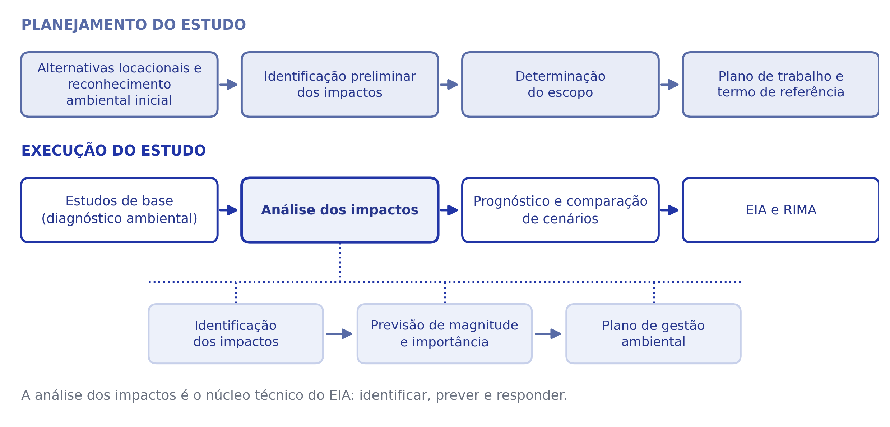{.fig-full fig-alt="Fluxo do estudo: na fase de planejamento, alternativas, identificação preliminar, escopo e plano de trabalho; na execução, estudos de base, análise dos impactos, prognóstico e EIA/RIMA" width="90%" fig-align="center"}

::: {.columns}
::: {.column width="50%"}
### Planejamento

A caracterização das **alternativas** e o **reconhecimento ambiental inicial** alimentam a identificação preliminar dos impactos, que por sua vez define o **escopo** e o plano de trabalho.
:::

::: {.column width="50%"}
### Execução

O plano de trabalho e o termo de referência comandam os **estudos de base**; a **análise dos impactos** encadeia identificação, previsão de magnitude e plano de gestão, e desemboca no EIA e no RIMA.
:::
:::

---

## Entender o projeto antes de prever impactos {.smaller-text}

::: {.columns}
::: {.column width="52%"}
### O que precisa estar descrito

| Elemento do projeto | Por que importa |
|---------------------|-----------------|
| Atividades de **preparação do terreno** | Definem supressão, movimentação de solo e erosão |
| **Processo construtivo** | Define ruído, poeira, tráfego e resíduos de obra |
| **Forma de operação** | Define efluentes, emissões e consumo de água |
| **Insumos e matérias-primas** consumidos | Definem demanda de recursos e risco de contaminação |
| **Tipos de resíduos** gerados | Definem passivos e exigências de destinação |
| **Mão de obra** empregada | Define pressão sobre serviços e dinâmica social |

: {.striped .hover}
:::

::: {.column width="48%"}
::: {.highlight-box}
**Regra de ouro**

Entender o projeto é fundamental para saber **quais impactos** podem ocorrer e **quais alternativas** existem. Sem a descrição técnica, o estudo lista impactos genéricos, que não se ligam a nenhuma ação e, portanto, não podem ser mitigados.
:::

::: {.info-box}
**Quando não há empreendimento**

Em áreas sem projeto definido, a identificação de impactos é feita por comparação com **áreas modelo**, trechos de alta qualidade ambiental que funcionam como referência do que foi perdido.
:::
:::
:::

---

## Triagem e determinação do escopo {.smaller-text}

::: {.columns}
::: {.column width="50%"}
### Triagem

- Selecionar as ações que tenham potencial de causar **alterações ambientais significativas**.
- Decidir sobre a necessidade ou não de **estudos aprofundados**, ou de avaliação prévia.

### Determinação do escopo

- Estabelecer a **abrangência** (temas e questões abordados) e a **profundidade** dos estudos (nível de detalhamento).
- Preparar o **termo de referência** ou as instruções técnicas.
- Identificar, prever, avaliar e gerenciar os impactos **significativos**, e só eles.
:::

::: {.column width="50%"}
::: {.info-box}
**O que define o foco do escopo**

- Importância dos **recursos ambientais ou culturais** envolvidos, ou vulnerabilidade das comunidades humanas.
- **Experiência profissional** dos analistas.
- **Opinião do público** e conhecimento local.
:::

> Escopo mal definido produz os dois erros clássicos: estudo volumoso sobre o que não importa e silêncio sobre o impacto decisivo.
:::
:::

---

## Termo de referência e plano de trabalho {.smaller-text}

::: {.columns}
::: {.column width="55%"}
### Fluxo do estudo

1. Apresentação da **proposta**, das características técnicas e da **justificativa locacional**.
2. Seleção das **ações** potencialmente causadoras de alterações.
3. **Triagem e escopo**: abrangência, profundidade e questões prioritárias.
4. Preparação do **Termo de Referência**.
5. **Plano de trabalho** e **estudos de base** (diagnóstico).
6. Identificação e **previsão** dos impactos.
7. Análise técnica, **consulta pública** e decisão do órgão ambiental.
8. **Monitoramento** e plano de gestão.
:::

::: {.column width="45%"}
::: {.info-box}
**Termo de Referência**

Roteiro do órgão ambiental com o conteúdo mínimo do EIA/RIMA (meios físico, biótico e socioeconômico). A empresa pode detalhar além do mínimo, jamais reduzi-lo.
:::

::: {.highlight-box}
**Resposta aos impactos**

Evitar → Reduzir → Corrigir → Compensar
:::
:::
:::

---

## Análise técnica, decisão e acompanhamento {.smaller-text}

::: {.columns}
::: {.column width="52%"}
| Etapa | O que se verifica |
|-------|-------------------|
| **Análise técnica** | Conformidade ao termo de referência e à regulamentação; grau de magnitude dos impactos e adequação das medidas mitigadoras propostas |
| **Consulta pública** | Pode ocorrer durante a realização do estudo ou após a sua conclusão |
| **Decisão** | Realizada pelo órgão ambiental competente |
| **Monitoramento e gestão** | Reduzir, eliminar e compensar impactos negativos; potencializar os positivos; confirmar as previsões feitas e aplicar ajustes e correções |
| **Acompanhamento** | Fiscalização; supervisão e/ou auditoria; monitoramento |

: {.striped .hover}
:::

::: {.column width="48%"}
::: {.highlight-box}
**A diferença entre monitorar e acompanhar**

**Monitorar** é medir indicadores e verificar se a previsão se confirmou. **Acompanhar** é o controle externo sobre o empreendedor: fiscalização, supervisão e auditoria.
:::

> Nenhum dos dois é medida mitigadora: eles informam se a medida adotada está funcionando.
:::
:::

# 3 · Diagnóstico, dados e áreas de influência {.section-header rotulo="Diagnóstico"}
## Estudos de base: o que o diagnóstico entrega {.smaller-text}

::: {.columns}
::: {.column width="52%"}
### Função dos estudos de base

Obter as informações necessárias à identificação e à previsão de impactos **específicas daquele empreendimento**.

- Mostram a **dinâmica ambiental** da área afetada.
- Utilizam **indicadores apropriados** para descrever as condições ambientais.
- Descrevem e analisam a **situação atual** da área de estudo.
- Levantam componentes e processos dos meios **físico, biótico e antrópico** e, sobretudo, as **interações** entre eles.
:::

::: {.column width="48%"}
::: {.info-box}
**Produto do planejamento dos estudos**

1. Definir o tipo de informação que se pretende coletar.
2. Definir se serão necessários dados primários e secundários.
3. Estabelecer as escalas temporal e espacial dos estudos.
4. Estabelecer os métodos de coleta.
5. Verificar a necessidade de análises laboratoriais e os procedimentos de coleta.
6. Tratar e interpretar os dados.
:::

> Os resultados precisam possibilitar a comparação **multitemporal**: antes e depois da implantação do projeto.
:::
:::

---

## Diagnóstico e prognóstico {.smaller-text}

::: {.columns}
::: {.column width="58%"}
### Diagnóstico ambiental

Caracterização do estado de referência (cenário **sem** o empreendimento) em três meios:

| Meio | Componentes |
|------|-------------|
| **Físico** | Clima, geologia, geomorfologia, solos, hidrologia, hidrogeologia, qualidade do ar e da água |
| **Biótico** | Flora, fauna terrestre, aquática e cavernícola, ecossistemas, espécies ameaçadas |
| **Antrópico** | População, atividades econômicas, patrimônio cultural, infraestrutura, governança |

: {.striped .hover}
:::

::: {.column width="42%"}
::: {.info-box}
**Prognóstico**

Projeção do estado ambiental em dois cenários:

- **Sem o empreendimento** (tendência atual).
- **Com o empreendimento** (em uma ou mais alternativas locacionais/tecnológicas).

A diferença entre cenários = **impacto previsto**.
:::
:::
:::

---

## Áreas de influência: ADA, AID e AII {.smaller-text}

::: {.columns}
::: {.column width="62%"}
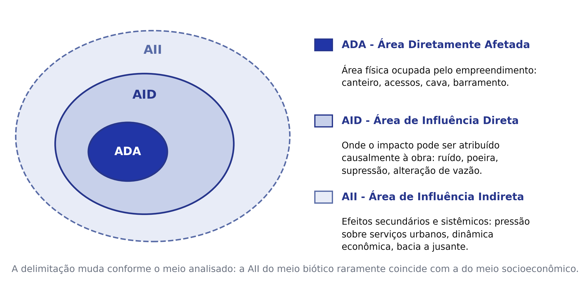{.fig-col fig-alt="Áreas de influência representadas como círculos concêntricos: ADA no centro, AID intermediária e AII externa" width="100%"}
:::

::: {.column width="38%"}
- **ADA** - área que sofre a ação direta do planejamento, da implantação, da operação e da desativação; área de consequências mais significativas dos impactos diretos ou de primeira ordem.
- **AID** - implantação de obras e atividades, infraestrutura, transporte e distribuição de produtos, insumos e água.
- **AII** - conjunto ou parte dos municípios envolvidos e bacia hidrográfica abrangida.

::: {.highlight-box}
**Importante**

A delimitação **varia com a categoria do impacto**: socioeconômico, físico e biótico exigem recortes próprios e justificados.
:::
:::
:::

---

## Dados primários e secundários {.smaller-text}

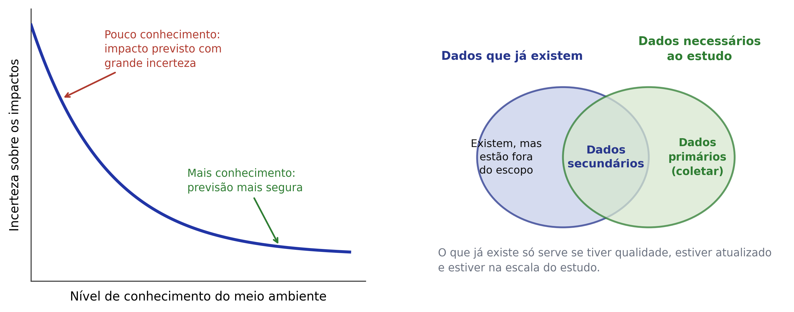{.fig-full fig-alt="À esquerda, incerteza sobre os impactos decrescendo com o nível de conhecimento do meio; à direita, diagrama de conjuntos entre dados existentes, secundários e primários" width="88%" fig-align="center"}

::: {.columns}
::: {.column width="50%"}
### Dados primários, por ordem de prioridade

- Diagnóstico dos elementos que **sofrerão maior impacto**.
- **Lacunas** de dados.
- **Especificidades locais**.
:::

::: {.column width="50%"}
### Dados secundários, condições de uso

- **Alta qualidade**.
- **Atualizados**.
- **Escala apropriada** ao estudo.
:::
:::

---

## Esforço amostral e curva do coletor {.smaller-text}

::: {.columns}
::: {.column width="55%"}
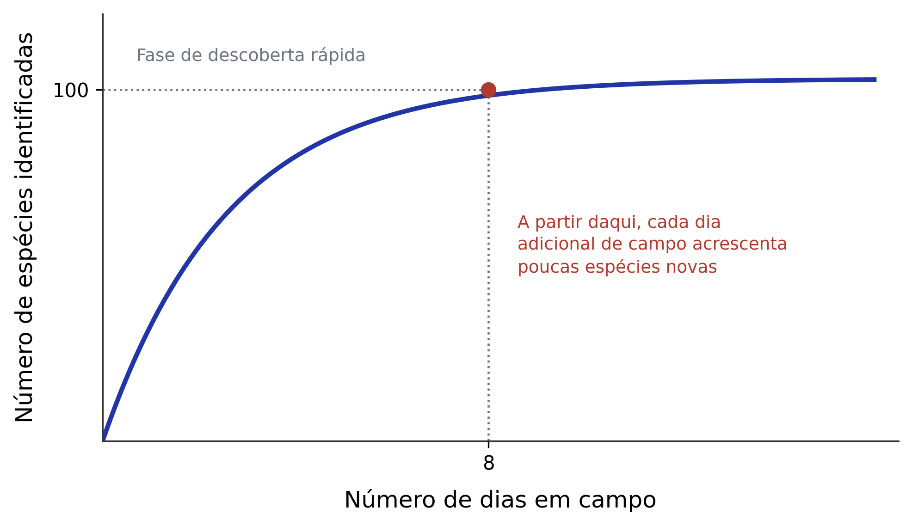{.fig-col fig-alt="Curva do coletor: número de espécies identificadas em função do número de dias em campo, com estabilização em 100 espécies por volta do oitavo dia" width="100%"}
:::

::: {.column width="45%"}
### Como se lê a curva

- No início, cada dia de campo acrescenta muitas espécies novas.
- A curva se estabiliza quando o inventário se aproxima da riqueza real: no exemplo, **100 espécies ao redor do oitavo dia**.
- A partir da estabilização, o esforço adicional tem baixo retorno, e é aí que se justifica encerrar a amostragem.

::: {.info-box}
**Planejar o esforço**

Definir **quantas coletas** e **por quanto tempo** é parte do termo de referência, não decisão de campo.
:::
:::
:::

---

## Desenho da amostragem {.smaller-text}

::: {.columns}
::: {.column width="52%"}
| Decisão | Alternativas | Quando usar cada uma |
|---------|--------------|----------------------|
| **Cobertura** | Inventário ou amostragem | Inventário quando a área é pequena ou o elemento é raro; amostragem no restante |
| **Tempo** | Séries temporais ou amostragens únicas | Amostragem única quando a qualidade ou o elemento é **estável**, com pouca variação temporal |
| **Regime** | Contínua ou discreta | A **contínua** é mais empregada no monitoramento operacional; a **discreta** cobre a maior parte dos estudos de base |

: {.striped .hover}
:::

::: {.column width="48%"}
::: {.info-box}
**Quando a área vale mais que o tempo**

Para elementos estáveis e de pouca variação temporal, **a área amostrada é mais importante que a temporalidade**: cobre-se mais espaço em menos campanhas.
:::

> O inverso vale para qualidade da água e ruído, em que a variação intra-anual é o próprio objeto da medição.
:::
:::

# 4 · Identificação e avaliação de impactos {.section-header rotulo="Impactos"}
## Identificação preliminar dos impactos {.smaller-text}

::: {.columns}
::: {.column width="52%"}
### Prováveis alterações no meio causadas pelo empreendimento

- Degradação dos recursos hídricos.
- Perda de solo.
- Degradação da vegetação.
- Poluição sonora.
- Degradação da qualidade do ar.

### Como se chega a essa lista

- **Analogia** com casos similares.
- **Experiência e opinião** de especialistas.
- **Consulta ao público**.
- Análise das questões definidas previamente **por via legal** (espécies raras e áreas protegidas).
:::

::: {.column width="48%"}
::: {.highlight-box}
**Nem todo impacto pesa igual**

Alguns impactos deverão ser considerados **mais importantes que outros** e receber mais atenção no EIA. A identificação preliminar existe justamente para hierarquizar o esforço antes de gastá-lo.
:::

::: {.info-box}
**Fonte do conhecimento**

Analogia com situações similares e experiência da **equipe multidisciplinar** ou de consultores externos são as duas vias mais usadas quando ainda não há dado primário.
:::
:::
:::

---

## Identificação por fase do ciclo de vida {.smaller-text}

::: {.columns}
::: {.column width="55%"}
### Fases do empreendimento

| Fase | Exemplos de impacto |
|------|---------------------|
| **Planejamento** | Tensão social e expectativa fundiária |
| **Implantação** | Supressão de vegetação, poeira, ruído, resíduos de construção |
| **Operação** | Efluentes, emissões, consumo de água, tráfego |
| **Desativação** | Demolição, reabilitação ou recuperação da área |

: {.striped .hover}

- O mesmo impacto pode ocorrer em mais de uma fase, com gravidade diferente em cada uma.
:::

::: {.column width="45%"}
### Exemplo: transposição do rio São Francisco

| Impacto | Fases em que ocorre |
|---------|---------------------|
| Tensões e riscos sociais | Planejamento e construção |
| Aumento da emissão de poeira | Construção e operação |
| Aumento ou aparecimento de doenças | Construção e operação |
| Demanda por infraestrutura de saúde | Construção |
| Perda de terras agricultáveis | Construção |
| Geração de renda e empregos | Construção e operação |

: {.striped .hover}
:::
:::

---

## Métodos de identificação: panorama {.smaller-text}

::: {.columns}
::: {.column width="50%"}
### Os seis métodos clássicos

1. Métodos **ad hoc**.
2. **Listas de verificação** (*checklists*).
3. **Matrizes de interação**.
4. **Redes de interação** (diagramas de sistema).
5. **Superposição de cartas**.
6. **Modelos de simulação**.

E, na prática, a **combinação de métodos**, com dois ou mais aplicados em conjunto.
:::

::: {.column width="50%"}
::: {.info-box}
**Como relacionar os impactos**

- **Com empreendimento definido**: relacionar os impactos com **cada atividade** do empreendimento.
- **Sem empreendimento definido**: relacionar com **áreas modelo**, de alta qualidade ambiental.
:::

> Nenhum método isolado dá conta do estudo. A escolha depende do que se quer enxergar: impactos diretos, encadeamentos, conflitos espaciais ou dinâmica temporal.
:::
:::

---

## Métodos 1 a 4 {.smaller-text}

| Método | Descrição | Aplicação | Vantagens (+) e desvantagens (−) |
|--------|-----------|-----------|----------------------------------|
| [1]{.circle} **Ad hoc** | Reunião de especialistas | Avaliações rápidas | **+** Rapidez e baixo custo   **−** Alto grau de subjetividade |
| [2]{.circle} **Checklist** (lista de verificação) | Listagens de fatores e impactos ambientais | Do diagnóstico ambiental até a comparação de alternativas | **+** Memorização de todos os fatores   **−** Não identifica impactos diretos e indiretos, características temporais e dinâmica dos sistemas |
| [3]{.circle} **Matrizes de interação** | Listagem de controle bidimensional (fatores × ações) | Identificação de impactos diretos | **+** Boa visualização, simplicidade e baixo custo   **−** Não identifica impactos indiretos, características temporais e dinâmica; subjetividade na magnitude   *Exemplos: Leopold; Fisher e Davies* |
| [4]{.circle} **Redes de interação** | Gráfico ou diagrama da cadeia de impacto | Determinação de impactos diretos e indiretos | **+** Abordagem integrada de impactos e interações; cruzamento de disciplinas (fauna, água, solo)   **−** Não detectam importância relativa dos impactos, aspectos temporais e espaciais nem a dinâmica dos sistemas |

: {.striped .hover}

---

## Métodos 5 a 7 {.smaller-text}

| Método | Descrição | Aplicação | Vantagens (+) e desvantagens (−) |
|--------|-----------|-----------|----------------------------------|
| [5]{.circle} **Superposição de cartas** | Cartas geradas por superposição de mapas de recursos e usos | Projetos lineares e diagnóstico ambiental | **+** Boa visualização e exposição de dados   **−** Resultados subjetivos; não quantifica magnitude; difícil integração de dados socioeconômicos; não considera a dinâmica dos sistemas |
| [6]{.circle} **Simulação** | Modelos matemáticos automatizados que simulam o comportamento de determinado sistema ambiental | Diagnósticos e prognósticos da qualidade ambiental | **+** Considera a dinâmica dos sistemas, as interações entre fatores e impactos e a variável temporal   **−** Custo elevado; representação da qualidade imperfeita |
| [7]{.circle} **Combinação de métodos** | Utilização de dois ou mais métodos | Avaliar impactos negativos de projetos, em uso simples ou múltiplo | **+** Simplicidade, rapidez e baixo custo na avaliação de impactos negativos; boa visualização   **−** Alto grau de controle governamental no planejamento ambiental; avaliação globalizada pouco segura |

: {.striped .hover}

---

## Matriz de Leopold {.smaller-text}

::: {.columns}
::: {.column width="58%"}
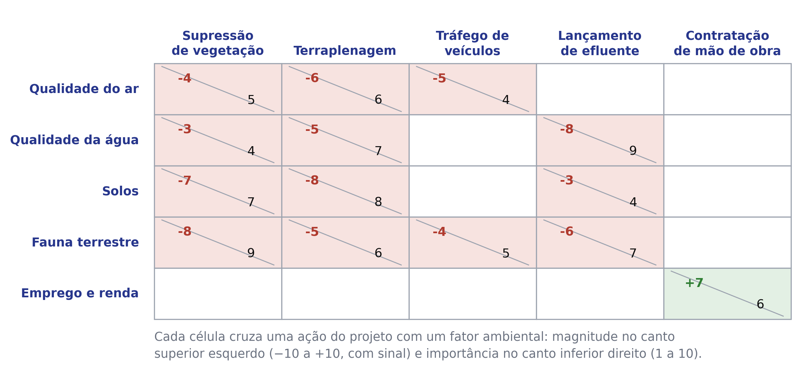{.fig-col fig-alt="Esquema de matriz de interação com ações do projeto nas colunas e fatores ambientais nas linhas, magnitude e importância em cada célula" width="100%"}
:::

::: {.column width="42%"}
- Cruza **componentes do projeto** (colunas) com **elementos do meio** (linhas).
- Cada célula recebe **magnitude** e **importância**, em escala de **0 a 10**, com sinal positivo ou negativo.
- É a matriz **mais utilizada** na prática brasileira.
- Objetiva e permite **hierarquizar** impactos.
- Não capta impactos indiretos nem a dinâmica temporal.
- A pontuação **não é transferível** entre empreendimentos ou locais.
:::
:::

---

## Matriz ponderada {.smaller-text}

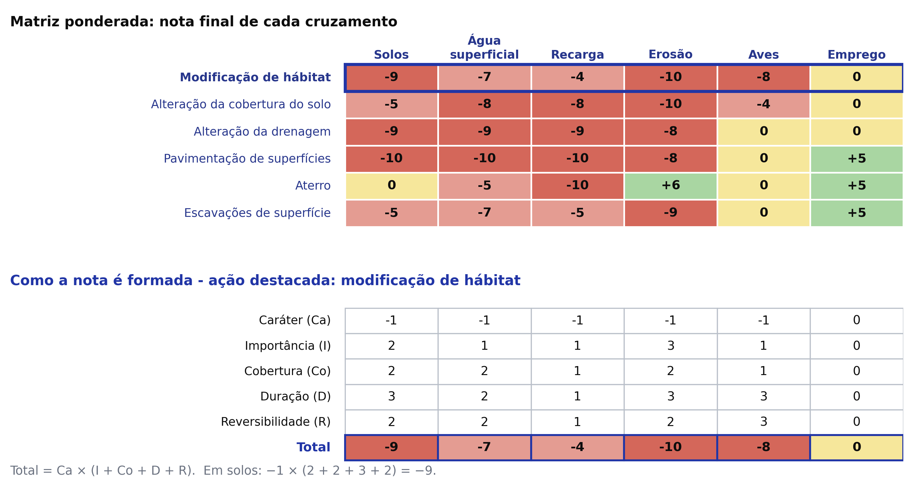{.fig-full fig-alt="Matriz ponderada com a nota final de cada cruzamento e, abaixo, a decomposição da ação modificação de hábitat em caráter, importância, cobertura, duração e reversibilidade" width="86%" fig-align="center"}

A nota de cada célula não é arbitrada diretamente: ela resulta do **caráter** (Ca, positivo ou negativo), da **importância** (I), da **cobertura** (Co), da **duração** (D) e da **reversibilidade** (R), combinados como **Total = Ca × (I + Co + D + R)**. Para a modificação de hábitat sobre os solos, isso dá −1 × (2 + 2 + 3 + 2) = **−9**.

---

## O que a nota não resolve {.smaller-text}

::: {.columns}
::: {.column width="50%"}
### Leitura da matriz ponderada

- Permite comparar **alternativas** e **fases** do empreendimento.
- Hierarquiza os impactos mais significativos sem depender da impressão de um único avaliador.
- Torna explícito **por que** uma célula pesa mais que outra.
:::

::: {.column width="50%"}
::: {.highlight-box}
**Limites**

- Os pesos são **decisões de quem avalia** e precisam estar justificados.
- Somar impactos de naturezas distintas pode esconder um impacto inaceitável dentro de um total aceitável.
- Impactos sobre áreas de baixa resiliência exigem análise própria, e não apenas um número.
:::
:::
:::

---

## Redes de interação: o caso da urbanização {.smaller-text}

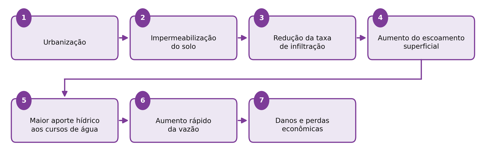{.fig-full fig-alt="Cadeia de impacto da urbanização: impermeabilização do solo, redução da infiltração, aumento do escoamento superficial, maior aporte hídrico, aumento da vazão e danos econômicos" width="92%" fig-align="center"}

A rede expõe o que a matriz não mostra: o impacto economicamente relevante, **danos e perdas**, está a **seis elos** da ação inicial. Mitigar no elo 7 é indenização; mitigar nos elos 2 e 3, com manutenção de áreas permeáveis, é prevenção.

---

## Impactos diretos e indiretos {.smaller-text}

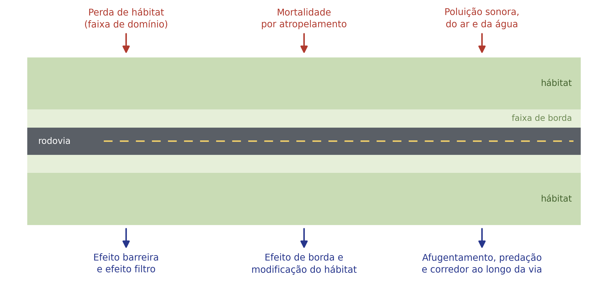{.fig-full fig-alt="Esquema de rodovia com impactos diretos acima (perda de hábitat, atropelamento, poluição) e indiretos abaixo (efeito barreira e filtro, efeito de borda, afugentamento, predação e corredor)" width="92%" fig-align="center"}

Para certos empreendimentos, os **impactos indiretos podem ser tão ou mais importantes que os diretos**. A faixa de domínio de uma rodovia representa uma perda de hábitat pequena em área, mas o efeito barreira, o efeito de borda e o corredor de dispersão ao longo da via reorganizam a fauna de toda a paisagem atravessada.

---

## Classificação dos impactos {.smaller-text}

::: {.columns}
::: {.column width="50%"}
| Atributo | O que expressa |
|----------|----------------|
| **Magnitude** | Estimativa qualitativa ou quantitativa da intensidade do impacto |
| **Duração** | Período de tempo que o impacto, se ocorrer, deverá durar |
| **Reversibilidade** | Natural ou por intermédio de ação humana |
| **Relevância** | De acordo com leis locais, nacionais ou tratados internacionais |
| **Probabilidade de ocorrência** | Estimativas qualitativas ou quantitativas de que o impacto ocorra |
| **Distribuição social dos riscos e benefícios** | De que maneira o empreendimento impõe repartição desigual de riscos e benefícios ambientais |

: {.striped .hover}
:::

::: {.column width="50%"}
### Exemplo de valoração justificada

| Elemento | Valor | Justificativa |
|----------|-------|---------------|
| Vegetação terrestre | Pequeno | Vegetação é comum |
| Ictiofauna | Grande | Habitats aquáticos de qualidade; espécies utilizadas para alimentação da população |
| Avifauna terrestre | Pequeno | Espécies comuns, não utilizadas para alimentação |
| Lazer e turismo | Médio | Uso atual limitado, sem atrativos particulares; há potencial de desenvolvimento que favorece a economia local |
| Arqueologia | Grande | Sítios relativamente raros, importantes para a história das populações locais |

: {.striped .hover}
:::
:::

---

## Hierarquização dos impactos {.smaller-text}

::: {.columns}
::: {.column width="50%"}
### A sequência de trabalho

1. **Identificação** dos prováveis impactos ambientais.
2. **Classificação ou hierarquização** dos impactos listados, selecionando os mais importantes ou significativos.
3. Preparação prévia de um **plano de estudos**.
4. **Estudo das condições do meio ambiente** - o reconhecimento.
:::

::: {.column width="50%"}
::: {.info-box}
**Por que hierarquizar antes de estudar**

A hierarquização define onde o esforço amostral será gasto. Estudar tudo com a mesma profundidade é a forma mais cara de não enxergar o impacto decisivo.
:::

> O valor atribuído a cada elemento precisa vir acompanhado da **justificativa**, porque é ela, e não o número, que o órgão ambiental analisa.
:::
:::

# 5 · Mitigação, monitoramento e participação {.section-header rotulo="Mitigação"}
## Hierarquia da mitigação {.smaller-text}

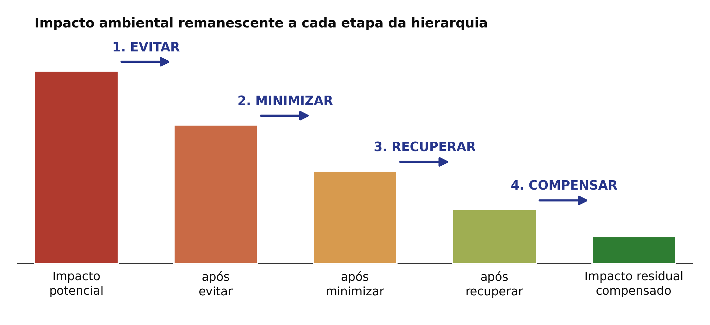{.fig-full fig-alt="Hierarquia da mitigação: barras decrescentes do impacto potencial ao impacto residual compensado, com as etapas evitar, minimizar, recuperar e compensar" width="72%" fig-align="center"}

::: {.columns}
::: {.column width="50%"}
1. **Evitar** - impactos e prevenir riscos.
2. **Reduzir / minimizar** - impactos negativos.
3. **Corrigir / recuperar** - depois da ocorrência, ao final de cada etapa do ciclo de vida.
4. **Compensar** - impactos que não podem ser evitados ou reduzidos.
:::

::: {.column width="50%"}
> Evitar impactos adversos é **uma das principais funções da AIA**, e a ordem da hierarquia é uma ordem de **preferência**, não uma lista de opções equivalentes.

> Compensação é **último recurso**: ela não desfaz o impacto, apenas o contrabalança em outro lugar. Referência: BBOP / CSBI.
:::
:::

---

## A hierarquia na prática {.smaller-text}

::: {.columns}
::: {.column width="55%"}
| Nível | Exemplo aplicado |
|-------|------------------|
| **Evitar** | Remover a vegetação anteriormente ao alagamento de uma área |
| **Reduzir / minimizar** | Fazer o manejo da fauna durante a supressão vegetal |
| **Corrigir** (depois da ocorrência) | Na identificação de processos erosivos não passíveis de controle, realizar a contenção e a estabilização da erosão |
| **Compensar** | Criação de Unidades de Conservação; desenvolver as ações propostas no Programa de Educação Ambiental |

: {.striped .hover}
:::

::: {.column width="45%"}
::: {.info-box}
**Como ler a tabela**

Os quatro exemplos tratam do **mesmo** impacto de supressão de vegetação em área a ser alagada. Mudam o **momento** da intervenção e, com ele, o que ainda é possível salvar.
:::

> Quanto mais à direita na hierarquia, menor o grau de liberdade do empreendedor e maior o custo por unidade de impacto evitado.
:::
:::

---

## Medidas mitigadoras típicas {.smaller-text}

::: {.columns}
::: {.column width="57%"}
| Categoria | Exemplo |
|-----------|---------|
| Construtivas | Cortinas de drenagem, *sed-traps* |
| Operacionais | Programa de educação ambiental, gestão de resíduos |
| Compensatórias | UCs (SNUC), pagamento por serviços ambientais |
| Reparadoras | PRAD, recomposição de APP |
| Valorização de benefícios | Priorizar contratação e capacitação da mão de obra local |

: {.striped .hover}
:::

::: {.column width="43%"}
::: {.highlight-box}
**O que não é medida mitigadora**

Exigências legais (licenças, outorga) e **monitoramento** não mitigam: mitigar é **agir sobre o impacto**. Monitorar apenas informa se a medida adotada está funcionando.
:::

> Medidas copiadas de outros empreendimentos costumam falhar; a medida precisa ser ajustada ao contexto local.
:::
:::

---

## Monitoramento e PBA {.smaller-text}

::: {.columns}
::: {.column width="55%"}
### Plano de Monitoramento

- Indicadores específicos para cada impacto previsto.
- **Linha de base** estabelecida antes da implantação.
- Fases **pré-operacional**, **operacional** e **pós-operacional**.
- Frequência compatível com a dinâmica do processo monitorado.
- Limiares de alerta e de ação corretiva.

### Programas Básicos Ambientais (PBA)

Detalham as condicionantes da LP. Exemplos típicos:

- **Gestão e supervisão**: PGA, PCS, PEA e gerenciamento de riscos (PGR).
- **Monitoramento biofísico**: qualidade da água, fauna, flora e ruído.
- **Recuperação e compensação**: PRAD e programas de reassentamento.
:::

::: {.column width="45%"}
::: {.info-box}
**Estudo Orientado nº 4** (entrega na aula seguinte)

Selecionar um EIA/RIMA público (SIBE/IBAMA ou órgão estadual) e identificar:

1. Áreas de influência (ADA, AID, AII).
2. Três principais impactos previstos.
3. Lacunas no diagnóstico ambiental.
4. Coerência da hierarquia de mitigação.
5. Adequação do plano de monitoramento.
:::
:::
:::

---

## Participação pública {.smaller-text}

::: {.columns}
::: {.column width="50%"}
### Audiência e consulta pública

- Envolve indivíduos e grupos afetados, positiva ou negativamente, pela intervenção proposta.
- A **audiência pública** é obrigatória no rito do EIA/RIMA; a **consulta** pode ocorrer durante a realização do estudo ou após a sua conclusão.
- Legitima a decisão, reduz conflitos e prazos e melhora a aceitação do projeto.

### Contribuições do público

- Proposição de medidas mitigadoras adequadas à realidade local.
- Redução de conflitos com comunidades, órgãos públicos e ONGs.
- Na prática, muitas vezes a participação limita-se ao direito de **ser informado** e de **exprimir pontos de vista**, com expectativa de influenciar a decisão.
:::

::: {.column width="50%"}
::: {.info-box}
**Quem participa**

Poder Executivo e Legislativo, órgãos públicos, conselhos, entidades da sociedade civil e pessoas físicas afetadas.

> Medidas mitigadoras copiadas de outros empreendimentos costumam falhar; o conhecimento local ajusta a medida ao contexto.
:::
:::
:::

---

## Exercício: ler o impacto na imagem {.smaller-text}

::: {.columns}
::: {.column width="52%"}
### Roteiro (em dupla, 20 minutos)

Abra o **Google Earth** e localize, em imagens **anteriores e posteriores** à obra, uma destas usinas:

- **UHE Serra do Facão** (rio São Marcos, Goiás).
- **UHE Jirau** (rio Madeira, Rondônia).

Depois responda:

1. Você consegue delimitar a **área afetada** pelos impactos?
2. Quais **atividades** e quais **aspectos** geraram esses impactos?
3. Quantos impactos você consegue identificar?
4. Consegue identificar impactos **positivos**?
:::

::: {.column width="48%"}
::: {.highlight-box}
**O que o exercício treina**

Passar da leitura descritiva da imagem para a **cadeia causal**: a mancha de água é o aspecto visível, não o impacto. O impacto está na perda de hábitat ripário, no deslocamento populacional e na alteração do regime de vazões a jusante.
:::

::: {.info-box}
**Leitura de apoio**

SÁNCHEZ (2013), capítulos 8 e 9, p. 171, sobre impactos de usinas hidrelétricas.
:::
:::
:::

# Referências {.section-header}
## Bibliografia da aula {.smaller-text}

- SÁNCHEZ, L. E. **Avaliação de impacto ambiental**: conceitos e métodos. 2. ed. São Paulo: Oficina de Textos, 2013. Capítulos de apoio a esta aula: 6 e 7 (*etapas do processo e determinação do escopo*); 8 e 9 (*identificação e previsão de impactos*, p. 171); além de *Estudos de base e diagnóstico ambiental* e *Mitigação e plano de gestão ambiental*.
- BITAR, O. Y.; ORTEGA, R. D. Gestão ambiental. In: OLIVEIRA, A. M. S.; BRITO, S. N. A. (org.). **Geologia de engenharia**. São Paulo: ABGE, 1998.
- BRASIL. **Lei nº 6.938, de 31 de agosto de 1981**. Política Nacional do Meio Ambiente.
- BRASIL. **Resolução CONAMA nº 01, de 23 de janeiro de 1986**. Dispõe sobre os critérios básicos e as diretrizes gerais para o Relatório de Impacto Ambiental (RIMA).
- BRASIL. **Resolução CONAMA nº 237, de 19 de dezembro de 1997**. Dispõe sobre os procedimentos do licenciamento ambiental.
- BRASIL/MMA. **Procedimentos de licenciamento ambiental do Brasil**. Brasília: MMA, 2016.
- CETESB. **Manual para elaboração de estudos ambientais**. São Paulo: CETESB, [s.d.]. Roteiro de apoio ao Estudo Orientado nº 4.
- BIELLO, D. **How long will human impacts last?** TED-Ed. Vídeo de apoio ao debate sobre duração e reversibilidade dos impactos.

::: {.small-text}
Figuras originais do autor, geradas por `aulas/analise_ambiental/extras/transcricoes_playlist_aia/gerar_figuras_aia.py`.
:::
