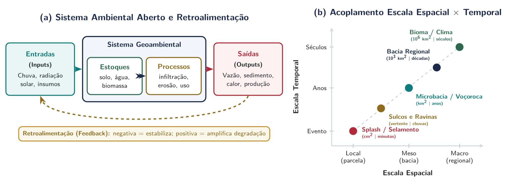
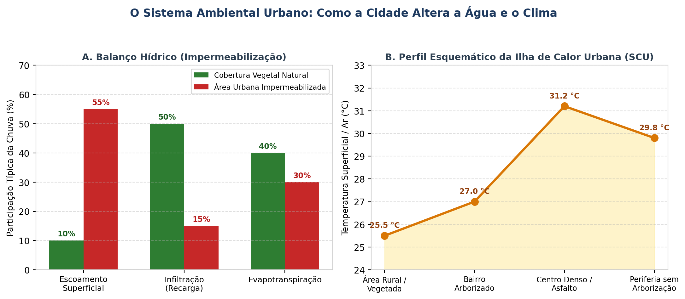

## [Abertura]{.pitch-tag} Visão Geral da Aula {#visao-geral .smaller-text .lesson-slide}

::: {.pitch-grid-55}
::: {.pitch-card}
[Roteiro da aula]{.pitch-card-index}
[Tópicos estruturantes]{.pitch-heading}

- [1]{.circle} O Sistema Ambiental: integração dos subsistemas Físico-Natural, Socioeconômico e Institucional
- [2]{.circle} Etapas de inventário, análise, integração, diagnóstico e proposição na Geoecologia das Paisagens
- [3]{.circle} O problema da escala na Análise Ambiental (Iná Elias de Castro, 1995; IBGE, 2018)
- [4]{.circle} Compatibilidade escalar ($1:250.000$ a $1:1.000$) para ZEE, Plano de Bacia, Plano Diretor, EIA e PRAD
- [5]{.circle} Zoneamento Ecológico-Econômico (Decreto 4.297/2002) e Ordenamento Territorial
- [6]{.circle} Análise Ambiental Urbana: Sistema Clima Urbano (SCU), drenagem e Estatuto da Cidade
:::

::: {.pitch-stack-2}
::: {.pitch-card .pitch-card--gold}
[Objetivo da aula]{.pitch-card-index}
[Síntese geossistêmica]{.pitch-heading}

Estruturar o método da **Análise Ambiental Integrada** na Geografia, dominando a articulação entre subsistemas, um roteiro fundamentado na Geoecologia da Paisagem, a escolha rigorosa da escala espaço-temporal e os instrumentos de ordenamento territorial rural e urbano.
:::

::: {.pitch-pill-row}
[Geoecologia]{.pitch-pill}
[Escala]{.pitch-pill .pitch-pill--gold}
[ZEE]{.pitch-pill}
[SCU Urbano]{.pitch-pill .pitch-pill--gold}
:::
:::
:::

# 1 · Arquitetura da Análise Integrada {.section-header rotulo="Síntese"}

## [Síntese]{.pitch-tag} O que é Análise Ambiental Integrada e por que Integrar? {#conceito-integracao .smaller-text .lesson-slide}

::: {.pitch-cards}
::: {.pitch-card}
[Subsistema 1]{.pitch-card-index}
[Físico-Natural]{.pitch-heading}

Litologia, relevo, solos, clima, hidrografia e biodiversidade em interação hidrodinâmica e morfogenética contínua.
:::

::: {.pitch-card .pitch-card--gold}
[Subsistema 2]{.pitch-card-index}
[Socioeconômico]{.pitch-heading}

Dinâmica populacional, uso e ocupação da terra, infraestrutura e cadeias produtivas que pressionam o território.
:::

::: {.pitch-card .pitch-card--teal}
[Subsistema 3]{.pitch-card-index}
[Jurídico-Institucional]{.pitch-heading}

Legislação ambiental, planos diretores, zoneamentos e capacidade efetiva de gestão e fiscalização.
:::
:::

::: {.pitch-cards-2}
::: {.pitch-card}
[Objetivo da integração]{.pitch-card-index}
[Unidades espaciais homogêneas]{.pitch-heading}

O território não funciona em compartimentos isolados: erosão ou enchentes resultam da interação simultânea entre rocha, solo, relevo, clima, uso e regras. Integrar é superar a soma de relatórios e orientar decisões.
:::

::: {.pitch-card .pitch-card--forest}
[Tricart (1977)]{.pitch-card-index}
[Organização vs. Reorganização]{.pitch-heading}

A **organização** planeja a ocupação futura segundo aptidões e limitações; a **reorganização** (ordenamento corretivo) atua onde o uso desordenado já produziu riscos e vulnerabilidades.
:::
:::

## [Sistema]{.pitch-tag .pitch-tag--gold} O sistema ambiental e o acoplamento de escalas {#sistema-ambiental-escalas .smaller-text .lesson-slide}

::: {.pitch-media-card .pitch-media-card--wide}

[Sistema ambiental aberto (a) e acoplamento escala espacial × temporal (b)]{.pitch-caption}
[Elaboração própria (TikZ) · retroalimentação negativa estabiliza o sistema; positiva amplifica a degradação]{.pitch-caption-sub}
:::

::: {.pitch-band}
Processos de detalhe (*splash*, selamento em $\text{cm}^2$/minutos) encadeiam-se com bacias regionais ($10^3\text{ km}^2$/décadas) e biomas ($10^6\text{ km}^2$/séculos): o diagnóstico precisa manter coerência entre ambos os eixos.
:::

## [Método]{.pitch-tag} Da Abordagem Setorial à Síntese Interdisciplinar {#diagnostico-gaveta .smaller-text .lesson-slide}

::: {.pitch-cards-2}
::: {.pitch-card .pitch-card--alert}
[Armadilha metodológica]{.pitch-card-index}
[O Erro Clássico do "Diagnóstico Gaveta"]{.pitch-heading}

Muitos estudos fracassam por operar em **justaposição multidisciplinar**:

- O geólogo escreve o capítulo de litologia;
- O pedólogo descreve perfis de solo isoladamente;
- O biólogo lista espécies de flora e fauna;
- O sociólogo tabula dados do IBGE;
- **Resultado:** capítulos estanques que não explicam a dinâmica territorial.
:::

::: {.pitch-card .pitch-card--forest}
[Síntese geográfica integrada]{.pitch-card-index}
[Geoecologia (Tricart, 1977; Rodriguez et al., 2017; Ross, 2006)]{.pitch-heading}

O Geógrafo cruza os processos causais:

- **Litologia e estrutura** condicionam relevo e potencial hidrogeológico;
- **Relevo e clima** comandam hidrodinâmica e solos na vertente (catena);
- **Solo e água** sustentam a vegetação e definem a aptidão agrícola;
- **Uso da terra e estrutura fundiária/urbana** alteram a estabilidade ecodinâmica e geram riscos.
:::
:::

# 2 · Escala Espacial e Temporal na Análise Ambiental {.section-header rotulo="Escalas"}

## [Escalas]{.pitch-tag .pitch-tag--gold} Distinção Epistemológica Fundamental {#escala-cartografica-geografica .smaller-text .lesson-slide}

::: {.pitch-cards-2}
::: {.pitch-card}
[Escala Cartográfica (Matemática)]{.pitch-card-index}
[Relação métrica mapa–terreno ($d / D$)]{.pitch-heading}

Expressa como fração ($1:250.000$, $1:50.000$, $1:2.000$):

- **Escala Pequena** ($1:1.000.000$): denominador grande → grande área, **baixo nível de detalhe**.
- **Escala Grande** ($1:2.000$): denominador pequeno → pequena área, **alto nível de detalhe**.
:::

::: {.pitch-card .pitch-card--gold}
[Escala Geográfica (Conceitual)]{.pitch-card-index}
[Iná Elias de Castro (1995)]{.pitch-heading}

Recorte espacial que confere visibilidade e sentido explicativo ao fenômeno.

Mudar de escala não é apenas "dar zoom": **quando a escala muda, mudam as variáveis dominantes e a própria natureza do processo observado**.
:::
:::

::: {.pitch-band .pitch-band--navy}
A escala de representação cartográfica (IBGE, 2018) só tem rigor técnico quando corresponde à escala geográfica dos processos modelados.
:::

## [Escalas]{.pitch-tag .pitch-tag--gold} Escala Temporal e Defasagem de Processos {#escala-temporal .smaller-text .lesson-slide}

::: {.pitch-table-box}
| Processo Ambiental | Escala Temporal Típica | Implicação no Diagnóstico |
|--------------------|------------------------|---------------------------|
| **Intemperismo e formação de $1\text{ cm}$ de Latossolo** | $10^2$ a $10^3$ anos | Perda de solo por erosão severa é **irreversível** na escala humana. |
| **Sucessão ecológica secundária florestal** | $20$ a $80$ anos | Metas de restauração em PRAD exigem monitoramento plurianual. |
| **Tempo de Retorno ($TR$) de cheias extremas** | $25$, $50$ ou $100$ anos | Séries curtas (1–2 anos) não capturam o risco real de inundação. |
| **Pulso de escoamento e turbidez em tempestade** | Minutos a horas | Exige monitoramento hidrossedimentológico em eventos chuvosos. |
:::

::: {.pitch-band}
A defasagem entre o tempo dos processos biofísicos e o tempo das decisões administrativas exige séries históricas compatíveis e limiares preventivos.
:::

## [Escalas]{.pitch-tag .pitch-tag--gold} Escolha da escala e qualidade da base {#escolha-escala-base .smaller-text .lesson-slide}

::: {.pitch-table-box}
| Finalidade | Escalas indicativas | Verificação indispensável |
|---|---|---|
| **Síntese regional / ZEE** | $1:250.000$ a $1:100.000$ | Generalização de solos, geologia e relevo; diretrizes do instrumento |
| **Sub-bacia / município** | $1:50.000$ a $1:25.000$ | Rede de drenagem, limites das unidades e campo |
| **Encosta / intervenção** | $1:10.000$ a $1:2.000$ | Topografia, material, ocupação e processos ativos |
| **Projeto / monitoramento** | Conforme objetivo e precisão | Referência geodésica e controle independente |
:::

::: {.pitch-band}
As faixas são exemplos de planejamento (de $1:250.000$ no ZEE até $1:1.000$ em projetos/PRAD). **O tamanho do pixel não garante escala cartográfica nem acurácia**: nunca ampliar um mapa regional de solos como levantamento de detalhe.
:::

# 3 · Zoneamento Ecológico-Econômico (ZEE) {.section-header rotulo="ZEE"}

## [ZEE]{.pitch-tag .pitch-tag--gold} Fundamentos Legais e Metodológicos {#fundamentos-zee .smaller-text .lesson-slide}

::: {.pitch-cards}
::: {.pitch-card}
[Base legal]{.pitch-card-index}
[Lei 6.938/81 e Dec. 4.297/2002]{.pitch-heading}

Previsto no **Art. 9º, II da Lei 6.938/1981** e regulamentado pelo **Decreto Federal nº 4.297/2002** (alterado pelo Dec. 6.288/2007).
:::

::: {.pitch-card .pitch-card--gold}
[Caráter vinculante]{.pitch-card-index}
[Instrumento de organização]{.pitch-heading}

Deve ser obrigatoriamente seguido na implantação de planos, obras e atividades públicas e privadas, definindo padrões segundo **vulnerabilidade natural** e **potencialidades socioeconômicas**.
:::

::: {.pitch-card .pitch-card--teal}
[Método no Brasil]{.pitch-card-index}
[UTB · Crepani e Ross]{.pitch-heading}

Cruza **Vulnerabilidade Natural à Perda de Solo (Crepani et al., 2001)** ou **Fragilidade Ambiental (Ross, 1994)** com o **Potencial Social/Produtivo** de cada Unidade Territorial Básica (UTB).
:::
:::

::: {.pitch-band .pitch-band--navy}
O ZEE traduz a análise integrada em regras territoriais diferenciadas por unidade homogênea de paisagem.
:::

## [ZEE]{.pitch-tag .pitch-tag--gold} Tipologia Clássica de Zonas no ZEE {#tipologia-zee .smaller-text .lesson-slide}

::: {.pitch-table-box}
| Zona | Critério Ambiental e Socioeconômico | Diretriz de Ordenamento |
|------|-------------------------------------|-------------------------|
| **1. Zonas Produtivas Consolidadas (ZPC)** | Baixa vulnerabilidade natural associada a infraestrutura produtiva instalada | Adensamento e intensificação sustentável com boas práticas de manejo |
| **2. Zonas de Uso Sustentável (ZUS)** | Vulnerabilidade natural média e potencial produtivo moderado | Atividades condicionadas a práticas conservacionistas de solo e água e respeito a APP/RL |
| **3. Zonas de Recuperação Ambiental (ZRA)** | Áreas com degradação avançada, erosão severa ou conflito de uso | Prioridade para PRAD, restauração florestal e reconversão produtiva |
| **4. Zonas de Proteção e Conservação (ZPCo)** | Unidades de Conservação, APPs, nascentes e áreas de alta fragilidade | Regras de uso e proteção próprias de cada categoria e instrumento legal |
:::

# 4 · Análise Ambiental Urbana {.section-header rotulo="Urbano"}

## [Urbano]{.pitch-tag .pitch-tag--teal} A Cidade como Sistema Socioecológico Modificado {#cidade-sistema .smaller-text .lesson-slide}

::: {.pitch-grid-40}
::: {.pitch-stack-2}
::: {.pitch-card}
[Especificidade urbana]{.pitch-card-index}
[Por que exige abordagem própria?]{.pitch-heading}

Asfalto, concreto e edificações alteram o balanço de radiação, a infiltração e a estabilidade de encostas. Em alta densidade, falhas pontuais de drenagem ou cortes em taludes atingem grande contingente populacional.
:::

::: {.pitch-card .pitch-card--teal}
[Articulação necessária]{.pitch-card-index}
[Clima, água, risco e lei]{.pitch-heading}

Integrar climatologia urbana, hidrologia de microbacias urbanizadas, cartografia de risco geotécnico e instrumentos do Estatuto da Cidade.
:::
:::

::: {.pitch-media-card .pitch-media-card--tall}

[Alteração do balanço hídrico (A) e perfil da Ilha de Calor Urbana — SCU (B)]{.pitch-caption}
[Impermeabilização eleva o escoamento superficial (10% → 55%) e reduz a recarga (50% → 15%)]{.pitch-caption-sub}
:::
:::

## [Urbano]{.pitch-tag .pitch-tag--teal} Processos Críticos no Ambiente Urbano {#processos-urbanos .smaller-text .lesson-slide}

::: {.pitch-cards}
::: {.pitch-card}
[01 · Hidrologia]{.pitch-card-index}
[Impermeabilização generalizada]{.pitch-heading}

Reduz a infiltração direta, altera recarga e escoamento conforme ocupação e rede de drenagem e antecipa o pico de cheia nos fundos de vale (**alagamentos e inundações bruscas**).
:::

::: {.pitch-card .pitch-card--alert}
[02 · Geomorfologia]{.pitch-card-index}
[Encostas e canais modificados]{.pitch-heading}

Cortes verticais sem contenção + águas servidas geram **escorregamentos (R3/R4)**. Retificação e aterramento de planícies e lagoas (ex.: nascentes e lagoas em **Feira de Santana – BA**) agravam cheias.
:::

::: {.pitch-card .pitch-card--gold}
[03 · Climatologia]{.pitch-card-index}
[Ilhas de Calor (SCU — Monteiro, 1976)]{.pitch-heading}

Asfalto/concreto (baixo albedo e alta capacidade térmica) + cânions urbanos produzem anomalias térmicas cuja magnitude varia com horário, estação, cobertura, morfologia e método.
:::
:::

## [Urbano]{.pitch-tag .pitch-tag--teal} Instrumentos Urbanísticos e Ambientais {#instrumentos-urbanos .smaller-text .lesson-slide}

::: {.pitch-band .pitch-band--navy}
**Lei 10.257/2001 (Estatuto da Cidade) e Lei 12.608/2012:** Plano Diretor Municipal obrigatório para cidades com $> 20\text{ mil hab.}$ ou incluídas no cadastro nacional de áreas com risco de desastres.
:::

::: {.pitch-cards}
::: {.pitch-card}
[Ordenamento territorial]{.pitch-card-index}
[Macrozoneamento e ZEIS]{.pitch-heading}

Definição de **macrozoneamento urbano-ambiental** e de **ZEIS** (Zonas Especiais de Interesse Social) obrigatoriamente fora de áreas de risco **R4**.
:::

::: {.pitch-card .pitch-card--forest}
[Infraestrutura verde]{.pitch-card-index}
[Permeabilidade e Drenagem Sustentável]{.pitch-heading}

**Taxa de Permeabilidade Mínima do Lote** e dispositivos de **Drenagem Urbana Sustentável** (*jardins de chuva, trincheiras de infiltração, bacias de detenção, pavimentos permeáveis*).
:::

::: {.pitch-card .pitch-card--gold}
[Arts. 36 a 38 · Lei 10.257/2001]{.pitch-card-index}
[Estudo de Impacto de Vizinhança (EIV)]{.pitch-heading}

Avalia adensamento populacional, ventilação/iluminação, tráfego, drenagem pluvial e sobrecarga na infraestrutura urbana instalada.
:::
:::

# 5 · Roteiro Prático, Síntese e Referências {.section-header rotulo="Síntese"}

## [Roteiro]{.pitch-tag .pitch-tag--teal} Um roteiro de integração para o trabalho final {#roteiro-trabalho-final .smaller-text .lesson-slide}

::: {.pitch-cards-2}
::: {.pitch-card}
[Fases 1 a 4]{.pitch-card-index}
[Da organização à integração]{.pitch-heading}

1. **Organização:** pergunta, equipe, área, escala e produtos.
2. **Inventário:** bases físicas, biológicas e sociais, com datas e fontes.
3. **Análise:** processos, relações causais e limitações.
4. **Integração:** unidades e conexões entre vertente, canal e ocupação.
:::

::: {.pitch-card .pitch-card--gold}
[Fases 5 a 7]{.pitch-card-index}
[Do diagnóstico à proposição]{.pitch-heading}

5. **Diagnóstico:** problemas, potencialidades e conflitos de uso.
6. **Prognóstico:** cenários com e sem intervenção.
7. **Proposição:** prioridades, responsáveis, indicadores e revisão.
:::
:::

::: {.pitch-band}
Roteiro didático adaptado da análise integrada e da Geoecologia das Paisagens. As etapas se retroalimentam; a síntese pode exigir novo levantamento em campo.
:::

## [Oficina]{.pitch-tag .pitch-tag--teal} Oficina: o que muda quando a escala muda? {#oficina-escala .smaller-text .lesson-slide}

::: {.pitch-grid-55}
::: {.pitch-card}
[Comparação prática]{.pitch-card-index}
[Mapa regional de solos × Topossequência de campo]{.pitch-heading}

Compare as duas representações e responda:

- Que informações foram generalizadas na legenda regional?
- O polígono regional permite localizar uma passagem entre horizontes ou uma surgência?
- Qual evidência sustenta a decisão de zonear, monitorar ou projetar?
:::

::: {.pitch-card .pitch-card--gold}
[Produto da atividade]{.pitch-card-index}
[Entrega esperada]{.pitch-heading}

Quadro comparativo contendo para cada fonte utilizada:

1. **Dado** analisado;
2. **Escala original** do levantamento;
3. **Limitação** técnica identificada;
4. **Uso aceitável** no relatório técnico.
:::
:::

## [Síntese]{.pitch-tag} Síntese Operacional {#sintese-operacional .smaller-text .lesson-slide}

::: {.pitch-milestones}
::: {.pitch-milestone-item}
**01 · Unidades Geoambientais:** a **Análise Ambiental Integrada** supera o inventário setorial ao articular processos morfodinâmicos, bióticos e socioeconômicos (base para **Tricart**, **Ross** e **Crepani**, aprofundados na **Aula 9.1**).
:::

::: {.pitch-milestone-item}
**02 · Compatibilidade escalar:** a escolha da **escala cartográfica e geográfica** deve ser estritamente compatível com o instrumento ($1:250.000$ no ZEE regional vs. $1:2.000$ no PRAD e na Carta de Risco Urbano).
:::

::: {.pitch-milestone-item}
**03 · Meio urbano integrado:** o Geógrafo articula o **Sistema Clima Urbano (SCU)**, a **hidrologia de bacias urbanizadas** e as diretrizes do **Estatuto da Cidade (Lei 10.257/2001)**.
:::
:::

## [Referências]{.pitch-tag} Referências Bibliográficas {#referencias .smaller-text .lesson-slide}

::: {.pitch-cards-2}
::: {.pitch-card}
[Marco legal e institucional]{.pitch-card-index}
[Legislação]{.pitch-heading}

- BRASIL. **Lei nº 10.257, de 10 de julho de 2001** (Estatuto da Cidade).
- BRASIL. **Decreto nº 4.297, de 10 de julho de 2002** (Regulamenta o Zoneamento Ecológico-Econômico — ZEE).
- IBGE. **Manual Técnico de Uso da Terra / Normas Cartográficas**. Rio de Janeiro: IBGE, 2018.
:::

::: {.pitch-card .pitch-card--gold}
[Literatura teórico-metodológica]{.pitch-card-index}
[Bibliografia fundamental]{.pitch-heading}

- CASTRO, I. E. O problema da escala. In: CASTRO, I. E.; GOMES, P. C. C.; CORRÊA, R. L. (Orgs.). **Geografia: Conceitos e Temas**. Rio de Janeiro: Bertrand Brasil, 1995. p. 117–140.
- CHRISTOFOLETTI, A. **Modelagem de Sistemas Ambientais**. São Paulo: Edgard Blücher, 1999.
- RODRIGUEZ, J. M. M.; SILVA, E. V.; CAVALCANTI, A. P. B. **Geoecologia das Paisagens: uma visão geossistêmica da análise ambiental**. 5. ed. Fortaleza: Edições UFC, 2017.
- ROSS, J. L. S. **Ecogeografia do Brasil: subsídios para o planejamento ambiental**. São Paulo: Oficina de Textos, 2006.
:::
:::
