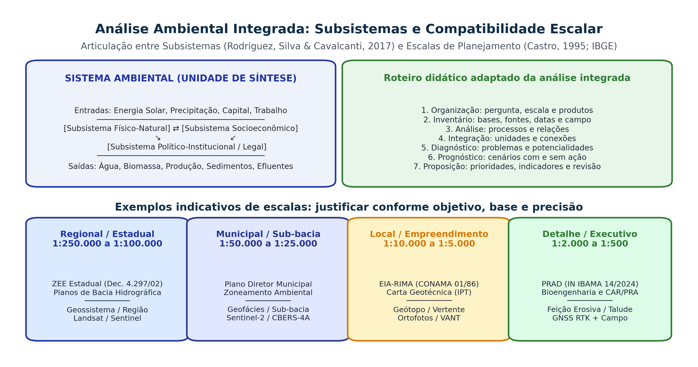

## Visão Geral da Aula {.smaller-text}

::: {.columns}
::: {.column width="50%"}
### Tópicos

- [1]{.circle} O Sistema Ambiental: integração dos subsistemas Físico-Natural, Socioeconômico e Institucional
- [2]{.circle} Etapas de inventário, análise, integração, diagnóstico e proposição na Geoecologia das Paisagens
- [3]{.circle} O problema da escala na Análise Ambiental (Iná Elias de Castro, 1995; IBGE, 2018)
- [4]{.circle} Compatibilidade escalar ($1:250.000$ a $1:1.000$) para ZEE, Plano de Bacia, Plano Diretor, EIA e PRAD
- [5]{.circle} Zoneamento Ecológico-Econômico (Decreto 4.297/2002) e Ordenamento Territorial
- [6]{.circle} Análise Ambiental Urbana: Sistema Clima Urbano (SCU), drenagem e Estatuto da Cidade
:::

::: {.column width="50%"}
::: {.info-box}
**Objetivo da Aula**

Estruturar o método da **Análise Ambiental Integrada** na Geografia, dominando a articulação entre subsistemas, um roteiro fundamentado na Geoecologia da Paisagem, a escolha rigorosa da escala espaço-temporal e os instrumentos de ordenamento territorial rural e urbano.
:::
:::
:::

# 1 · Arquitetura da Análise Integrada {.section-header rotulo="Síntese"}

## O sistema ambiental e as etapas do diagnóstico {.smaller-text}

{.fig-full}

## Da Abordagem Setorial (Multidisciplinar) à Síntese Interdisciplinar {.smaller-text}

::: {.columns}
::: {.column width="50%"}
### O Erro Clássico do "Diagnóstico Gaveta"

- Muitos estudos ambientais fracassam porque operam por **justaposição multidisciplinar**:
  - O geólogo escreve o capítulo de litologia;
  - O pedólogo descreve os perfis de solo isoladamente;
  - O biólogo lista as espécies de flora e fauna;
  - O sociólogo tabula dados do IBGE;
  - **Resultado**: capítulos estanques que não conversam entre si e não explicam a dinâmica do território.
:::

::: {.column width="50%"}
### A Síntese Geográfica Integrada (Geoecologia)

- Na **Análise Ambiental Integrada** (Tricart, 1977; Rodriguez, Silva & Cavalcanti, 2017; Ross, 2006), o Geógrafo cruza os processos:
  - A **litologia e a estrutura geológica** condicionam o relevo e o potencial hidrogeológico;
  - O **relevo e o clima** comandam a hidrodinâmica e a diferenciação dos solos na vertente (catena);
  - O **solo e a água** sustentam a cobertura vegetal e definem a aptidão agrícola;
  - O **uso da terra e a estrutura fundiária/urbana** alteram a estabilidade ecodinâmica e geram impactos e riscos.
:::
:::

# 2 · Escala Espacial e Temporal na Análise Ambiental {.section-header rotulo="Escalas"}

## Distinção Epistemológica Fundamental {.smaller-text}

- **Escala Cartográfica (Matemática)**: relação métrica entre a distância medida no mapa ($d$) e a distância real no terreno ($D$), expressa como fração ($1:250.000$, $1:50.000$, $1:2.000$).
  - **Escala Pequena** ($1:1.000.000$): denominador grande → grande área, **baixo nível de detalhe**.
  - **Escala Grande** ($1:2.000$): denominador pequeno → pequena área, **alto nível de detalhe**.
- **Escala Geográfica (Conceitual — Iná Elias de Castro, 1995)**: recorte espacial que confere visibilidade e sentido explicativo ao fenômeno. Mudar de escala não é apenas "dar zoom": **quando a escala muda, mudam as variáveis dominantes e a própria natureza do processo observado**.

## Escala Temporal e Defasagem de Processos {.smaller-text}

| Processo Ambiental | Escala Temporal Típica | Implicação no Diagnóstico |
|--------------------|------------------------|---------------------------|
| **Intemperismo e formação de $1\text{ cm}$ de Latossolo** | $10^2$ a $10^3$ anos | Perda de solo por erosão severa é **irreversível** na escala humana. |
| **Sucessão ecológica secundária florestal** | $20$ a $80$ anos | Metas de restauração em PRAD exigem monitoramento plurianual. |
| **Tempo de Retorno ($TR$) de cheias extremas** | $25$, $50$ ou $100$ anos | Séries curtas (1–2 anos) não capturam o risco real de inundação. |
| **Pulso de escoamento e turbidez em tempestade** | Minutos a horas | Exige monitoramento hidrossedimentológico em eventos chuvosos. |

## Escolha da escala e qualidade da base {.smaller-text}

| Finalidade | Escalas indicativas | Verificação indispensável |
|---|---|---|
| Síntese regional / ZEE | 1:250.000 a 1:100.000 | Generalização de solos, geologia e relevo; diretrizes do instrumento |
| Sub-bacia / município | 1:50.000 a 1:25.000 | Rede de drenagem, limites das unidades e campo |
| Encosta / intervenção | 1:10.000 a 1:2.000 | Topografia, material, ocupação e processos ativos |
| Projeto / monitoramento | Conforme objetivo e precisão | Referência geodésica e controle independente |

As faixas são exemplos de planejamento. O tamanho do pixel não garante escala cartográfica nem acurácia. Não ampliar um mapa de solos regional e apresentá-lo como levantamento de detalhe.

# 3 · Zoneamento Ecológico-Econômico (ZEE) {.section-header rotulo="ZEE"}

## Fundamentos Legais e Metodológicos {.smaller-text}

- Previsto no **Art. 9º, II da Lei 6.938/1981** e regulamentado pelo **Decreto Federal nº 4.297/2002** (alterado pelo Dec. 6.288/2007).
- **Conceito**: instrumento de organização do território a ser obrigatoriamente seguido na implantação de planos, obras e atividades públicas e privadas, estabelecendo medidas e padrões de proteção ambiental com base na **vulnerabilidade natural** e nas **potencialidades socioeconômicas**.
- **Base metodológica no Brasil**: cruza o diagnóstico de **Vulnerabilidade Natural à Perda de Solo (Crepani et al., 2001)** ou **Fragilidade Ambiental (Ross, 1994)** com o **Potencial Social/Produtivo** de cada Unidade Territorial Básica (UTB).

## Tipologia Clássica de Zonas no ZEE {.smaller-text}

```text
1. Zonas Produtivas Consolidadas (ZPC)
Baixa vulnerabilidade natural + infraestrutura instalada →
adensamento e intensificação sustentável com boas práticas.
↓
2. Zonas de Uso Sustentável / Expansão Controlada (ZUS)
Vulnerabilidade média → atividades condicionadas a práticas
conservacionistas de solo e água e respeito estrito a APP/RL.
↓
3. Zonas de Recuperação Ambiental (ZRA)
Áreas com forte degradação/erosão ou conflito de uso →
prioridade para PRAD, restauração florestal e reconversão produtiva.
↓
4. Zonas de Proteção e Conservação (ZPCo)
Unidades de Conservação, APPs, nascentes e alta fragilidade →
regras de uso e proteção próprias de cada categoria e instrumento legal.
```

# 4 · Análise Ambiental Urbana {.section-header rotulo="Urbano"}

## Processos Críticos no Ambiente Urbano {.smaller-text}

1. **Impermeabilização generalizada do solo**:
   - Reduz a infiltração direta e altera a recarga e o escoamento, com efeitos dependentes da ocupação e da rede de drenagem e antecipa o pico de cheia nos fundos de vale (**alagamentos e inundações bruscas**).
2. **Alteração da morfologia de encostas e canais**:
   - Cortes verticais em taludes sem contenção + lançamento de águas servidas/pluviais → **escorregamentos translacionais (R3/R4)**.
   - Retificação, tamponamento e ocupação das planícies de inundação e lagoas urbanas (ex.: aterramento de lagoas e nascentes em **Feira de Santana - BA**).
3. **Ilhas de Calor Urbanas (SCU — Monteiro, 1976)**:
   - Substituição de cobertura vegetal por asfalto/concreto (baixo albedo e alta capacidade térmica) + cânions urbanos → diferenças térmicas cuja magnitude varia com horário, estação, cobertura, morfologia e método de medição.

## Instrumentos Urbanísticos e Ambientais (Lei 10.257/2001 e Lei 12.608/2012) {.smaller-text}

- **Plano Diretor Municipal** (obrigatório para cidades $> 20\text{ mil hab.}$ ou incluídas no cadastro nacional de áreas com risco de desastres):
  - **Macrozoneamento urbano-ambiental** e definição de **ZEIS** (Zonas Especiais de Interesse Social) fora de áreas de risco R4;
  - **Taxa de Permeabilidade Mínima do Lote** e dispositivos de **Drenagem Urbana Sustentável** (*jardins de chuva, trincheiras de infiltração, bacias de detenção/amortecimento, pavimentos permeáveis*);
  - **Estudo de Impacto de Vizinhança (EIV — Arts. 36 a 38)**: avalia adensamento, ventilação/iluminação, tráfego, drenagem e sobrecarga na infraestrutura urbana.

## Um roteiro de integração para o trabalho final {.smaller-text}

1. **Organização:** pergunta, equipe, área, escala e produtos.
2. **Inventário:** bases físicas, biológicas e sociais, com datas e fontes.
3. **Análise:** processos, relações causais e limitações.
4. **Integração:** unidades e conexões entre vertente, canal e ocupação.
5. **Diagnóstico:** problemas, potencialidades e conflitos de uso.
6. **Prognóstico:** cenários com e sem intervenção.
7. **Proposição:** prioridades, responsáveis, indicadores e revisão.

Roteiro didático adaptado da análise integrada e da Geoecologia das Paisagens. As etapas se retroalimentam; a síntese pode exigir novo campo.

## Oficina: o que muda quando a escala muda? {.smaller-text}

Compare um mapa regional de solos com uma topossequência de campo.

- Que informações foram generalizadas na legenda regional?
- O polígono permite localizar uma passagem entre horizontes ou uma surgência?
- Qual evidência sustenta a decisão de zonear, monitorar ou projetar?

**Entrega:** quadro com dado, escala original, limitação e uso aceitável no relatório.

# 5 · Síntese e Referências {.section-header rotulo="Síntese"}

## Síntese Operacional {.smaller-text}

- A **Análise Ambiental Integrada** supera o inventário setorial ao articular processos morfodinâmicos, bióticos e socioeconômicos em **Unidades Geoambientais**.
- A escolha da **escala cartográfica e geográfica** deve ser estritamente compatível com o instrumento ($1:250.000$ no ZEE regional vs. $1:2.000$ no PRAD e na Carta de Risco Urbano).
- No meio urbano, o Geógrafo articula o **Sistema Clima Urbano (SCU)**, a **hidrologia de bacias urbanizadas** e as diretrizes do **Estatuto da Cidade (Lei 10.257/2001)**.

## Referências Bibliográficas {.smaller-text}

- BRASIL. **Lei nº 10.257, de 10 de julho de 2001** (Estatuto da Cidade).
- BRASIL. **Decreto nº 4.297, de 10 de julho de 2002** (Regulamenta o Zoneamento Ecológico-Econômico — ZEE).
- CASTRO, I. E. O problema da escala. In: CASTRO, I. E.; GOMES, P. C. C.; CORRÊA, R. L. (Orgs.). **Geografia: Conceitos e Temas**. Rio de Janeiro: Bertrand Brasil, 1995. p. 117–140.
- CHRISTOFOLETTI, A. **Modelagem de Sistemas Ambientais**. São Paulo: Edgard Blücher, 1999.
- RODRIGUEZ, J. M. M.; SILVA, E. V.; CAVALCANTI, A. P. B. **Geoecologia das Paisagens: uma visão geossistêmica da análise ambiental**. 5. ed. Fortaleza: Edições UFC, 2017.
- ROSS, J. L. S. **Ecogeografia do Brasil: subsídios para o planejamento ambiental**. São Paulo: Oficina de Textos, 2006.
