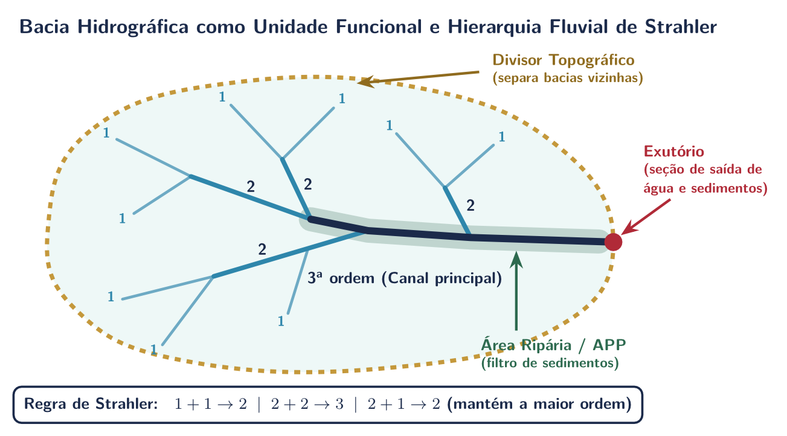
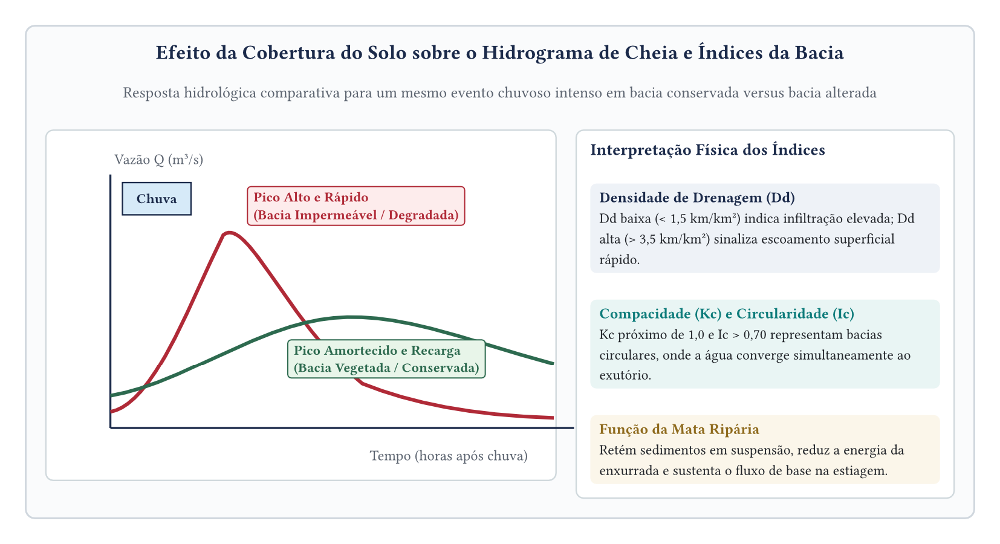
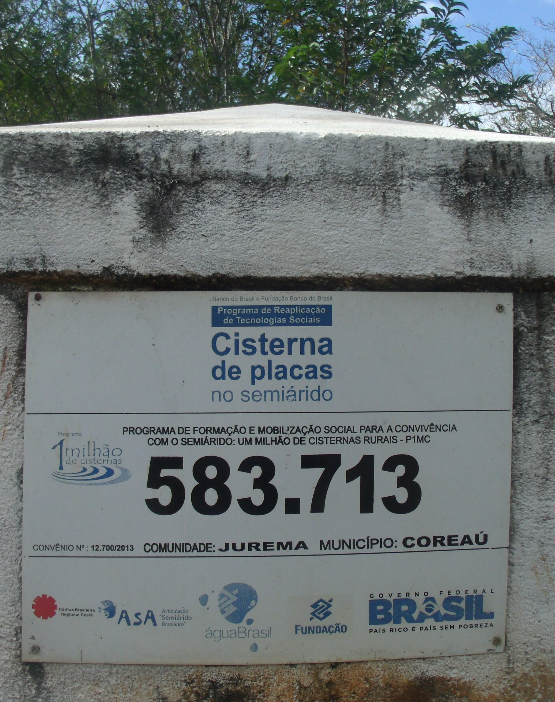

## [Abertura]{.pitch-tag} Visão Geral da Aula {#visao-geral .smaller-text .lesson-slide}

::: {.pitch-grid-55}
::: {.pitch-card}
[Roteiro da aula]{.pitch-card-index}
[Tópicos estruturantes]{.pitch-heading}

- [1]{.circle} Bacia e microbacia hidrográfica: divisores, balanço hídrico e recorte legal
- [2]{.circle} Hierarquia Fluvial de Horton-Strahler e Padrões de Drenagem (Christofoletti, 1980)
- [3]{.circle} Equações e Índices Morfométricos ($K_c, K_f, I_c, D_d, D_h, t_c$) e propensão a cheias
- [4]{.circle} Hidrograma de Enchente ($Q \times t$) e efeito do uso e cobertura da terra
- [5]{.circle} Conectividade hidrossedimentológica e funções eco-hidrológicas da Zona Ripária
- [6]{.circle} Política Nacional de Recursos Hídricos (Lei 9.433/1997): fundamentos, os 5 instrumentos e SINGREH
:::

::: {.pitch-stack-2}
::: {.pitch-card .pitch-card--gold}
[Objetivo da aula]{.pitch-card-index}
[Análise e governança da água]{.pitch-heading}

Operar a **bacia hidrográfica** como unidade fundamental de análise ambiental e gestão territorial (Lei 9.433/1997), calculando seus parâmetros morfométricos, interpretando sua resposta hidrossedimentológica frente à mudança de uso da terra e aplicando os instrumentos da Política Nacional de Recursos Hídricos.
:::

::: {.pitch-pill-row}
[Strahler]{.pitch-pill}
[Morfometria]{.pitch-pill .pitch-pill--gold}
[Conectividade]{.pitch-pill}
[Lei 9.433/97]{.pitch-pill .pitch-pill--gold}
:::
:::
:::

# 1 · A Bacia como Sistema Aberto e Unidade Legal {.section-header rotulo="Bacia"}

## [Bacia]{.pitch-tag} Conceito Geomorfológico e Balanço Hídrico {#conceito-bacia .smaller-text .lesson-slide}

::: {.pitch-cards-2}
::: {.pitch-card}
[Definição sistêmica]{.pitch-card-index}
[Christofoletti (1980) · Tucci (2001)]{.pitch-heading}

Área de captação natural da água precipitada que faz convergir os escoamentos superficiais e subsuperficiais para um único ponto de saída (**exutório**), delimitada pelos **divisores topográficos (linhas de cumeada / interflúvios)**.
:::

::: {.pitch-card .pitch-card--alert}
[Atenção técnica · Bahia]{.pitch-card-index}
[Divisor topográfico ≠ divisor freático]{.pitch-heading}

Em terrenos cársticos (calcários, como na Bacia do Rio São Francisco / **Irecê – BA**) ou sedimentares profundos (**Aquífero Urucuia**), o **divisor hidrogeológico** pode não coincidir com o divisor topográfico superficial!
:::
:::

::: {.pitch-formula}
**Equação do Balanço Hídrico na Bacia:**

$$P = Q_s + Q_b + ET \pm \Delta S$$

onde $P$ é a precipitação, $Q_s$ o escoamento superficial direto, $Q_b$ o escoamento básico (subterrâneo), $ET$ a evapotranspiração real e $\Delta S$ a variação do armazenamento no solo e no aquífero.
:::

## [Escalas]{.pitch-tag .pitch-tag--gold} Bacia, Sub-bacia e Microbacia {#bacia-sub-micro .smaller-text .lesson-slide}

::: {.pitch-table-box}
| Recorte | Escala Espacial Típica | Aplicação Principal |
|---------|------------------------|---------------------|
| **Região / Bacia Hidrográfica** | $> 10.000\text{ km}^2$ (ex.: Rio Paraguaçu, Rio São Francisco, Rio Contas) | Planos de Recursos Hídricos, Comitês de Bacia (CBH) e outorgas regionais. |
| **Sub-bacia** | $100\text{ a }10.000\text{ km}^2$ (ex.: Rio Jacuípe, Rio Subaé, Rio Pojuca) | Zoneamento ambiental intermunicipal, enquadramento CONAMA 357 e AII de EIA. |
| **Microbacia (Bacia de Cabeceira)** | $< 100\text{ km}^2$ (canais de 1ª a 3ª ordem; unidade ecológica mínima — Botelho, 1999) | Manejo integrado de solo e água, PRAD, monitoramento hidrossedimentológico e PSA. |
:::

::: {.pitch-band}
A escolha do recorte espacial define os processos observáveis: a **microbacia** captura a conexão direta vertente–canal; a **bacia** articula o planejamento regional e os comitês.
:::

## [Drenagem]{.pitch-tag .pitch-tag--gold} Delimitação da Bacia e Hierarquia de Strahler {#bacia-strahler .smaller-text .lesson-slide}

::: {.pitch-media-card .pitch-media-card--wide}

[Bacia hidrográfica como unidade funcional e hierarquia fluvial de Strahler (1952)]{.pitch-caption}
[Elaboração própria (TikZ) · divisor topográfico, canais de 1ª a 3ª ordem, área ripária/APP e exutório]{.pitch-caption-sub}
:::

::: {.pitch-band}
Na regra de Strahler, apenas a confluência de dois canais de **mesma ordem** eleva a hierarquia ($1+1 \rightarrow 2$; $2+2 \rightarrow 3$); tributários menores não alteram a ordem do canal receptor ($2+1 \rightarrow 2$).
:::

# 2 · Rede de Drenagem e Morfometria {.section-header rotulo="Morfometria"}

## [Drenagem]{.pitch-tag .pitch-tag--gold} Regime Hidrológico e Ordem (Strahler, 1952) {#regime-ordem .smaller-text .lesson-slide}

::: {.pitch-cards-2}
::: {.pitch-card}
[Regime de escoamento]{.pitch-card-index}
[Relação com o nível freático]{.pitch-heading}

- **Perene:** fluxo contínuo o ano todo (lençol freático alimenta o canal mesmo na estiagem).
- **Intermitente:** escoa na estação chuvosa e seca na estiagem (típico do Semiárido baiano — *protegido por APP na Lei 12.651/2012!*).
- **Efêmero:** escoa apenas durante ou logo após chuvas torrenciais (acima do nível freático).
:::

::: {.pitch-card .pitch-card--teal}
[Ordenamento fluvial]{.pitch-card-index}
[Regras de Strahler (1952)]{.pitch-heading}

- Nascentes sem tributários = **1ª ordem**;
- $1\text{ª} + 1\text{ª} \rightarrow 2\text{ª ordem}$;
- $2\text{ª} + 2\text{ª} \rightarrow 3\text{ª ordem}$;
- Confluência de ordens diferentes **mantém a ordem maior** ($2\text{ª} + 1\text{ª} = 2\text{ª ordem}$).
:::
:::

## [Drenagem]{.pitch-tag .pitch-tag--gold} Padrões de Drenagem e Controle Geológico {#padroes-drenagem .smaller-text .lesson-slide}

::: {.pitch-table-box}
| Padrão | Geometria da Rede | Controle Litológico / Estrutural |
|--------|-------------------|----------------------------------|
| **Dendrítico** (Arborescente) | Ramificação irregular semelhante a uma árvore | Rochas de **resistência uniforme** (granitos, gnaisses homogêneos ou sedimentos horizontais). |
| **Treliça** | Tributários paralelos confluindo em ângulo reto ($\approx 90^\circ$) | Dobramentos ou faixas alternadas de rochas resistentes e friáveis (ex.: Chapada Diamantina). |
| **Retangular** | Inflexões bruscas em ângulo reto no canal principal e afluentes | Forte controle por **redes de falhas e fraturas ortogonais** em rochas cristalinas. |
| **Paralelo** | Cursos d'água paralelos entre si com poucos tributários | Vertentes de **acentuada declividade** uniforme ou controle estrutural monoclinal. |
| **Radial** | Canais divergem de um ponto central (centrífugo) ou convergem (centrípeto) | Domos estruturais, cones vulcânicos, maciços residuais (*inselbergs*) ou depressões fechadas. |
:::

## [Morfometria]{.pitch-tag .pitch-tag--gold} Morfometria: equações e unidades {#morfometria-equacoes .smaller-text .lesson-slide}

::: {.pitch-formula}
$$K_c = \frac{0{,}28\,P}{\sqrt{A}} \qquad K_f = \frac{A}{L_a^2} \qquad I_c = \frac{4\pi A}{P^2} \qquad D_d = \frac{\sum L_i}{A} \qquad D_h = \frac{N}{A} \qquad t_c = 0{,}0195\,L^{0{,}77}\,S^{-0{,}385}$$
:::

::: {.pitch-table-box}
| Índice | Variáveis e Unidades | Interpretação Hidrológica |
|---|---|---|
| **Compacidade ($K_c$)** | $P$ (km), $A$ (km²) | Aproximação da forma circular ($K_c \to 1{,}0$ maior concentração) |
| **Fator de forma ($K_f$)** e **Circularidade ($I_c$)** | $L_a$ axial (km); $I_c$ adimensional | Sensível à delimitação e ao perímetro; valores altos elevam tendência a picos |
| **Densidade de drenagem ($D_d$) e hidrográfica ($D_h$)** | $\text{km/km}^2$ e $\text{canais/km}^2$ | Depende da escala de extração da rede e do critério de contagem ($N$) |
| **Tempo de concentração ($t_c$ · Kirpich)** | min ($L$ em m; $S$ em m/m) | Relação empírica com domínio de aplicação definido |
:::

::: {.pitch-band}
A forma da bacia participa da resposta junto com chuva, umidade antecedente, infiltração, armazenamento e uso da terra.
:::

## [Prática]{.pitch-tag .pitch-tag--teal} Exercício morfométrico com controle de unidades {#exercicio-morfometrico .smaller-text .lesson-slide}

::: {.pitch-band}
**Bacia didática:** área $A = 12\text{ km}^2$; perímetro $P = 16\text{ km}$; comprimento axial $L_a = 6\text{ km}$; rede com $\sum L_i = 24\text{ km}$ de canais.
:::

::: {.pitch-formula}
- $K_c = 0{,}28(16)/\sqrt{12} \approx 1{,}29$ &nbsp;|&nbsp; $K_f = 12/6^2 \approx 0{,}33$
- $I_c = 4\pi(12)/16^2 \approx 0{,}59$ &nbsp;|&nbsp; $D_d = 24/12 = 2{,}0\text{ km/km}^2$
:::

::: {.pitch-card .pitch-card--alert}
[Limite da morfometria]{.pitch-card-index}
[O que falta para estimar a cheia?]{.pitch-heading}

Esses números **não fornecem a vazão de cheia**. Indique quais dados de **chuva** (intensidade e duração), **solo** (infiltração e profundidade), **armazenamento** e **ocupação da terra** são indispensáveis para modelar o hidrograma.
:::

## [Hidrologia]{.pitch-tag .pitch-tag--gold} Hidrograma de Enchente e Uso da Terra {#hidrograma-urbano .smaller-text .lesson-slide}

::: {.pitch-media-card .pitch-media-card--wide}

[Efeito da cobertura do solo sobre o hidrograma de cheia e interpretação dos índices]{.pitch-caption}
[Elaboração própria (PGFPlots) · pico alto e rápido em bacia impermeável vs. pico amortecido e recarga em bacia vegetada]{.pitch-caption-sub}
:::

::: {.pitch-band}
A perda de cobertura vegetal e a impermeabilização reduzem a infiltração e o tempo de concentração ($t_c$), antecipando e elevando a vazão de pico ($Q_p$).
:::

## [Hidrologia]{.pitch-tag .pitch-tag--teal} Ler um hidrograma e reconhecer seus limites {#leitura-hidrograma .smaller-text .lesson-slide}

::: {.pitch-band}
Identifique **início da resposta**, **ramo ascendente**, **pico**, **recessão** e **vazão anterior**.
:::

::: {.pitch-milestones}
::: {.pitch-milestone-item}
**01 · Tempo de resposta:** relacione os horários da chuva intensa e do pico no exutório.
:::

::: {.pitch-milestone-item}
**02 · Umidade antecedente:** compare eventos com precipitação semelhante e umidade prévia distinta no solo.
:::

::: {.pitch-milestone-item}
**03 · Controles artificiais:** verifique se barragem, derivação ou extravasamento altera o registro hidrométrico.
:::

::: {.pitch-milestone-item}
**04 · Pico vs. volume:** diferencie vazão de pico ($\text{m}^3/\text{s}$) e volume total escoado ($\text{m}^3$).
:::
:::

::: {.pitch-band .pitch-band--navy}
Avaliar a resposta em rede evita soluções pontuais que apenas transferem o problema de inundação para jusante.
:::

# 3 · Conectividade e Zona Ripária {.section-header rotulo="Conectividade"}

## [Conectividade]{.pitch-tag .pitch-tag--teal} Conectividade Lateral e Longitudinal (Borselli et al., 2008) {#conectividade .smaller-text .lesson-slide}

::: {.pitch-cards-2}
::: {.pitch-card}
[Vertente → Canal]{.pitch-card-index}
[Conectividade Lateral]{.pitch-heading}

Grau de acoplamento pelo qual o escoamento e os sedimentos erodidos nas encostas conseguem atingir a calha fluvial.

Estradas rurais mal drenadas, sulcos de pastagem e supressão de mata ciliar atuam como **atalhos hidráulicos**, elevando drasticamente a entrega de sedimentos (*Sediment Delivery Ratio — SDR*).
:::

::: {.pitch-card .pitch-card--alert}
[Montante → Jusante]{.pitch-card-index}
[Conectividade Longitudinal]{.pitch-heading}

Transporte de água, sedimentos, nutrientes e organismos ao longo da rede fluvial.

Barragens interrompem essa conectividade, retendo sedimentos no reservatório e provocando **erosão de margem por "água faminta" (*hungry water*)** a jusante.
:::
:::

## [Zona Ripária]{.pitch-tag .pitch-tag--forest} Cinco Funções Eco-Hidrológicas da Zona Ripária (APP) {#zona-riparia .smaller-text .lesson-slide}

::: {.pitch-cards}
::: {.pitch-card .pitch-card--forest}
[01 · Filtragem física]{.pitch-card-index}
[Dissipação de energia]{.pitch-heading}

Rugosidade da serapilheira e raízes reduz a velocidade da enxurrada e retém sedimentos; eficiência varia com largura, declive e concentração do fluxo.
:::

::: {.pitch-card .pitch-card--teal}
[02 · Buffer Strip]{.pitch-card-index}
[Tampão biogeoquímico]{.pitch-heading}

Absorção radicular e desnitrificação bacteriana removem nitrato ($\text{NO}_3^-$), fósforo ($\text{PO}_4^{3-}$) e agrotóxicos antes de atingirem o canal.
:::

::: {.pitch-card}
[03 · Margens]{.pitch-card-index}
[Estabilidade geotécnica]{.pitch-heading}

Raízes reforçam os barrancos fluviais contra desmoronamentos; o solapamento basal exige avaliação hidráulica própria.
:::
:::

::: {.pitch-cards-2}
::: {.pitch-card .pitch-card--gold}
[04 · Microclima aquático]{.pitch-card-index}
[Temperatura e Oxigênio Dissolvido]{.pitch-heading}

O sombreamento arbóreo mantém a temperatura da água mais baixa e o **Oxigênio Dissolvido (OD)** mais elevado para a biota aquática.
:::

::: {.pitch-card .pitch-card--forest}
[05 · Conectividade ecológica]{.pitch-card-index}
[Corredor e zona hiporreica]{.pitch-heading}

Assegura fluxo gênico de fauna e flora ao longo da rede de drenagem e promove armazenamento e troca hídrica na zona hiporreica aluvial.
:::
:::

# 4 · Política Nacional de Recursos Hídricos {.section-header rotulo="Lei 9.433/97"}

## [Lei 9.433/97]{.pitch-tag} Os 6 Fundamentos da PNRH (Art. 1º) {#fundamentos-pnrh .smaller-text .lesson-slide}

::: {.pitch-cards}
::: {.pitch-card}
[Fundamento I]{.pitch-card-index}
[Domínio público]{.pitch-heading}

A água é um **bem de domínio público** (União ou Estados — não existe água privada desde a CF/88).
:::

::: {.pitch-card .pitch-card--gold}
[Fundamento II]{.pitch-card-index}
[Valor econômico]{.pitch-heading}

A água é um **recurso natural limitado, dotado de valor econômico**.
:::

::: {.pitch-card .pitch-card--alert}
[Fundamento III]{.pitch-card-index}
[Uso prioritário na escassez]{.pitch-heading}

Em situações de escassez, a prioridade absoluta é o **consumo humano e a dessedentação de animais**.
:::

::: {.pitch-card .pitch-card--teal}
[Fundamento IV]{.pitch-card-index}
[Uso múltiplo]{.pitch-heading}

A gestão dos recursos hídricos deve sempre proporcionar o **uso múltiplo das águas**.
:::

::: {.pitch-card .pitch-card--forest}
[Fundamento V]{.pitch-card-index}
[Unidade territorial]{.pitch-heading}

A **bacia hidrográfica é a unidade territorial** para implementação da PNRH e atuação do SINGREH.
:::

::: {.pitch-card .pitch-card--gold}
[Fundamento VI]{.pitch-card-index}
[Gestão descentralizada]{.pitch-heading}

Participação do Poder Público, usuários e comunidades (**gestão tripartite nos Comitês de Bacia**).
:::
:::

## [Lei 9.433/97]{.pitch-tag .pitch-tag--gold} Os 5 Instrumentos da PNRH (Art. 5º) {#instrumentos-pnrh .smaller-text .lesson-slide}

::: {.pitch-table-box}
| Instrumento (Art. 5º) | Função Técnica na Gestão da Bacia |
|-----------------------|-----------------------------------|
| **I. Planos de Recursos Hídricos** | Planos diretores de longo prazo (por bacia, estado e país) com diagnóstico, balanço disponibilidade $\times$ demanda e metas. |
| **II. Enquadramento dos corpos de água em classes** | Estabelece a meta de qualidade da água (Classes Especial a 4 — **CONAMA 357/2005**) segundo os usos preponderantes pretendidos. |
| **III. Outorga dos direitos de uso** | Ato administrativo (**ANA** ou **INEMA-BA**) que autoriza captação superficial/subterrânea ou lançamento de efluentes por prazo determinado. |
| **IV. Cobrança pelo uso de recursos hídricos** | Reconhece a água como bem econômico, induz o uso racional e financia programas previstos no Plano de Bacia. |
| **V. Sistema de Informações (SNIRH)** | Coleta, tratamento, armazenamento e disponibilização pública de dados hidrometeorológicos e de outorgas. |
:::

## [Gestão Hídrica]{.pitch-tag .pitch-tag--teal} Convivência com o Semiárido e Gestão Hídrica Descentralizada {#semiarido-cisterna .smaller-text .lesson-slide}

::: {.pitch-grid-60}
::: {.pitch-stack-2}
::: {.pitch-card .pitch-card--teal}
[Segurança hídrica comunitária]{.pitch-card-index}
[Captação pluvial e convivência com o Semiárido]{.pitch-heading}

Em bacias do Semiárido com **rios intermitentes** e forte déficit hídrico sazonal, a gestão integrada combina planejamento por bacia (Lei 9.433/1997) com tecnologias sociais descentralizadas, como as **cisternas de placas** (P1MC/ASA).

Essas estruturas reservam água da chuva para atravessar a estiagem, efetivando na prática o **uso prioritário de consumo humano** (Art. 1º, III).
:::

::: {.pitch-card .pitch-card--gold}
[Governança territorial]{.pitch-card-index}
[Da propriedade ao SINGREH]{.pitch-heading}

A reserva descentralizada nas comunidades rurais articula-se aos **Comitês de Bacia Hidrográfica (CBHs)** e à gestão estadual (**INEMA-BA**) para reduzir conflitos de escassez e proteger nascentes e áreas de recarga.
:::
:::

::: {.pitch-media-card .pitch-media-card--photo .pitch-media-card--tall}

[Cisterna de placas no Semiárido (P1MC / ASA)]{.pitch-caption}
[Infraestrutura social de captação pluvial para segurança hídrica na estiagem]{.pitch-caption-sub}
:::
:::

# 5 · Síntese e Referências {.section-header rotulo="Síntese"}

## [Síntese]{.pitch-tag} Resumo para Provas e Relatório Técnico {#resumo-bacia .smaller-text .lesson-slide}

::: {.pitch-cards}
::: {.pitch-card}
[01 · Forma e resposta]{.pitch-card-index}
[Morfometria da bacia]{.pitch-heading}

**Bacias circulares** ($K_c \to 1{,}0$, $K_f$ alto, $I_c \to 1{,}0$) concentram o escoamento simultaneamente e têm resposta potencialmente mais concentrada, dependente também de chuva, armazenamento e uso da terra.
:::

::: {.pitch-card .pitch-card--alert}
[02 · Mudança de uso]{.pitch-card-index}
[Desmatamento e urbanização]{.pitch-heading}

Reduzem a infiltração ($f$) e o tempo de concentração ($t_c$), podendo antecipar e elevar a **vazão de pico ($Q_p$)**; efeitos sobre a vazão de base dependem do balanço hídrico e da hidrogeologia.
:::

::: {.pitch-card .pitch-card--teal}
[03 · Marco legal]{.pitch-card-index}
[Lei Federal nº 9.433/1997]{.pitch-heading}

A **bacia hidrográfica** deixa de ser apenas um recorte geomorfológico e torna-se a **unidade legal obrigatória de planejamento e gestão tripartite** no SINGREH.
:::
:::

## [Referências]{.pitch-tag} Referências Bibliográficas {#referencias .smaller-text .lesson-slide}

::: {.pitch-cards-2}
::: {.pitch-card}
[Legislação e manejo de bacias]{.pitch-card-index}
[Fontes normativas e aplicadas]{.pitch-heading}

- BOTELHO, R. G. M. Planejamento ambiental em microbacia hidrográfica. In: GUERRA, A. J. T.; SILVA, A. S.; BOTELHO, R. G. M. (Orgs.). **Erosão e Conservação dos Solos**. Rio de Janeiro: Bertrand Brasil, 1999. p. 269–300.
- BRASIL. **Lei nº 9.433, de 8 de janeiro de 1997** (Política Nacional de Recursos Hídricos — PNRH).
- VILLELA, S. M.; MATTOS, A. **Hidrologia Aplicada**. São Paulo: McGraw-Hill do Brasil, 1975.
:::

::: {.pitch-card .pitch-card--gold}
[Geomorfologia fluvial e hidrologia]{.pitch-card-index}
[Fundamentos clássicos]{.pitch-heading}

- CHRISTOFOLETTI, A. **Geomorfologia**. 2. ed. São Paulo: Edgard Blücher, 1980.
- STRAHLER, A. N. Hypsometric (area-altitude) analysis of erosional topography. **Geological Society of America Bulletin**, v. 63, p. 1117–1142, 1952.
- TUCCI, C. E. M. (Org.). **Hidrologia: ciência e aplicação**. 2. ed. Porto Alegre: Editora da UFRGS; ABRH, 2001.
:::
:::
