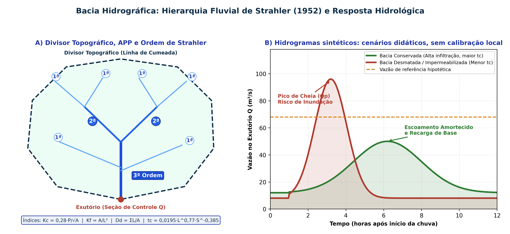

## Visão Geral da Aula {.smaller-text}

::: {.columns}
::: {.column width="50%"}
### Tópicos

- [1]{.circle} Bacia e microbacia hidrográfica: divisores, balanço hídrico e recorte legal
- [2]{.circle} Hierarquia Fluvial de Horton-Strahler e Padrões de Drenagem (Christofoletti, 1980)
- [3]{.circle} Equações e Índices Morfométricos ($K_c, K_f, I_c, D_d, D_h, t_c$) e propensão a cheias
- [4]{.circle} Hidrograma de Enchente ($Q \times t$) e efeito do uso e cobertura da terra
- [5]{.circle} Conectividade hidrossedimentológica e funções eco-hidrológicas da Zona Ripária
- [6]{.circle} Política Nacional de Recursos Hídricos (Lei 9.433/1997): fundamentos, os 5 instrumentos e SINGREH
:::

::: {.column width="50%"}
::: {.info-box}
**Objetivo da Aula**

Operar a **bacia hidrográfica** como unidade fundamental de análise ambiental e gestão territorial (Lei 9.433/1997), calculando seus parâmetros morfométricos, interpretando sua resposta hidrossedimentológica frente à mudança de uso da terra e aplicando os instrumentos da Política Nacional de Recursos Hídricos.
:::
:::
:::

# 1 · A Bacia como Sistema Aberto e Unidade Legal {.section-header rotulo="Bacia"}

## Conceito Geomorfológico e Hidrológico {.smaller-text}

- **Bacia Hidrográfica** (Christofoletti, 1980; Tucci, 2001): área de captação natural da água precipitada que faz convergir os escoamentos superficiais e subsuperficiais para um único ponto de saída (**exutório**), delimitada pelos **divisores topográficos (linhas de cumeada / interflúvios)**.
- **Atenção técnica**: em terrenos cársticos (calcários, como na Bacia do Rio São Francisco / Irecê - BA) ou sedimentares profundos (Aquífero Urucuia), o **divisor hidrogeológico (freático)** pode não coincidir com o divisor topográfico superficial!
- **Equação do Balanço Hídrico na Bacia**:
  $$P = Q_s + Q_b + ET \pm \Delta S$$
  onde $P$ é a precipitação, $Q_s$ o escoamento superficial direto, $Q_b$ o escoamento básico (subterrâneo), $ET$ a evapotranspiração real e $\Delta S$ a variação do armazenamento no solo/aquífero.

## Bacia, Sub-bacia e Microbacia {.smaller-text}

| Recorte | Escala Espacial Típica | Aplicação Principal |
|---------|------------------------|---------------------|
| **Região / Bacia Hidrográfica** | $> 10.000\text{ km}^2$ (ex.: Rio Paraguaçu, Rio São Francisco, Rio Contas) | Planos de Recursos Hídricos, Comitês de Bacia (CBH) e outorgas regionais. |
| **Sub-bacia** | $100\text{ a }10.000\text{ km}^2$ (ex.: Rio Jacuípe, Rio Subaé, Rio Pojuca) | Zoneamento ambiental intermunicipal, enquadramento CONAMA 357 e AII de EIA. |
| **Microbacia (Bacia de Cabeceira)** | $< 100\text{ km}^2$ (canais de 1ª a 3ª ordem; unidade ecológica mínima — Botelho, 1999) | Manejo integrado de solo e água, PRAD, monitoramento hidrossedimentológico e PSA. |

## Hierarquia Fluvial de Strahler e Resposta Hidrológica {.smaller-text}

{.fig-full}

# 2 · Rede de Drenagem e Morfometria {.section-header rotulo="Morfometria"}

## Regime Hidrológico e Ordem (Strahler, 1952) {.smaller-text}

- **Regime de escoamento**:
  - **Perene**: fluxo contínuo o ano todo (lençol freático alimenta o canal mesmo na estiagem).
  - **Intermitente**: escoa durante a estação chuvosa e seca no período de estiagem (típico do Semiárido baiano — *protegido por APP na Lei 12.651/2012!*).
  - **Efêmero**: escoa apenas durante ou imediatamente após eventos de chuva torrencial (acima do nível freático).
- **Regras de Strahler (1952)**:
  - Nascentes sem tributários = **1ª ordem**;
  - $1\text{ª} + 1\text{ª} \rightarrow 2\text{ª ordem}$; $2\text{ª} + 2\text{ª} \rightarrow 3\text{ª ordem}$;
  - A confluência de ordens diferentes mantém a ordem maior ($2\text{ª} + 1\text{ª} = 2\text{ª ordem}$).

## Padrões de Drenagem e Controle Geológico {.smaller-text}

| Padrão | Geometria da Rede | Controle Litológico / Estrutural |
|--------|-------------------|----------------------------------|
| **Dendrítico** (Arborescente) | Ramificação irregular semelhante a uma árvore | Rochas de **resistência uniforme** (granitos, gnaisses homogêneos ou sedimentos horizontais). |
| **Treliça** | Tributários paralelos confluindo em ângulo reto ($\approx 90^\circ$) | Dobramentos ou faixas alternadas de rochas resistentes e friáveis (ex.: Chapada Diamantina). |
| **Retangular** | Inflexões bruscas em ângulo reto no canal principal e afluentes | Forte controle por **redes de falhas e fraturas ortogonais** em rochas cristalinas. |
| **Paralelo** | Cursos d'água paralelos entre si com poucos tributários | Vertentes de **acentuada declividade** uniforme ou controle estrutural monoclinal. |
| **Radial** | Canais divergem de um ponto central (centrífugo) ou convergem (centrípeto) | Domos estruturais, cones vulcânicos, maciços residuais (*inselbergs*) ou depressões fechadas. |

## Morfometria: equações e unidades {.smaller-text}

| Índice | Expressão | Unidades / interpretação |
|---|---|---|
| Compacidade | $K_c=0{,}28P/\sqrt A$ | $P$ em km, $A$ em km²; aproximação da forma circular |
| Fator de forma | $K_f=A/L_a^2$ | $L_a$: comprimento axial em km |
| Circularidade | $I_c=4\pi A/P^2$ | Adimensional; sensível à delimitação e ao perímetro |
| Densidade de drenagem | $D_d=\sum L_i/A$ | km/km²; depende da escala de extração da rede |
| Densidade hidrográfica | $D_h=N/A$ | canais/km²; declarar critério de contagem |
| Kirpich | $t_c=0{,}0195L^{0{,}77}S^{-0{,}385}$ | Minutos; $L$ em m e $S$ em m/m |

A forma da bacia participa da resposta junto com chuva, umidade antecedente, infiltração, armazenamento e uso da terra. Kirpich é uma relação empírica com domínio de aplicação.

# 3 · Conectividade e Zona Ripária {.section-header rotulo="Conectividade"}

## Conectividade Lateral e Longitudinal (Borselli et al., 2008) {.smaller-text}

- **Conectividade Lateral (Vertente $\rightarrow$ Canal)**: grau de acoplamento pelo qual o escoamento e os sedimentos erodidos nas encostas conseguem atingir a calha fluvial.
  - Estradas rurais mal drenadas, sulcos de pastagem e supressão de mata ciliar atuam como **atalhos hidráulicos**, elevando drasticamente a entrega de sedimentos ao rio (*Sediment Delivery Ratio — SDR*).
- **Conectividade Longitudinal (Montante $\rightarrow$ Jusante)**: transporte de água, sedimentos, nutrientes e organismos ao longo da rede fluvial; barragens interrompem essa conectividade, retendo sedimentos no reservatório e provocando **erosão de margem por "água faminta" (*hungry water*)** a jusante.

## Cinco Funções Eco-Hidrológicas da Zona Ripária (APP) {.smaller-text}

1. **Dissipação de energia e filtragem física**: a rugosidade hidráulica da serapilheira e das raízes reduz a velocidade do escoamento superficial e pode reter sedimentos; a eficiência depende de largura, cobertura, declive e concentração do fluxo.
2. **Tampão biogeoquímico (*Buffer Strip*)**: absorção radicular e desnitrificação bacteriana removem nitrato ($\text{NO}_3^-$), fósforo ($\text{PO}_4^{3-}$) e moléculas de agrotóxicos antes de atingirem o curso d'água.
3. **Estabilidade geotécnica dos barrancos fluviais**: raízes podem reforçar as margens; o solapamento basal exige avaliação hidráulica própria.
4. **Regulação microclimática aquática**: sombreamento mantém a temperatura da água mais baixa e o **Oxigênio Dissolvido (OD)** mais elevado.
5. **Corredor ecológico e recarga aluvial**: fluxo gênico de fauna/flora e armazenamento na zona hiporreica.

# 4 · Política Nacional de Recursos Hídricos {.section-header rotulo="Lei 9.433/97"}

## Os 6 Fundamentos (Art. 1º — Altamente Cobrados!) {.smaller-text}

1. A água é um **bem de domínio público** (União ou Estados — não existe água privada desde a CF/88).
2. A água é um **recurso natural limitado, dotado de valor econômico**.
3. Em situações de **escassez**, o uso prioritário é o **consumo humano e a dessedentação de animais**.
4. A gestão dos recursos hídricos deve sempre proporcionar o **uso múltiplo das águas**.
5. A **bacia hidrográfica é a unidade territorial** para implementação da PNRH e atuação do SINGREH.
6. A gestão deve ser **descentralizada e contar com a participação** do Poder Público, dos usuários e das comunidades (**gestão tripartite nos Comitês de Bacia**).

## Os 5 Instrumentos da PNRH (Art. 5º) {.smaller-text}

| Instrumento (Art. 5º) | Função Técnica na Gestão da Bacia |
|-----------------------|-----------------------------------|
| **I. Planos de Recursos Hídricos** | Planos diretores de longo prazo (por bacia, estado e país) com diagnóstico, balanço disponibilidade $\times$ demanda e metas. |
| **II. Enquadramento dos corpos de água em classes** | Estabelece a meta de qualidade da água (Classes Especial a 4 — **CONAMA 357/2005**) segundo os usos preponderantes pretendidos. |
| **III. Outorga dos direitos de uso** | Ato administrativo (ANA ou **INEMA-BA**) que autoriza captação superficial/subterrânea ou lançamento de efluentes por prazo determinado. |
| **IV. Cobrança pelo uso de recursos hídricos** | Reconhece a água como bem econômico, induz o uso racional e financia programas previstos no Plano de Bacia. |
| **V. Sistema de Informações (SNIRH)** | Coleta, tratamento, armazenamento e disponibilização pública de dados hidrometeorológicos e de outorgas. |

## Exercício morfométrico com controle de unidades {.smaller-text}

Bacia didática: $A=12$ km²; $P=16$ km; $L_a=6$ km; rede com 24 km de canais.

- $K_c=0{,}28(16)/\sqrt{12}\approx1{,}29$.
- $K_f=12/6^2\approx0{,}33$.
- $I_c=4\pi(12)/16^2\approx0{,}59$.
- $D_d=24/12=2$ km/km².

Esses números não fornecem a vazão de cheia. Indique os dados de chuva, solo, armazenamento e ocupação que faltam.

## Ler um hidrograma e reconhecer seus limites {.smaller-text}

Identifique início da resposta, ramo ascendente, pico, recessão e vazão anterior.

1. Relacione horários da chuva e do pico.
2. Compare eventos com precipitação semelhante e umidade antecedente diferente.
3. Verifique se barragem, derivação ou extravasamento altera o registro.
4. Diferencie vazão de pico (m³/s) e volume escoado (m³).

Avaliar a resposta em rede evita transferir o problema para jusante.

# 5 · Síntese e Referências {.section-header rotulo="Síntese"}

## Resumo para Provas e Relatório Técnico {.smaller-text}

- **Bacias circulares ($K_c \rightarrow 1{,}0$, $K_f$ alto, $I_c \rightarrow 1{,}0$)** concentram o escoamento simultaneamente e possuem resposta potencialmente mais concentrada, dependente também de chuva, armazenamento e uso da terra.
- **Desmatamento e urbanização** reduzem a infiltração ($f$) e o tempo de concentração ($t_c$), podendo antecipar e elevar a **vazão de pico ($Q_p$)**; efeitos sobre a vazão de base dependem do balanço hídrico e da hidrogeologia.
- Pela **Lei Federal nº 9.433/1997**, a **bacia hidrográfica** deixa de ser apenas um recorte geomorfológico e torna-se a **unidade legal obrigatória de planejamento e gestão tripartite**.

## Referências Bibliográficas {.smaller-text}

- BOTELHO, R. G. M. Planejamento ambiental em microbacia hidrográfica. In: GUERRA, A. J. T.; SILVA, A. S.; BOTELHO, R. G. M. (Orgs.). **Erosão e Conservação dos Solos**. Rio de Janeiro: Bertrand Brasil, 1999. p. 269–300.
- BRASIL. **Lei nº 9.433, de 8 de janeiro de 1997** (Política Nacional de Recursos Hídricos — PNRH).
- CHRISTOFOLETTI, A. **Geomorfologia**. 2. ed. São Paulo: Edgard Blücher, 1980.
- STRAHLER, A. N. Hypsometric (area-altitude) analysis of erosional topography. **Geological Society of America Bulletin**, v. 63, p. 1117–1142, 1952.
- TUCCI, C. E. M. (Org.). **Hidrologia: ciência e aplicação**. 2. ed. Porto Alegre: Editora da UFRGS; ABRH, 2001.
- VILLELA, S. M.; MATTOS, A. **Hidrologia Aplicada**. São Paulo: McGraw-Hill do Brasil, 1975.
