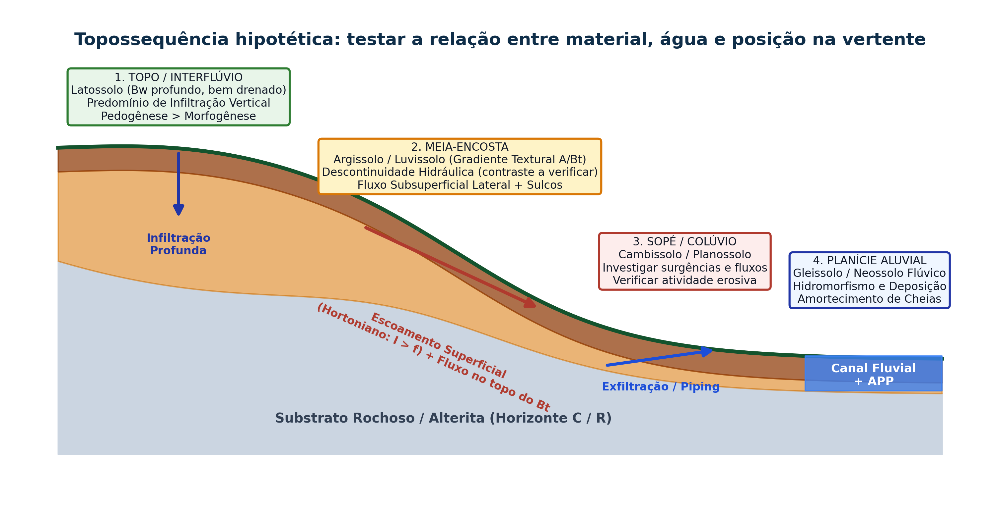

## Visão Geral da Aula {.smaller-text}

::: {.columns}
::: {.column width="50%"}
### Tópicos

- [1]{.circle} Fundamentos da Morfopedologia (Tricart & Kilian, 1979; Castro & Salomão, 2000)
- [2]{.circle} Análise Estrutural da Cobertura Pedológica e Topossequências / Catenas (Boulet, 1982)
- [3]{.circle} Geometria de Vertentes em Planta e Perfil (Troeh, 1965; Ruhe, 1975) e fluxos hídricos
- [4]{.circle} Descontinuidade Hidráulica Subsuperficial ($A/Bt$) e gênese de processos erosivos
- [5]{.circle} Equação Universal de Perda de Solo Revisada — RUSLE ($A = R \cdot K \cdot LS \cdot C \cdot P$)
- [6]{.circle} Movimentos Gravitacionais de Massa (rastejo, escorregamentos, quedas e corridas)
:::

::: {.column width="50%"}
::: {.info-box}
**Objetivo da Aula**

Compreender o funcionamento integrado do binômio **relevo–solo (morfopedologia)** ao longo das vertentes tropicais, analisando como a geometria das encostas e a estrutura vertical e lateral dos horizontes pedológicos controlam a infiltração, a erosão hídrica (RUSLE) e os movimentos de massa.
:::
:::
:::

# 1 · Morfopedologia e Catenas Tropicais {.section-header rotulo="Morfopedologia"}

## O Conceito de Compartimentação Morfopedológica {.smaller-text}

::: {.columns}
::: {.column width="52%"}
### Relevo e Solo como Sistema Co-Evolutivo

- **Morfopedologia** (Tricart & Kilian, 1979; Castro & Salomão, 2000): abordagem que analisa de forma indissociável a **geomorfologia das vertentes** e a **distribuição espacial dos solos**, pois ambos evoluem simultaneamente sob o comando dos fluxos hídricos superficiais e subsuperficiais.
- **Análise Estrutural da Cobertura Pedológica (Boulet, 1982; Queiroz Neto, 2000)**:
  - O solo não é uma coleção de perfis verticais isolados, mas um **contínuo tridimensional** que se transforma do topo do interflúvio até a planície aluvial (**Topossequência ou Catena** — Milne, 1935).
  - Processos de **transformação interna** (lixiviação, eluviação/iluviação de argila, hidromorfismo) no interior da vertente alteram o relevo tanto quanto o escoamento superficial.
:::

::: {.column width="48%"}
::: {.highlight-box}
**Regra Prática de Diagnóstico em Campo**

Em uma mesma litologia e sob o mesmo clima, a mudança de **posição na vertente (topo $\rightarrow$ meia-encosta $\rightarrow$ sopé $\rightarrow$ várzea)** altera a espessura do *solum*, a textura, a drenagem interna e a erodibilidade do solo!
:::
:::
:::

## Topossequência (Catena Morfopedológica) e Hidrodinâmica de Vertente {.smaller-text}

{.fig-full}

# 2 · Geometria de Vertentes e Hidrodinâmica {.section-header rotulo="Vertentes"}

## Segmentos de Perfil Longitudinal (Ruhe, 1975) {.smaller-text}

1. **Topo / Interflúvio (*Summit*)**: declividade muito baixa ($< 6\%$); predomínio absoluto da **infiltração vertical** e pedogênese profunda (Latossolos).
2. **Ombro / Convexidade Superior (*Shoulder*)**: transição convexa onde o escoamento ganha aceleração gravitacional; zona de máxima perda por erosão laminar.
3. **Meia-Encosta Retilínea (*Backslope*)**: transporte ativo de água e sedimentos por escoamento superficial e subsuperficial lateral (*throughflow*) e movimentos de massa.
4. **Sopé Côncavo (*Footslope*) e Tálvegue (*Toeslope*)**: desaceleração e deposição coluvial/aluvial, mas com **saturação hídrica e exfiltração do lençol freático**.

## Curvatura em Planta (Horizontal) e Concentração Hídrica {.smaller-text}

| Forma da Vertente | Geometria das Linhas de Fluxo | Comportamento Hidrossedimentológico |
|-------------------|-------------------------------|-------------------------------------|
| **Divergente (Convexa em planta — "Nariz/Espigão")** | As linhas de fluxo espalham-se encosta abaixo | Lâmina d'água fina e dispersa → menor energia cisalhante; predomínio de erosão laminar difusa. |
| **Planar (Retilínea em planta)** | Linhas de fluxo paralelas | Aumento progressivo da lâmina com o comprimento de rampa ($L$) → formação de sulcos paralelos. |
| **Convergente (Côncava em planta — "Anfiteatro / Cabeceira")** | Todas as linhas de fluxo convergem para o eixo central da concavidade | **Concentração extrema de fluxo superficial e subsuperficial** → sítio preferencial de **voçorocas e escorregamentos**. |

## Descontinuidade Hidráulica Subsuperficial ($A/Bt$) {.smaller-text}

::: {.columns}
::: {.column width="52%"}
### Por que Argissolos, Luvissolos e Planossolos Erodem Tanto?

- Nos **Latossolos** (horizonte $Bw$), a textura e a estrutura microgranular (em "pó de café") são homogêneas ao longo de $2\text{ a }5\text{ metros}$ de profundidade → a condutividade hidráulica saturada ($K_s$) é elevada em todo o perfil.
- Já nos **Argissolos, Luvissolos e Planossolos** (muito comuns no Recôncavo, Agreste e Sertão da Bahia), ocorre um forte **gradiente textural** entre o horizonte superficial $A/E$ (mais arenoso, solto e permeável) e o horizonte subsuperficial **$Bt$ ou $B\text{ plânico}$** (muito argiloso, adensado e de baixíssima permeabilidade: $K_{s(A)} \gg K_{s(Bt)}$).
:::

::: {.column width="48%"}
### O Mecanismo Físico da Ruptura na Chuva Intensa

```text
1. A água da chuva infiltra rapidamente no horizonte A/E arenoso.
↓
2. Ao atingir o topo do horizonte Bt (impermeável), a infiltração
vertical é bloqueada, formando um lençol suspenso temporário.
↓
3. O horizonte A satura por completo (poropressão positiva u > 0),
perdendo sua resistência ao cisalhamento (τf = c' + (σ - u)·tan φ').
↓
4. Ocorre escoamento lateral subsuperficial (piping/liquefação) e
escoamento superficial por saturação → decapitação em sulcos e ravinas!
```
:::
:::

# 3 · Modelagem da Erosão Hídrica (RUSLE) {.section-header rotulo="RUSLE"}

## Formulação Matemática e Significado Físico {.smaller-text}

$$A = R \cdot K \cdot L \cdot S \cdot C \cdot P$$

onde $A$ é a perda média anual de solo ($\text{t}\cdot\text{ha}^{-1}\cdot\text{ano}^{-1}$):

- **$R$ · Erosividade da Chuva** ($\text{MJ}\cdot\text{mm}\cdot\text{ha}^{-1}\cdot\text{h}^{-1}\cdot\text{ano}^{-1}$): produto da energia cinética total da chuva pela sua intensidade máxima em 30 minutos ($EI_{30}$). Representa a **força ativa do clima**.
- **$K$ · Erodibilidade do Solo** ($\text{t}\cdot\text{h}\cdot\text{MJ}^{-1}\cdot\text{mm}^{-1}$): suscetibilidade intrínseca do solo à desagregação e transporte (depende do teor de silte + areia muito fina, matéria orgânica, estrutura e permeabilidade).
- **$LS$ · Fator Topográfico** (adimensional): combina o comprimento de rampa ($L$) e o grau de declive ($S$). Quanto mais longa e íngreme a vertente, maior a velocidade e a tensão cisalhante do escoamento.

## Fatores Antrópicos de Manejo ($C$ e $P$) {.smaller-text}

- **$C$ · Uso e Manejo da Cobertura da Terra** (varia de $0{,}001$ a $1{,}0$):
  - Floresta densa / mata ciliar: $C \approx 0{,}001\text{ a }0{,}01$ (proteção máxima contra o efeito *splash*);
  - Pastagem bem manejada: $C \approx 0{,}05\text{ a }0{,}10$;
  - Cultivo anual sem plantio direto / pastagem degradada: $C \approx 0{,}25\text{ a }0{,}50$;
  - Solo exposto descoberto: $C = 1{,}00$.
- **$P$ · Práticas Conservacionistas Mecânicas** (varia de $0{,}1$ a $1{,}0$):
  - Plantio morro abaixo: $P = 1{,}0$;
  - Plantio em contorno (curvas de nível), culturas em faixas, cordões vegetados e **terraceamento agrícola** ($P \approx 0{,}15\text{ a }0{,}50$), pois seccionam o comprimento de rampa ($L$).

## Práticas Mecânicas de Controle do Fator $LS$ e $P$ na Bacia {.smaller-text}

::: {.columns}
::: {.column width="48%"}
### Como o Terraceamento e as Bacias de Captação Atuam?

- Ao implantar **terraços em nível** e **bacias de retenção (*barraginhas*)** ao longo das curvas de nível da vertente:
  1. Quebra-se um comprimento de rampa único ($L = 300\text{ m}$) em vários segmentos curtos ($L = 30\text{ m}$), impedindo que o escoamento atinja a tensão crítica de incisão ($\tau_c$).
  2. O volume retido nos camalhões infiltra lentamente no perfil pedológico, recarregando o lençol freático e reduzindo a entrega de sedimentos ao canal fluvial.
:::

::: {.column width="52%"}
{.fig-col}
:::
:::

# 4 · Movimentos Gravitacionais de Massa {.section-header rotulo="Mov. Massa"}

## Tipologia e Mecanismos Geotécnicos (Varnes, 1978; Guidicini & Nieble, 1984) {.smaller-text}

::: {.columns}
::: {.column width="100%"}
### Diferenciação entre Processos Hidrossedimentológicos (Erosão) e Geotécnicos (Movimentos de Massa)

| Tipo de Movimento | Velocidade e Geometria | Mecanismo Físico-Geotécnico Dominante | Indicadores Diagnósticos em Campo |
|-------------------|------------------------|---------------------------------------|-----------------------------------|
| **1. Rastejo (*Creep*)** | Muito lento ($\text{mm a cm/ano}$); contínuo e sem superfície de ruptura definida | Deformação viscoplástica sazonal do manto de intemperismo superficial sob ação da gravidade e variações térmicas/hídricas. | Árvores com troncos curvos ("floresta bêbada"), postes e cercas inclinados, pequenas rugas na encosta. |
| **2. Escorregamento Translacional (Planar)** | Rápido ($\text{m/s}$); superfície de ruptura **plana e rasa** ($1\text{ a }3\text{ m}$ de espessura) | Saturação hídrica rápida durante chuvas intensas no contato **solo raso / rocha sã** ou no contato entre horizontes contrastantes; perda de coesão efetiva. | Cicatrizes longas, estreitas e rasas em encostas íngremes ($> 30^\circ$, como na Serra do Mar e escarpas de Salvador). |
| **3. Escorregamento Rotacional (*Slump*)** | Moderado a rápido; superfície de ruptura **curva/côncava (circular)** e profunda ($> 5\text{ m}$) | Ocorre em mantos de intemperismo espessos e homogêneos, argilas ou aterros; frequentemente deflagrado por **corte na base do talude** ou saturação basal. | Degrau de abatimento (escarpa principal em meia-lua), basculamento do bloco para trás e tufos de acumulação no pé. |
| **4. Queda e Tombamento de Blocos (*Rockfall*)** | Extremamente rápido (queda livre); blocos rochosos | Descontinuidades estruturais da rocha (fraturas, falhas, xistosidade, alívio de tensão), pressão de raízes nas fendas e intemperismo diferencial na base. | Paredões rochosos subverticais com blocos instáveis no topo e depósito de **tálus** na base. |
| **5. Corrida de Massa / Detritos (*Debris Flow*)** | Extremamente rápido e destrutivo ($> 10\text{ m/s}$); fluxo viscoso canalizado | Liquefação de grande volume de solo, blocos de rocha e troncos de árvores que descem pelas drenagens de montanha como uma massa fluida de alta densidade. | Línguas extensas de blocos métricos e lama depositadas no sopé das serras e planícies aluviais. |
:::
:::


## RUSLE: exemplo e alcance da estimativa {.smaller-text}

Exemplo **didático**, com fatores compatíveis com o resultado em t/ha/ano:

$$A=R\,K\,LS\,C\,P=6000(0{,}03)(1{,}5)(0{,}20)(1)=54.$$

Mantendo os demais fatores, $C=0{,}04$ e $P=0{,}60$ produzem $A=6{,}48$ t/ha/ano.

O exercício compara cenários; não é medição local nem carga entregue ao rio. A RUSLE representa perda média por erosão entre sulcos e em sulcos. Voçorocas, movimentos de massa e erosão de margens exigem abordagens próprias.

## Do perfil da vertente à hipótese de processo {.smaller-text}

| Observação | Hipótese | Evidência a obter |
|---|---|---|
| Contraste textural e mosqueados | Restrição sazonal ao fluxo vertical | Perfil, permeabilidade e saturação |
| Convergência em planta | Concentração de água | Área contribuinte e marcas de fluxo |
| Colúvio no sopé | Transferência e armazenamento | Estratigrafia e conexão com a encosta |
| Trinca próxima a ruptura | Possível instabilidade | Evolução temporal e avaliação geotécnica |

Nenhum horizonte ou formato determina sozinho o processo. Combinar geometria, material, água e história de uso.

# 5 · Síntese e Referências {.section-header rotulo="Síntese"}

## Conceitos Essenciais para Fixação {.smaller-text}

1. **Catena Morfopedológica**: sucessão genética de solos ao longo da vertente (Topo Latossólico estável $\rightarrow$ Meia-encosta Argissólica/Luvissólica com descontinuidade hidráulica $A/Bt$ $\rightarrow$ Planície Gleissólica hidromórfica).
2. **Anfiteatros côncavos (convergentes)** concentram fluxos superficiais e subsuperficiais, sendo os pontos críticos para instalação de voçorocas e escorregamentos.
3. Na **RUSLE ($A = R \cdot K \cdot LS \cdot C \cdot P$)**, os fatores $R, K, LS$ expressam a fragilidade natural, enquanto $C$ e $P$ expressam o controle exercido pela cobertura vegetal e pelas práticas conservacionistas.

## Referências Bibliográficas {.smaller-text}

- BOULET, R. Analyse structurale et cartographie en pédologie. **Cahiers ORSTOM, Série Pédologie**, v. 19, n. 4, p. 309–351, 1982.
- CASTRO, S. S.; SALOMÃO, F. X. T. Compartimentação morfopedológica e sua aplicação: considerações metodológicas. **Geousp**, São Paulo, n. 7, p. 27–37, 2000.
- GUERRA, A. J. T.; MARÇAL, M. S. **Geomorfologia Ambiental**. 6. ed. Rio de Janeiro: Bertrand Brasil, 2014.
- GUIDICINI, G.; NIEBLE, C. M. **Estabilidade de Taludes Naturais e de Escavação**. 2. ed. São Paulo: Edgard Blücher, 1984.
- RENARD, K. G. et al. **Predicting Soil Erosion by Water: A Guide to Conservation Planning with the Revised Universal Soil Loss Equation (RUSLE)**. Washington: USDA Agriculture Handbook 703, 1997.
- TRICART, J.; KILIAN, J. **L'Éco-géographie et l'aménagement du milieu naturel**. Paris: François Maspero, 1979.
