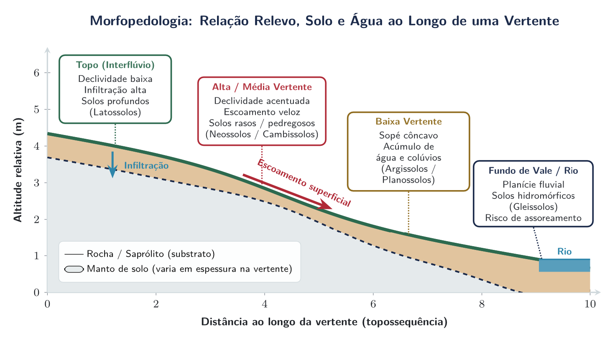
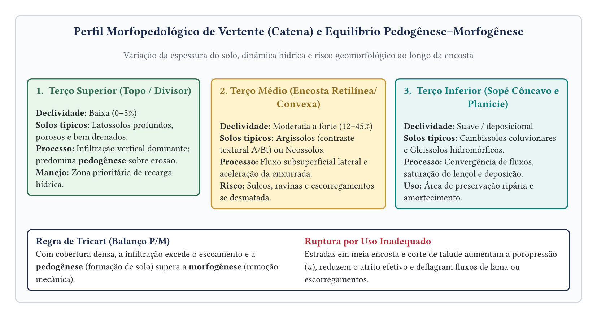
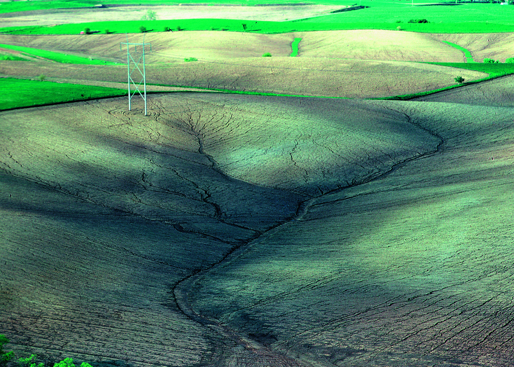
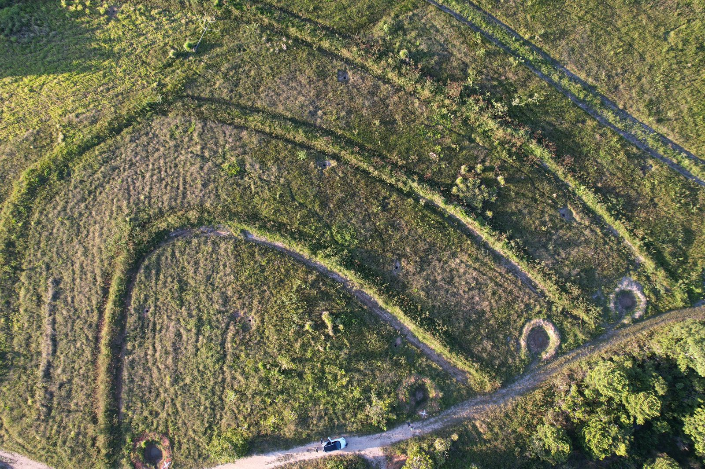

## [Abertura]{.pitch-tag} Visão Geral da Aula {#visao-geral .smaller-text .lesson-slide}

::: {.pitch-grid-55}
::: {.pitch-card}
[Roteiro da aula]{.pitch-card-index}
[Tópicos estruturantes]{.pitch-heading}

- [1]{.circle} Fundamentos da Morfopedologia (Tricart & Kilian, 1979; Castro & Salomão, 2000)
- [2]{.circle} Análise Estrutural da Cobertura Pedológica e Topossequências / Catenas (Boulet, 1982)
- [3]{.circle} Geometria de Vertentes em Planta e Perfil (Troeh, 1965; Ruhe, 1975) e fluxos hídricos
- [4]{.circle} Descontinuidade Hidráulica Subsuperficial ($A/Bt$) e gênese de processos erosivos
- [5]{.circle} Equação Universal de Perda de Solo Revisada — RUSLE ($A = R \cdot K \cdot LS \cdot C \cdot P$)
- [6]{.circle} Movimentos Gravitacionais de Massa (rastejo, escorregamentos, quedas e corridas)
:::

::: {.pitch-stack-2}
::: {.pitch-card .pitch-card--gold}
[Objetivo da aula]{.pitch-card-index}
[Integração relevo–solo–água]{.pitch-heading}

Compreender o funcionamento integrado do binômio **relevo–solo (morfopedologia)** ao longo das vertentes tropicais, analisando como a geometria das encostas e a estrutura vertical e lateral dos horizontes pedológicos controlam a infiltração, a erosão hídrica (RUSLE) e os movimentos de massa.
:::

::: {.pitch-pill-row}
[Catena]{.pitch-pill}
[Descontinuidade A/Bt]{.pitch-pill .pitch-pill--gold}
[RUSLE]{.pitch-pill}
[Mov. de Massa]{.pitch-pill .pitch-pill--gold}
:::
:::
:::

# 1 · Morfopedologia e Catenas Tropicais {.section-header rotulo="Morfopedologia"}

## [Morfopedologia]{.pitch-tag} O Conceito de Compartimentação Morfopedológica {#compartimentacao .smaller-text .lesson-slide}

::: {.pitch-grid-55}
::: {.pitch-stack-2}
::: {.pitch-card}
[Tricart & Kilian (1979) · Castro & Salomão (2000)]{.pitch-card-index}
[Relevo e solo como sistema co-evolutivo]{.pitch-heading}

Abordagem que analisa de forma indissociável a **geomorfologia das vertentes** e a **distribuição espacial dos solos**, pois ambos evoluem simultaneamente sob o comando dos fluxos hídricos superficiais e subsuperficiais.
:::

::: {.pitch-card .pitch-card--teal}
[Boulet (1982) · Queiroz Neto (2000)]{.pitch-card-index}
[Análise Estrutural e Catena (Milne, 1935)]{.pitch-heading}

O solo não é uma coleção de perfis verticais isolados, mas um **contínuo tridimensional** que se transforma do topo do interflúvio até a planície aluvial (**Topossequência ou Catena**). Lixiviação, eluviação/iluviação e hidromorfismo alteram o relevo tanto quanto a enxurrada.
:::
:::

::: {.pitch-card .pitch-card--gold}
[Diagnóstico em campo]{.pitch-card-index}
[Regra prática na vertente]{.pitch-heading}

Em uma mesma litologia e sob o mesmo clima, a mudança de **posição na vertente (topo $\rightarrow$ meia-encosta $\rightarrow$ sopé $\rightarrow$ várzea)** altera a espessura do *solum*, a textura, a drenagem interna e a erodibilidade do solo!
:::
:::

## [Catenas]{.pitch-tag .pitch-tag--gold} Topossequência (Catena Morfopedológica) e Hidrodinâmica {#catena-morfopedologica .smaller-text .lesson-slide}

::: {.pitch-media-card .pitch-media-card--wide}

[Topossequência morfopedológica: relevo, solos (SiBCS) e fluxos hídricos]{.pitch-caption}
[Elaboração própria (PGFPlots) · infiltração dominante no topo, escoamento na encosta e saturação no fundo de vale]{.pitch-caption-sub}
:::

::: {.pitch-band}
A posição na topossequência governa a espessura do manto de alteração e define onde predomina infiltração vertical, transporte lateral ou acúmulo hidromórfico.
:::

## [Catenas]{.pitch-tag .pitch-tag--gold} Terços da Vertente e Balanço Pedogênese–Morfogênese {#catena-troeh .smaller-text .lesson-slide}

::: {.pitch-media-card .pitch-media-card--wide}

[Perfil morfopedológico de vertente e equilíbrio Pedogênese–Morfogênese (Tricart)]{.pitch-caption}
[Elaboração própria (TikZ) · terços superior, médio e inferior e ruptura geotécnica por cortes e estradas]{.pitch-caption-sub}
:::

::: {.pitch-band}
Sob cobertura densa, a infiltração supera o escoamento (**pedogênese > morfogênese**); estradas em meia encosta e cortes de talude elevam a poropressão ($u$) e deflagram erosão e escorregamentos.
:::

# 2 · Geometria de Vertentes e Hidrodinâmica {.section-header rotulo="Vertentes"}

## [Vertentes]{.pitch-tag} Segmentos de Perfil Longitudinal (Ruhe, 1975) {#perfil-ruhe .smaller-text .lesson-slide}

::: {.pitch-flow-4}
::: {.pitch-card .pitch-card--forest}
[01 · Topo (*Summit*)]{.pitch-card-index}
[Interflúvio ($< 6\%$)]{.pitch-heading}

Declividade muito baixa; predomínio absoluto da **infiltração vertical** e pedogênese profunda (**Latossolos**).
:::

::: {.pitch-card .pitch-card--gold}
[02 · Ombro (*Shoulder*)]{.pitch-card-index}
[Convexidade superior]{.pitch-heading}

Transição convexa onde o escoamento ganha aceleração gravitacional; zona de máxima perda por erosão laminar.
:::

::: {.pitch-card}
[03 · Meia-Encosta (*Backslope*)]{.pitch-card-index}
[Segmento retilíneo]{.pitch-heading}

Transporte ativo de água e sedimentos por escoamento superficial, fluxo lateral (*throughflow*) e movimentos de massa.
:::

::: {.pitch-card .pitch-card--teal}
[04 · Sopé e Tálvegue]{.pitch-card-index}
[*Footslope / Toeslope*]{.pitch-heading}

Desaceleração e deposição coluvial/aluvial, mas com **saturação hídrica e exfiltração do lençol freático**.
:::
:::

::: {.pitch-band}
Cada segmento do perfil longitudinal exige práticas distintas de conservação: proteção de recarga no topo, controle de enxurrada na meia-encosta e faixa ripária preservada no sopé.
:::

## [Vertentes]{.pitch-tag .pitch-tag--gold} Curvatura em Planta (Horizontal) e Concentração Hídrica {#curvatura-planta .smaller-text .lesson-slide}

::: {.pitch-table-box}
| Forma da Vertente (Troeh, 1965) | Geometria das Linhas de Fluxo | Comportamento Hidrossedimentológico |
|-------------------|-------------------------------|-------------------------------------|
| **Divergente (Convexa em planta — "Nariz/Espigão")** | As linhas de fluxo espalham-se encosta abaixo | Lâmina d'água fina e dispersa → menor energia cisalhante; predomínio de erosão laminar difusa. |
| **Planar (Retilínea em planta)** | Linhas de fluxo paralelas | Aumento progressivo da lâmina com o comprimento de rampa ($L$) → formação de sulcos paralelos. |
| **Convergente (Côncava em planta — "Anfiteatro / Cabeceira")** | Todas as linhas de fluxo convergem para o eixo central da concavidade | **Concentração extrema de fluxo superficial e subsuperficial** → sítio preferencial de **voçorocas e escorregamentos**. |
:::

::: {.pitch-band .pitch-band--navy}
Em mapeamentos de fragilidade e risco, a combinação **anfiteatro côncavo + alta declividade** sinaliza áreas críticas para instalação de voçorocas e rupturas.
:::

## [Descontinuidade]{.pitch-tag .pitch-tag--alert} Descontinuidade Hidráulica Subsuperficial ($A/Bt$) {#descontinuidade-abt .smaller-text .lesson-slide}

::: {.pitch-grid-50}
::: {.pitch-stack-2}
::: {.pitch-card}
[Contraste textural]{.pitch-card-index}
[Por que Argissolos, Luvissolos e Planossolos erodem tanto?]{.pitch-heading}

- **Latossolos ($Bw$):** textura e estrutura microgranular homogêneas ($2\text{ a }5\text{ m}$), com condutividade saturada ($K_s$) elevada em todo o perfil.
- **Argissolos, Luvissolos e Planossolos** (Recôncavo, Agreste e Sertão da Bahia): forte **gradiente textural** entre $A/E$ arenoso/permeável e **$Bt$ ou $B\text{ plânico}$** muito argiloso e adensado ($K_{s(A)} \gg K_{s(Bt)}$).
:::

::: {.pitch-formula}
**Critério de Mohr–Coulomb:** $\tau_f = c' + (\sigma - u)\cdot \tan \phi'$

Quando a poropressão torna-se positiva ($u > 0$), cai a resistência ao cisalhamento ($\tau_f$).
:::
:::

::: {.pitch-milestones}
::: {.pitch-milestone-item}
**01 · Infiltração rápida:** a água da chuva penetra facilmente no horizonte $A/E$ arenoso.
:::

::: {.pitch-milestone-item}
**02 · Barreira hidráulica:** ao atingir o topo do horizonte $Bt$ pouco permeável, forma-se um **lençol suspenso temporário**.
:::

::: {.pitch-milestone-item}
**03 · Saturação e ruptura:** o horizonte $A$ satura por completo ($u > 0$), perdendo resistência ao cisalhamento.
:::

::: {.pitch-milestone-item}
**04 · Incisão acelerada:** ocorrem escoamento lateral subsuperficial (*piping*/liquefação) e escoamento superficial por saturação → **decapitação em sulcos e ravinas**.
:::
:::
:::

# 3 · Modelagem da Erosão Hídrica (RUSLE) {.section-header rotulo="RUSLE"}

## [RUSLE]{.pitch-tag .pitch-tag--gold} O que é a Erosão Laminar e por que Modelar a Perda de Solo? {#erosao-laminar .smaller-text .lesson-slide}

::: {.pitch-grid-55}
::: {.pitch-stack-2}
::: {.pitch-card}
[Diagnóstico precoce]{.pitch-card-index}
[Erosão laminar e tolerância ($T$)]{.pitch-heading}

Antes de abrir ravinas ou voçorocas, chuva e escoamento removem camadas finas de solo fértil (**erosão laminar e em sulcos**). Estimar a perda média anual ($\text{t}\cdot\text{ha}^{-1}\cdot\text{ano}^{-1}$) permite comparar cenários (ex.: pastagem degradada vs. sistema agroflorestal) frente à **tolerância de perda de solo ($T$)**.
:::

::: {.pitch-card .pitch-card--gold}
[Lógica da RUSLE]{.pitch-card-index}
[Renard et al. (1997)]{.pitch-heading}

Separa **condicionantes naturais** (energia da chuva $R$, fragilidade do solo $K$ e geometria da rampa $LS$) das **decisões de manejo** (cobertura $C$ e práticas conservacionistas $P$).
:::
:::

::: {.pitch-media-card .pitch-media-card--photo .pitch-media-card--tall}

[Erosão laminar e em sulcos em vertente agrícola]{.pitch-caption}
[USDA-NRCS / Wikimedia Commons · domínio público]{.pitch-caption-sub}
:::
:::

## [RUSLE]{.pitch-tag .pitch-tag--gold} Formulação Matemática e Fatores Naturais ($R, K, LS$) {#rusle-formula .smaller-text .lesson-slide}

::: {.pitch-formula}
$$A = R \cdot K \cdot L \cdot S \cdot C \cdot P$$

onde $A$ é a perda média anual de solo estimada ($\text{t}\cdot\text{ha}^{-1}\cdot\text{ano}^{-1}$).
:::

::: {.pitch-cards}
::: {.pitch-card .pitch-card--teal}
[$R$ · Erosividade da chuva]{.pitch-card-index}
[$\text{MJ}\cdot\text{mm}\cdot\text{ha}^{-1}\cdot\text{h}^{-1}\cdot\text{ano}^{-1}$]{.pitch-heading}

Produto da energia cinética total da chuva pela sua intensidade máxima em 30 minutos ($EI_{30}$). Representa a **força ativa do clima**.
:::

::: {.pitch-card .pitch-card--gold}
[$K$ · Erodibilidade do solo]{.pitch-card-index}
[$\text{t}\cdot\text{h}\cdot\text{MJ}^{-1}\cdot\text{mm}^{-1}$]{.pitch-heading}

Suscetibilidade intrínseca à desagregação e transporte: depende de silte + areia muito fina, matéria orgânica, estrutura e permeabilidade.
:::

::: {.pitch-card}
[$LS$ · Fator topográfico]{.pitch-card-index}
[Adimensional]{.pitch-heading}

Combina o comprimento de rampa ($L$) e o grau de declive ($S$). Quanto mais longa e íngreme a vertente, maior a velocidade e a tensão cisalhante do escoamento.
:::
:::

## [RUSLE]{.pitch-tag .pitch-tag--forest} Fatores Antrópicos de Manejo ($C$ e $P$) {#rusle-cp .smaller-text .lesson-slide}

::: {.pitch-cards-2}
::: {.pitch-card .pitch-card--forest}
[$C$ · Uso e cobertura ($0{,}001\text{ a }1{,}0$)]{.pitch-card-index}
[Proteção contra o efeito *splash*]{.pitch-heading}

- **Floresta densa / mata ciliar:** $C \approx 0{,}001\text{ a }0{,}01$ (proteção máxima da superfície);
- **Pastagem bem manejada:** $C \approx 0{,}05\text{ a }0{,}10$;
- **Cultivo anual sem plantio direto / pastagem degradada:** $C \approx 0{,}25\text{ a }0{,}50$;
- **Solo exposto descoberto:** $C = 1{,}00$.
:::

::: {.pitch-card .pitch-card--gold}
[$P$ · Práticas mecânicas ($0{,}1\text{ a }1{,}0$)]{.pitch-card-index}
[Controle do comprimento de rampa]{.pitch-heading}

- **Plantio morro abaixo:** $P = 1{,}0$ (nenhuma prática conservacionista);
- **Plantio em contorno (curvas de nível)**, culturas em faixas, cordões vegetados e **terraceamento agrícola:** $P \approx 0{,}15\text{ a }0{,}50$, pois seccionam o comprimento de rampa ($L$) e reduzem a velocidade da enxurrada.
:::
:::

::: {.pitch-band}
Como $R$, $K$ e a declividade regional dificilmente são alterados pelo produtor, o controle da erosão concentra-se na **cobertura vegetal ($C$)** e nas **práticas conservacionistas ($P$ e redução efetiva de $L$)**.
:::

## [Conservação]{.pitch-tag .pitch-tag--forest} Práticas Mecânicas de Controle do Fator $LS$ e $P$ na Bacia {#praticas-mecanicas .smaller-text .lesson-slide}

::: {.pitch-grid-50}
::: {.pitch-stack-2}
::: {.pitch-card .pitch-card--forest}
[Seccionamento de rampa]{.pitch-card-index}
[Terraços em nível e *barraginhas*]{.pitch-heading}

1. Quebra-se um comprimento de rampa único ($L = 300\text{ m}$) em vários segmentos curtos ($L = 30\text{ m}$), impedindo que o escoamento atinja a tensão crítica de incisão ($\tau_c$).
:::

::: {.pitch-card .pitch-card--teal}
[Efeito hidrossedimentológico]{.pitch-card-index}
[Infiltração e menor entrega ao rio]{.pitch-heading}

2. O volume retido nos camalhões e bacias de captação infiltra lentamente no perfil pedológico, recarregando o lençol freático e reduzindo a entrega de sedimentos ao canal fluvial.
:::
:::

::: {.pitch-media-card .pitch-media-card--photo .pitch-media-card--tall}

[Vertente manejada com práticas mecânicas (controle de $LS$ e $P$)]{.pitch-caption}
[Registro aéreo de terraços e bacias de retenção integrados ao escoamento superficial]{.pitch-caption-sub}
:::
:::

## [RUSLE]{.pitch-tag .pitch-tag--gold} RUSLE: exemplo e alcance da estimativa {#rusle-exemplo .smaller-text .lesson-slide}

::: {.pitch-formula}
**Exemplo didático** (fatores compatíveis com resultado em $\text{t}\cdot\text{ha}^{-1}\cdot\text{ano}^{-1}$):

$$A = R \cdot K \cdot LS \cdot C \cdot P = 6000 \times 0{,}03 \times 1{,}5 \times 0{,}20 \times 1 = 54\text{ t}\cdot\text{ha}^{-1}\cdot\text{ano}^{-1}$$

Mantendo os demais fatores, a adoção de cobertura conservacionista ($C = 0{,}04$) e práticas mecânicas ($P = 0{,}60$) reduz a estimativa para **$A = 6{,}48\text{ t}\cdot\text{ha}^{-1}\cdot\text{ano}^{-1}$** ($-88\%$).
:::

::: {.pitch-band}
O exercício **compara cenários**; não é medição local nem carga entregue ao rio. A RUSLE estima perda média por erosão entre sulcos e em sulcos: **voçorocas, movimentos de massa e erosão de margens** exigem abordagens próprias.
:::

# 4 · Movimentos Gravitacionais de Massa {.section-header rotulo="Mov. Massa"}

## [Movimentos de Massa]{.pitch-tag .pitch-tag--alert} Tipologia e Mecanismos Geotécnicos (Varnes, 1978; Guidicini & Nieble, 1984) {#movimentos-massa .smaller-text .lesson-slide}

::: {.pitch-table-box}
| Tipo de Movimento | Velocidade e Geometria | Mecanismo Físico-Geotécnico Dominante | Indicadores Diagnósticos em Campo |
|-------------------|------------------------|---------------------------------------|-----------------------------------|
| **1. Rastejo (*Creep*)** | Muito lento ($\text{mm a cm/ano}$); contínuo e sem superfície de ruptura definida | Deformação viscoplástica sazonal do manto de intemperismo superficial sob gravidade e variações térmicas/hídricas. | Árvores com troncos curvos ("floresta bêbada"), postes e cercas inclinados, pequenas rugas na encosta. |
| **2. Escorregamento Translacional (Planar)** | Rápido ($\text{m/s}$); superfície de ruptura **plana e rasa** ($1\text{ a }3\text{ m}$) | Saturação hídrica rápida durante chuvas intensas no contato **solo raso / rocha sã** ou entre horizontes contrastantes; perda de coesão efetiva. | Cicatrizes longas, estreitas e rasas em encostas íngremes ($> 30^\circ$, como na Serra do Mar e escarpas de Salvador). |
| **3. Escorregamento Rotacional (*Slump*)** | Moderado a rápido; superfície de ruptura **curva/côncava (circular)** e profunda ($> 5\text{ m}$) | Em mantos de intemperismo espessos e homogêneos, argilas ou aterros; deflagrado por **corte na base do talude** ou saturação basal. | Degrau de abatimento (escarpa em meia-lua), basculamento do bloco para trás e tufos de acumulação no pé. |
| **4. Queda e Tombamento (*Rockfall*)** | Extremamente rápido (queda livre); blocos rochosos | Descontinuidades estruturais da rocha (fraturas, falhas, xistosidade, alívio de tensão), pressão de raízes e intemperismo basal. | Paredões rochosos subverticais com blocos instáveis no topo e depósito de **tálus** na base. |
| **5. Corrida de Massa / Detritos (*Debris Flow*)** | Extremamente rápido e destrutivo ($> 10\text{ m/s}$); fluxo viscoso canalizado | Liquefação de grande volume de solo, blocos de rocha e troncos que descem pelas drenagens de montanha como massa fluida densa. | Línguas extensas de blocos métricos e lama depositadas no sopé das serras e planícies aluviais. |
:::

## [Diagnóstico]{.pitch-tag .pitch-tag--teal} Do perfil da vertente à hipótese de processo {#perfil-hipotese .smaller-text .lesson-slide}

::: {.pitch-table-box}
| Observação em campo | Hipótese de processo | Evidência a obter |
|---|---|---|
| **Contraste textural e mosqueados** | Restrição sazonal ao fluxo vertical | Perfil pedológico, permeabilidade e saturação |
| **Convergência em planta** | Concentração de água superficial e subsuperficial | Área contribuinte e marcas de fluxo |
| **Colúvio no sopé** | Transferência e armazenamento de vertente | Estratigrafia e conexão com a encosta |
| **Trinca próxima a ruptura** | Possível instabilidade geotécnica ativa | Evolução temporal e avaliação geotécnica |
:::

::: {.pitch-band}
Nenhum horizonte ou formato determina sozinho o processo: o diagnóstico exige combinar **geometria**, **material**, **água** e **história de uso**.
:::

# 5 · Síntese e Referências {.section-header rotulo="Síntese"}

## [Síntese]{.pitch-tag} Conceitos Essenciais para Fixação {#conceitos-essenciais .smaller-text .lesson-slide}

::: {.pitch-cards}
::: {.pitch-card}
[01 · Morfopedologia]{.pitch-card-index}
[Catena Morfopedológica]{.pitch-heading}

Sucessão genética de solos ao longo da vertente: Topo Latossólico estável $\rightarrow$ Meia-encosta Argissólica/Luvissólica com descontinuidade $A/Bt$ $\rightarrow$ Planície Gleissólica hidromórfica.
:::

::: {.pitch-card .pitch-card--alert}
[02 · Geometria crítica]{.pitch-card-index}
[Anfiteatros côncavos]{.pitch-heading}

Vertentes **convergentes (côncavas em planta)** concentram fluxos superficiais e subsuperficiais, sendo os pontos críticos para instalação de **voçorocas e escorregamentos**.
:::

::: {.pitch-card .pitch-card--forest}
[03 · Modelagem]{.pitch-card-index}
[RUSLE ($A = R \cdot K \cdot LS \cdot C \cdot P$)]{.pitch-heading}

Os fatores $R$, $K$ e $LS$ expressam a fragilidade natural, enquanto $C$ e $P$ expressam o controle exercido pela cobertura vegetal e pelas práticas conservacionistas.
:::
:::

## [Referências]{.pitch-tag} Referências Bibliográficas {#referencias .smaller-text .lesson-slide}

::: {.pitch-cards-2}
::: {.pitch-card}
[Morfopedologia e vertentes]{.pitch-card-index}
[Análise estrutural e geomorfologia]{.pitch-heading}

- BOULET, R. Analyse structurale et cartographie en pédologie. **Cahiers ORSTOM, Série Pédologie**, v. 19, n. 4, p. 309–351, 1982.
- CASTRO, S. S.; SALOMÃO, F. X. T. Compartimentação morfopedológica e sua aplicação: considerações metodológicas. **Geousp**, São Paulo, n. 7, p. 27–37, 2000.
- GUERRA, A. J. T.; MARÇAL, M. S. **Geomorfologia Ambiental**. 6. ed. Rio de Janeiro: Bertrand Brasil, 2014.
- TRICART, J.; KILIAN, J. **L'Éco-géographie et l'aménagement du milieu naturel**. Paris: François Maspero, 1979.
:::

::: {.pitch-card .pitch-card--gold}
[Erosão e estabilidade de taludes]{.pitch-card-index}
[Modelagem e geotecnia]{.pitch-heading}

- GUIDICINI, G.; NIEBLE, C. M. **Estabilidade de Taludes Naturais e de Escavação**. 2. ed. São Paulo: Edgard Blücher, 1984.
- RENARD, K. G. et al. **Predicting Soil Erosion by Water: A Guide to Conservation Planning with the Revised Universal Soil Loss Equation (RUSLE)**. Washington: USDA Agriculture Handbook 703, 1997.
:::
:::
