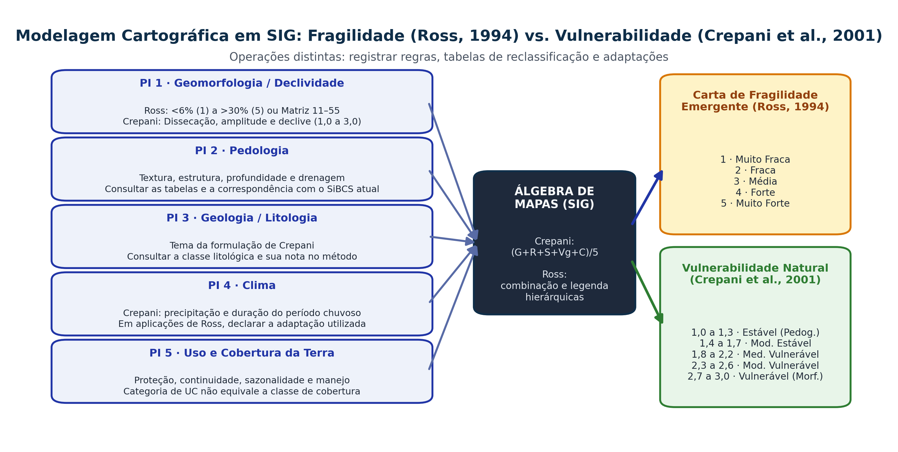

## Objetivos e percurso {.smaller-text}

- Relacionar geossistemas, unidades de paisagem e fluxos ambientais.
- Aplicar o raciocínio ecodinâmico de Tricart.
- Distinguir fragilidade de Ross e vulnerabilidade à perda de solo de Crepani.
- Construir uma legenda reproduzível, com validação em campo.

**Produto:** duas interpretações da mesma área, com regras e limites declarados.

# 1 · Geossistemas e ecodinâmica {.section-header rotulo="Fundamentos"}

## Um sistema tem limites, fluxos e história {.smaller-text}

Em uma microbacia, relevo, solo, vegetação, água e práticas sociais interagem por fluxos de energia e matéria.

O recorte depende da pergunta: a vertente permite estudar transferências; a bacia inclui rotas até o canal; o território evidencia decisões de acesso, manejo e proteção.

**Sotchava:** geossistemas são sistemas naturais espacializados, abertos e hierarquizados. A ação humana modifica sua dinâmica; a unidade de estudo precisa ser justificada.

## Bertrand: organização da paisagem {.smaller-text}

| Conjunto | Unidades da proposta de Bertrand (1968) |
|---|---|
| Escalas superiores | Zona, domínio e região natural |
| Escalas inferiores | Geossistema, geofácies e geótopo |

O geossistema articula potencial ecológico, exploração biológica e ação antrópica. Não equivale automaticamente a tamanho de pixel ou limite administrativo.

O **GTP** articula geossistema, território e paisagem: funcionamento biofísico, apropriação social e percepção.

## Tricart: relações entre processos {.smaller-text}

| Meio | Relação predominante | Pergunta de campo |
|---|---|---|
| Estável | Pedogênese com menor atividade morfogenética | Perfil e cobertura estão conservados? |
| Intergrade | Interferência entre pedogênese e morfogênese | Quais processos coexistem? |
| Fortemente instável | Predomínio da morfogênese | Há remoção, incisão ou movimentos ativos? |

Vegetação aberta ou sazonal não demonstra sozinha instabilidade. Interpretar a Caatinga com sua sazonalidade, material e formas de uso.

# 2 · Fragilidade ambiental de Ross {.section-header rotulo="Ross"}

## Fragilidade potencial e emergente {.smaller-text}

**Potencial:** interpretação das condições físico-naturais e de sua suscetibilidade à alteração.

**Emergente:** estado resultante dessas condições e das formas de uso e proteção da superfície.

Ross (1994) utiliza unidades ecodinâmicas e hierarquias qualitativas. Aplicações posteriores acrescentam temas e alteram regras. Informar sempre referência, escala, classes e operação.

## Declividade: cinco classes de fragilidade {.smaller-text}

| Classe | Faixa na aplicação didática | Fragilidade |
|---|---|---|
| 1 | $d<6\%$ | Muito fraca |
| 2 | $6\%\le d<12\%$ | Fraca |
| 3 | $12\%\le d<20\%$ | Média |
| 4 | $20\%\le d\le30\%$ | Forte |
| 5 | $d>30\%$ | Muito forte |

Faixas baseadas em Ross (1994); a convenção de limites evita sobreposição. Porcentagem e grau são medidas distintas: $d(\%)=100\tan\theta$.

## Dissecação: interpretar a matriz 11–55 {.smaller-text}

Cruzamento entre **entalhamento dos vales** e **dimensão interfluvial média**:

| Entalhamento / dimensão interfluvial | Muito grande (1) | Grande (2) | Média (3) | Pequena (4) | Muito pequena (5) |
|---|---|---|---|---|---|
| Muito fraco (1) | 11 | 12 | 13 | 14 | 15 |
| Fraco (2) | 21 | 22 | 23 | 24 | 25 |
| Médio (3) | 31 | 32 | 33 | 34 | 35 |
| Forte (4) | 41 | 42 | 43 | 44 | 45 |
| Muito forte (5) | 51 | 52 | 53 | 54 | 55 |

Registrar as faixas de medida de cada eixo e sua fonte. O código é uma combinação de atributos, não uma escala contínua de 11 a 55.

## Solos e cobertura: atributos verificáveis {.smaller-text}

| Tema | Características a observar |
|---|---|
| Solo | Textura, estrutura, profundidade, contraste entre horizontes, drenagem e agregação |
| Cobertura | Contato com o solo, serapilheira, continuidade, sazonalidade e manejo |
| Relevo | Declive, comprimento, curvaturas e conexões com a drenagem |
| Chuva, quando incluída na adaptação | Distribuição, intensidade e período da série |

A nomenclatura pedológica original exige correspondência criteriosa com o SiBCS atual. Uma UC não constitui classe de cobertura. O nome de uma ordem de solo não fornece sozinho sua erodibilidade.

## Códigos e regras de combinação {.smaller-text}

Uma legenda pode registrar **relevo–solo–cobertura**. Declarar a ordem e o significado de cada posição.

- Conservar os atributos permite rastrear diferenças entre unidades.
- Média simples de notas não é regra universal de Ross.
- Uma floresta pode proteger a superfície sem eliminar rupturas profundas.
- Pesos, novos temas ou soma ponderada constituem adaptações a documentar.

**Entrega:** reclassificação, operação, legenda, fontes e verificação em campo.

# 3 · Vulnerabilidade de Crepani e colaboradores {.section-header rotulo="Crepani"}

## Cinco temas e uma unidade territorial {.smaller-text}

Crepani et al. (2001) avaliam unidades territoriais básicas com valores relativos de **1,0 a 3,0**, associados ao balanço pedogênese–morfogênese.

$$V_{\mathrm{UTB}}=\frac{G+R+S+V_g+C}{5}$$

$G$: geologia; $R$: geomorfologia; $S$: solos; $V_g$: vegetação; $C$: clima.

O índice é relativo e empírico. Não representa probabilidade de desastre, t/ha/ano nem vulnerabilidade social.

## Atribuir valores com rastreabilidade {.smaller-text}

| Tema | Informação a consultar nas tabelas do método |
|---|---|
| Geologia | Litologia, coesão e resistência ao intemperismo |
| Geomorfologia | Amplitude, declividade e dissecação |
| Solos | Desenvolvimento e correspondência das classes |
| Vegetação | Densidade e proteção da cobertura |
| Clima | Precipitação e duração do período chuvoso |

Não converter automaticamente toda Caatinga em “muito vulnerável” nem todo granito em 1,0. Registrar a classe e a tabela que sustentam cada nota.

## Exemplo didático e sensibilidade {.smaller-text}

Unidade hipotética: $G=1{,}5$; $R=2{,}3$; $S=2{,}0$; $V_g=2{,}5$; $C=2{,}2$.

$$V_{\mathrm{UTB}}=10{,}5/5=2{,}10.$$

Se apenas a cobertura passar de 2,5 para 1,5, o resultado será 1,90. Isso explicita a sensibilidade do índice, mas não prova redução proporcional da perda de solo.

**Teste:** variar as notas incertas e verificar se a classificação muda.

## Operações que permanecem distintas {.smaller-text}

{.fig-full}

# 4 · Oficina de síntese cartográfica {.section-header rotulo="Aplicação"}

## Construir e validar um produto em SIG {.smaller-text}

1. Conferir projeção, escala, datas e limites dos dados.
2. Delimitar unidades e verificar transições em campo.
3. Reclassificar temas com regras explícitas.
4. Aplicar a operação do método escolhido.
5. Comparar com processos observados e reconhecer áreas sem evidência.
6. Exportar mapa com legenda, fontes, incertezas e finalidade.

Uma saída raster detalhada não corrige uma base regional generalizada.

## Exercício: mesmo índice, processos diferentes {.smaller-text}

Duas unidades obtêm $V_{\mathrm{UTB}}=2{,}10$. Uma combina relevo suave e solo exposto; outra, forte declive e cobertura contínua.

- Quais processos esperar em cada uma?
- Qual entrega mais sedimento ao canal? Quais dados faltam?
- O índice identifica moradias expostas ou capacidade de resposta?

**Produto:** interpretação escrita e plano de verificação. A decisão exige os atributos e as evidências que originaram o mapa.

## Referências e leitura metodológica {.smaller-text}

- TRICART, J. **Ecodinâmica**. IBGE, 1977.
- BERTRAND, G. Paisagem e geografia física global: esboço metodológico. **Caderno de Ciências da Terra**, 13, 1972 [original de 1968].
- CHRISTOFOLETTI, A. **Análise de sistemas em Geografia**. Hucitec/Edusp, 1979.
- ROSS, J. L. S. [Análise empírica da fragilidade dos ambientes naturais e antropizados](https://revistas.usp.br/rdg/article/view/47327). **RDG**, 8, 63–74, 1994.
- CREPANI, E. et al. **Sensoriamento remoto e geoprocessamento aplicados ao zoneamento ecológico-econômico e ao ordenamento territorial**. INPE, 2001.
- SPÖRL, C.; ROSS, J. L. S. Análise comparativa da fragilidade ambiental com aplicação de três modelos. **GEOUSP**, 15, 39–49, 2004.
