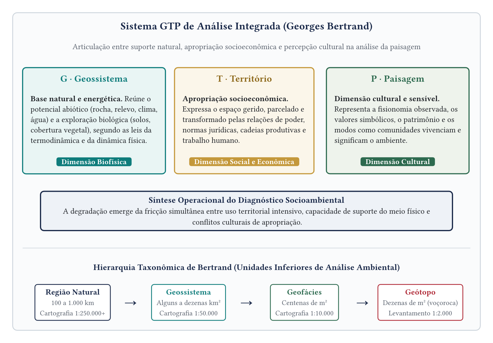
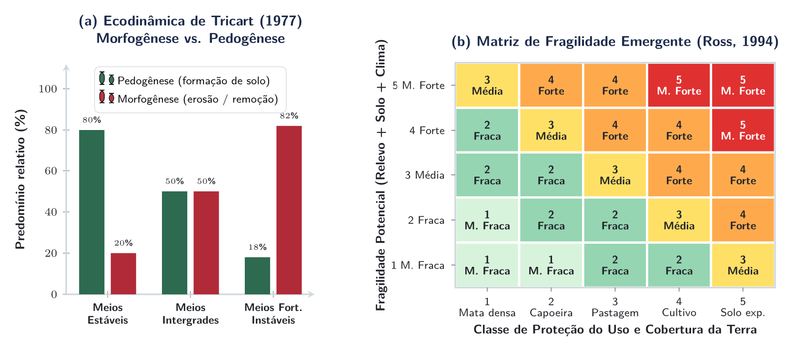
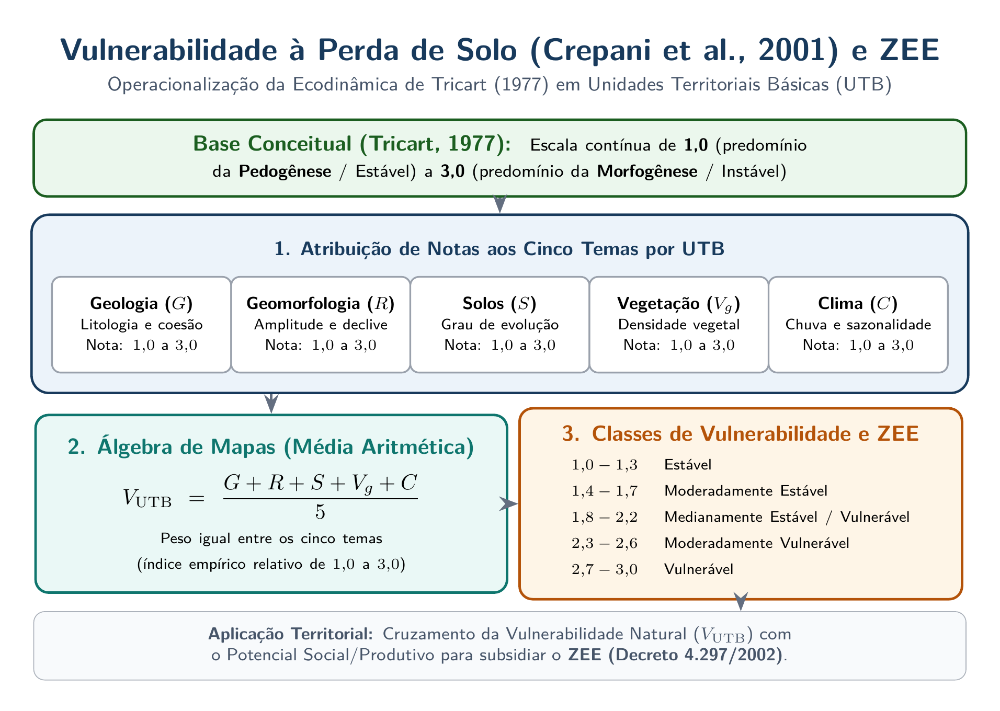
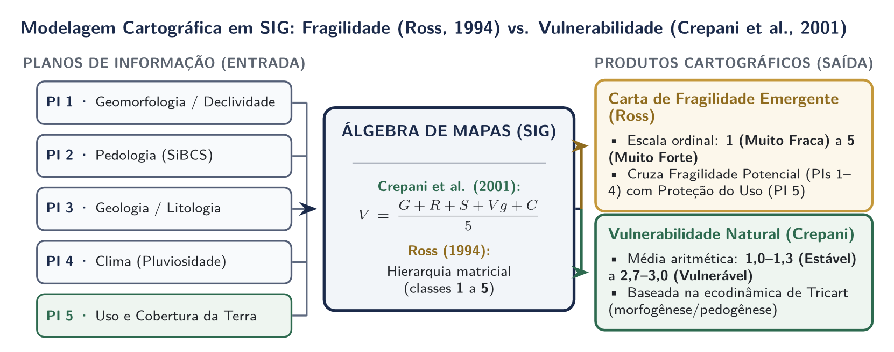

## [Abertura]{.pitch-tag} Objetivos e percurso {.smaller-text .lesson-slide}

::: {.pitch-flow-4}
::: {.pitch-card}
[01 · Sistemas]{.pitch-card-index}
[Geossistemas e paisagem]{.pitch-heading}

Relacionar geossistemas, unidades de paisagem e fluxos ambientais de energia e matéria.
:::

::: {.pitch-card .pitch-card--teal}
[02 · Processos]{.pitch-card-index}
[Ecodinâmica de Tricart]{.pitch-heading}

Aplicar o raciocínio ecodinâmico de Tricart (1977) à leitura de meios estáveis, intergrades e instáveis.
:::

::: {.pitch-card .pitch-card--gold}
[03 · Modelos]{.pitch-card-index}
[Ross vs. Crepani]{.pitch-heading}

Distinguir fragilidade de Ross (1994) e vulnerabilidade à perda de solo de Crepani et al. (2001).
:::

::: {.pitch-card .pitch-card--forest}
[04 · Síntese]{.pitch-card-index}
[Legenda e campo]{.pitch-heading}

Construir uma legenda reproduzível em SIG, com rastreabilidade e validação em campo.
:::
:::

::: {.pitch-band .pitch-band--navy}
**Produto da aula:** duas interpretações cartográficas da mesma área, com regras de álgebra de mapas e limites declarados.
:::

# 1 · Geossistemas e ecodinâmica {.section-header rotulo="Fundamentos"}

## [Geossistemas]{.pitch-tag .pitch-tag--teal} Um sistema tem limites, fluxos e história {.smaller-text .lesson-slide}

::: {.pitch-cards}
::: {.pitch-card}
[Escala da vertente]{.pitch-card-index}
[Transferências locais]{.pitch-heading}

Permite estudar fluxos de água, sedimentos e solutos entre topo, meia-encosta e sopé.
:::

::: {.pitch-card .pitch-card--teal}
[Escala da bacia]{.pitch-card-index}
[Rotas até o canal]{.pitch-heading}

Integra relevo, solo, vegetação e água ao longo das rotas hidrológicas até a rede de drenagem.
:::

::: {.pitch-card .pitch-card--gold}
[Escala do território]{.pitch-card-index}
[Decisões e manejo]{.pitch-heading}

Evidencia práticas sociais, decisões de acesso, uso da terra, manejo e proteção ambiental.
:::
:::

::: {.pitch-card .pitch-card--gold}
[Base teórica · Sotchava (1977)]{.pitch-card-index}
[Geossistemas como sistemas abertos e hierarquizados]{.pitch-heading}

Em uma microbacia, relevo, solo, vegetação, água e práticas sociais interagem por fluxos de energia e matéria. Para **Sotchava (1977)**, geossistemas são sistemas naturais espacializados, abertos e hierarquizados: a ação humana modifica sua dinâmica, e o recorte espacial depende da pergunta de estudo, devendo ser explicitamente justificado.
:::

## [Paisagem]{.pitch-tag .pitch-tag--teal} Bertrand (1968): organização da paisagem {.smaller-text .lesson-slide}

::: {.pitch-grid-40}
::: {.pitch-stack-2}
::: {.pitch-table-box}
| Conjunto | Unidades de Bertrand (1968) |
|---|---|
| Escalas superiores | Zona, domínio e região natural |
| Escalas inferiores | Geossistema, geofácies e geótopo |
:::

::: {.pitch-card}
[Conceito operacional]{.pitch-card-index}
[Geossistema e sistema GTP]{.pitch-heading}

O geossistema articula **potencial ecológico**, **exploração biológica** e **ação antrópica** — não equivale automaticamente a tamanho de pixel ou limite administrativo.

O **GTP** (Bertrand & Bertrand, 2007) integra geossistema (funcionamento biofísico), território (apropriação social) e paisagem (percepção).
:::
:::

::: {.pitch-media-card}

[Sistema GTP e Hierarquia Taxonômica (Bertrand, 1968; 2007)]{.pitch-caption}
[Articulação entre base biofísica, apropriação socioeconômica e dimensão cultural]{.pitch-caption-sub}
:::
:::

## [Ecodinâmica]{.pitch-tag .pitch-tag--teal} Tricart (1977): relações entre processos {.smaller-text .lesson-slide}

::: {.pitch-table-box}
| Meio ecodinâmico | Relação predominante | Pergunta de campo |
|---|---|---|
| **Estável** | Pedogênese com menor atividade morfogenética | Perfil de solo e cobertura estão conservados? |
| **Intergrade** | Interferência entre pedogênese e morfogênese | Quais processos formadores e erosivos coexistem? |
| **Fortemente instável** | Predomínio da morfogênese | Há remoção, incisão linear ou movimentos ativos? |
:::

::: {.pitch-band .pitch-band--teal}
**Cautela no Semiárido:** vegetação aberta ou sazonal não demonstra sozinha instabilidade. Interpretar a Caatinga considerando sua sazonalidade hídrica, material de origem e formas reais de uso.
:::

## [Ecodinâmica]{.pitch-tag .pitch-tag--teal} Tricart (1977): Avaliação Integrada Regional {.smaller-text .lesson-slide}

::: {.pitch-band}
Para sair da classificação ecodinâmica e chegar ao planejamento territorial (**organização** ou **reorganização** do espaço), Tricart (1977) estrutura quatro etapas sequenciais:
:::

::: {.pitch-milestones}
::: {.pitch-milestone-item}
**01 · Quadro regional:** análise do **clima dinâmico** (eventos extremos e ritmo, além das médias) e do **quadro morfoestrutural** (tectônica e litologia).
:::

::: {.pitch-milestone-item}
**02 · Análise morfodinâmica:** sistema morfogenético com **litovariantes** (variações litológicas) e **topovariantes** (variações de dissecação/relevo), avaliando processos atuais quanto a **natureza, intensidade e distribuição** + ação antrópica.
:::

::: {.pitch-milestone-item}
**03 · Recursos ecológicos:** regime hídrico, condições ecoclimatológicas, degradação dos solos e diagnóstico agroecológico.
:::

::: {.pitch-milestone-item}
**04 · Gestão e recomendações:** definição de aptidões, limitações e compatibilização de usos — matriz direta para **Ross (1994)** e **Crepani et al. (2001)**.
:::
:::

## [Gestão territorial]{.pitch-tag .pitch-tag--teal} Classificação Funcional das Regiões (Tricart, 1977) {.smaller-text .lesson-slide}

::: {.pitch-table-box}
| Tipo de região | Caracterização | Papel na gestão territorial |
|---|---|---|
| **1. Regiões de produção** | Boa estabilidade ambiental, solos férteis, relevo suave e clima favorável | Foco de atividades econômicas intensivas; suportam uso produtivo sem degradação severa mediante manejo conservacionista |
| **2. Regiões marginais** | Fortes limitações naturais (encostas íngremes, solos rasos, aridez ou inundações) | Custo de adaptação supera o retorno; priorizar preservação, restauração ou turismo ecológico de baixo impacto |
| **3. Regiões compostas** | Mosaicos de pequenas áreas produtivas lado a lado com áreas marginais (ex.: vales e morros) | Planejamento rigoroso nos **fenômenos de contato** (bordas): desmatar o morro marginal desencadeia erosão sobre o vale |
| **4. Regiões conexas** | Áreas ligadas por fluxos contínuos de matéria e energia (água, sedimentos, vento; ex.: bacia) | Gestão em rede: alterações a montante (desmatamento, poluição) geram enchentes, assoreamento ou contaminação a jusante |
| **5. Regiões neutras** | Unidades isoladas ou muito estáveis, sem trocas significativas com áreas vizinhas | Baixo risco de impactos em cadeia; permitem planejamento mais independente e localizado |
:::

::: {.pitch-band .pitch-band--navy}
**Princípio da conexão:** intervir em uma unidade produtiva sem gerir as regiões conexas ou marginais a montante compromete a estabilidade do conjunto.
:::

# 2 · Fragilidade ambiental de Ross (1994) {.section-header rotulo="Ross"}

## [Ross (1994)]{.pitch-tag .pitch-tag--gold} Fragilidade potencial e emergente {.smaller-text .lesson-slide}

::: {.pitch-cards-2}
::: {.pitch-card}
[01 · Suscetibilidade natural]{.pitch-card-index}
[Fragilidade Potencial (FP)]{.pitch-heading}

- **O que é:** avalia a sensibilidade intrínseca do ambiente apenas por suas características físico-naturais, antes da intervenção humana.
- **O que é analisado:** relevo (declividade ou dissecação), solos (erodibilidade), geologia (tipo de rocha) e clima (intensidade das chuvas).
- **Exemplo prático:** encosta muito íngreme, com solo arenoso e chuvas intensas tem fragilidade potencial **muito alta**, mesmo sob floresta nativa.
:::

::: {.pitch-card .pitch-card--gold}
[02 · Risco real atual]{.pitch-card-index}
[Fragilidade Emergente (FE)]{.pitch-heading}

- **O que é:** resultado do cruzamento entre a **Fragilidade Potencial** e a forma de uso e ocupação do solo (grau de proteção da superfície).
- **O que é analisado:** adiciona-se a cobertura atual (floresta, pastagem, lavoura, área urbana), que atua como escudo contra a chuva e a erosão.
- **Exemplo prático:** a mesma encosta íngreme mantém-se estável sob floresta densa; ao ser convertida em pasto degradado ou loteamento, a fragilidade emergente dispara.
:::
:::

::: {.pitch-band .pitch-band--teal}
**Organização dos dados (Ross, 1994):** com base em Tricart (1977), separa **Unidades Estáveis** (pedogênese) de **Unidades Instáveis** (erosão), atribuindo hierarquias qualitativas de **1** (muito baixa) a **5** (muito alta). *Informar sempre referência, escala, classes e operação utilizada.*
:::

## [Ross (1994)]{.pitch-tag .pitch-tag--gold} Declividade: cinco classes de fragilidade {.smaller-text .lesson-slide}

::: {.pitch-table-box}
| Classe | Faixa na aplicação didática | Fragilidade |
|:---:|---|---|
| **1** | $d < 6\%$ | Muito fraca |
| **2** | $6\% \le d < 12\%$ | Fraca |
| **3** | $12\% \le d < 20\%$ | Média |
| **4** | $20\% \le d \le 30\%$ | Forte |
| **5** | $d > 30\%$ | Muito forte |
:::

::: {.pitch-band}
Faixas baseadas em **Ross (1994)**; a convenção explícita de limites abertos e fechados evita sobreposição entre classes. Porcentagem e grau são medidas distintas: $d(\%) = 100\tan\theta$.
:::

## [Ross (1994)]{.pitch-tag .pitch-tag--gold} Cálculo da Declividade e Conversão (% e Graus) {.smaller-text .lesson-slide}

::: {.pitch-grid-55}
::: {.pitch-stack-2}
::: {.pitch-formula}
$$d(\%) = \frac{D_V}{D_H} \times 100 = 100 \tan\theta$$

$$\theta(^\circ) = \arctan\!\left(\frac{D_V}{D_H}\right) = \arctan\!\left(\frac{d(\%)}{100}\right)$$
:::

::: {.pitch-card .pitch-card--gold}
[Aplicação em carta, MDE e SIG]{.pitch-card-index}
[Exemplo numérico e atenção no QGIS/ArcGIS]{.pitch-heading}

- **Cálculo:** se o terreno sobe $D_V = 12\text{ m}$ em distância horizontal $D_H = 100\text{ m}$, então $d = 12\%$ e $\theta = \arctan(0{,}12) \approx 6{,}84^\circ$.
- **Atenção no SIG:** ao rodar a ferramenta *Slope* (Declividade), selecionar **Porcentagem** para aplicar diretamente as classes de Ross (1994).
:::
:::

::: {.pitch-table-box}
| Declividade (%) | Ângulo ($\theta^\circ$) | Referência |
|:---:|:---:|---|
| $6\%$ | $3{,}4^\circ$ | Limite Classe 1 / 2 (Ross, 1994) |
| $12\%$ | $6{,}8^\circ$ | Limite Classe 2 / 3 (Ross, 1994) |
| $20\%$ | $11{,}3^\circ$ | Limite Classe 3 / 4 (Ross, 1994) |
| $30\%$ | $16{,}7^\circ$ | Limite Classe 4 / 5 (Ross, 1994) |
| $46{,}6\%$ | $25{,}0^\circ$ | Topo de morro (APP, Lei 12.651/2012) |
| $100\%$ | $45{,}0^\circ$ | Encosta (APP, Lei 12.651/2012) |
:::
:::

## [Ross (1994)]{.pitch-tag .pitch-tag--gold} Hierarquização e Atribuição de Notas (1 a 5) {.smaller-text .lesson-slide}

::: {.pitch-table-box}
| Nota | Fragilidade | Declividade | Exemplo: Solos (SiBCS) | Exemplo: Uso da Terra (Proteção) |
|:---:|---|---|---|---|
| **1** | Muito Baixa | $< 6\%$ (plano) | Latossolos | Floresta densa (alta proteção) |
| **2** | Baixa | $6\% \le d < 12\%$ | Argissolos profundos | Silvicultura / Pastagem bem manejada |
| **3** | Média | $12\% \le d < 20\%$ | Cambissolos | Culturas perenes |
| **4** | Alta | $20\% \le d \le 30\%$ | Neossolos Litólicos (rasos) | Culturas temporárias (solo exposto parte do ano) |
| **5** | Muito Alta | $> 30\%$ (íngreme) | Neossolos Quartzarênicos (arenosos) | Área urbana / Solo exposto / Mineração |
:::

::: {.pitch-band}
Cada plano de informação (*raster*) é reclassificado em **5 graus de fragilidade**, de **1 (Muito Baixa)** a **5 (Muito Alta)**, antes do cruzamento na Calculadora Raster.
:::

## [Ross (1994)]{.pitch-tag .pitch-tag--gold} Cálculo da Fragilidade Potencial e Emergente em SIG {.smaller-text .lesson-slide}

::: {.pitch-cards-2}
::: {.pitch-card}
[01 · Fatores naturais]{.pitch-card-index}
[Fragilidade Potencial (FP)]{.pitch-heading}

Combina apenas fatores naturais na Calculadora Raster:

::: {.pitch-formula}
$$\text{FP} = \frac{\text{Decliv.} + \text{Solos} + \text{Geol.} + \text{Pluv.}}{4}$$

$$\text{FP}_{\text{AHP}} = 0{,}4\,\text{Decliv.} + 0{,}3\,\text{Solos} + 0{,}1\,\text{Geol.} + 0{,}2\,\text{Pluv.}$$
:::

*O mapa contínuo resultante (1 a 5) é reclassificado nas 5 categorias de fragilidade ($\sum p_i = 1$).*
:::

::: {.pitch-card .pitch-card--gold}
[02 · Cruzamento com Uso (UOT)]{.pitch-card-index}
[Fragilidade Emergente (FE)]{.pitch-heading}

Cruza o mapa de **FP** com o **Uso e Ocupação da Terra (UOT)** (notas 1 a 5):

::: {.pitch-formula}
$$\text{FE} = \frac{\text{FP} + \text{UOT}}{2} \quad \text{ou} \quad \text{FE} = 0{,}6\,\text{FP} + 0{,}4\,\text{UOT}$$
:::

**Matriz Original de Ross (Dígitos):** concatena os códigos em tabela de dupla entrada. Ex.: $\text{FP} = 4$ (alta) e $\text{UOT} = 1$ (floresta) gera o código **41**, resultando em FE Média ou Baixa pela proteção vegetal.
:::
:::

## [Ross (1994)]{.pitch-tag .pitch-tag--gold} Matriz Ecodinâmica e Fragilidade Emergente {.smaller-text .lesson-slide}

::: {.pitch-media-card .pitch-media-card--wide}

[Ecodinâmica (Tricart, 1977) e Matriz de Fragilidade Emergente (Ross, 1994)]{.pitch-caption}
[Cruzamento entre Fragilidade Potencial e classes de proteção do Uso e Cobertura da Terra]{.pitch-caption-sub}
:::

::: {.pitch-band}
A matriz de dupla entrada preserva o papel amortecedor da cobertura vegetal sem apagar a suscetibilidade física de base (declividade, solos, litologia e clima).
:::

## [Ross (1994)]{.pitch-tag .pitch-tag--gold} Dissecação: interpretar a matriz 11–55 {.smaller-text .lesson-slide}

::: {.pitch-table-box}
| Entalhamento / dimensão interfluvial | Muito grande (1) | Grande (2) | Média (3) | Pequena (4) | Muito pequena (5) |
|---|---|---|---|---|---|
| **Muito fraco (1)** | 11 | 12 | 13 | 14 | 15 |
| **Fraco (2)** | 21 | 22 | 23 | 24 | 25 |
| **Médio (3)** | 31 | 32 | 33 | 34 | 35 |
| **Forte (4)** | 41 | 42 | 43 | 44 | 45 |
| **Muito forte (5)** | 51 | 52 | 53 | 54 | 55 |
:::

::: {.pitch-band .pitch-band--navy}
**Atenção analítica:** registrar as faixas de medida de cada eixo (entalhamento dos vales $\times$ dimensão interfluvial média) e sua fonte. O código **11–55** é uma combinação de atributos, **não** uma escala contínua numérica.
:::

## [Atributos]{.pitch-tag .pitch-tag--gold} Solos e cobertura: atributos verificáveis {.smaller-text .lesson-slide}

::: {.pitch-table-box}
| Tema | Características a observar |
|---|---|
| **Solo** | Textura, estrutura, profundidade, contraste entre horizontes, drenagem e agregação |
| **Cobertura** | Contato com o solo, serapilheira, continuidade, sazonalidade e manejo |
| **Relevo** | Declive, comprimento de rampa, curvaturas e conexões com a drenagem |
| **Chuva** *(quando incluída)* | Distribuição sazonal, intensidade e período da série histórica |
:::

::: {.pitch-card .pitch-card--alert}
[Cuidados na reclassificação]{.pitch-card-index}
[Erros frequentes em SIG]{.pitch-heading}

A nomenclatura pedológica original exige correspondência criteriosa com o **SiBCS atual**. Uma Unidade de Conservação (UC) não constitui classe de cobertura vegetal, e o nome isolado de uma ordem de solo não fornece sua erodibilidade.
:::

## [Legenda]{.pitch-tag .pitch-tag--gold} Códigos e regras de combinação {.smaller-text .lesson-slide}

::: {.pitch-milestones}
::: {.pitch-milestone-item}
**01 · Legenda rastreável:** registrar a sequência **relevo–solo–cobertura**, declarando a ordem e o significado de cada dígito; conservar os atributos permite rastrear diferenças entre unidades.
:::

::: {.pitch-milestone-item}
**02 · Operação matemática:** média simples de notas **não é regra universal** do método de Ross (1994).
:::

::: {.pitch-milestone-item}
**03 · Limite da cobertura:** uma floresta pode proteger a superfície contra erosão laminar sem eliminar rupturas profundas em encostas muito íngremes.
:::

::: {.pitch-milestone-item}
**04 · Adaptações documentadas:** pesos, novos temas ou soma ponderada constituem adaptações que precisam ser justificadas no memorial.
:::
:::

::: {.pitch-band .pitch-band--navy}
**Entrega exigida:** tabela de reclassificação, operação utilizada, legenda completa, fontes cartográficas e verificação em campo.
:::

# 3 · Vulnerabilidade de Crepani et al. (2001) {.section-header rotulo="Crepani"}

## [Crepani (2001)]{.pitch-tag .pitch-tag--teal} Base Conceitual: Ecodinâmica aplicada ao ZEE {.smaller-text .lesson-slide}

::: {.pitch-cards-2}
::: {.pitch-card .pitch-card--teal}
[Origem do método]{.pitch-card-index}
[INPE e Zoneamento Ecológico-Econômico]{.pitch-heading}

Proposto pelo **INPE** (Crepani et al., 2001) para subsidiar o **Zoneamento Ecológico-Econômico (ZEE)**, traduz os princípios ecodinâmicos de Tricart (1977) para escalas regionais por meio de sensoriamento remoto e cartografia temática.
:::

::: {.pitch-card .pitch-card--gold}
[Ideia central]{.pitch-card-index}
[Balanço Pedogênese ↔ Morfogênese]{.pitch-heading}

Cada unidade de paisagem é posicionada entre dois extremos do balanço natural: o predomínio da **pedogênese** (formação de solo, estabilidade) e o predomínio da **morfogênese** (erosão, instabilidade), antes da atribuição numérica dos cinco temas.
:::
:::

::: {.pitch-band}
A análise ocorre sobre **Unidades Territoriais Básicas (UTB)**, atribuindo valores contínuos relativos de **1,0** (estabilidade máxima) a **3,0** (vulnerabilidade máxima).
:::

## [Crepani (2001)]{.pitch-tag .pitch-tag--teal} Cinco temas e uma unidade territorial {.smaller-text .lesson-slide}

::: {.pitch-grid-40}
::: {.pitch-stack-2}
::: {.pitch-formula}
$$V_{\mathrm{UTB}}=\frac{G+R+S+V_g+C}{5}$$

$G$: geologia · $R$: geomorfologia · $S$: solos · $V_g$: vegetação · $C$: clima.
:::

::: {.pitch-card .pitch-card--alert}
[Alcance e limites do índice]{.pitch-card-index}
[Escala relativa de 1,0 a 3,0]{.pitch-heading}

Crepani et al. (2001) avaliam UTBs com valores relativos de **1,0 a 3,0**, associados ao balanço pedogênese–morfogênese. O índice é relativo e empírico: **não representa** probabilidade de desastre, perda em $\text{t/ha/ano}$ nem vulnerabilidade social.
:::
:::

::: {.pitch-media-card .pitch-media-card--tall}

[Fluxograma Metodológico de Crepani et al. (2001)]{.pitch-caption}
[Atribuição aos cinco temas por UTB, média aritmética e classes para ZEE]{.pitch-caption-sub}
:::
:::

## [Crepani (2001)]{.pitch-tag .pitch-tag--teal} Atribuir valores com rastreabilidade {.smaller-text .lesson-slide}

::: {.pitch-table-box}
| Tema | Informação a consultar nas tabelas do método |
|---|---|
| **Geologia ($G$)** | Litologia, grau de coesão das rochas e resistência ao intemperismo |
| **Geomorfologia ($R$)** | Amplitude altimétrica, declividade e dissecação do relevo |
| **Solos ($S$)** | Grau de desenvolvimento pedogenético e correspondência das classes |
| **Vegetação ($V_g$)** | Densidade fisionômica e capacidade de proteção da cobertura |
| **Clima ($C$)** | Precipitação média anual e duração/intensidade do período chuvoso |
:::

::: {.pitch-band .pitch-band--teal}
**Rastreabilidade:** não converter automaticamente toda Caatinga em "muito vulnerável" nem todo granito em $1{,}0$. Registrar exatamente a classe e a tabela que sustentam cada nota.
:::

## [Sensibilidade]{.pitch-tag .pitch-tag--teal} Exemplo didático e sensibilidade {.smaller-text .lesson-slide}

::: {.pitch-formula}
**Unidade hipotética:** $G=1{,}5$; $R=2{,}3$; $S=2{,}0$; $V_g=2{,}5$; $C=2{,}2$

$$V_{\mathrm{UTB}}=\frac{1{,}5+2{,}3+2{,}0+2{,}5+2{,}2}{5}=\frac{10{,}5}{5}=2{,}10$$
:::

::: {.pitch-cards-2}
::: {.pitch-card}
[Simulação de cenário]{.pitch-card-index}
[Efeito da cobertura vegetal]{.pitch-heading}

Se apenas a cobertura passar de $2{,}5$ para $1{,}5$, o resultado cai para **$1{,}90$**. Isso explicita a sensibilidade do índice ao parâmetro $V_g$, mas não prova redução proporcional da perda física de solo.
:::

::: {.pitch-card .pitch-card--gold}
[Controle metodológico]{.pitch-card-index}
[Teste de sensibilidade]{.pitch-heading}

Variar as notas atribuídas aos temas com maior incerteza cartográfica para verificar se a classe final de vulnerabilidade da UTB muda de faixa.
:::
:::

## [Comparação]{.pitch-tag} Operações que permanecem distintas {.smaller-text .lesson-slide}

::: {.pitch-media-card .pitch-media-card--wide}

[Álgebra de Mapas em SIG: Fragilidade (Ross, 1994) vs. Vulnerabilidade (Crepani et al., 2001)]{.pitch-caption}
[Planos de informação de entrada, operações matriciais vs. aritméticas e escalas de saída]{.pitch-caption-sub}
:::

::: {.pitch-band}
Ross (1994) opera com **hierarquia matricial (classes 1 a 5)** distinguindo FP e FE; Crepani et al. (2001) operam com **média aritmética (1,0 a 3,0)** integrada ao potencial socioeconômico no ZEE.
:::

# 4 · Oficina de síntese cartográfica {.section-header rotulo="Aplicação"}

## [Oficina SIG]{.pitch-tag .pitch-tag--forest} Construir e validar um produto em SIG {.smaller-text .lesson-slide}

::: {.pitch-milestones}
::: {.pitch-milestone-item}
**01 · Padronizar bases:** conferir projeção, escala cartográfica, datas de aquisição e limites espaciais dos dados.
:::

::: {.pitch-milestone-item}
**02 · Delimitar e checar:** delimitar unidades de paisagem ou UTBs e verificar transições e bordas em campo.
:::

::: {.pitch-milestone-item}
**03 · Reclassificar temas:** aplicar tabelas de reclassificação com regras explícitas e correspondência SiBCS atualizada.
:::

::: {.pitch-milestone-item}
**04 · Executar a operação:** aplicar a matriz ou álgebra correspondente ao método escolhido (Ross ou Crepani).
:::

::: {.pitch-milestone-item}
**05 · Validar e exportar:** confrontar com processos observados, reconhecer áreas sem evidência e exportar mapa com legenda, fontes, incertezas e finalidade.
:::
:::

::: {.pitch-band .pitch-band--navy}
**Princípio da escala:** uma saída *raster* com pixels pequenos não corrige uma base temática regional generalizada.
:::

## [Oficina SIG]{.pitch-tag .pitch-tag--forest} Exercício: mesmo índice, processos diferentes {.smaller-text .lesson-slide}

::: {.pitch-band .pitch-band--navy}
**Cenário comparativo:** duas unidades obtêm exatamente $V_{\mathrm{UTB}}=2{,}10$. A **Unidade A** combina relevo suave e solo exposto; a **Unidade B**, forte declive e cobertura vegetal contínua.
:::

::: {.pitch-cards}
::: {.pitch-card}
[Questão 01]{.pitch-card-index}
[Processos dominantes]{.pitch-heading}

Quais processos erosivos ou hidrológicos esperar em cada unidade, apesar do índice idêntico?
:::

::: {.pitch-card .pitch-card--teal}
[Questão 02]{.pitch-card-index}
[Conectividade e dados]{.pitch-heading}

Qual unidade entrega mais sedimento ao canal fluvial? Quais dados de campo faltam para confirmar?
:::

::: {.pitch-card .pitch-card--gold}
[Questão 03]{.pitch-card-index}
[Limites do índice]{.pitch-heading}

O índice $V_{\mathrm{UTB}}$ identifica moradias expostas, vulnerabilidade social ou capacidade de resposta?
:::
:::

::: {.pitch-band}
**Produto da oficina:** interpretação escrita comparando as duas unidades e plano de verificação em campo — toda decisão exige os atributos de origem e as evidências locais.
:::

## [Referências]{.pitch-tag} Referências e leitura metodológica {.smaller-text .lesson-slide}

::: {.pitch-cards-2}
::: {.pitch-card}
[Teoria geossistêmica e ecodinâmica]{.pitch-card-index}
[Fundamentos da paisagem]{.pitch-heading}

- SOTCHAVA, V. B. O estudo de geossistemas. **Métodos em Questão**, 16, 1–52, 1977.
- TRICART, J. **Ecodinâmica**. IBGE, 1977.
- BERTRAND, G. Paisagem e geografia física global: esboço metodológico. **Caderno de Ciências da Terra**, 13, 1972 [original de 1968].
- BERTRAND, G.; BERTRAND, C. **Uma geografia transversal e de travessias: o meio ambiente através dos territórios e das temporalidades**. Massoni, 2007.
- CHRISTOFOLETTI, A. **Análise de sistemas em Geografia**. Hucitec/Edusp, 1979.
:::

::: {.pitch-card .pitch-card--teal}
[Fragilidade e vulnerabilidade em SIG]{.pitch-card-index}
[Métodos aplicados]{.pitch-heading}

- ROSS, J. L. S. [Análise empírica da fragilidade dos ambientes naturais e antropizados](https://revistas.usp.br/rdg/article/view/47327). **RDG**, 8, 63–74, 1994.
- CREPANI, E. et al. **Sensoriamento remoto e geoprocessamento aplicados ao zoneamento ecológico-econômico e ao ordenamento territorial**. INPE, 2001.
- SPÖRL, C.; ROSS, J. L. S. Análise comparativa da fragilidade ambiental com aplicação de três modelos. **GEOUSP**, 15, 39–49, 2004.
:::
:::
