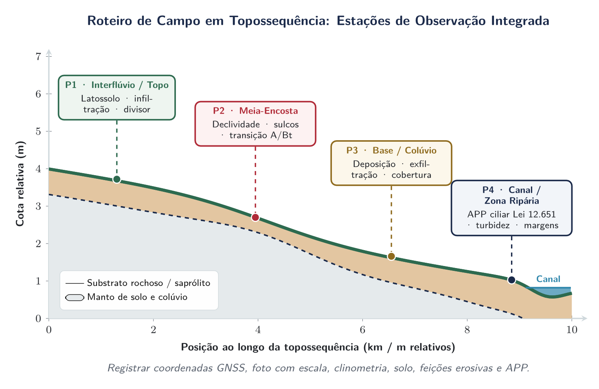

## [Trabalho de Campo]{.pitch-tag .pitch-tag--forest} Objetivos e produto do campo {.smaller-text .lesson-slide}

::: {.pitch-card .pitch-card--forest}
[Semana 10 · Prática Integrada]{.pitch-card-index}
[Objetivo do levantamento de campo]{.pitch-heading}

Integrar **relevo, solo, água, cobertura vegetal, uso da terra e condições sociais** ao longo de uma topossequência ou microbacia hidrográfica, conectando os conceitos das Unidades I e II às observações primárias.
:::

::: {.pitch-pill-row}
[Caderno de campo]{.pitch-pill}
[Mapa de pontos GNSS]{.pitch-pill .pitch-pill--gold}
[Registros fotográficos com escala]{.pitch-pill}
[Quadro de unidades e incertezas]{.pitch-pill .pitch-pill--gold}
:::

::: {.pitch-band}
**Alcance técnico do roteiro:** o levantamento apoia o diagnóstico ambiental e o relatório final da disciplina; não autoriza intervenção física em campo nem substitui projeto executivo.
:::

# 1 · Preparação e organização {.section-header rotulo="Antes do campo"}

## [Preparação]{.pitch-tag .pitch-tag--forest} Pergunta, área e fontes {.smaller-text .lesson-slide}

::: {.pitch-milestones}
::: {.pitch-milestone-item}
**01 · Pergunta e recorte:** formular a questão norteadora do diagnóstico e delimitar a sub-bacia ou topossequência de trabalho.
:::

::: {.pitch-milestone-item}
**02 · Bases prévias:** consultar cartas e dados de relevo, solos, geologia, chuva e uso/cobertura da terra.
:::

::: {.pitch-milestone-item}
**03 · Metadados cartográficos:** conferir datas de aquisição, escala, sistema de projeção e licença das bases utilizadas.
:::

::: {.pitch-milestone-item}
**04 · Desenho amostral:** planejar estações de topo, meia-encosta, sopé e canal conforme as condições de acesso.
:::

::: {.pitch-milestone-item}
**05 · Logística e autorização:** obter autorização de acesso, confirmar rota, contatos locais e condições seguras de realização.
:::
:::

::: {.pitch-band .pitch-band--navy}
**Pergunta orientadora:** como as formas de uso alteram a circulação da água e a transferência de sedimentos entre os compartimentos?
:::

## [Protocolo]{.pitch-tag .pitch-tag--forest} Equipe, materiais e conduta {.smaller-text .lesson-slide}

::: {.pitch-grid-50}
::: {.pitch-table-box}
| Dimensão | Protocolo operacional |
|---|---|
| **Funções da equipe** | Posicionamento, descrição, fotografia, medidas físicas e entrevistas autorizadas |
| **Kit de campo** | Mapas impressos, ficha, trena, clinômetro, GNSS ou aplicativo e material de registro |
| **Georreferenciamento** | Registrar sempre o **sistema de referência (datum/SRC)** e a **precisão estimada** |
:::

::: {.pitch-stack-2}
::: {.pitch-card .pitch-card--alert}
[Segurança e ética em campo]{.pitch-card-index}
[Limites operacionais obrigatórios]{.pitch-heading}

- Evitar bordas instáveis, canais em cheia, escavações e contato direto com água suspeita.
- Não expor dados pessoais nem publicar imagens de pessoas sem autorização explícita.
:::

::: {.pitch-band}
**Critério de suspensão:** adiar ou adaptar o campo sempre que chuva intensa, dificuldade de acesso ou instabilidade comprometerem a segurança da equipe.
:::
:::
:::

# 2 · Levantamento nos pontos {.section-header rotulo="Observação"}

## [Topossequência]{.pitch-tag .pitch-tag--forest} Visão Geral do Caminhamento e Estações P1–P4 {.smaller-text .lesson-slide}

::: {.pitch-grid-55}
::: {.pitch-media-card .pitch-media-card--tall}

[Topossequência de Campo: Estações P1 a P4]{.pitch-caption}
[Coordenadas GNSS, foto com escala, clinometria, solo, feições erosivas e APP]{.pitch-caption-sub}
:::

::: {.pitch-milestones}
::: {.pitch-milestone-item}
**P1 · Interflúvio / Topo:** avaliar espessura de solos residuais (ex.: Latossolos), taxa de infiltração e posição no divisor de águas.
:::

::: {.pitch-milestone-item}
**P2 · Meia-Encosta:** medir declividade, identificar sulcos ou ravinas e verificar possível transição textural ($A/Bt$).
:::

::: {.pitch-milestone-item}
**P3 · Base / Colúvio:** observar depósitos coluviais, sinais de exfiltração subsuperficial e grau de cobertura do solo.
:::

::: {.pitch-milestone-item}
**P4 · Canal / Zona Ripária:** verificar faixa de APP ciliar (Lei 12.651/2012), turbidez aparente e estabilidade das margens.
:::
:::
:::

## [Ficha de Campo]{.pitch-tag .pitch-tag--forest} Identificação de cada ponto {.smaller-text .lesson-slide}

::: {.pitch-table-box}
| Campo da ficha | Registro obrigatório em cada estação |
|---|---|
| **Código** | Identificador único do ponto e vínculo direto com a numeração das fotografias |
| **Posição** | Coordenadas geográficas/UTM, referência visual, equipamento utilizado e precisão |
| **Tempo** | Data, horário, ocorrência de chuva recente e condição atual de umidade do solo |
| **Compartimento** | Topo, vertente (meia-encosta), sopé, planície aluvial ou canal fluvial |
| **Uso e cobertura** | Classe observada, práticas de manejo presentes e evidências diretas de alteração |
| **Fonte da informação** | Observação direta, medida com instrumento, documento consultado ou relato local |
:::

::: {.pitch-band .pitch-band--teal}
**Regra de registro:** manter sempre separados, na caderneta e na ficha, os **dados observados/medidos** da **interpretação preliminar**.
:::

## [Relevo]{.pitch-tag .pitch-tag--forest} Relevo e geometria da vertente {.smaller-text .lesson-slide}

::: {.pitch-card .pitch-card--forest}
[Atributos geomorfológicos]{.pitch-card-index}
[O que descrever na vertente]{.pitch-heading}

Registrar a posição na vertente, direção de exposição (azimute), comprimento aproximado da rampa, curvaturas em perfil e em planta (côncava, convexa, retilínea) e conexões com a rede de drenagem.
:::

::: {.pitch-formula}
$$d(\%) = 100\,\frac{\Delta h}{\Delta x} = 100\tan\theta$$

**Exemplo didático:** desnível vertical $\Delta h = 1{,}5\text{ m}$ em distância horizontal $\Delta x = 20\text{ m}$ resulta em declividade de **$7{,}5\%$**.
:::

::: {.pitch-band}
**Cuidado na leitura:** conferir se o clinômetro exibe grau ou porcentagem; repetir a leitura e registrar a extensão medida — uma medida pontual não representa toda a encosta.
:::

## [Solos]{.pitch-tag .pitch-tag--forest} Solo: descrição acessível e limites {.smaller-text .lesson-slide}

::: {.pitch-cards-2}
::: {.pitch-card .pitch-card--forest}
[01 · Exposição segura (barranco/corte)]{.pitch-card-index}
[Atributos morfológicos observáveis]{.pitch-heading}

- Sequência vertical de horizontes ou camadas.
- Cor, textura estimada ao tato, estrutura e consistência.
- Raízes, porosidade visível, pedregosidade e contato com o substrato.
- Mosqueados, sinais de saturação hídrica e contrastes entre camadas.
- Marcas de compactação superficial, selamento ou remoção de solo.
:::

::: {.pitch-card .pitch-card--gold}
[02 · Rigor taxonômico]{.pitch-card-index}
[Limites da classificação em campo]{.pitch-heading}

Classificar a ordem pedológica (SiBCS) somente quando os critérios morfológicos e dados disponíveis forem suficientes.

Quando faltar confirmação analítica ou profundidade de perfil, registrar explicitamente como **"hipótese pedológica"** na ficha.
:::
:::

## [Hidrologia]{.pitch-tag .pitch-tag--forest} Água e conectividade {.smaller-text .lesson-slide}

::: {.pitch-band}
**Objetivo hidrológico:** localizar entradas, caminhos preferenciais de escoamento e saídas de água na topossequência.
:::

::: {.pitch-cards-2}
::: {.pitch-card}
[01 · Concentração do fluxo]{.pitch-card-index}
[Vetores artificiais e naturais]{.pitch-heading}

Há concentração de escoamento superficial provocada por estrada, telhado, trilha de gado, vala de drenagem ou terraço?
:::

::: {.pitch-card .pitch-card--teal}
[02 · Rota até o canal]{.pitch-card-index}
[Descontinuidades e armazenamento]{.pitch-heading}

O fluxo alcança diretamente o canal fluvial ou fica retido/armazenado em depressões no sopé da encosta?
:::

::: {.pitch-card .pitch-card--forest}
[03 · Regime e umidade]{.pitch-card-index}
[Subsuperfície e intermitência]{.pitch-heading}

Há surgências d'água, zonas de encharcamento permanente ou evidências de drenagem intermitente/efêmera?
:::

::: {.pitch-card .pitch-card--gold}
[04 · Barreiras hidráulicas]{.pitch-card-index}
[Interferências no trajeto]{.pitch-heading}

Que barreiras físicas, bueiros, travessias, barragens ou estruturas alteram o caminho natural da água?
:::
:::

::: {.pitch-band .pitch-band--navy}
**Atenção sazonal:** ausência de água corrente em um dia seco não demonstra ausência de conectividade hidrológica durante eventos de chuva.
:::

## [Erosão]{.pitch-tag .pitch-tag--forest} Feições e atividade erosiva {.smaller-text .lesson-slide}

::: {.pitch-table-box}
| Evidência em campo | Pergunta diagnóstica |
|---|---|
| **Marcas recentes de fluxo** | Que área de contribuição a montante drena para o ponto? |
| **Incisão e degrau erosivo** | Há recuo de cabeceira ou aprofundamento de leito demonstrado? |
| **Duto ou cavidade (*piping*)** | Existe evidência de remoção subsuperficial / erosão interna? |
| **Blocos e trincas de tração** | Há instabilidade de talude e qual sua relação com a água infiltrada? |
| **Depósito no sopé ou canal** | Qual a provável área-fonte e conexão com a vertente? |
:::

::: {.pitch-band}
Descrever **extensão, largura, profundidade, cabeceira, paredes e depósitos** das feições. Não inferir taxa anual de evolução a partir de uma única visita.
:::

## [Cobertura]{.pitch-tag .pitch-tag--forest} Cobertura, proteção e manejo {.smaller-text .lesson-slide}

::: {.pitch-cards-2}
::: {.pitch-card .pitch-card--forest}
[01 · Protocolo de estimativa]{.pitch-card-index}
[Proteção efetiva da superfície]{.pitch-heading}

Registrar a continuidade da vegetação e seu contato direto com o solo, presença de serapilheira, áreas descobertas, pisoteio animal e práticas conservacionistas.

Ao estimar porcentagem de cobertura, indicar sempre o **método**, a **unidade amostral** e o **número de repetições**.
:::

::: {.pitch-card .pitch-card--gold}
[02 · Interpretação sazonal]{.pitch-card-index}
[Caatinga e histórico de uso]{.pitch-heading}

A sazonalidade foliar da **Caatinga** deve integrar a interpretação diagnóstica.

Uma superfície aberta pode resultar de condição natural da estação seca, manejo específico, fase do ciclo agrícola ou degradação avançada — investigar sempre o histórico local.
:::
:::

## [Território]{.pitch-tag .pitch-tag--forest} Ocupação, usos e exposição {.smaller-text .lesson-slide}

::: {.pitch-milestones}
::: {.pitch-milestone-item}
**01 · Infraestrutura e moradias:** localizar moradias, acessos viários, pontos de abastecimento de água e equipamentos comunitários.
:::

::: {.pitch-milestone-item}
**02 · Usos comuns:** identificar áreas de uso coletivo e formas históricas de apropriação do território.
:::

::: {.pitch-milestone-item}
**03 · Relatos e conflitos:** registrar conflitos socioambientais e relatos locais sempre com indicação de fonte e autorização.
:::

::: {.pitch-milestone-item}
**04 · Processo vs. risco:** distinguir claramente o **processo físico** (erosão, cheia) do **risco** para pessoas, moradias e bens expostos.
:::
:::

::: {.pitch-card .pitch-card--alert}
[Conduta diante de situações críticas]{.pitch-card-index}
[Prioridade absoluta à integridade física]{.pitch-heading}

Situações críticas de instabilidade ou contaminação requerem comunicação imediata aos responsáveis e aos órgãos competentes; a turma **não deve acessar setores instáveis** apenas para completar a ficha.
:::

# 3 · Síntese e relatório {.section-header rotulo="Integração"}

## [Síntese]{.pitch-tag .pitch-tag--forest} Construir a topossequência interpretativa {.smaller-text .lesson-slide}

::: {.pitch-band}
Representar no **mesmo perfil integrado** os cinco elementos articulados da paisagem:
:::

::: {.pitch-milestones}
::: {.pitch-milestone-item}
**01 · Relevo e estações:** perfil topográfico contínuo com localização exata dos pontos P1–P4.
:::

::: {.pitch-milestone-item}
**02 · Solos e substrato:** camadas, horizontes conhecidos e transições texturais identificadas.
:::

::: {.pitch-milestone-item}
**03 · Cobertura e uso:** classes vegetais, áreas expostas, estruturas e práticas de manejo.
:::

::: {.pitch-milestone-item}
**04 · Fluxos sustentados:** direções de fluxo superficial e subsuperficial comprovadas pelas evidências.
:::

::: {.pitch-milestone-item}
**05 · Dinâmica erosiva:** setores de erosão, armazenamento coluvial e conexão direta com o canal.
:::
:::

::: {.pitch-band .pitch-band--teal}
**Transparência cartográfica:** diferenciar na legenda o que foi **medido**, **observado** ou **inferido**, informando o exagero vertical e os limites da representação.
:::

## [Diagnóstico]{.pitch-tag .pitch-tag--forest} Quadro de diagnóstico integrado {.smaller-text .lesson-slide}

::: {.pitch-table-box}
| Unidade | Evidências | Processo / hipótese | Conflito | Dado faltante |
|---|---|---|---|---|
| **Topo (P1)** | Registrar | Formular | Identificar | Planejar |
| **Meia-encosta (P2)** | Registrar | Formular | Identificar | Planejar |
| **Sopé (P3)** | Registrar | Formular | Identificar | Planejar |
| **Canal / planície (P4)** | Registrar | Formular | Identificar | Planejar |
:::

::: {.pitch-band}
Usar o quadro integrado para calibrar cartas de fragilidade (Ross) e selecionar indicadores ambientais; nunca atribuir classes apenas pela aparência visual da fotografia.
:::

## [Entrega]{.pitch-tag .pitch-tag--forest} Controle de qualidade e entrega {.smaller-text .lesson-slide}

::: {.pitch-milestones}
::: {.pitch-milestone-item}
**01 · Conferência de metadados:** revisar códigos dos pontos, unidades de medida e coordenadas georreferenciadas.
:::

::: {.pitch-milestone-item}
**02 · Curadoria fotográfica:** selecionar fotografias com indicação de direção (azimute), escala visual e legenda explicativa.
:::

::: {.pitch-milestone-item}
**03 · Declaração de incertezas:** explicitar lacunas de dados, hipóteses não confirmadas e limitações sazonais.
:::

::: {.pitch-milestone-item}
**04 · Viabilidade das propostas:** relacionar recomendações técnicas aos processos físicos observados e à viabilidade local.
:::

::: {.pitch-milestone-item}
**05 · Pacote final:** entregar mapa de pontos, topossequência, quadro integrado e referências junto com a interpretação escrita.
:::
:::

::: {.pitch-band .pitch-band--navy}
O relatório final deve explicar **como os compartimentos funcionam em rede** e **quem é afetado pelas mudanças** no território.
:::

## [Continuidade]{.pitch-tag .pitch-tag--forest} Conexões com as próximas aulas {.smaller-text .lesson-slide}

::: {.pitch-cards-2}
::: {.pitch-card .pitch-card--forest}
[Ponte com a Unidade III]{.pitch-card-index}
[Alimentação das etapas seguintes]{.pitch-heading}

Os dados primários coletados em campo alimentam diretamente a revisão teórica (Aula 10.1), a seleção de indicadores de monitoramento (Aula 11.1), o diagnóstico de qualidade do solo e degradação, e as propostas de recuperação (PRAD/SbN).
:::

::: {.pitch-card .pitch-card--teal}
[Validação temporal]{.pitch-card-index}
[Retorno sazonal aos pontos]{.pitch-heading}

Retomar as estações P1–P4 em diferentes condições sazonais (estação chuvosa vs. estação seca) permite testar as hipóteses formuladas durante a primeira campanha de campo.
:::
:::

::: {.pitch-band}
**Referências metodológicas:** Ab'Sáber (1969); Tricart (1977); Ross (1994); Rodriguez, Silva e Cavalcanti (2017); manual DRES/Embrapa (2017).
:::
