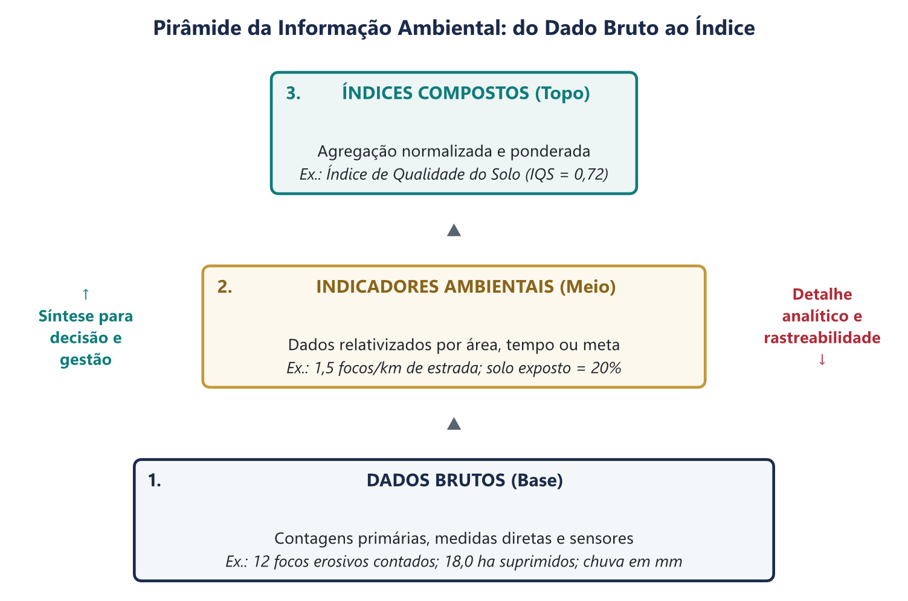

## [Avaliação]{.pitch-tag} Visão Geral da Aula e da Avaliação {.smaller-text .lesson-slide}

::: {.pitch-grid-60}
::: {.pitch-card}
[Escopo programático]{.pitch-card-index}
[Eixos Avaliados (Unidades I e II)]{.pitch-heading}

- [1]{.circle} Questão ambiental, *Land-Change Science* e relação $S \leftrightarrow N$
- [2]{.circle} Abordagens da Geografia Brasileira (Ab'Sáber, Monteiro, Mendonça, Suertegaray)
- [3]{.circle} Conceitos operacionais: impacto, resiliência, vulnerabilidade e risco ($R = P \times E \times V$)
- [4]{.circle} PNMA (Lei 6.938/1981), LC 140/2011 e AIA / EIA-RIMA (CONAMA 01/86 e 237/97)
- [5]{.circle} Análise Ambiental Integrada, escalas (Castro, 1995) e ZEE (Dec. 4.297/2002)
- [6]{.circle} Bacia hidrográfica, morfometria fluvial e Lei das Águas (Lei 9.433/1997)
- [7]{.circle} Morfopedologia, RUSLE, Ecodinâmica (Tricart), Fragilidade (Ross) e Vulnerabilidade (Crepani)
:::

::: {.pitch-stack-2}
::: {.pitch-card .pitch-card--gold}
[Objetivo da Sessão]{.pitch-card-index}
[Avaliação + Alinhamento para Unidade III]{.pitch-heading}

Realizar a **Avaliação Teórica Individual** (Unidades I e II — peso de **35% da média**) e alinhar o **Protocolo Operacional de Campo** para o levantamento de dados primários do Trabalho Prático Final (Unidade III).
:::

::: {.pitch-pill-row}
[Unidades I e II]{.pitch-pill}
[35% da média]{.pitch-pill .pitch-pill--gold}
[100 minutos]{.pitch-pill}
[Sem consulta]{.pitch-pill .pitch-pill--gold}
:::
:::
:::

# 1 · Quadro-Síntese das Unidades I e II {.section-header rotulo="Revisão"}

## [Revisão · Unid. I]{.pitch-tag .pitch-tag--teal} Mapa Conceitual: Epistemologia, Geografia e Risco {.smaller-text .lesson-slide}

::: {.pitch-table-box}
| Eixo Temático | Autores e Normas de Referência | Conceitos e Equações Chave |
|---|---|---|
| **1. Epistemologia e Mudança de Uso da Terra** | Porto-Gonçalves (1989); Santos (1996); Leff (2001); Lambin et al. (2003); MapBiomas (2020) | Causas próximas vs. forças motrizes subjacentes; Primeira e Segunda Natureza; Meio Técnico-Científico-Informacional; Justiça Ambiental. |
| **2. Escola Geográfica Brasileira** | Ab'Sáber (1969, 2003); Monteiro (1976, 2000); Mendonça (1993, 2001); Suertegaray (2001) | Os 3 níveis de Ab'Sáber (compartimentação, estrutura superficial, fisiologia); Sistema Clima Urbano (SCU); Geografia Socioambiental ($S \leftrightarrow N$). |
| **3. Vocabulário Técnico e Risco** | Sánchez (2020); Lei 6.938/81; Lei 9.985/00; Lei 12.608/12 (PNPDEC); IPT (2007) | Aspecto vs. Impacto; Degradação vs. Poluição; Resistência vs. Resiliência; $R = P \times E \times V$; Graus de Risco Urbano (**R1 a R4**). |
:::

::: {.pitch-band .pitch-band--teal}
**Articulação Unidade I:** compreender como forças motrizes sociais produzem alterações na estrutura superficial da paisagem e distribuem desigualmente o risco ($R = P \times E \times V$).
:::

## [Revisão · Unid. II]{.pitch-tag .pitch-tag--gold} Mapa Conceitual: PNMA, Bacias e Ecodinâmica {.smaller-text .lesson-slide}

::: {.pitch-table-box}
| Eixo Temático | Autores e Normas de Referência | Conceitos e Equações Chave |
|---|---|---|
| **4. PNMA, Licenciamento e AIA** | Lei 6.938/81 (Art. 9º); LC 140/2011; CONAMA 01/86 e 237/97; Lei BA 10.431/06 | SISNAMA; LP $\rightarrow$ LI $\rightarrow$ LO; Triagem, Escopo e TR; ADA, AID e AII; Matriz de Leopold e Redes de Interação; Hierarquia da Mitigação. |
| **5. Bacias e Recursos Hídricos** | Strahler (1952); Christofoletti (1980); Tucci (2001); Lei 9.433/97 (Art. 1º e 5º) | Ordem de Strahler; $K_c, K_f, I_c, D_d, t_c$; Hidrograma de cheia ($Q_p$); Zona ripária; Os 5 instrumentos da PNRH (Plano, Enquadramento, Outorga, Cobrança, SNIRH). |
| **6. Morfopedologia, Ecodinâmica e ZEE** | Boulet (1982); Bertrand (1968); Tricart (1977); Ross (1994); Crepani et al. (2001) | Catena morfopedológica; Descontinuidade $A/Bt$; RUSLE ($A = R \cdot K \cdot LS \cdot C \cdot P$); Pedogênese vs. Morfogênese; Classes 1–5 (Ross) e Escala $1{,}0\text{–}3{,}0$ (Crepani). |
:::

::: {.pitch-band}
**Articulação Unidade II:** integrar legislação e instrumentos de gestão (AIA, PNRH, ZEE) à quantificação física em bacias hidrográficas, vertentes e álgebra de mapas.
:::

## [Síntese]{.pitch-tag .pitch-tag--teal} Da Observação Bruta ao Índice Diagnóstico {.smaller-text .lesson-slide}

::: {.pitch-media-card .pitch-media-card--tall}

[Pirâmide da Informação Ambiental: Rastreabilidade Analítica]{.pitch-caption}
[Ponte entre as medições primárias em campo (Aula 9.2) e os modelos de avaliação da Unidade III]{.pitch-caption-sub}
:::

::: {.pitch-band .pitch-band--navy}
Todo índice agregado (IQS, IQA, Ross ou Crepani) perde validade técnica quando não permite **rastreabilidade até os indicadores relativizados e dados brutos de campo**.
:::

# 2 · Instruções e Rubrica da Avaliação {.section-header rotulo="Prova"}

## [Prova]{.pitch-tag .pitch-tag--alert} Condições de Realização e Estrutura {.smaller-text .lesson-slide}

::: {.pitch-pill-row}
[Individual e escrita]{.pitch-pill}
[Sem consulta impressa ou eletrônica]{.pitch-pill .pitch-pill--gold}
[Duração: 100 minutos]{.pitch-pill}
[Pontuação total: 10,0 pts]{.pitch-pill .pitch-pill--gold}
:::

::: {.pitch-cards}
::: {.pitch-card}
[Questões 1 e 2 · 3,0 pontos]{.pitch-card-index}
[Licenciamento e Conflito]{.pitch-heading}

Estudo de caso de licenciamento ambiental (**EIA/RIMA**), competências federativas e conflito socioambiental na Bahia.
:::

::: {.pitch-card .pitch-card--teal}
[Questões 3 e 4 · 3,5 pontos]{.pitch-card-index}
[Bacias e Hidrogramas]{.pitch-heading}

Interpretação de dados morfométricos de duas sub-bacias hidrográficas ($K_c, K_f, D_d$) e leitura comparativa de hidrogramas ($Q \times t$).
:::

::: {.pitch-card .pitch-card--gold}
[Questões 5 e 6 · 3,5 pontos]{.pitch-card-index}
[Topossequência e SIG]{.pitch-heading}

Diagnóstico de topossequência morfopedológica e cálculo/classificação de **Fragilidade Emergente** (Ross, 1994) e **Vulnerabilidade Natural** (Crepani et al., 2001).
:::
:::

::: {.pitch-band .pitch-band--navy}
**Orientação de escrita:** explicitar unidades de medida, fórmulas aplicadas e base normativa em cada item dissertativo.
:::

## [Correção]{.pitch-tag .pitch-tag--gold} Rubrica de Correção (Padrão ENADE / Concursos) {.smaller-text .lesson-slide}

::: {.pitch-table-box}
| Critério Avaliado | Peso | O que se espera na resposta |
|---|:---:|---|
| **1. Precisão conceitual e normativa** | $35\%$ | Distinção exata entre conceitos (ex.: perigo vs. risco; fragilidade potencial vs. emergente; recuperação vs. restauração) e citação correta dos dispositivos legais. |
| **2. Raciocínio mecanístico (Causa $\rightarrow$ Processo $\rightarrow$ Efeito)** | $35\%$ | Explicação física, hidrológica, pedológica e social do fenômeno, evitando frases genéricas ou meramente opinativas. |
| **3. Articulação escalar e propositiva** | $30\%$ | Coerência entre o diagnóstico apresentado, a escala cartográfica adotada e a medida mitigadora ou instrumento de gestão proposto. |
:::

::: {.pitch-band}
Respostas avaliadas com rigor técnico priorizam **mecanismo causal** e **enquadramento legal preciso** sobre adjetivos vagos.
:::

## [Campo → Unidade III]{.pitch-tag .pitch-tag--forest} Integrar os dados de campo à revisão {.smaller-text .lesson-slide}

::: {.pitch-milestones}
::: {.pitch-milestone-item}
**01 · Unidades e processos:** sistematizar compartimentos observados na topossequência e processos morfopedológicos ativos.
:::

::: {.pitch-milestone-item}
**02 · Conexão espacial:** consolidar evidências de transferência de água e sedimentos entre vertente, canal e uso da terra.
:::

::: {.pitch-milestone-item}
**03 · Enquadramento teórico:** relacionar o caso observado em campo aos conceitos e métodos que o explicam (Tricart, Ross, Crepani, PNRH).
:::

::: {.pitch-milestone-item}
**04 · Lacunas e perguntas:** registrar limitações dos dados primários e formular perguntas ainda abertas para a etapa de indicadores (Aula 11.1).
:::
:::

::: {.pitch-card .pitch-card--forest}
[Material de apoio · Semana 10]{.pitch-card-index}
[Retomada do protocolo de campo]{.pitch-heading}

Consulte os procedimentos e fichas operacionais em [Abrir o roteiro de campo](../09.2_roteiro_campo_analise_integrada/roteiro_campo_analise_integrada.html).
:::
