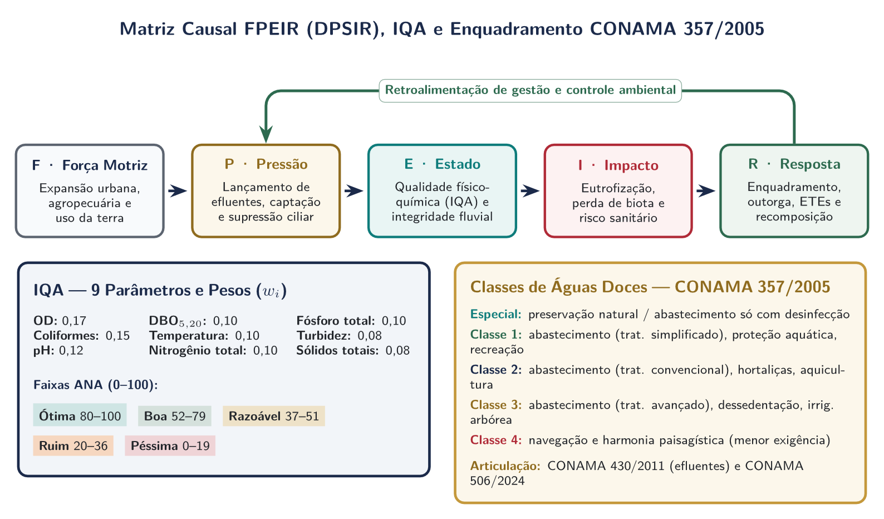

## Visão Geral da Aula {.smaller-text}

::: {.columns}
::: {.column width="50%"}
### Tópicos

- [1]{.circle} Dado, parâmetro, indicador e índice agregado (pirâmide da informação ambiental)
- [2]{.circle} Matrizes Causais: **PER** (OCDE, 1993) e **FPEIR / DPSIR** (EEA, 1999)
- [3]{.circle} Qualidade da Água: **IQA** (9 parâmetros e pesos), **IET** (Eutrofização) e **CONAMA 357/2005**
- [4]{.circle} Padrões de Efluentes (**CONAMA 430/2011**) e Qualidade do Ar (**CONAMA 506/2024**)
- [5]{.circle} Os 5 Pilares da Avaliação, **Biomarcadores de Alerta Precoce** e Bioindicadores (BMWP/EPT, Líquens)
- [6]{.circle} **QA/QC, Gestão Adaptativa**, Índices Orbitais (**NDVI, SAVI, NDWI**) e Indicadores Técnicos vs. Científicos
:::

::: {.column width="50%"}
::: {.info-box}
**Objetivo da Aula**

Capacitar o estudante a selecionar, auditar (QA/QC) e interpretar **indicadores e índices ambientais** físicos, químicos, biológicos e orbitais dentro do modelo **FPEIR (DPSIR)** e da **Gestão Adaptativa**, confrontando-os com os padrões normativos brasileiros (**CONAMA 357/2005, 430/2011 e 506/2024**).
:::
:::
:::

# 1 · Fundamentos e Modelo FPEIR (DPSIR) {.section-header rotulo="FPEIR / DPSIR"}

## O que é Monitoramento Ambiental e por que usar Indicadores? {.smaller-text}

- **Diagnóstico vs. Monitoramento:** o diagnóstico retrata um estado em um momento específico; o **monitoramento** acompanha séries temporais padronizadas para verificar tendências de degradação ou recuperação e aferir a eficácia de políticas, licenciamentos e PRADs.
- **Fotografia vs. Filme (Química vs. Biologia):** uma análise química de água ou solo funciona como uma **fotografia** instantânea — mostra o que estava presente no exato segundo da coleta (um pulso poluente pode já ter sido levado pela correnteza). Já os **bioindicadores e biomarcadores** funcionam como um **filme**, revelando o impacto **cumulativo e sinérgico** dos estressores ao longo do tempo.
- **Por que não basta apenas medir?** Leituras isoladas de campo ou de satélite (ex.: $12\text{ mg/L}$ de sólido ou $\text{pH} = 6{,}4$) pouco dizem sem um **padrão de referência** (área testemunha conservada, *baseline* ou limite legal).
- **Papel dos indicadores:** traduzir fenômenos ambientais complexos em sinais claros, auditáveis e comparáveis no tempo e no espaço para orientar a gestão territorial.

## Da Medição Bruta ao Índice Sintético {.smaller-text}

::: {.columns}
::: {.column width="50%"}
### A Pirâmide da Informação Ambiental (Hammond et al., 1995; Siche et al., 2007)

```text
4. Índice Agregado (Ex.: IQA = 34 [Ruim]; IDH; IET)
Agregação matemática ponderada de múltiplos indicadores para decisão.
↑
3. Indicador Ambiental (Ex.: Déficit de OD em relação ao limite CONAMA 357)
Parâmetro contextualizado frente a uma meta, limiar crítico ou série histórica.
↑
2. Parâmetro / Variável (Ex.: Concentração média de OD = 3,2 mg/L)
Propriedade física, química ou biológica estatisticamente tratada.
↑
1. Dado Bruto / Medição Primária (Ex.: Leituras da sonda multiparâmetro em campo)
Observações pontuais coletadas em campanhas amostrais ou sensores orbitais.
```
:::

::: {.column width="50%"}
### Critérios SMART para Seleção de Bons Indicadores (Fidalgo, 2003)

1. **Relevância causal e sensibilidade**: responder rapidamente ao tensor antrópico ou à medida de recuperação implantada.
2. **Auditabilidade e reprodutibilidade**: protocolo padronizado (ex.: *Standard Methods* — APHA; Embrapa) que permita repetição por outro analista.
3. **Existência de valor de referência (*Baseline* ou Padrão Legal)**: permitir comparação com área testemunha conservada ou resolução CONAMA.
4. **Viabilidade operacional e custo-efetividade**: compatível com o cronograma e orçamento do monitoramento (PBA/PRAD).
5. **Comunicabilidade pública**: compreensível por gestores, comitês de bacia e comunidades locais.
:::
:::

## Matriz FPEIR (DPSIR), IQA e Enquadramento CONAMA 357/2005 {.smaller-text}

{.fig-full}

## Aplicação Completa da Matriz FPEIR em uma Bacia Hidrográfica {.smaller-text}

::: {.columns}
::: {.column width="100%"}
### Exemplo Prático: Sub-bacia do Rio Subaé / Rio Jacuípe (Bahia)

| Elo da Cadeia FPEIR | Pergunta Diagnóstica | Exemplo de Indicador Quantitativo Auditável | Unidade de Medida |
|---------------------|----------------------|---------------------------------------------|-------------------|
| **F · Força Motriz (*Driving Force*)** | *Quais processos socioeconômicos macroestruturais geram demanda sobre a bacia?* | Taxa de crescimento urbano periférico sem rede coletora; expansão da área de pastagem/monocultura. | $\% \cdot \text{ano}^{-1}$ ou $\text{ha}\cdot\text{ano}^{-1}$ (IBGE / MapBiomas) |
| **P · Pressão (*Pressure*)** | *Quais cargas diretas de matéria/energia ou supressões são impostas ao meio?* | Vazão de esgoto doméstico *in natura* lançado; taxa de desmatamento em APP; carga de fertilizantes nitrogenados/fosfatados. | $\text{kg DBO}\cdot\text{dia}^{-1}$; $\%$ de déficit de APP no CAR |
| **E · Estado (*State*)** | *Qual é a condição física, química e biológica atual dos compartimentos?* | Concentração de Oxigênio Dissolvido (OD), Fósforo Total, Coliformes, Turbidez, **IQA** e **IET**. | $\text{mg}\cdot\text{L}^{-1}$; $\text{NMP}/100\text{ mL}$; $\text{NTU}$; adimensional ($0\text{–}100$) |
| **I · Impacto (*Impact*)** | *Quais são os efeitos ecológicos, econômicos e à saúde humana resultantes?* | Floração de cianobactérias tóxicas; mortandade de peixes; internações por doenças de veiculação hídrica; custo de tratamento na ETA. | $\text{células}\cdot\text{mL}^{-1}$; casos/$10.000\text{ hab.}$; $\text{R\$}/1.000\text{ m}^3$ |
| **R · Resposta (*Response*)** | *Quais ações políticas, legais e técnicas a sociedade adota para corrigir o quadro?* | Percentual de esgoto tratado (ETE c/ remoção terciária de $P$); hectares de APP restaurados via PRAD; enquadramento e outorga pelo INEMA/CBH. | $\%$ de atendimento; $\text{ha}$ recuperados; $\text{R\$}$ investidos |
:::
:::

# 2 · Indicadores Hídricos e CONAMA 357/2005 {.section-header rotulo="Água e CONAMA"}

## Por que Monitorar a Água e como Funciona um Índice Sintético? {.smaller-text}

::: {.columns}
::: {.column width="55%"}
- **A água como integrador da bacia:** a qualidade de um rio reflete diretamente o uso e a cobertura da terra a montante (esgotos domésticos, efluentes industriais, erosão agrícola e remoção de mata ciliar).
- **Por que criar um índice agregado?** Avaliar dezenas de variáveis físico-químicas e microbiológicas separadamente dificulta a comparação entre campanhas e a comunicação com gestores e comitês de bacia.
- **Lógica do IQA (NSF / CETESB):** desenvolvido pela *National Sanitation Foundation* (EUA) e adaptado no Brasil pela CETESB, o índice converte 9 parâmetros em notas adimensionais ($q_i$, de $0$ a $100$) e as combina por pesos ($w_i$) conforme sua relevância sanitária e ecológica.
:::

::: {.column width="45%"}
{fig-align="center" width="100%"}
:::
:::

## IQA: parâmetros, pesos e cálculo {.smaller-text}

$$IQA=\prod_{i=1}^{9}q_i^{w_i},\qquad \sum w_i=1.$$

| Parâmetro | Peso | Parâmetro | Peso |
|---|---|---|---|
| Oxigênio dissolvido | 0,17 | Nitrogênio total | 0,10 |
| Coliformes termotolerantes | 0,15 | Fósforo total | 0,10 |
| pH | 0,12 | Turbidez | 0,08 |
| DBO$_{5,20}$ | 0,10 | Resíduo total | 0,08 |
| Temperatura | 0,10 | **Soma** | **1,00** |

Cada medida é convertida em $q_i$ pela curva do método. Não inserir diretamente concentração ou pH no produtório.

## IQA: interpretação e limites {.smaller-text}

O IQA foi concebido para sintetizar condições da água bruta para abastecimento após tratamento, com forte presença de indicadores de esgoto.

- Não avalia todas as substâncias tóxicas, agrotóxicos ou patógenos.
- Não substitui avaliação de potabilidade nem atendimento aos parâmetros legais.
- As faixas de classificação variam entre os sistemas estaduais; informar a tabela adotada.
- Médias anuais podem ocultar eventos críticos e mudanças sazonais.

[ANA: parâmetros, curvas, pesos e faixas do IQA](https://www.ana.gov.br/portalpnqa/indicadores-indice-aguas.aspx).

## IET: nutrientes e resposta biológica {.smaller-text}

Na formulação de Lamparelli utilizada pela CETESB, o estado trófico é avaliado por **fósforo total e clorofila-a**, com equações próprias para rios e reservatórios.

- Fósforo representa uma dimensão do potencial de enriquecimento.
- Clorofila-a indica a resposta fitoplanctônica.
- Transparência pode sofrer interferência de partículas minerais.
- O mesmo teor de nutrientes não produz a mesma resposta em ambientes com luz, residência e mistura diferentes.

Registrar método, unidades, tipo de ambiente e critério de combinação. Nitrogênio é relevante ao diagnóstico, mas não substitui as variáveis dessa formulação.

## Água: classe, condição medida e lançamento {.smaller-text}

| Instrumento | Pergunta |
|---|---|
| CONAMA 357/2005 | Qual a classe e quais padrões e usos se aplicam ao corpo receptor? |
| CONAMA 430/2011 | Quais condições e padrões se aplicam ao lançamento de efluentes? |
| Monitoramento | Qual é a condição observada, em que datas e locais? |
| Enquadramento | Qual a meta de qualidade para os usos pretendidos? |

Uma coleta fora do padrão não muda automaticamente o enquadramento. Na ausência de enquadramento aprovado, o art. 42 prevê águas doces como classe 2, **salvo condição atual melhor, para a qual se aplica a classe mais rigorosa correspondente**.

## Águas doces: exemplos de padrões {.smaller-text}

| Classe | OD mínimo (mg/L) | DBO$_{5,20}$ máxima (mg/L) | Turbidez máxima (UNT) |
|---|---|---|---|
| 1 | 6 | 3 | 40 |
| 2 | 5 | 5 | 100 |
| 3 | 4 | 10 | 100 |
| 4 | Maior que 2 | Consultar norma | Consultar norma |

Síntese parcial da CONAMA 357/2005. Conferir usos, exceções e frequência amostral no texto integral. Classe especial preserva as condições naturais; não se aplica uma tabela de limites artificiais.

## Qualidade do ar: atualização normativa {.smaller-text}

A **CONAMA 506/2024** estabelece os padrões nacionais atuais e revoga parte dos dispositivos da 491/2018.

- A etapa **PI-2** entrou em vigor em 1º de janeiro de 2025.
- Comparar cada poluente com o tempo de média e a etapa aplicáveis.
- Não comparar diretamente média anual com limite de 24 horas.
- Registrar cobertura temporal, estação, método e ocorrências excepcionais.

[MMA: padrões de qualidade do ar](https://www.gov.br/mma/pt-br/assuntos/meio-ambiente-urbano-recursos-hidricos-qualidade-ambiental/qualidade-do-ar/padroes-de-qualidade-do-ar/padroes-de-qualidade-do-ar/).

# 3 · Bioindicadores, Biomarcadores e Índices Orbitais {.section-header rotulo="Biota e Satélite"}

## Os 5 Pilares da Avaliação Ambiental e Alerta Precoce {.smaller-text}

O estresse ambiental nunca começa matando o ecossistema inteiro de uma só vez; ele percorre uma **cascata de falhas** em cinco níveis crescentes de complexidade:

| Nível / Pilar | O que mede | Caráter da resposta |
|---|---|---|
| **1. Químico** | Concentração de contaminantes nos compartimentos (água, solo, ar) | Exposição externa instantânea |
| **2. Bioacumulação** | Dose crítica interna retida nos tecidos da biota | Exposição acumulada no tempo |
| **3. Efeito Biológico (Biomarcadores)** | Alterações bioquímicas, moleculares (DNA/proteínas), subcelulares e celulares | **Sinal prévio reversível** (alerta precoce) |
| **4. Saúde do Organismo** | Necrose tecidual, tumores, doenças crônicas e falência de órgãos | **Efeito tardio irreversível** |
| **5. Ecossistema** | Queda de densidade, perda de riqueza e colapso das funções | Dano sistêmico consolidado |

::: {.info-box}
**Exemplo de Biomarcador Precoce (*Tradescantia pallida*):** o teste de **micronúcleos** detecta fragmentos de DNA perdidos durante a divisão celular antes que qualquer dano macroscópico apareça na planta, funcionando como "canário na mina de carvão" para riscos mutagênicos.
:::

## Bioindicadores na Paisagem e Regra Trófica {.smaller-text}

::: {.columns}
::: {.column width="52%"}
- **Flora e Líquens (qualidade do ar):** sem raízes para retirar nutrientes do solo, os líquens absorvem umidade e gases diretamente da atmosfera como "esponjas vivas", desaparecendo rapidamente diante de $\text{SO}_2$ e poluentes industriais.
- **Fauna Edáfica (minhocas):** indicam contaminação por metais pesados e agrotóxicos via contato direto da cutícula e ingestão de serapilheira.
- **Macroinvertebrados Bentônicos (BMWP e EPT):** respondem à qualidade da água, substrato, vazão e conectividade; exigir padronização de esforço, época e micro-hábitat.
:::

::: {.column width="48%"}
- **Regra Trófica:** priorizar organismos na **base da cadeia alimentar** (plâncton, moluscos filtradores, invertebrados) permite detectar bioacumulação antes que atinja predadores de topo em doses letais.
- **Nem todo bioindicador morre:** na **maré vermelha** (*Gonyaulax catenella*) ou floração de cianobactérias, o indicador é a **proliferação patológica** desencadeada por excesso de nutrientes (esgoto) e mudanças térmicas.
- **Critérios de um biomonitor ideal (van der Oost):** fácil taxonomia, abundância ampla, acúmulo mensurável, sensibilidade precoce, estabilidade sazonal e confiabilidade QA/QC.
:::
:::

## Monitoramento Orbital: como Alvos da Superfície Refletem a Luz {.smaller-text}

::: {.columns}
::: {.column width="52%"}
- **Por que usar satélite junto com o campo?** O monitoramento em campo oferece alta precisão pontual, enquanto sensores orbitais (Landsat, Sentinel-2) permitem acompanhar áreas extensas e séries históricas contínuas na bacia.
- **Comportamento espectral dos alvos:**
  - **Vegetação sadia:** absorve fortemente a luz vermelha (`RED`) na fotossíntese e reflete intensamente o infravermelho próximo (`NIR`) pela estrutura celular das folhas.
  - **Água limpa:** absorve quase toda a energia no `NIR` e reflete relativamente mais no verde (`GREEN`).
  - **Solo exposto:** pode mascarar o sinal da vegetação rala no Semiárido (motivando índices ajustados ao solo, como o SAVI).
:::

::: {.column width="48%"}
{fig-align="center" width="100%"}
:::
:::

## Índices espectrais: vegetação e água {.smaller-text}

| Índice | Expressão com reflectâncias | Aplicação |
|---|---|---|
| NDVI | $(NIR-RED)/(NIR+RED)$ | Contraste espectral associado à vegetação |
| SAVI | $(1+L)(NIR-RED)/(NIR+RED+L)$ | Atenuar efeito do fundo do solo; justificar $L$ |
| NDWI de McFeeters | $(GREEN-NIR)/(GREEN+NIR)$ | Identificação de água superficial |
| NDMI | $(NIR-SWIR)/(NIR+SWIR)$ | Sensibilidade à umidade da vegetação |

Não atribuir classes universais de bioma a limiares de NDVI. Comparar sensores, correção atmosférica, nuvens e estação do ano. [USGS: NDMI](https://www.usgs.gov/landsat-missions/normalized-difference-moisture-index).


## Selecionar indicadores para uma pergunta {.smaller-text}

Pergunta: uma intervenção reduziu a entrega de sedimento de uma encosta?

| Registro | Papel e limite |
|---|---|
| Chuva e umidade antecedente | Contextualizam a força dos eventos |
| Cobertura do solo | Resposta da área tratada |
| Pinos / seções | Mudança local da superfície |
| Turbidez e vazão | Resposta no canal; turbidez requer calibração para massa |
| Manutenção e falhas | Explicam diferenças no desempenho |

Comparar períodos e áreas com condições documentadas. Uma redução de turbidez em ano seco não demonstra sozinha eficácia da intervenção.

## Correlação vs. Causalidade e Arquitetura da Qualidade (QA/QC) {.smaller-text}

::: {.columns}
::: {.column width="52%"}
- **Armadilha da causalidade:** se a turbidez de um rio sobe próximo a uma obra, multar a construtora sem **área de referência (controle a montante)** confunde correlação com causalidade — o pico pode vir de chuva intensa 18 km acima em encosta desmatada.
- **Desenho amostral rigoroso:** unidades espaciais fixas, locais de referência conservados e frequência temporal padronizada (evitar deslocar pontos sem registro, o que invalida séries de 10+ anos).
:::

::: {.column width="48%"}
- **Protocolo QA/QC em campo e laboratório:**
  - Inserir **amostras em branco** (*field blanks*) para descartar contaminação do frasco/reagente.
  - Coletar **duplicatas físicas** e manter **cadeia de custódia** assinada e preservação térmica.
  - **Regra de ouro QA/QC:** dados anômalos ou inválidos **nunca devem ser deletados silenciosamente**; investigar a causa raiz revela falhas de calibração ou gargalos reais de processo.
:::
:::

## Gestão Adaptativa: Fechando o Loop Decisório {.smaller-text}

Monitoramento ambiental **não é arquivo de gaveta**: o dado coletado deve acionar uma decisão quando cruza o **Limite de Ação Operacional (*Threshold*)**.

| Situação observada | Diagnóstico da causa raiz | Ação obrigatória |
|---|---|---|
| **Dentro da faixa esperada** | Sistema alinhado ao estado desejável | Manter plano de monitoramento e frequência vigente |
| **Desvio por erro metodológico** | Falha na cadeia QA/QC, desvio de calibração ou troca de método/sensor | Recalibrar equipamentos, revisar protocolo e retreinar equipe |
| **Desvio por resposta ambiental real** | Aumento de pressão externa ou falha de manejo em campo | Ativar **Manejo Adaptativo imediato** (ex.: replantio, controle de invasoras, contenção de carga) |

## Indicadores Técnicos vs. Científicos e o Desafio Climático {.smaller-text}

::: {.columns}
::: {.column width="52%"}
- **Indicadores Técnicos (conformidade rápida):** métricas visuais e estruturais usadas por órgãos ambientais (cobertura do solo, presença de exóticas invasoras como braquiária, estratificação do dossel).
- **Indicadores Científicos (processos de longo prazo):** chuva de sementes (poleiros artificiais), retorno reprodutivo da fauna e fluxo gênico entre fragmentos.
- **Dimensão Socioeconômica (Rigueira & Mariano-Neto):** a sustentabilidade de áreas recuperadas exige cruzar flora, fauna e solo com a **função social** (adesão comunitária, renda e capacitação).
:::

::: {.column width="48%"}
::: {.info-box}
**Desafio do Século XXI — *Shifting Baselines* (Referências Móveis):**

Sob mudanças climáticas globais severas, os próprios remanescentes usados como **áreas de referência** sofrem alterações de temperatura e regime hídrico. Monitorar exige distinguir variação climática regional de falha local de manejo.
:::
:::
:::

# 4 · Síntese e Referências {.section-header rotulo="Síntese"}

## Pontos Essenciais para Fixação {.smaller-text}

1. A matriz **FPEIR (DPSIR)** impede que o analista liste indicadores desconexos, obrigando a vincular **Força Motriz $\rightarrow$ Pressão $\rightarrow$ Estado $\rightarrow$ Impacto $\rightarrow$ Resposta**.
2. A análise química é uma **fotografia** instantânea; **biomarcadores precoces e bioindicadores** funcionam como um **filme** do impacto cumulativo (com atenção à regra trófica e proliferações patológicas).
3. Sem **área de referência**, **QA/QC** (brancos, duplicatas, cadeia de custódia) e **Gestão Adaptativa**, o monitoramento vira acúmulo de planilhas sem poder causal ou corretivo.
4. No Semiárido baiano, a combinação de **SAVI** (satélite), **IQA/IET** (água), **CONAMA 357/430/506** e **bioindicadores** oferece diagnóstico robusto e multiescalar.

## Referências Bibliográficas {.smaller-text}

- ANA (Agência Nacional de Águas e Saneamento Básico). **Indicadores de Qualidade — Índice de Qualidade das Águas (IQA)**. Brasília: ANA, 2020.
- CONAMA. **Resolução nº 357, de 17 de março de 2005**; **Resolução nº 430, de 13 de maio de 2011**; **Resolução nº 506, de 5 de julho de 2024**.
- EEA (European Environment Agency). **Environmental indicators: Typology and overview** (DPSIR Framework). Copenhagen: EEA, 1999.
- MAGALHÃES JR., A. P. **Indicadores Ambientais e Recursos Hídricos**. Rio de Janeiro: Bertrand Brasil, 2007.
- RIGUEIRA, D. M. G.; MARIANO-NETO, E. Monitoramento: uma proposta integrada para avaliação do sucesso em projetos de restauração ecológica em áreas florestais. **Revista Caititu**, n. 1, p. 73–88, 2013.
- SICHE, R. et al. Índices versus indicadores: precisões conceituais na discussão da sustentabilidade de países. **Ambiente & Sociedade**, v. 10, n. 2, p. 137–148, 2007.
- VAN DER OOST, R.; BEYER, J.; VERMEULEN, N. P. E. Fish bioaccumulation and biomarkers in environmental risk assessment: a review. **Environmental Toxicology and Pharmacology**, v. 13, n. 2, p. 57–149, 2003.
