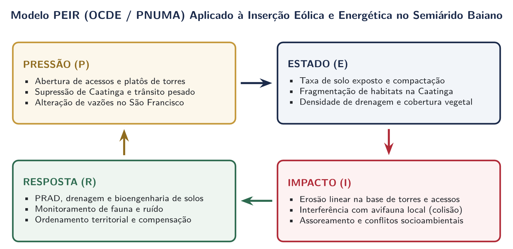
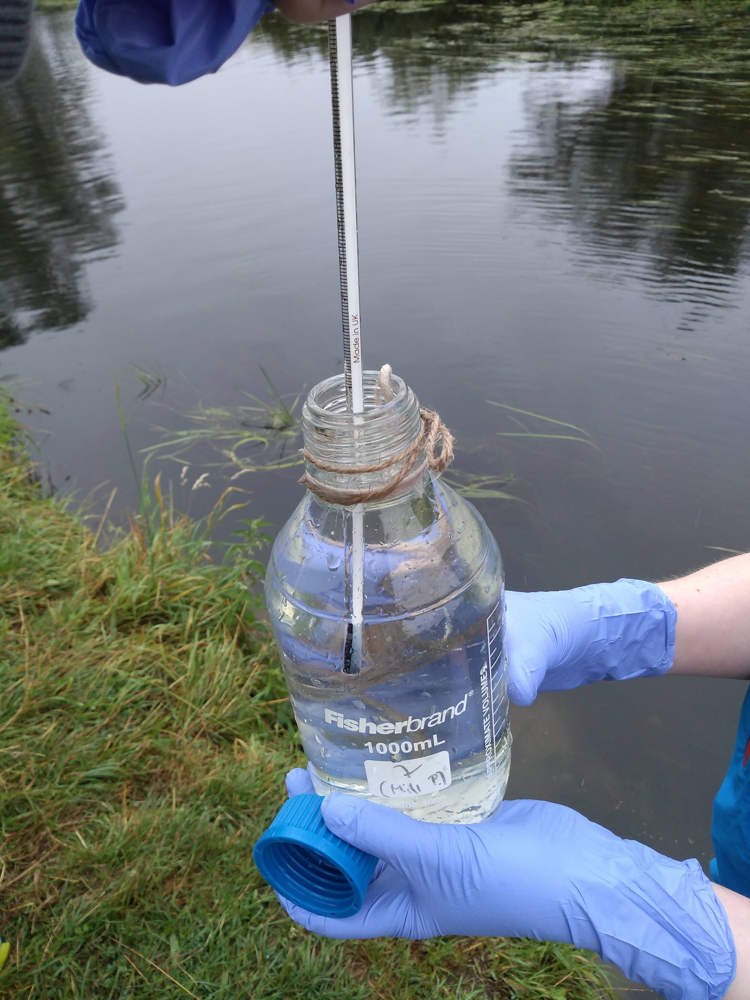
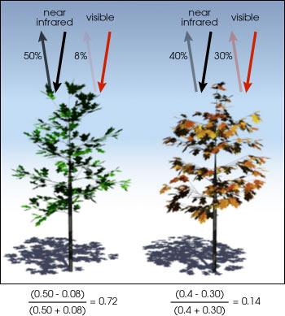

## [Abertura]{.pitch-tag} Visão Geral da Aula {.smaller-text .lesson-slide}

::: {.pitch-grid-60}
::: {.pitch-card}
[Roteiro da Unidade III]{.pitch-card-index}
[Tópicos]{.pitch-heading}

- [1]{.circle} Dado, parâmetro, indicador e índice agregado (pirâmide da informação ambiental)
- [2]{.circle} Matrizes Causais: **PER** (OCDE, 1993) e **FPEIR / DPSIR** (EEA, 1999)
- [3]{.circle} Qualidade da Água: **IQA** (9 parâmetros e pesos), **IET** (Eutrofização) e **CONAMA 357/2005**
- [4]{.circle} Padrões de Efluentes (**CONAMA 430/2011**) e Qualidade do Ar (**CONAMA 506/2024**)
- [5]{.circle} Os 5 Pilares da Avaliação, **Biomarcadores de Alerta Precoce** e Bioindicadores (BMWP/EPT, Líquens)
- [6]{.circle} **QA/QC, Gestão Adaptativa**, Índices Orbitais (**NDVI, SAVI, NDWI**) e Indicadores Técnicos vs. Científicos
:::

::: {.pitch-stack-2}
::: {.pitch-card .pitch-card--gold}
[Objetivo da Aula]{.pitch-card-index}
[Monitoramento auditável e normativo]{.pitch-heading}

Capacitar o estudante a selecionar, auditar (**QA/QC**) e interpretar **indicadores e índices ambientais** físicos, químicos, biológicos e orbitais dentro do modelo **FPEIR (DPSIR)** e da **Gestão Adaptativa**, confrontando-os com os padrões normativos brasileiros (**CONAMA 357/2005, 430/2011 e 506/2024**).
:::

::: {.pitch-pill-row}
[FPEIR / DPSIR]{.pitch-pill}
[IQA & IET]{.pitch-pill .pitch-pill--gold}
[CONAMA 357 · 430 · 506]{.pitch-pill}
[QA/QC & Satélite]{.pitch-pill .pitch-pill--gold}
:::
:::
:::

# 1 · Fundamentos e Modelo FPEIR (DPSIR) {.section-header rotulo="FPEIR / DPSIR"}

## [Fundamentos]{.pitch-tag .pitch-tag--teal} O que é Monitoramento e por que usar Indicadores? {.smaller-text .lesson-slide}

::: {.pitch-cards-2}
::: {.pitch-card}
[01 · Dimensão temporal]{.pitch-card-index}
[Diagnóstico vs. Monitoramento]{.pitch-heading}

O **diagnóstico** retrata um estado em um momento específico; o **monitoramento** acompanha séries temporais padronizadas para verificar tendências de degradação ou recuperação e aferir a eficácia de políticas, licenciamentos e PRADs.
:::

::: {.pitch-card .pitch-card--teal}
[02 · Química vs. Biologia]{.pitch-card-index}
[Fotografia vs. Filme]{.pitch-heading}

Análise química é uma **fotografia** instantânea (um pulso poluente pode já ter passado). **Bioindicadores e biomarcadores** funcionam como um **filme**, revelando o impacto **cumulativo e sinérgico** dos estressores ao longo do tempo.
:::

::: {.pitch-card .pitch-card--gold}
[03 · Comparabilidade]{.pitch-card-index}
[Por que não basta apenas medir?]{.pitch-heading}

Leituras isoladas (ex.: $12\text{ mg/L}$ de sólido ou $\text{pH} = 6{,}4$) pouco informam sem um **padrão de referência** — seja área testemunha conservada, *baseline* histórico ou limite legal.
:::

::: {.pitch-card .pitch-card--forest}
[04 · Função decisória]{.pitch-card-index}
[Papel dos indicadores]{.pitch-heading}

Traduzir fenômenos ambientais complexos em sinais claros, **auditáveis e comparáveis** no tempo e no espaço para orientar a gestão territorial.
:::
:::

## [Informação]{.pitch-tag .pitch-tag--teal} Da Medição Bruta ao Índice Sintético {.smaller-text .lesson-slide}

::: {.pitch-grid-50}
::: {.pitch-milestones}
::: {.pitch-milestone-item}
**04 · Índice Agregado:** agregação matemática ponderada de múltiplos indicadores para decisão (ex.: $\text{IQA} = 34$ [Ruim]; IDH; IET).
:::

::: {.pitch-milestone-item}
**03 · Indicador Ambiental:** parâmetro contextualizado frente a uma meta, limiar crítico ou série histórica (ex.: déficit de OD frente à CONAMA 357).
:::

::: {.pitch-milestone-item}
**02 · Parâmetro / Variável:** propriedade física, química ou biológica estatisticamente tratada (ex.: concentração média de $\text{OD} = 3{,}2\text{ mg/L}$).
:::

::: {.pitch-milestone-item}
**01 · Dado Bruto / Medição Primária:** observações pontuais coletadas em campanhas amostrais ou sensores orbitais (ex.: leituras de sonda em campo).
:::
:::

::: {.pitch-card .pitch-card--gold}
[Critérios SMART · Fidalgo (2003)]{.pitch-card-index}
[Seleção de Bons Indicadores (Hammond et al., 1995; Siche et al., 2007)]{.pitch-heading}

1. **Relevância causal e sensibilidade:** responder rapidamente ao tensor antrópico ou à medida implantada.
2. **Auditabilidade e reprodutibilidade:** protocolo padronizado (*Standard Methods* — APHA; Embrapa) repetível por outro analista.
3. **Valor de referência (*Baseline* ou Padrão Legal):** permitir confronto com área testemunha ou resolução CONAMA.
4. **Viabilidade operacional e custo-efetividade:** compatível com o cronograma e orçamento (PBA/PRAD).
5. **Comunicabilidade pública:** compreensível por gestores, comitês de bacia e comunidades locais.
:::
:::

## [FPEIR / DPSIR]{.pitch-tag .pitch-tag--teal} Matriz FPEIR (DPSIR), IQA e CONAMA 357/2005 {.smaller-text .lesson-slide}

::: {.pitch-media-card .pitch-media-card--wide}

[Matriz Causal FPEIR (DPSIR), IQA e Enquadramento CONAMA 357/2005]{.pitch-caption}
[Integração entre forças motrizes socioeconômicas, estado físico-químico hídrico e respostas normativas]{.pitch-caption-sub}
:::

::: {.pitch-band}
A matriz **FPEIR / DPSIR** (EEA, 1999) estrutura a cadeia causal completa entre pressões antrópicas e instrumentos de gestão hídrica.
:::

## [Semiárido]{.pitch-tag .pitch-tag--teal} Modelo PEIR Aplicado ao Semiárido Baiano {.smaller-text .lesson-slide}

::: {.pitch-media-card .pitch-media-card--wide}

[Modelo PEIR (OCDE, 1993 / PNUMA) em Empreendimentos Energéticos no Semiárido]{.pitch-caption}
[Ciclo Pressão–Estado–Impacto–Resposta aplicado a acessos, Caatinga, erosão e PRAD]{.pitch-caption-sub}
:::

::: {.pitch-band .pitch-band--teal}
Enquanto o modelo **PER/PEIR** (OCDE, 1993) parte diretamente da Pressão sobre o meio, o **FPEIR/DPSIR** (EEA, 1999) explicita as **Forças Motrizes** socioeconômicas que originam essas pressões.
:::

## [FPEIR na Bacia]{.pitch-tag .pitch-tag--teal} Aplicação da Matriz FPEIR em uma Bacia Hidrográfica {.smaller-text .lesson-slide}

::: {.pitch-table-box}
| Elo da Cadeia FPEIR | Pergunta Diagnóstica (Sub-bacia Rio Subaé / Jacuípe, BA) | Indicador Quantitativo Auditável | Unidade de Medida |
|---|---|---|---|
| **F · Força Motriz** | *Que processos macroestruturais geram demanda na bacia?* | Expansão urbana periférica sem rede coletora; avanço de pastagem/monocultura | $\%\cdot\text{ano}^{-1}$; $\text{ha}\cdot\text{ano}^{-1}$ |
| **P · Pressão** | *Que cargas ou supressões incidem diretamente no meio?* | Vazão de esgoto *in natura*; desmatamento em APP; carga de fertilizantes N/P | $\text{kg DBO}\cdot\text{dia}^{-1}$; $\%$ déficit APP |
| **E · Estado** | *Qual a condição físico-química e biológica atual?* | Concentração de OD, Fósforo Total, Coliformes, Turbidez, **IQA** e **IET** | $\text{mg}\cdot\text{L}^{-1}$; $\text{NMP}/100\text{ mL}$; $\text{NTU}$; $0\text{–}100$ |
| **I · Impacto** | *Quais efeitos ecológicos, econômicos e sanitários ocorrem?* | Floração de cianobactérias; mortandade de peixes; internações; custo na ETA | $\text{cél.}\cdot\text{mL}^{-1}$; casos/$10\text{ mil}$; $\text{R\$}/10^3\text{ m}^3$ |
| **R · Resposta** | *Que ações políticas, legais e técnicas corrigem o quadro?* | Esgoto tratado (ETE terciária); ha de APP em PRAD; enquadramento e outorga | $\%$ atend.; $\text{ha}$ recup.; $\text{R\$}$ invest. |
:::

# 2 · Indicadores Hídricos e CONAMA 357/2005 {.section-header rotulo="Água e CONAMA"}

## [Qualidade da Água]{.pitch-tag .pitch-tag--teal} Por que Monitorar a Água e como Funciona um Índice? {.smaller-text .lesson-slide}

::: {.pitch-grid-55}
::: {.pitch-stack-2}
::: {.pitch-card}
[Integrador da bacia]{.pitch-card-index}
[Espelho do uso e cobertura da terra]{.pitch-heading}

A qualidade de um rio reflete diretamente as dinâmicas a montante: lançamento de esgotos domésticos, efluentes industriais, erosão agrícola e supressão de mata ciliar.
:::

::: {.pitch-card .pitch-card--teal}
[Lógica do IQA (NSF / CETESB)]{.pitch-card-index}
[Síntese ponderada de nove variáveis]{.pitch-heading}

Avaliar dezenas de variáveis isoladas dificulta comparar campanhas. Desenvolvido pela *National Sanitation Foundation* e adaptado pela CETESB, o **IQA** converte 9 parâmetros em notas adimensionais ($q_i$, $0\text{–}100$) e os combina por pesos ($w_i$).
:::
:::

::: {.pitch-media-card .pitch-media-card--photo .pitch-media-card--tall}

[Coleta e medição físico-química em campo]{.pitch-caption}
[Fonte: Wikimedia Commons (domínio público / CC) · exibição recortada]{.pitch-caption-sub}
:::
:::

## [IQA]{.pitch-tag .pitch-tag--gold} IQA: parâmetros, pesos e cálculo {.smaller-text .lesson-slide}

::: {.pitch-formula}
$$\text{IQA} = \prod_{i=1}^{9} q_i^{w_i}, \qquad \sum_{i=1}^{9} w_i = 1$$
:::

::: {.pitch-table-box}
| Parâmetro | Peso ($w_i$) | Parâmetro | Peso ($w_i$) |
|---|:---:|---|:---:|
| Oxigênio dissolvido (OD) | $0{,}17$ | Nitrogênio total | $0{,}10$ |
| Coliformes termotolerantes | $0{,}15$ | Fósforo total | $0{,}10$ |
| pH | $0{,}12$ | Turbidez | $0{,}08$ |
| DBO$_{5,20}$ | $0{,}10$ | Resíduo total (sólidos) | $0{,}08$ |
| Temperatura | $0{,}10$ | **Soma dos pesos** | **$1{,}00$** |
:::

::: {.pitch-band .pitch-band--navy}
**Regra de cálculo:** cada concentração ou leitura é convertida primeiro em nota de qualidade $q_i$ ($0$ a $100$) pela curva do método — nunca inserir diretamente concentração ou pH no produtório.
:::

## [IQA]{.pitch-tag .pitch-tag--gold} IQA: interpretação e limites {.smaller-text .lesson-slide}

::: {.pitch-band .pitch-band--navy}
O IQA sintetiza condições da **água bruta para abastecimento após tratamento**, com forte peso de indicadores ligados a esgotos domésticos.
:::

::: {.pitch-cards-2}
::: {.pitch-card .pitch-card--alert}
[01 · Escopo sanitário limitado]{.pitch-card-index}
[O que o IQA não mede]{.pitch-heading}

- Não avalia substâncias tóxicas persistentes, metais pesados, agrotóxicos ou patógenos específicos.
- Não substitui a verificação de **potabilidade** nem o atendimento integral aos padrões legais de classe.
:::

::: {.pitch-card .pitch-card--gold}
[02 · Comparação e temporalidade]{.pitch-card-index}
[Cuidados na interpretação]{.pitch-heading}

- As faixas de classificação (Ótima a Péssima) variam entre sistemas estaduais — declarar sempre a tabela adotada.
- Médias anuais podem ocultar eventos críticos agudos e variações sazonais marcantes.
:::
:::

::: {.pitch-band}
**Referência técnica:** [ANA — parâmetros, curvas, pesos e faixas do IQA](https://www.ana.gov.br/portalpnqa/indicadores-indice-aguas.aspx).
:::

## [IET]{.pitch-tag .pitch-tag--gold} IET: nutrientes e resposta biológica {.smaller-text .lesson-slide}

::: {.pitch-formula}
**Índice de Estado Trófico (Lamparelli / CETESB):**

$$\text{IET} = \frac{\text{IET}(PT) + \text{IET}(CL)}{2}$$

Equações específicas por ambiente (**rios** vs. **reservatórios**) a partir de **Fósforo Total ($PT$)** e **Clorofila-a ($CL$)**.
:::

::: {.pitch-cards-2}
::: {.pitch-card}
[01 · Causa vs. Resposta]{.pitch-card-index}
[Significado ecológico]{.pitch-heading}

- **Fósforo total** representa o potencial de enriquecimento nutricional.
- **Clorofila-a** indica a resposta biológica efetiva do fitoplâncton.
- **Transparência** sofre interferência de partículas minerais em suspensão.
:::

::: {.pitch-card .pitch-card--teal}
[02 · Condições hidrodinâmicas]{.pitch-card-index}
[Cuidados metodológicos]{.pitch-heading}

O mesmo teor de nutrientes produz respostas distintas conforme luz, tempo de residência e mistura vertical. Registrar método, unidades e tipo de ambiente (nitrogênio auxilia o diagnóstico, mas não substitui $PT$ e $CL$ nessa formulação).
:::
:::

## [CONAMA]{.pitch-tag} Água: classe, condição medida e lançamento {.smaller-text .lesson-slide}

::: {.pitch-table-box}
| Instrumento normativo / técnico | Pergunta que responde |
|---|---|
| **CONAMA nº 357/2005** | Qual a classe de qualidade e quais padrões e usos se aplicam ao corpo receptor? |
| **CONAMA nº 430/2011** | Quais condições e padrões de emissão se aplicam ao lançamento de efluentes? |
| **Monitoramento ambiental** | Qual é a condição observada no rio, em quais datas e estações amostrais? |
| **Enquadramento (PNRH)** | Qual a meta de qualidade pactuada no comitê para os usos pretendidos? |
:::

::: {.pitch-card .pitch-card--gold}
[Art. 42 da CONAMA 357/2005]{.pitch-card-index}
[Não confundir condição observada com classe legal]{.pitch-heading}

Uma coleta fora do padrão não altera automaticamente o enquadramento do rio. Na ausência de enquadramento aprovado, o **art. 42** prevê águas doces como **Classe 2**, *salvo condição atual melhor, para a qual se aplica a classe mais rigorosa correspondente*.
:::

## [CONAMA 357]{.pitch-tag} Águas doces: exemplos de padrões {.smaller-text .lesson-slide}

::: {.pitch-table-box}
| Classe | OD mínimo (mg/L) | DBO$_{5,20}$ máxima (mg/L) | Turbidez máxima (UNT) |
|:---:|:---:|:---:|:---:|
| **Classe 1** | $6$ | $3$ | $40$ |
| **Classe 2** | $5$ | $5$ | $100$ |
| **Classe 3** | $4$ | $10$ | $100$ |
| **Classe 4** | $> 2$ | Consultar norma | Consultar norma |
:::

::: {.pitch-band}
**Síntese parcial da CONAMA nº 357/2005:** conferir usos preponderantes, exceções e frequência amostral no texto integral. A **Classe Especial** preserva as condições naturais, não se aplicando tabela de limites artificiais.
:::

## [CONAMA 506]{.pitch-tag} Qualidade do ar: atualização normativa {.smaller-text .lesson-slide}

::: {.pitch-card}
[Marco regulatório vigente]{.pitch-card-index}
[Resolução CONAMA nº 506/2024]{.pitch-heading}

Estabelece os padrões nacionais atuais de qualidade do ar e revoga parte dos dispositivos da Resolução CONAMA nº 491/2018, com entrada em vigor da etapa **PI-2** em **1º de janeiro de 2025**.
:::

::: {.pitch-milestones}
::: {.pitch-milestone-item}
**01 · Tempo de média e etapa:** confrontar cada poluente ($\text{MP}_{2{,}5}, \text{MP}_{10}, \text{O}_3, \text{SO}_2, \text{NO}_2, \text{CO}$) exatamente com seu tempo de média e etapa vigentes.
:::

::: {.pitch-milestone-item}
**02 · Incompatibilidade temporal:** nunca comparar diretamente uma média anual observada com um limite normativo de 24 horas.
:::

::: {.pitch-milestone-item}
**03 · Rastreabilidade da estação:** registrar cobertura temporal da série, localização da estação, método analítico e ocorrências excepcionais.
:::
:::

::: {.pitch-band}
**Referência normativa:** [MMA — Padrões de Qualidade do Ar](https://www.gov.br/mma/pt-br/assuntos/meio-ambiente-urbano-recursos-hidricos-qualidade-ambiental/qualidade-do-ar/padroes-de-qualidade-do-ar/padroes-de-qualidade-do-ar/).
:::

# 3 · Bioindicadores, Biomarcadores e Índices Orbitais {.section-header rotulo="Biota e Satélite"}

## [Bioindicadores]{.pitch-tag .pitch-tag--forest} Os 5 Pilares da Avaliação e Alerta Precoce {.smaller-text .lesson-slide}

::: {.pitch-table-box}
| Nível / Pilar | O que mede | Caráter da resposta |
|---|---|---|
| **1. Químico** | Concentração de contaminantes nos compartimentos (água, solo, ar) | Exposição externa instantânea |
| **2. Bioacumulação** | Dose crítica interna retida nos tecidos da biota | Exposição acumulada no tempo |
| **3. Efeito Biológico (Biomarcadores)** | Alterações bioquímicas, moleculares (DNA/proteínas) e celulares | **Sinal prévio reversível** (alerta precoce) |
| **4. Saúde do Organismo** | Necrose tecidual, tumores, doenças crônicas e falência de órgãos | **Efeito tardio irreversível** |
| **5. Ecossistema** | Queda de densidade, perda de riqueza e colapso das funções | Dano sistêmico consolidado |
:::

::: {.pitch-card .pitch-card--teal}
[Exemplo de Biomarcador Precoce · *Tradescantia pallida*]{.pitch-card-index}
[O "canário na mina de carvão" para mutagenicidade]{.pitch-heading}

O ensaio de **micronúcleos** detecta fragmentos de DNA perdidos durante a divisão celular antes que qualquer dano macroscópico apareça na planta, antecipando o risco antes do colapso ecológico.
:::

## [Bioindicadores]{.pitch-tag .pitch-tag--forest} Bioindicadores na Paisagem e Regra Trófica {.smaller-text .lesson-slide}

::: {.pitch-cards}
::: {.pitch-card .pitch-card--forest}
[01 · Ar e solo]{.pitch-card-index}
[Líquens e Fauna Edáfica]{.pitch-heading}

- **Líquens:** sem raízes, absorvem umidade e gases diretamente da atmosfera, desaparecendo diante de $\text{SO}_2$ e poluentes industriais.
- **Minhocas:** indicam contaminação por metais e agrotóxicos via cutícula e ingestão de serapilheira.
:::

::: {.pitch-card .pitch-card--teal}
[02 · Ecossistemas aquáticos]{.pitch-card-index}
[Bentônicos (BMWP e EPT)]{.pitch-heading}

Macroinvertebrados bentônicos integram qualidade da água, substrato, vazão e conectividade ripária. Exigem padronização rigorosa de esforço amostral, época e micro-hábitat.
:::

::: {.pitch-card .pitch-card--gold}
[03 · Ecologia trófica]{.pitch-card-index}
[Regra Trófica e Proliferação]{.pitch-heading}

- Priorizar organismos na **base da cadeia** (plâncton, filtradores) detecta bioacumulação antes dos predadores de topo.
- Nem todo bioindicador morre: na **maré vermelha** (*Gonyaulax catenella*) ou em cianobactérias, o sinal é a **proliferação patológica**.
:::
:::

::: {.pitch-band}
**Biomonitor ideal (van der Oost et al., 2003):** fácil taxonomia, abundância ampla, acúmulo mensurável, sensibilidade precoce, estabilidade sazonal e confiabilidade QA/QC.
:::

## [Orbital]{.pitch-tag .pitch-tag--teal} Monitoramento Orbital: Alvos e Comportamento Espectral {.smaller-text .lesson-slide}

::: {.pitch-grid-55}
::: {.pitch-stack-2}
::: {.pitch-card}
[Integração satélite + campo]{.pitch-card-index}
[Escala espacial e séries históricas]{.pitch-heading}

O campo garante alta precisão pontual, enquanto sensores orbitais (**Landsat**, **Sentinel-2**) permitem acompanhar bacias inteiras e séries temporais contínuas.
:::

::: {.pitch-card .pitch-card--gold}
[Assinatura espectral dos alvos]{.pitch-card-index}
[Reflectância no visível e infravermelho]{.pitch-heading}

- **Vegetação sadia:** absorve luz vermelha (`RED`) na fotossíntese e reflete fortemente o infravermelho próximo (`NIR`).
- **Água limpa:** absorve quase toda energia no `NIR` e reflete relativamente mais no verde (`GREEN`).
- **Solo exposto:** mascara vegetação rala no Semiárido, motivando o ajuste pelo **SAVI**.
:::
:::

::: {.pitch-media-card}

[Comportamento Espectral e Cálculo do NDVI]{.pitch-caption}
[NASA Earth Observatory / Robert Simmon · domínio público]{.pitch-caption-sub}
:::
:::

## [Índices Orbitais]{.pitch-tag .pitch-tag--teal} Índices espectrais: vegetação e água {.smaller-text .lesson-slide}

::: {.pitch-formula}
$$\text{NDVI} = \frac{NIR - RED}{NIR + RED} \qquad \text{SAVI} = \frac{(1+L)(NIR - RED)}{NIR + RED + L}$$
:::

::: {.pitch-table-box}
| Índice | Expressão com reflectâncias | Aplicação principal |
|---|---|---|
| **NDVI** | $(NIR - RED)/(NIR + RED)$ | Contraste espectral associado ao vigor vegetal |
| **SAVI** | $(1+L)(NIR - RED)/(NIR + RED + L)$ | Atenuar o efeito do fundo do solo; justificar fator $L$ |
| **NDWI (McFeeters)** | $(GREEN - NIR)/(GREEN + NIR)$ | Identificação de espelhos e corpos d'água superficiais |
| **NDMI** | $(NIR - SWIR)/(NIR + SWIR)$ | Sensibilidade ao teor de umidade na vegetação |
:::

::: {.pitch-band}
**Cautela orbital:** não atribuir classes universais de bioma a limiares fixos de NDVI; controlar sensor, correção atmosférica, nuvens e estação ([USGS: NDMI](https://www.usgs.gov/landsat-missions/normalized-difference-moisture-index)).
:::

## [Seleção]{.pitch-tag .pitch-tag--teal} Selecionar indicadores para uma pergunta {.smaller-text .lesson-slide}

::: {.pitch-band .pitch-band--navy}
**Pergunta operacional:** uma intervenção de manejo reduziu efetivamente a entrega de sedimento de uma encosta para o canal?
:::

::: {.pitch-table-box}
| Registro monitorado | Papel no diagnóstico e limite analítico |
|---|---|
| **Chuva e umidade antecedente** | Contextualizam a energia erosiva e a força dos eventos |
| **Cobertura do solo** | Mede a resposta direta de proteção na área tratada |
| **Pinos de erosão / seções** | Quantificam alteração geométrica local da superfície |
| **Turbidez e vazão** | Capturam a resposta no canal; turbidez exige calibração para massa de sedimentos |
| **Manutenção e falhas** | Explicam diferenças de desempenho entre áreas ou campanhas |
:::

::: {.pitch-band}
Comparar períodos e áreas sob condições climáticas documentadas: redução de turbidez em **ano seco** não demonstra sozinha eficácia da intervenção.
:::

## [QA/QC]{.pitch-tag .pitch-tag--alert} Correlação vs. Causalidade e Arquitetura QA/QC {.smaller-text .lesson-slide}

::: {.pitch-cards-2}
::: {.pitch-card}
[01 · Controle espacial]{.pitch-card-index}
[Armadilha da causalidade e Desenho]{.pitch-heading}

- **Controle a montante:** se a turbidez sobe perto de uma obra, multar sem área de referência a montante confunde correlação com causalidade (o pico pode vir de chuva 18 km acima).
- **Desenho amostral:** unidades espaciais fixas, áreas-referência conservadas e frequência padronizada (deslocar pontos sem registro invalida séries de 10+ anos).
:::

::: {.pitch-card .pitch-card--alert}
[02 · Garantia e Controle de Qualidade]{.pitch-card-index}
[Protocolo QA/QC em campo e laboratório]{.pitch-heading}

- Inserir **amostras em branco** (*field blanks*) para descartar contaminação de frasco ou reagente.
- Coletar **duplicatas físicas** e manter **cadeia de custódia** assinada com preservação térmica.
- **Regra de ouro QA/QC:** dados anômalos **nunca devem ser deletados silenciosamente** — investigar a causa raiz revela falhas de calibração ou processos reais.
:::
:::

## [Gestão]{.pitch-tag .pitch-tag--gold} Gestão Adaptativa: Fechando o Loop Decisório {.smaller-text .lesson-slide}

::: {.pitch-band}
Monitoramento ambiental **não é arquivo de gaveta**: o dado coletado deve acionar uma decisão quando cruza o **Limite de Ação Operacional (*Threshold*)**.
:::

::: {.pitch-table-box}
| Situação observada | Diagnóstico da causa raiz | Ação obrigatória |
|---|---|---|
| **Dentro da faixa esperada** | Sistema alinhado ao estado desejável | Manter plano de monitoramento e frequência vigente |
| **Desvio por erro metodológico** | Falha na cadeia QA/QC, desvio de calibração ou troca de sensor | Recalibrar equipamentos, revisar protocolo e retreinar equipe |
| **Desvio por resposta ambiental real** | Aumento de pressão externa ou falha de manejo em campo | Ativar **Manejo Adaptativo imediato** (replantio, controle de invasoras, contenção de carga) |
:::

::: {.pitch-band .pitch-band--teal}
A decisão corretiva retroalimenta o elo **Resposta ($R$)** da matriz FPEIR antes que o dano avance na cascata ecológica.
:::

## [Síntese Aplicada]{.pitch-tag .pitch-tag--teal} Indicadores Técnicos vs. Científicos e Clima {.smaller-text .lesson-slide}

::: {.pitch-grid-55}
::: {.pitch-stack-2}
::: {.pitch-card}
[Conformidade vs. Processos]{.pitch-card-index}
[Indicadores Técnicos vs. Científicos]{.pitch-heading}

- **Técnicos (conformidade rápida):** cobertura do solo, invasoras (ex.: braquiária) e estratificação do dossel.
- **Científicos (longo prazo):** chuva de sementes (poleiros), retorno reprodutivo da fauna e fluxo gênico entre fragmentos.
:::

::: {.pitch-card .pitch-card--forest}
[Sustentabilidade social]{.pitch-card-index}
[Dimensão Socioeconômica (Rigueira & Mariano-Neto, 2013)]{.pitch-heading}

A sustentabilidade de áreas recuperadas exige cruzar flora, fauna e solo com a **função social** (adesão comunitária, renda e capacitação).
:::
:::

::: {.pitch-card .pitch-card--alert}
[Desafio do Século XXI]{.pitch-card-index}
[*Shifting Baselines* (Referências Móveis)]{.pitch-heading}

Sob mudanças climáticas globais severas, os próprios remanescentes usados como **áreas de referência** sofrem alterações térmicas e hídricas.

Monitorar exige distinguir **variação climática regional** de **falha local de manejo**.
:::
:::

# 4 · Síntese e Referências {.section-header rotulo="Síntese"}

## [Síntese]{.pitch-tag} Pontos Essenciais para Fixação {.smaller-text .lesson-slide}

::: {.pitch-milestones}
::: {.pitch-milestone-item}
**01 · Cadeia causal:** a matriz **FPEIR (DPSIR)** impede listas desconexas de variáveis, vinculando **Força Motriz $\rightarrow$ Pressão $\rightarrow$ Estado $\rightarrow$ Impacto $\rightarrow$ Resposta**.
:::

::: {.pitch-milestone-item}
**02 · Complementaridade temporal:** a química é uma **fotografia** instantânea; **biomarcadores precoces e bioindicadores** funcionam como um **filme** do impacto cumulativo (regra trófica e proliferações).
:::

::: {.pitch-milestone-item}
**03 · Rigor operacional:** sem **área de referência**, **QA/QC** (brancos, duplicatas, cadeia de custódia) e **Gestão Adaptativa**, o monitoramento vira acúmulo de planilhas sem poder causal.
:::

::: {.pitch-milestone-item}
**04 · Síntese no Semiárido:** combinar **SAVI** (satélite), **IQA/IET** (água), **CONAMA 357/430/506** e **bioindicadores** garante diagnóstico multiescalar robusto.
:::
:::

## [Referências]{.pitch-tag} Referências Bibliográficas {.smaller-text .lesson-slide}

::: {.pitch-cards-2}
::: {.pitch-card}
[Normas e marcos institucionais]{.pitch-card-index}
[Legislação e padrões]{.pitch-heading}

- ANA (Agência Nacional de Águas e Saneamento Básico). **Indicadores de Qualidade — Índice de Qualidade das Águas (IQA)**. Brasília: ANA, 2020.
- CONAMA. **Resolução nº 357, de 17 de março de 2005**; **Resolução nº 430, de 13 de maio de 2011**; **Resolução nº 506, de 5 de julho de 2024**.
- EEA (European Environment Agency). **Environmental indicators: Typology and overview** (DPSIR Framework). Copenhagen: EEA, 1999.
:::

::: {.pitch-card .pitch-card--teal}
[Literatura científica de base]{.pitch-card-index}
[Indicadores e biomarcadores]{.pitch-heading}

- MAGALHÃES JR., A. P. **Indicadores Ambientais e Recursos Hídricos**. Rio de Janeiro: Bertrand Brasil, 2007.
- RIGUEIRA, D. M. G.; MARIANO-NETO, E. Monitoramento: uma proposta integrada para avaliação do sucesso em projetos de restauração ecológica em áreas florestais. **Revista Caititu**, n. 1, p. 73–88, 2013.
- SICHE, R. et al. Índices versus indicadores: precisões conceituais na discussão da sustentabilidade de países. **Ambiente & Sociedade**, v. 10, n. 2, p. 137–148, 2007.
- VAN DER OOST, R.; BEYER, J.; VERMEULEN, N. P. E. Fish bioaccumulation and biomarkers in environmental risk assessment: a review. **Environmental Toxicology and Pharmacology**, v. 13, n. 2, p. 57–149, 2003.
:::
:::
