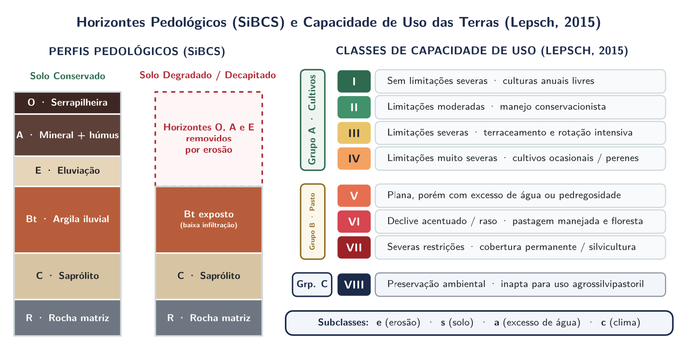
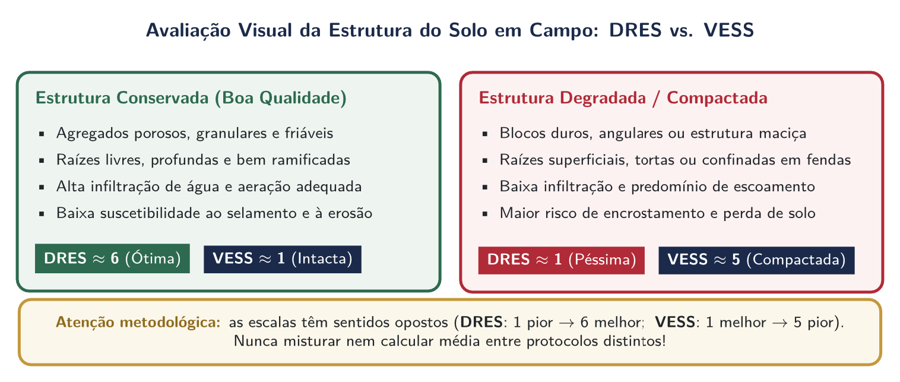
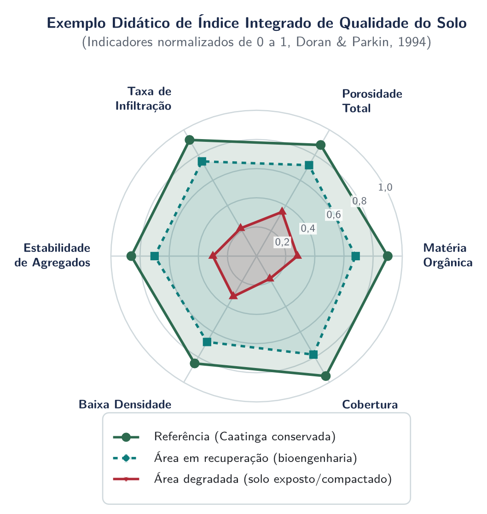

## [Abertura]{.pitch-tag} Visão Geral da Aula {.smaller-text .lesson-slide}

::: {.pitch-grid-55}
::: {.pitch-milestones}
::: {.pitch-milestone-item}
**01 · Funções e SiBCS:** funções ecossistêmicas do solo no Geossistema e horizontes diagnósticos.
:::

::: {.pitch-milestone-item}
**02 · Ordens na Bahia:** comportamento hidrossedimentológico das ordens de solos do Brasil e da Bahia (Embrapa, 2018).
:::

::: {.pitch-milestone-item}
**03 · Campo:** indicadores visuais e físicos — selamento, compactação, infiltração e protocolos DRES/VESS.
:::

::: {.pitch-milestone-item}
**04 · Capacidade de Uso:** Grupos A, B, C e Classes I a VIII (Lepsch et al., 2015).
:::

::: {.pitch-milestone-item}
**05 · Aptidão Agrícola:** níveis de manejo e fatores limitantes (Ramalho Filho & Beek, 1995).
:::

::: {.pitch-milestone-item}
**06 · CONAMA 420/2009:** Valores Orientadores (VRQ, VP e VI) e gerenciamento de áreas contaminadas.
:::
:::

::: {.pitch-stack-2}
::: {.pitch-card .pitch-card--gold}
[Objetivo da Aula]{.pitch-card-index}
[Qualidade edáfica e planejamento territorial]{.pitch-heading}

Avaliar a qualidade ambiental dos solos na perspectiva do **planejamento territorial e da geomorfologia**, relacionando as ordens do **SiBCS** à suscetibilidade erosiva, classificando as terras segundo a **Capacidade de Uso (Classes I–VIII)** e a **Aptidão Agrícola**, e aplicando a **Resolução CONAMA nº 420/2009** para áreas contaminadas.
:::

::: {.pitch-pill-row}
[SiBCS · Embrapa]{.pitch-pill}
[Lepsch · Classes I–VIII]{.pitch-pill .pitch-pill--gold}
[DRES / VESS]{.pitch-pill}
[CONAMA 420/2009]{.pitch-pill .pitch-pill--gold}
:::
:::
:::

# 1 · O Solo no Sistema Ambiental e no SiBCS {.section-header rotulo="SiBCS"}

## [SiBCS]{.pitch-tag} Funções Ambientais do Solo e Horizontes Pedológicos {.smaller-text .lesson-slide}

::: {.pitch-grid-50}
::: {.pitch-card}
[Karlen et al., 1997; FAO, 2015]{.pitch-card-index}
[Cinco Funções do Solo na Análise Ambiental]{.pitch-heading}

1. **Regulação do ciclo hidrológico**: partição entre infiltração vertical ($f$), armazenamento de água disponível na zona radicular e recarga de aquíferos vs. escoamento superficial ($Q_s$).
2. **Filtro, tampão e reator biogeoquímico**: adsorção de cátions e retenção/degradação de poluentes na matriz coloidal (argilas + húmus).
3. **Reservatório global de carbono**: o solo armazena mais carbono orgânico ($\text{COS}$) do que a atmosfera e a vegetação somadas.
4. **Suporte físico e geotécnico**: estabilidade de vertentes e fundações.
5. **Sustentação da biodiversidade edáfica e produção de biomassa**.
:::

::: {.pitch-card .pitch-card--teal}
[SiBCS — Embrapa, 2018]{.pitch-card-index}
[Horizontes Principais do Perfil]{.pitch-heading}

- **Horizonte $O$**: camada superficial orgânica (serapilheira em decomposição) que amortece a energia cinética das gotas de chuva (*efeito splash*).
- **Horizonte $A$**: horizonte mineral superficial escurecido pela matéria orgânica humificada; estrutura granular porosa de alta infiltração.
- **Horizonte $E$**: horizonte mineral eluvial (claro/esbranquiçado) que perdeu argila silicatada, ferro ou alumínio por translocação descendente.
- **Horizonte $B$**: máxima expressão pedogenética (**$Bw$** latossólico; **$Bt$** textural com acumulação de argila; **$Bi$** incipiente; **$Bn$** nátrico/sódico).
- **Horizonte $C$ (Saprolito) e Camada $R$ (Rocha matriz)**.
:::
:::

## [SiBCS]{.pitch-tag} Perfil Conservado vs. Truncado e Classes de Capacidade de Uso {.smaller-text .lesson-slide}

::: {.pitch-media-card .pitch-media-card--tall}

[Horizontes pedológicos (SiBCS) e Classes de Capacidade de Uso das Terras]{.pitch-caption}
[Perfil conservado vs. decapitado por erosão (A) e sistema de oito classes de Lepsch et al., 2015 (B)]{.pitch-caption-sub}
:::

## [SiBCS]{.pitch-tag} SiBCS e comportamento ambiental: hipóteses a verificar {.smaller-text .lesson-slide}

::: {.pitch-table-box}
| Ordem / condição | Aspectos relevantes ao diagnóstico |
|---|---|
| **Latossolos** | Profundidade, textura, agregação e compactação por uso |
| **Argissolos** | Contraste textural, estrutura e continuidade dos horizontes |
| **Luvissolos** | Atividade da argila, profundidade e pedregosidade |
| **Planossolos** | Horizonte B plânico e possíveis restrições sazonais à drenagem |
| **Cambissolos / Neossolos** | Material de origem, profundidade e posição na vertente |
| **Gleissolos** | Sinais de redução e regime de saturação |
:::

::: {.pitch-band .pitch-band--navy}
O SiBCS classifica solos; não fornece automaticamente resistência geotécnica, erodibilidade ou delimitação legal de APP. Essas avaliações exigem atributos medidos, posição no relevo e legislação aplicável.
:::

# 2 · Capacidade de Uso e Aptidão Agrícola {.section-header rotulo="Capacidade Uso"}

## [Capacidade de Uso]{.pitch-tag .pitch-tag--gold} Estrutura Hierárquica: Grupos (A, B, C) e Classes (I a VIII) {.smaller-text .lesson-slide}

::: {.pitch-band}
O sistema adaptativo brasileiro (Lepsch et al., 2015 — SBCS) classifica a **máxima intensidade de uso agrossilvipastoril que uma gleba suporta sem sofrer degradação acelerada por erosão**.
:::

::: {.pitch-cards}
::: {.pitch-card .pitch-card--forest}
[Grupo A · Classes I, II, III e IV]{.pitch-card-index}
[Cultivos anuais e múltiplos usos]{.pitch-heading}

Terras passíveis de utilização com **culturas anuais, perenes, pastagens e reflorestamento/vida silvestre**. As restrições e exigências de conservação crescem progressivamente da Classe I para a Classe IV.
:::

::: {.pitch-card .pitch-card--gold}
[Grupo B · Classes V, VI e VII]{.pitch-card-index}
[Pastagens e silvicultura]{.pitch-heading}

Terras **impróprias para cultivos anuais intensivos**, adaptadas a **pastagens permanentes, silvicultura ou culturas perenes protetoras** (Classe V: áreas planas sujeitas a inundação/pedregosidade sem erosão; Classes VI e VII: encostas declivosas ou solos rasos).
:::

::: {.pitch-card .pitch-card--alert}
[Grupo C · Classe VIII]{.pitch-card-index}
[Preservação ambiental exclusiva]{.pitch-heading}

Terras **impróprias para qualquer cultivo agrícola, pastagem ou silvicultura comercial**, destinadas à **preservação da flora/fauna, recreação ou armazenamento hídrico** (escarpas, afloramentos rochosos, dunas, manguezais).
:::
:::

## [Capacidade de Uso]{.pitch-tag .pitch-tag--gold} Subclasses de Limitação (`e`, `s`, `a`, `c`) {.smaller-text .lesson-slide}

::: {.pitch-band .pitch-band--teal}
Ao número romano da Classe acrescenta-se a letra minúscula indicativa da natureza da limitação dominante (ex.: **$\text{IIIe}$**, **$\text{IVs}$**, **$\text{Va}$**, **$\text{VIe,s}$**).
:::

::: {.pitch-table-box}
| Símbolo | Fator Limitante Dominante | Exemplos Diagnósticos |
|---------|---------------------------|-----------------------|
| **`e`** | **Risco de Erosão e Declividade** | Declive acentuado, rampa longa, presença de sulcos/ravinas e alta erodibilidade ($K$). |
| **`s`** | **Limitações intrínsecas do Solo** | Pouca profundidade efetiva (contato lítico), pedregosidade, textura muito arenosa, salinidade/sodicidade ou baixa retenção hídrica. |
| **`a`** | **Excesso de Água (Hidromorfismo)** | Lençol freático elevado, drenagem interna deficiente e risco de inundação fluvial sazonal. |
| **`c`** | **Limitações Climáticas** | Déficit hídrico severo prolongado (semiaridez/aridez), risco de geadas ou ventos dessecantes. |
:::

## [Aptidão Agrícola]{.pitch-tag .pitch-tag--gold} Capacidade de Uso vs. Aptidão Agrícola {.smaller-text .lesson-slide}

::: {.pitch-cards-2}
::: {.pitch-card}
[Lepsch et al., 2015 · Base USDA]{.pitch-card-index}
[Capacidade de Uso das Terras]{.pitch-heading}

Foca prioritariamente na **conservação do solo contra a erosão** e assume um único padrão tecnológico elevado para definir o limite máximo de uso sustentável.
:::

::: {.pitch-card .pitch-card--gold}
[Ramalho Filho & Beek, 1995 · Embrapa / IBGE]{.pitch-card-index}
[Aptidão Agrícola das Terras]{.pitch-heading}

Avalia a viabilidade das terras sob **Três Níveis de Manejo Tecnológico**, considerando condições econômicas e acesso a insumos e mecanização.
:::
:::

::: {.pitch-cards}
::: {.pitch-card}
[Nível A]{.pitch-card-index}
[Baixo emprego de insumos]{.pitch-heading}

Trabalho braçal ou tração animal, sem aplicação de corretivos ou fertilizantes químicos.
:::

::: {.pitch-card .pitch-card--gold}
[Nível B]{.pitch-card-index}
[Tecnologia intermediária]{.pitch-heading}

Tração animal ou mecanização parcial, aplicação modesta de calcário/adubos e práticas simples de conservação.
:::

::: {.pitch-card .pitch-card--teal}
[Nível C]{.pitch-card-index}
[Desenvolvido / Tecnificado]{.pitch-heading}

Motomecanização intensiva, maior emprego de insumos e mecanização, conforme os pressupostos do sistema.
:::
:::

## [Aptidão Agrícola]{.pitch-tag .pitch-tag--gold} Os 6 Grupos de Aptidão e os 5 Fatores Limitantes {.smaller-text .lesson-slide}

::: {.pitch-grid-50}
::: {.pitch-card}
[Parâmetros avaliados]{.pitch-card-index}
[Cinco Fatores Limitantes]{.pitch-heading}

1. **Deficiência de Fertilidade ($f$)**;
2. **Deficiência de Água ($h$)**;
3. **Excesso de Água / Deficiência de Oxigênio ($o$)**;
4. **Suscetibilidade à Erosão ($e$)**;
5. **Impedimentos à Mecanização ($m$)**.
:::

::: {.pitch-card .pitch-card--teal}
[Classificação final]{.pitch-card-index}
[Seis Grupos de Aptidão (1 a 6)]{.pitch-heading}

- **Grupos 1, 2 e 3**: lavouras (**Aptidão Boa, Regular e Restrita**);
- **Grupo 4**: pastagem plantada;
- **Grupo 5**: silvicultura e/ou pastagem natural;
- **Grupo 6**: preservação da flora e da fauna (sem aptidão agrossilvipastoril).
:::
:::

# 3 · Diagnóstico de Campo e CONAMA 420/2009 {.section-header rotulo="CONAMA 420"}

## [Campo]{.pitch-tag .pitch-tag--teal} Por que Avaliar a Estrutura do Solo Diretamente no Campo? {.smaller-text .lesson-slide}

::: {.pitch-grid-40}
::: {.pitch-stack-2}
::: {.pitch-card}
[Limites do laboratório]{.pitch-card-index}
[Amostras deformadas]{.pitch-heading}

Amostras deformadas enviadas ao laboratório revelam fertilidade química e granulometria, mas destroem a **arquitetura natural dos agregados e dos poros** no terreno.
:::

::: {.pitch-card .pitch-card--teal}
[Protocolos padronizados]{.pitch-card-index}
[DRES e VESS in situ]{.pitch-heading}

Capturam compactação por tráfego ou pisoteio, crostas de selamento, impedimento radicular e infiltração. O **DRES** (Ralisch et al., 2017) e o **VESS** convertem a inspeção de um bloco de solo em notas auditáveis e comparáveis.
:::
:::

::: {.pitch-media-card .pitch-media-card--wide}

[Avaliação visual da estrutura do solo em campo: DRES vs. VESS]{.pitch-caption}
[Solo conservado vs. degradado/compactado e sentido inverso das notas de qualidade estrutural]{.pitch-caption-sub}
:::
:::

## [Campo]{.pitch-tag .pitch-tag--teal} DRES e VESS: escalas diferentes {.smaller-text .lesson-slide}

::: {.pitch-table-box}
| Protocolo | Escala | Sentido da qualidade estrutural |
|---|---|---|
| **DRES** | 1 a 6 | **1 pior; 6 melhor** |
| **VESS** | 1 a 5 | **1 melhor; 5 pior** |
:::

::: {.pitch-band .pitch-band--navy}
Descrever o bloco, umidade, camadas, poros, raízes e agregados conforme cada manual. Não misturar notas nem calcular uma média entre escalas com sentidos opostos.
:::

::: {.pitch-card .pitch-card--teal}
[Referência técnica oficial]{.pitch-card-index}
[Manual de campo]{.pitch-heading}

Consultar o documento completo da Embrapa Soja: [Embrapa: manual do DRES (Documentos, 390)](https://www.infoteca.cnptia.embrapa.br/infoteca/bitstream/doc/1071114/1/Doc390OL.pdf).
:::

## [Qualidade Física]{.pitch-tag .pitch-tag--teal} Índice Integrado e Evidências de Qualidade Física {.smaller-text .lesson-slide}

::: {.pitch-grid-50}
::: {.pitch-stack-2}
::: {.pitch-card}
[Conjunto de evidências]{.pitch-card-index}
[Leitura integrada dos atributos]{.pitch-heading}

- Densidade e porosidade devem ser interpretadas com textura e estrutura.
- Resistência à penetração depende da umidade e do equipamento.
- Infiltração superficial não equivale automaticamente à condutividade saturada do perfil.
- Agregação, cobertura, raízes e atividade biológica completam a avaliação.
:::

::: {.pitch-band}
Na Geografia, relacionar essas evidências à posição na vertente, uso, circulação de água e conflito territorial. Ensaios laboratoriais aprofundados são desenvolvidos também em Bioengenharia de Solos.
:::
:::

::: {.pitch-media-card .pitch-media-card--tall}

[Índice Integrado de Qualidade do Solo (Doran & Parkin, 1994)]{.pitch-caption}
[Indicadores normalizados de 0 a 1 entre Caatinga conservada, área em recuperação e solo degradado]{.pitch-caption-sub}
:::
:::

## [CONAMA 420]{.pitch-tag .pitch-tag--alert} CONAMA 420/2009: valores orientadores {.smaller-text .lesson-slide}

::: {.pitch-table-box}
| Valor | Interpretação |
|---|---|
| **VRQ** | Referência da ocorrência natural de uma substância, estabelecida conforme o procedimento estadual |
| **VP** | Prevenção de alterações prejudiciais às funções do solo |
| **VI** | Investigação de risco potencial em cenários padronizados de exposição |
:::

::: {.pitch-cards-2}
::: {.pitch-card .pitch-card--alert}
[Protocolo de decisão]{.pitch-card-index}
[Ultrapassagem de limites]{.pitch-heading}

Conferir substância, unidade, matriz e cenário. Ultrapassar um valor exige as ações de investigação e gestão previstas; não fornece sozinho o risco individual nem uma solução de remediação.
:::

::: {.pitch-card}
[Cenários de exposição]{.pitch-card-index}
[Agrícola, residencial e industrial]{.pitch-heading}

Os valores por uso agrícola, residencial e industrial dependem da substância e do cenário. Não impor uma cadeia universal de desigualdades.
:::
:::

## [Diagnóstico]{.pitch-tag .pitch-tag--forest} Conflito de uso: da classe à recomendação {.smaller-text .lesson-slide}

::: {.pitch-band}
**Caso didático:** vertente com solo raso, trechos descobertos e uso anual intenso.
:::

::: {.pitch-milestones}
::: {.pitch-milestone-item}
**01 · Mapear:** identificar as limitações físicas/químicas e delimitar a unidade de avaliação.
:::

::: {.pitch-milestone-item}
**02 · Classificar:** enquadrar a capacidade de uso com os critérios completos do sistema.
:::

::: {.pitch-milestone-item}
**03 · Confrontar:** comparar uso atual, exigências de conservação e restrições legais aplicáveis.
:::

::: {.pitch-milestone-item}
**04 · Pactuar:** discutir alternativas de manejo com proprietários, trabalhadores e comunidades.
:::

::: {.pitch-milestone-item}
**05 · Monitorar:** definir indicadores verificáveis de conservação e viabilidade social.
:::
:::

::: {.pitch-band .pitch-band--navy}
Classe de capacidade de uso, aptidão agrícola, qualidade do solo e APP são avaliações distintas. Integrá-las sem substituir uma pela outra.
:::

# 4 · Síntese e Referências {.section-header rotulo="Síntese"}

## [Síntese]{.pitch-tag .pitch-tag--gold} Resumo para Provas, ENADE e Perícias {.smaller-text .lesson-slide}

::: {.pitch-cards}
::: {.pitch-card .pitch-card--alert}
[01 · Overuse]{.pitch-card-index}
[Conflito de Uso do Solo]{.pitch-heading}

Ocorre quando o Uso Atual da Terra é mais intensivo do que a **Capacidade de Uso** permite (ex.: lavoura anual ou pastagem sem manejo instalada em terras de **Classe VIe, VIIe ou VIII**), desencadeando erosão acelerada.
:::

::: {.pitch-card .pitch-card--gold}
[02 · Semiárido e Agreste]{.pitch-card-index}
[Luvissolos, Planossolos e Argissolos]{.pitch-heading}

No Semiárido e Agreste baiano, essas ordens exigem práticas rigorosas de retenção hídrica devido à **descontinuidade hidráulica no topo do horizonte $B$**.
:::

::: {.pitch-card .pitch-card--teal}
[03 · CONAMA 420/2009]{.pitch-card-index}
[Gerenciamento de Contaminantes]{.pitch-heading}

Selecionar a substância, o cenário e o valor orientador corretos; a investigação deve avaliar **fontes, vias de exposição e receptores**.
:::
:::

## [Referências]{.pitch-tag} Referências Bibliográficas {.smaller-text .lesson-slide}

::: {.pitch-card}
[Bibliografia da Aula]{.pitch-card-index}
[Normas e manuais de referência]{.pitch-heading}

- CONAMA. **Resolução nº 420, de 28 de dezembro de 2009** (Critérios e valores orientadores de qualidade do solo quanto à presença de substâncias químicas e diretrizes para o gerenciamento ambiental de áreas contaminadas).
- EMBRAPA (Santos, H. G. et al.). **Sistema Brasileiro de Classificação de Solos (SiBCS)**. 6. ed. Brasília: Embrapa, 2025.
- LEPSCH, I. F. et al. **Manual para Levantamento Utilitário e Classificação de Terras no Sistema de Capacidade de Uso**. 6. ed. Viçosa: Sociedade Brasileira de Ciência do Solo (SBCS), 2015.
- RALISCH, R. et al. **Diagnóstico Rápido da Estrutura do Solo — DRES**. Londrina: Embrapa Soja (Documentos, 390), 2017.
- RAMALHO FILHO, A.; BEEK, K. J. **Sistema de Avaliação da Aptidão Agrícola das Terras**. 3. ed. Rio de Janeiro: Embrapa-CNPS, 1995.
:::
