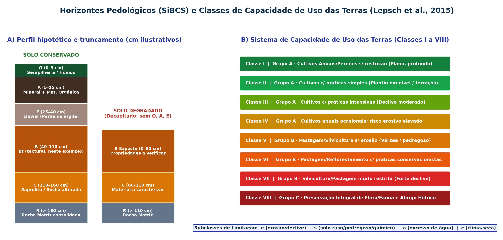

## Visão Geral da Aula {.smaller-text}

::: {.columns}
::: {.column width="50%"}
### Tópicos

- [1]{.circle} Funções ecossistêmicas do solo no Geossistema e horizontes diagnósticos (SiBCS)
- [2]{.circle} Comportamento hidrossedimentológico das ordens de solos do Brasil e da Bahia (Embrapa, 2018)
- [3]{.circle} Indicadores visuais e físicos de campo: selamento, compactação, infiltração e DRES/VESS
- [4]{.circle} Sistema de Capacidade de Uso das Terras: Grupos A, B, C e Classes I a VIII (Lepsch et al., 2015)
- [5]{.circle} Sistema de Avaliação da Aptidão Agrícola das Terras (Ramalho Filho & Beek, 1995)
- [6]{.circle} Resolução CONAMA nº 420/2009: Valores Orientadores (VRQ, VP e VI) e Áreas Contaminadas
:::

::: {.column width="50%"}
::: {.info-box}
**Objetivo da Aula**

Avaliar a qualidade ambiental dos solos na perspectiva do **planejamento territorial e da geomorfologia**, relacionando as ordens do **SiBCS** à suscetibilidade erosiva, classificando as terras segundo a **Capacidade de Uso (Classes I–VIII)** e a **Aptidão Agrícola**, e aplicando a **Resolução CONAMA nº 420/2009** para áreas contaminadas.
:::
:::
:::

# 1 · O Solo no Sistema Ambiental e no SiBCS {.section-header rotulo="SiBCS"}

## Funções Ambientais do Solo e Horizontes Pedológicos {.smaller-text}

::: {.columns}
::: {.column width="50%"}
### Cinco Funções do Solo na Análise Ambiental (Karlen et al., 1997; FAO, 2015)

1. **Regulação do ciclo hidrológico**: partição entre infiltração vertical ($f$), armazenamento de água disponível na zona radicular e recarga de aquíferos vs. escoamento superficial ($Q_s$).
2. **Filtro, tampão e reator biogeoquímico**: adsorção de cátions e retenção/degradação de poluentes na matriz coloidal (argilas + húmus).
3. **Reservatório global de carbono**: o solo armazena mais carbono orgânico ($\text{COS}$) do que a atmosfera e a vegetação somadas.
4. **Suporte físico e geotécnico**: estabilidade de vertentes e fundações.
5. **Sustentação da biodiversidade edáfica e produção de biomassa**.
:::

::: {.column width="50%"}
### Horizontes Principais do Perfil (SiBCS — Embrapa, 2018)

- **Horizonte $O$**: camada superficial orgânica (serapilheira em decomposição) que amortece a energia cinética das gotas de chuva (*efeito splash*).
- **Horizonte $A$**: horizonte mineral superficial escurecido pela incorporação de matéria orgânica humificada; estrutura granular porosa de alta infiltração.
- **Horizonte $E$**: horizonte mineral eluvial (claro/esbranquiçado) que perdeu argila silicatada, ferro ou alumínio por translocação descendente.
- **Horizonte $B$**: horizonte subsuperficial de máxima expressão pedogenética (**$Bw$** latossólico; **$Bt$** textural com acumulação de argila; **$Bi$** incipiente; **$Bn$** nátrico/sódico).
- **Horizonte $C$ (Saprolito) e Camada $R$ (Rocha matriz)**.
:::
:::

## Perfil Conservado vs. Truncado e Classes de Capacidade de Uso {.smaller-text}

{.fig-full}

## SiBCS e comportamento ambiental: hipóteses a verificar {.smaller-text}

| Ordem / condição | Aspectos relevantes ao diagnóstico |
|---|---|
| Latossolos | Profundidade, textura, agregação e compactação por uso |
| Argissolos | Contraste textural, estrutura e continuidade dos horizontes |
| Luvissolos | Atividade da argila, profundidade e pedregosidade |
| Planossolos | Horizonte B plânico e possíveis restrições sazonais à drenagem |
| Cambissolos / Neossolos | Material de origem, profundidade e posição na vertente |
| Gleissolos | Sinais de redução e regime de saturação |

O SiBCS classifica solos; não fornece automaticamente resistência geotécnica, erodibilidade ou delimitação legal de APP. Essas avaliações exigem atributos medidos, posição no relevo e legislação aplicável.

# 2 · Capacidade de Uso e Aptidão Agrícola {.section-header rotulo="Capacidade Uso"}

## Estrutura Hierárquica: Grupos (A, B, C), Classes (I a VIII) e Subclasses {.smaller-text}

O sistema adaptativo brasileiro (Lepsch et al., 2015 — SBCS) classifica a **máxima intensidade de uso agrossilvipastoril que uma gleba suporta sem sofrer degradação acelerada por erosão**:

- **Grupo A (Classes I, II, III e IV)**: terras passíveis de utilização com **culturas anuais, perenes, pastagens e reflorestamento/vida silvestre** (as restrições e exigências de conservação crescem da Classe I para a IV).
- **Grupo B (Classes V, VI e VII)**: terras **impróprias para cultivos anuais intensivos**, mas adaptadas para **pastagens permanentes, silvicultura ou culturas perenes protetoras** (Classe V: áreas planas sujeitas a inundação/pedregosidade sem erosão; Classes VI e VII: encostas declivosas/solos rasos).
- **Grupo C (Classe VIII)**: terras **impróprias para qualquer cultivo agrícola, pastagem ou silvicultura comercial**, destinadas exclusivamente à **preservação da flora/fauna, recreação ou armazenamento hídrico** (escarpas, afloramentos rochosos, dunas, manguezais).

## Subclasses de Limitação (`e`, `s`, `a`, `c`) {.smaller-text}

Ao número romano da Classe acrescenta-se a letra minúscula indicativa da natureza da limitação dominante (ex.: **$\text{IIIe}$**, **$\text{IVs}$**, **$\text{Va}$**, **$\text{VIe,s}$**):

| Símbolo | Fator Limitante Dominante | Exemplos Diagnósticos |
|---------|---------------------------|-----------------------|
| **`e`** | **Risco de Erosão e Declividade** | Declive acentuado, rampa longa, presença de sulcos/ravinas e alta erodibilidade ($K$). |
| **`s`** | **Limitações intrínsecas do Solo** | Pouca profundidade efetiva (contato lítico), pedregosidade, textura muito arenosa, salinidade/sodicidade ou baixa retenção hídrica. |
| **`a`** | **Excesso de Água (Hidromorfismo)** | Lençol freático elevado, drenagem interna deficiente e risco de inundação fluvial sazonal. |
| **`c`** | **Limitações Climáticas** | Déficit hídrico severo prolongado (semiaridez/aridez), risco de geadas ou ventos dessecantes. |

## Diferença entre Capacidade de Uso (Lepsch) e Aptidão Agrícola (FAO/Embrapa) {.smaller-text}

- Enquanto a **Capacidade de Uso** (origem norte-americana — USDA) foca prioritariamente na **conservação do solo contra a erosão** e assume um único padrão tecnológico elevado, o **Sistema de Aptidão Agrícola da Embrapa** (Ramalho Filho & Beek, 1995; utilizado pelo IBGE) avalia a viabilidade das terras sob **Três Níveis de Manejo Tecnológico**:
  - **Nível A (baixo emprego de insumos e mecanização)**: trabalho braçal/tração animal, sem aplicação de corretivos ou fertilizantes químicos.
  - **Nível B (emprego intermediário de tecnologia)**: tração animal ou mecanização parcial, aplicação modesta de calcário/adubos e práticas simples de conservação.
  - **Nível C (Desenvolvido / Tecnificado)**: motomecanização intensiva, maior emprego de insumos e mecanização, conforme os pressupostos do sistema.

## Os 6 Grupos de Aptidão Agrícola e os 5 Fatores Limitantes {.smaller-text}

- **Cinco Fatores Limitantes avaliados**:
  1. Deficiência de Fertilidade ($f$);
  2. Deficiência de Água ($h$);
  3. Excesso de Água / Deficiência de Oxigênio ($o$);
  4. Suscetibilidade à Erosão ($e$);
  5. Impedimentos à Mecanização ($m$).
- **Grupos de Aptidão (1 a 6)**:
  - **Grupos 1, 2 e 3**: lavouras (Aptidão Boa, Regular e Restrita);
  - **Grupo 4**: pastagem plantada;
  - **Grupo 5**: silvicultura e/ou pastagem natural;
  - **Grupo 6**: preservação da flora e da fauna (sem aptidão agrossilvipastoril).

# 3 · Diagnóstico de Campo e CONAMA 420/2009 {.section-header rotulo="CONAMA 420"}

## DRES e VESS: escalas diferentes {.smaller-text}

| Protocolo | Escala | Sentido da qualidade estrutural |
|---|---|---|
| **DRES** | 1 a 6 | **1 pior; 6 melhor** |
| **VESS** | 1 a 5 | **1 melhor; 5 pior** |

Descrever o bloco, umidade, camadas, poros, raízes e agregados conforme cada manual. Não misturar notas nem calcular uma média entre escalas com sentidos opostos.

[Embrapa: manual do DRES](https://www.infoteca.cnptia.embrapa.br/infoteca/bitstream/doc/1071114/1/Doc390OL.pdf).

## Qualidade física: um conjunto de evidências {.smaller-text}

- Densidade e porosidade devem ser interpretadas com textura e estrutura.
- Resistência à penetração depende da umidade e do equipamento.
- Infiltração superficial não equivale automaticamente à condutividade saturada do perfil.
- Agregação, cobertura, raízes e atividade biológica completam a avaliação.

Na Geografia, relacionar essas evidências à posição na vertente, uso, circulação de água e conflito territorial. Ensaios laboratoriais aprofundados são desenvolvidos também em Bioengenharia de Solos.

## CONAMA 420/2009: valores orientadores {.smaller-text}

| Valor | Interpretação |
|---|---|
| VRQ | Referência da ocorrência natural de uma substância, estabelecida conforme o procedimento estadual |
| VP | Prevenção de alterações prejudiciais às funções do solo |
| VI | Investigação de risco potencial em cenários padronizados de exposição |

Conferir substância, unidade, matriz e cenário. Ultrapassar um valor exige as ações de investigação e gestão previstas; não fornece sozinho o risco individual nem uma solução de remediação.

Os valores por uso agrícola, residencial e industrial dependem da substância e do cenário. Não impor uma cadeia universal de desigualdades.

## Conflito de uso: da classe à recomendação {.smaller-text}

Caso didático: vertente com solo raso, trechos descobertos e uso anual intenso.

1. Mapear as limitações e a unidade de avaliação.
2. Classificar capacidade de uso com os critérios completos do sistema.
3. Comparar uso atual, exigências de conservação e restrições legais.
4. Discutir alternativas com proprietários, trabalhadores e comunidades.
5. Definir indicadores de conservação e viabilidade social.

Classe de capacidade de uso, aptidão agrícola, qualidade do solo e APP são avaliações distintas. Integrá-las sem substituir uma pela outra.

# 4 · Síntese e Referências {.section-header rotulo="Síntese"}

## Resumo para Provas, ENADE e Perícias {.smaller-text}

- **Conflito de Uso do Solo (*Overuse*)**: ocorre quando o Uso Atual da Terra é mais intensivo do que a **Capacidade de Uso** permite (ex.: lavoura anual ou pastagem sem manejo instalada em terras de **Classe VIe, VIIe ou VIII**), desencadeando erosão acelerada.
- No Semiárido e Agreste baiano, **Luvissolos, Planossolos e Argissolos** exigem práticas rigorosas de retenção hídrica devido à **descontinuidade hidráulica no topo do horizonte $B$**.
- Na **CONAMA 420/2009**, selecionar a substância, o cenário e o valor orientador corretos; a investigação deve avaliar fontes, vias e receptores.

## Referências Bibliográficas {.smaller-text}

- CONAMA. **Resolução nº 420, de 28 de dezembro de 2009** (Critérios e valores orientadores de qualidade do solo quanto à presença de substâncias químicas e diretrizes para o gerenciamento ambiental de áreas contaminadas).
- EMBRAPA (Santos, H. G. et al.). **Sistema Brasileiro de Classificação de Solos (SiBCS)**. 6. ed. Brasília: Embrapa, 2025.
- LEPSCH, I. F. et al. **Manual para Levantamento Utilitário e Classificação de Terras no Sistema de Capacidade de Uso**. 6. ed. Viçosa: Sociedade Brasileira de Ciência do Solo (SBCS), 2015.
- RALISCH, R. et al. **Diagnóstico Rápido da Estrutura do Solo — DRES**. Londrina: Embrapa Soja (Documentos, 390), 2017.
- RAMALHO FILHO, A.; BEEK, K. J. **Sistema de Avaliação da Aptidão Agrícola das Terras**. 3. ed. Rio de Janeiro: Embrapa-CNPS, 1995.
