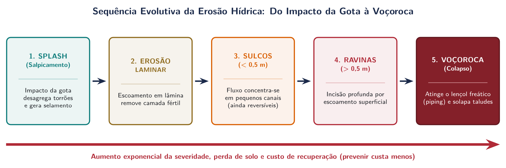
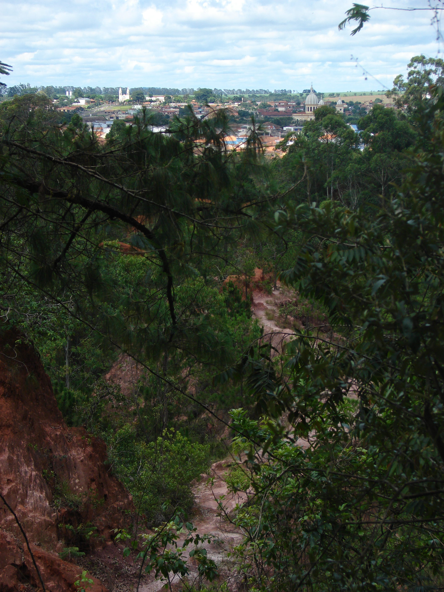

## [Abertura]{.pitch-tag} Visão Geral da Aula {.smaller-text .lesson-slide}

::: {.pitch-grid-55}
::: {.pitch-milestones}
::: {.pitch-milestone-item}
**01 · Erosão Hídrica:** *splash*, erosão laminar, sulcos, ravinas e voçorocas.
:::

::: {.pitch-milestone-item}
**02 · Hidrodinâmica:** limiar de incisão ($\tau_0 > \tau_c$) e erosão interna subsuperficial (*piping/sapping*).
:::

::: {.pitch-milestone-item}
**03 · Geotecnia:** dinâmica de recuo de cabeceiras (*headcut retreat*) em voçorocas.
:::

::: {.pitch-milestone-item}
**04 · Monitoramento:** protocolos auditáveis com pinos de erosão, estacas e VANT (SfM / DoD).
:::

::: {.pitch-milestone-item}
**05 · Degradação Fluvial:** solapamento de margens, assoreamento e desconexão de planície.
:::

::: {.pitch-milestone-item}
**06 · Terras Secas e Pastagens:** compactação, salinização, desertificação e recuperação vs. renovação.
:::
:::

::: {.pitch-stack-2}
::: {.pitch-card .pitch-card--gold}
[Objetivo da Aula]{.pitch-card-index}
[Mecanismos físicos e métricas de campo]{.pitch-heading}

Diagnosticar os mecanismos físicos, hidráulicos e geotécnicos que governam a evolução das feições erosivas lineares (sulcos, ravinas e voçorocas), a instabilidade de margens fluviais e a salinização de solos, aplicando métodos quantitativos de monitoramento em campo.
:::

::: {.pitch-pill-row}
[Tensão Cisalhante]{.pitch-pill}
[Piping & Headcut]{.pitch-pill .pitch-pill--gold}
[Pinos & VANT/DoD]{.pitch-pill}
[Salinização]{.pitch-pill .pitch-pill--gold}
:::
:::
:::

# 1 · Evolução Mecanística da Erosão Hídrica {.section-header rotulo="Erosão Linear"}

## [Erosão Linear]{.pitch-tag .pitch-tag--alert} Do Impacto da Gota (*Splash*) à Voçoroca {.smaller-text .lesson-slide}

::: {.pitch-media-card .pitch-media-card--tall}

[Sequência evolutiva da erosão hídrica: do salpicamento à voçoroca]{.pitch-caption}
[Transição entre processos difusos, incisão linear concentrada, piping freático e colapso de taludes]{.pitch-caption-sub}
:::

## [Diagnóstico]{.pitch-tag} Diagnosticar feições e processos erosivos {.smaller-text .lesson-slide}

::: {.pitch-table-box}
| Evidência | Interpretação a investigar |
|---|---|
| **Salpicamento e selamento** | Desagregação por chuva e redução da infiltração |
| **Remoção entre sulcos** | Transporte por escoamento superficial difuso |
| **Sulcos** | Concentração do fluxo em pequenas incisões |
| **Ravinas e voçorocas** | Incisões persistentes com cabeceiras, paredes e conexões próprias |
:::

::: {.pitch-cards-2}
::: {.pitch-card}
[Critério terminológico]{.pitch-card-index}
[Definir dimensões e atividade]{.pitch-heading}

Os limites dimensionais e o emprego de “ravina” e “voçoroca” variam na literatura. Declarar o critério adotado e descrever largura, profundidade, extensão, atividade e mecanismos.
:::

::: {.pitch-card .pitch-card--gold}
[Cautela diagnóstica]{.pitch-card-index}
[Não inferir só pela geometria]{.pitch-heading}

Fluxos superficiais e subsuperficiais podem coexistir. Lençol freático ou *piping* devem ser demonstrados; formato em U ou V não prova sozinho o mecanismo, nem há sequência linear obrigatória.
:::
:::

# 2 · Hidrodinâmica e Geotecnia do Voçorocamento {.section-header rotulo="Voçorocas"}

## [Voçorocas]{.pitch-tag .pitch-tag--alert} O que diferencia uma Voçoroca e por que estudar seus Mecanismos? {.smaller-text .lesson-slide}

::: {.pitch-grid-55}
::: {.pitch-stack-2}
::: {.pitch-card}
[Escala do corte]{.pitch-card-index}
[Do escoamento difuso ao canal incisivo]{.pitch-heading}

Enquanto a erosão laminar e os sulcos rasos dependem sobretudo da chuva e do escoamento superficial, o voçorocamento envolve cortes profundos no solo e no saprolito com participação frequente do lençol freático e da estabilidade geotécnica das paredes.
:::

::: {.pitch-card .pitch-card--alert}
[Base para o PRAD]{.pitch-card-index}
[Por que quantificar forças e fluxos internos?]{.pitch-heading}

O sucesso de qualquer obra de contenção ou PRAD depende de saber se a feição avança por **força trativa na base ($\tau_0$)**, por **escoamento subsuperficial (*piping* e *sapping*)** ou por **colapso de taludes**.
:::
:::

::: {.pitch-media-card .pitch-media-card--photo .pitch-media-card--tall}

[Voçoroca de grande porte em campo (Casa Branca, SP)]{.pitch-caption}
[Fonte: Wikimedia Commons · incisão profunda e instabilidade geotécnica das paredes]{.pitch-caption-sub}
:::
:::

## [Hidrodinâmica]{.pitch-tag .pitch-tag--alert} Incisão, erosão interna e recuo de cabeceira {.smaller-text .lesson-slide}

::: {.pitch-formula}
Para fluxo aproximadamente uniforme, a tensão cisalhante hidráulica na base ($\tau_0$) desencadeia incisão quando supera a resistência crítica do material ($\tau_c$):

$$\tau_0 = \rho_w g R_h S_f = \gamma R_h S_f > \tau_c$$

$R_h$: raio hidráulico ($\text{m}$); $S_f$: declividade da linha de energia ($\text{m/m}$); $\gamma = \rho_w g$: peso específico da água; resultado em $\text{Pa}$, comparado a $\tau_c$ medido ou estimado para o material.
:::

::: {.pitch-flow-4}
::: {.pitch-card .pitch-card--alert}
[01 · Headcut]{.pitch-card-index}
[Recuo de cabeceira]{.pitch-heading}

Degrau erosivo pode recuar por impacto, escavação basal e colapso.
:::

::: {.pitch-card .pitch-card--gold}
[02 · Piping]{.pitch-card-index}
[Erosão interna]{.pitch-heading}

Remoção interna de partículas com formação ou ampliação de dutos.
:::

::: {.pitch-card .pitch-card--teal}
[03 · Sapping]{.pitch-card-index}
[Exfiltração]{.pitch-heading}

Erosão associada à descarga subterrânea na superfície do talude.
:::

::: {.pitch-card}
[04 · Rupturas]{.pitch-card-index}
[Colapso de paredes]{.pitch-heading}

Dependem de material, geometria, água e perda de apoio basal.
:::
:::

::: {.pitch-band}
Nem todo saprolito é friável; nem toda voçoroca apresenta exfiltração permanente. Registrar chuvas, surgências e mudanças sazonais.
:::

# 3 · Monitoramento Morfométrico Auditável {.section-header rotulo="Monitoramento"}

## [Monitoramento]{.pitch-tag .pitch-tag--teal} Pinos e estacas: um protocolo reproduzível {.smaller-text .lesson-slide}

::: {.pitch-grid-55}
::: {.pitch-milestones}
::: {.pitch-milestone-item}
**01 · Orientação:** definir a superfície e a direção medida (vertical ou normal ao talude).
:::

::: {.pitch-milestone-item}
**02 · Linha de base:** instalar referências estáveis e registrar exposição inicial e posição.
:::

::: {.pitch-milestone-item}
**03 · Periodicidade:** repetir as leituras após eventos e exatamente na mesma orientação.
:::

::: {.pitch-milestone-item}
**04 · Ocorrências:** registrar deslocamento, pisoteio, perdas e deposição junto à haste.
:::

::: {.pitch-milestone-item}
**05 · Relato:** apresentar variação, dispersão, número de pinos e período amostral.
:::
:::

::: {.pitch-card .pitch-card--alert}
[Limites de interpretação]{.pitch-card-index}
[Leitura pontual vs. bacia]{.pitch-heading}

Exposição maior pode indicar remoção; menor pode indicar deposição. Movimentação da haste ou do bloco invalida a interpretação simples.

A mudança local da superfície **não equivale ao sedimento exportado da bacia hidrográfica**.
:::
:::

## [Monitoramento]{.pitch-tag .pitch-tag--teal} Quando converter espessura em massa? {.smaller-text .lesson-slide}

::: {.pitch-formula}
Para uma **lâmina média representativa da área**, com densidade aparente do solo ($D_s$) conhecida:

$$M\;(\mathrm{t/ha}) = 10\,h\;(\mathrm{mm})\,D_s\;(\mathrm{g/cm^3})$$

**Exemplo didático:** $h = 5\text{ mm}$ e $D_s = 1{,}30\text{ g/cm}^3 \implies M = 65\text{ t/ha}$.
:::

::: {.pitch-band .pitch-band--navy}
A relação exige área de referência e geometria compatíveis. Uma leitura normal a uma parede não é uma lâmina vertical sobre um hectare. Explicitar se o resultado representa mudança líquida, remoção bruta ou deposição; não chamar automaticamente de produção de sedimentos.
:::

## [VANT / SfM]{.pitch-tag .pitch-tag--teal} Fotogrametria e modelo de diferença (DoD) {.smaller-text .lesson-slide}

::: {.pitch-formula}
Modelo Digital de Diferença de Elevação (*DEM of Difference*):

$$DoD = MDE_{t_2} - MDE_{t_1}$$
:::

::: {.pitch-grid-50}
::: {.pitch-card}
[Protocolo fotogramétrico]{.pitch-card-index}
[Rastreabilidade e incerteza]{.pitch-heading}

- Usar a mesma referência, corregistrar modelos e verificar pontos de controle independentes.
- Separar vegetação e superfície do terreno.
- Estimar o limite de detecção e propagar a incerteza.
- Integrar diferenças negativas e positivas apenas onde o sinal é confiável.
:::

::: {.pitch-card .pitch-card--alert}
[Restrições geométricas]{.pitch-card-index}
[Limites do MDE 2.5D]{.pitch-heading}

Um MDE representa uma altura por posição horizontal e pode falhar em paredes verticais, saliências e áreas ocultas.

Resolução centimétrica **não garante acurácia centimétrica nem volume “exato”**.
:::
:::

# 4 · Degradação Fluvial e Salinização {.section-header rotulo="Rios e Sais"}

## [Canais Fluviais]{.pitch-tag .pitch-tag--teal} Degradação Hidrossedimentológica de Canais Fluviais {.smaller-text .lesson-slide}

::: {.pitch-cards-2}
::: {.pitch-card .pitch-card--alert}
[Solapamento de barrancos]{.pitch-card-index}
[Erosão Marginal]{.pitch-heading}

Causada pela remoção da mata ciliar (perda da coesão radicular $c_r$ e da rugosidade hidráulica), pelo pisoteio direto do gado na margem (desagregação) e pela oscilação rápida do nível d'água (poropressão residual no rebaixamento da cheia).
:::

::: {.pitch-card .pitch-card--gold}
[Aggradation]{.pitch-card-index}
[Assoreamento]{.pitch-heading}

Quando a carga sólida entregue pelas vertentes erodidas supera a **capacidade de transporte do rio**, areia e cascalho depositam-se no leito em bancos e barras. A calha torna-se rasa e larga, reduzindo o volume útil de reservatórios e elevando a frequência de transbordamentos.
:::
:::

## [Terras Secas]{.pitch-tag .pitch-tag--gold} Salinização e Sodificação de Solos no Semiárido {.smaller-text .lesson-slide}

::: {.pitch-band}
Ocorre em baixadas e perímetros irrigados ($ETP \gg P$, Vale do São Francisco e açudes do Sertão) com **irrigação salobra e ausência de drenagem subsuperficial**: a **ascensão capilar** precipita crostas brancas ($\text{NaCl, CaSO}_4, \text{MgSO}_4$).
:::

::: {.pitch-cards}
::: {.pitch-card .pitch-card--gold}
[Richards, 1954 / Embrapa]{.pitch-card-index}
[Solo Salino]{.pitch-heading}

Condutividade Elétrica do extrato de saturação $CE_{es} \ge 4\text{ dS/m}$ e Percentagem de Sódio Trocável $PST < 15\%$.
:::

::: {.pitch-card .pitch-card--alert}
[Dispersão estrutural]{.pitch-card-index}
[Solo Sódico (Alcalino)]{.pitch-heading}

$PST \ge 15\%$ e $CE_{es} < 4\text{ dS/m}$: o íon $\text{Na}^+$ dispersa as argilas, destrói a estrutura física e pode reduzir a infiltração, dependendo da mineralogia e concentração de eletrólitos.
:::

::: {.pitch-card .pitch-card--teal}
[Dupla restrição]{.pitch-card-index}
[Solo Salino-Sódico]{.pitch-heading}

$CE_{es} \ge 4\text{ dS/m}$ e $PST \ge 15\%$: combina estresse osmótico severo com risco de colapso estrutural se lixiviado sem corretivo de cálcio.
:::
:::

## [Risco Socioambiental]{.pitch-tag .pitch-tag--alert} Do processo ao risco socioambiental {.smaller-text .lesson-slide}

::: {.pitch-band}
**Caso:** incisão ativa próxima de estrada e moradias.
:::

::: {.pitch-table-box}
| Etapa | Evidência |
|---|---|
| **Processo e tendência** | Recuo de cabeceira, seções, chuva e histórico |
| **Área potencialmente atingida** | Geometria e cenários fundamentados |
| **Exposição** | Pessoas, acessos, água e infraestrutura |
| **Vulnerabilidade** | Condições das edificações, mobilidade e resposta |
| **Ação** | Comunicação com órgãos responsáveis e prioridades de proteção |
:::

::: {.pitch-band .pitch-band--navy}
Não extrapolar uma taxa medida em um ponto para toda a feição. Registrar a incerteza e distinguir diagnóstico de projeto executivo.
:::

# 5 · Degradação da Cobertura Vegetal e Recuperação {.section-header rotulo="Degradação e Manejo"}

## [Pastagens]{.pitch-tag .pitch-tag--forest} Níveis de Degradação do Solo sob Pastagens {.smaller-text .lesson-slide}

::: {.pitch-grid-50}
::: {.pitch-table-box}
| Grau | Barcellos (1986) | Dias-Filho (2011) |
|:---:|---|---|
| **1** | Redução de produção | Perda de vigor e solo pouco descoberto |
| **2** | Grau 1 + redução da cobertura | Nível 1 agravado + plantas daninhas (PD) |
| **3** | Graus 1 e 2 + invasoras + leve erosão | Nível 2 + morte da forrageira |
| **4** | Grau 3 + invasoras + pasto nativo + erosão | Solo descoberto + erosão física |
:::

::: {.pitch-table-box}
| Autor / Critério | Faixas de Classificação |
|---|---|
| **Serrão & Toledo (1990)** *(% de plantas daninhas, PD)* | **Até 10%:** não degradado **10% a 35%:** baixo · **35% a 80%:** médio **80% ou mais:** alto |
| **Nascimento Jr. (1994)** *(Produtividade relativa)* | **75% a 100%:** excelente (não degradada) **50% a 75%:** boa · **25% a 50%:** ruim **Menor que 25%:** degradada |
:::
:::

## [Recuperação]{.pitch-tag .pitch-tag--forest} Estratégias de Intervenção: Recuperação vs. Renovação {.smaller-text .lesson-slide}

::: {.pitch-cards-2}
::: {.pitch-card .pitch-card--forest}
[Graus 1 e 2]{.pitch-card-index}
[Recuperação Direta]{.pitch-heading}

Restabelecer a produção forrageira **mantendo a mesma espécie ou cultivar** por meio de práticas simples de manejo:

1. Ajuste no manejo do pasto;
2. Controle de plantas invasoras;
3. Correção da fertilidade do solo;
4. Introdução de leguminosas;
5. Sobressemeadura da espécie já existente (no florescimento).
:::

::: {.pitch-card .pitch-card--gold}
[Graus 3 e 4]{.pitch-card-index}
[Intervenção Estrutural e Renovação]{.pitch-heading}

Perda severa de cobertura e presença de erosão exigem ações mais onerosas:

- **Renovação:** substituição da espécie/cultivar ou reintrodução da forrageira;
- **Alternativas complementares:** implantação de **Sistema Agrossilvopastoril** ou **pousio da pastagem** (descanso programado).
:::
:::

::: {.pitch-band}
**Objetivo:** restabelecer vigor, qualidade e produtividade, obtendo um sistema sustentável e viável.
:::

# 6 · Síntese e Referências {.section-header rotulo="Síntese"}

## [Síntese]{.pitch-tag .pitch-tag--gold} Síntese Operacional para Diagnósticos e PRAD {.smaller-text .lesson-slide}

::: {.pitch-cards}
::: {.pitch-card}
[01 · Protocolo descritivo]{.pitch-card-index}
[Ravinas e voçorocas]{.pitch-heading}

Descrever geometria, atividade, conectividade e participação dos fluxos superficiais e subsuperficiais; declarar o critério terminológico adotado.
:::

::: {.pitch-card .pitch-card--alert}
[02 · Erro crítico em PRAD]{.pitch-card-index}
[Nunca aterrar sem drenagem]{.pitch-heading}

Jamais aterrar uma voçoroca com solo solto sem antes **disciplinar o escoamento superficial na cabeceira (crista)** e **drenar o fluxo freático na base**, sob pena de nova ruptura imediata.
:::

::: {.pitch-card .pitch-card--teal}
[03 · Auditoria]{.pitch-card-index}
[Pinos de erosão e VANT (DoD)]{.pitch-heading}

Transformam descrições subjetivas em **métricas volumétricas e gravimétricas auditáveis ($\text{m}^3$ e $\text{t/ha/ano}$)**.
:::
:::

## [Referências]{.pitch-tag} Referências Bibliográficas {.smaller-text .lesson-slide}

::: {.pitch-card}
[Bibliografia da Aula]{.pitch-card-index}
[Erosão, geotecnia, monitoramento e pastagens]{.pitch-heading}

- AUGUSTO FILHO, O. Caracterização geológico-geotécnica voltada à estabilização de encostas. In: **COBRAE**, 1., 1992, Rio de Janeiro. Anais... ABMS/ABGE, 1992. p. 721–733.
- BARCELLOS, A. O. Recuperação de pastagens degradadas. In: **Simpósio sobre Manejo da Pastagem**, 8., 1986, Piracicaba. Anais... FEALQ, 1986.
- DIAS-FILHO, M. B. **Degradação de pastagens: processos, causas e estratégias de recuperação**. 4. ed. Belém: Mb Agro, 2011.
- GUERRA, A. J. T.; SILVA, A. S.; BOTELHO, R. G. M. (Orgs.). **Erosão e Conservação dos Solos: conceitos, temas e aplicações**. 9. ed. Rio de Janeiro: Bertrand Brasil, 2014.
- MORGAN, R. P. C. **Soil Erosion and Conservation**. 3. ed. Oxford: Blackwell Publishing, 2005.
- NASCIMENTO JÚNIOR, D.; QUEIROZ, D. S.; SANTOS, M. V. F. Degradação das pastagens e critérios para avaliação. In: **Simpósio sobre Manejo da Pastagem**, 11., 1994, Piracicaba. Anais... FEALQ, 1994. p. 107–151.
- OLIVEIRA, M. A. T. Processos erosivos e preservação de áreas de risco de erosão por voçorocas. In: GUERRA, A. J. T. et al. **Erosão e Conservação dos Solos**. Rio de Janeiro: Bertrand Brasil, 1999. p. 57–99.
- SERRÃO, E. A. S.; TOLEDO, J. M. The search for sustainability in Amazonian pastures. In: ANDERSON, A. B. (Ed.). **Alternatives to deforestation**. New York: Columbia University Press, 1990. p. 195–214.
:::
