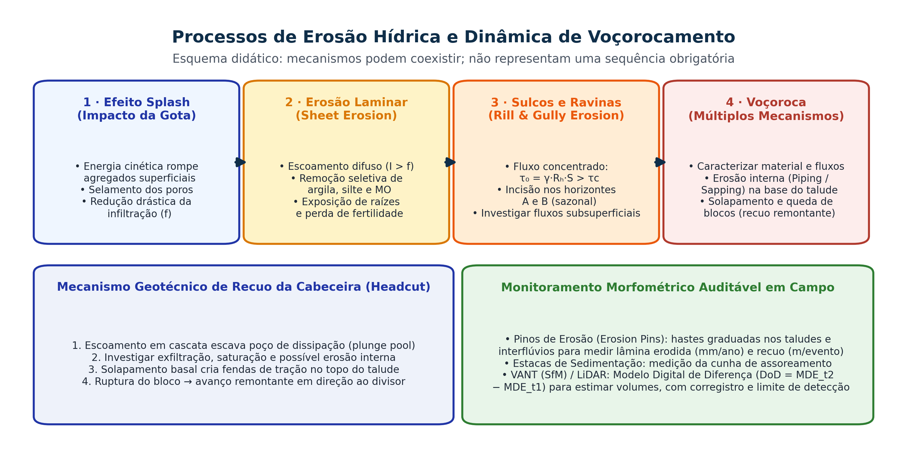

## Visão Geral da Aula {.smaller-text}

::: {.columns}
::: {.column width="50%"}
### Tópicos

- [1]{.circle} Mecanística da erosão hídrica: *splash*, erosão laminar, sulcos, ravinas e voçorocas
- [2]{.circle} Limiar hidrodinâmico de incisão ($\tau_0 > \tau_c$) e erosão interna subsuperficial (*piping/sapping*)
- [3]{.circle} Dinâmica geotécnica de recuo de cabeceiras (*headcut retreat*) em voçorocas
- [4]{.circle} Protocolos auditáveis de monitoramento: Pinos de Erosão, Estacas e VANT (SfM / DoD)
- [5]{.circle} Degradação fluvial: solapamento de margens, assoreamento e desconexão de planície
- [6]{.circle} Degradação química e física em terras secas: compactação, salinização e desertificação
:::

::: {.column width="50%"}
::: {.info-box}
**Objetivo da Aula**

Diagnosticar os mecanismos físicos, hidráulicos e geotécnicos que governam a evolução das feições erosivas lineares (sulcos, ravinas e voçorocas), a instabilidade de margens fluviais e a salinização de solos, aplicando métodos quantitativos de monitoramento em campo.
:::
:::
:::

# 1 · Evolução Mecanística da Erosão Hídrica {.section-header rotulo="Erosão Linear"}

## Do Impacto da Gota (*Splash*) à Voçoroca {.smaller-text}

{.fig-full}

## Diagnosticar feições e processos erosivos {.smaller-text}

| Evidência | Interpretação a investigar |
|---|---|
| Salpicamento e selamento | Desagregação por chuva e redução da infiltração |
| Remoção entre sulcos | Transporte por escoamento superficial difuso |
| Sulcos | Concentração do fluxo em pequenas incisões |
| Ravinas e voçorocas | Incisões persistentes com cabeceiras, paredes e conexões próprias |

Os limites dimensionais e o emprego de “ravina” e “voçoroca” variam na literatura. Declarar o critério e descrever largura, profundidade, extensão, atividade e mecanismos.

Fluxos superficiais e subsuperficiais podem coexistir. A presença de lençol freático ou piping deve ser demonstrada; formato em U ou V não prova sozinho o mecanismo. As feições não precisam seguir uma sequência linear obrigatória.

# 2 · Hidrodinâmica e Geotecnia do Voçorocamento {.section-header rotulo="Voçorocas"}

## Incisão, erosão interna e recuo de cabeceira {.smaller-text}

Para fluxo aproximadamente uniforme:

$$\tau_0=\rho_w gR_hS_f.$$

$R_h$: raio hidráulico em m; $S_f$: declividade da linha de energia; resultado em Pa. Comparar com resistência crítica medida ou estimada para o material.

- **Headcut:** degrau erosivo pode recuar por impacto, escavação basal e colapso.
- **Piping:** remoção interna com formação ou ampliação de dutos.
- **Sapping:** erosão associada à descarga subterrânea na superfície.
- **Rupturas:** dependem de material, geometria, água e perda de apoio.

Nem todo saprolito é friável; nem toda voçoroca apresenta exfiltração permanente. Registrar chuvas, surgências e mudanças sazonais.

# 3 · Monitoramento Morfométrico Auditável {.section-header rotulo="Monitoramento"}

## Pinos e estacas: um protocolo reproduzível {.smaller-text}

1. Definir a superfície e a direção medida: vertical ou normal ao talude.
2. Instalar referências estáveis e registrar exposição inicial e posição.
3. Repetir as leituras após eventos e na mesma orientação.
4. Registrar deslocamento, pisoteio, perdas e deposição junto à haste.
5. Apresentar variação, dispersão, número de pinos e período.

Exposição maior pode indicar remoção; menor pode indicar deposição. Movimentação da haste ou do bloco invalida a interpretação simples. A mudança local da superfície não equivale ao sedimento exportado da bacia.

## Quando converter espessura em massa? {.smaller-text}

Para uma **lâmina média representativa da área**, com densidade do solo conhecida:

$$M\;(\mathrm{t/ha})=10\,h\;(\mathrm{mm})\,D_s\;(\mathrm{g/cm^3}).$$

Exemplo didático: $h=5$ mm e $D_s=1{,}30$ g/cm³ resultam em 65 t/ha.

A relação exige área de referência e geometria compatíveis. Uma leitura normal a uma parede não é uma lâmina vertical sobre um hectare. Explicitar se o resultado representa mudança líquida, remoção bruta ou deposição; não chamar automaticamente de produção de sedimentos.

## Fotogrametria e modelo de diferença {.smaller-text}

$$DoD=MDE_{t_2}-MDE_{t_1}.$$

- Usar a mesma referência, corregistrar modelos e verificar pontos independentes.
- Separar vegetação e superfície do terreno.
- Estimar o limite de detecção e propagar a incerteza.
- Integrar diferenças negativas e positivas apenas onde o sinal é confiável.

Um MDE representa uma altura por posição horizontal e pode falhar em paredes verticais, saliências e áreas ocultas. Resolução centimétrica não garante acurácia centimétrica nem volume “exato”.

# 4 · Degradação Fluvial e Salinização {.section-header rotulo="Rios e Sais"}

## Degradação Hidrossedimentológica de Canais Fluviais {.smaller-text}

- **Erosão Marginal (Solapamento de Barrancos)**:
  - Causada pela remoção da mata ciliar (perda da coesão radicular $c_r$ e da rugosidade hidráulica), pelo pisoteio direto do gado na margem (desagregação) e pela oscilação rápida do nível d'água (poropressão residual no rebaixamento da cheia).
- **Assoreamento (*Aggradation*)**:
  - Quando a carga sólida entregue pelas vertentes erodidas supera a **capacidade de transporte do rio**, a areia e o cascalho depositam-se no leito, formando bancos e barras.
  - **Consequência geomorfológica e social**: a calha torna-se rasa e larga, reduzindo o volume útil de reservatórios de abastecimento/hidrelétricas e fazendo com que vazões ordinárias transbordem com frequência muito maior.

## Salinização e Sodificação de Solos no Semiárido {.smaller-text}

- Ocorre intensamente em baixadas e perímetros irrigados de regiões semiáridas ($ETP \gg P$, como no Vale do São Francisco e açudes do Sertão) quando há **irrigação com água salobra e ausência de drenagem subsuperficial**:
  - **Ascensão capilar**: o lençol freático raso sobe por capilaridade e evapora na superfície, precipitando crostas brancas de sais solúveis ($\text{NaCl, CaSO}_4, \text{MgSO}_4$).
  - **Classificação pedológica (Richards, 1954 / Embrapa)**:
    - **Solo Salino**: Condutividade Elétrica do extrato de saturação $CE_{es} \ge 4\text{ dS/m}$ e Percentagem de Sódio Trocável $PST < 15\%$.
    - **Solo Sódico (Alcalino)**: $PST \ge 15\%$ e $CE_{es} < 4\text{ dS/m}$ (o íon $\text{Na}^+$ dispersa as argilas, destrói a estrutura física e pode reduzir a infiltração, dependendo da mineralogia e concentração de eletrólitos!).
    - **Solo Salino-Sódico**: $CE_{es} \ge 4\text{ dS/m}$ e $PST \ge 15\%$.

## Do processo ao risco socioambiental {.smaller-text}

Caso: incisão ativa próxima de estrada e moradias.

| Etapa | Evidência |
|---|---|
| Processo e tendência | Recuo de cabeceira, seções, chuva e histórico |
| Área potencialmente atingida | Geometria e cenários fundamentados |
| Exposição | Pessoas, acessos, água e infraestrutura |
| Vulnerabilidade | Condições das edificações, mobilidade e resposta |
| Ação | Comunicação com órgãos responsáveis e prioridades de proteção |

Não extrapolar uma taxa medida em um ponto para toda a feição. Registrar a incerteza e distinguir diagnóstico de projeto executivo.

# 5 · Síntese e Referências {.section-header rotulo="Síntese"}

## Síntese Operacional para Diagnósticos e PRAD {.smaller-text}

1. **Ravinas e voçorocas:** descrever geometria, atividade, conectividade e participação dos fluxos; declarar o critério terminológico adotado.
2. **Atenção no Projeto de Recuperação**: jamais se deve simplesmente "aterrar" uma voçoroca com solo solto sem antes **disciplinar o escoamento superficial na cabeceira (crista)** e **drenar o fluxo freático na base**, sob pena de nova ruptura imediata!
3. O uso de **pinos de erosão** e **VANT (DoD)** transforma descrições subjetivas em **métricas volumétricas e gravimétricas auditáveis ($\text{m}^3$ e $\text{t/ha/ano}$)**.

## Referências Bibliográficas {.smaller-text}

- AUGUSTO FILHO, O. Caracterização geológico-geotécnica voltada à estabilização de encostas. In: **Conferência Brasileira sobre Estabilidade de Encostas (COBRAE)**, 1., 1992, Rio de Janeiro. Anais... Rio de Janeiro: ABMS/ABGE, 1992. p. 721–733.
- GUERRA, A. J. T.; SILVA, A. S.; BOTELHO, R. G. M. (Orgs.). **Erosão e Conservação dos Solos: conceitos, temas e aplicações**. 9. ed. Rio de Janeiro: Bertrand Brasil, 2014.
- MORGAN, R. P. C. **Soil Erosion and Conservation**. 3. ed. Oxford: Blackwell Publishing, 2005.
- OLIVEIRA, M. A. T. Processos erosivos e preservação de áreas de risco de erosão por voçorocas. In: GUERRA, A. J. T.; SILVA, A. S.; BOTELHO, R. G. M. (Orgs.). **Erosão e Conservação dos Solos**. Rio de Janeiro: Bertrand Brasil, 1999. p. 57–99.
