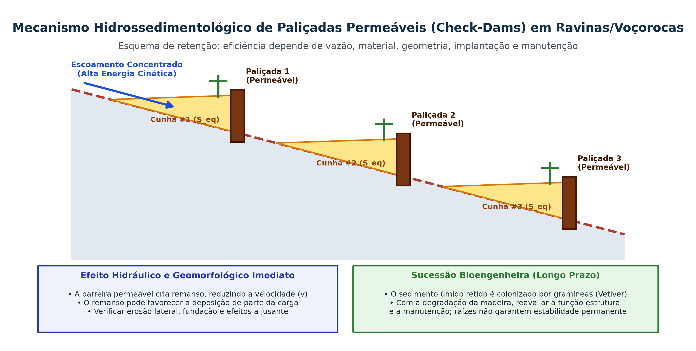

## Visão Geral da Aula {.smaller-text}

::: {.columns}
::: {.column width="50%"}
### Tópicos

- [1]{.circle} Soluções Baseadas na Natureza (SbN / *NbS* — IUCN) e Bioengenharia na Análise Ambiental
- [2]{.circle} Princípios hidrogeomorfológicos: rugosidade de Manning ($n$), tensão cisalhante ($\tau_0$) e coesão radicular ($c_r$)
- [3]{.circle} Zoneamento de intervenções na vertente e na microbacia (Cabeceira $\rightarrow$ Taludes $\rightarrow$ Tálvegue)
- [4]{.circle} Paliçadas permeáveis (*check-dams*): funcionamento hidráulico e formação de cunhas de sedimento
- [5]{.circle} Barreiras vivas em contorno (Capim-Vetiver), biomantas antierosivas e retentores
- [6]{.circle} Estabilização bioengenheira de margens fluviais e integração com a sucessão ecológica no PRAD
:::

::: {.column width="50%"}
::: {.info-box}
**Objetivo da Aula**

Compreender como as **Soluções Baseadas na Natureza (SbN)** e a **Bioengenharia de Água e Solo** atuam na recuperação de áreas degradadas (PRAD), integrando dissipação de energia hidráulica, retenção de sedimentos e reforço mecânico radicular na escala da vertente e da bacia hidrográfica.
:::
:::
:::

# 1 · Soluções Baseadas na Natureza e Bioengenharia {.section-header rotulo="SbN e Princípios"}

## Soluções Baseadas na Natureza e bioengenharia {.smaller-text}

SbN envolvem proteção, manejo e restauração de ecossistemas para enfrentar desafios sociais, com benefícios à biodiversidade e ao bem-estar.

A bioengenharia combina vegetação e elementos construtivos para funções hidráulicas, mecânicas e ecológicas. Pode integrar SbN quando atende aos objetivos e critérios pertinentes.

Comparar alternativas pela adequação ao local, durabilidade, manutenção, custo do ciclo de vida e efeitos a montante e jusante. Estruturas vegetadas, obras minerais e soluções híbridas apresentam desempenhos condicionados pelo projeto e pelo ambiente.

Evitar percentuais universais de economia ou promessas de estabilidade crescente sem monitoramento.

## Mecanismos e condições de funcionamento {.smaller-text}

| Função | Processo | O que avaliar |
|---|---|---|
| Proteção superficial | Cobertura reduz impacto de gotas e modifica o escoamento | Continuidade, contato e falhas da cobertura |
| Retenção | Estruturas alteram transporte e armazenamento | Sedimento retido, transbordamento e erosão lateral |
| Reforço radicular | Raízes podem mobilizar resistência e modificar a água no solo | Espécie, estabelecimento, distribuição e plano de ruptura |
| Recuperação ecológica | Recolonização e melhoria do habitat | Sobrevivência, regeneração, diversidade e invasoras |

Aumentar rugosidade não garante redução da tensão em qualquer situação, pois geometria e lâmina também mudam. Raízes não eliminam por si só poropressão, erosão basal ou ruptura profunda.

# 2 · Zoneamento de Intervenções e Paliçadas {.section-header rotulo="Paliçadas"}

## Mecanismo Hidrossedimentológico de Paliçadas Permeáveis em Série {.smaller-text}

{.fig-full}

## Planejar intervenções na vertente e na microbacia {.smaller-text}

1. Identificar fontes de água e sedimento, caminhos de fluxo e receptores.
2. Proteger pessoas e interromper práticas que mantêm a degradação.
3. Avaliar controle do escoamento a montante **com saída segura**.
4. Tratar cabeceira, taludes, fundo e margens conforme o processo ativo.
5. Implantar proteção superficial e revegetação com cronograma sazonal.
6. Inspecionar após eventos e ajustar a manutenção.

Terraços, desvios, retaludamento, drenos e barramentos exigem avaliação específica. Não concentrar água em outro setor nem infiltrar junto a uma encosta instável sem investigar o efeito.

# 3 · Tecnologias Bioengenheiras Aplicadas {.section-header rotulo="Técnicas"}

## Vegetação, biomantas e retentores {.smaller-text}

- Selecionar espécies compatíveis com clima, solo, disponibilidade hídrica e objetivo.
- Priorizar a adequação ecológica e avaliar risco de invasão.
- Vetiver pode formar barreiras densas, mas profundidade e resistência das raízes dependem de cultivar, idade e sítio.
- Biomantas precisam de contato, fixação e tratamento das bordas.
- Retentores requerem continuidade, capacidade e pontos de descarga.

Não adotar um valor único de tração radicular como resistência de toda a encosta. A fase de implantação costuma exigir proteção e manutenção próprias.

## Margens fluviais: combinar processos e técnicas {.smaller-text}

Enrocamento vegetado, feixes vivos, estacas e parede Krainer são alternativas conforme material, geometria e regime hidráulico.

**Verificar:** erosão do pé, fundação, filtros, níveis de cheia, velocidade, acesso, conexão ripária e efeitos sobre o canal.

Revegetar a face não resolve necessariamente o solapamento basal. A escolha deve considerar dinâmica fluvial, competência profissional, licenças e manutenção.

# 4 · Síntese e Referências {.section-header rotulo="Síntese"}

## Recuperação: definir metas e critérios de revisão {.smaller-text}

| Dimensão | Indicador | Registro |
|---|---|---|
| Superfície | Cobertura e falhas | Parcelas e fotografias repetidas |
| Erosão | Recuo e mudanças de seção | Referências estáveis e incerteza |
| Estruturas | Deformação, obstrução e erosão lateral | Inspeção após eventos |
| Vegetação | Sobrevivência e regeneração | Amostragem e época |
| Conexão com o rio | Sedimentos e qualidade da água | Chuva, vazão e pontos comparáveis |

Definir metas por contexto e responsáveis por manutenção. Estabilidade e recuperação são hipóteses a testar ao longo do tempo.

## Referências de projeto e avaliação {.smaller-text}

- IUCN. **Global Standard for Nature-based Solutions**. 2020.
- GRAY, D. H.; SOTIR, R. B. **Biotechnical and Soil Bioengineering Slope Stabilization**. 1996.
- DURLO, M. A.; SUTILI, F. J. **Bioengenharia: manejo biotécnico de cursos de água**. 2014.
- NRCS. [Soil Bioengineering for Streambank and Shoreline Protection](https://directives.nrcs.usda.gov/sites/default/files2/1720531900/Chapter%2016%20-%20Soil%20Bioengineering%20for%20Streambank%20and%20Shoreline%20Protection.pdf). 2021.

Na Análise Ambiental, integrar processos, território e prioridades do PRAD. Dimensionamento e ensaios também são aprofundados em Bioengenharia de Solos.
