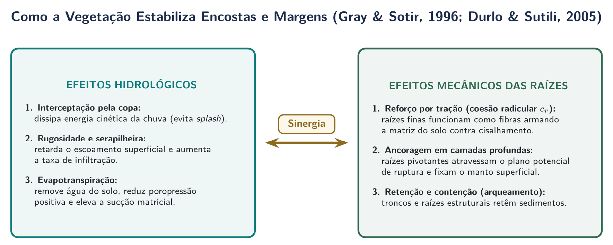
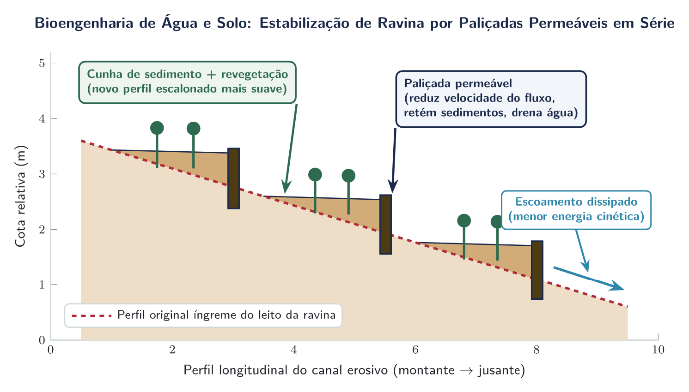
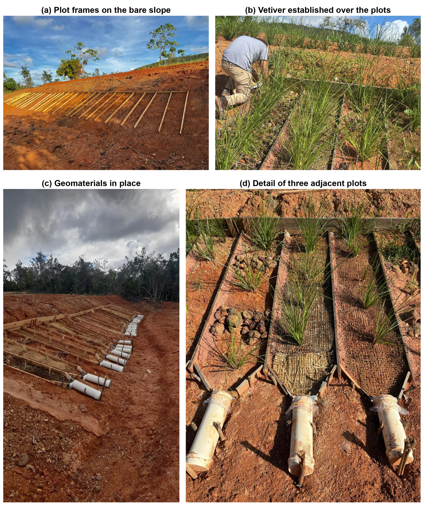

## [Abertura]{.pitch-tag} Visão Geral da Aula {.smaller-text .lesson-slide}

::: {.pitch-grid-55}
::: {.pitch-milestones}
::: {.pitch-milestone-item}
**01 · SbN e Bioengenharia:** Soluções Baseadas na Natureza (IUCN) e Bioengenharia na Análise Ambiental.
:::

::: {.pitch-milestone-item}
**02 · Princípios Físicos:** rugosidade de Manning ($n$), tensão cisalhante ($\tau_0$) e coesão radicular ($c_r$).
:::

::: {.pitch-milestone-item}
**03 · Zoneamento:** intervenções na vertente e na microbacia (Cabeceira $\rightarrow$ Taludes $\rightarrow$ Tálvegue).
:::

::: {.pitch-milestone-item}
**04 · Paliçadas:** funcionamento hidráulico (*check-dams* permeáveis) e formação de cunhas de sedimento.
:::

::: {.pitch-milestone-item}
**05 · Técnicas Aplicadas:** barreiras vivas (Capim-Vetiver), biomantas, geocompostos e retentores.
:::

::: {.pitch-milestone-item}
**06 · Margens Fluviais:** estabilização bioengenheira e integração com a sucessão ecológica no PRAD.
:::
:::

::: {.pitch-stack-2}
::: {.pitch-card .pitch-card--gold}
[Objetivo da Aula]{.pitch-card-index}
[Dissipação hidráulica e reforço radicular]{.pitch-heading}

Compreender como as **Soluções Baseadas na Natureza (SbN)** e a **Bioengenharia de Água e Solo** atuam na recuperação de áreas degradadas (PRAD), integrando dissipação de energia hidráulica, retenção de sedimentos e reforço mecânico radicular na escala da vertente e da bacia hidrográfica.
:::

::: {.pitch-pill-row}
[SbN · IUCN 2020]{.pitch-pill}
[Manning & Mohr-Coulomb]{.pitch-pill .pitch-pill--gold}
[Check-Dams]{.pitch-pill}
[Biomantas & Vetiver]{.pitch-pill .pitch-pill--gold}
:::
:::
:::

# 1 · Soluções Baseadas na Natureza e Bioengenharia {.section-header rotulo="SbN e Princípios"}

## [SbN e Princípios]{.pitch-tag .pitch-tag--forest} Soluções Baseadas na Natureza e bioengenharia {.smaller-text .lesson-slide}

::: {.pitch-cards-2}
::: {.pitch-card .pitch-card--forest}
[IUCN, 2020]{.pitch-card-index}
[Soluções Baseadas na Natureza (SbN)]{.pitch-heading}

Envolvem proteção, manejo e restauração de ecossistemas para enfrentar desafios sociais, gerando benefícios simultâneos à biodiversidade e ao bem-estar humano.
:::

::: {.pitch-card .pitch-card--teal}
[Abordagem híbrida]{.pitch-card-index}
[Bioengenharia de Água e Solo]{.pitch-heading}

Combina vegetação e elementos construtivos para funções hidráulicas, mecânicas e ecológicas. Pode integrar SbN quando atende aos objetivos e critérios pertinentes.
:::
:::

::: {.pitch-band .pitch-band--navy}
Comparar alternativas pela adequação ao local, durabilidade, manutenção, custo do ciclo de vida e efeitos a montante e jusante. Estruturas vegetadas, obras minerais e soluções híbridas têm desempenhos condicionados pelo projeto e pelo ambiente — evitar percentuais universais de economia ou promessas sem monitoramento.
:::

## [Princípios]{.pitch-tag .pitch-tag--teal} Hidráulica (Manning) e Resistência Radicular (Mohr-Coulomb) {.smaller-text .lesson-slide}

::: {.pitch-grid-50}
::: {.pitch-formula}
**Equação de Manning (rugosidade $n$ e velocidade $v$):**

$$v = \frac{1}{n}\,R_h^{2/3}\,S^{1/2}$$

Cobertura vegetal e serapilheira elevam $n$, reduzindo a velocidade do escoamento e favorecendo a infiltração.
:::

::: {.pitch-formula}
**Mohr-Coulomb com coesão radicular ($c_r$):**

$$\tau = c' + c_r + \sigma' \tan\phi'$$

Raízes atuam como fibras na matriz do solo, acrescentando $c_r$ à coesão efetiva ($c'$) e ao atrito ($\sigma'\tan\phi'$).
:::
:::

::: {.pitch-media-card .pitch-media-card--compact}

[Como a vegetação estabiliza encostas e margens (Gray & Sotir, 1996; Durlo & Sutili, 2005)]{.pitch-caption}
[Sinergia entre interceptação, rugosidade, sucção matricial por evapotranspiração, coesão radicular ($c_r$) e ancoragem]{.pitch-caption-sub}
:::

## [Mecanismos]{.pitch-tag .pitch-tag--teal} Mecanismos e condições de funcionamento {.smaller-text .lesson-slide}

::: {.pitch-table-box}
| Função | Processo | O que avaliar |
|---|---|---|
| **Proteção superficial** | Cobertura reduz impacto de gotas e modifica o escoamento | Continuidade, contato e falhas da cobertura |
| **Retenção** | Estruturas alteram transporte e armazenamento | Sedimento retido, transbordamento e erosão lateral |
| **Reforço radicular** | Raízes mobilizam resistência e modificam a água no solo | Espécie, estabelecimento, distribuição e plano de ruptura |
| **Recuperação ecológica** | Recolonização e melhoria do habitat | Sobrevivência, regeneração, diversidade e invasoras |
:::

::: {.pitch-band .pitch-band--navy}
Aumentar rugosidade não garante redução da tensão em qualquer situação, pois geometria e lâmina também mudam. Raízes não eliminam por si só poropressão, erosão basal ou ruptura profunda.
:::

# 2 · Zoneamento de Intervenções e Paliçadas {.section-header rotulo="Paliçadas"}

## [Paliçadas]{.pitch-tag .pitch-tag--gold} Mecanismo Hidrossedimentológico de Paliçadas Permeáveis em Série {.smaller-text .lesson-slide}

::: {.pitch-media-card .pitch-media-card--tall}

[Estabilização de ravina por paliçadas permeáveis em série (*check-dams*)]{.pitch-caption}
[Dissipação do escoamento, retenção gradual de cunhas de sedimento e revegetação do perfil escalonado]{.pitch-caption-sub}
:::

## [Zoneamento]{.pitch-tag .pitch-tag--gold} Planejar intervenções na vertente e na microbacia {.smaller-text .lesson-slide}

::: {.pitch-grid-55}
::: {.pitch-milestones}
::: {.pitch-milestone-item}
**01 · Diagnóstico de fluxos:** identificar fontes de água e sedimento, caminhos de fluxo e receptores.
:::

::: {.pitch-milestone-item}
**02 · Segurança e controle:** proteger pessoas e interromper práticas que mantêm a degradação.
:::

::: {.pitch-milestone-item}
**03 · Montante:** avaliar controle do escoamento a montante **com saída segura**.
:::

::: {.pitch-milestone-item}
**04 · Compartimentos:** tratar cabeceira, taludes, fundo e margens conforme o processo ativo.
:::

::: {.pitch-milestone-item}
**05 · Cobertura:** implantar proteção superficial e revegetação com cronograma sazonal.
:::

::: {.pitch-milestone-item}
**06 · Manutenção:** inspecionar após eventos extremos e ajustar intervenções.
:::
:::

::: {.pitch-card .pitch-card--alert}
[Cuidado hidráulico]{.pitch-card-index}
[Não transferir o problema]{.pitch-heading}

Terraços, desvios, retaludamento, drenos e barramentos exigem avaliação específica.

**Regra crítica:** não concentrar água em outro setor nem infiltrar junto a uma encosta instável sem investigar o efeito na poropressão.
:::
:::

# 3 · Tecnologias Bioengenheiras Aplicadas {.section-header rotulo="Técnicas"}

## [Técnicas]{.pitch-tag .pitch-tag--forest} Vegetação, biomantas, geocompostos e retentores {.smaller-text .lesson-slide}

::: {.pitch-grid-55}
::: {.pitch-stack-2}
::: {.pitch-card .pitch-card--forest}
[Seleção vegetal]{.pitch-card-index}
[Espécies nativas e Capim-Vetiver]{.pitch-heading}

- Selecionar espécies compatíveis com clima, solo, disponibilidade hídrica e objetivo; priorizar adequação ecológica e avaliar risco de invasão.
- **Vetiver** pode formar barreiras densas, mas profundidade e resistência das raízes dependem de cultivar, idade e sítio.
:::

::: {.pitch-card .pitch-card--gold}
[Obras de superfície]{.pitch-card-index}
[Biomantas e retentores]{.pitch-heading}

- **Biomantas** precisam de contato íntimo com o solo, fixação e tratamento das bordas.
- **Retentores** requerem continuidade, capacidade hidráulica e pontos seguros de descarga.
- Não adotar valor único de tração radicular para toda a encosta; a fase de implantação exige proteção e manutenção próprias.
:::
:::

::: {.pitch-media-card .pitch-media-card--photo .pitch-media-card--tall}

[Ensaio de campo com geocompostos e vetiver em talude]{.pitch-caption}
[Parcelas experimentais monitoradas: implantação em solo exposto, estabelecimento vegetal e coletores de escoamento]{.pitch-caption-sub}
:::
:::

## [Margens Fluviais]{.pitch-tag .pitch-tag--teal} Margens fluviais: combinar processos e técnicas {.smaller-text .lesson-slide}

::: {.pitch-cards}
::: {.pitch-card .pitch-card--teal}
[01 · Soluções combinadas]{.pitch-card-index}
[Repertório técnico]{.pitch-heading}

Enrocamento vegetado, feixes vivos, estacas e parede Krainer são alternativas conforme material, geometria e regime hidráulico.
:::

::: {.pitch-card .pitch-card--gold}
[02 · Itens a verificar]{.pitch-card-index}
[Projeto e hidráulica]{.pitch-heading}

Erosão do pé, fundação, filtros, níveis de cheia, velocidade de fluxo, acesso, conexão ripária e efeitos sobre o canal.
:::

::: {.pitch-card .pitch-card--alert}
[03 · Limite da revegetação]{.pitch-card-index}
[Solapamento basal]{.pitch-heading}

Revegetar a face não resolve necessariamente o solapamento basal. A escolha deve considerar dinâmica fluvial, competência profissional, licenças e manutenção.
:::
:::

# 4 · Síntese e Referências {.section-header rotulo="Síntese"}

## [Monitoramento]{.pitch-tag .pitch-tag--gold} Recuperação: definir metas e critérios de revisão {.smaller-text .lesson-slide}

::: {.pitch-table-box}
| Dimensão | Indicador | Registro |
|---|---|---|
| **Superfície** | Cobertura e falhas | Parcelas e fotografias repetidas |
| **Erosão** | Recuo e mudanças de seção | Referências estáveis e incerteza |
| **Estruturas** | Deformação, obstrução e erosão lateral | Inspeção após eventos |
| **Vegetação** | Sobrevivência e regeneração | Amostragem e época |
| **Conexão com o rio** | Sedimentos e qualidade da água | Chuva, vazão e pontos comparáveis |
:::

::: {.pitch-band .pitch-band--navy}
Definir metas por contexto e responsáveis por manutenção. Estabilidade e recuperação são hipóteses a testar ao longo do tempo.
:::

## [Referências]{.pitch-tag} Referências de projeto e avaliação {.smaller-text .lesson-slide}

::: {.pitch-card}
[Bibliografia da Aula]{.pitch-card-index}
[SbN e Bioengenharia de Solos]{.pitch-heading}

- IUCN. **Global Standard for Nature-based Solutions**. 2020.
- GRAY, D. H.; SOTIR, R. B. **Biotechnical and Soil Bioengineering Slope Stabilization**. 1996.
- DURLO, M. A.; SUTILI, F. J. **Bioengenharia: manejo biotécnico de cursos de água**. 2014.
- NRCS. [Soil Bioengineering for Streambank and Shoreline Protection](https://directives.nrcs.usda.gov/sites/default/files2/1720531900/Chapter%2016%20-%20Soil%20Bioengineering%20for%20Streambank%20and%20Shoreline%20Protection.pdf). 2021.
:::

::: {.pitch-band}
Na Análise Ambiental, integrar processos, território e prioridades do PRAD. Dimensionamento e ensaios também são aprofundados em Bioengenharia de Solos.
:::
