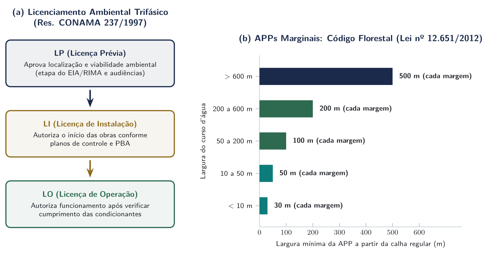
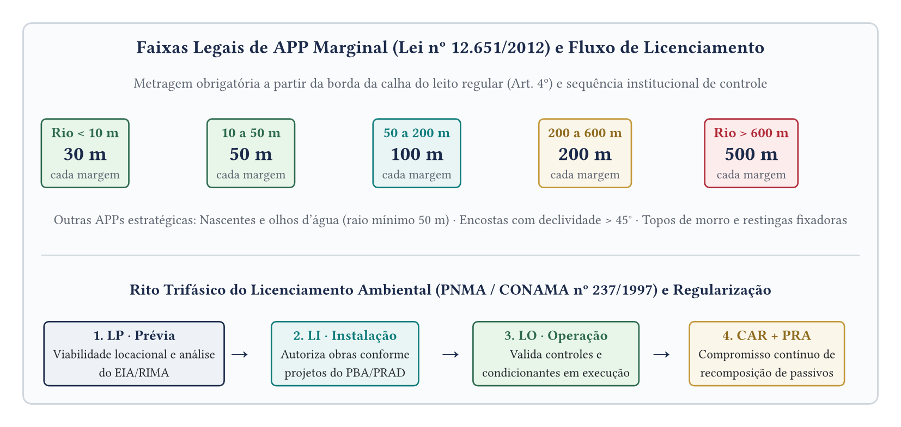
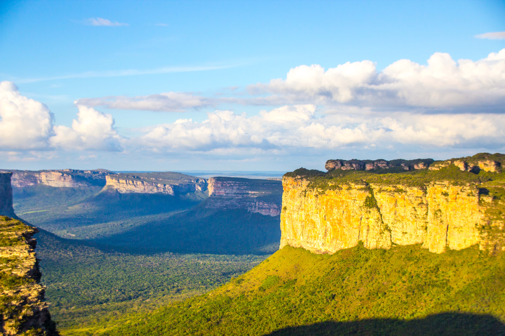

## [Abertura]{.pitch-tag} Visão Geral da Aula {.smaller-text .lesson-slide}

::: {.pitch-grid-55}
::: {.pitch-milestones}
::: {.pitch-milestone-item}
**01 · Código Florestal (Lei 12.651/2012):** todas as faixas de **APP** (Art. 4º) e **Reserva Legal** (Art. 12).
:::

::: {.pitch-milestone-item}
**02 · Regularização Rural:** Áreas Consolidadas (Art. 61-A), Cadastro Ambiental Rural (**CAR**) e **PRA**.
:::

::: {.pitch-milestone-item}
**03 · SNUC (Lei 9.985/2000):** as 12 categorias entre Proteção Integral e Uso Sustentável.
:::

::: {.pitch-milestone-item}
**04 · PRAD (IN IBAMA 14/2024):** estrutura técnica oficial e métodos de restauração florestal.
:::

::: {.pitch-milestone-item}
**05 · PNPSA e Bahia:** Pagamento por Serviços Ambientais (**Lei 14.119/2021**) e governança (INEMA/CEPRAM).
:::

::: {.pitch-milestone-item}
**06 · Responsabilidade:** Tríplice Responsabilidade Ambiental (CF/88 Art. 225, § 3º e Lei 9.605/1998).
:::
:::

::: {.pitch-stack-2}
::: {.pitch-card .pitch-card--gold}
[Objetivo da Aula]{.pitch-card-index}
[Parâmetros normativos e perícia ambiental]{.pitch-heading}

Dominar os parâmetros métricos, percentuais e normativos da legislação ambiental brasileira e baiana (**Lei 12.651/2012, Lei 9.985/2000, Lei 14.119/2021, Lei 9.605/1998 e IN IBAMA 14/2024**) indispensáveis para laudos, CAR, PRAD, EIA-RIMA e concursos públicos.
:::

::: {.pitch-pill-row}
[Lei 12.651/2012]{.pitch-pill}
[SNUC 9.985/2000]{.pitch-pill .pitch-pill--gold}
[IN IBAMA 14/2024]{.pitch-pill}
[PNPSA 14.119/2021]{.pitch-pill .pitch-pill--gold}
:::
:::
:::

# 1 · Código Florestal: APPs e Reserva Legal {.section-header rotulo="Lei 12.651/12"}

## [Lei 12.651/12]{.pitch-tag .pitch-tag--forest} Visão Integrada: Licenciamento e Faixas de APP {.smaller-text .lesson-slide}

::: {.pitch-media-card .pitch-media-card--tall}

[Licenciamento Trifásico (CONAMA 237/1997) e APPs Marginais (Lei nº 12.651/2012)]{.pitch-caption}
[Articulação entre controle preventivo de empreendimentos (LP, LI, LO) e faixas de proteção hídrica]{.pitch-caption-sub}
:::

## [Lei 12.651/12]{.pitch-tag .pitch-tag--forest} APPs Hídricas (Margens de Rios, Lagos e Nascentes) {.smaller-text .lesson-slide}

::: {.pitch-band}
Faixas marginais de **qualquer curso d'água natural perene e intermitente** (excluídos os efêmeros), medidas desde a **borda da calha do leito regular** (Art. 4º):
:::

::: {.pitch-grid-55}
::: {.pitch-table-box}
| Largura do Curso d'Água | Largura Mínima de APP (cada margem) |
|-------------------------|-------------------------------------|
| **Menos de $10\text{ m}$** | **$30\text{ metros}$** |
| **De $10\text{ a }50\text{ m}$** | **$50\text{ metros}$** |
| **De $50\text{ a }200\text{ m}$** | **$100\text{ metros}$** |
| **De $200\text{ a }600\text{ m}$** | **$200\text{ metros}$** |
| **Superior a $600\text{ m}$** | **$500\text{ metros}$** |
:::

::: {.pitch-card .pitch-card--teal}
[Demais APPs hídricas]{.pitch-card-index}
[Nascentes, lagos e veredas]{.pitch-heading}

- **Nascentes e olhos d'água perenes**: raio mínimo de **$50\text{ metros}$** (qualquer situação topográfica).
- **Lagos e lagoas naturais**:
  - **Zona rural**: **$100\text{ m}$** (ou **$50\text{ m}$** para corpo d'água com até $20\text{ ha}$ de superfície);
  - **Zona urbana**: **$30\text{ m}$**.
- **Veredas**: faixa marginal mínima de **$50\text{ m}$** a partir do espaço permanentemente brejoso e encharcado.
:::
:::

## [Lei 12.651/12]{.pitch-tag .pitch-tag--forest} APPs Geomorfológicas e Ecológicas (Art. 4º, V a XI) {.smaller-text .lesson-slide}

::: {.pitch-cards-2}
::: {.pitch-card .pitch-card--forest}
[Relevo e altitude]{.pitch-card-index}
[Encostas, topos e chapadas]{.pitch-heading}

1. **Encostas ou partes destas**: declividade superior a **$45^\circ$** ($100\%$ na linha de maior declive).
2. **Topos de morros, montes, montanhas e serras**: altura mínima de **$100\text{ m}$** (base/sela mais próxima) **E** inclinação média maior que **$25^\circ$ ($46{,}6\%$)**, no **terço superior** do relevo.
3. **Bordas dos tabuleiros ou chapadas**: até a linha de ruptura do relevo, faixa mínima de **$100\text{ m}$** em projeções horizontais.
:::

::: {.pitch-card .pitch-card--teal}
[Ecossistemas críticos]{.pitch-card-index}
[Altitude e zona costeira]{.pitch-heading}

4. **Altitude superior a $1.800\text{ m}$**: qualquer que seja a vegetação.
5. **Restingas** (como fixadoras de dunas ou estabilizadoras de mangues) e **Manguezais** (em toda a sua extensão).
:::
:::

::: {.pitch-band .pitch-band--navy}
**Regra de Intervenção em APP (Art. 8º):** a vegetação em APP deve ser mantida; a intervenção ou supressão **só é admitida nos casos excepcionais de Utilidade Pública, Interesse Social ou Baixo Impacto Ambiental** devidamente licenciados.
:::

## [Lei 12.651/12]{.pitch-tag .pitch-tag--forest} Reserva Legal (RL): Percentuais e Regime de Uso {.smaller-text .lesson-slide}

::: {.pitch-grid-50}
::: {.pitch-card .pitch-card--forest}
[Art. 3º, III e Art. 12]{.pitch-card-index}
[Conceito e Percentuais Mínimos]{.pitch-heading}

Área no interior do imóvel rural para assegurar **uso econômico sustentável**, conservação ecológica e biodiversidade:

- **Amazônia Legal**: **$80\%$** (floresta), **$35\%$** (cerrado) e **$20\%$** (campos gerais).
- **Demais Regiões do País (toda a Bahia — Caatinga, Mata Atlântica e Cerrado baiano)**: **$20\%$** da área total do imóvel!
:::

::: {.pitch-card .pitch-card--gold}
[Distinção jurídica fundamental]{.pitch-card-index}
[APP × Reserva Legal]{.pitch-heading}

- A **APP** é intocável como regra geral (preservação rígida de funções hídricas e geomorfológicas).
- A **Reserva Legal** admite exploração econômica mediante **Manejo Florestal Sustentável** aprovado pelo órgão ambiental (ou coleta sem propósito comercial).
:::
:::

## [Lei 12.651/12]{.pitch-tag .pitch-tag--forest} CAR, PRA e a "Escadinha" do Art. 61-A {.smaller-text .lesson-slide}

::: {.pitch-grid-50}
::: {.pitch-card}
[Art. 29 e Art. 3º, IV]{.pitch-card-index}
[CAR e Área Rural Consolidada]{.pitch-heading}

- **CAR (Cadastro Ambiental Rural)**: registro público eletrônico nacional obrigatório para todos os imóveis rurais, integrando APPs, RL, florestas e áreas consolidadas.
- **Área Rural Consolidada**: ocupação antrópica preexistente a **22 de julho de 2008**.
:::

::: {.pitch-card .pitch-card--gold}
[Art. 61-A · Módulos Fiscais (MF)]{.pitch-card-index}
[Recomposição escalonada de APP hídrica]{.pitch-heading}

- Até **$1\text{ MF}$**: recomposição obrigatória de **$5\text{ m}$**;
- $> 1\text{ até }2\text{ MF}$: recomposição de **$8\text{ m}$**;
- $> 2\text{ até }4\text{ MF}$: recomposição de **$15\text{ m}$**;
- $> 4\text{ MF}$: de **$20\text{ a }100\text{ m}$** conforme o PRA;
- Nascentes consolidadas: raio mínimo de **$15\text{ m}$**.
:::
:::

## [Lei 12.651/12]{.pitch-tag .pitch-tag--forest} Síntese Visual: Faixas de APP e Fluxo de Regularização {.smaller-text .lesson-slide}

::: {.pitch-media-card .pitch-media-card--tall}

[Faixas Legais de APP Marginal e Rito de Regularização (LP · LI · LO · CAR + PRA)]{.pitch-caption}
[Metragem a partir da borda da calha regular (Art. 4º) articulada ao controle e recomposição de passivos]{.pitch-caption-sub}
:::

# 2 · Sistema Nacional de Unidades de Conservação (SNUC) {.section-header rotulo="SNUC"}

## [SNUC]{.pitch-tag .pitch-tag--teal} O que é o SNUC e por que Dividir em Dois Grupos? {.smaller-text .lesson-slide}

::: {.pitch-grid-55}
::: {.pitch-stack-2}
::: {.pitch-card}
[Lei nº 9.985/2000]{.pitch-card-index}
[Sistema Nacional de Unidades de Conservação]{.pitch-heading}

Unificou critérios para criar, implantar e gerir áreas protegidas nas esferas federal, estadual e municipal, exigindo **plano de manejo** e **zona de amortecimento**.
:::

::: {.pitch-card .pitch-card--teal}
[Grau de intervenção permitido]{.pitch-card-index}
[Proteção Integral (5) vs. Uso Sustentável (7)]{.pitch-heading}

- **Proteção Integral (5 categorias):** preservar a natureza, admitindo apenas **uso indireto** (pesquisa, educação ambiental e visitação controlada).
- **Uso Sustentável (7 categorias):** compatibilizar conservação com **uso direto** e manejado por populações tradicionais ou proprietários.
:::
:::

::: {.pitch-media-card .pitch-media-card--photo .pitch-media-card--tall}

[Parque Nacional da Chapada Diamantina (BA)]{.pitch-caption}
[Unidade de Conservação de Proteção Integral na Bahia · Fonte: Wikimedia Commons]{.pitch-caption-sub}
:::
:::

## [SNUC]{.pitch-tag .pitch-tag--teal} SNUC: cinco categorias de Proteção Integral {.smaller-text .lesson-slide}

::: {.pitch-table-box}
| Categoria | Finalidade e regime geral |
|---|---|
| **Estação Ecológica** | Preservação e pesquisa; visitação educacional conforme regras |
| **Reserva Biológica** | Preservação integral da biota e atributos naturais |
| **Parque** | Preservação, pesquisa, educação e recreação compatíveis |
| **Monumento Natural** | Sítios naturais raros, singulares ou de beleza cênica |
| **Refúgio de Vida Silvestre** | Ambientes necessários à existência e reprodução de espécies |
:::

::: {.pitch-band}
Admite-se uso indireto, com as exceções previstas na Lei 9.985/2000. Monumento Natural e Refúgio podem incluir áreas particulares compatíveis com seus objetivos.
:::

## [SNUC]{.pitch-tag .pitch-tag--teal} SNUC: sete categorias de Uso Sustentável {.smaller-text .lesson-slide}

::: {.pitch-table-box}
| Categoria | Finalidade e regime geral |
|---|---|
| **APA** | Disciplinar ocupação e uso sustentável em área geralmente extensa |
| **ARIE** | Manter ecossistemas de importância regional ou local |
| **Floresta Nacional** | Uso múltiplo sustentável dos recursos florestais e pesquisa |
| **Reserva Extrativista** | Proteger modos de vida e uso sustentável por populações tradicionais |
| **Reserva de Fauna** | Estudos de manejo econômico sustentável de fauna nativa |
| **Reserva de Desenvolvimento Sustentável** | Preservação e reprodução dos modos de vida tradicionais |
| **RPPN** | Conservação em área privada gravada com perpetuidade |
:::

::: {.pitch-band .pitch-band--navy}
O grupo não autoriza qualquer uso. Consultar objetivos, domínio, zoneamento e plano de manejo de cada categoria.
:::

## [SNUC]{.pitch-tag .pitch-tag--teal} Conceitos Territoriais do SNUC (Art. 2º e Art. 25) {.smaller-text .lesson-slide}

::: {.pitch-cards-2}
::: {.pitch-card}
[Zoneamento e normas]{.pitch-card-index}
[Plano de Manejo]{.pitch-heading}

Documento técnico que, com fundamento nos objetivos gerais da UC, estabelece seu **zoneamento** e as normas de uso da área (deve ser elaborado no prazo de **5 anos** a partir da criação da UC).
:::

::: {.pitch-card .pitch-card--alert}
[Pegadinha Clássica de Concurso!]{.pitch-card-index}
[Zona de Amortecimento (ZA — Art. 2º, XVIII e Art. 25)]{.pitch-heading}

Entorno da UC onde atividades humanas seguem normas específicas para minimizar impactos negativos. Pelo **Art. 25 da Lei 9.985/2000**, todas as UCs devem ter ZA, **EXCETO APA e RPPN**!
:::
:::

## [SNUC]{.pitch-tag .pitch-tag--teal} Conectividade na Paisagem Regional {.smaller-text .lesson-slide}

::: {.pitch-cards-2}
::: {.pitch-card .pitch-card--forest}
[Art. 2º, XIX]{.pitch-card-index}
[Corredores Ecológicos]{.pitch-heading}

Porções de ecossistemas naturais ou seminaturais ligando UCs, que possibilitam o **fluxo de genes e o movimento da biota**, facilitando dispersão e recolonização (mitigando a fragmentação insular — MacArthur & Wilson).
:::

::: {.pitch-card .pitch-card--gold}
[Art. 26]{.pitch-card-index}
[Mosaico de Unidades de Conservação]{.pitch-heading}

Conjunto de UCs de categorias diferentes ou não, próximas, justapostas ou sobrepostas, e outras áreas protegidas públicas ou privadas, cuja gestão deve ser **integrada e participativa**.
:::
:::

# 3 · PRAD, PNPSA e Responsabilidade Ambiental {.section-header rotulo="PRAD e Crimes"}

## [PRAD]{.pitch-tag .pitch-tag--gold} Roteiro Oficial de um PRAD (IN IBAMA nº 14/2024) {.smaller-text .lesson-slide}

::: {.pitch-band}
Regulamentado pela **IN IBAMA nº 14/2024**, no âmbito dos procedimentos do Ibama (revogou a IN 04/2011). Para outros órgãos, consultar a norma e o termo de referência aplicáveis:
:::

::: {.pitch-cards}
::: {.pitch-card}
[01 · Responsabilidade]{.pitch-card-index}
[Identificação e ART]{.pitch-heading}

Dados do imóvel/empreendimento e Responsável Técnico (**ART do Geógrafo**).
:::

::: {.pitch-card .pitch-card--alert}
[02 · Diagnóstico]{.pitch-card-index}
[Área degradada e resiliência]{.pitch-heading}

Clima, geomorfologia, solo e hidrologia; **fatores de degradação ativos** (fogo, gado, erosão, *Urochloa*/*Leucaena*) e potencial de regeneração.
:::

::: {.pitch-card .pitch-card--teal}
[03 · Estratégia]{.pitch-card-index}
[Seleção de métodos]{.pitch-heading}

Escolha justificada das técnicas de recuperação ou restauração ecológica.
:::

::: {.pitch-card .pitch-card--forest}
[04 · Execução]{.pitch-card-index}
[Manutenção e tratos]{.pitch-heading}

Controle de formigas cortadeiras, coroamento, adubação de cobertura e replantio conforme metas.
:::

::: {.pitch-card .pitch-card--gold}
[05 · Auditoria]{.pitch-card-index}
[Indicadores de monitoramento]{.pitch-heading}

Cobertura de dossel ($\%$), densidade de regenerantes ($\text{ind./ha}$) e riqueza nativa em período e frequência definidos.
:::

::: {.pitch-card}
[06 · Gestão]{.pitch-card-index}
[Cronograma e orçamento]{.pitch-heading}

Cronograma físico de implantação/manutenção e orçamento financeiro detalhado.
:::
:::

## [Restauração]{.pitch-tag .pitch-tag--forest} Quatro Estratégias de Restauração Florestal {.smaller-text .lesson-slide}

::: {.pitch-table-box}
| Estratégia | Quando Aplicar (Potencial de Resiliência) | Técnicas Principais |
|---|---|---|
| **1. Condução da Regeneração Natural (Isolamento)** | **Alta resiliência**: solo conservado, banco de sementes/plântulas ativo e fontes de propágulos avaliadas no local. | Cercamento contra o gado, aceiros contra fogo e controle seletivo de gramíneas exóticas. |
| **2. Regeneração c/ Manejo (Adensamento e Enriquecimento)** | **Média resiliência**: regeneração presente, com falhas espaciais (clareiras) ou baixa diversidade. | Plantio de mudas em clareiras (**adensamento**) e introdução de secundárias tardias/clímax (**enriquecimento**). |
| **3. Técnicas de Nucleação (Reis et al., 2003)** | **Média a baixa resiliência**: busca recriar "ilhas de diversidade" que atraiam dispersores de fauna. | Transposição de *topsoil*, poleiros artificiais para avifauna, transposição de galharia e grupos de Anderson. |
| **4. Plantio em Área Total + Bioengenharia** | **Baixíssima resiliência**: solos decapitados, taludes de mineração, voçorocas ou pastagens sem propágulos. | Descompactação, bioengenharia, semeadura direta (*muvuca*) ou plantio alternando **Recobrimento (Pioneiras)** e **Diversidade (Não Pioneiras)**. |
:::

## [PNPSA]{.pitch-tag .pitch-tag--gold} Política Nacional de Pagamento por Serviços Ambientais (Lei nº 14.119/2021) {.smaller-text .lesson-slide}

::: {.pitch-grid-50}
::: {.pitch-card}
[Lei nº 14.119/2021]{.pitch-card-index}
[Conceito legal do PSA]{.pitch-heading}

Transação de natureza voluntária mediante a qual um **pagador** de serviços ambientais transfere a um **provedor** (ex.: agricultor familiar, comunidade tradicional, proprietário rural que conserva água e solo) recursos financeiros ou outra forma de remuneração.
:::

::: {.pitch-card .pitch-card--gold}
[Art. 5º da PNPSA]{.pitch-card-index}
[Modalidades de pagamento]{.pitch-heading}

- **Pagamento monetário direto** (ex.: Programa *Produtor de Água* da ANA);
- **Melhorias sociais** a comunidades rurais e urbanas;
- Compensação vinculada a certificado de redução de emissões (**REDD+**);
- **Cota de Reserva Ambiental (CRA — Art. 44 da Lei 12.651/2012)** e títulos verdes (*green bonds*).
:::
:::

## [Responsabilidade]{.pitch-tag .pitch-tag--alert} A Tríplice Responsabilidade Ambiental (CF/88 Art. 225, § 3º) {.smaller-text .lesson-slide}

::: {.pitch-band}
Um único ato lesivo (ex.: suprimir mata ciliar em APP sem licença e assorear rio) sujeita o infrator (PF ou PJ), de forma **cumulativa e independente**, a **três esferas**:
:::

::: {.pitch-table-box}
| Esfera | Natureza Jurídica | Sanção Aplicável |
|---|---|---|
| **1. Civil** *(Lei 6.938/81, Art. 14, § 1º)* | **Responsabilidade Objetiva** (independe de culpa; imprescritível — STF Tema 999) | **Obrigação de reparar integralmente o dano (*in natura* via PRAD)** + indenização pelos danos interinos e morais coletivos. |
| **2. Administrativa** *(Lei 9.605/98, Art. 72 e Dec. 6.514/08)* | Poder de Polícia Ambiental (IBAMA, ICMBio, INEMA-BA) | Advertência, **multa simples ou diária**, apreensão de equipamentos, **embargo de obra/área**, suspensão de venda e restritiva de direitos (crédito rural). |
| **3. Penal (Criminal)** *(Lei 9.605/1998)* | Responsabilidade Subjetiva (admite responsabilização penal da **Pessoa Jurídica** — Art. 3º!) | Penas privativas de liberdade (detenção/reclusão), restritivas de direitos (prestação de serviços/interdição) e multa penal. |
:::

## [Lei 12.651/12]{.pitch-tag .pitch-tag--forest} APP: faixa geral, situação consolidada e decisão {.smaller-text .lesson-slide}

::: {.pitch-band}
As faixas do art. 4º e as regras de recomposição de áreas rurais consolidadas do art. 61-A têm objetos diferentes.
:::

::: {.pitch-milestones}
::: {.pitch-milestone-item}
**01 · Identificar:** caracterizar curso d'água, nascente ou outra hipótese de APP.
:::

::: {.pitch-milestone-item}
**02 · Verificar:** checar regime hídrico, medidas, data de ocupação e situação do imóvel.
:::

::: {.pitch-milestone-item}
**03 · Conferir:** consultar CAR, PRA e normas aplicáveis ao ente federado.
:::

::: {.pitch-milestone-item}
**04 · Área urbana:** em área urbana consolidada, verificar a **Lei 14.285/2021** e a legislação municipal pertinente.
:::

::: {.pitch-milestone-item}
**05 · Documentar:** registrar o fundamento legal e as limitações da delimitação.
:::
:::

::: {.pitch-band .pitch-band--navy}
Não reduzir a delimitação a um buffer automático nem autorizar intervenção a partir de uma tabela didática.
:::

## [PRAD]{.pitch-tag .pitch-tag--gold} PRAD: metas, monitoramento e responsabilidade {.smaller-text .lesson-slide}

::: {.pitch-cards-2}
::: {.pitch-card}
[Coerência ecológica]{.pitch-card-index}
[Metas compatíveis com o bioma]{.pitch-heading}

O PRAD deve ligar fatores de degradação, métodos, metas, indicadores, manutenção e critérios de conclusão:

- O prazo, a amostragem e as metas precisam ser compatíveis com o ecossistema.
- Restaurar a **Caatinga** não equivale a implantar uma floresta de outra região.
:::

::: {.pitch-card .pitch-card--teal}
[Gestão e atribuição]{.pitch-card-index}
[Revisão e responsabilidade técnica]{.pitch-heading}

- Medidas corretivas dependem do diagnóstico das falhas observadas.
- Responsabilidade técnica deve corresponder às atribuições efetivas do profissional.
- Fonte oficial: [Ibama: recuperação ambiental e procedimentos do PRAD](https://www.gov.br/ibama/pt-br/assuntos/biodiversidade/recuperacao-ambiental).
:::
:::

# 4 · Síntese e Referências {.section-header rotulo="Síntese"}

## [Síntese]{.pitch-tag .pitch-tag--gold} Resumo Essencial para Provas e Concursos {.smaller-text .lesson-slide}

::: {.pitch-cards}
::: {.pitch-card .pitch-card--forest}
[01 · APPs Hídricas (Art. 4º)]{.pitch-card-index}
[Lei 12.651/2012]{.pitch-heading}

Rios: $<10\text{ m} \rightarrow 30\text{ m}$; $10\text{–}50\text{ m} \rightarrow 50\text{ m}$; $50\text{–}200\text{ m} \rightarrow 100\text{ m}$; $200\text{–}600\text{ m} \rightarrow 200\text{ m}$; $>600\text{ m} \rightarrow 500\text{ m}$. Nascentes perenes: raio de $50\text{ m}$.
:::

::: {.pitch-card .pitch-card--gold}
[02 · Reserva Legal na Bahia]{.pitch-card-index}
[Art. 12 da Lei 12.651/2012]{.pitch-heading}

**$20\%$** em todos os biomas estaduais (Caatinga, Mata Atlântica e Cerrado fora da Amazônia Legal).
:::

::: {.pitch-card .pitch-card--teal}
[03 · SNUC (Lei 9.985/2000)]{.pitch-card-index}
[5 Proteção + 7 Uso Sustentável]{.pitch-heading}

PI: ESEC, REBIO, Parque, MONA, REVIS. US: APA, ARIE, FLONA, RESEX, REFAU, RDS, RPPN. **APA e RPPN não possuem Zona de Amortecimento!**
:::
:::

## [Referências]{.pitch-tag} Referências Bibliográficas {.smaller-text .lesson-slide}

::: {.pitch-card}
[Bibliografia da Aula]{.pitch-card-index}
[Legislação federal e literatura técnica]{.pitch-heading}

- BRASIL. **Lei nº 9.605, de 12 de fevereiro de 1998** (Lei de Crimes Ambientais).
- BRASIL. **Lei nº 9.985, de 18 de julho de 2000** (Sistema Nacional de Unidades de Conservação da Natureza — SNUC).
- BRASIL. **Lei nº 12.651, de 25 de maio de 2012** (Dispõe sobre a proteção da vegetação nativa — Código Florestal).
- BRASIL. **Lei nº 14.119, de 13 de janeiro de 2021** (Política Nacional de Pagamento por Serviços Ambientais — PNPSA).
- IBAMA. **Instrução Normativa nº 14, de 2024** (Procedimentos para elaboração, execução e monitoramento de projetos de recuperação de áreas degradadas ou alteradas — PRAD).
- REIS, A. et al. Restauração de áreas degradadas: a nucleação como base para incrementar os processos sucessionais. **Natureza & Conservação**, v. 1, n. 1, p. 28–36, 2003.
:::
