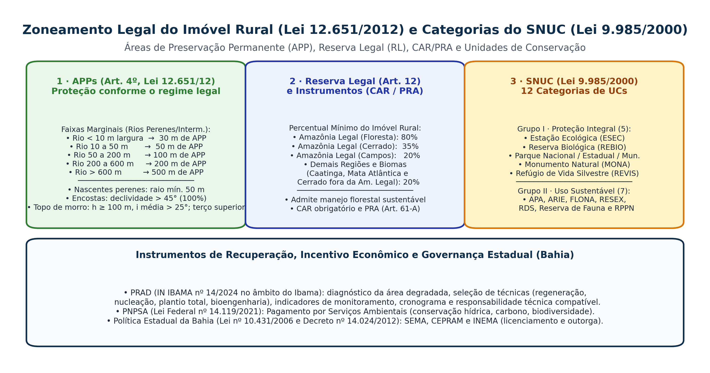

## Visão Geral da Aula {.smaller-text}

::: {.columns}
::: {.column width="50%"}
### Tópicos

- [1]{.circle} Código Florestal (Lei 12.651/2012): todas as faixas de **APP** (Art. 4º) e **Reserva Legal** (Art. 12)
- [2]{.circle} Áreas Rurais Consolidadas (Art. 61-A), Cadastro Ambiental Rural (**CAR**) e **PRA**
- [3]{.circle} Sistema Nacional de Unidades de Conservação (**SNUC — Lei 9.985/2000**): as 12 categorias
- [4]{.circle} Estrutura Técnica do **PRAD** (IN IBAMA 14/2024) e métodos de restauração
- [5]{.circle} Pagamento por Serviços Ambientais (**PNPSA — Lei 14.119/2021**) e governança na Bahia (INEMA/CEPRAM)
- [6]{.circle} Tríplice Responsabilidade Ambiental (CF/88 Art. 225, § 3º e Lei de Crimes Ambientais 9.605/1998)
:::

::: {.column width="50%"}
::: {.info-box}
**Objetivo da Aula**

Dominar os parâmetros métricos, percentuais e normativos da legislação ambiental brasileira e baiana (**Lei 12.651/2012, Lei 9.985/2000, Lei 14.119/2021, Lei 9.605/1998 e IN IBAMA 14/2024**) indispensáveis para a elaboração de laudos, CAR, PRAD, EIA-RIMA e aprovação em concursos públicos para Geógrafo/Analista Ambiental.
:::
:::
:::

# 1 · Código Florestal: APPs e Reserva Legal {.section-header rotulo="Lei 12.651/12"}

## Visão Integrada: Imóvel Rural (Lei 12.651/2012) e SNUC (Lei 9.985/2000) {.smaller-text}

{.fig-full}

## APPs Hídricas (Margens de Rios, Lagos e Nascentes) {.smaller-text}

As faixas marginais de **qualquer curso d'água natural perene e intermitente** (excluídos os efêmeros), medidas desde a **borda da calha do leito regular**, são:

| Largura do Curso d'Água | Largura Mínima de APP (em cada margem) |
|-------------------------|----------------------------------------|
| **Menos de $10\text{ m}$** | **$30\text{ metros}$** |
| **De $10\text{ a }50\text{ m}$** | **$50\text{ metros}$** |
| **De $50\text{ a }200\text{ m}$** | **$100\text{ metros}$** |
| **De $200\text{ a }600\text{ m}$** | **$200\text{ metros}$** |
| **Superior a $600\text{ m}$** | **$500\text{ metros}$** |

- **Nascentes e olhos d'água perenes**: raio mínimo de **$50\text{ metros}$** (qualquer que seja a situação topográfica).
- **Lagos e lagoas naturais**:
  - Em **zona rural**: **$100\text{ m}$** (ou **$50\text{ m}$** para corpo d'água com até $20\text{ ha}$ de superfície);
  - Em **zona urbana**: **$30\text{ m}$**.
- **Veredas**: faixa marginal mínima de **$50\text{ m}$** a partir do espaço permanentemente brejoso e encharcado.

## APPs Geomorfológicas e Ecológicas (Art. 4º, V a XI) {.smaller-text}

1. **Encostas ou partes destas**: com declividade superior a **$45^\circ$**, equivalente a **$100\%$** na linha de maior declive.
2. **Topos de morros, montes, montanhas e serras**: com altura mínima de **$100\text{ m}$** (em relação à base/sela mais próxima) **E** inclinação média maior que **$25^\circ$ ($46{,}6\%$)**, correspondendo ao **terço superior** do relevo.
3. **Bordas dos tabuleiros ou chapadas**: até a linha de ruptura do relevo, em faixa nunca inferior a **$100\text{ m}$** em projeções horizontais.
4. **Em altitude superior a $1.800\text{ m}$**: qualquer que seja a vegetação.
5. **Restingas** (como fixadoras de dunas ou estabilizadoras de mangues) e **Manguezais** (em toda a sua extensão).

> **Regra de Intervenção em APP (Art. 8º)**: a vegetação em APP deve ser mantida; a intervenção ou supressão **só é admitida nos casos excepcionais de Utilidade Pública, Interesse Social ou Baixo Impacto Ambiental** devidamente licenciados.

## Reserva Legal (RL): Percentuais e Regime de Uso {.smaller-text}

- **Conceito (Art. 3º, III)**: área localizada no interior de uma propriedade ou posse rural com a função de assegurar o **uso econômico de modo sustentável** dos recursos naturais, auxiliar a conservação e a reabilitação dos processos ecológicos e abrigar a biodiversidade.
- **Percentuais mínimos em relação à área do imóvel (Art. 12)**:
  - **Na Amazônia Legal**:
    - **$80\%$** no imóvel situado em área de **floresta**;
    - **$35\%$** no imóvel situado em área de **cerrado**;
    - **$20\%$** no imóvel situado em área de **campos gerais**.
  - **Nas Demais Regiões do País (incluindo toda a Bahia — Caatinga, Mata Atlântica e Cerrado baiano)**:
    - **$20\%$** da área total do imóvel!
- **Diferença fundamental APP $\times$ RL**: a APP é intocável (regra geral); a **Reserva Legal admite exploração econômica mediante Manejo Florestal Sustentável** aprovado pelo órgão ambiental (ou coleta sem propósito comercial).

## CAR, PRA e a "Escadinha" do Art. 61-A {.smaller-text}

- **CAR (Cadastro Ambiental Rural — Art. 29)**: registro público eletrônico nacional obrigatório para todos os imóveis rurais, integrando as informações ambientais de APPs, Reserva Legal, florestas e áreas consolidadas.
- **Área Rural Consolidada (Art. 3º, IV)**: área com ocupação antrópica preexistente a **22 de julho de 2008**.
- **Recomposição escalonada de APP hídrica em áreas consolidadas (Art. 61-A)** conforme o tamanho do imóvel em **Módulos Fiscais (MF)**:
  - Até **$1\text{ MF}$**: recomposição obrigatória de **$5\text{ m}$**;
  - $> 1\text{ até }2\text{ MF}$: recomposição de **$8\text{ m}$**;
  - $> 2\text{ até }4\text{ MF}$: recomposição de **$15\text{ m}$**;
  - $> 4\text{ MF}$: de **$20\text{ a }100\text{ m}$** conforme o PRA.
  - Nascentes consolidadas: raio mínimo de **$15\text{ m}$**.

# 2 · Sistema Nacional de Unidades de Conservação (SNUC) {.section-header rotulo="SNUC"}

## SNUC: cinco categorias de Proteção Integral {.smaller-text}

| Categoria | Finalidade e regime geral |
|---|---|
| Estação Ecológica | Preservação e pesquisa; visitação educacional conforme regras |
| Reserva Biológica | Preservação integral da biota e atributos naturais |
| Parque | Preservação, pesquisa, educação e recreação compatíveis |
| Monumento Natural | Sítios naturais raros, singulares ou de beleza cênica |
| Refúgio de Vida Silvestre | Ambientes necessários à existência e reprodução de espécies |

Admite-se uso indireto, com as exceções previstas na Lei 9.985/2000. Monumento Natural e Refúgio podem incluir áreas particulares compatíveis com seus objetivos.

## SNUC: sete categorias de Uso Sustentável {.smaller-text}

| Categoria | Finalidade e regime geral |
|---|---|
| APA | Disciplinar ocupação e uso sustentável em área geralmente extensa |
| ARIE | Manter ecossistemas de importância regional ou local |
| Floresta Nacional | Uso múltiplo sustentável dos recursos florestais e pesquisa |
| Reserva Extrativista | Proteger modos de vida e uso sustentável por populações tradicionais |
| Reserva de Fauna | Estudos de manejo econômico sustentável de fauna nativa |
| Reserva de Desenvolvimento Sustentável | Preservação e reprodução dos modos de vida tradicionais |
| RPPN | Conservação em área privada gravada com perpetuidade |

O grupo não autoriza qualquer uso. Consultar objetivos, domínio, zoneamento e plano de manejo de cada categoria.

## Conceitos Territoriais do SNUC (Art. 2º e Art. 25) {.smaller-text}

- **Plano de Manejo**: documento técnico mediante o qual, com fundamento nos objetivos gerais de uma UC, se estabelece o seu **zoneamento** e as normas que devem presidir o uso da área (deve ser elaborado no prazo de **5 anos** a partir da criação da UC).
- **Zona de Amortecimento (ZA — Art. 2º, XVIII)**: o **entorno de uma unidade de conservação**, onde as atividades humanas estão sujeitas a normas e restrições específicas, com o propósito de minimizar os impactos negativos sobre a unidade.
  - **Atenção (Pegadinha Clássica de Concurso!)**: pelo **Art. 25 da Lei 9.985/2000**, todas as UCs devem possuir uma Zona de Amortecimento, **EXCETO as Áreas de Proteção Ambiental (APA) e as Reservas Particulares do Patrimônio Natural (RPPN)**!

## Conectividade na Paisagem Regional {.smaller-text}

- **Corredores Ecológicos (Art. 2º, XIX)**: porções de ecossistemas naturais ou seminaturais, ligando unidades de conservação, que possibilitam entre elas o **fluxo de genes e o movimento da biota**, facilitando a dispersão de espécies e a recolonização de áreas degradadas (mitigando os efeitos da fragmentação insular — MacArthur & Wilson).
- **Mosaico de Unidades de Conservação (Art. 26)**: quando existir um conjunto de UCs de categorias diferentes ou não, próximas, justapostas ou sobrepostas, e outras áreas protegidas públicas ou privadas, sua gestão será feita de forma integrada e participativa.

# 3 · PRAD, PNPSA e Responsabilidade Ambiental {.section-header rotulo="PRAD e Crimes"}

## Roteiro Oficial de um PRAD (Plano de Recuperação de Áreas Degradadas) {.smaller-text}

Regulamentado pelo **IN IBAMA nº 14/2024**, no âmbito dos procedimentos do Ibama, que revogou a IN 04/2011. Para outros órgãos, consultar a norma e o termo de referência aplicáveis:

1. **Identificação do Imóvel/Empreendimento e Responsável Técnico (ART do Geógrafo)**.
2. **Diagnóstico Ambiental da Área Degradada**:
   - Caracterização climática, geomorfológica, pedológica e hidrológica;
   - Identificação precisa dos **fatores de degradação ativos** (fogo, gado, erosão linear, espécies exóticas invasoras como *Urochloa/Brachiaria* ou *Leucaena*) e do **potencial de regeneração natural (resiliência)**.
3. **Seleção dos Métodos e Técnicas de Recuperação/Restauração**.
4. **Plano de Manutenção e Tratos Culturais** (controle de formigas cortadeiras, coroamento, adubação de cobertura, replantio conforme metas e diagnóstico da mortalidade).
5. **Matriz de Indicadores de Monitoramento Ecologicamente Auditáveis** (cobertura de dossel $\%$, densidade de regenerantes $\text{ind./ha}$ e riqueza de espécies nativas em período e frequência definidos pelo projeto e órgão competente).
6. **Cronograma Físico e Orçamento Financeiro Detalhado**.

## Quatro Estratégias de Restauração Florestal {.smaller-text}

| Estratégia | Quando Aplicar (Potencial de Resiliência) | Técnicas Principais |
|------------|-------------------------------------------|---------------------|
| **1. Condução da Regeneração Natural (Isolamento)** | **Alta resiliência**: solo conservado, banco de sementes/plântulas ativo e fontes de propágulos e conectividade avaliadas no local. | Cercamento contra o gado, aceiros contra fogo e controle seletivo de gramíneas exóticas. |
| **2. Regeneração c/ Manejo (Adensamento e Enriquecimento)** | **Média resiliência**: regeneração natural presente, porém com falhas espaciais (clareiras) ou baixa diversidade (só pioneiras). | Plantio de mudas de preenchimento nas clareiras (**adensamento**) e introdução de espécies secundárias tardias/clímax (**enriquecimento**). |
| **3. Técnicas de Nucleação (Reis et al., 2003)** | **Média a baixa resiliência**: busca recriar "ilhas de diversidade" que atraiam dispersores de fauna. | Transposição de *topsoil* (solo superficial da mata), poleiros artificiais para avifauna, transposição de galharia e grupos de Anderson. |
| **4. Plantio em Área Total + Bioengenharia** | **Baixíssima resiliência**: solos decapitados, taludes de mineração, voçorocas ou pastagens sem fonte de propágulos. | Descompactação/preparo do solo, bioengenharia, semeadura direta (*muvuca*) ou plantio em linhas alternando **Espécies de Recobrimento (Pioneiras)** e **Espécies de Diversidade (Não Pioneiras)**. |

## Política Nacional de Pagamento por Serviços Ambientais (PNPSA — Lei nº 14.119/2021) {.smaller-text}

- **Conceito legal**: transação de natureza voluntária mediante a qual um **pagador** de serviços ambientais transfere a um **provedor** desses serviços (ex.: agricultor familiar, comunidade tradicional, proprietário rural que conserva água e solo) recursos financeiros ou outra forma de remuneração.
- **Modalidades de pagamento (Art. 5º)**:
  - Pagamento monetário direto (ex.: Programa *Produtor de Água* da ANA);
  - Prestação de melhorias sociais a comunidades rurais e urbanas;
  - Compensação vinculada a certificado de redução de emissões por desmatamento e degradação (**REDD+**);
  - **Cota de Reserva Ambiental (CRA — Art. 44 da Lei 12.651/2012)** e títulos verdes (*green bonds*).

## A Tríplice Responsabilidade Ambiental (CF/88 Art. 225, § 3º e Lei 9.605/1998) {.smaller-text}

Um único ato lesivo ao meio ambiente (ex.: suprimir mata ciliar em APP sem licença e provocar assoreamento de rio) sujeita o infrator (pessoa física ou jurídica), de forma **cumulativa e independente**, a **três esferas de responsabilização**:

| Esfera | Natureza Jurídica | Sanção Aplicável |
|--------|-------------------|------------------|
| **1. Civil** *(Lei 6.938/81, Art. 14, § 1º)* | **Responsabilidade Objetiva** (independe de culpa; não prescreve — STF Tema 999) | **Obrigação de reparar integralmente o dano (*in natura* via PRAD)** + indenização pecuniária pelos danos interinos e morais coletivos. |
| **2. Administrativa** *(Lei 9.605/98, Art. 72 e Dec. 6.514/08)* | Poder de Polícia Ambiental (IBAMA, ICMBio, INEMA-BA) | Advertência, **multa simples ou diária**, apreensão de equipamentos, **embargo de obra/área**, suspensão de venda e restritiva de direitos (cancelamento de crédito rural). |
| **3. Penal (Criminal)** *(Lei 9.605/1998)* | Responsabilidade Subjetiva (admite responsabilização penal da **Pessoa Jurídica** — Art. 3º!) | Penas privativas de liberdade (detenção/reclusão), penas restritivas de direitos (prestação de serviços à comunidade/interdição) e multa penal. |

## APP: faixa geral, situação consolidada e decisão {.smaller-text}

As faixas do art. 4º e as regras de recomposição de áreas rurais consolidadas do art. 61-A têm objetos diferentes.

1. Identificar curso d'água, nascente ou outra hipótese de APP.
2. Verificar regime hídrico, medidas, data de ocupação e situação do imóvel.
3. Conferir CAR, PRA e normas aplicáveis.
4. Em área urbana consolidada, verificar também as hipóteses da Lei 14.285/2021 e a legislação municipal pertinente.
5. Registrar o fundamento e as limitações da delimitação.

Não reduzir a delimitação a um buffer automático nem autorizar intervenção a partir de uma tabela didática.

## PRAD: metas, monitoramento e responsabilidade {.smaller-text}

O PRAD deve ligar fatores de degradação, métodos, metas, indicadores, manutenção e critérios de conclusão.

- O prazo, a amostragem e as metas precisam ser compatíveis com o ecossistema.
- Restaurar a Caatinga não equivale a implantar uma floresta de outra região.
- Medidas corretivas dependem do diagnóstico das falhas.
- Responsabilidade técnica deve corresponder às atribuições efetivas do profissional.

[Ibama: recuperação ambiental e procedimentos do PRAD](https://www.gov.br/ibama/pt-br/assuntos/biodiversidade/recuperacao-ambiental).

# 4 · Síntese e Referências {.section-header rotulo="Síntese"}

## Resumo Essencial para Provas e Concursos {.smaller-text}

- **Faixas de APP de rios (Art. 4º, Lei 12.651/2012)**: $<10\text{ m} \rightarrow 30\text{ m}$; $10\text{–}50\text{ m} \rightarrow 50\text{ m}$; $50\text{–}200\text{ m} \rightarrow 100\text{ m}$; $200\text{–}600\text{ m} \rightarrow 200\text{ m}$; $>600\text{ m} \rightarrow 500\text{ m}$. Nascentes perenes: raio de $50\text{ m}$.
- **Reserva Legal na Bahia (Art. 12)**: **$20\%$** em todos os biomas estaduais (Caatinga, Mata Atlântica e Cerrado fora da Amazônia Legal).
- **SNUC (Lei 9.985/2000)**: 5 de Proteção Integral (ESEC, REBIO, Parque, MONA, REVIS) + 7 de Uso Sustentável (APA, ARIE, FLONA, RESEX, REFAU, RDS, RPPN). **APA e RPPN não possuem Zona de Amortecimento!**

## Referências Bibliográficas {.smaller-text}

- BRASIL. **Lei nº 9.605, de 12 de fevereiro de 1998** (Lei de Crimes Ambientais).
- BRASIL. **Lei nº 9.985, de 18 de julho de 2000** (Sistema Nacional de Unidades de Conservação da Natureza — SNUC).
- BRASIL. **Lei nº 12.651, de 25 de maio de 2012** (Dispõe sobre a proteção da vegetação nativa — Código Florestal).
- BRASIL. **Lei nº 14.119, de 13 de janeiro de 2021** (Política Nacional de Pagamento por Serviços Ambientais — PNPSA).
- IBAMA. **Instrução Normativa nº 14, de 2024** (Procedimentos para elaboração, execução e monitoramento de projetos de recuperação de áreas degradadas ou alteradas — PRAD).
- REIS, A. et al. Restauração de áreas degradadas: a nucleação como base para incrementar os processos sucessionais. **Natureza & Conservação**, v. 1, n. 1, p. 28–36, 2003.
