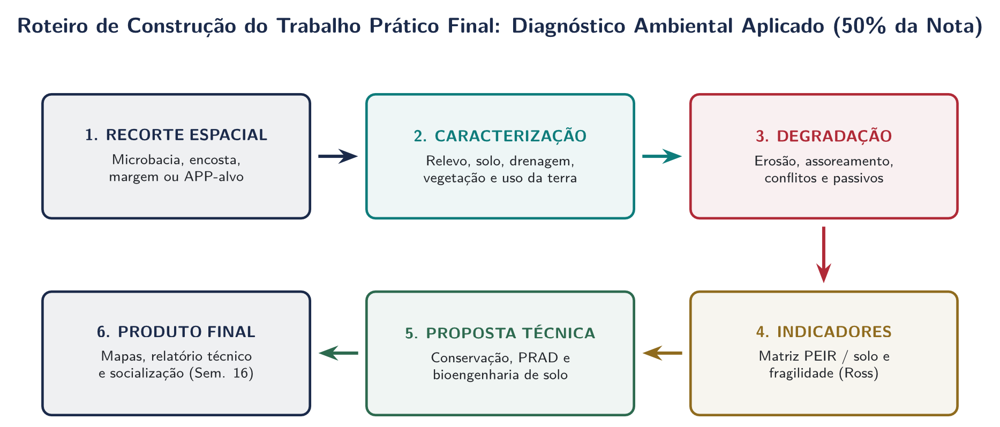
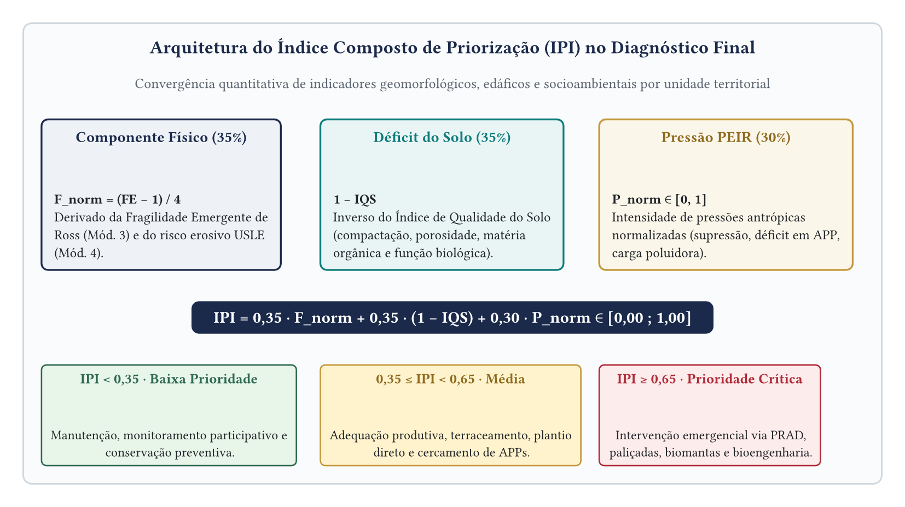

## [Abertura]{.pitch-tag} Visão Geral da Aula {.smaller-text .lesson-slide}

::: {.pitch-grid-55}
::: {.pitch-milestones}
::: {.pitch-milestone-item}
**01 · Termo de Referência (TR):** estrutura obrigatória do Relatório Técnico Final de Análise Ambiental.
:::

::: {.pitch-milestone-item}
**02 · Rito de Defesa:** Seminário de Defesa Técnica em formato de Câmara Técnica / INEMA / CBH.
:::

::: {.pitch-milestone-item}
**03 · Rubrica de Avaliação:** critérios de excelência do Relatório Escrito ($25\%$) e da Defesa Oral ($20\%$).
:::

::: {.pitch-milestone-item}
**04 · Síntese das 16 Semanas:** a Caixa de Ferramentas do Geógrafo Analista Ambiental.
:::

::: {.pitch-milestone-item}
**05 · Ética e Carreira:** Responsabilidade Técnica (CREA/ART) e perspectivas de atuação profissional.
:::
:::

::: {.pitch-stack-2}
::: {.pitch-card .pitch-card--gold}
[Objetivo da Aula]{.pitch-card-index}
[Defesa técnica e síntese formativa]{.pitch-heading}

Conduzir a defesa pública dos **Diagnósticos e Planos de Intervenção Ambiental** elaborados pelas equipes ao longo da Unidade III e consolidar a síntese profissional das competências do Bacharel em Geografia na área de Análise e Planejamento Ambiental.
:::

::: {.pitch-pill-row}
[Relatório 25%]{.pitch-pill}
[Defesa Oral 20%]{.pitch-pill .pitch-pill--gold}
[Matriz FPEIR & IPI]{.pitch-pill}
[CREA / ART]{.pitch-pill .pitch-pill--gold}
:::
:::
:::

# 1 · Estrutura do Trabalho Prático Final {.section-header rotulo="Termo de Ref."}

## [Termo de Ref.]{.pitch-tag} Seções Obrigatórias do Documento Técnico {.smaller-text .lesson-slide}

::: {.pitch-cards-2}
::: {.pitch-card}
[01 · Identificação e Escopo]{.pitch-card-index}
[Recorte territorial]{.pitch-heading}

Título, localização da sub-bacia ou gleba estudada (mapa de localização em **SIRGAS 2000**), justificativa e objetivos.
:::

::: {.pitch-card .pitch-card--teal}
[02 · Diagnóstico Integrado]{.pitch-card-index}
[Meios Físico, Biótico e Socioeconômico]{.pitch-heading}

- **Físico:** geologia, geomorfologia/declividade, morfometria ($K_c, K_f, D_d$), clima e solos (SiBCS / topossequência).
- **Biótico e Uso:** fitofisionomia, MapBiomas e situação legal de APPs/RL (Lei 12.651/2012).
- **Socioeconômico:** usos da água, conflitos territoriais e pressões antrópicas.
:::

::: {.pitch-card .pitch-card--gold}
[03 · Fragilidade e FPEIR]{.pitch-card-index}
[Avaliação integrada]{.pitch-heading}

Classificação da **Fragilidade Emergente (Ross, 1994)** ou **Vulnerabilidade Natural (Crepani, 2001)**, Capacidade de Uso (Lepsch, 2015) e indicadores de água/solo.
:::

::: {.pitch-card .pitch-card--forest}
[04 · Zoneamento e Intervenção]{.pitch-card-index}
[Proposta de PRAD / SbN]{.pitch-heading}

Medidas preventivas, mitigadoras, de bioengenharia e de restauração ecológica espacializadas, com matriz de indicadores de monitoramento.
:::
:::

## [Termo de Ref.]{.pitch-tag} Fluxo Metodológico do Trabalho Prático Final {.smaller-text .lesson-slide}

::: {.pitch-media-card .pitch-media-card--tall}

[Roteiro de Construção do Trabalho Prático Final (50% da Nota)]{.pitch-caption}
[Encadeamento do recorte espacial, caracterização, degradação, indicadores e proposta técnica até a entrega final]{.pitch-caption-sub}
:::

## [Cartografia]{.pitch-tag .pitch-tag--teal} Produtos Cartográficos e Técnicos Exigidos {.smaller-text .lesson-slide}

::: {.pitch-flow-4}
::: {.pitch-card}
[Carta 1]{.pitch-card-index}
[Base Física e Drenagem]{.pitch-heading}

Mapa de Localização, Hipsometria e Rede de Drenagem hierarquizada (**Strahler**).
:::

::: {.pitch-card .pitch-card--gold}
[Carta 2]{.pitch-card-index}
[Declividade e Uso]{.pitch-heading}

Mapa de Declividade (classes de Ross: $<6\%$ a $>30\%$) e Uso/Cobertura da Terra.
:::

::: {.pitch-card .pitch-card--teal}
[Carta 3 · Síntese]{.pitch-card-index}
[Fragilidade e APP]{.pitch-heading}

Carta de Fragilidade Ambiental Emergente ou Zoneamento de Intervenção/Conflito Legal em APP.
:::

::: {.pitch-card .pitch-card--forest}
[Anexo de Campo]{.pitch-card-index}
[Evidências in situ]{.pitch-heading}

Fichas de Diagnóstico Rápido preenchidas nas estações amostrais + Prancha Fotográfica comentada.
:::
:::

::: {.pitch-band .pitch-band--navy}
Todos os produtos cartográficos devem observar convenções completas: grade de coordenadas, legenda hierarquizada, escala gráfica, orientação norte, fonte oficial e datum **SIRGAS 2000**.
:::

## [Priorização]{.pitch-tag .pitch-tag--gold} Índice Composto de Priorização (IPI) no Diagnóstico Final {.smaller-text .lesson-slide}

::: {.pitch-media-card .pitch-media-card--tall}

[Arquitetura do Índice Composto de Priorização (IPI)]{.pitch-caption}
[Convergência quantitativa entre Fragilidade Emergente (Ross), Déficit do Solo (1 − IQS) e Pressão PEIR]{.pitch-caption-sub}
:::

# 2 · Rito de Defesa e Rubrica de Avaliação {.section-header rotulo="Defesa"}

## [Defesa]{.pitch-tag .pitch-tag--gold} Formato de "Câmara Técnica / Audiência" {.smaller-text .lesson-slide}

::: {.pitch-cards-2}
::: {.pitch-card .pitch-card--gold}
[Cronômetro da sessão]{.pitch-card-index}
[Tempo por equipe]{.pitch-heading}

- **$15\text{ minutos}$** de exposição técnica objetiva (todos os integrantes devem apresentar ao menos uma etapa do estudo);
- **$5\text{ a }10\text{ minutos}$** de arguição pela banca (docente + colegas atuando como analistas do órgão ambiental / comitê de bacia).
:::

::: {.pitch-card .pitch-card--teal}
[Diretriz de apresentação]{.pitch-card-index}
[Foco da exposição]{.pitch-heading}

- Evitar longas introduções teóricas gerais;
- Ir direto à **caracterização da área, às evidências de campo, à cadeia causal dos impactos diagnosticados (FPEIR) e à viabilidade técnica/legal das soluções propostas**.
:::
:::

## [Avaliação]{.pitch-tag .pitch-tag--gold} Rubrica de Avaliação do Trabalho Final {.smaller-text .lesson-slide}

::: {.pitch-table-box}
| Dimensão Avaliada | Peso | Critérios de Excelência |
|-------------------|:----:|-------------------------|
| **1. Rigor do Diagnóstico Integrado e Cartografia** | **$30\%$** | Integração real entre relevo, solo, hidrologia e uso da terra; mapas com convenções cartográficas completas (grade, legenda, escala, norte, fonte e datum SIRGAS 2000). |
| **2. Coerência dos Indicadores e Enquadramento Legal** | **$25\%$** | Aplicação correta da matriz FPEIR, das classes de Ross/Crepani/Lepsch e das normas (Lei 12.651/2012, CONAMA 357/2005, IN IBAMA 14/2024). |
| **3. Qualidade Técnica da Proposta (PRAD / SbN)** | **$25\%$** | Especificidade das técnicas de bioengenharia e restauração recomendadas para cada compartimento da vertente/canal (sem "receitas genéricas"). |
| **4. Clareza, Postura Técnica e Resposta à Arguição** | **$20\%$** | Domínio oral, precisão terminológica, cumprimento do tempo e capacidade de sustentar tecnicamente as recomendações. |
:::

# 3 · Síntese Geral da Disciplina {.section-header rotulo="Síntese"}

## [Síntese]{.pitch-tag .pitch-tag--forest} A Caixa de Ferramentas do Geógrafo Analista Ambiental {.smaller-text .lesson-slide}

::: {.pitch-cards}
::: {.pitch-card}
[Unidade I · Aulas 1.1 a 5.1]{.pitch-card-index}
[Fundamentos, Conceitos e Licenciamento]{.pitch-heading}

- **Epistemologia Sociedade$\leftrightarrow$Natureza:** Santos, Porto-Gonçalves, Leff, Ab'Sáber, Monteiro, Mendonça e Suertegaray.
- **Impacto, Resiliência e Risco:** equação $R = P \times E \times V$ e setorização R1–R4.
- **Marco Legal:** PNMA (Lei 6.938/81) e rito de AIA/EIA-RIMA.
:::

::: {.pitch-card .pitch-card--gold}
[Unidade II · Aulas 6.1 a 10.1]{.pitch-card-index}
[Análise Integrada, Bacias e Geossistemas]{.pitch-heading}

- **Escalas e Ordenamento:** compatibilidade de escalas (Castro, 1995) e ZEE (Dec. 4.297/02).
- **Bacias e Vertentes:** morfometria, Lei das Águas (Lei 9.433/97) e morfopedologia (Boulet, RUSLE, movimentos de massa).
- **Síntese:** Ecodinâmica (Tricart), Fragilidade (Ross) e Vulnerabilidade (Crepani).
:::

::: {.pitch-card .pitch-card--teal}
[Unidade III · Aulas 11.1 a 16.1]{.pitch-card-index}
[Indicadores, Degradação e Legislação]{.pitch-heading}

- **Monitoramento e Solos:** Matriz FPEIR, IQA, IET, CONAMA 357/05, SiBCS, Capacidade de Uso (I–VIII) e CONAMA 420/09.
- **Processos e Técnicas:** mecanística de voçorocas, pinos/VANT e SbN/Bioengenharia.
- **Normas:** Código Florestal, SNUC, PNPSA e PRAD (IN IBAMA 14/2024).
:::
:::

::: {.pitch-band .pitch-band--navy}
**Percurso das 16 semanas:** articular fundamentos epistemológicos, modelagem biofísica multiescalar e engenharia normativa para produzir diagnósticos ambientais auditáveis e socialmente justos.
:::

## [Ética e CREA]{.pitch-tag .pitch-tag--alert} Ética Profissional, CREA/ART e Caminhos de Atuação {.smaller-text .lesson-slide}

::: {.pitch-grid-50}
::: {.pitch-stack-2}
::: {.pitch-card}
[Leis nº 6.664/1979 e nº 6.496/1977]{.pitch-card-index}
[Rigor científico e independência técnica]{.pitch-heading}

Um parecer ambiental, EIA/RIMA ou laudo pericial assinado por um Geógrafo (com recolhimento de **ART junto ao CREA**) decide sobre a segurança hídrica, a estabilidade de encostas e os direitos territoriais de populações inteiras.
:::

::: {.pitch-card .pitch-card--alert}
[Art. 69-A da Lei nº 9.605/1998]{.pitch-card-index}
[Jamais omitir impactos ou riscos]{.pitch-heading}

A omissão dolosa ou culposa de informações relevantes em estudos de licenciamento configura crime ambiental: elaborar ou apresentar estudo, laudo ou relatório ambiental total ou parcialmente falso ou enganoso.
:::
:::

::: {.pitch-card .pitch-card--gold}
[Mensagem Final de Encerramento]{.pitch-card-index}
[O olhar integrador da Geografia]{.pitch-heading}

A **Geografia** é uma das poucas ciências capazes de ler simultaneamente a **estrutura mineral da rocha**, a **hidrodinâmica do poro do solo**, a **morfometria da bacia hidrográfica** e as **relações sociais de poder no território**.

Levem essa capacidade de síntese integrada para a pesquisa, para o serviço público e para o planejamento ambiental do Brasil e da Bahia!
:::
:::
