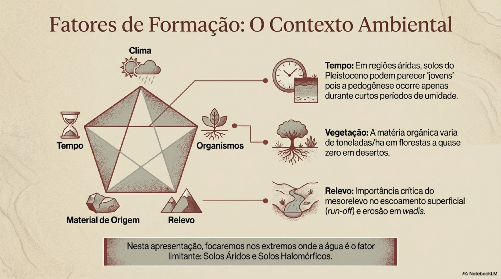
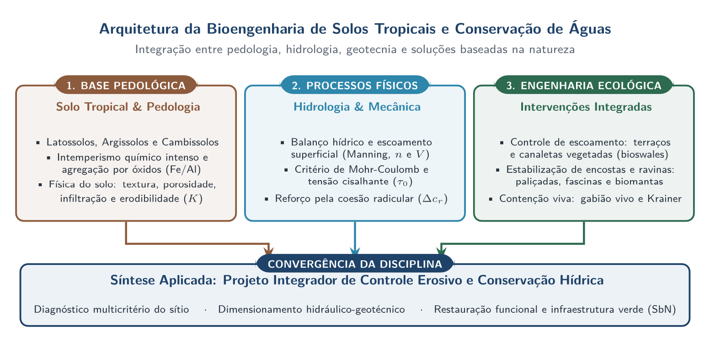

## [Abertura]{.pitch-tag} Aula 01 · Do solo tropical ao projeto biotécnico {.smaller-text .lesson-slide}

::: {.pitch-grid-55}
::: {.pitch-card}
[Objetivos da aula]{.pitch-card-index}
[Ao final da aula, você deverá:]{.pitch-heading}

- [1]{.circle} Relacionar clima, relevo, material de origem, organismos e tempo ao perfil do solo.
- [2]{.circle} Distinguir proteção contra erosão superficial de estabilização de uma massa de solo.
- [3]{.circle} Selecionar plantas e materiais auxiliares a partir do diagnóstico do local.
:::

::: {.pitch-stack-2}
::: {.pitch-card .pitch-card--gold}
[Problema disparador]{.pitch-card-index}
[Pergunta de partida]{.pitch-heading}

Por que a mesma técnica pode funcionar em uma margem úmida e falhar em uma encosta do Semiárido?
:::

::: {.pitch-pill-row}
[Pedogênese]{.pitch-pill}
[Proteção vs. Estabilidade]{.pitch-pill .pitch-pill--gold}
[Seleção vegetal]{.pitch-pill}
:::
:::
:::

# 1 · Formação do solo e condições de intervenção {.section-header rotulo="Formação"}

## [Formação]{.pitch-tag} Fatores de formação: interpretar o perfil observado {.smaller-text .lesson-slide}

::: {.pitch-grid-50}
::: {.pitch-stack-2}
::: {.pitch-formula}
$$S=f(cl,o,r,p,t)$$
:::

::: {.pitch-card}
[Equação de Jenny]{.pitch-card-index}
[Variáveis de formação]{.pitch-heading}

- **Clima ($cl$):** chuva, evapotranspiração e duração do período seco.
- **Organismos ($o$):** raízes, matéria orgânica e agregação.
- **Relevo ($r$):** declividade e convergência de água.
- **Material de origem ($p$):** minerais, textura e fraturas.
- **Tempo ($t$):** evolução do manto e das descontinuidades.
:::

::: {.pitch-band}
A classe de solo orienta a investigação; a decisão exige observar e medir o perfil.
:::
:::

::: {.pitch-media-card}

[Fatores de formação na paisagem]{.pitch-caption}
[Contexto ambiental e resposta pedogenética]{.pitch-caption-sub}
:::
:::

## [Formação]{.pitch-tag .pitch-tag--teal} Trópico úmido e Semiárido: contrastes para o projeto {.smaller-text .lesson-slide}

::: {.pitch-table-box}

| Condição | Processo a investigar | Consequência para a intervenção |
|---|---|---|
| Períodos úmidos prolongados | Saturação, fluxo lateral e perda de sucção | Drenagem e estabilidade do talude |
| Chuvas intensas após seca | Selamento, enxurrada e baixa cobertura | Proteção imediata e controle da água de montante |
| Déficit hídrico sazonal | Mortalidade e crescimento lento | Época de plantio e manutenção inicial |
| Horizonte pouco permeável | Acúmulo temporário de água | Investigar infiltração e destino da drenagem |

:::

::: {.pitch-band .pitch-band--navy}
Há diversidade de solos em ambos os ambientes. Evite atribuir uma propriedade geotécnica apenas ao clima ou à latitude.
:::

## [Formação]{.pitch-tag} Da superfície ao saprolito {.smaller-text .lesson-slide}

::: {.pitch-flow-4}
::: {.pitch-card .pitch-card--forest}
[Horizonte A/O]{.pitch-card-index}
[Camada superficial]{.pitch-heading}

Material superficial, raízes e atividade biológica; conservar o horizonte fértil para revegetação quando apropriado.
:::

::: {.pitch-card .pitch-card--gold}
[Horizonte B]{.pitch-card-index}
[Zona subsuperficial]{.pitch-heading}

Estrutura, argila, cimentações e possíveis impedimentos à água ou às raízes.
:::

::: {.pitch-card .pitch-card--teal}
[Horizontes C/Cr]{.pitch-card-index}
[Saprolito]{.pitch-heading}

Material de alteração que pode manter fraturas e estruturas da rocha.
:::

::: {.pitch-card}
[Camada R]{.pitch-card-index}
[Rocha]{.pitch-heading}

Rocha; a circulação de água depende também das descontinuidades.
:::
:::

::: {.pitch-band}
**Investigue:** profundidade efetiva, nascentes, trincas, camadas contrastantes e sinais de erosão interna. Um contato entre horizontes é uma hipótese de descontinuidade, cuja função hidráulica precisa ser confirmada.
:::

# 2 · Funções e limites da bioengenharia {.section-header rotulo="Funções"}

## [Funções]{.pitch-tag .pitch-tag--forest} Plantas como componentes de engenharia {.smaller-text .lesson-slide}

::: {.pitch-band}
A bioengenharia de água e solo combina vegetação viva e, quando necessário, madeira, rochas, fibras e outros elementos auxiliares.
:::

::: {.pitch-table-box}

| Função | Mecanismo | O que observar |
|---|---|---|
| Proteção superficial | Cobertura e rugosidade | Solo exposto e formação de sulcos |
| Reforço mecânico | Raízes cruzando uma zona de deformação | Distribuição, resistência e ancoragem |
| Regulação hídrica | Interceptação e evapotranspiração | Umidade, sazonalidade e nível d'água |
| Recuperação ecológica | Aporte orgânico e sucessão | Sobrevivência, diversidade e regeneração |

:::

::: {.pitch-band .pitch-band--teal}
Base conceitual: Gray & Sotir (1996), Durlo & Sutili (2014) e USDA-NRCS.
:::

## [Funções]{.pitch-tag} Efeitos favoráveis e efeitos que exigem verificação {.smaller-text .lesson-slide}

::: {.pitch-grid-50}
::: {.pitch-card .pitch-card--forest}
[Potencial biotécnico]{.pitch-card-index}
[Contribuições possíveis]{.pitch-heading}

- Redução do impacto das gotas.
- Aumento da resistência do solo com raízes.
- Retenção de sedimentos e criação de microsítios.
- Recuperação de cobertura e atividade biológica.
:::

::: {.pitch-card .pitch-card--alert}
[Critérios de verificação]{.pitch-card-index}
[Condições a verificar]{.pitch-heading}

- O reforço depende da profundidade alcançada pelas raízes.
- A infiltração pode aumentar o aporte de água a uma camada restritiva.
- Árvores acrescentam peso e podem transmitir esforços pelo vento.
- Plantas não substituem a análise de ruptura profunda ou de solapamento.
:::
:::

## [Funções]{.pitch-tag .pitch-tag--gold} O desempenho muda ao longo do tempo {.smaller-text .lesson-slide}

::: {.pitch-table-box}

| Fase | Principal condição de projeto | Evidência de acompanhamento |
|---|---|---|
| Implantação | Solo ainda exposto e raízes pouco desenvolvidas | Fixações, cobertura provisória e drenagem |
| Estabelecimento | Crescimento desigual e mortalidade possível | Pegamento, raízes e reparos |
| Consolidação | Vegetação mais desenvolvida e materiais envelhecidos | Estabilidade, sucessão e integridade das estruturas |

:::

::: {.pitch-band .pitch-band--navy}
Não adote prazos fixos de transferência de carga. A velocidade de estabelecimento e a durabilidade dos materiais dependem da espécie, do clima e da manutenção.
:::

# 3 · Diagnóstico e seleção de espécies {.section-header rotulo="Espécies"}

## [Diagnóstico]{.pitch-tag .pitch-tag--alert} Salinidade e sodicidade: recorte necessário ao projeto {.smaller-text .lesson-slide}

::: {.pitch-cards-2}
::: {.pitch-card .pitch-card--gold}
[Restrição osmótica]{.pitch-card-index}
[Salinidade]{.pitch-heading}

Sais solúveis podem limitar a absorção de água pelas plantas.
:::

::: {.pitch-card .pitch-card--alert}
[Risco estrutural]{.pitch-card-index}
[Sodicidade]{.pitch-heading}

Sódio trocável, associado à composição da solução, pode favorecer dispersão e reduzir a infiltração.
:::

::: {.pitch-card .pitch-card--teal}
[Diagnóstico]{.pitch-card-index}
[Parâmetros de análise]{.pitch-heading}

Condutividade elétrica do extrato de saturação, PST, qualidade da água, drenagem e resposta da espécie.
:::

::: {.pitch-card}
[Conduta]{.pitch-card-index}
[Decisão técnica]{.pitch-heading}

Testar necessidade de correção, drenagem e lavagem com base em análise. A gessagem requer dimensionamento e destino para a água percolada.
:::
:::

::: {.pitch-band}
O detalhamento de solos salinos e sódicos da versão original permanece em material complementar de Pedologia.
:::

## [Seleção]{.pitch-tag .pitch-tag--forest} Como selecionar o material vegetal {.smaller-text .lesson-slide}

::: {.pitch-milestones}
::: {.pitch-milestone-item}
**1 · Ocorrência e ambiente:** identifique a região de ocorrência e as exigências de água, luz e substrato.
:::
::: {.pitch-milestone-item}
**2 · Função biotécnica:** defina a função: cobertura, barreira, estaquia, ancoragem ou recuperação ciliar.
:::
::: {.pitch-milestone-item}
**3 · Desempenho local:** verifique propagação, sobrevivência e crescimento nas condições locais.
:::
::: {.pitch-milestone-item}
**4 · Critério ecológico:** prefira espécies nativas adequadas ao ambiente; avalie restrições e potencial invasor das demais.
:::
::: {.pitch-milestone-item}
**5 · Especificação operacional:** especifique procedência, época de coleta, plantio, irrigação inicial e reposição.
:::
:::

::: {.pitch-band .pitch-band--navy}
**Uma planta citada em um manual de outra região não é uma recomendação automática para a Bahia.**
:::

## [Espécies]{.pitch-tag .pitch-tag--forest} Espécies: exemplos para investigar, por função {.smaller-text .lesson-slide}

::: {.pitch-table-box}

| Grupo ou espécie | Possível função | Verificação necessária |
|---|---|---|
| Gramíneas de cobertura, como *Paspalum notatum* | Revestimento superficial | Adaptação, cobertura e resistência hidráulica |
| *Salix humboldtiana* | Estaquia em ambientes ripários | Ocorrência local, propagação e regime de inundação |
| *Phyllanthus sellowianus* | Proteção biotécnica em contextos regionais apropriados | Adequação climática e disponibilidade |
| *Chrysopogon zizanioides* (vetiver) | Barreiras e proteção de taludes | Material de propagação, comportamento e contexto ecológico |
| Arbustos e árvores nativos locais | Recuperação e estrutura radicular | Sobrevivência, arquitetura e compatibilidade com a obra |

:::

::: {.pitch-band}
Resistência à tração e profundidade radicular precisam de fonte específica ou ensaio; não são constantes universais da espécie.
:::

# 4 · Aplicação e monitoramento {.section-header rotulo="Aplicação"}

## [Diagnóstico]{.pitch-tag} Diagnóstico antes da escolha da técnica {.smaller-text .lesson-slide}

::: {.pitch-table-box}

| Evidência | Pergunta de projeto | Encaminhamento |
|---|---|---|
| Sulcos após chuvas | De onde vem a enxurrada? | Cobertura e controle da área contribuinte |
| Base erodida de margem | Há solapamento? | Proteção da base e avaliação hidráulica |
| Água emergindo em talude | Há fluxo subsuperficial? | Investigar poropressão e drenagem filtrada |
| Solo compactado e baixa cobertura | Há restrição ao enraizamento? | Diagnóstico físico e manejo localizado |
| Trincas e deslocamento | Há movimento de massa? | Análise geotécnica e definição de solução integrada |

:::

## [Monitoramento]{.pitch-tag .pitch-tag--teal} Como demonstrar desempenho {.smaller-text .lesson-slide}

::: {.pitch-grid-55}
::: {.pitch-card}
[Protocolo de acompanhamento]{.pitch-card-index}
[Indicadores de campo]{.pitch-heading}

- Registre a condição inicial e pontos fixos de medição.
- Meça sobrevivência e cobertura vegetal por método repetível.
- Acompanhe geometria, recuo de margens, sulcos e sedimento retido.
- Relacione cada campanha às chuvas e às intervenções de manutenção.
- Compare com área de referência ou controle quando viável.
:::

::: {.pitch-card .pitch-card--gold}
[Aplicação em sala]{.pitch-card-index}
[Atividade]{.pitch-heading}

Para uma encosta do Semiárido e uma margem sazonalmente inundada, proponha uma técnica, três medições e a principal condição capaz de provocar falha.
:::
:::

## [Síntese]{.pitch-tag .pitch-tag--forest} Arquitetura da disciplina: da pedologia ao projeto {.smaller-text .lesson-slide}

::: {.pitch-media-card .pitch-media-card--wide}

[Arquitetura da Bioengenharia de Solos Tropicais e Conservação de Águas]{.pitch-caption}
[Integração entre base pedológica, processos físicos e engenharia ecológica rumo ao projeto integrador]{.pitch-caption-sub}
:::

## [Referências]{.pitch-tag} Leituras e fontes técnicas {.smaller-text .lesson-slide}

::: {.pitch-cards}
::: {.pitch-card}
[Referência internacional]{.pitch-card-index}
[USDA-NRCS (2007)]{.pitch-heading}

[NEH 654, suplemento 14I: Streambank Soil Bioengineering](https://directives.nrcs.usda.gov/sites/default/files2/1720623369/Technical%20Supplement%2014%20I%20-%20Streambank%20Soil%20Bioengineering.pdf)
:::

::: {.pitch-card .pitch-card--forest}
[Referência nacional]{.pitch-card-index}
[UFSM · LABEN]{.pitch-heading}

[Laboratório de Engenharia Natural: bases e aplicações](https://www.ufsm.br/laboratorios/laben/informacoes-gerais)
:::

::: {.pitch-card .pitch-card--teal}
[Experiência regional]{.pitch-card-index}
[UFS · Campus Rural]{.pitch-heading}

[Experiência de conservação de água e solo no Campus Rural](https://www.ufs.br/conteudo/72187-laboratorio-promove-acao-de-conservacao-do-solo-no-campus-rural-da-ufs)
:::
:::

## [Roteiro]{.pitch-tag .pitch-tag--gold} Conexão com as próximas aulas {.smaller-text .lesson-slide}

::: {.pitch-milestones}
::: {.pitch-milestone-item}
**Aula 02:** intemperismo e descontinuidades do perfil.
:::
::: {.pitch-milestone-item}
**Aula 03:** física, qualidade e mecânica do solo.
:::
::: {.pitch-milestone-item}
**Aula 09:** geometria e ensaios do sistema radicular.
:::
::: {.pitch-milestone-item}
**Aulas 10–20:** escolha, dimensionamento e implantação de técnicas.
:::
::: {.pitch-milestone-item}
**Aula 21:** integração do diagnóstico, dos cálculos e do monitoramento.
:::
:::
