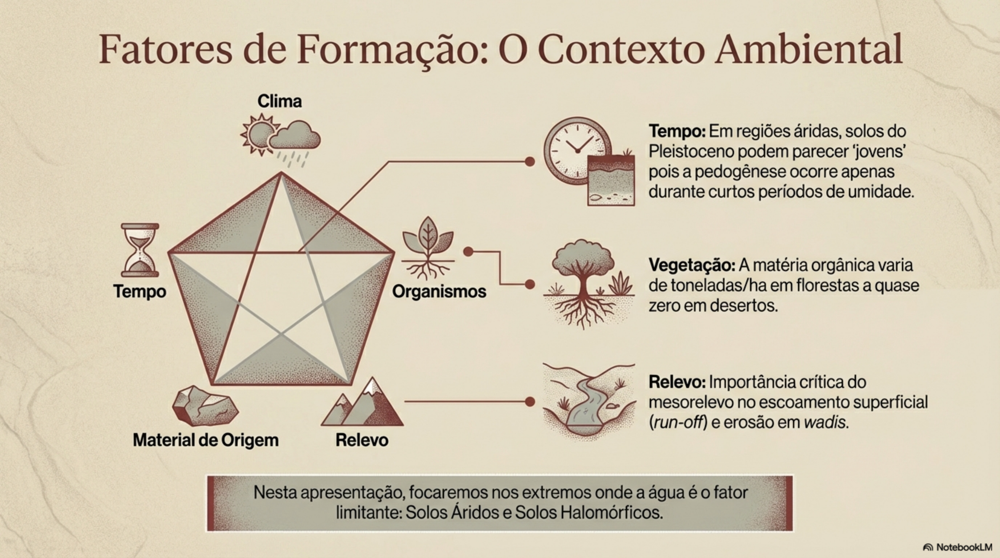

## Aula 01 · Do solo tropical ao projeto biotécnico {.smaller-text}

Ao final da aula, você deverá:

1. Relacionar clima, relevo, material de origem, organismos e tempo ao perfil do solo.
2. Distinguir proteção contra erosão superficial de estabilização de uma massa de solo.
3. Selecionar plantas e materiais auxiliares a partir do diagnóstico do local.

**Pergunta de partida:** por que a mesma técnica pode funcionar em uma margem úmida e falhar em uma encosta do Semiárido?

# 1 · Formação do solo e condições de intervenção

## Fatores de formação: interpretar o perfil observado {.smaller-text}

:::: {.columns}
::: {.column width="50%"}

$$S=f(cl,o,r,p,t)$$

- **Clima:** chuva, evapotranspiração e duração do período seco.
- **Organismos:** raízes, matéria orgânica e agregação.
- **Relevo:** declividade e convergência de água.
- **Material de origem:** minerais, textura e fraturas.
- **Tempo:** evolução do manto e das descontinuidades.

A classe de solo orienta a investigação; a decisão exige observar e medir o perfil.

:::
::: {.column width="50%"}

{fig-align="center" width="90%"}

:::
::::

## Trópico úmido e Semiárido: contrastes para o projeto {.smaller-text}

| Condição | Processo a investigar | Consequência para a intervenção |
|---|---|---|
| Períodos úmidos prolongados | Saturação, fluxo lateral e perda de sucção | Drenagem e estabilidade do talude |
| Chuvas intensas após seca | Selamento, enxurrada e baixa cobertura | Proteção imediata e controle da água de montante |
| Déficit hídrico sazonal | Mortalidade e crescimento lento | Época de plantio e manutenção inicial |
| Horizonte pouco permeável | Acúmulo temporário de água | Investigar infiltração e destino da drenagem |

Há diversidade de solos em ambos os ambientes. Evite atribuir uma propriedade geotécnica apenas ao clima ou à latitude.

## Da superfície ao saprolito {.smaller-text}

- **A/O:** material superficial, raízes e atividade biológica; conservar o horizonte fértil para revegetação quando apropriado.
- **B:** estrutura, argila, cimentações e possíveis impedimentos à água ou às raízes.
- **C/Cr:** material de alteração que pode manter fraturas e estruturas da rocha.
- **R:** rocha; a circulação de água depende também das descontinuidades.

**Investigue:** profundidade efetiva, nascentes, trincas, camadas contrastantes e sinais de erosão interna. Um contato entre horizontes é uma hipótese de descontinuidade, cuja função hidráulica precisa ser confirmada.

# 2 · Funções e limites da bioengenharia

## Plantas como componentes de engenharia {.smaller-text}

A bioengenharia de água e solo combina vegetação viva e, quando necessário, madeira, rochas, fibras e outros elementos auxiliares.

| Função | Mecanismo | O que observar |
|---|---|---|
| Proteção superficial | Cobertura e rugosidade | Solo exposto e formação de sulcos |
| Reforço mecânico | Raízes cruzando uma zona de deformação | Distribuição, resistência e ancoragem |
| Regulação hídrica | Interceptação e evapotranspiração | Umidade, sazonalidade e nível d'água |
| Recuperação ecológica | Aporte orgânico e sucessão | Sobrevivência, diversidade e regeneração |

Base conceitual: Gray & Sotir (1996), Durlo & Sutili (2014) e USDA-NRCS.

## Efeitos favoráveis e efeitos que exigem verificação {.smaller-text}

:::: {.columns}
::: {.column width="50%"}

**Contribuições possíveis**

- Redução do impacto das gotas.
- Aumento da resistência do solo com raízes.
- Retenção de sedimentos e criação de microsítios.
- Recuperação de cobertura e atividade biológica.

:::
::: {.column width="50%"}

**Condições a verificar**

- O reforço depende da profundidade alcançada pelas raízes.
- A infiltração pode aumentar o aporte de água a uma camada restritiva.
- Árvores acrescentam peso e podem transmitir esforços pelo vento.
- Plantas não substituem a análise de ruptura profunda ou de solapamento.

:::
::::

## O desempenho muda ao longo do tempo {.smaller-text}

| Fase | Principal condição de projeto | Evidência de acompanhamento |
|---|---|---|
| Implantação | Solo ainda exposto e raízes pouco desenvolvidas | Fixações, cobertura provisória e drenagem |
| Estabelecimento | Crescimento desigual e mortalidade possível | Pegamento, raízes e reparos |
| Consolidação | Vegetação mais desenvolvida e materiais envelhecidos | Estabilidade, sucessão e integridade das estruturas |

Não adote prazos fixos de transferência de carga. A velocidade de estabelecimento e a durabilidade dos materiais dependem da espécie, do clima e da manutenção.

# 3 · Diagnóstico e seleção de espécies

## Salinidade e sodicidade: recorte necessário ao projeto {.smaller-text}

- **Salinidade:** sais solúveis podem limitar a absorção de água pelas plantas.
- **Sodicidade:** sódio trocável, associado à composição da solução, pode favorecer dispersão e reduzir a infiltração.
- **Diagnóstico:** condutividade elétrica do extrato de saturação, PST, qualidade da água, drenagem e resposta da espécie.
- **Conduta:** testar necessidade de correção, drenagem e lavagem com base em análise. A gessagem requer dimensionamento e destino para a água percolada.

O detalhamento de solos salinos e sódicos da versão original permanece em material complementar de Pedologia.

## Como selecionar o material vegetal {.smaller-text}

1. Identifique a região de ocorrência e as exigências de água, luz e substrato.
2. Defina a função: cobertura, barreira, estaquia, ancoragem ou recuperação ciliar.
3. Verifique propagação, sobrevivência e crescimento nas condições locais.
4. Prefira espécies nativas adequadas ao ambiente; avalie restrições e potencial invasor das demais.
5. Especifique procedência, época de coleta, plantio, irrigação inicial e reposição.

**Uma planta citada em um manual de outra região não é uma recomendação automática para a Bahia.**

## Espécies: exemplos para investigar, por função {.smaller-text}

| Grupo ou espécie | Possível função | Verificação necessária |
|---|---|---|
| Gramíneas de cobertura, como *Paspalum notatum* | Revestimento superficial | Adaptação, cobertura e resistência hidráulica |
| *Salix humboldtiana* | Estaquia em ambientes ripários | Ocorrência local, propagação e regime de inundação |
| *Phyllanthus sellowianus* | Proteção biotécnica em contextos regionais apropriados | Adequação climática e disponibilidade |
| *Chrysopogon zizanioides* (vetiver) | Barreiras e proteção de taludes | Material de propagação, comportamento e contexto ecológico |
| Arbustos e árvores nativos locais | Recuperação e estrutura radicular | Sobrevivência, arquitetura e compatibilidade com a obra |

Resistência à tração e profundidade radicular precisam de fonte específica ou ensaio; não são constantes universais da espécie.

# 4 · Aplicação e monitoramento

## Diagnóstico antes da escolha da técnica {.smaller-text}

| Evidência | Pergunta de projeto | Encaminhamento |
|---|---|---|
| Sulcos após chuvas | De onde vem a enxurrada? | Cobertura e controle da área contribuinte |
| Base erodida de margem | Há solapamento? | Proteção da base e avaliação hidráulica |
| Água emergindo em talude | Há fluxo subsuperficial? | Investigar poropressão e drenagem filtrada |
| Solo compactado e baixa cobertura | Há restrição ao enraizamento? | Diagnóstico físico e manejo localizado |
| Trincas e deslocamento | Há movimento de massa? | Análise geotécnica e definição de solução integrada |

## Como demonstrar desempenho {.smaller-text}

- Registre a condição inicial e pontos fixos de medição.
- Meça sobrevivência e cobertura vegetal por método repetível.
- Acompanhe geometria, recuo de margens, sulcos e sedimento retido.
- Relacione cada campanha às chuvas e às intervenções de manutenção.
- Compare com área de referência ou controle quando viável.

**Atividade:** para uma encosta do Semiárido e uma margem sazonalmente inundada, proponha uma técnica, três medições e a principal condição capaz de provocar falha.

## Leituras e fontes técnicas {.smaller-text}

- [USDA-NRCS (2007). NEH 654, suplemento 14I: Streambank Soil Bioengineering](https://directives.nrcs.usda.gov/sites/default/files2/1720623369/Technical%20Supplement%2014%20I%20-%20Streambank%20Soil%20Bioengineering.pdf)
- [UFSM · Laboratório de Engenharia Natural: bases e aplicações](https://www.ufsm.br/laboratorios/laben/informacoes-gerais)
- [UFS · Experiência de conservação de água e solo no Campus Rural](https://www.ufs.br/conteudo/72187-laboratorio-promove-acao-de-conservacao-do-solo-no-campus-rural-da-ufs)

## Conexão com as próximas aulas {.smaller-text}

**Aula 02:** intemperismo e descontinuidades do perfil.

**Aula 03:** física, qualidade e mecânica do solo.

**Aula 09:** geometria e ensaios do sistema radicular.

**Aulas 10–20:** escolha, dimensionamento e implantação de técnicas.

**Aula 21:** integração do diagnóstico, dos cálculos e do monitoramento.
