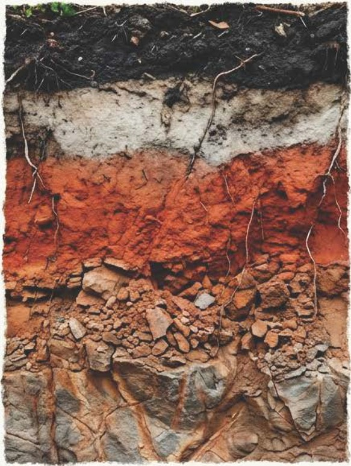
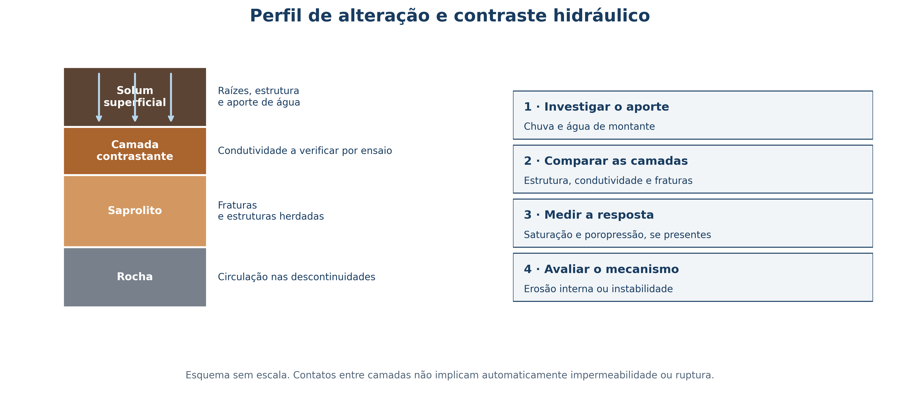
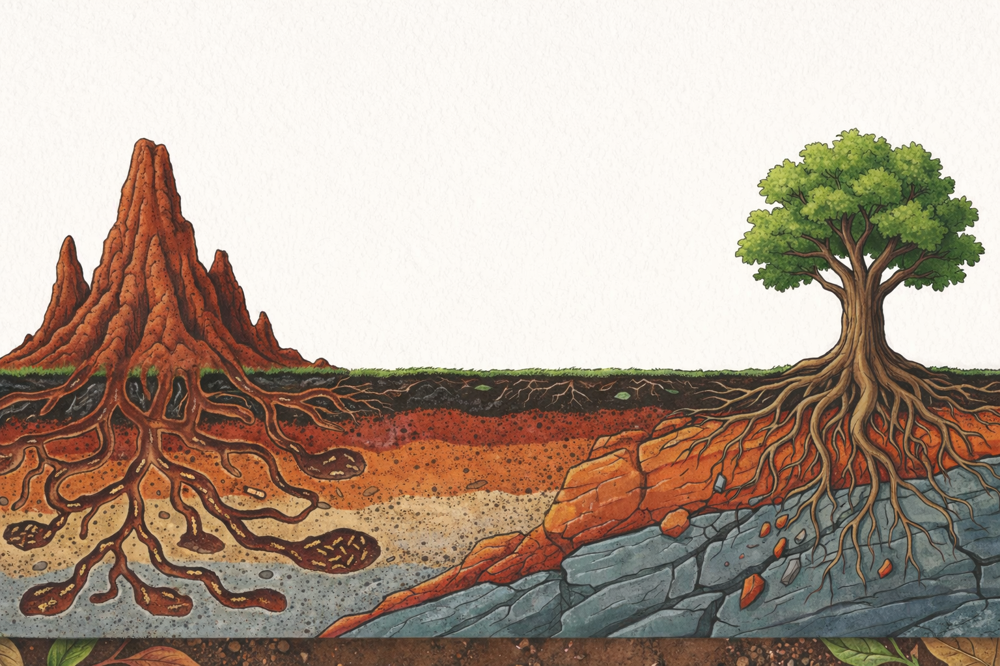
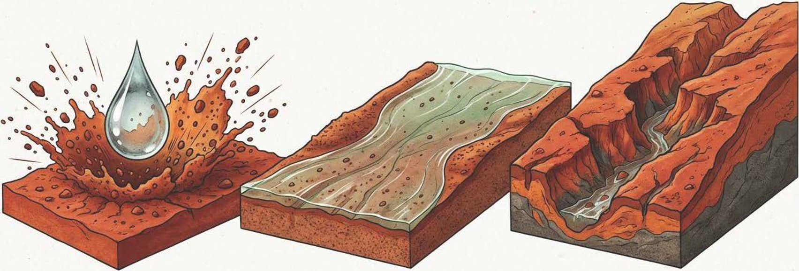
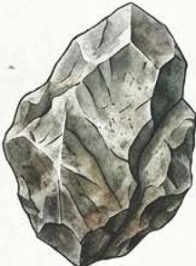
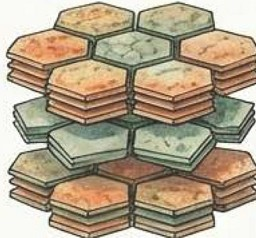
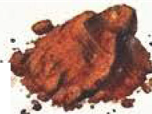
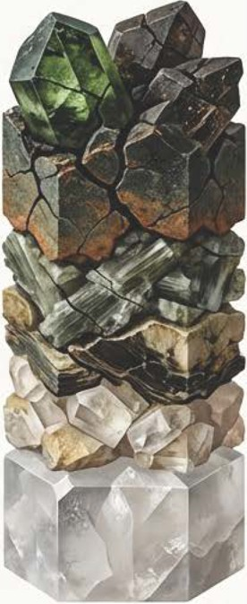

## Aula 02 · Intemperismo tropical e estabilidade {.smaller-text}

**Objetivo:** interpretar como o manto de alteração condiciona a infiltração, a erosão e a estabilidade do terreno.

Ao final, diferencie solum, saprolito e rocha; identifique possíveis contrastes hidráulicos; e proponha uma investigação anterior à obra.

# 1 · Perfil de alteração

## Solo: sólidos, água e ar {.smaller-text}

:::: {.columns}
::: {.column width="50%"}

O volume de solo reúne:

- **Sólidos:** minerais e matéria orgânica.
- **Água:** ocupa parte dos poros e transporta solutos.
- **Ar:** ocupa a porosidade não preenchida por água.

As proporções variam com textura, estrutura, compactação e umidade. A distribuição 50/25/25 é apenas uma representação didática, sem validade como meta universal.

:::
::: {.column width="50%"}

{fig-align="center" width="90%"}

:::
::::

## Da rocha ao solum {.smaller-text}

:::: {.columns}
::: {.column width="50%"}

| Material | Característica a registrar |
|---|---|
| Rocha sã ou pouco alterada | Resistência e descontinuidades |
| Rocha alterada | Fraturas e variação de resistência |
| Saprolito | Alteração com estrutura herdada da rocha |
| Solum | Horizontes transformados pela pedogênese |

A sequência é conceitual: espessuras, transições e presença das camadas variam entre locais.

:::
::: {.column width="50%"}

{fig-align="center" width="90%"}

:::
::::

## Descontinuidades: hipóteses de campo {.smaller-text}

{fig-align="center" width="96%"}

# 2 · Processos de intemperismo

## Vias que atuam em conjunto {.smaller-text}

:::: {.columns}
::: {.column width="50%"}

| Via | Exemplos | Consequência possível |
|---|---|---|
| Física | Fraturamento e ciclos de umedecimento e secagem | Exposição de novas superfícies |
| Química | Hidrólise, dissolução e oxirredução | Transformação dos minerais |
| Biológica | Raízes, organismos e compostos orgânicos | Alteração mineral e agregação |

O clima atua junto ao material de origem, ao relevo e ao tempo.

:::
::: {.column width="50%"}

{fig-align="center" width="90%"}

:::
::::

## Fraturas e alteração esferoidal {.smaller-text}

:::: {.columns}
::: {.column width="50%"}

- Fraturas controlam parte da circulação de água na rocha.
- A alteração química pode avançar pelas bordas dos blocos.
- Matacões podem permanecer em uma matriz já alterada.
- A remoção da matriz por erosão pode reduzir o apoio dos blocos.

**Aplicação:** a presença de blocos e juntas orienta o levantamento geológico e a avaliação da estabilidade de um corte.

:::
::: {.column width="50%"}

{fig-align="center" width="90%"}

:::
::::

## Umedecimento e secagem em materiais expostos {.smaller-text}

:::: {.columns}
::: {.column width="50%"}

- A entrada rápida de água pode desagregar alguns materiais por *slaking*.
- Minerais expansivos podem gerar ciclos de retração e inchamento.
- Exposição, textura, cimentação e confinamento alteram a resposta.

**Conduta:** reconhecer o mecanismo e testar o material. Cobertura superficial reduz exposição, mas não resolve toda instabilidade interna.

:::
::: {.column width="50%"}

{fig-align="center" width="90%"}

:::
::::

# 3 · Mineralogia e comportamento

## Minerais primários e produtos de alteração {.smaller-text}

:::: {.columns}
::: {.column width="50%"}

- Feldspatos e outros silicatos sofrem transformação e liberam elementos para a solução.
- A drenagem e a remoção de sílica e bases influenciam os produtos formados.
- Caulinita e óxidos de Fe/Al são frequentes em solos muito intemperizados.
- Minerais 2:1 podem ser preservados ou formados em outros contextos.

A mineralogia não pode ser deduzida apenas da zona climática.

:::
::: {.column width="50%"}

{fig-align="center" width="90%"}

:::
::::

## Argilas 1:1, argilas 2:1 e óxidos {.smaller-text}

| Constituinte | Tendência relevante | Cuidado de interpretação |
|---|---|---|
| Caulinita (1:1) | Menor expansão entre camadas | Estrutura e compactação também controlam o fluxo |
| Esmectitas (2:1) | Potencial de expansão e retração | Depende de composição, água e confinamento |
| Outros minerais 2:1 | Comportamento variável | Nem todo mineral 2:1 é fortemente expansivo |
| Óxidos de ferro e alumínio | Podem contribuir para cimentação e agregação | Não garantem estabilidade de taludes |

Confirme mineralogia e atividade quando a decisão de engenharia depender delas.

## Ler a estrutura, além da mineralogia {.smaller-text}

:::: {.columns}
::: {.column width="50%"}

{fig-align="center" width="90%"}

:::
::: {.column width="50%"}

{fig-align="center" width="90%"}

:::
::::

# 4 · Água, erosão e ruptura

## Contraste de condutividade hidráulica {.smaller-text}

1. A chuva e a água de montante fornecem o aporte.
2. Uma camada pode transmitir água mais lentamente que a sobrejacente.
3. Se o aporte superar a drenagem, pode ocorrer saturação temporária e fluxo lateral.
4. A elevação da poropressão pode reduzir a tensão efetiva:

$$sigma'=sigma-u$$

**Verifique:** condutividade por camada, piezometria, caminhos preferenciais e duração da saturação. Um horizonte Bt não é automaticamente impermeável.

## Erosão interna e exfiltração {.smaller-text}

:::: {.columns}
::: {.column width="50%"}

- A água que emerge no talude pode mobilizar partículas.
- Gradiente hidráulico, granulometria, dispersividade e ausência de filtro influenciam o processo.
- Túneis, abatimentos e surgências turvas são sinais para investigação.
- Saprolito exposto pode ser vulnerável, mas não é sinônimo de *piping*.

**Projeto:** controlar a origem da água e especificar coleta e saída filtrada sem transferir erosão a jusante.

:::
::: {.column width="50%"}

{fig-align="center" width="90%"}

:::
::::

## Roteiro de investigação no perfil {.smaller-text}

| Registro | Método possível | Decisão que informa |
|---|---|---|
| Camadas e fraturas | Descrição, sondagem e fotografias com escala | Geometria do modelo |
| Infiltração e condutividade | Ensaios e observações em diferentes camadas | Partição e circulação da água |
| Nível d'água | Piezômetros e campanhas sazonais | Pressões consideradas no cálculo |
| Resistência | Ensaios adequados ao solo e à condição hídrica | Estabilidade |
| Dispersão e erosão interna | Ensaios e inspeção de surgências | Filtros, drenos e proteção |

## Atividade · Escolher a investigação {.smaller-text}

Um corte apresenta horizonte superficial arenoso, camada argilosa, saprolito fraturado e surgência após chuva.

1. Desenhe dois caminhos possíveis para a água.
2. Indique três observações que distinguem essas hipóteses.
3. Explique por que instalar apenas biomanta pode ser insuficiente.
4. Proponha monitoramento anterior e posterior à intervenção.

**Entrega:** croqui, hipótese de processo e plano de medições; não atribua parâmetros de resistência apenas pela cor ou pela classe do solo.

## Leituras e fontes técnicas {.smaller-text}

- [Embrapa (2017). Manual de métodos de análise de solo, 3ª edição](https://www.embrapa.br/web/solos/busca-de-publicacoes/-/publicacao/1085209/manual-de-metodos-de-analise-de-solo)
- [USDA-NRCS (2007). NEH 654, suplemento 14I: Streambank Soil Bioengineering](https://directives.nrcs.usda.gov/sites/default/files2/1720623369/Technical%20Supplement%2014%20I%20-%20Streambank%20Soil%20Bioengineering.pdf)
