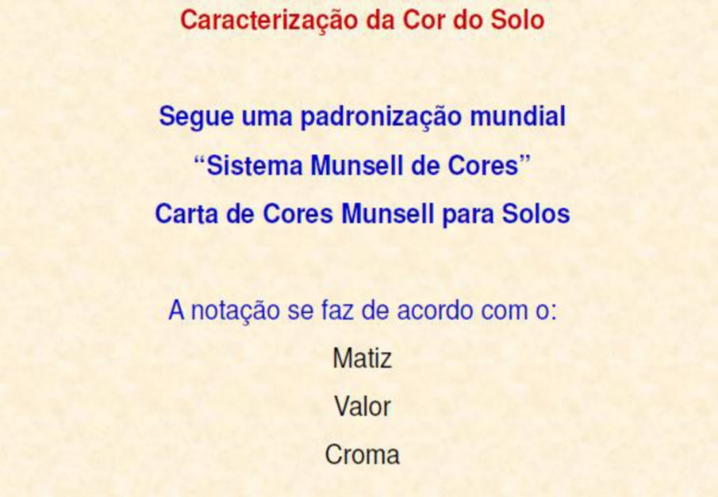
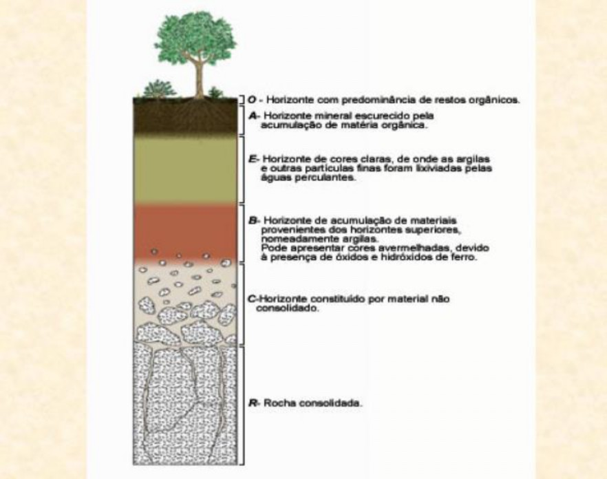
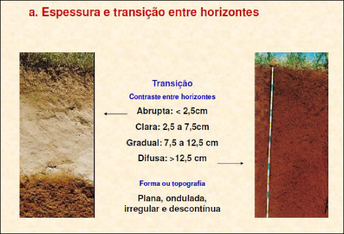
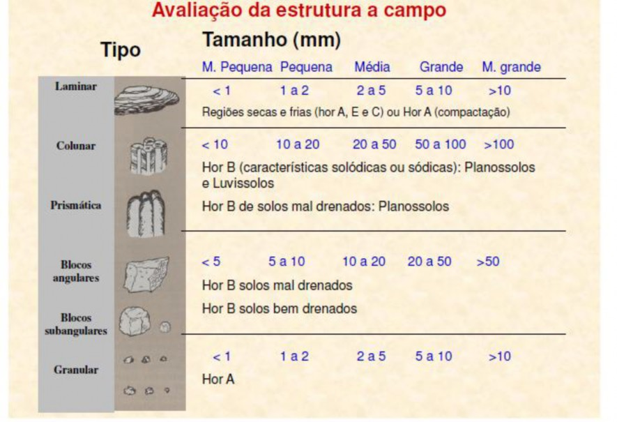
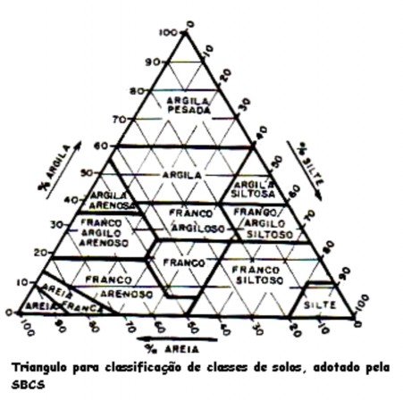
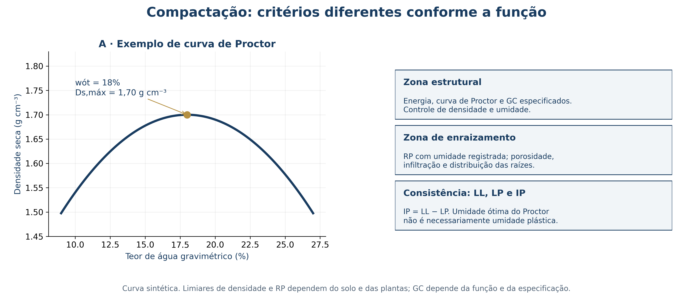

## Aula 03 · Diagnóstico físico, mecânico e biológico {.smaller-text}

**Questão de projeto:** o material deve favorecer o enraizamento, suportar uma estrutura ou cumprir ambas as funções em zonas diferentes?

Nesta aula: descrição do perfil, densidade e porosidade, agregação, infiltração, indicadores biológicos, consistência, compactação e resistência ao cisalhamento.

# 1 · Perfil e amostragem

## Descrever antes de coletar {.smaller-text}

:::: {.columns}
::: {.column width="50%"}

Registre:

- Posição no relevo, uso atual e histórico de manejo.
- Espessura, textura, estrutura, raízes e transição dos horizontes.
- Camadas adensadas, fraturas, mosqueados e surgências.
- Profundidade e variação do nível d'água.

Separe pontos por condição de solo e posição na encosta. Uma amostra composta de toda a área pode ocultar uma camada crítica.

:::
::: {.column width="50%"}

{fig-align="center" width="90%"}

:::
::::

## Horizontes e contrastes do perfil {.smaller-text}

:::: {.columns}
::: {.column width="50%"}

{fig-align="center" width="90%"}

:::
::: {.column width="50%"}

{fig-align="center" width="90%"}

:::
::::

## Textura, estrutura e cor: indícios complementares {.smaller-text}

:::: {.columns}
::: {.column width="50%"}

- **Textura:** proporção de areia, silte e argila; confirme em laboratório quando necessário.
- **Estrutura:** forma, tamanho e organização dos agregados e poros.
- **Cor:** pode indicar matéria orgânica, pigmentos minerais ou condições de oxirredução.

Cor e classe pedológica não fornecem, isoladamente, resistência ou condutividade hidráulica.

:::
::: {.column width="50%"}

{fig-align="center" width="90%"}

:::
::::

## Plano mínimo de amostragem {.smaller-text}

| Determinação | Tipo de amostra ou registro | Controle de comparabilidade |
|---|---|---|
| Densidade e porosidade | Amostra indeformada por camada | Volume conhecido e coleta sem compressão |
| Agregação | Agregados preservados | Pré-tratamento e peneiras padronizados |
| Textura e química | Amostra identificada por camada | Método e preparação |
| Penetrometria | Perfil de leituras em campo | Umidade, equipamento e repetições |
| Biologia | Amostra conservada conforme protocolo | Época, transporte e armazenamento |

Registre réplicas, coordenadas, profundidade e condições hídricas.

# 2 · Densidade, poros e água

## Relações de massa e volume {.smaller-text}

$$D_s=\frac{M_s}{V_t}qquad D_p=\frac{M_s}{V_s}qquad P_t=1-\frac{D_s}{D_p}$$

- $M_s$: massa seca; $V_t$: volume total; $V_s$: volume dos sólidos.
- Com massa em g e volume em cm³, as densidades resultam em g cm⁻³.
- $P_t$ é uma fração volumétrica; multiplique por 100 para expressar em porcentagem.
- Meça ou justifique $D_p$: 2,65 g cm⁻³ é uma aproximação frequente para alguns solos minerais.

**Exemplo didático:** $M_s=140$ g, $V_t=100$ cm³ e $D_p=2{,}65$ g cm⁻³ → $D_s=1{,}40$ g cm⁻³ e $P_t=0{,}472$ m³ m⁻³.

## Macro e microporosidade: separação operacional {.smaller-text}

1. Sature a amostra indeformada conforme o método.
2. Equilibre-a em tensão definida, por exemplo 6 kPa.
3. Determine a água retida e expresse-a como fração do volume total.
4. Calcule a macroporosidade pela diferença em relação à porosidade total.

$$P_{\mathrm{macro}}=P_t-P_{\mathrm{micro}}$$

**Exemplo:** $P_t=0{,}472$ e $P_{\mathrm{micro}}=0{,}340$ → $P_{\mathrm{macro}}=0{,}132$ m³ m⁻³.

Informe a tensão usada: o limite entre classes de poros depende do protocolo. A fração de ar no campo depende também da umidade naquele momento.

## Infiltração, VIB e condutividade {.smaller-text}

| Grandeza | O que representa | Aplicação |
|---|---|---|
| Infiltração acumulada $F(t)$ | Lâmina que entrou no solo | Armazenamento ao longo do ensaio |
| Taxa de infiltração $f(t)$ | Variação da lâmina por tempo | Comparação com intensidade de chuva |
| VIB | Taxa aproximadamente estável no ensaio | Avaliação operacional do manejo |
| $K_s$ | Condutividade hidráulica em condição saturada | Modelagem do fluxo no perfil |

VIB e $K_s$ não são intercambiáveis em qualquer ensaio. Informe método, geometria, carga hidráulica, umidade inicial e variabilidade espacial.

## Dinâmica da água no solo e modelos de infiltração {.smaller-text}

- **Potencial total da água ($\Psi_t$):** $\Psi_t = \Psi_m + \Psi_g + \Psi_o + \Psi_p$ (em solos não saturados predomina o potencial mátrico $\Psi_m$ e o gravitacional $\Psi_g$).
- **Água disponível e drenagem:** delimitada entre a **Capacidade de Campo (CC)** ($\approx -10\text{ a }-33\text{ kPa}$) e o **Ponto de Murcha Permanente (PMP)** ($\approx -1.500\text{ kPa}$); acima da CC ocorre drenagem rápida pelos macroporos.
- **Modelagem da infiltração (anéis concêntricos / simulador de chuvas):**
  - **Horton:** $f(t) = f_c + (f_0 - f_c)e^{-kt}$ *(capacidade inicial $f_0$ decaindo até a taxa básica $f_c = \text{VIB}$).*
  - **Kostiakov:** $F(t) = a \cdot t^b \implies f(t) = a \cdot b \cdot t^{b-1}$ *(ajuste empírico de campo para lâmina acumulada).*

> **Conexão conservacionista:** quando a intensidade de chuva supera a taxa de infiltração ($i > f(t)$), ocorre o empoçamento ($t_p$) e inicia-se o escoamento superficial hortoniano.

## Resistência à penetração: interpretar com a umidade {.smaller-text}

- Penetrômetros de impacto, como Stolf, e de inserção contínua têm procedimentos e calibrações próprios.
- Registre cone, velocidade ou impactos, profundidade, repetições e teor de água.
- Valores próximos de **2 MPa** são usados como referência em muitos estudos de restrição radicular, mas a resposta depende da espécie, da textura e da continuidade de bioporos.
- Compare camadas e tratamentos em condições hídricas comparáveis.

**Decisão:** combinar RP, raízes observadas, densidade e fluxo de água. Uma leitura isolada não determina automaticamente subsolagem.

# 3 · Agregação e qualidade biológica

## Estabilidade de agregados em água {.smaller-text}

O tamisamento úmido em equipamento do tipo Yoder compara a resistência dos agregados à desagregação sob um procedimento padronizado.

$$DMP=\sum_i x_iw_iqquad DMG=expleft(\sum_i w_iln x_i
ight)$$

$x_i$: diâmetro médio da classe, em mm; $w_i$: fração de massa da classe; $\sum w_i=1$.

Informe umedecimento prévio, tempo, oscilação, peneiras e correção de areia, quando prevista no método.

**Exemplo:** classes com $x_i=(0{,}25;,1;,3)$ mm e $w_i=(0{,}2;,0{,}3;,0{,}5)$ → $DMP=1{,}85$ mm e $DMG\approx1{,}31$ mm.

## Textura e dispersão não são a mesma medida {.smaller-text}

:::: {.columns}
::: {.column width="50%"}

A granulometria com dispersão adequada estima as frações:

- Areia: 2 a 0,05 mm.
- Silte: 0,05 a 0,002 mm.
- Argila: menor que 0,002 mm.

O ensaio sem dispersante permite avaliar argila dispersa em água (ADA).

$$GF=100\left(1-\frac{ADA}{\text{argila total}}
ight)$$

Use unidades iguais. Baixo GF é um indício a investigar junto à química, à água e à estabilidade do material.

:::
::: {.column width="50%"}

{fig-align="center" width="90%"}

:::
::::

## Biomassa microbiana e respiração {.smaller-text}

- **CBM:** carbono da biomassa microbiana, determinado por método especificado.
- **Respiração basal:** produção de CO₂-C em condições controladas de incubação.
- **Quociente metabólico:** razão entre respiração e CBM, com unidades compatíveis.

$$qCO_2=\frac{R_{\mathrm{basal}}}{CBM}$$

Se $R_{\mathrm{basal}}$ estiver em µg CO₂-C g⁻¹ h⁻¹ e CBM em µg C g⁻¹, a razão tem unidade h⁻¹.

Compare solo, época, umidade e temperatura de incubação. Uma mudança no $qCO_2$ sozinha não comprova recuperação ou degradação.

## Enzimas e indicadores químicos {.smaller-text}

| Grupo | Exemplos | Interpretação para a intervenção |
|---|---|---|
| Enzimas | β-glicosidase e arilsulfatase | Processos associados aos ciclos de C e S |
| Fertilidade e acidez | pH, P, K, Ca, Mg, Al, CTC e saturação por bases | Condições de estabelecimento vegetal |
| Carbono | Carbono orgânico e matéria orgânica | Estoques e organização do habitat |
| Sais e sódio | CE, PST e composição da água | Risco para plantas, estrutura e infiltração |

A BioAS/Embrapa usa referências regionais, texturais e de manejo para interpretar atividades enzimáticas. Não transfira uma faixa de interpretação sem verificar sua aplicação.

## Construir um Índice de Qualidade do Solo {.smaller-text}

$$IQS=\sum_{i=1}^{n}p_i,s_i,qquad \sum_i p_i=1$$

1. Defina a função avaliada: enraizamento, infiltração ou recuperação do habitat.
2. Selecione indicadores sem contar repetidamente a mesma informação.
3. Declare referência, curva de normalização $s_i$ e peso $p_i$.
4. Mantenha os mesmos métodos ao comparar campanhas.
5. Apresente o IQS junto aos valores originais e à incerteza.

Um índice alto pode ocultar um impedimento crítico. Examine cada indicador antes da decisão.

# 4 · Consistência, compactação e resistência

## Limites de Atterberg e umidade de trabalho {.smaller-text}

- **Limite de liquidez (LL):** transição operacional entre estados líquido e plástico.
- **Limite de plasticidade (LP):** transição operacional entre estados plástico e semissólido.
- **Índice de plasticidade:** $IP=LL-LP$, com os dois limites na mesma unidade.

Os limites descrevem o material ensaiado segundo um método. Eles não substituem a curva de compactação ou a verificação de campo.

**Aplicação agronômica:** avaliar consistência e risco de deformação pelo tráfego; trabalhar em condição adequada ao solo e ao equipamento.

## Proctor: energia, umidade e densidade seca {.smaller-text}

- O ensaio relaciona teor de água e densidade seca para uma energia de compactação definida.
- O pico fornece $w_{\mathrm{ót}}$ e $D_{s,max}$ daquele material e daquela energia.
- O grau de compactação compara a densidade seca de campo à referência:

$$GC=100\frac{D_{s,\mathrm{campo}}}{D_{s,max}}$$

**Exemplo:** 1,53/1,70 × 100 = 90%.

O GC exigido e a tolerância de umidade pertencem à especificação do projeto. A umidade ótima de Proctor não é obrigatoriamente uma umidade entre LP e LL.

## Separar função estrutural e zona de raízes {.smaller-text}

{fig-align="center" width="96%"}

## Mohr-Coulomb em tensões efetivas {.smaller-text}

$$\tau_f=c'+(\sigma_n-u)\\tan\phi'$$

| Símbolo | Significado | Unidade |
|---|---|---|
| $\tau_f$ | Resistência ao cisalhamento | kPa |
| $c'$ | Intercepto de coesão efetiva | kPa |
| $\sigma_n$ | Tensão normal total | kPa |
| $u$ | Poropressão | kPa |
| $\phi'$ | Ângulo de atrito efetivo | graus |

Especifique ensaio e condição de drenagem. O modelo acima não representa toda a contribuição da sucção em solos não saturados.

## Raízes no modelo mecânico {.smaller-text}

Uma representação simplificada acrescenta uma contribuição radicular:

$$\tau_f=c'+\Delta c_r+(\sigma_n-u)\\tan\phi'$$

**Exemplo didático:** $c'=5$ kPa; $\sigma_n=50$ kPa; $u=20$ kPa; $\phi'=30^circ$.

- Sem contribuição radicular: $\tau_f=22{,}32$ kPa.
- Com $\Delta c_r=3$ kPa: $\tau_f=25{,}32$ kPa.

O acréscimo precisa corresponder às raízes que cruzam a zona mobilizada. A Aula 09 trata dos ensaios e das limitações desse modelo.

# 5 · Classificação e decisão de projeto

## SiBCS: usar a classificação para orientar perguntas {.smaller-text}

| Grupo ou atributo | Questão a verificar no local |
|---|---|
| Latossolos e Nitossolos | Estrutura, compactação e eventual caráter coeso |
| Argissolos, Luvissolos e Planossolos | Contraste textural, drenagem e profundidade útil |
| Neossolos e Cambissolos | Espessura, material de origem e exposição do substrato |
| Vertissolos | Expansão, retração e estado hídrico |
| Gleissolos e Organossolos | Hidromorfismo, compressibilidade e função de área úmida |
| Plintossolos, Espodossolos e Chernossolos | Cimentações, estrutura e atributos diagnósticos |

As 13 ordens do SiBCS não constituem classes de resistência geotécnica. Nenhuma ordem, isoladamente, autoriza um corte íngreme ou determina uma técnica.

## Atividade · Diagnóstico antes da intervenção {.smaller-text}

Uma encosta apresenta baixa cobertura, raízes horizontais a 20 cm e empoçamento após chuva.

1. Proponha duas explicações, distinguindo compactação de impedimento natural.
2. Escolha cinco indicadores e descreva sua coleta.
3. Defina uma referência e um calendário de monitoramento.
4. Explique como separar uma zona estrutural compactada de uma faixa destinada às raízes.

**Entrega:** ficha de campo, quadro de métodos e decisão justificada. Use os resultados individuais junto ao IQS.

## Leituras e fontes técnicas {.smaller-text}

- [Embrapa (2017). Manual de métodos de análise de solo, 3ª edição](https://www.embrapa.br/web/solos/busca-de-publicacoes/-/publicacao/1085209/manual-de-metodos-de-analise-de-solo)
- [Embrapa · Bioanálise e interpretação regional da saúde do solo](https://saudedosolo.embrapa.gov.br/ciencia)
- [USDA-NRCS (2007). NEH 654, suplemento 14I: Streambank Soil Bioengineering](https://directives.nrcs.usda.gov/sites/default/files2/1720623369/Technical%20Supplement%2014%20I%20-%20Streambank%20Soil%20Bioengineering.pdf)

## Origem e continuidade dos conteúdos {.smaller-text}

Os indicadores físicos, químicos e biológicos retomam os recortes da antiga Aula 12.1 de Análise Ambiental, preservada em material complementar.

**Nesta disciplina:** o diagnóstico é aplicado ao projeto de água e solo, articulando os resultados laboratoriais às condições de campo.

**Próximos usos:** erosão e hidrologia (Aula 04), canais (07–08), biomecânica radicular (09), biomantas (14) e projeto integrador (21).
