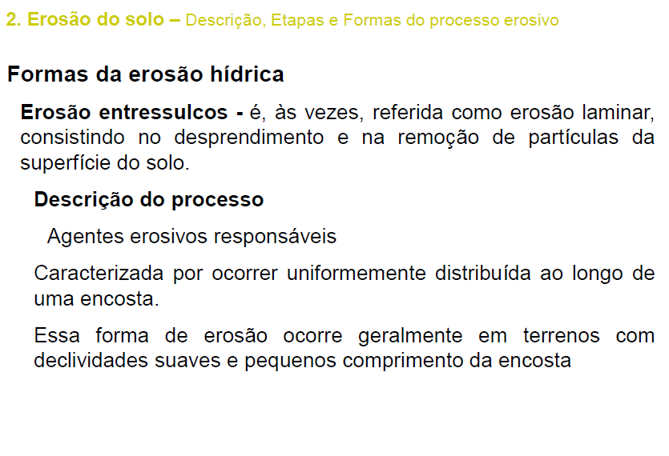
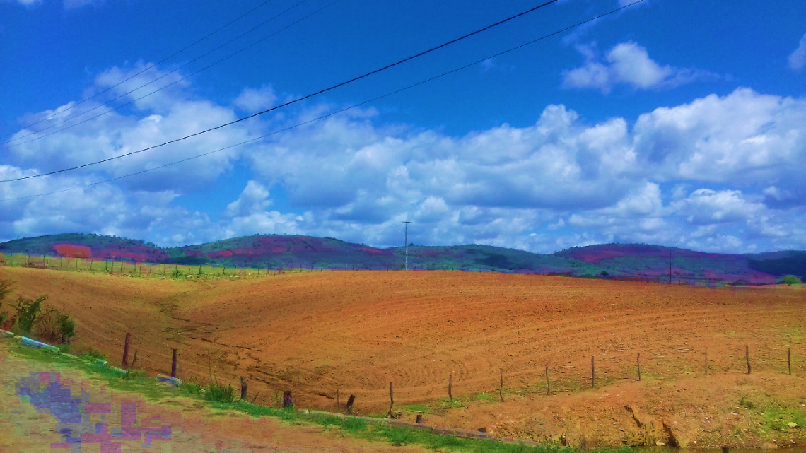
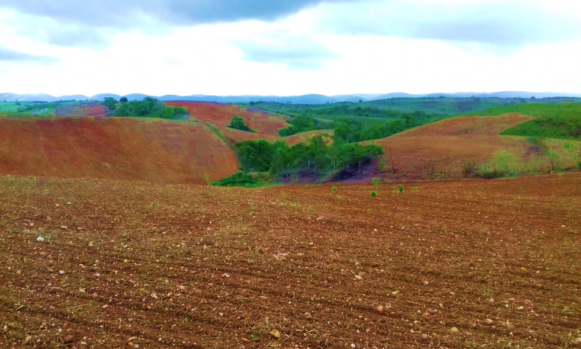
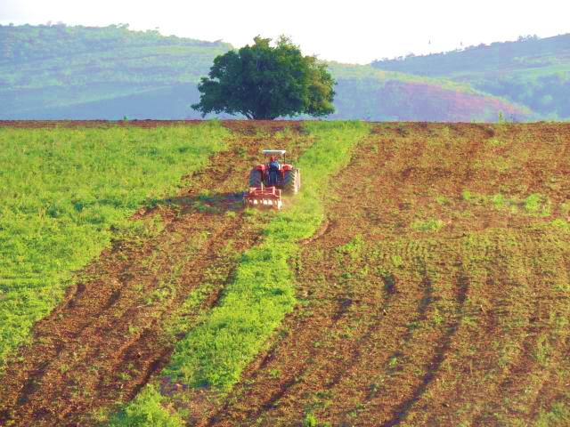
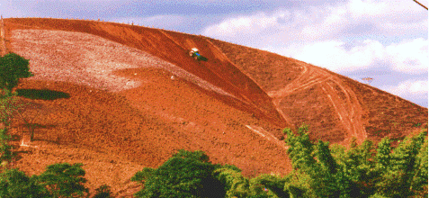
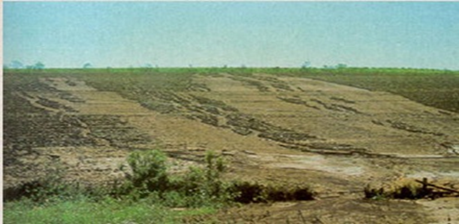

## Aula 04 · Processos erosivos e hidrologia de projeto {.smaller-text}

**Objetivo:** relacionar destacamento, transporte e deposição às medidas de conservação e aos cálculos de perda de solo, vazão de pico e volume.

**Três resultados diferentes:** perda média anual de solo, vazão máxima de um evento e volume escoado. Cada um exige um modelo e unidades próprios.

# 1 · Mecânica da erosão e conectividade

## Do impacto da gota à deposição {.smaller-text}

1. O impacto da chuva pode desagregar partículas na superfície desprotegida.
2. O escoamento transporta parte do material disponível.
3. A concentração de água aumenta a capacidade de incisão.
4. A redução de energia ou a presença de barreiras favorece a deposição.

**Diagnóstico:** diferencie erosão entre sulcos, em sulcos, ravinas, voçorocas, erosão interna e movimentos de massa. As medidas e os modelos não são equivalentes para todos esses processos.

## Ler a propriedade como sistema conectado {.smaller-text}

:::: {.columns}
::: {.column width="50%"}

{fig-align="center" width="90%"}

:::
::: {.column width="50%"}

No croqui, identifique:

- Áreas que produzem enxurrada e sedimentos.
- Caminhos que concentram ou dispersam o fluxo.
- Pontos de armazenamento e deposição.
- Receptores: lavouras, estradas, cursos d'água e reservatórios.

A intervenção deve ter uma saída estável para a água; reter sedimentos não significa eliminar a vazão.

:::
::::

## Tensão aplicada e resistência à erosão {.smaller-text}

Para um trecho aproximadamente uniforme, a tensão média de contorno pode ser estimada por:

$$\tau_0=\rho gR_hS_f$$

- $
ho$: massa específica da água (kg m⁻³); $g$: gravidade (m s⁻²).
- $R_h$: raio hidráulico (m); $S_f$: declividade da linha de energia (m m⁻¹).
- $\tau_0$ resulta em Pa; compare com a tensão admissível do sistema solo–revestimento.

## Erosão eólica e controle por quebra-ventos {.smaller-text}

- **Mecanismos de transporte pelo vento** (crítico em solos arenosos, secos e descobertos do Semiárido e cerrados):
  1. **Rolamento superficial (*creep*):** partículas grossas ($0{,}5\text{--}2{,}0\text{ mm}$) arrastadas sobre a superfície;
  2. **Saltação:** partículas médias ($0{,}1\text{--}0{,}5\text{ mm}$) em saltos balísticos — principal fonte de abrasão e desagregação secundária;
  3. **Suspensão:** silte e argila ($< 0{,}1\text{ mm}$) transportados a longas distâncias (perda de fertilidade e coloides).
- **Equação da Erosão Eólica (WEQ):** $E = f(I, K, C, L, V)$ *(erodibilidade do solo, rugosidade, fator climático, comprimento desprotegido e cobertura vegetal).*
- **Controle agronômico e biotécnico:** manutenção de palhada/restos culturais em pé, rugosidade por preparo em nível e **quebra-ventos vegetados** (faixas arbóreo-arbustivas com porosidade óptica de $40\text{--}50\%$, protegendo até **$15\text{ a }20\times$ a altura ($H$)** a sotavento).

A média não representa máximos locais em curvas, entradas e quedas. Não confunda esse critério de erosão hidráulica com a resistência ao cisalhamento em kPa da mecânica dos solos.

# 2 · Predição e limites da RUSLE

## O que a RUSLE estima {.smaller-text}

$$A=R,K,LS,C,P$$

| Fator | Interpretação |
|---|---|
| $A$ | Perda média anual de solo, em t ha⁻¹ ano⁻¹ |
| $R$ | Erosividade da chuva |
| $K$ | Erodibilidade do solo, com unidades compatíveis com $R$ |
| $LS$ | Comprimento e declividade da vertente |
| $C$ | Cobertura e manejo |
| $P$ | Práticas de suporte |

A RUSLE representa erosão entre sulcos e em sulcos. Não fornece diretamente erosão de voçorocas, ruptura de taludes ou sedimento exportado pela bacia.

## Exemplo de cenário antes e depois {.smaller-text}

**Valores didáticos, sem representar uma área medida:**

| Parâmetro | Situação inicial | Cenário conservacionista |
|---|---:|---:|
| $R$ | 6.000 | 6.000 |
| $K$ | 0,025 | 0,025 |
| $LS$ | 1,8 | 1,8 |
| $C$ | 0,20 | 0,04 |
| $P$ | 1,0 | 0,6 |
| $A$ (t ha⁻¹ ano⁻¹) | 54,00 | 6,48 |

Redução estimada: **88%**. A escolha de C e P exige referência adequada ao manejo; verifique também a perda tolerável e os processos fora do alcance do modelo.

## Da perda estimada ao planejamento {.smaller-text}

- Use dados locais ou parâmetros cuja origem e aplicação estejam documentadas.
- Não atribua a redução de K a uma prática sem demonstrar a mudança correspondente.
- Evite contar duas vezes o mesmo efeito ao ajustar LS e P.
- A tolerância de perda depende de profundidade, formação e funções do solo; não é um único valor por ordem do SiBCS.
- Avalie capacidade de uso ou aptidão das terras antes de intensificar o manejo.

**Uma área inadequada ao uso proposto não se torna adequada apenas com um valor baixo de A.**

# 3 · Chuva, vazão e volume

## Duração da chuva e tempo de concentração {.smaller-text}

O tempo de concentração $t_c$ expressa o tempo característico para a contribuição de toda a área à seção de interesse.

Uma forma da equação empírica de Kirpich é:

$$t_c=0{,}0195,L^{0{,}77}S^{-0{,}385}$$

Com $t_c$ em minutos, comprimento $L$ em metros e declividade $S$ em m m⁻¹. Verifique se o tipo e a escala da bacia são compatíveis com a equação.

Use uma relação **IDF local** para obter a intensidade para a duração e o período de retorno adotados. Precipitação média anual não fornece a intensidade de projeto.

## Método Racional: vazão de pico {.smaller-text}

$$Q_p=\frac{C,i,A_b}{360}$$

| Símbolo | Unidade nesta forma |
|---|---|
| $Q_p$ | m³ s⁻¹ |
| $C$ | Adimensional |
| $i$ | mm h⁻¹ |
| $A_b$ | ha |

**Exemplo:** $C=0{,}58$; $i=190$ mm h⁻¹; $A_b=8$ ha → $Q_p=2{,}449$ m³ s⁻¹.

O método pressupõe chuva de projeto compatível com $t_c$ e contribuição espacial adequada. Verifique armazenamento, heterogeneidade e necessidade de propagação do hidrograma.

## CN: lâmina e volume de um evento {.smaller-text}

Na formulação clássica do método NRCS-CN:

$$S_r=\frac{25400}{CN}-254,qquad I_a=0{,}2S_r$$

$$P_e=\begin{cases}0,&P\le I_a\\ \dfrac{(P-I_a)^2}{P-I_a+S_r},&P>I_a\end{cases}$$

$P$, $P_e$, $I_a$ e $S_r$ em mm. $V_e=10P_eA_b$ dá volume em m³ para área em ha.

Informe grupo hidrológico, cobertura, condição antecedente e hipótese de abstração inicial. A razão 0,2 é uma convenção da formulação clássica; outras calibrações exigem parâmetros consistentes.

## Vazão não substitui volume {.smaller-text}

| Estrutura ou análise | Grandeza principal | Complemento necessário |
|---|---|---|
| Canal escoadouro | Vazão de pico | Geometria, rugosidade e estabilidade |
| Bacia de captação | Volume e balanço de entradas e saídas | Infiltração, extravasor e sedimento |
| Terraço em nível | Armazenamento e infiltração | Segurança contra transbordamento |
| Terraço em gradiente | Vazão ao longo do canal | Descarga em saída protegida |

Somar picos individuais de áreas com tempos de chegada diferentes não representa, em geral, o pico real a jusante.

# 4 · Manejo e evidências de campo

## Orientação do preparo e concentração da água {.smaller-text}

:::: {.columns}
::: {.column width="50%"}

{fig-align="center" width="90%"}

:::
::: {.column width="50%"}

{fig-align="center" width="90%"}

:::
::::

## Identificar a conexão até a feição erosiva {.smaller-text}

:::: {.columns}
::: {.column width="50%"}

{fig-align="center" width="90%"}

:::
::: {.column width="50%"}

{fig-align="center" width="90%"}

:::
::::

## Compactação: construir e testar a hipótese {.smaller-text}

:::: {.columns}
::: {.column width="50%"}

{fig-align="center" width="90%"}

:::
::: {.column width="50%"}

Hipótese: tráfego ou manejo alteram a estrutura; parte da macroporosidade e da infiltração pode diminuir; a enxurrada pode aumentar.

**Teste com:** perfil de raízes, densidade, RP com umidade registrada, infiltração e observação durante chuva.

Não atribua automaticamente liquefação ou erosão a um valor de RP. Diferencie compactação por manejo de adensamento natural.

:::
::::

## Planejamento conservacionista por função {.smaller-text}

| Função | Medidas possíveis | Verificação |
|---|---|---|
| Reduzir solo exposto | Cobertura viva, palhada, biomanta | Cobertura e permanência |
| Diminuir concentração | Plantio em contorno e faixas vegetadas | Continuidade e ausência de atalhos |
| Interceptar e conduzir | Terraços e canais dimensionados | Vazão, armazenamento e saída |
| Recuperar estrutura | Manejo de tráfego e rotação; intervenção localizada quando indicada | Resposta física e radicular |
| Conter feições ativas | Técnicas combinadas e controle de montante | Evolução da geometria e estabilidade |

## Atividade · Três cálculos, três decisões {.smaller-text}

Para os cenários apresentados:

1. Reproduza a perda estimada pela RUSLE e a redução percentual.
2. Confira a vazão pelo Método Racional, mantendo as unidades.
3. Calcule a lâmina e o volume para $P=60$ mm, $CN=80$ e área de 8 ha.
4. Explique por que esses resultados não dimensionam sozinhos uma obra.

**Resultados de conferência do item 3:** $S_r=63{,}5$ mm; $P_e\approx20{,}19$ mm; $V_e\approx1.615$ m³. A transformação dessa lâmina em hidrograma exige outra etapa.

## Leituras e fontes técnicas {.smaller-text}

- [USDA-ARS · Fundamentos e alcance da RUSLE2](https://www.ars.usda.gov/ARSUserFiles/60600505/rusle/rusle2_science_doc.pdf)
- [USDA-NRCS · Estimating Runoff (EFH, capítulo 2)](https://directives.nrcs.usda.gov/sites/default/files2/1712930818/31754.pdf)
- [Embrapa (2017). Manual de métodos de análise de solo, 3ª edição](https://www.embrapa.br/web/solos/busca-de-publicacoes/-/publicacao/1085209/manual-de-metodos-de-analise-de-solo)
