## [Abertura]{.pitch-tag} Aula 05 · Declividade e locação {.smaller-text .lesson-slide}

::: {.pitch-grid-55}
::: {.pitch-card}
[Objetivo da aula]{.pitch-card-index}
[Medição e locação em campo]{.pitch-heading}

**Objetivo:** medir desníveis e distâncias, calcular declividade e locar linhas em nível ou em gradiente.
:::

::: {.pitch-stack-2}
::: {.pitch-card .pitch-card--gold}
[Produto da aula]{.pitch-card-index}
[Entrega técnica]{.pitch-heading}

Caderneta com leituras, croqui, cálculo de fechamento e indicação do traçado de uma prática conservacionista.
:::

::: {.pitch-pill-row}
[Desnível Δz]{.pitch-pill}
[Declividade (%)]{.pitch-pill .pitch-pill--gold}
[Locação em nível/gradiente]{.pitch-pill}
:::
:::
:::

# 1 · Grandezas e unidades {.section-header rotulo="Grandezas"}

## [Grandezas]{.pitch-tag .pitch-tag--gold} Declividade não é o mesmo que ângulo {.smaller-text .lesson-slide}

::: {.pitch-grid-50}
::: {.pitch-stack-2}
::: {.pitch-formula}
$$D(\%)=100\frac{\Delta z}{L_h}\qquad \theta=\arctan\left(\frac{\Delta z}{L_h}\right)$$
:::

::: {.pitch-card}
[Relações trigonométricas]{.pitch-card-index}
[Definição das variáveis]{.pitch-heading}

- $\Delta z$: desnível vertical.
- $L_h$: distância horizontal.
- Use a mesma unidade para as duas grandezas.

**Exemplo:** 8 m de desnível em 100 m horizontais $\rightarrow$ $D=8\%$ e $\theta\approx4{,}57^\circ$.
:::

::: {.pitch-band .pitch-band--navy}
Uma encosta de 45° tem declividade de 100%, não de 45%.
:::
:::

::: {.pitch-media-card}

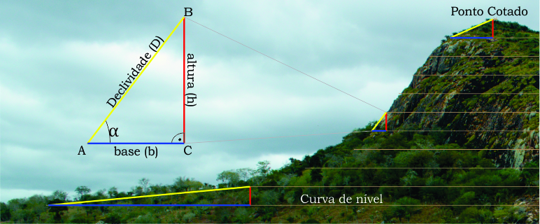

[Declividade em relação à horizontal]{.pitch-caption}
:::
:::

## [Grandezas]{.pitch-tag .pitch-tag--gold} Vários segmentos e terreno irregular {.smaller-text .lesson-slide}

::: {.pitch-formula}
$$D_{\mathrm{média}}=100\frac{\sum_i \Delta z_i}{\sum_i L_{h,i}}$$
:::

::: {.pitch-card}
[Critérios de cálculo]{.pitch-card-index}
[Trechos heterogêneos]{.pitch-heading}

- Mantenha a convenção de sinal para subidas e descidas.
- Não tire a média aritmética de porcentagens quando os comprimentos diferirem.
- Uma média pequena pode ocultar um trecho íngreme.
- Represente o perfil longitudinal e registre mudanças de inclinação.
:::

::: {.pitch-band .pitch-band--navy}
Para um canal, a declividade de projeto refere-se ao **fundo ou à linha de energia**, conforme a equação usada; não substitua automaticamente pela declividade da encosta.
:::

# 2 · Instrumentos e calibração {.section-header rotulo="Instrumentos"}

## [Instrumentos]{.pitch-tag} Qual equipamento usar? {.smaller-text .lesson-slide}

::: {.pitch-table-box}

| Equipamento | Uso | Controle essencial |
|---|---|---|
| Pé-de-galinha / nível tipo A | Locação simples de nível | Calibrar por inversão dos apoios |
| Nível de mangueira | Transferência de cotas | Retirar bolhas e aguardar estabilização |
| Nível óptico ou laser | Nivelamento e controle de cotas | Visadas, referência e fechamento |
| Clinômetro | Medida expedita de inclinação | Altura de visada e leitura |
| Estação total ou GNSS adequado | Levantamento e implantação | Precisão, geometria e sistema de referência |

:::

::: {.pitch-band}
A precisão requerida decorre do projeto, sobretudo em gradientes pequenos.
:::

## [Instrumentos]{.pitch-tag .pitch-tag--forest} Calibrar o pé-de-galinha {.smaller-text .lesson-slide}

::: {.pitch-card}
[Procedimento de aferição]{.pitch-card-index}
[Calibração por inversão]{.pitch-heading}

1. Coloque os apoios em dois pontos estáveis.
2. Marque a posição do fio de prumo ou do nível.
3. Inverta os apoios nos mesmos pontos.
4. Marque a segunda leitura; o ponto médio fornece a referência de nível.
5. Repita o controle e confira a rigidez do instrumento.
:::

::: {.pitch-band .pitch-band--teal}
**Locação:** avance um apoio por vez, marque as posições de igual cota e confira o traçado antes de movimentar o solo.
:::

## [Instrumentos]{.pitch-tag .pitch-tag--teal} Nível de mangueira: sequência de leitura {.smaller-text .lesson-slide}

::: {.pitch-card}
[Cuidados operacionais]{.pitch-card-index}
[Protocolo de campo]{.pitch-heading}

- Encha a mangueira com água limpa e elimine bolhas e estrangulamentos.
- Mantenha ambas as extremidades abertas e sem derramamento.
- Use réguas verticais, mesmo critério de menisco e tempo de estabilização.
- Registre as leituras em pares, a distância horizontal e o sentido do levantamento.
- Retorne a uma referência conhecida para conferir o fechamento.
:::

::: {.pitch-band .pitch-band--navy}
**Não registre somente a diferença calculada:** mantenha as leituras originais na caderneta.
:::

# 3 · Exercícios com conferência {.section-header rotulo="Exercícios"}

## [Exercício]{.pitch-tag .pitch-tag--gold} Exemplo 1 · Leituras de mangueira {.smaller-text .lesson-slide}

::: {.pitch-grid-55}
::: {.pitch-stack-2}
::: {.pitch-band}
Pares de leituras, em cm:
:::

::: {.pitch-table-box}

| Trecho | Leitura 1 | Leitura 2 | Diferença | Distância horizontal |
|---|---:|---:|---:|---:|
| 1 | 32,0 | 23,0 | 9,0 | 12 m |
| 2 | 38,0 | 21,0 | 17,0 | 8 m |
| 3 | 28,0 | 19,8 | 8,2 | 11 m |
| 4 | 25,9 | 22,3 | 3,6 | 15 m |

:::
:::

::: {.pitch-stack-2}
::: {.pitch-card}
[Somas acumuladas]{.pitch-card-index}
[Mesmo sentido]{.pitch-heading}

Admitindo diferenças no mesmo sentido: $\Delta z=37{,}8$ cm = 0,378 m; $L_h=46$ m.
:::

::: {.pitch-formula}
$$D=100\frac{0{,}378}{46}=0{,}822\%$$
:::
:::
:::

## [Exercício]{.pitch-tag .pitch-tag--gold} Exemplo 2 · Seis avanços de 3 m {.smaller-text .lesson-slide}

::: {.pitch-card .pitch-card--gold}
[Dados de campo]{.pitch-card-index}
[Desníveis medidos]{.pitch-heading}

Desníveis: 4, 8, 5, 10, 8 e 7 cm, no mesmo sentido.
:::

::: {.pitch-formula}
$$\Delta z=42\,\mathrm{cm}=0{,}42\,\mathrm{m}$$
$$L_h=6\times3=18\,\mathrm{m}$$
$$D=100\frac{0{,}42}{18}=2{,}33\%$$
:::

::: {.pitch-band .pitch-band--navy}
**Confira:** as distâncias de 3 m devem ser horizontais. Se forem medidas ao longo da superfície inclinada, corrija a projeção horizontal ou registre essa limitação.
:::

## [Locação]{.pitch-tag .pitch-tag--forest} Locar nível e locar gradiente {.smaller-text .lesson-slide}

::: {.pitch-table-box}

| Traçado | Relação entre cotas | Aplicação |
|---|---|---|
| Em nível | Mesma cota de referência | Estruturas destinadas à retenção, quando adequadas ao solo |
| Em gradiente | Queda definida ao longo do percurso | Condução da água a uma saída protegida |

:::

::: {.pitch-card .pitch-card--gold}
[Exemplo de controle]{.pitch-card-index}
[Conversão operacional]{.pitch-heading}

Gradiente de 0,4% corresponde a 4 cm de queda em 10 m horizontais.
:::

::: {.pitch-band}
Esse valor ilustra a conversão; o gradiente admissível depende de vazão, solo, geometria e revestimento.
:::

## [Campo]{.pitch-tag} Conferência e entrega de campo {.smaller-text .lesson-slide}

::: {.pitch-card}
[Roteiro de fechamento]{.pitch-card-index}
[Controle topográfico]{.pitch-heading}

1. Escolha uma referência de cota e marque-a em croqui.
2. Faça levantamento de ida e conferência de retorno.
3. Calcule o erro de fechamento e compare com a tolerância definida para a atividade.
4. Marque pontos de mudança de direção e de declividade.
5. Entregue caderneta, perfil e traçado proposto.
:::

::: {.pitch-band .pitch-band--navy}
**Discussão:** como um erro de poucos centímetros pode criar empoçamento ou uma saída erosiva em um terraço de pequeno gradiente?
:::

# Acervo visual · Construção e locação {.section-header rotulo="Acervo"}

## [Acervo]{.pitch-tag} Registros e esquemas de apoio · 1 {.smaller-text .lesson-slide}

::: {.pitch-cards}
::: {.pitch-media-card .pitch-media-card--compact}

[Declividade do solo]{.pitch-caption}
:::

::: {.pitch-media-card .pitch-media-card--compact}

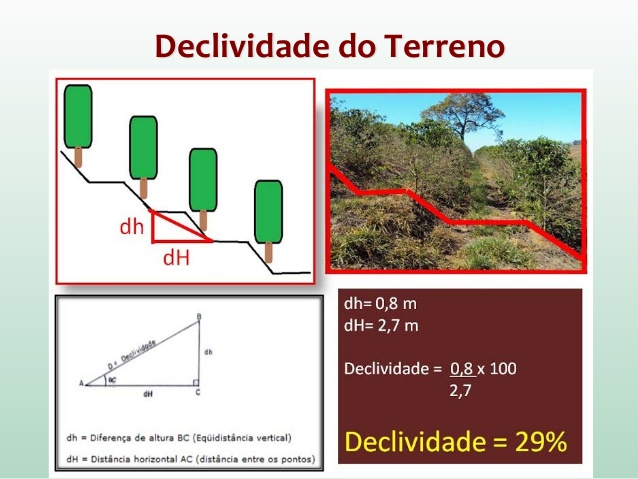

[Cálculo de declividade]{.pitch-caption}
:::

::: {.pitch-media-card .pitch-media-card--photo .pitch-media-card--compact}

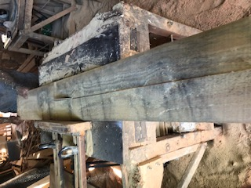

[Passo 1]{.pitch-caption}
:::
:::

::: {.pitch-band}
Acervo preservado da conversão original. Confira a geometria e os procedimentos com os cálculos e critérios apresentados nesta aula.
:::

## [Acervo]{.pitch-tag} Registros e esquemas de apoio · 2 {.smaller-text .lesson-slide}

::: {.pitch-cards}
::: {.pitch-media-card .pitch-media-card--photo .pitch-media-card--compact}

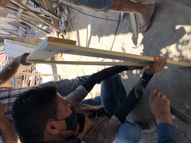

[Passo 4]{.pitch-caption}
:::

::: {.pitch-media-card .pitch-media-card--photo .pitch-media-card--compact}

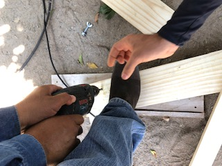

[Passo 2]{.pitch-caption}
:::

::: {.pitch-media-card .pitch-media-card--photo .pitch-media-card--compact}

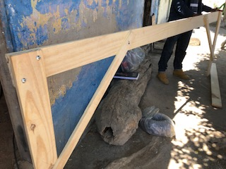

[Passo 5]{.pitch-caption}
:::
:::

::: {.pitch-band}
Acervo preservado da conversão original. Confira a geometria e os procedimentos com os cálculos e critérios apresentados nesta aula.
:::

## [Acervo]{.pitch-tag} Registros e esquemas de apoio · 3 {.smaller-text .lesson-slide}

::: {.pitch-cards}
::: {.pitch-media-card .pitch-media-card--photo .pitch-media-card--compact}

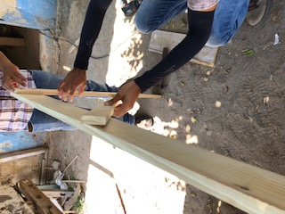

[Passo 3]{.pitch-caption}
:::

::: {.pitch-media-card .pitch-media-card--photo .pitch-media-card--compact}

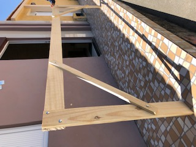

[Passo 6]{.pitch-caption}
:::

::: {.pitch-media-card .pitch-media-card--photo .pitch-media-card--compact}

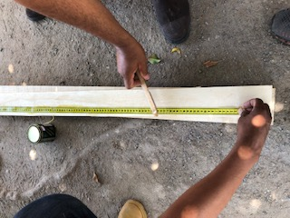

[Passo 1]{.pitch-caption}
:::
:::

::: {.pitch-band}
Acervo preservado da conversão original. Confira a geometria e os procedimentos com os cálculos e critérios apresentados nesta aula.
:::

## [Acervo]{.pitch-tag} Registros e esquemas de apoio · 4 {.smaller-text .lesson-slide}

::: {.pitch-cards}
::: {.pitch-media-card .pitch-media-card--photo .pitch-media-card--compact}

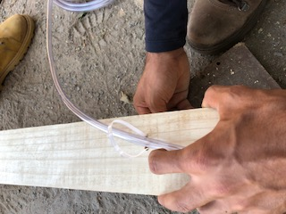

[Passo 4]{.pitch-caption}
:::

::: {.pitch-media-card .pitch-media-card--photo .pitch-media-card--compact}

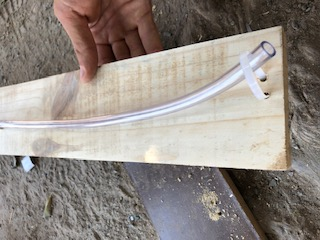

[Passo 2]{.pitch-caption}
:::

::: {.pitch-media-card .pitch-media-card--photo .pitch-media-card--compact}

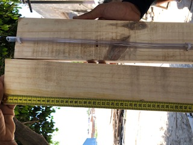

[Passo 5]{.pitch-caption}
:::
:::

::: {.pitch-band}
Acervo preservado da conversão original. Confira a geometria e os procedimentos com os cálculos e critérios apresentados nesta aula.
:::

## [Acervo]{.pitch-tag} Registros e esquemas de apoio · 5 {.smaller-text .lesson-slide}

::: {.pitch-cards-2}
::: {.pitch-media-card .pitch-media-card--photo}

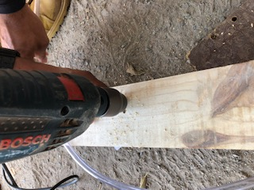

[Passo 3]{.pitch-caption}
:::

::: {.pitch-media-card .pitch-media-card--photo}

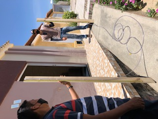

[Passo 6]{.pitch-caption}
:::
:::

::: {.pitch-band}
Acervo preservado da conversão original. Confira a geometria e os procedimentos com os cálculos e critérios apresentados nesta aula.
:::
