## [Abertura]{.pitch-tag} Planejamento Conservacionista e Terraços {.smaller-text .lesson-slide}

::: {.pitch-grid-50}
::: {.pitch-card .pitch-card--forest}
[Objetivo da aula]{.pitch-card-index}
[Seleção e dimensionamento]{.pitch-heading}

Selecionar práticas conservacionistas pela função no sistema e calcular espaçamento e requisitos hidráulicos de terraços agrícolas.
:::

::: {.pitch-stack-2}
::: {.pitch-card}
[Sequência do projeto]{.pitch-card-index}
[Encadeamento lógico]{.pitch-heading}

Capacidade de uso → cobertura e controle do escoamento → espaçamento ($EV$ e $EH$) → seção e saída → implantação e manutenção.
:::

::: {.pitch-pill-row}
[Práticas Vegetativas]{.pitch-pill}
[Práticas Edáficas]{.pitch-pill .pitch-pill--gold}
[Práticas Mecânicas]{.pitch-pill}
:::
:::
:::

::: {.pitch-band .pitch-band--navy}
O terraço integra o sistema conservacionista na escala da microbacia: não substitui a cobertura vegetal nem dispensa saída hidráulica estabilizada.
:::

# 1 · Práticas e função no sistema {.section-header rotulo="Práticas"}

## [Sistema]{.pitch-tag .pitch-tag--forest} Combinar Práticas Vegetativas, Edáficas e Mecânicas {.smaller-text .lesson-slide}

::: {.pitch-table-box}

| Grupo | Exemplos | Função predominante |
|---|---|---|
| **Vegetativas** | Cobertura, faixas e cordões vegetativos | Proteger a superfície e reduzir concentração |
| **Edáficas e de manejo** | Rotação, aporte orgânico, correções indicadas e tráfego controlado | Melhorar as condições do solo |
| **Mecânicas** | Terraços, canais e bacias dimensionados | Interceptar, armazenar ou conduzir água |

:::

::: {.pitch-band .pitch-band--navy}
Uma prática mecânica não dispensa cobertura nem planejamento do uso. Avalie também estradas e contribuições externas ao talhão.
:::

## [Diagnóstico]{.pitch-tag} Escolher a partir da Aptidão e da Capacidade de Uso {.smaller-text .lesson-slide}

::: {.pitch-grid-55}
::: {.pitch-milestones}
::: {.pitch-milestone-item}
**1. Levantamento físico:** relevo, profundidade, drenagem, erodibilidade e impedimentos.
:::

::: {.pitch-milestone-item}
**2. Compatibilidade:** compare o uso proposto à capacidade de sustentá-lo.
:::

::: {.pitch-milestone-item}
**3. Áreas sensíveis:** preserve áreas de função hídrica e ecológica.
:::

::: {.pitch-milestone-item}
**4. Zoneamento:** defina unidades de manejo com características semelhantes.
:::

::: {.pitch-milestone-item}
**5. Rede de drenagem:** mapeie caminhos preferenciais e saída da água.
:::
:::

::: {.pitch-card .pitch-card--gold}
[Critério de decisão]{.pitch-card-index}
[Mudança de uso vs. obras]{.pitch-heading}

Há situações em que **alterar o uso da terra** é mais adequado e seguro do que intensificar obras mecânicas para tentar manter uma atividade incompatível com a aptidão do solo.
:::
:::

## [Planejamento]{.pitch-tag .pitch-tag--teal} Sistema de Capacidade de Uso das Terras (Classes I–VIII) e Microbacias {.smaller-text .lesson-slide}

::: {.pitch-table-box}

| Grupo / Classes | Aptidão e Limitações | Diretriz de Manejo e Bioengenharia |
|:---|:---|:---|
| **Grupo A (I a IV)** | Culturas anuais (I sem restrição; II–III restrições moderadas a severas; IV uso ocasional) | Práticas edáficas + vegetativas (I–II) associadas a **terraceamento e canais escoadouros** (III–IV) |
| **Grupo B (V a VII)** | Pastagens, silvicultura e culturas perenes (declividade alta, pedregosidade ou drenagem restrita) | Cobertura permanente, **cordões vegetativos, faixas de vetiver** e controle de carga animal |
| **Grupo C (VIII)** | Terras impróprias para exploração agropecuária (escarpas, afloramentos, APPs) | Preservação integral, **PRAD e estabilização biotécnica** |

:::

::: {.pitch-band .pitch-band--teal}
**Unidade de planejamento:** o projeto conservacionista deve ser integrado na escala da **Microbacia Hidrográfica** (conectando estradas rurais, divisores de água, encostas e rede de drenagem).
:::

## [Base]{.pitch-tag .pitch-tag--forest} Práticas Edáficas e Vegetativas na Base do Sistema {.smaller-text .lesson-slide}

::: {.pitch-grid-50}
::: {.pitch-card .pitch-card--gold}
[Práticas edáficas]{.pitch-card-index}
[Estrutura, agregação e infiltração]{.pitch-heading}

- **Calagem e gessagem:** floculação de argilas e aprofundamento radicular.
- **Nutrição e matéria orgânica:** adubação orgânica e equilíbrio nutricional para rápido fechamento do dossel.
- **Descompactação pontual:** subsolagem ou escarificação em solo friável apenas quando houver camada compactada diagnosticada ($RP > 2{,}0\text{ MPa}$).
:::

::: {.pitch-card .pitch-card--forest}
[Práticas vegetativas]{.pitch-card-index}
[Energia cinética, fatores $C$ e $L$]{.pitch-heading}

- **SPD e cultivo mínimo:** manutenção de palhada permanente ($\ge 70\%$ de cobertura), rotação de culturas e **adubação verde** (leguminosas + gramíneas).
- **Barreiras vivas e eólica:** cultivo em contorno, faixas de retenção, **cordões vegetativos** (*Chrysopogon zizanioides*, *Pennisetum*, leguminosas arbustivas) e **quebra-ventos** contra erosão eólica.
:::
:::

# 2 · Terraços em nível e em gradiente {.section-header rotulo="Terraços"}

## [Tipologia]{.pitch-tag .pitch-tag--teal} Retenção e Condução Exigem Critérios Diferentes {.smaller-text .lesson-slide}

::: {.pitch-table-box}

| Tipo | Destino principal da água | Verificações obrigatórias |
|---|---|---|
| **Em nível** | Armazenamento temporário e infiltração | Volume útil, infiltração, estabilidade e rota de excedência |
| **Em gradiente** | Condução a uma saída protegida | Vazão, geometria, erosão e conexão com o canal |

:::

::: {.pitch-cards-2}
::: {.pitch-card .pitch-card--alert}
[Limitação física]{.pitch-card-index}
[Infiltração e saturação]{.pitch-heading}

Baixa infiltração ou saturação prolongada podem limitar estruturas de retenção em nível, exigindo escoamento controlado.
:::

::: {.pitch-card}
[Critério pedológico]{.pitch-card-index}
[Sem automatismos]{.pitch-heading}

O nome da classe pedológica, sozinho, não impõe uma proibição nem uma escolha automática: avalie atributos hidráulicos e locais.
:::
:::

## [Geometria]{.pitch-tag} Geometria e Espaçamento dos Terraços {.smaller-text .lesson-slide}

::: {.pitch-media-card .pitch-media-card--tall}

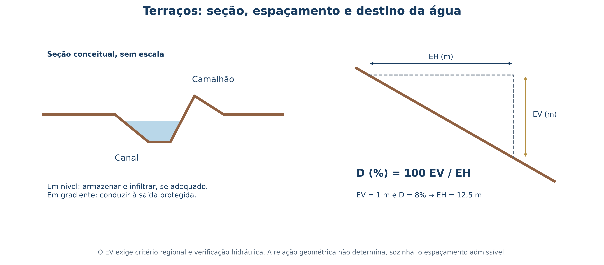

[Terraço em corte transversal e relações entre espaçamento vertical ($EV$) e horizontal ($EH$)]{.pitch-caption}
[Compatibilização entre rampa do terreno, largura da faixa de contribuição e seção útil de retenção ou condução]{.pitch-caption-sub}
:::

## [Cálculo]{.pitch-tag .pitch-tag--gold} Espaçamento Vertical e Horizontal {.smaller-text .lesson-slide}

::: {.pitch-grid-55}
::: {.pitch-formula}
$$D = 100\,\frac{EV}{EH} \qquad EH = \frac{100\,EV}{D}$$

- $EV$: diferença de cota entre linhas consecutivas, em $\text{m}$.
- $EH$: distância horizontal medida na direção do declive, em $\text{m}$.
- $D$: declividade do terreno em porcentagem ($\%$).
:::

::: {.pitch-stack-2}
::: {.pitch-card .pitch-card--gold}
[Exemplo didático]{.pitch-card-index}
[Aplicação direta]{.pitch-heading}

Para $D = 8\%$ e um $EV$ preliminar de $1{,}0\text{ m}$:

$$EH = \frac{100 \times 1{,}0}{8} = 12{,}5\text{ m}$$
:::

::: {.pitch-card .pitch-card--alert}
[Ressalva técnica]{.pitch-card-index}
[A geometria não dimensiona sozinha]{.pitch-heading}

O $EV$ adotado precisa ser definido por **método regional** e verificado quanto a solo, manejo, operação e hidráulica.
:::
:::
:::

## [Critérios]{.pitch-tag} Métodos Empíricos: Declarar Origem e Limites {.smaller-text .lesson-slide}

::: {.pitch-grid-55}
::: {.pitch-milestones}
::: {.pitch-milestone-item}
**1. Especificidade:** equações e tabelas de espaçamento foram desenvolvidas para condições específicas.
:::

::: {.pitch-milestone-item}
**2. Rastreabilidade:** registre referência, unidades, grupo de solo e fatores de cobertura ou operação.
:::

::: {.pitch-milestone-item}
**3. Legenda:** não transfira coeficientes de uma tabela sem verificar sua legenda original.
:::

::: {.pitch-milestone-item}
**4. Operação:** ajuste o traçado à topografia real e à circulação de máquinas.
:::

::: {.pitch-milestone-item}
**5. Validação:** submeta o espaçamento escolhido à verificação hidráulica da seção e da saída.
:::
:::

::: {.pitch-card .pitch-card--teal}
[Atividade em aula]{.pitch-card-index}
[Comparação de critérios]{.pitch-heading}

Aplique **dois critérios documentados** ao mesmo talhão e explique por que os valores de $EV$ e $EH$ diferem segundo solo, chuva e manejo considerados.
:::
:::

## [Dimensionamento]{.pitch-tag .pitch-tag--gold} Quantidade de Faixas e Área de Contribuição {.smaller-text .lesson-slide}

::: {.pitch-cards-2}
::: {.pitch-formula}
**Número de intervalos** (rampa horizontal de $200\text{ m}$ e $EH = 12{,}5\text{ m}$):

$$N_{\mathrm{intervalos}} = \frac{200}{12{,}5} = 16$$

O número final de obras depende dos limites da gleba e das linhas de topo e de base.
:::

::: {.pitch-formula}
**Área de contribuição** (trecho regular com comprimento de linha de $400\text{ m}$):

$$A_b \approx 400 \times 12{,}5 = 5.000\text{ m}^2 = 0{,}50\text{ ha}$$

Contribuições externas, cabeceiras e irregularidades exigem delimitação adicional.
:::
:::

::: {.pitch-band .pitch-band--navy}
A delimitação real em planta deve somar qualquer escoamento oriundo de estradas ou áreas a montante antes de verificar o canal do terraço.
:::

# 3 · Verificação hidráulica {.section-header rotulo="Hidráulica"}

## [Em Nível]{.pitch-tag .pitch-tag--teal} Terraço em Nível: Armazenamento Útil {.smaller-text .lesson-slide}

::: {.pitch-grid-55}
::: {.pitch-formula}
Se uma área de $1\text{ ha}$ produzir lâmina escoada de $30\text{ mm}$:

$$V_e = 10 \times 30 \times 1 = 300\text{ m}^3$$

Para $200\text{ m}$ de canal com seção útil uniforme:

$$A_{\mathrm{útil}} \ge \frac{300}{200} = 1{,}50\text{ m}^2$$
:::

::: {.pitch-card .pitch-card--alert}
[Cuidado na verificação]{.pitch-card-index}
[Cálculo preliminar]{.pitch-heading}

- Considere variações de cota, sedimentação, infiltração ao longo do evento, borda livre e transbordamento seguro.
- Se a lâmina de $30\text{ mm}$ já foi estimada como **escoamento**, não desconte novamente a mesma perda por infiltração.
:::
:::

## [Em Gradiente]{.pitch-tag .pitch-tag--gold} Terraço em Gradiente: Vazão e Descarga {.smaller-text .lesson-slide}

::: {.pitch-grid-55}
::: {.pitch-stack-2}
::: {.pitch-formula}
No exemplo de $0{,}50\text{ ha}$, com hipóteses didáticas $C = 0{,}50$ e $i = 120\text{ mm h}^{-1}$:

$$Q_p = \frac{0{,}50 \times 120 \times 0{,}50}{360} = 0{,}0833\text{ m}^3\,\text{s}^{-1}$$
:::

::: {.pitch-band .pitch-band--teal}
As **Aulas 07 e 08** desenvolvem a verificação da capacidade e estabilidade por **Manning**.
:::
:::

::: {.pitch-card}
[Requisitos hidráulicos]{.pitch-card-index}
[Lista de checagem]{.pitch-heading}

- Dimensione a seção para a vazão e o revestimento previstos.
- Verifique velocidade ($V$) e tensão aplicada ($\tau_0$).
- Some áreas contribuintes e considere seus tempos de resposta no canal coletor.
- Construa e estabilize a **saída** antes de conectar os terraços.
:::
:::

## [Seção]{.pitch-tag} Seção Transversal e Operação Agrícola {.smaller-text .lesson-slide}

::: {.pitch-cards-2}
::: {.pitch-card}
[Geometria e terraplenagem]{.pitch-card-index}
[Projeto da seção]{.pitch-heading}

- Defina canal, camalhão, fundação e cota de coroamento.
- Compatibilize largura e taludes com solo e equipamentos.
- Separe o solo superficial destinado à revegetação.
:::

::: {.pitch-card .pitch-card--forest}
[Conservação e tráfego]{.pitch-card-index}
[Integridade em operação]{.pitch-heading}

- Especifique compactação nas zonas estruturais.
- Proteja o canal e a saída contra erosão antes das chuvas.
- Evite bloqueios e atalhos de tráfego que interrompam a continuidade.
:::
:::

::: {.pitch-band .pitch-band--navy}
**Atenção de orçamento:** volume de corte, volume útil de armazenamento e volume compactado são grandezas diferentes.
:::

# 4 · Locação, implantação e desempenho {.section-header rotulo="Implantação"}

## [Execução]{.pitch-tag .pitch-tag--forest} Sequência Executiva e Pontos de Controle {.smaller-text .lesson-slide}

::: {.pitch-grid-60}
::: {.pitch-milestones}
::: {.pitch-milestone-item}
**1.** Levantar cotas e confirmar contribuição e saída.
:::

::: {.pitch-milestone-item}
**2.** Locar linhas, conexões e estruturas complementares.
:::

::: {.pitch-milestone-item}
**3.** Preparar o terreno e executar corte e aterro.
:::

::: {.pitch-milestone-item}
**4.** Conferir seção, declividade longitudinal e compactação especificada.
:::

::: {.pitch-milestone-item}
**5.** Implantar cobertura e proteção temporária.
:::

::: {.pitch-milestone-item}
**6.** Registrar o estado inicial e inspecionar após chuvas.
:::
:::

::: {.pitch-card .pitch-card--alert}
[Manutenção corretiva]{.pitch-card-index}
[O que corrigir após chuvas]{.pitch-heading}

- Depressões inesperadas na crista
- Erosão na descarga e conexões
- Recalques no aterro
- Rompimento do camalhão
- Acúmulo de sedimentos que reduza a seção útil
:::
:::

## [Campo]{.pitch-tag .pitch-tag--forest} Cordões de Contorno: Observar a Função em Campo {.smaller-text .lesson-slide}

::: {.pitch-grid-50}
::: {.pitch-media-card .pitch-media-card--photo}

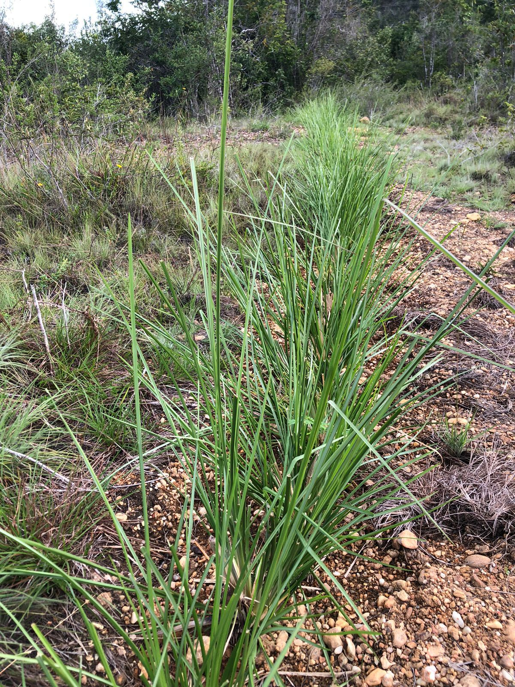

[Cordão em contorno]{.pitch-caption}
[Interceptação do escoamento superficial ao longo da encosta]{.pitch-caption-sub}
:::

::: {.pitch-media-card .pitch-media-card--photo}

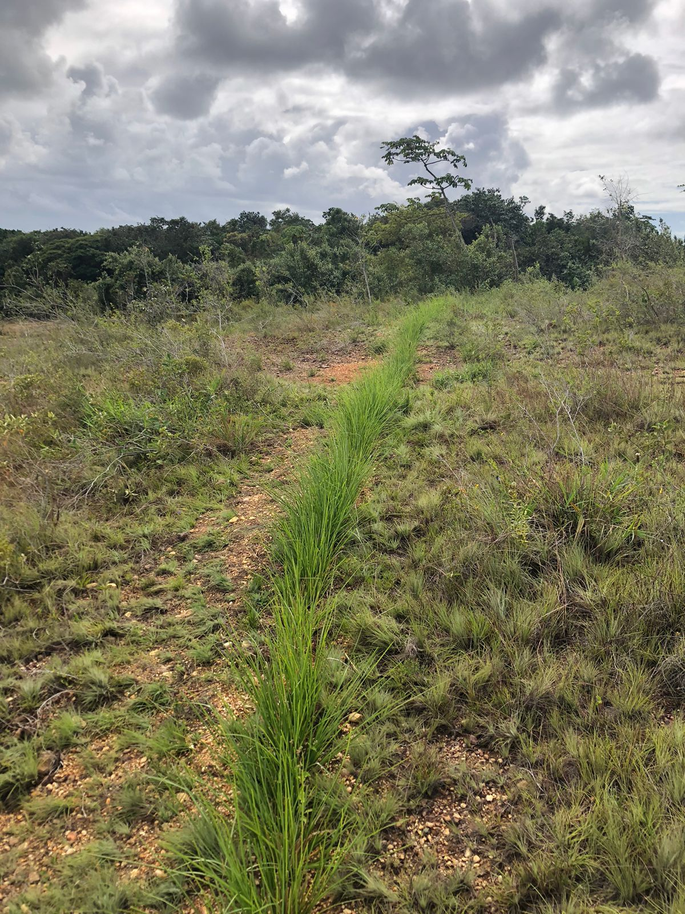

[Deposição a montante]{.pitch-caption}
[Retenção de sedimentos junto à barreira em contorno]{.pitch-caption-sub}
:::
:::

## [Atividade]{.pitch-tag .pitch-tag--gold} Atividade · Memorial de uma Unidade de Manejo {.smaller-text .lesson-slide}

::: {.pitch-grid-60}
::: {.pitch-card}
[Entregas técnicas]{.pitch-card-index}
[Conteúdo do memorial]{.pitch-heading}

1. Mapa de contribuição e justificativa do tipo de terraço.
2. Critério documentado de $EV$ e cálculo de $EH$.
3. Estimativa de vazão ou armazenamento e seção preliminar.
4. Traçado da saída e medidas de proteção.
5. Quantitativos, sequência de execução e plano de manutenção.
:::

::: {.pitch-card .pitch-card--gold}
[Critério de revisão]{.pitch-card-index}
[Coerência sistêmica]{.pitch-heading}

As decisões **geométricas**, **hidráulicas** e **operacionais** precisam ser compatíveis entre si e com a capacidade de uso da unidade de manejo.
:::
:::

# Acervo visual · Construção e locação {.section-header rotulo="Acervo"}

## [Acervo]{.pitch-tag} Registros e Esquemas de Apoio · 1 {.smaller-text .lesson-slide}

::: {.pitch-cards}
::: {.pitch-media-card .pitch-media-card--compact}

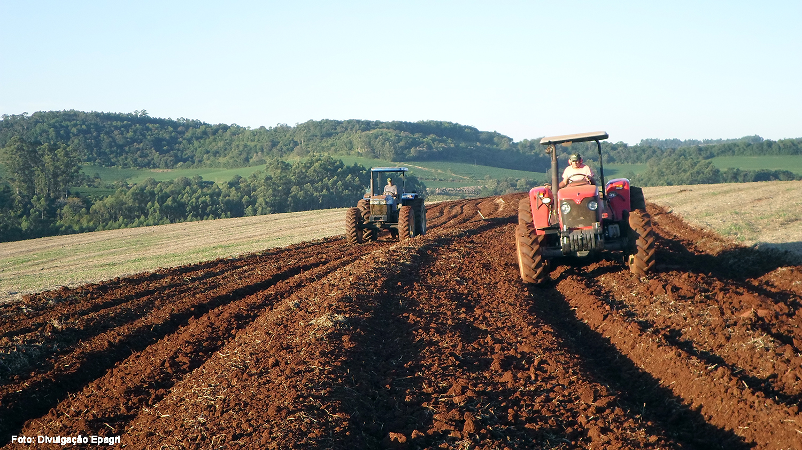

[Controle de Erosão Hídrica]{.pitch-caption}
:::

::: {.pitch-media-card .pitch-media-card--compact}

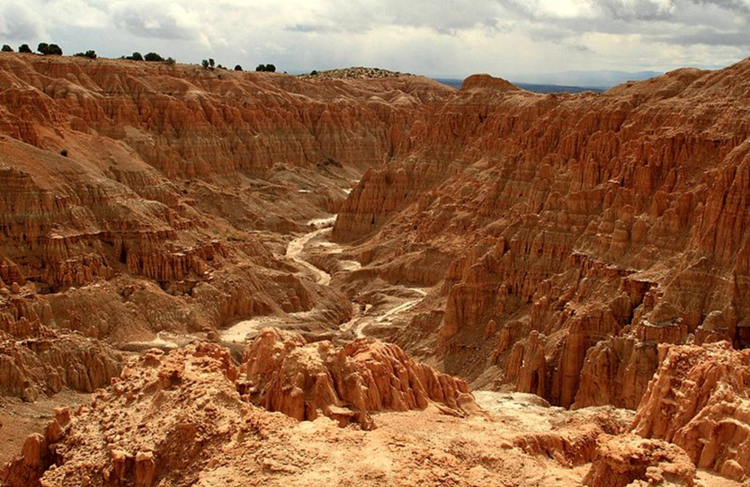

[Mapa de erosividade]{.pitch-caption}
:::

::: {.pitch-media-card .pitch-media-card--compact}

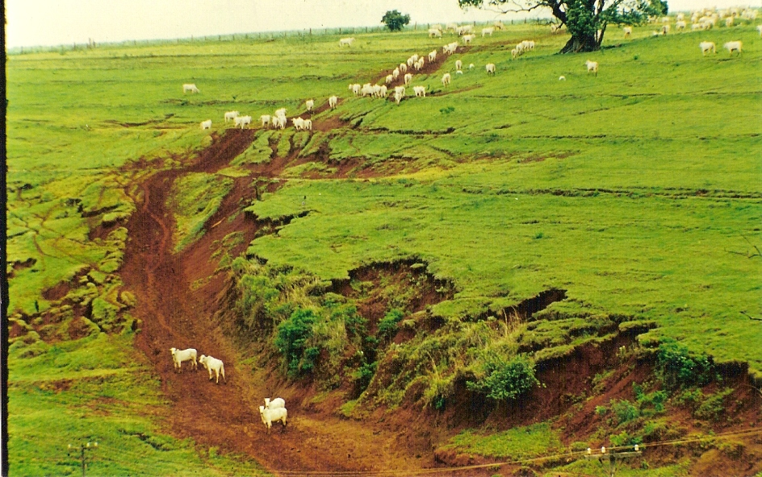

[Capacidade de uso do solo]{.pitch-caption}
:::
:::

::: {.pitch-band}
Acervo preservado da conversão original. Confira a geometria e os procedimentos com os cálculos e critérios apresentados nesta aula.
:::

## [Acervo]{.pitch-tag} Registros e Esquemas de Apoio · 2 {.smaller-text .lesson-slide}

::: {.pitch-cards}
::: {.pitch-media-card .pitch-media-card--compact}

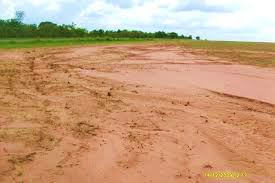

[Erosividade e uso]{.pitch-caption}
:::

::: {.pitch-media-card .pitch-media-card--compact}

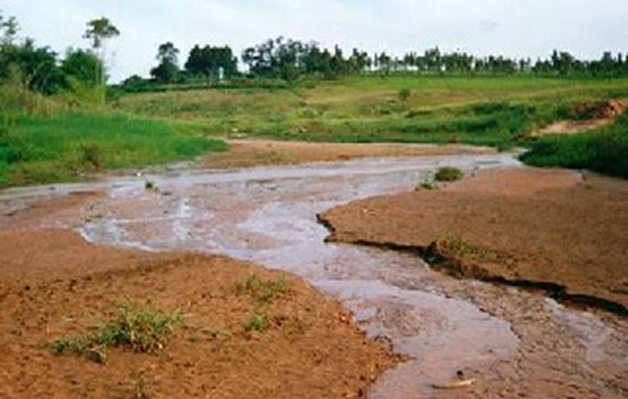

[Capacidade de uso]{.pitch-caption}
:::

::: {.pitch-media-card .pitch-media-card--compact}

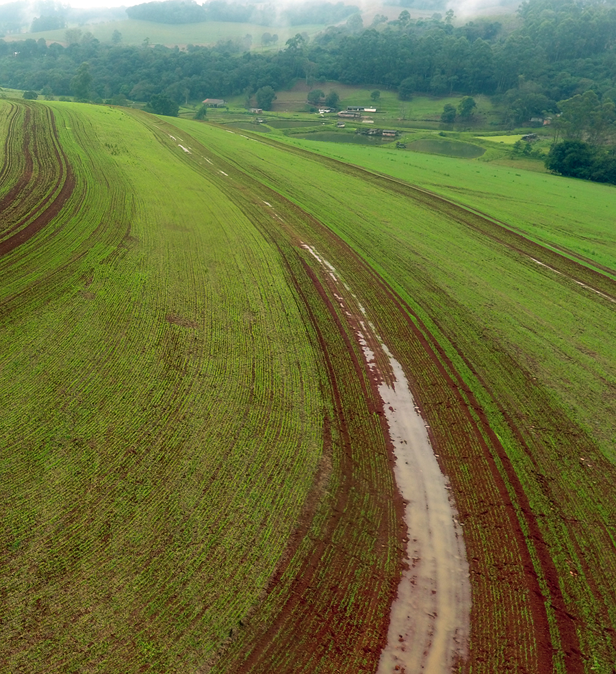

[Práticas mecânicas]{.pitch-caption}
:::
:::

::: {.pitch-band}
Acervo preservado da conversão original. Confira a geometria e os procedimentos com os cálculos e critérios apresentados nesta aula.
:::

## [Acervo]{.pitch-tag} Registros e Esquemas de Apoio · 3 {.smaller-text .lesson-slide}

::: {.pitch-cards}
::: {.pitch-media-card .pitch-media-card--compact}

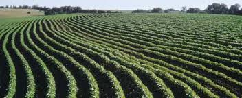

[Controle da erosão]{.pitch-caption}
:::

::: {.pitch-media-card .pitch-media-card--compact}

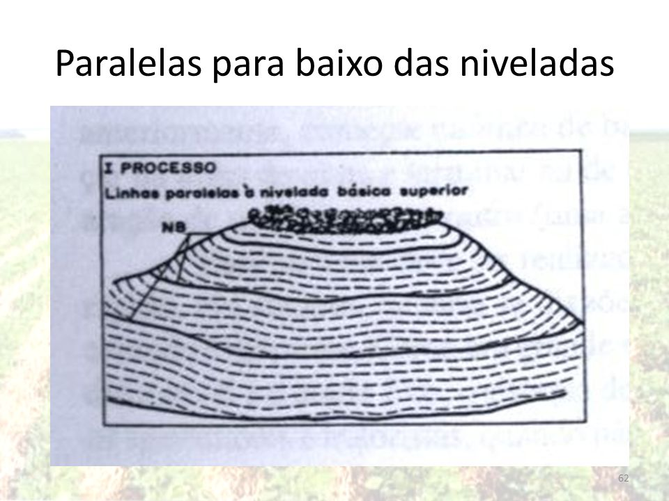

[Locação de niveladas básicas]{.pitch-caption}
:::

::: {.pitch-media-card .pitch-media-card--compact}

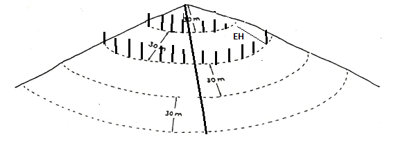

[Locação de niveladas básicas (esquema)]{.pitch-caption}
:::
:::

::: {.pitch-band}
Acervo preservado da conversão original. Confira a geometria e os procedimentos com os cálculos e critérios apresentados nesta aula.
:::

## [Acervo]{.pitch-tag} Registros e Esquemas de Apoio · 4 {.smaller-text .lesson-slide}

::: {.pitch-cards}
::: {.pitch-media-card .pitch-media-card--compact}

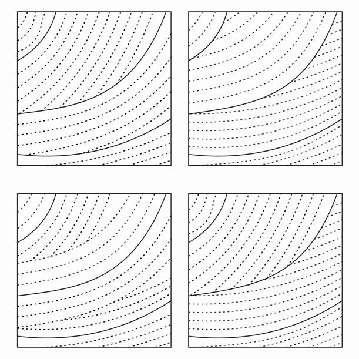

[Orientação de preparo do solo]{.pitch-caption}
:::

::: {.pitch-media-card .pitch-media-card--compact}

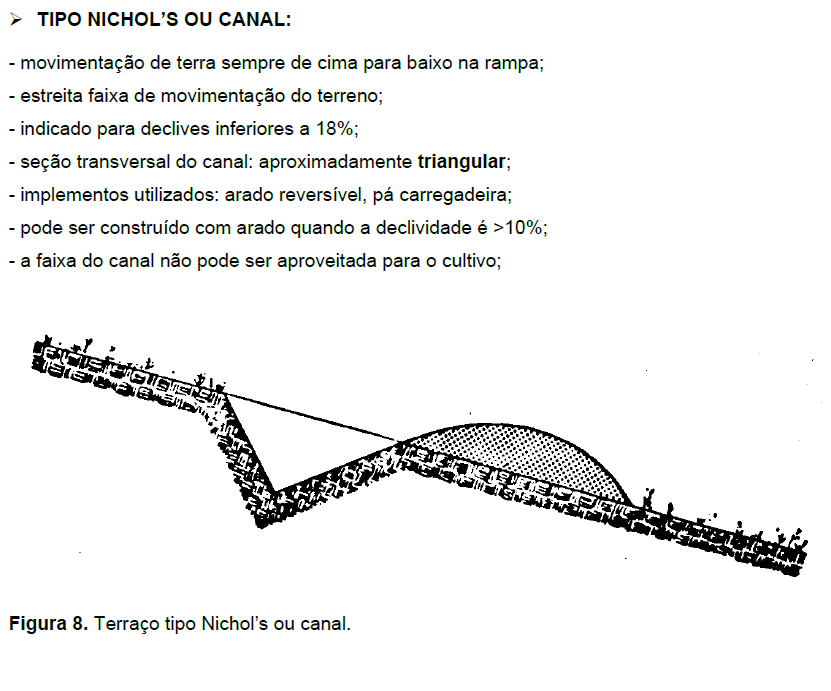

[Terraceamento]{.pitch-caption}
:::

::: {.pitch-media-card .pitch-media-card--compact}

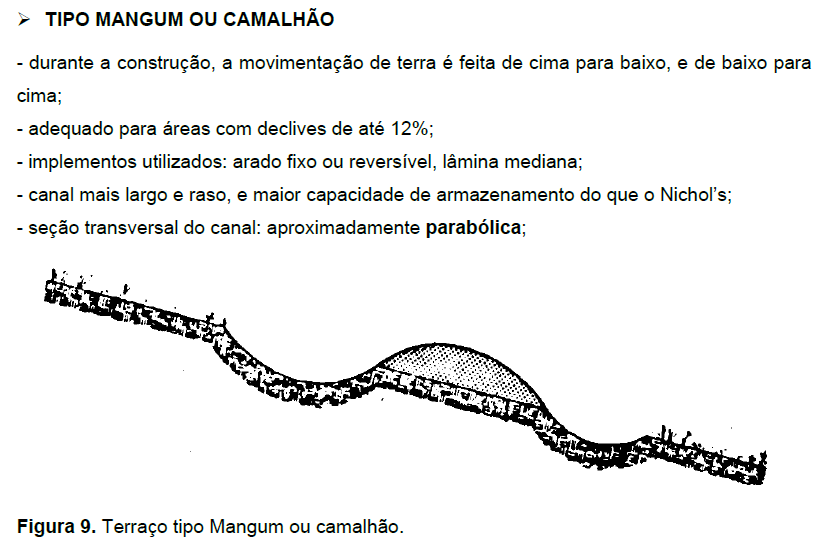

[Visão esquemática do terraceamento]{.pitch-caption}
:::
:::

::: {.pitch-band}
Acervo preservado da conversão original. Confira a geometria e os procedimentos com os cálculos e critérios apresentados nesta aula.
:::

## [Acervo]{.pitch-tag} Registros e Esquemas de Apoio · 5 {.smaller-text .lesson-slide}

::: {.pitch-cards}
::: {.pitch-media-card .pitch-media-card--compact}

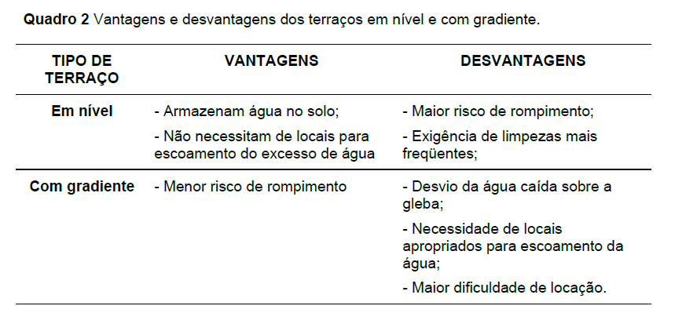

[Terraços em patamar]{.pitch-caption}
:::

::: {.pitch-media-card .pitch-media-card--compact}

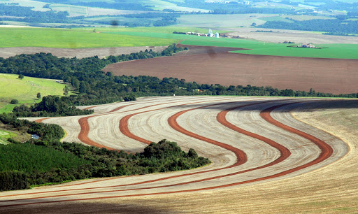

[Terraços em patamar (perfil)]{.pitch-caption}
:::

::: {.pitch-media-card .pitch-media-card--compact}

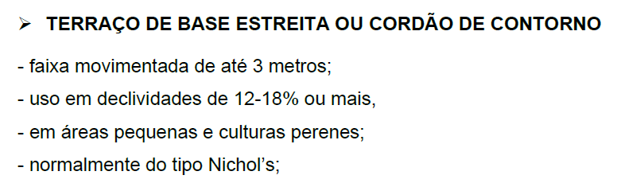

[Cálculo de declividade]{.pitch-caption}
:::
:::

::: {.pitch-band}
Acervo preservado da conversão original. Confira a geometria e os procedimentos com os cálculos e critérios apresentados nesta aula.
:::

## [Acervo]{.pitch-tag} Registros e Esquemas de Apoio · 6 {.smaller-text .lesson-slide}

::: {.pitch-cards}
::: {.pitch-media-card .pitch-media-card--compact}

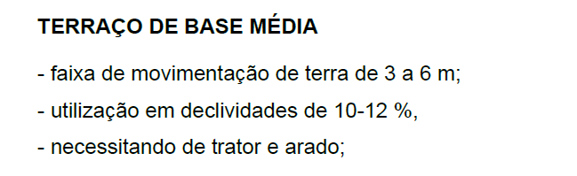

[Espaçamento]{.pitch-caption}
:::

::: {.pitch-media-card .pitch-media-card--compact}

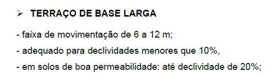

[Tabela de espaçamento]{.pitch-caption}
:::

::: {.pitch-media-card .pitch-media-card--compact}

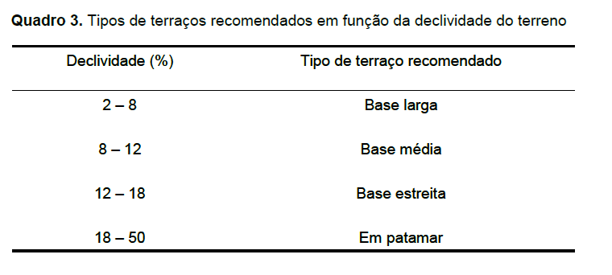

[Equipamentos]{.pitch-caption}
:::
:::

::: {.pitch-band}
Acervo preservado da conversão original. Confira a geometria e os procedimentos com os cálculos e critérios apresentados nesta aula.
:::

## [Acervo]{.pitch-tag} Registros e Esquemas de Apoio · 7 {.smaller-text .lesson-slide}

::: {.pitch-cards}
::: {.pitch-media-card .pitch-media-card--compact}

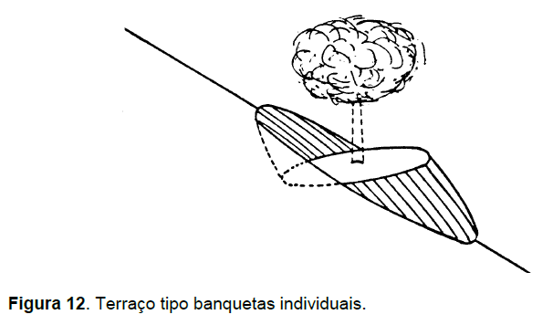

[Nível de borracha]{.pitch-caption}
:::

::: {.pitch-media-card .pitch-media-card--compact}

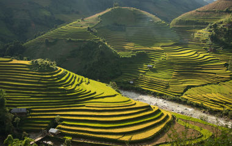

[Nível de mangueira]{.pitch-caption}
:::

::: {.pitch-media-card .pitch-media-card--compact}

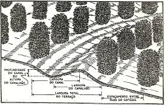

[Nível ótico]{.pitch-caption}
:::
:::

::: {.pitch-band}
Acervo preservado da conversão original. Confira a geometria e os procedimentos com os cálculos e critérios apresentados nesta aula.
:::

## [Acervo]{.pitch-tag} Registros e Esquemas de Apoio · 8 {.smaller-text .lesson-slide}

::: {.pitch-cards}
::: {.pitch-media-card .pitch-media-card--compact}

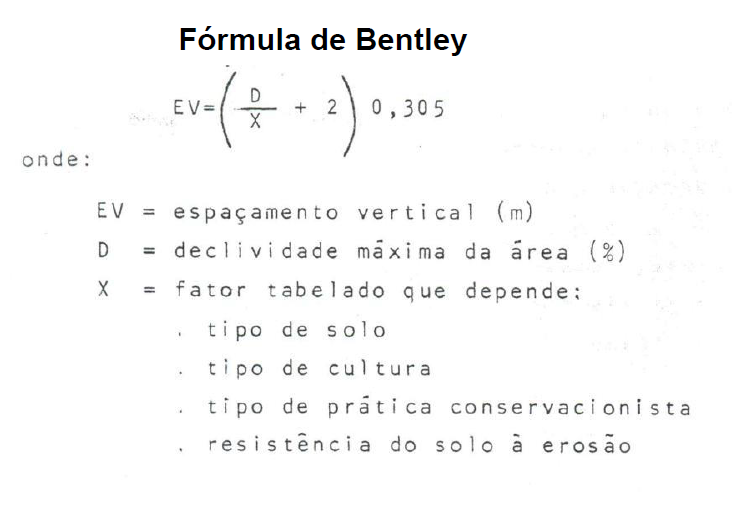

[Métodos de espaçamento]{.pitch-caption}
:::

::: {.pitch-media-card .pitch-media-card--compact}

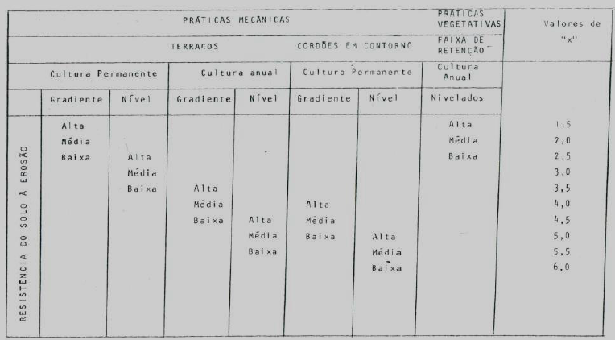

[Exemplo de cálculo]{.pitch-caption}
:::

::: {.pitch-media-card .pitch-media-card--compact}

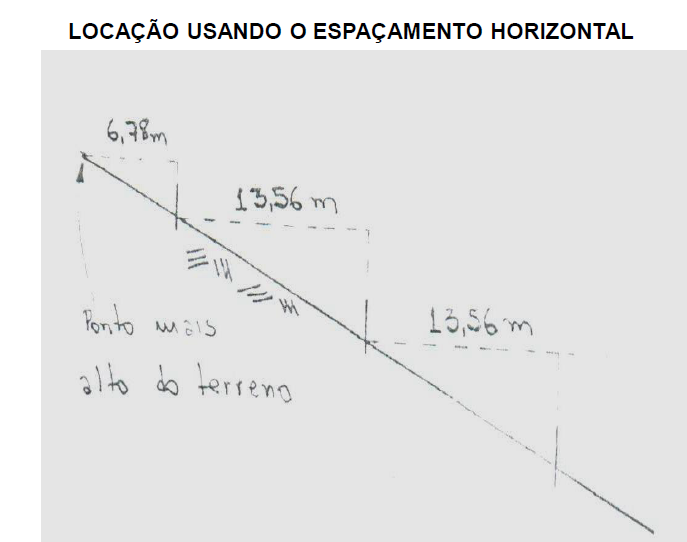

[Ponto mais alto do terreno]{.pitch-caption}
:::
:::

::: {.pitch-band}
Acervo preservado da conversão original. Confira a geometria e os procedimentos com os cálculos e critérios apresentados nesta aula.
:::

## [Acervo]{.pitch-tag} Registros e Esquemas de Apoio · 9 {.smaller-text .lesson-slide}

::: {.pitch-cards}
::: {.pitch-media-card .pitch-media-card--compact}

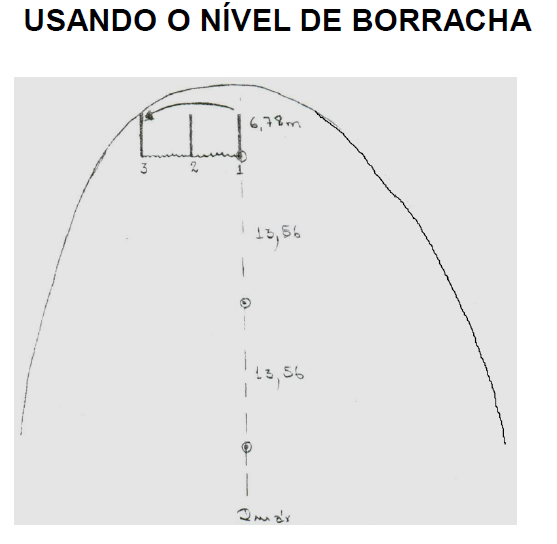

[Marcação do terreno]{.pitch-caption}
:::

::: {.pitch-media-card .pitch-media-card--compact}

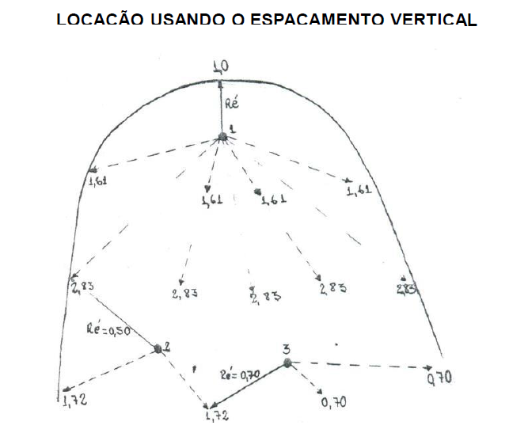

[Usando o nível ótico]{.pitch-caption}
:::

::: {.pitch-media-card .pitch-media-card--compact}

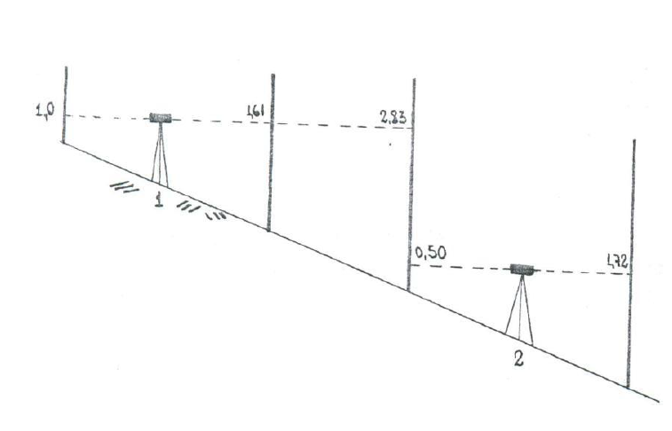

[Leitura com nível ótico]{.pitch-caption}
:::
:::

::: {.pitch-band}
Acervo preservado da conversão original. Confira a geometria e os procedimentos com os cálculos e critérios apresentados nesta aula.
:::

## [Acervo]{.pitch-tag} Registros e Esquemas de Apoio · 10 {.smaller-text .lesson-slide}

::: {.pitch-cards}
::: {.pitch-media-card .pitch-media-card--compact}

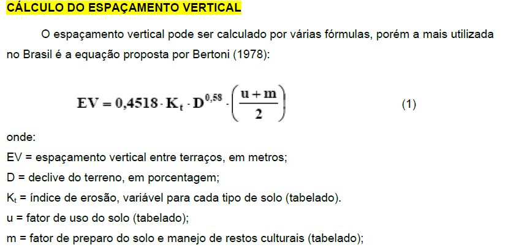

[Exemplo de cálculo]{.pitch-caption}
:::

::: {.pitch-media-card .pitch-media-card--compact}

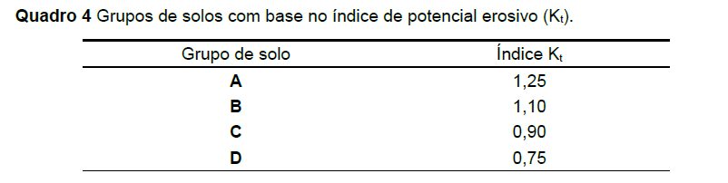

[Tabela de espaçamento]{.pitch-caption}
:::

::: {.pitch-media-card .pitch-media-card--compact}

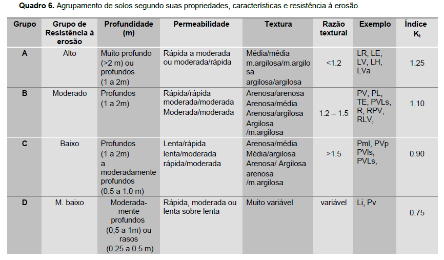

[Locação de terraços]{.pitch-caption}
:::
:::

::: {.pitch-band}
Acervo preservado da conversão original. Confira a geometria e os procedimentos com os cálculos e critérios apresentados nesta aula.
:::

## [Acervo]{.pitch-tag} Registros e Esquemas de Apoio · 11 {.smaller-text .lesson-slide}

::: {.pitch-cards}
::: {.pitch-media-card .pitch-media-card--compact}

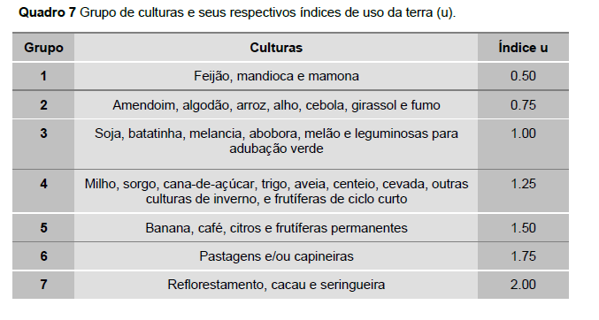

[Construção]{.pitch-caption}
:::

::: {.pitch-media-card .pitch-media-card--compact}

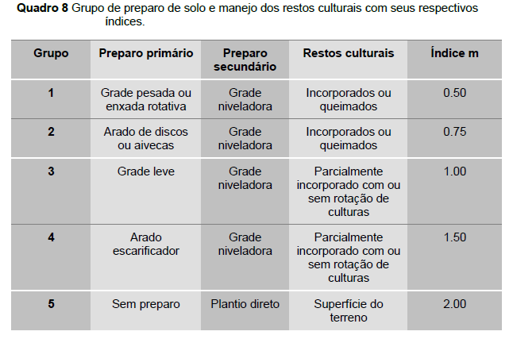

[Terraço construído]{.pitch-caption}
:::

::: {.pitch-media-card .pitch-media-card--compact}

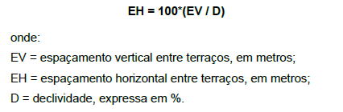

[Detalhe do terraço]{.pitch-caption}
:::
:::

::: {.pitch-band}
Acervo preservado da conversão original. Confira a geometria e os procedimentos com os cálculos e critérios apresentados nesta aula.
:::

## [Acervo]{.pitch-tag} Registros e Esquemas de Apoio · 12 {.smaller-text .lesson-slide}

::: {.pitch-cards}
::: {.pitch-media-card .pitch-media-card--compact}

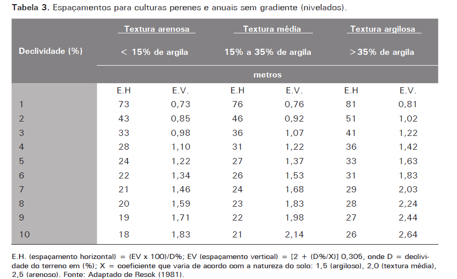

[Estruturas associadas aos terraços]{.pitch-caption}
:::

::: {.pitch-media-card .pitch-media-card--compact}

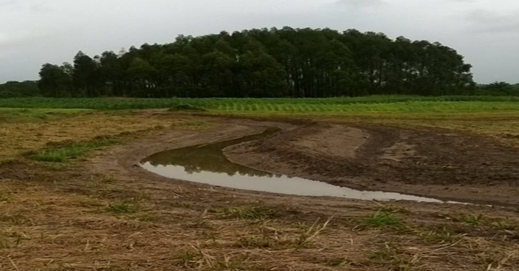

[Construção dos terraços]{.pitch-caption}
:::

::: {.pitch-media-card .pitch-media-card--compact}

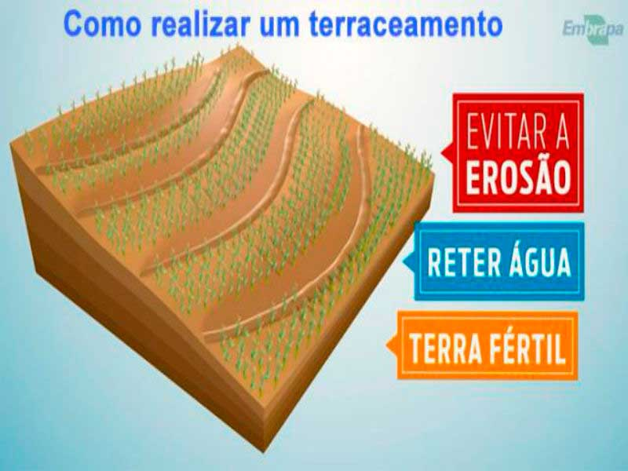

[Equipamentos para construção]{.pitch-caption}
:::
:::

::: {.pitch-band}
Acervo preservado da conversão original. Confira a geometria e os procedimentos com os cálculos e critérios apresentados nesta aula.
:::

## [Acervo]{.pitch-tag} Registros e Esquemas de Apoio · 13 {.smaller-text .lesson-slide}

::: {.pitch-cards}
::: {.pitch-media-card .pitch-media-card--compact}

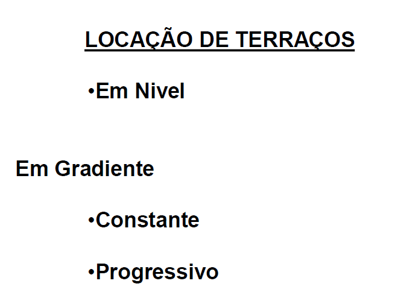

[Equipamentos]{.pitch-caption}
:::

::: {.pitch-media-card .pitch-media-card--compact}

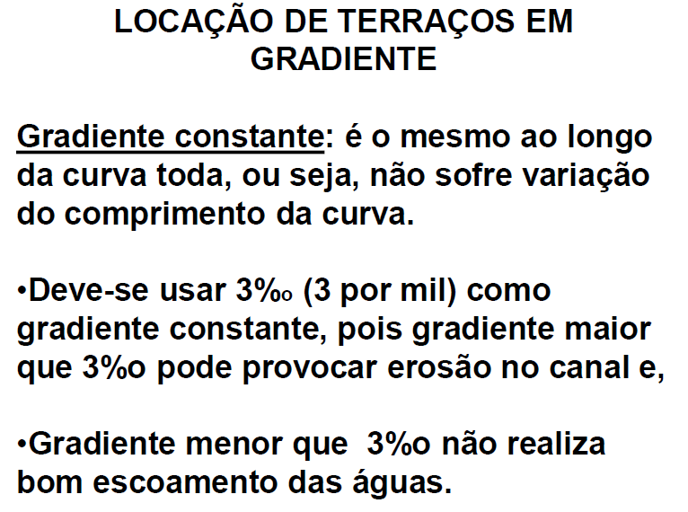

[Trator e implemento]{.pitch-caption}
:::

::: {.pitch-media-card .pitch-media-card--compact}

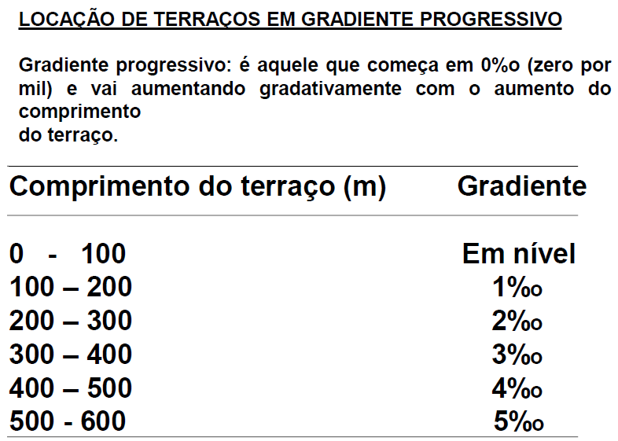

[Construção mecânica]{.pitch-caption}
:::
:::

::: {.pitch-band}
Acervo preservado da conversão original. Confira a geometria e os procedimentos com os cálculos e critérios apresentados nesta aula.
:::

## [Acervo]{.pitch-tag} Registros e Esquemas de Apoio · 14 {.smaller-text .lesson-slide}

::: {.pitch-cards}
::: {.pitch-media-card .pitch-media-card--compact}

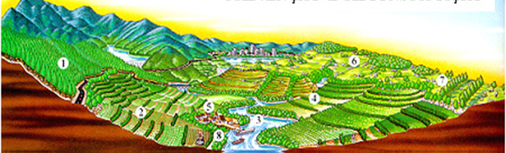

[Propriedade com planejamento conservacionista]{.pitch-caption}
:::

::: {.pitch-media-card .pitch-media-card--compact}

[Práticas conservacionistas]{.pitch-caption}
:::

::: {.pitch-media-card .pitch-media-card--compact}

[Manejo conservacionista]{.pitch-caption}
:::
:::

::: {.pitch-band}
Acervo preservado da conversão original. Confira a geometria e os procedimentos com os cálculos e critérios apresentados nesta aula.
:::
