## Aula 06 · Planejamento conservacionista e terraços {.smaller-text}

**Objetivo:** selecionar práticas pela função e calcular espaçamento e requisitos hidráulicos de terraços.

**Sequência:** capacidade de uso → controle da cobertura e do escoamento → espaçamento → seção e saída → implantação e manutenção.

# 1 · Práticas e função no sistema

## Combinar práticas vegetativas, edáficas e mecânicas {.smaller-text}

| Grupo | Exemplos | Função predominante |
|---|---|---|
| Vegetativas | Cobertura, faixas e cordões vegetativos | Proteger a superfície e reduzir concentração |
| Edáficas e de manejo | Rotação, aporte orgânico, correções indicadas e tráfego controlado | Melhorar as condições do solo |
| Mecânicas | Terraços, canais e bacias dimensionados | Interceptar, armazenar ou conduzir água |

Uma prática mecânica não dispensa cobertura nem planejamento do uso. Avalie também estradas e contribuições externas ao talhão.

## Escolher a partir da aptidão e da capacidade de uso {.smaller-text}

- Levante relevo, profundidade, drenagem, erodibilidade e impedimentos.
- Compare o uso proposto à capacidade de sustentá-lo.
- Preserve áreas de função hídrica e ecológica.
- Defina unidades de manejo com características semelhantes.
- Mapeie caminhos preferenciais e saída da água.

**Decisão:** há situações em que alterar o uso é mais adequado do que intensificar obras para manter uma atividade incompatível.

## Sistema de Capacidade de Uso das Terras (Classes I–VIII) e Microbacias {.smaller-text}

| Grupo / Classes | Aptidão e Limitações | Diretriz de Manejo e Bioengenharia |
|:---|:---|:---|
| **Grupo A (I a IV)** | Culturas anuais (I sem restrição; II–III restrições moderadas a severas; IV uso ocasional) | Práticas edáficas + vegetativas (I–II) associadas a **terraceamento e canais escoadouros** (III–IV) |
| **Grupo B (V a VII)** | Pastagens, silvicultura e culturas perenes (declividade alta, pedregosidade ou drenagem restrita) | Cobertura permanente, **cordões vegetativos, faixas de vetiver** e controle de carga animal |
| **Grupo C (VIII)** | Terras impróprias para exploração agropecuária (escarpas, afloramentos, APPs) | Preservação integral, **PRAD e estabilização biotécnica** |

- **Unidade de planejamento:** o projeto conservacionista deve ser integrado na escala da **Microbacia Hidrográfica** (conectando estradas rurais, divisores de água, encostas e rede de drenagem).

## Práticas edáficas e vegetativas na base do sistema conservacionista {.smaller-text}

- **Práticas edáficas (melhoram a estrutura, agregação e infiltração):**
  - Calagem e gessagem (floculação de argilas e aprofundamento radicular); adubação orgânica e equilíbrio nutricional para rápido fechamento do dossel;
  - Subsolagem/escarificação pontual em solo friável apenas quando houver camada compactada diagnosticada ($RP > 2{,}0\text{ MPa}$).
- **Práticas vegetativas (dissipam energia cinética e reduzem $C$ e $L$):**
  - **Sistema Plantio Direto (SPD) e cultivo mínimo:** manutenção de palhada permanente ($\ge 70\%$ de cobertura), rotação de culturas e **adubação verde** (leguminosas + gramíneas);
  - **Cultivo em contorno, faixas de retenção e cordões vegetativos** (*Chrysopogon zizanioides*, *Pennisetum*, leguminosas arbustivas) e **quebra-ventos** contra erosão eólica.

# 2 · Terraços em nível e em gradiente

## Retenção e condução exigem critérios diferentes {.smaller-text}

| Tipo | Destino principal da água | Verificações |
|---|---|---|
| Em nível | Armazenamento temporário e infiltração | Volume útil, infiltração, estabilidade e rota de excedência |
| Em gradiente | Condução a uma saída protegida | Vazão, geometria, erosão e conexão com o canal |

Baixa infiltração ou saturação prolongada podem limitar estruturas de retenção. O nome da classe pedológica, sozinho, não impõe uma proibição ou uma escolha automática.

## Geometria e espaçamento {.smaller-text}

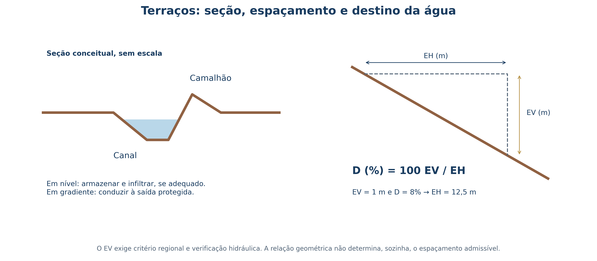{fig-align="center" width="96%"}

## Espaçamento vertical e horizontal {.smaller-text}

$$D=100\frac{EV}{EH}qquad EH=\frac{100EV}{D}$$

- $EV$: diferença de cota entre linhas consecutivas, em m.
- $EH$: distância horizontal medida na direção do declive, em m.
- $D$: declividade do terreno em porcentagem.

**Exemplo didático:** para $D=8%$ e um $EV$ preliminar de 1,0 m → $EH=12{,}5$ m.

O EV adotado precisa ser definido por método regional e verificado quanto a solo, manejo, operação e hidráulica. A relação geométrica, sozinha, não o dimensiona.

## Métodos empíricos: declarar origem e limites {.smaller-text}

- Equações e tabelas de espaçamento foram desenvolvidas para condições específicas.
- Registre referência, unidades, grupo de solo e fatores de cobertura ou operação.
- Não transfira coeficientes de uma tabela sem verificar sua legenda.
- Ajuste o traçado à topografia real e à circulação de máquinas.
- Submeta o espaçamento escolhido à verificação hidráulica da seção e da saída.

**Para comparação em aula:** aplique dois critérios documentados ao mesmo talhão e explique por que os resultados diferem.

## Quantidade de faixas e área de contribuição {.smaller-text}

Para rampa horizontal de 200 m e EH de 12,5 m:

$$N_{\mathrm{intervalos}}=\frac{200}{12{,}5}=16$$

O número final de obras depende dos limites e das linhas de topo e de base.

Em um trecho regular, com comprimento da linha de 400 m:

$$A_b\approx400\times12{,}5=5.000 \mathrm{m^2}=0{,}50 \mathrm{ha}$$

Contribuições externas, cabeceiras e irregularidades exigem delimitação adicional.

# 3 · Verificação hidráulica

## Terraço em nível: armazenamento útil {.smaller-text}

Se uma área de 1 ha produzir lâmina escoada de 30 mm:

$$V_e=10\times30\times1=300 \mathrm{m^3}$$

Para 200 m de canal com seção útil uniforme:

$$A_{\mathrm{útil}}\ge \frac{300}{200}=1{,}50 \mathrm{m^2}$$

Esse cálculo é preliminar. Considere variações de cota, sedimentação, infiltração ao longo do evento, borda livre e transbordamento seguro. Se a lâmina já foi estimada como escoamento, não desconte novamente a mesma perda por infiltração.

## Terraço em gradiente: vazão e descarga {.smaller-text}

No exemplo de 0,50 ha, com hipóteses didáticas $C=0{,}50$ e $i=120$ mm h⁻¹:

$$Q_p=\frac{0{,}50\times120\times0{,}50}{360}=0{,}0833 \mathrm{m^3,s^{-1}}$$

- Dimensione a seção para a vazão e o revestimento previstos.
- Verifique velocidade e tensão aplicada.
- Some áreas contribuintes e considere seus tempos de resposta no canal coletor.
- Construa e estabilize a saída antes de conectar os terraços.

As Aulas 07 e 08 desenvolvem a verificação por Manning.

## Seção transversal e operação agrícola {.smaller-text}

- Defina canal, camalhão, fundação e cota de coroamento.
- Compatibilize largura e taludes com solo e equipamentos.
- Separe o solo superficial destinado à revegetação.
- Especifique compactação nas zonas estruturais.
- Proteja o canal e a saída contra erosão antes das chuvas.
- Evite bloqueios e atalhos de tráfego que interrompam a continuidade.

Volume de corte, volume útil de armazenamento e volume compactado são grandezas diferentes.

# 4 · Locação, implantação e desempenho

## Sequência executiva e pontos de controle {.smaller-text}

1. Levantar cotas e confirmar contribuição e saída.
2. Locar linhas, conexões e estruturas complementares.
3. Preparar o terreno e executar corte e aterro.
4. Conferir seção, declividade longitudinal e compactação especificada.
5. Implantar cobertura e proteção temporária.
6. Registrar o estado inicial e inspecionar após chuvas.

**Corrija:** depressões inesperadas, erosão na descarga, recalques, rompimento do camalhão e acúmulo que reduza a seção útil.

## Cordões de contorno: observar a função em campo {.smaller-text}

:::: {.columns}
::: {.column width="50%"}

{fig-align="center" width="90%"}

:::
::: {.column width="50%"}

{fig-align="center" width="90%"}

:::
::::

## Atividade · Memorial de uma unidade de manejo {.smaller-text}

Produza:

- Mapa de contribuição e justificativa do tipo de terraço.
- Critério documentado de EV e cálculo de EH.
- Estimativa de vazão ou armazenamento e seção preliminar.
- Traçado da saída e medidas de proteção.
- Quantitativos, sequência de execução e plano de manutenção.

**Critério de revisão:** as decisões geométricas, hidráulicas e operacionais precisam ser compatíveis entre si.

# Acervo visual · Construção e locação

## Registros e esquemas de apoio · 1 {.smaller-text}

:::: {.columns}
::: {.column width="33%"}

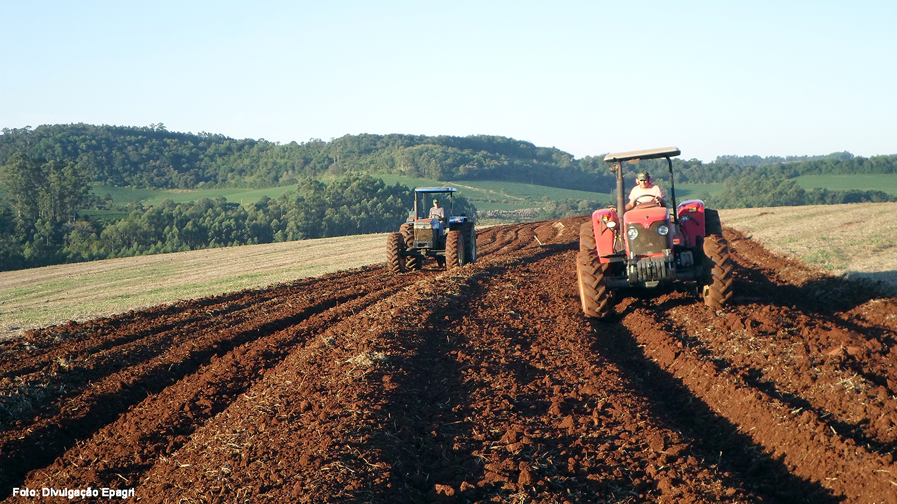{fig-align="center" width="95%"}

:::
::: {.column width="33%"}

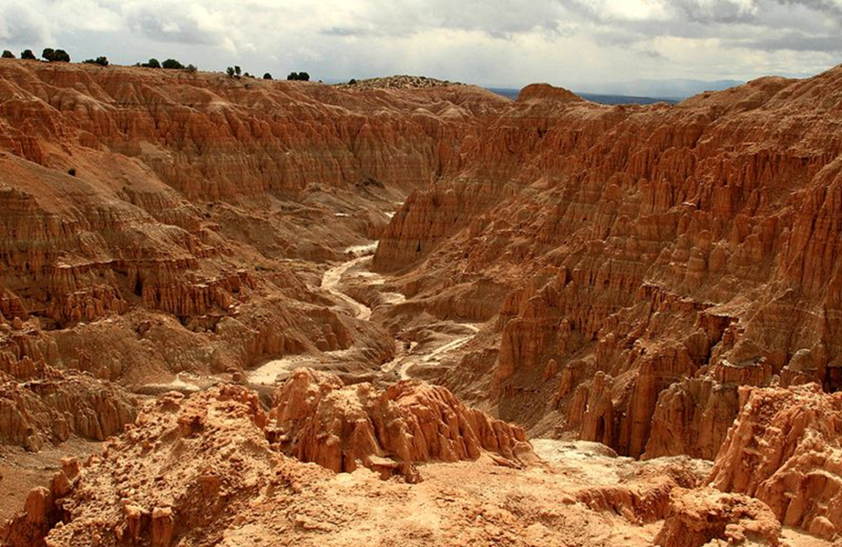{fig-align="center" width="95%"}

:::
::: {.column width="33%"}

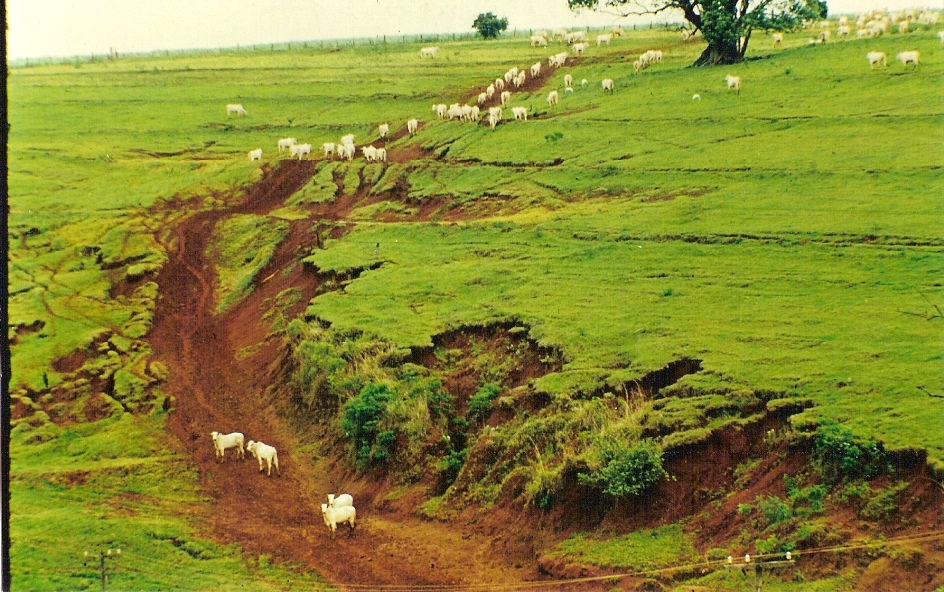{fig-align="center" width="95%"}

:::
::::

Acervo preservado da conversão original. Confira a geometria e os procedimentos com os cálculos e critérios apresentados nesta aula.

## Registros e esquemas de apoio · 2 {.smaller-text}

:::: {.columns}
::: {.column width="33%"}

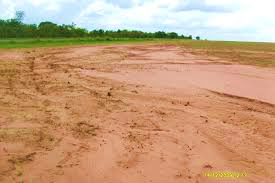{fig-align="center" width="95%"}

:::
::: {.column width="33%"}

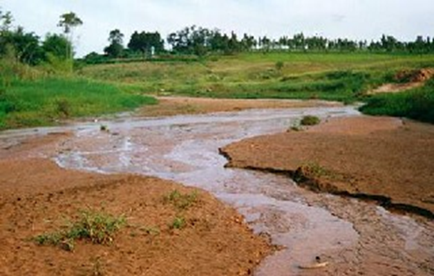{fig-align="center" width="95%"}

:::
::: {.column width="33%"}

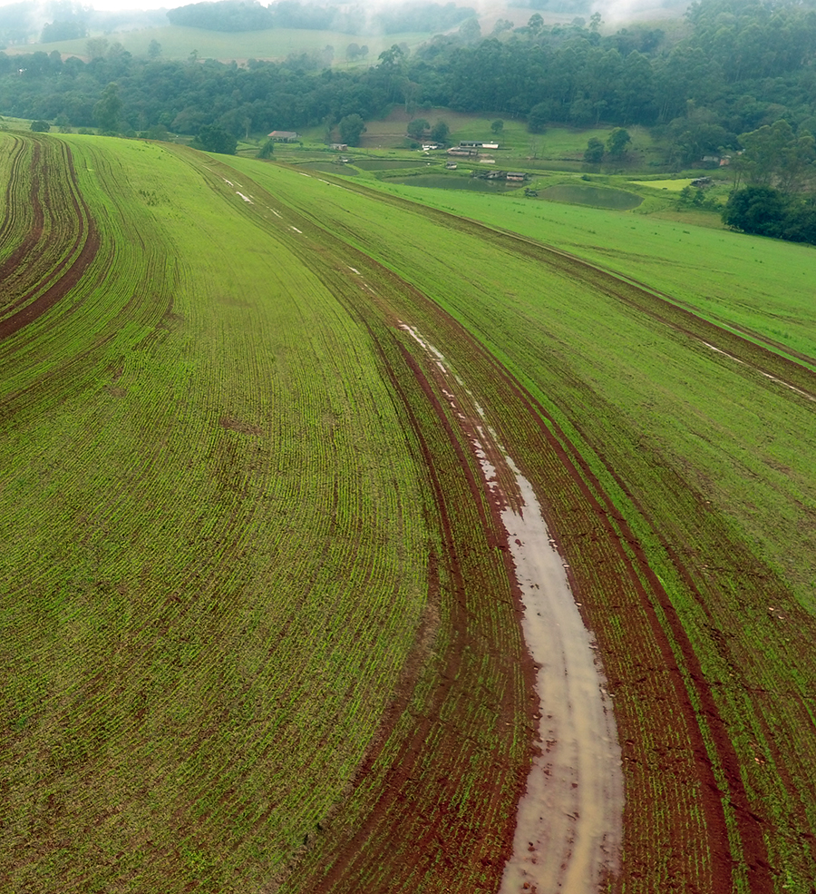{fig-align="center" width="95%"}

:::
::::

Acervo preservado da conversão original. Confira a geometria e os procedimentos com os cálculos e critérios apresentados nesta aula.

## Registros e esquemas de apoio · 3 {.smaller-text}

:::: {.columns}
::: {.column width="33%"}

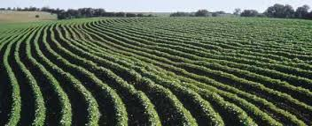{fig-align="center" width="95%"}

:::
::: {.column width="33%"}

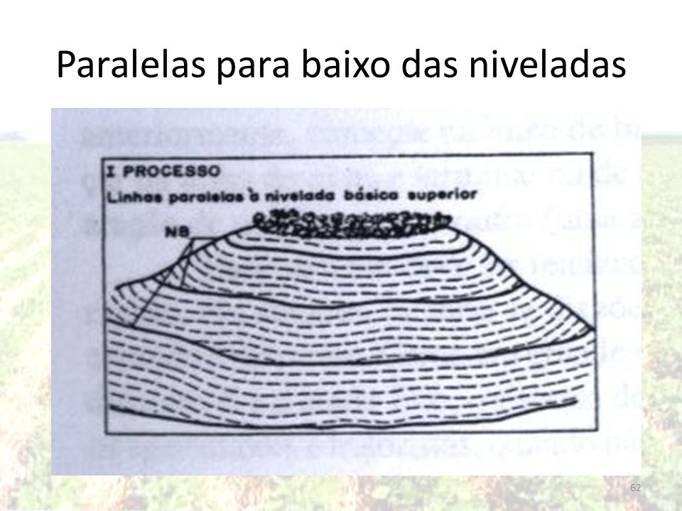{fig-align="center" width="95%"}

:::
::: {.column width="33%"}

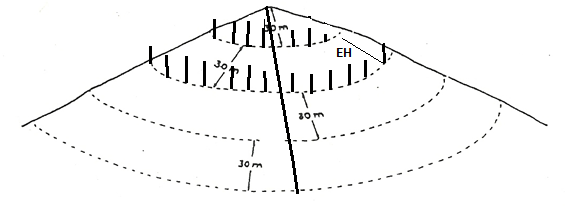{fig-align="center" width="95%"}

:::
::::

Acervo preservado da conversão original. Confira a geometria e os procedimentos com os cálculos e critérios apresentados nesta aula.

## Registros e esquemas de apoio · 4 {.smaller-text}

:::: {.columns}
::: {.column width="33%"}

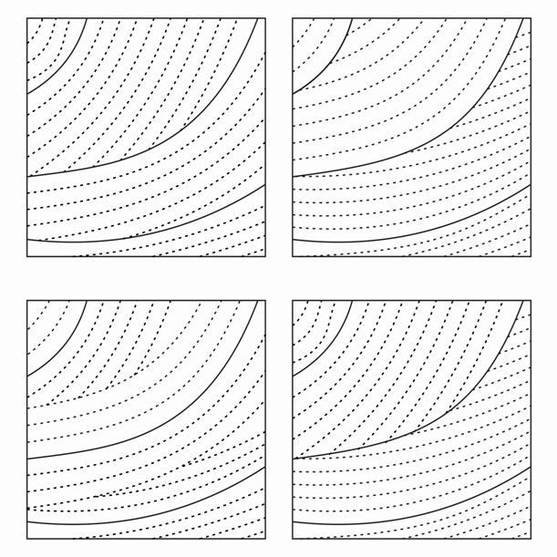{fig-align="center" width="95%"}

:::
::: {.column width="33%"}

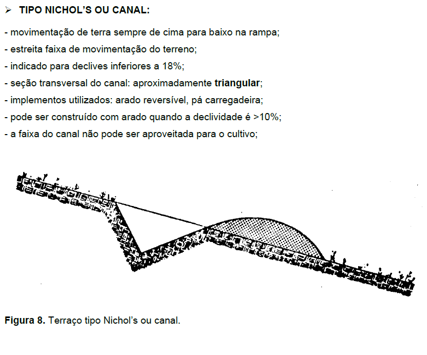{fig-align="center" width="95%"}

:::
::: {.column width="33%"}

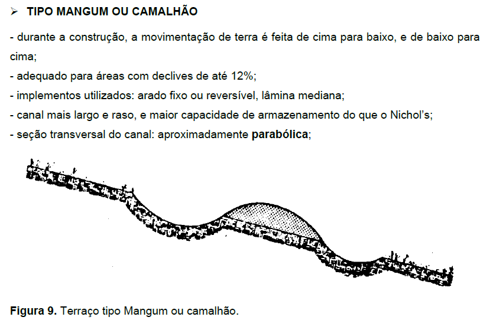{fig-align="center" width="95%"}

:::
::::

Acervo preservado da conversão original. Confira a geometria e os procedimentos com os cálculos e critérios apresentados nesta aula.

## Registros e esquemas de apoio · 5 {.smaller-text}

:::: {.columns}
::: {.column width="33%"}

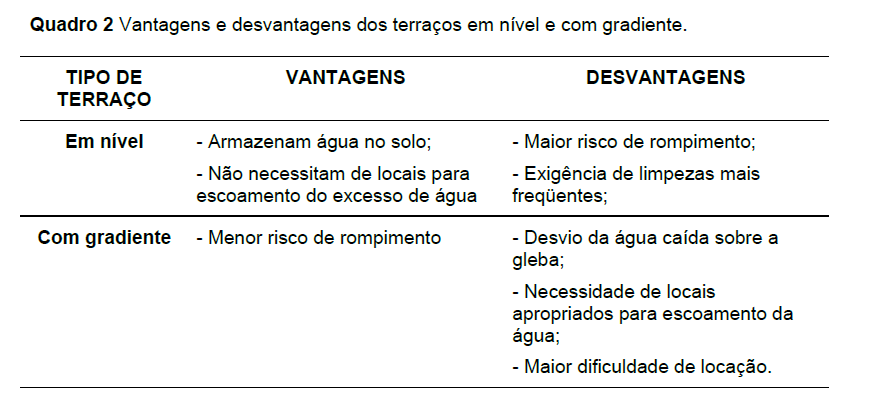{fig-align="center" width="95%"}

:::
::: {.column width="33%"}

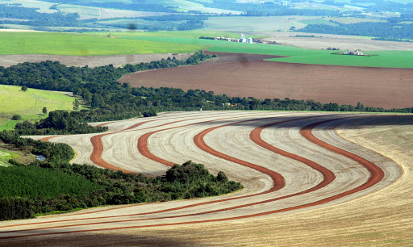{fig-align="center" width="95%"}

:::
::: {.column width="33%"}

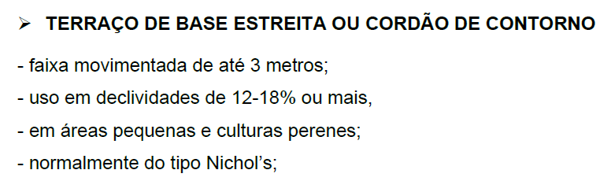{fig-align="center" width="95%"}

:::
::::

Acervo preservado da conversão original. Confira a geometria e os procedimentos com os cálculos e critérios apresentados nesta aula.

## Registros e esquemas de apoio · 6 {.smaller-text}

:::: {.columns}
::: {.column width="33%"}

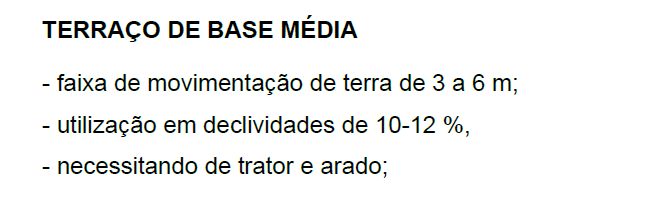{fig-align="center" width="95%"}

:::
::: {.column width="33%"}

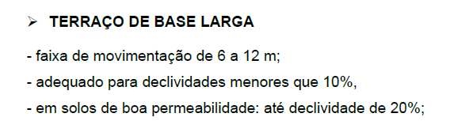{fig-align="center" width="95%"}

:::
::: {.column width="33%"}

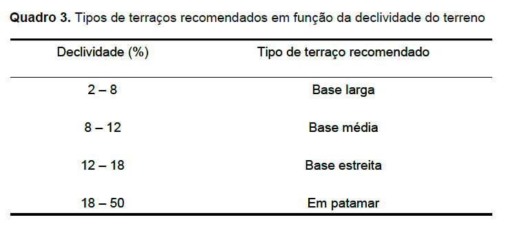{fig-align="center" width="95%"}

:::
::::

Acervo preservado da conversão original. Confira a geometria e os procedimentos com os cálculos e critérios apresentados nesta aula.

## Registros e esquemas de apoio · 7 {.smaller-text}

:::: {.columns}
::: {.column width="33%"}

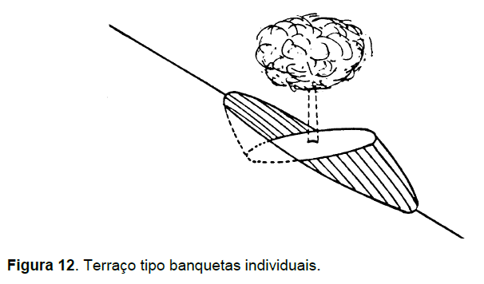{fig-align="center" width="95%"}

:::
::: {.column width="33%"}

{fig-align="center" width="95%"}

:::
::: {.column width="33%"}

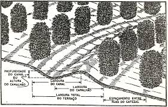{fig-align="center" width="95%"}

:::
::::

Acervo preservado da conversão original. Confira a geometria e os procedimentos com os cálculos e critérios apresentados nesta aula.

## Registros e esquemas de apoio · 8 {.smaller-text}

:::: {.columns}
::: {.column width="33%"}

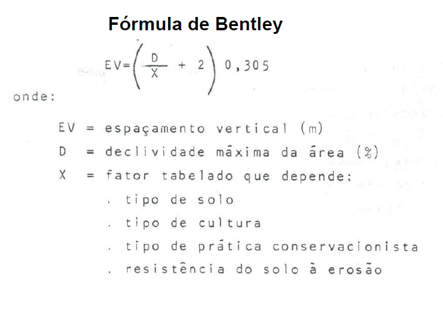{fig-align="center" width="95%"}

:::
::: {.column width="33%"}

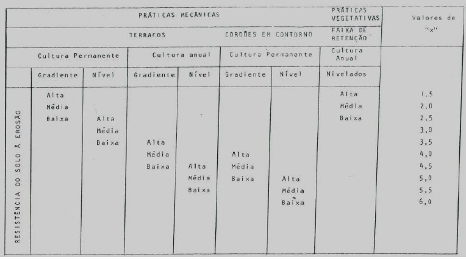{fig-align="center" width="95%"}

:::
::: {.column width="33%"}

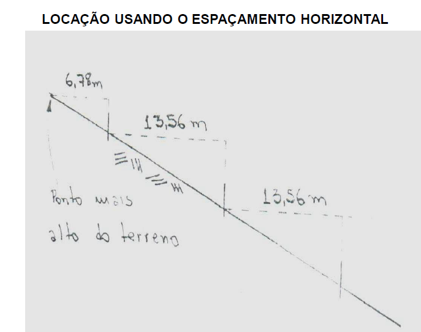{fig-align="center" width="95%"}

:::
::::

Acervo preservado da conversão original. Confira a geometria e os procedimentos com os cálculos e critérios apresentados nesta aula.

## Registros e esquemas de apoio · 9 {.smaller-text}

:::: {.columns}
::: {.column width="33%"}

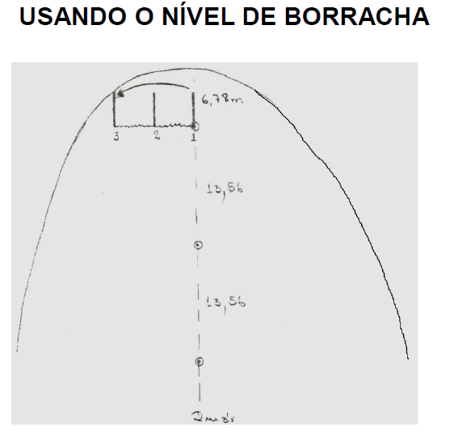{fig-align="center" width="95%"}

:::
::: {.column width="33%"}

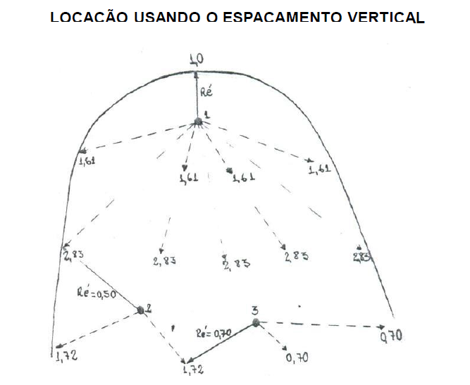{fig-align="center" width="95%"}

:::
::: {.column width="33%"}

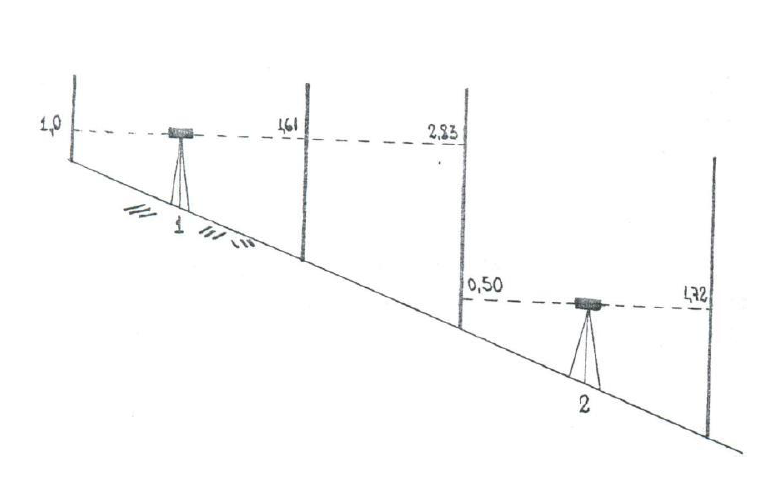{fig-align="center" width="95%"}

:::
::::

Acervo preservado da conversão original. Confira a geometria e os procedimentos com os cálculos e critérios apresentados nesta aula.

## Registros e esquemas de apoio · 10 {.smaller-text}

:::: {.columns}
::: {.column width="33%"}

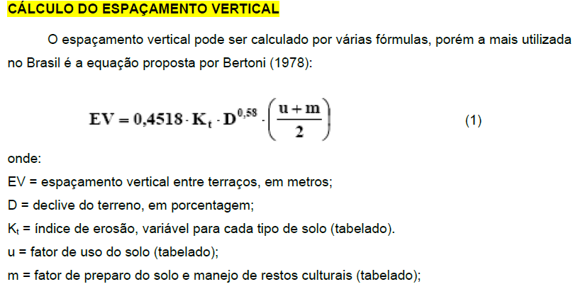{fig-align="center" width="95%"}

:::
::: {.column width="33%"}

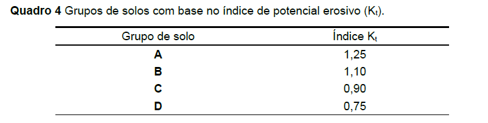{fig-align="center" width="95%"}

:::
::: {.column width="33%"}

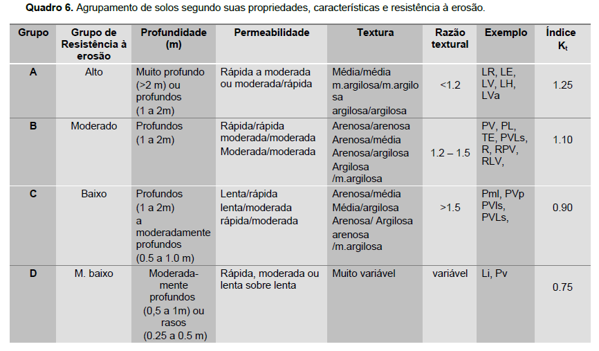{fig-align="center" width="95%"}

:::
::::

Acervo preservado da conversão original. Confira a geometria e os procedimentos com os cálculos e critérios apresentados nesta aula.

## Registros e esquemas de apoio · 11 {.smaller-text}

:::: {.columns}
::: {.column width="33%"}

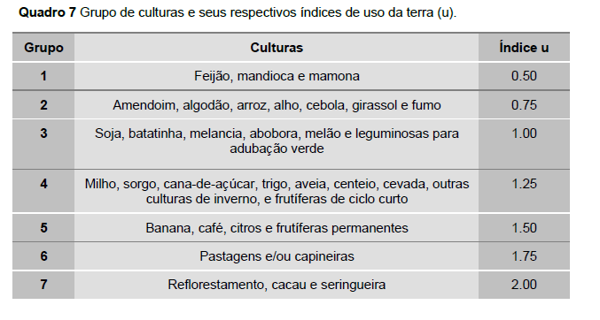{fig-align="center" width="95%"}

:::
::: {.column width="33%"}

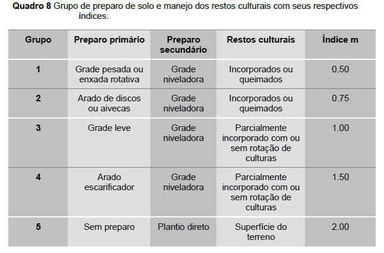{fig-align="center" width="95%"}

:::
::: {.column width="33%"}

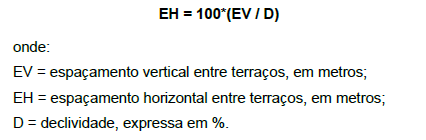{fig-align="center" width="95%"}

:::
::::

Acervo preservado da conversão original. Confira a geometria e os procedimentos com os cálculos e critérios apresentados nesta aula.

## Registros e esquemas de apoio · 12 {.smaller-text}

:::: {.columns}
::: {.column width="33%"}

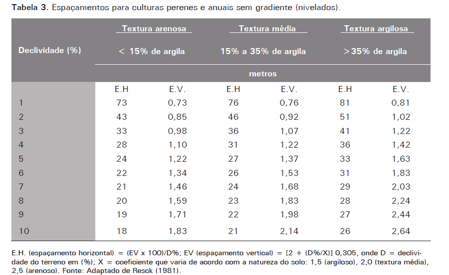{fig-align="center" width="95%"}

:::
::: {.column width="33%"}

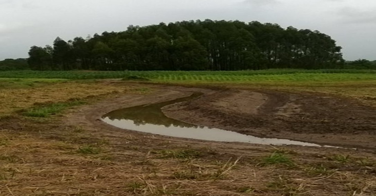{fig-align="center" width="95%"}

:::
::: {.column width="33%"}

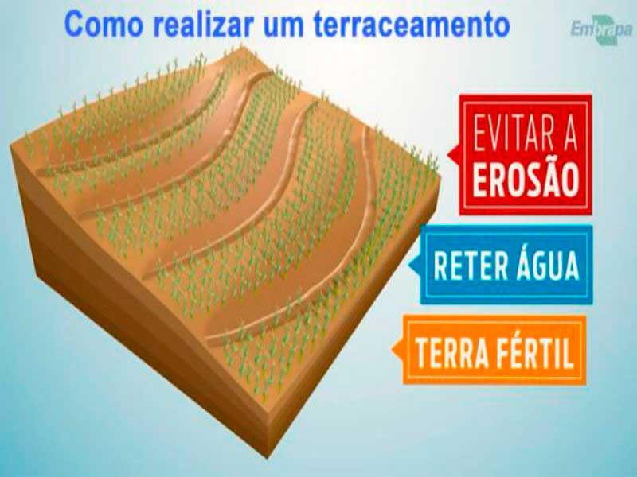{fig-align="center" width="95%"}

:::
::::

Acervo preservado da conversão original. Confira a geometria e os procedimentos com os cálculos e critérios apresentados nesta aula.

## Registros e esquemas de apoio · 13 {.smaller-text}

:::: {.columns}
::: {.column width="33%"}

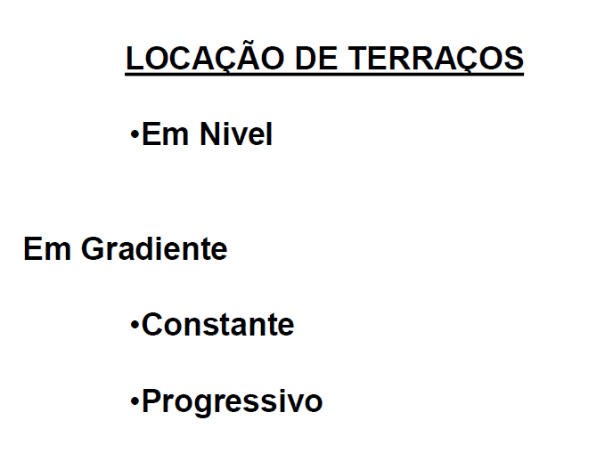{fig-align="center" width="95%"}

:::
::: {.column width="33%"}

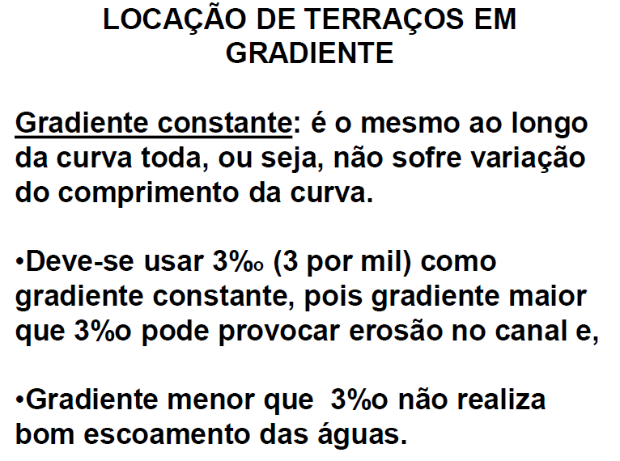{fig-align="center" width="95%"}

:::
::: {.column width="33%"}

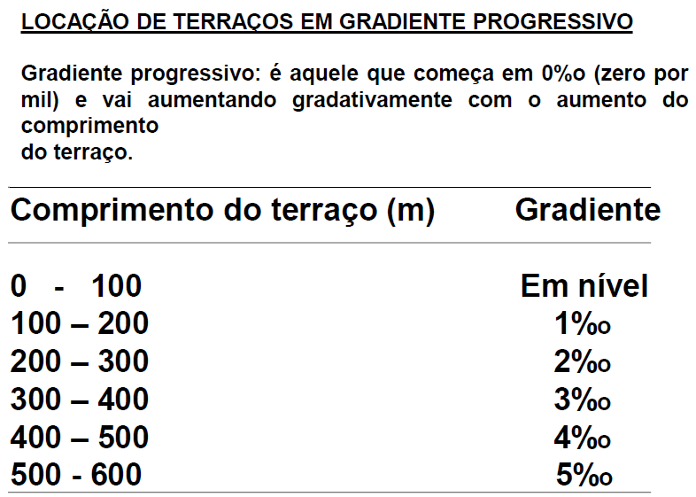{fig-align="center" width="95%"}

:::
::::

Acervo preservado da conversão original. Confira a geometria e os procedimentos com os cálculos e critérios apresentados nesta aula.

## Registros e esquemas de apoio · 14 {.smaller-text}

:::: {.columns}
::: {.column width="33%"}

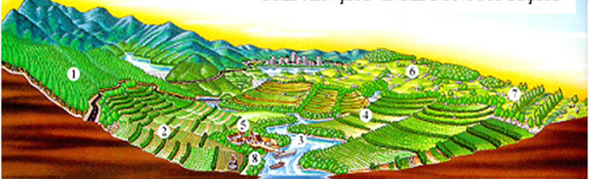{fig-align="center" width="95%"}

:::
::: {.column width="33%"}

{fig-align="center" width="95%"}

:::
::: {.column width="33%"}

{fig-align="center" width="95%"}

:::
::::

Acervo preservado da conversão original. Confira a geometria e os procedimentos com os cálculos e critérios apresentados nesta aula.
