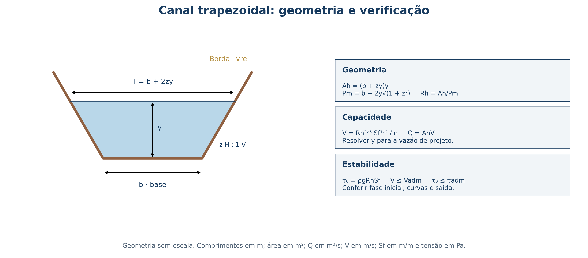
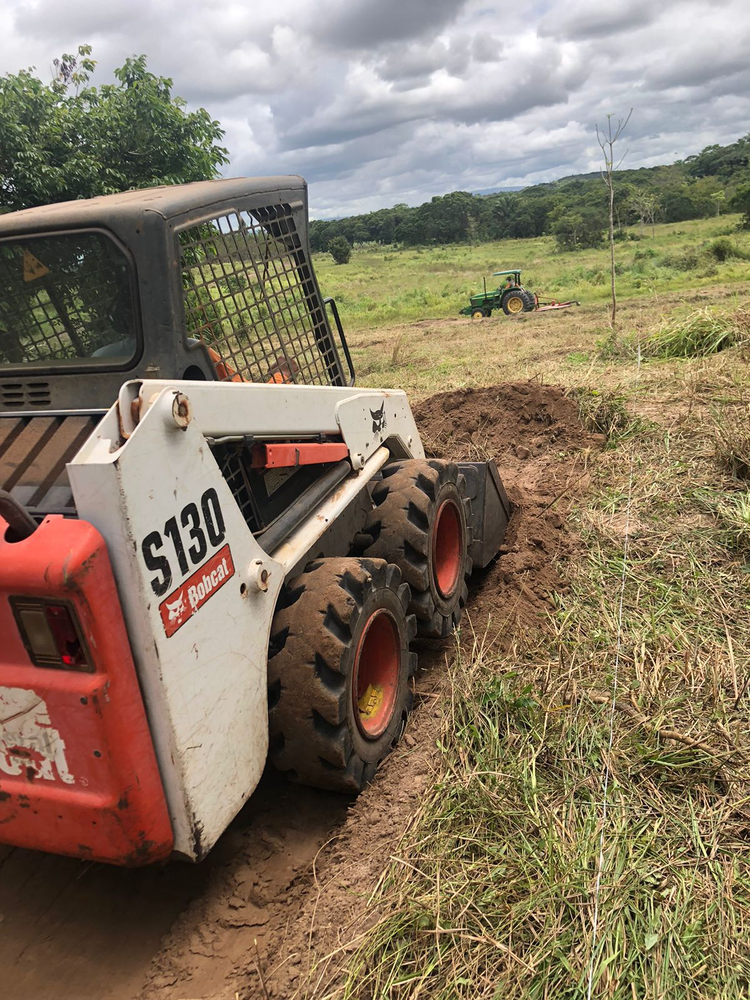
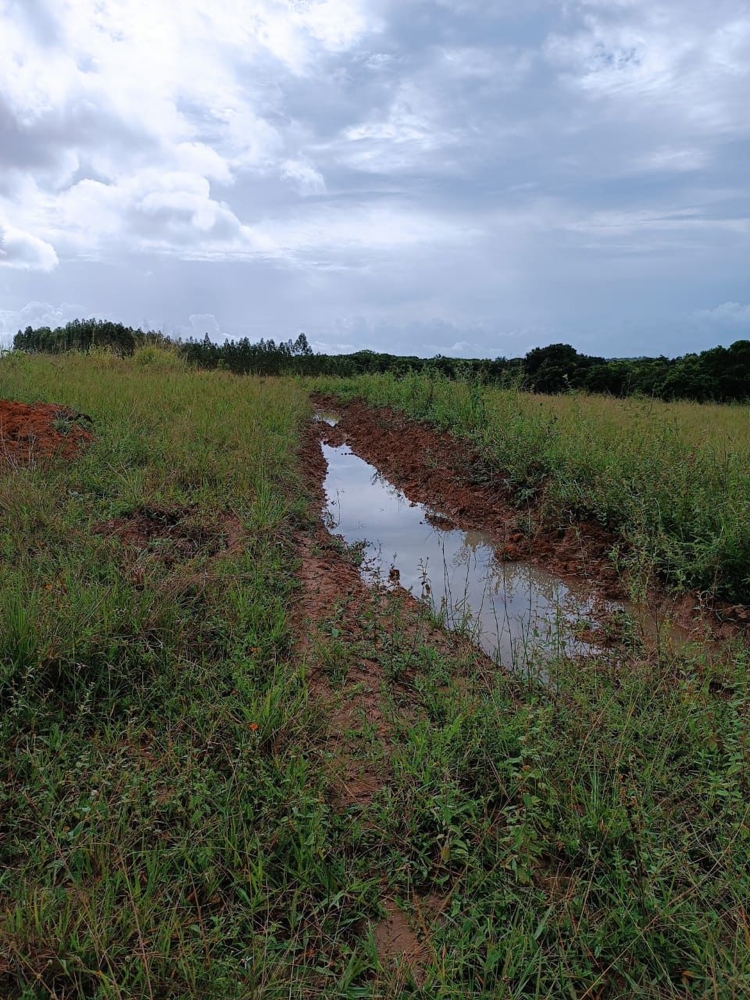

## [Abertura]{.pitch-tag} Hidráulica de Canais Escoadouros Vegetados {.smaller-text .lesson-slide}

::: {.pitch-cards-2}
::: {.pitch-card .pitch-card--teal}
[Objetivo da aula]{.pitch-card-index}
[Capacidade e estabilidade]{.pitch-heading}

Verificar **capacidade de condução** e **resistência à erosão** em canais escoadouros vegetados que recebem água de áreas e terraços contribuintes.
:::

::: {.pitch-card .pitch-card--forest}
[Sistema hidráulico vivo]{.pitch-card-index}
[Duplo estado da vegetação]{.pitch-heading}

A vegetação é parte integrante da seção hidráulica, apresentando comportamento distinto na **fase de implantação** e **após o estabelecimento**.
:::
:::

::: {.pitch-pill-row}
[Método Racional]{.pitch-pill}
[Equação de Manning]{.pitch-pill .pitch-pill--gold}
[Velocidade e Tensão Admissíveis]{.pitch-pill}
[Número de Froude]{.pitch-pill}
:::

::: {.pitch-band .pitch-band--navy}
O canal recebe o escoamento das estruturas a montante e o conduz de forma controlada até uma saída estável.
:::

# 1 · Diagnóstico e vazão de projeto {.section-header rotulo="Diagnóstico"}

## [Levantamento]{.pitch-tag} O que Levantar Antes de Calcular {.smaller-text .lesson-slide}

::: {.pitch-grid-55}
::: {.pitch-milestones}
::: {.pitch-milestone-item}
**1. Bacia contribuinte:** área contribuinte, caminhos de fluxo e entradas ao longo do canal.
:::

::: {.pitch-milestone-item}
**2. Topografia:** perfil longitudinal, cotas e condições da saída.
:::

::: {.pitch-milestone-item}
**3. Substrato:** textura, dispersividade, nível d'água e resistência do solo.
:::

::: {.pitch-milestone-item}
**4. Revestimento:** cobertura prevista, manutenção e acesso operacional.
:::

::: {.pitch-milestone-item}
**5. Hidrologia:** chuva de projeto e período de retorno justificados pelas consequências de falha.
:::
:::

::: {.pitch-card .pitch-card--gold}
[Traçado do canal]{.pitch-card-index}
[Critério de locação]{.pitch-heading}

Localize o canal em um traçado que permita condução controlada. O **talvegue natural** é uma hipótese de localização cuja estabilidade hidráulica e geotécnica precisa ser avaliada antes do projeto.
:::
:::

## [Hidrologia]{.pitch-tag .pitch-tag--gold} Vazão, Seção e Velocidade {.smaller-text .lesson-slide}

::: {.pitch-grid-50}
::: {.pitch-formula}
**Equação da continuidade:**

$$Q = A_h\,V$$

- $Q$: vazão em $\text{m}^3\,\text{s}^{-1}$.
- $A_h$: área molhada da seção em $\text{m}^2$.
- $V$: velocidade média em $\text{m}\,\text{s}^{-1}$.
:::

::: {.pitch-formula}
**Método Racional** (pequenas áreas compatíveis com suas premissas):

$$Q_p = \frac{C\,i\,A_b}{360}$$

- $i$ em $\text{mm}\,\text{h}^{-1}$ e $A_b$ em $\text{ha}$.
- **Atenção:** não use a área de contribuição em $\text{m}^2$ com o divisor $360$.
:::
:::

# 2 · Seção e equação de Manning {.section-header rotulo="Manning"}

## [Geometria]{.pitch-tag .pitch-tag--teal} Seção Trapezoidal: Definir os Símbolos {.smaller-text .lesson-slide}

::: {.pitch-media-card .pitch-media-card--tall}

[Geometria trapezoidal e grandezas hidráulicas para verificação pela equação de Manning]{.pitch-caption}
[Base ($b$), profundidade da água ($y$), talude ($z$H:$1$V), largura superficial ($T$) e borda livre]{.pitch-caption-sub}
:::

## [Parâmetros]{.pitch-tag .pitch-tag--gold} Área Molhada, Perímetro e Raio Hidráulico {.smaller-text .lesson-slide}

::: {.pitch-grid-55}
::: {.pitch-formula}
Para base $b$, profundidade da água $y$ e talude $z$ horizontal para $1$ vertical:

$$A_h = (b + z y)\,y \qquad T = b + 2 z y$$
$$P_m = b + 2 y\sqrt{1 + z^2} \qquad R_h = \frac{A_h}{P_m}$$
:::

::: {.pitch-stack-2}
::: {.pitch-card}
[Superfície livre]{.pitch-card-index}
[Regra do perímetro]{.pitch-heading}

$T$ é a largura da superfície da água. **Não inclua essa superfície livre** no cálculo do perímetro molhado ($P_m$).
:::

::: {.pitch-card .pitch-card--teal}
[Exemplo numérico]{.pitch-card-index}
[$b = 4\text{ m}$, $z = 2$, $y = 0{,}65\text{ m}$]{.pitch-heading}

- $A_h = 3{,}445\text{ m}^2$
- $P_m = 6{,}907\text{ m}$
- $R_h = 0{,}499\text{ m}$
:::
:::
:::

## [Equação]{.pitch-tag .pitch-tag--gold} Manning em Unidades do SI {.smaller-text .lesson-slide}

::: {.pitch-grid-55}
::: {.pitch-formula}
$$V = \frac{1}{n}\,R_h^{2/3}\,S_f^{1/2} \qquad Q = \frac{1}{n}\,A_h\,R_h^{2/3}\,S_f^{1/2}$$

- $n$: coeficiente de Manning, em $\text{s}\,\text{m}^{-1/3}$.
- $R_h$: metros; $S_f$: $\text{m}\,\text{m}^{-1}$; resultados em $\text{m}\,\text{s}^{-1}$ e $\text{m}^3\,\text{s}^{-1}$.
- Em escoamento aproximadamente uniforme, $S_f$ pode ser aproximada pela declividade do fundo.
:::

::: {.pitch-card .pitch-card--alert}
[Limites de validade]{.pitch-card-index}
[Quando não basta escoamento uniforme]{.pitch-heading}

Em entradas de terraços, remansos, curvas acentuadas e quedas, a aproximação de escoamento uniforme pode ser inadequada. **Verifique transições e controle de jusante.**
:::
:::

## [Rugosidade]{.pitch-tag .pitch-tag--forest} Rugosidade: Não Usar um Único Estado da Vegetação {.smaller-text .lesson-slide}

::: {.pitch-table-box}

| Estado da superfície | Consequência hidráulica a investigar |
|---|---|
| **Solo exposto ou revestimento recém-instalado** | Menor proteção contra erosão |
| **Vegetação baixa ou acamada** | Rugosidade e velocidade diferentes do estado de máxima altura |
| **Vegetação alta e densa** | Menor capacidade para a mesma profundidade em muitos cenários |
| **Sedimento, resíduos e falhas de cobertura** | Alteração local da seção e da resistência |

:::

::: {.pitch-band .pitch-band--teal}
Em canais gramados, $n$ depende também da profundidade, flexão e características do escoamento. Faça **análise de sensibilidade** e utilize referências aplicáveis.
:::

## [Iteração]{.pitch-tag} Encontrar a Profundidade Normal {.smaller-text .lesson-slide}

::: {.pitch-grid-55}
::: {.pitch-milestones}
::: {.pitch-milestone-item}
**1. Dados conhecidos:** fixe $Q_p$, $b$, $z$, $n$ e $S_f$ e adote um valor inicial de $y$.
:::

::: {.pitch-milestone-item}
**2. Geometria:** calcule $A_h$, $P_m$ e $R_h$.
:::

::: {.pitch-milestone-item}
**3. Vazão:** calcule $Q_{\mathrm{Manning}}$.
:::

::: {.pitch-milestone-item}
**4. Convergência:** aumente ou reduza $y$ até $Q_{\mathrm{Manning}} \approx Q_p$.
:::

::: {.pitch-milestone-item}
**5. Checagem final:** verifique borda livre, velocidade, tensão e condições de transição.
:::
:::

::: {.pitch-card .pitch-card--alert}
[Erro frequente]{.pitch-card-index}
[Atenção na verificação]{.pitch-heading}

Obter $A_h = Q / V_{\mathrm{adm}}$ e depois encontrar uma velocidade de Manning menor **não prova capacidade**. É necessário conferir novamente o produto $A_h\,V_{\mathrm{Manning}}$.
:::
:::

# 3 · Capacidade e estabilidade {.section-header rotulo="Estabilidade"}

## [Critérios]{.pitch-tag .pitch-tag--alert} Velocidade e Tensão Admissíveis {.smaller-text .lesson-slide}

::: {.pitch-grid-55}
::: {.pitch-stack-2}
::: {.pitch-formula}
$$V \le V_{\mathrm{adm}} \qquad \tau_0 = \rho\,g\,R_h\,S_f \le \tau_{\mathrm{adm}}$$
:::

::: {.pitch-band .pitch-band--navy}
Não transfira uma velocidade tabelada sem reproduzir suas condições de uso (solo, espécie, duração e declividade).
:::
:::

::: {.pitch-card}
[Verificações complementares]{.pitch-card-index}
[Critérios de projeto]{.pitch-heading}

- Os limites dependem do solo, da vegetação, do revestimento e da duração do fluxo.
- Confira o **estado de implantação**, além do estado com vegetação estabelecida.
- A tensão média precisa ser complementada por avaliação de fundo, taludes, curvas e entradas.
- Indique a fonte e o **fator de segurança** associado ao critério.
:::
:::

## [Regime]{.pitch-tag .pitch-tag--teal} Froude e Mudanças de Regime {.smaller-text .lesson-slide}

::: {.pitch-grid-55}
::: {.pitch-formula}
$$D_h = \frac{A_h}{T} \qquad Fr = \frac{V}{\sqrt{g\,D_h}}$$

- $Fr < 1$: escoamento **subcrítico**.
- $Fr = 1$: condição **crítica**.
- $Fr > 1$: escoamento **supercrítico**.
:::

::: {.pitch-card .pitch-card--gold}
[Interpretação hidráulica]{.pitch-card-index}
[Dissipação de energia]{.pitch-heading}

Uma mudança de regime pode exigir avaliação de **ressalto hidráulico**, queda e dissipação de energia. A verificação de Froude complementa os critérios de capacidade e erosão; **não os substitui**.
:::
:::

## [Segurança]{.pitch-tag} Borda Livre e Saída Estável {.smaller-text .lesson-slide}

::: {.pitch-grid-60}
::: {.pitch-milestones}
::: {.pitch-milestone-item}
**1. Envoltória de lâminas:** calcule a profundidade hidráulica nos estados de rugosidade previstos.
:::

::: {.pitch-milestone-item}
**2. Folga de segurança:** acrescente borda livre justificada, sem tratá-la como área útil permanente.
:::

::: {.pitch-milestone-item}
**3. Fatores locais:** considere sedimentos, recalques e manutenção.
:::

::: {.pitch-milestone-item}
**4. Singularidades:** proteja conexões com terraços, mudanças de direção e descargas.
:::

::: {.pitch-milestone-item}
**5. Jusante:** verifique se a saída não transfere incisão ou inundação para outra área.
:::
:::

::: {.pitch-card .pitch-card--alert}
[Ponto crítico do sistema]{.pitch-card-index}
[Transições e descarga]{.pitch-heading}

Uma seção perfeitamente estável no trecho uniforme pode falhar na **entrada** ou na **saída** por concentração localizada de energia.
:::
:::

# 4 · Implantação e acompanhamento {.section-header rotulo="Implantação"}

## [Campo]{.pitch-tag .pitch-tag--forest} Conformação e Funcionamento em Campo {.smaller-text .lesson-slide}

::: {.pitch-grid-50}
::: {.pitch-media-card .pitch-media-card--photo}

[Conformação da seção]{.pitch-caption}
[Escavação e modelagem do canal escoadouro com equipamento]{.pitch-caption-sub}
:::

::: {.pitch-media-card .pitch-media-card--photo}

[Operação sob chuva]{.pitch-caption}
[Canal escoadouro conduzindo escoamento superficial em campo]{.pitch-caption-sub}
:::
:::

## [Vegetação]{.pitch-tag .pitch-tag--forest} Revestimento e Fase Inicial {.smaller-text .lesson-slide}

::: {.pitch-grid-60}
::: {.pitch-milestones}
::: {.pitch-milestone-item}
**1. Substrato:** prepare o solo sem eliminar as condições de enraizamento.
:::

::: {.pitch-milestone-item}
**2. Seleção vegetal:** escolha vegetação adaptada à umidade, à manutenção e às solicitações hidráulicas.
:::

::: {.pitch-milestone-item}
**3. Proteção temporária:** especifique sementes, mudas ou placas e proteção temporária quando necessária.
:::

::: {.pitch-milestone-item}
**4. Controle de carga:** controle a entrada de água enquanto a proteção não estiver estabelecida.
:::

::: {.pitch-milestone-item}
**5. Acompanhamento:** reponha falhas e acompanhe sulcos, deslocamento de revestimento e sedimentos.
:::
:::

::: {.pitch-card .pitch-card--gold}
[Critério ecológico]{.pitch-card-index}
[Seleção de gramíneas]{.pitch-heading}

Gramíneas citadas em materiais históricos devem ser avaliadas quanto à **adequação regional** e ao **potencial invasor** antes da recomendação em projeto.
:::
:::

## [Memorial]{.pitch-tag} Checklist do Memorial Hidráulico {.smaller-text .lesson-slide}

::: {.pitch-table-box}

| Item | Evidência obrigatória |
|---|---|
| **Hidrologia** | Área, chuva, método e premissas |
| **Geometria** | Planta, perfil, seção e cotas |
| **Capacidade** | Profundidade normal, $Q$ e borda livre |
| **Estabilidade** | $V$, tensão aplicada e limites documentados |
| **Implantação** | Proteção inicial e saída |
| **Manutenção** | Inspeções, responsáveis e reparos |

:::

::: {.pitch-band .pitch-band--navy}
**Próxima aula (Aula 08):** aplicar integralmente este roteiro a um exercício completo em Planossolo.
:::

## [Referências]{.pitch-tag} Leituras e Fontes Técnicas {.smaller-text .lesson-slide}

::: {.pitch-card}
[Referência normativa e técnica]{.pitch-card-index}
[Dimensionamento de canais estáveis]{.pitch-heading}

- [USDA-NRCS (2007). *National Engineering Handbook*, Part 654, Chapter 8: Threshold Channel Design](https://directives.nrcs.usda.gov/sites/default/files2/1712931093/7332.pdf)
:::
