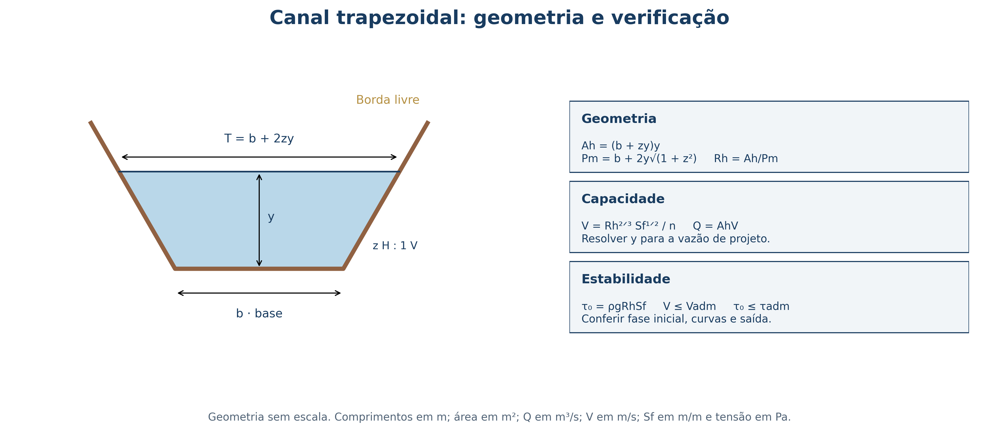

## Aula 07 · Hidráulica de canais escoadouros vegetados {.smaller-text}

**Objetivo:** verificar capacidade de condução e resistência à erosão.

O canal recebe água de áreas e terraços contribuintes e a conduz a uma saída estável. A vegetação é parte do sistema hidráulico, com comportamento diferente na implantação e após o estabelecimento.

# 1 · Diagnóstico e vazão de projeto

## O que levantar antes de calcular {.smaller-text}

- Área contribuinte, caminhos de fluxo e entradas ao longo do canal.
- Perfil longitudinal, cotas e condições da saída.
- Textura, dispersividade, nível d'água e resistência do substrato.
- Cobertura prevista, manutenção e acesso.
- Chuva de projeto e período de retorno justificados pelas consequências de falha.

Localize o canal em um traçado que permita condução controlada. O talvegue natural é uma hipótese de localização, cuja estabilidade precisa ser avaliada.

## Vazão, seção e velocidade {.smaller-text}

$$Q=A_hV$$

- $Q$: vazão em m³ s⁻¹.
- $A_h$: área molhada da seção em m².
- $V$: velocidade média em m s⁻¹.

Para pequenas áreas compatíveis com as premissas do Método Racional:

$$Q_p=\frac{CiA_b}{360}$$

Aqui $i$ está em mm h⁻¹ e $A_b$ em ha. Não use a área de contribuição em m² com o divisor 360.

# 2 · Seção e equação de Manning

## Seção trapezoidal: definir os símbolos {.smaller-text}

{fig-align="center" width="96%"}

## Área molhada, perímetro e raio hidráulico {.smaller-text}

Para base $b$, profundidade da água $y$ e talude $z$ horizontal para 1 vertical:

$$A_h=(b+zy)yqquad T=b+2zy$$
$$P_m=b+2ysqrt{1+z^2}qquad R_h=\frac{A_h}{P_m}$$

$T$ é a largura da superfície da água. Não inclua essa superfície livre no perímetro molhado.

**Exemplo:** $b=4$ m, $z=2$, $y=0{,}65$ m → $A_h=3{,}445$ m²; $P_m=6{,}907$ m; $R_h=0{,}499$ m.

## Manning em unidades do SI {.smaller-text}

$$V=\frac{1}{n}R_h^{2/3}S_f^{1/2}qquad Q=\frac{1}{n}A_hR_h^{2/3}S_f^{1/2}$$

- $n$: coeficiente de Manning, em s m⁻¹/³.
- $R_h$: metros; $S_f$: m m⁻¹; resultados em m s⁻¹ e m³ s⁻¹.
- Em escoamento aproximadamente uniforme, $S_f$ pode ser aproximada pela declividade do fundo.

Em entradas, remansos, curvas e quedas, a aproximação uniforme pode ser inadequada. Verifique transições e controle de jusante.

## Rugosidade: não usar um único estado da vegetação {.smaller-text}

| Estado | Consequência a investigar |
|---|---|
| Solo exposto ou revestimento recém-instalado | Menor proteção contra erosão |
| Vegetação baixa ou acamada | Rugosidade e velocidade diferentes do estado de máxima altura |
| Vegetação alta e densa | Menor capacidade para a mesma profundidade em muitos cenários |
| Sedimento, resíduos e falhas de cobertura | Alteração local da seção e da resistência |

Em canais gramados, n depende também da profundidade, flexão e características do escoamento. Faça análise de sensibilidade e use referências aplicáveis.

## Encontrar a profundidade normal {.smaller-text}

Conhecidos $Q_p$, $b$, $z$, $n$ e $S_f$:

1. Adote um valor de $y$.
2. Calcule $A_h$, $P_m$ e $R_h$.
3. Calcule $Q_{\mathrm{Manning}}$.
4. Aumente ou reduza y até $Q_{\mathrm{Manning}}\approx Q_p$.
5. Verifique borda livre, velocidade, tensão e condições de transição.

**Atenção:** obter $A_h=Q/V_{\mathrm{adm}}$ e depois encontrar uma velocidade de Manning menor não prova capacidade. É necessário conferir novamente o produto $A_hV_{\mathrm{Manning}}$.

# 3 · Capacidade e estabilidade

## Velocidade e tensão admissíveis {.smaller-text}

$$V\le V_{\mathrm{adm}}qquad \tau_0=\rho gR_hS_f\le \tau_{\mathrm{adm}}$$

- Os limites dependem do solo, da vegetação, do revestimento e da duração do fluxo.
- Confira o estado de implantação, além do estado com vegetação estabelecida.
- A tensão média precisa ser complementada por avaliação de fundo, taludes, curvas e entradas.
- Indique a fonte e o fator de segurança associado ao critério.

Não transfira uma velocidade tabelada sem reproduzir suas condições de uso.

## Froude e mudanças de regime {.smaller-text}

$$D_h=\frac{A_h}{T}qquad Fr=\frac{V}{\sqrt{gD_h}}$$

- $Fr<1$: escoamento subcrítico.
- $Fr=1$: condição crítica.
- $Fr>1$: escoamento supercrítico.

Uma mudança de regime pode exigir avaliação de ressalto, queda e dissipação de energia. A verificação de Froude complementa os critérios de capacidade e erosão; não os substitui.

## Borda livre e saída estável {.smaller-text}

- Calcule a profundidade hidráulica nos estados de rugosidade previstos.
- Acrescente borda livre justificada, sem tratá-la como área útil permanente.
- Considere sedimentos, recalques e manutenção.
- Proteja conexões com terraços, mudanças de direção e descargas.
- Verifique se a saída não transfere incisão ou inundação para outra área.

Uma seção estável no trecho uniforme pode falhar na entrada ou na saída.

# 4 · Implantação e acompanhamento

## Conformação e funcionamento em campo {.smaller-text}

:::: {.columns}
::: {.column width="50%"}

{fig-align="center" width="90%"}

:::
::: {.column width="50%"}

{fig-align="center" width="90%"}

:::
::::

## Revestimento e fase inicial {.smaller-text}

1. Prepare o substrato sem eliminar as condições de enraizamento.
2. Escolha vegetação adaptada à umidade, à manutenção e às solicitações hidráulicas.
3. Especifique sementes, mudas ou placas e proteção temporária quando necessária.
4. Controle a entrada de água enquanto a proteção não estiver estabelecida.
5. Reponha falhas e acompanhe sulcos, deslocamento de revestimento e sedimentos.

Gramíneas citadas em materiais históricos devem ser avaliadas quanto à adequação regional e ao potencial invasor.

## Checklist do memorial hidráulico {.smaller-text}

| Item | Evidência |
|---|---|
| Hidrologia | Área, chuva, método e premissas |
| Geometria | Planta, perfil, seção e cotas |
| Capacidade | Profundidade normal, Q e borda livre |
| Estabilidade | V, tensão aplicada e limites documentados |
| Implantação | Proteção inicial e saída |
| Manutenção | Inspeções, responsáveis e reparos |

**Aula 08:** aplicar esse roteiro a um exemplo em Planossolo.

## Leituras e fontes técnicas {.smaller-text}

- [USDA-NRCS (2007). NEH 654, capítulo 8: Threshold Channel Design](https://directives.nrcs.usda.gov/sites/default/files2/1712931093/7332.pdf)
