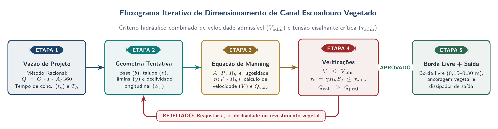

## [Abertura]{.pitch-tag} Exercício Completo de Canal Escoadouro {.smaller-text .lesson-slide}

::: {.pitch-cards-2}
::: {.pitch-card .pitch-card--teal}
[Caso didático]{.pitch-card-index}
[Perímetro da Ribeira (adaptado)]{.pitch-heading}

- **Uso agrícola:** talhão de milho em sucessão com feijão.
- **Solo:** Planossolo com contraste textural.
- **Dimensões e relevo:** $400 \times 200\text{ m} = 8\text{ ha}$; declividade do terreno de $8\%$.
:::

::: {.pitch-card .pitch-card--gold}
[Objetivo do exercício]{.pitch-card-index}
[Pré-dimensionamento verificável]{.pitch-heading}

Produzir um **pré-dimensionamento verificável**, distinguindo rigorosamente os **dados do enunciado** das **hipóteses adotadas** para completar os cálculos.
:::
:::

::: {.pitch-pill-row}
[Planossolo · Contraste EB/Bt]{.pitch-pill}
[Área = 8 ha]{.pitch-pill .pitch-pill--gold}
[Sensibilidade de Manning]{.pitch-pill}
[Perfil Longitudinal]{.pitch-pill}
:::

## [Roteiro]{.pitch-tag .pitch-tag--teal} Fluxograma Iterativo de Dimensionamento {.smaller-text .lesson-slide}

::: {.pitch-media-card .pitch-media-card--wide}

[Fluxograma iterativo: vazão de projeto → geometria tentativa → Manning → verificações $V/\tau_0$ → borda livre e saída]{.pitch-caption}
[Critério hidráulico combinado de velocidade admissível ($V_{\mathrm{adm}}$) e tensão cisalhante crítica ($\tau_{\mathrm{adm}}$)]{.pitch-caption-sub}
:::

# 1 · Diagnóstico e dados de entrada {.section-header rotulo="Diagnóstico"}

## [Solo]{.pitch-tag .pitch-tag--teal} Perfil do Solo: Manter e Interpretar os Dados {.smaller-text .lesson-slide}

::: {.pitch-table-box}

| Atributo | Ap | E | EB | Bt |
|---|---:|---:|---:|---:|
| **Matéria orgânica ($\text{dag kg}^{-1}$)** | 3,6 | 1,3 | 0,8 | 0,8 |
| **Areia grossa (%)** | 2 | 1 | 1 | 1 |
| **Areia fina (%)** | 12 | 11 | 9 | 3 |
| **Argila (%)** | 15 | 17 | 20 | 45 |
| **Silte (%)** | 71 | 71 | 70 | 51 |

:::

::: {.pitch-band .pitch-band--navy}
As frações granulométricas somam $100\%$ em cada horizonte. **Investigar:** contraste EB/Bt, drenagem, dispersividade e resistência à erosão — a classe pedológica orienta essas perguntas, mas não fornece valores hidráulicos ou geotécnicos.
:::

## [Parâmetros]{.pitch-tag} O que é Dado e o que é Hipótese {.smaller-text .lesson-slide}

::: {.pitch-table-box}

| Entrada | Valor usado | Condição |
|---|---:|---|
| **Área contribuinte** | $8\text{ ha}$ | Enunciado |
| **Declividade inicial do canal** | $6\%$ | Enunciado; verificar |
| **Período de retorno** | $5\text{ anos}$ | Enunciado; discutir consequência de falha |
| **Chuva média anual** | $950\text{ mm}$ | Enunciado; não substitui IDF |
| **Intensidade $i$** | $190\text{ mm h}^{-1}$ | Hipótese didática, a substituir pela IDF e por $t_c$ |
| **Coeficiente $C$** | $0{,}58$ | Hipótese didática |
| **Manning $n$** | $0{,}035;\; 0{,}050;\; 0{,}080$ | Cenários de sensibilidade |

:::

::: {.pitch-band}
Os valores adotados como hipótese didática não constituem calibração nem recomendação regional.
:::

## [Etapa 1]{.pitch-tag .pitch-tag--gold} Organização dos Terraços {.smaller-text .lesson-slide}

::: {.pitch-grid-55}
::: {.pitch-formula}
Para praticar a geometria, adote preliminarmente $EV = 1{,}0\text{ m}$:

$$EH = \frac{100 \times 1{,}0}{8} = 12{,}5\text{ m}$$

- Em $200\text{ m}$ de rampa horizontal, há $16$ intervalos de $12{,}5\text{ m}$.
- A faixa retangular de $400 \times 12{,}5\text{ m}$ tem $0{,}5\text{ ha}$.
:::

::: {.pitch-card .pitch-card--alert}
[Cuidados na Etapa 1]{.pitch-card-index}
[Limites e hidrograma]{.pitch-heading}

- O número final de obras depende do levantamento e dos limites.
- O $EV$ preliminar precisa de critério regional e verificação hidráulica.
- Dimensione o canal final para a contribuição delimitada; não arredonde e acumule picos de terraços sem avaliar o **tempo de resposta**.
:::
:::

## [Etapa 2]{.pitch-tag .pitch-tag--gold} Vazão de Projeto {.smaller-text .lesson-slide}

::: {.pitch-grid-55}
::: {.pitch-formula}
Com as hipóteses do exercício:

$$Q_p = \frac{C\,i\,A_b}{360} = \frac{0{,}58 \times 190 \times 8}{360}$$
$$Q_p = 2{,}449\text{ m}^3\,\text{s}^{-1}$$
:::

::: {.pitch-card}
[Verificações anteriores ao uso em campo]{.pitch-card-index}
[Validação hidrológica]{.pitch-heading}

1. Intensidade obtida de **equação IDF** válida para o local.
2. Duração compatível com o **tempo de concentração** ($t_c$).
3. $C$ representativo da cobertura, solo e condição hídrica.
4. Método adequado à escala, ao armazenamento e à área contribuinte.
:::
:::

# 2 · Testar e revisar a solução {.section-header rotulo="Iteração"}

## [Etapa 3]{.pitch-tag .pitch-tag--alert} Teste do Traçado com 6% {.smaller-text .lesson-slide}

::: {.pitch-grid-55}
::: {.pitch-stack-2}
::: {.pitch-card}
[Seção e parâmetros de teste]{.pitch-card-index}
[$b = 4{,}0\text{ m}$, $z = 2\text{ H}:1\text{ V}$, $n = 0{,}050$, $S_f = 0{,}06$]{.pitch-heading}

Resolvendo Manning para $Q_p = 2{,}449\text{ m}^3\,\text{s}^{-1}$:
:::

::: {.pitch-table-box}

| Resultado | Valor |
|---|---:|
| **Profundidade normal $y$** | $0{,}281\text{ m}$ |
| **Área molhada $A_h$** | $1{,}281\text{ m}^2$ |
| **Velocidade $V$** | $1{,}912\text{ m s}^{-1}$ |
| **Tensão média $\tau_0$** | $143{,}5\text{ Pa}$ |
| **Froude $Fr$** | $1{,}22$ |

:::
:::

::: {.pitch-card .pitch-card--alert}
[Diagnóstico: REJEITADO]{.pitch-card-index}
[Excede limites admissíveis]{.pitch-heading}

Para limites didáticos $V_{\mathrm{adm}} = 1{,}35\text{ m s}^{-1}$ e $\tau_{\mathrm{adm}} = 50\text{ Pa}$, o teste a $6\%$ **não atende** ($V$ e $\tau_0$ muito acima e regime supercrítico $Fr = 1{,}22$).

Os limites também precisam de comprovação para o sistema solo–revestimento.
:::
:::

## [Etapa 4]{.pitch-tag .pitch-tag--teal} Revisão do Perfil Longitudinal {.smaller-text .lesson-slide}

::: {.pitch-grid-55}
::: {.pitch-card}
[Compatibilidade topográfica]{.pitch-card-index}
[Teste com $S_f = 0{,}01$ (1%)]{.pitch-heading}

Investigue um trecho com $S_f = 0{,}01$ ($1\%$) e a mesma base e taludes:

- Um trecho de $200\text{ m}$ a $6\%$ perde **$12\text{ m}$** de cota.
- O mesmo comprimento a $1\%$ perde apenas **$2\text{ m}$**.
- Os **$10\text{ m}$** restantes exigem outro traçado ou **estruturas de queda e dissipação**.
- Para perder $12\text{ m}$ continuamente a $1\%$, seriam necessários **$1.200\text{ m}$** de desenvolvimento.
:::

::: {.pitch-card .pitch-card--gold}
[Regra de projeto]{.pitch-card-index}
[Realismo geométrico]{.pitch-heading}

Não reduza a declividade apenas na planilha: **demonstre o perfil executável** e dimensione transições e dissipadores. O exemplo seguinte verifica o trecho uniforme de $1\%$.
:::
:::

## [Etapa 5]{.pitch-tag .pitch-tag--gold} Seção para a Capacidade de Condução {.smaller-text .lesson-slide}

::: {.pitch-formula}
Adote, para teste, profundidade útil de $0{,}65\text{ m}$ e o cenário de maior rugosidade, $n = 0{,}080$ (com $b = 4\text{ m}$, $z = 2$, $S_f = 0{,}01$):

$$A_h = (4 + 2 \times 0{,}65) \times 0{,}65 = 3{,}445\text{ m}^2 \qquad P_m = 4 + 2 \times 0{,}65\sqrt{5} = 6{,}907\text{ m}$$
$$R_h = 0{,}499\text{ m} \qquad V = 0{,}786\text{ m}\,\text{s}^{-1}$$
$$Q_{\mathrm{cap}} = 3{,}445 \times 0{,}786 = 2{,}708\text{ m}^3\,\text{s}^{-1}$$
:::

::: {.pitch-band .pitch-band--teal}
Como $Q_{\mathrm{cap}} = 2{,}708 > Q_p = 2{,}449\text{ m}^3\,\text{s}^{-1}$ nesse estado, a seção atende à capacidade. A profundidade de $0{,}65\text{ m}$ é o limite útil adotado; a profundidade normal será menor.
:::

## [Etapa 6]{.pitch-tag .pitch-tag--teal} Sensibilidade à Rugosidade {.smaller-text .lesson-slide}

::: {.pitch-table-box}

| $n$ | $y$ normal ($\text{m}$) | $V$ ($\text{m s}^{-1}$) | Tensão média ($\text{Pa}$) | $Fr$ |
|---:|---:|---:|---:|---:|
| $0{,}035$ | $0{,}384$ | $1{,}337$ | $31{,}4$ | $0{,}74$ |
| $0{,}050$ | $0{,}471$ | $1{,}052$ | $37{,}4$ | $0{,}53$ |
| $0{,}080$ | $0{,}614$ | $0{,}762$ | $46{,}7$ | $0{,}35$ |

:::

::: {.pitch-band .pitch-band--navy}
Para $Q_p = 2{,}449\text{ m}^3\,\text{s}^{-1}$, $b = 4\text{ m}$, $z = 2$ e $S_f = 0{,}01$: a **maior rugosidade** governa a lâmina ($0{,}614\text{ m}$); a **menor rugosidade** governa a velocidade ($1{,}337\text{ m s}^{-1}$). A margem frente a $1{,}35\text{ m s}^{-1}$ é pequena: outros estados podem exigir nova geometria ou revestimento.
:::

## [Etapa 7]{.pitch-tag .pitch-tag--forest} Borda Livre e Largura Superior {.smaller-text .lesson-slide}

::: {.pitch-grid-55}
::: {.pitch-formula}
Como hipótese de desenho, acrescente $0{,}20\text{ m}$ de borda livre à profundidade útil de $0{,}65\text{ m}$:

$$H = 0{,}65 + 0{,}20 = 0{,}85\text{ m}$$
$$B_{\mathrm{topo}} = b + 2 z H = 4 + 2 \times 2 \times 0{,}85 = 7{,}40\text{ m}$$
:::

::: {.pitch-card .pitch-card--forest}
[Folga efetiva e validação]{.pitch-card-index}
[Cenário $n = 0{,}080$]{.pitch-heading}

No cenário $n = 0{,}080$, a lâmina normal é $0{,}614\text{ m}$; portanto, a diferença até o coroamento é aproximadamente **$0{,}236\text{ m}$**.

Borda livre, largura, taludes e resistência precisam ser confirmados para sedimento, manutenção, recalque e condições locais.
:::
:::

# 3 · Implantação, quantidades e acompanhamento {.section-header rotulo="Implantação"}

## [Etapa 8]{.pitch-tag .pitch-tag--gold} Quantitativos do Trecho {.smaller-text .lesson-slide}

::: {.pitch-grid-55}
::: {.pitch-formula}
Seção geométrica até $H = 0{,}85\text{ m}$:

$$A_{\mathrm{geom}} = (4 + 2 \times 0{,}85) \times 0{,}85 = 4{,}845\text{ m}^2$$

Área aproximada do revestimento por metro de canal:

$$P_{\mathrm{rev}} = 4 + 2 \times 0{,}85\sqrt{5} = 7{,}801\text{ m}$$
:::

::: {.pitch-card}
[Estimativa para 100 m e orçamento]{.pitch-card-index}
[Trecho uniforme]{.pitch-heading}

Para um **trecho uniforme de $100\text{ m}$**, isso corresponde a **$484{,}5\text{ m}^3$** de prisma geométrico e **$780{,}1\text{ m}^2$** de superfície interna.

O volume real de corte e aterro depende das seções do terreno. Acrescente transições, sobreposições, perdas e estruturas complementares ao orçamento.
:::
:::

## [Etapa 9]{.pitch-tag .pitch-tag--forest} Sequência de Execução {.smaller-text .lesson-slide}

::: {.pitch-grid-50}
::: {.pitch-milestones}
::: {.pitch-milestone-item}
**1.** Confirmar levantamento, perfil, acesso e destino da descarga.
:::

::: {.pitch-milestone-item}
**2.** Construir saída e dissipação previstas.
:::

::: {.pitch-milestone-item}
**3.** Locar e conformar a seção; separar material superficial adequado.
:::

::: {.pitch-milestone-item}
**4.** Controlar cotas, zonas de compactação e camada para raízes.
:::
:::

::: {.pitch-milestones}
::: {.pitch-milestone-item}
**5.** Implantar revestimento e proteção temporária.
:::

::: {.pitch-milestone-item}
**6.** Liberar a contribuição conforme o desempenho previsto para a fase inicial.
:::

::: {.pitch-milestone-item}
**7.** Registrar seção e cobertura e inspecionar após chuvas.
:::
:::
:::

## [Etapa 10]{.pitch-tag} Decisão e Relatório {.smaller-text .lesson-slide}

::: {.pitch-grid-55}
::: {.pitch-card}
[Condicionantes executivos]{.pitch-card-index}
[O que falta validar]{.pitch-heading}

O trecho a $1\%$ atende aos testes numéricos **apenas sob as hipóteses adotadas**. A solução executiva ainda depende de:

- IDF, tempo de concentração e coeficiente de escoamento locais.
- Limites de resistência documentados para solo, vegetação e proteção inicial.
- Perfil longitudinal completo, transições e dissipação dos desníveis.
- Estabilidade dos taludes, nível d'água e saída.
- Quantitativos reais, custos e plano de manutenção.
:::

::: {.pitch-card .pitch-card--gold}
[Entrega técnica]{.pitch-card-index}
[Composição do relatório]{.pitch-heading}

- Memorial de cálculo
- Tabela de sensibilidade ($n$)
- Planta e perfil longitudinal
- Seção transversal tipo
- Justificativa das revisões
:::
:::

## [Referências]{.pitch-tag} Leituras e Fontes Técnicas {.smaller-text .lesson-slide}

::: {.pitch-card}
[Referências de apoio]{.pitch-card-index}
[Hidráulica e análises de solo]{.pitch-heading}

- [USDA-NRCS (2007). *National Engineering Handbook*, Part 654, Chapter 8: Threshold Channel Design](https://directives.nrcs.usda.gov/sites/default/files2/1712931093/7332.pdf)
- [Embrapa (2017). *Manual de métodos de análise de solo*, 3ª edição](https://www.embrapa.br/web/solos/busca-de-publicacoes/-/publicacao/1085209/manual-de-metodos-de-analise-de-solo)
:::
