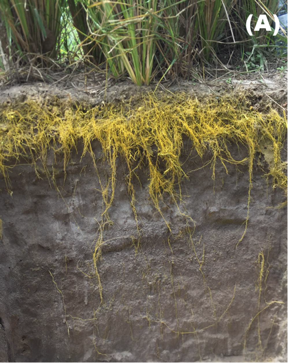
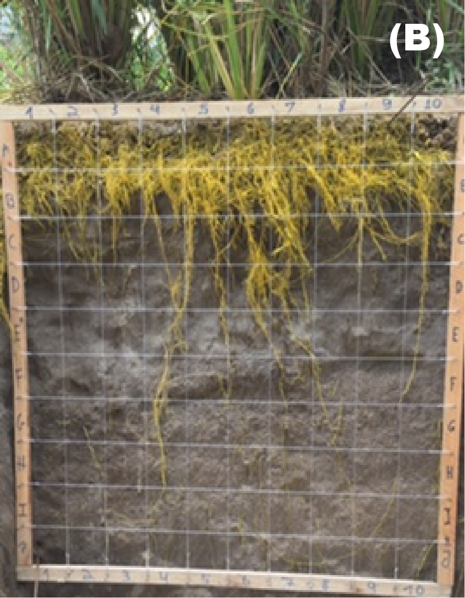
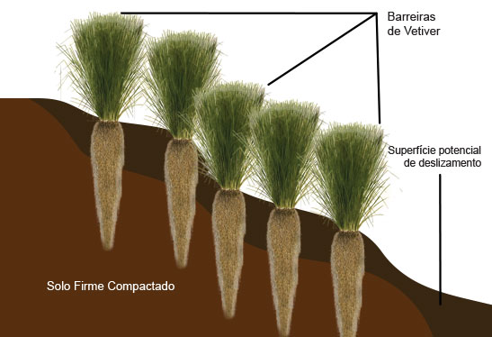
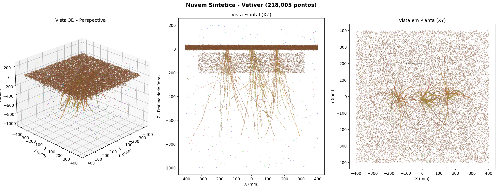
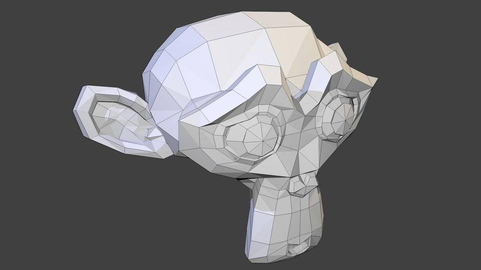
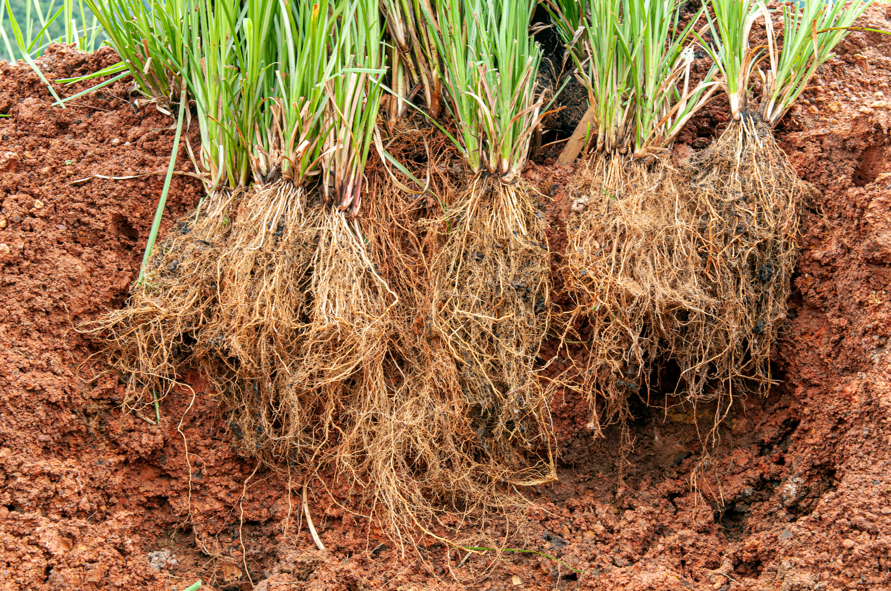
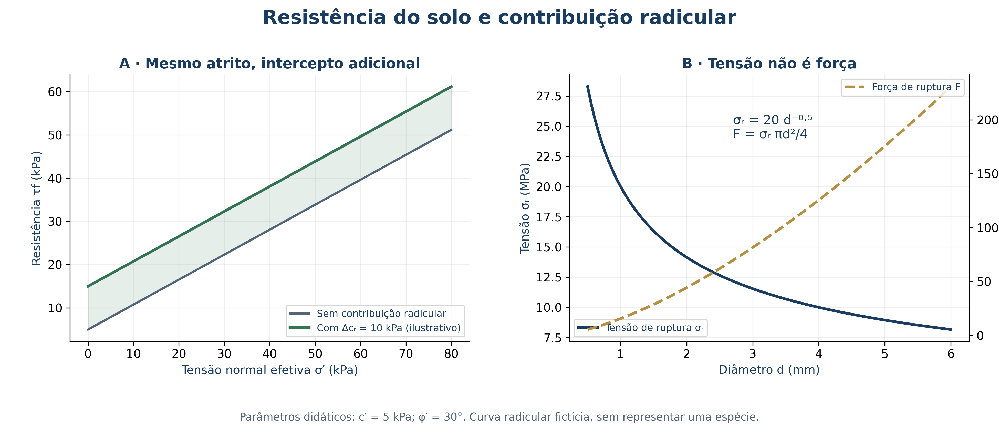
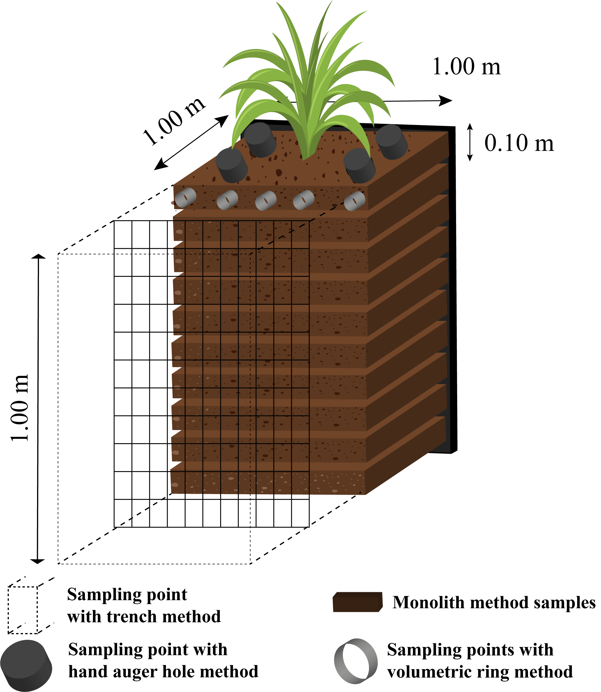

## [Abertura]{.pitch-tag} Visão Geral da Aula {.smaller-text .lesson-slide}

::: {.pitch-grid-50}
::: {.pitch-card}
[Roteiro da aula]{.pitch-card-index}
[Tópicos principais]{.pitch-heading}

- [1]{.circle} Raízes e estabilidade de taludes
- [2]{.circle} O capim-vetiver como modelo de estudo
- [3]{.circle} Fundamentos de fotogrametria SfM
- [4]{.circle} Protocolo de coleta em campo
- [5]{.circle} Processamento no Meshroom
- [6]{.circle} Análise no CloudCompare
- [7]{.circle} Ensaios e modelos mecânicos (Wu & Waldron)
- [8]{.circle} Estudo de caso — Vetiver em talude
- [9]{.circle} Quiz & exercício proposto
:::

::: {.pitch-stack-2}
::: {.pitch-card .pitch-card--forest}
[Objetivo central]{.pitch-card-index}
[Da imagem 3D à geotecnia]{.pitch-heading}

Aprender a construir modelos 3D de sistemas radiculares expostos usando fotogrametria digital de baixo custo, processá-los no CloudCompare e extrair parâmetros relevantes para avaliação do controle de erosão.
:::

::: {.pitch-card .pitch-card--gold}
[Logística da aula]{.pitch-card-index}
[Duração e requisitos]{.pitch-heading}

- **⏱ Duração:** 60 min (teoria + demonstração + exercício)
- **📋 Pré-requisitos:** CloudCompare instalado, câmera ≥ 12 MP
:::
:::
:::

# 1 · Raízes e estabilidade de taludes {.section-header rotulo="Raízes"}

## [Mecânica]{.pitch-tag .pitch-tag--forest} O Papel Mecânico das Raízes {.smaller-text .lesson-slide}

::: {.pitch-grid-50}
::: {.pitch-stack-2}
::: {.pitch-formula}
**Reforço mecânico (tração + cisalhamento):**

$$\Delta c_r = t_R \times (A_R / A)$$

- $\Delta c_r$: incremento de coesão pela raiz ($\text{kPa}$)
- $t_R$: resistência à tração da raiz ($\text{kPa}$)
- $A_R / A$: razão de área radicular (*Root Area Ratio* — RAR)
:::

::: {.pitch-card .pitch-card--teal}
[Efeito hidráulico]{.pitch-card-index}
[Regulação da poropressão]{.pitch-heading}

- Raízes extraem água → reduzem a poropressão ($u$)
- Aumento da sucção mátrica → maior resistência efetiva e estabilidade
:::
:::

::: {.pitch-stack-2}
::: {.pitch-formula}
**Modelo de Wu (1979):**

$$\Delta c_r = 1{,}2 \times \overline{t_R} \times RAR$$

O fator $1{,}2$ corrige a orientação aleatória das raízes no plano de ruptura.
:::

::: {.pitch-table-box}

| Espécie | $\Delta c_r$ típico ($\text{kPa}$) |
|---------|:---:|
| Vetiver | 5 – 18 |
| Ingá | 3 – 12 |
| Leucena | 4 – 15 |
| Gramíneas nativas | 1 – 6 |

:::
:::
:::

## [Espécie-Modelo]{.pitch-tag .pitch-tag--forest} O Capim-Vetiver — Planta-Modelo {.smaller-text .lesson-slide}

::: {.pitch-grid-55}
::: {.pitch-card .pitch-card--forest}
[*Chrysopogon zizanioides*]{.pitch-card-index}
[Por que o vetiver?]{.pitch-heading}

- **Raízes profundas:** alcançam $3\text{--}4\text{ m}$ no primeiro ano
- **Sistema radicular denso:** milhares de raízes finas e fibrosas
- **Alta resistência à tração:** $40\text{--}180\text{ MPa}$ (comparável a aço de baixo carbono)
- **Tolerância extrema:** seca, inundação, pH $3\text{--}11$, metais pesados
- **Sem propagação invasiva:** não produz sementes viáveis na maioria dos climas
- **Crescimento rápido:** barreira funcional em $3\text{--}6\text{ meses}$
:::

::: {.pitch-media-card .pitch-media-card--photo}

[Sistema radicular de vetiver em campo]{.pitch-caption}
[Densidade e profundidade em comparação com a escala métrica]{.pitch-caption-sub}
:::
:::

## [Morfologia]{.pitch-tag .pitch-tag--forest} Morfologia Radicular do Vetiver {.smaller-text .lesson-slide}

::: {.pitch-grid-55}
::: {.pitch-stack-2}
::: {.pitch-table-box}

| Parâmetro (sistema fasciculado denso) | Valor típico |
|-----------|:---:|
| **Profundidade máx. (1 ano)** | $3{,}0\text{--}4{,}0\text{ m}$ |
| **Diâmetro médio da raiz** | $0{,}5\text{--}0{,}8\text{ mm}$ |
| **Nº de raízes por touceira** | $500\text{--}3.000$ |
| **Massa seca radicular ($\text{kg/m}^3$)** | $0{,}8\text{--}3{,}5$ |
| **Resistência à tração** | $40\text{--}180\text{ MPa}$ |
| **RAR camada 0–30 cm** | $0{,}15\text{--}0{,}45\%$ |

:::

::: {.pitch-band .pitch-band--navy}
**Dado importante:** a resistência à tração das raízes de vetiver ($40\text{--}180\text{ MPa}$) é muito superior à de árvores típicas ($5\text{--}40\text{ MPa}$), tornando-o ideal para reforço de solos.
:::
:::

::: {.pitch-media-card .pitch-media-card--photo}

[Detalhe das raízes fibrosas]{.pitch-caption}
[Trama densa responsável pelo efeito de reforço superficial]{.pitch-caption-sub}
:::
:::

## [Perfil]{.pitch-tag .pitch-tag--teal} Distribuição Radicular em Profundidade {.smaller-text .lesson-slide}

::: {.pitch-grid-55}
::: {.pitch-stack-2}
::: {.pitch-table-box}

| Camada ($\text{cm}$) | RAR ($\%$) | Nº raízes/$\text{dm}^2$ | $\Delta c_r$ ($\text{kPa}$) |
|:---:|:---:|:---:|:---:|
| 0–10 | 0,40 | 180–250 | 7,2 |
| 10–20 | 0,30 | 120–180 | 5,4 |
| 20–30 | 0,20 | 80–120 | 3,6 |
| 30–50 | 0,12 | 40–80 | 2,2 |
| 50–100 | 0,05 | 10–30 | 0,9 |
| > 100 | 0,01 | 2–10 | 0,2 |

:::

::: {.pitch-band .pitch-band--teal}
A concentração é maior nos primeiros $30\text{ cm}$, mas raízes profundas ancoram o talude em camadas mais estáveis.
:::
:::

::: {.pitch-media-card .pitch-media-card--photo .pitch-media-card--tall}

[Perfil lateral em trincheira]{.pitch-caption}
[Decaimento não linear da densidade radicular em profundidade]{.pitch-caption-sub}
:::
:::

## [Modelagem 3D]{.pitch-tag} Por que Modelar em 3D? {.smaller-text .lesson-slide}

::: {.pitch-cards-2}
::: {.pitch-card .pitch-card--alert}
[Limitações da análise 2D]{.pitch-card-index}
[Perda de informação espacial]{.pitch-heading}

A análise bidimensional (cortes e fotos frontais) perde informação sobre:

- **Distribuição espacial** das raízes no volume de solo
- **Densidade volumétrica** (RVD — *Root Volume Density*)
- **Conectividade** entre raízes e resistência ao arrancamento
- **Assimetria** da distribuição (taludes têm raízes predominantes a jusante)
- **Volume real:** estimativas 2D subestimam em $20\text{--}40\%$
:::

::: {.pitch-card .pitch-card--teal}
[Vantagens da fotogrametria SfM]{.pitch-card-index}
[Reconstrução acessível e precisa]{.pitch-heading}

A fotogrametria **SfM** (*Structure from Motion*) reconstrói a geometria 3D completa com:

- Equipamento de **baixo custo** (celular ou DSLR)
- Software **livre** (Meshroom, OpenDroneMap)
- Análise em software **gratuito** (CloudCompare)
- Precisão de **$0{,}1\text{--}1{,}0\text{ mm}$** conforme resolução
- Registro permanente e **reprodutível**
:::
:::

## [Técnicas 3D]{.pitch-tag .pitch-tag--teal} Comparativo de Técnicas de Imagem 3D {.smaller-text .lesson-slide}

::: {.pitch-table-box}

| Técnica | Resolução | Custo | Portabilidade | Ideal para |
|---------|:---------:|:-----:|:-------------:|:-----------|
| **Fotogrametria SfM** | $0{,}1\text{--}1\text{ mm}$ | Baixo (celular) | ✅ Campo | Raízes expostas em taludes |
| **LiDAR terrestre** | $1\text{--}5\text{ mm}$ | Alto | ⚠️ Pesado | Estruturas maiores ($> 1\text{ m}$) |
| **Tomografia (CT)** | $10\text{--}50\;\mu\text{m}$ | Muito alto | ❌ Laboratório | Raízes finas *in-situ* (amostras) |
| **Ressonância (MRI)** | $50\text{--}200\;\mu\text{m}$ | Muito alto | ❌ Laboratório | Dinâmica de água nas raízes |
| **Scanner 3D estruturado** | $0{,}05\text{--}0{,}5\text{ mm}$ | Médio | ⚠️ Lab/campo | Amostras lavadas em bancada |

:::

::: {.pitch-band .pitch-band--navy}
**Para bioengenharia de solos**, a fotogrametria SfM oferece a melhor relação custo-benefício: portátil, sub-milimétrica, não destrutiva e acessível a qualquer laboratório.
:::

# 2 · Fotogrametria digital SfM {.section-header rotulo="SfM"}

## [Conceito SfM]{.pitch-tag} Conceito de Structure from Motion {.smaller-text .lesson-slide}

::: {.pitch-grid-55}
::: {.pitch-card}
[Princípio e pipeline]{.pitch-card-index}
[6 etapas da reconstrução]{.pitch-heading}

A partir de **múltiplas fotografias** de ângulos distintos, identificam-se **pontos homólogos** para reconstruir a geometria 3D:

1. **Detecção de features:** SIFT/SURF em cada imagem
2. **Correspondência:** emparelhar features entre imagens
3. **Estimativa de câmera:** posição e orientação de cada foto
4. **Nuvem densa:** triangulação de milhares de pontos 3D
5. **Malha (*mesh*):** superfície poligonal contínua
6. **Textura:** projeção das cores sobre a malha
:::

::: {.pitch-table-box}

| Software livre | Uso principal |
|----------|-----|
| **Meshroom** | Fotogrametria SfM (Nuvem densa e malha) |
| **OpenDroneMap** | Alternativa (melhor para drones) |
| **COLMAP** | Motor SfM robusto |
| **CloudCompare** | Visualização, limpeza e análise 3D |

:::
:::

## [Resolução]{.pitch-tag .pitch-tag--gold} GSD — Resolução Espacial das Fotos {.smaller-text .lesson-slide}

::: {.pitch-grid-50}
::: {.pitch-formula}
**Ground Sampling Distance ($GSD$):**

$$GSD = \frac{d \times p}{f}$$

- $d$: distância câmera-objeto ($\text{m}$); $p$: pixel no sensor ($\text{mm}$); $f$: distância focal ($\text{mm}$).

**Exemplo:** $f = 4{,}2\text{ mm}$, $p = 0{,}0012\text{ mm}$, $d = 0{,}5\text{ m}$:

$$GSD = \frac{0{,}5 \times 0{,}0012}{4{,}2} = 0{,}14\text{ mm/pixel}$$

Suficiente para mapear raízes de vetiver (diâm. $\ge 0{,}5\text{ mm}$).
:::

::: {.pitch-stack-2}
::: {.pitch-table-box}

| Aplicação | GSD necessário |
|-----------|:--------------:|
| Raízes finas ($< 1\text{ mm}$) | $\le 0{,}2\text{ mm/pixel}$ |
| Raízes médias ($1\text{--}5\text{ mm}$) | $\le 0{,}5\text{ mm/pixel}$ |
| Raízes grossas ($> 5\text{ mm}$) | $\le 1{,}0\text{ mm/pixel}$ |
| Touceira inteira | $\le 2{,}0\text{ mm/pixel}$ |

:::

::: {.pitch-band .pitch-band--teal}
**Regra prática:** o GSD deve ser $\le$ metade do diâmetro da menor raiz que se deseja detectar.
:::
:::
:::

# 3 · Protocolo de coleta em campo {.section-header rotulo="Coleta"}

## [Protocolo]{.pitch-tag .pitch-tag--forest} Preparação do Local e Aquisição {.smaller-text .lesson-slide}

::: {.pitch-cards-2}
::: {.pitch-card .pitch-card--forest}
[Etapa 1 · Exposição da raiz]{.pitch-card-index}
[Preparo em talude ou trincheira]{.pitch-heading}

1. Selecione o talude ou trincheira com raízes expostas.
2. Use **jato de água** a baixa pressão para remover solo aderido sem danificar raízes.
3. Delimite a área com **estacas de referência coloridas** (mínimo 4 pontos).
4. Posicione uma **escala métrica** (trena ou régua graduada) visível em todas as fotos.
:::

::: {.pitch-card .pitch-card--teal}
[Etapa 2 · Aquisição das fotos]{.pitch-card-index}
[Parâmetros fotogramétricos]{.pitch-heading}

- **Equipamento:** câmera $\ge 12\text{ MP}$ (celular serve)
- **Nº de fotos:** $60\text{--}120$ (quanto mais, melhor)
- **Sobreposição:** $\ge 70\%$ entre fotos consecutivas
- **Ângulos:** circundar o objeto em pelo menos 2 alturas
- **Iluminação:** difusa (céu nublado ideal) — evitar sombras duras
- **Foco:** fixar foco manual se possível
:::
:::

::: {.pitch-band .pitch-band--navy}
**Dica prática:** fotografe em círculos concêntricos (varredura orbital) ao redor da raiz — comece mais longe (contexto) e feche o enquadramento progressivamente.
:::

## [Checklist]{.pitch-tag} Checklist de Campo — Antes de Fotografar {.smaller-text .lesson-slide}

::: {.pitch-cards-2}
::: {.pitch-card}
[Preparo e local]{.pitch-card-index}
[Laboratório e chegada ao talude]{.pitch-heading}

- [ ] Câmera carregada, cartão vazio, tripé/estabilizador (opcional)
- [ ] Trena/régua ($\ge 30\text{ cm}$), $\ge 4$ estacas/alvos, borrifador e caderneta
- [ ] Limpar raízes com jato d'água suave e posicionar escala métrica
- [ ] Verificar iluminação difusa e travar foco manual + ISO $100\text{--}400$
:::

::: {.pitch-card .pitch-card--forest}
[Captura e encerramento]{.pitch-card-index}
[Execução e backup]{.pitch-heading}

- [ ] Capturar $60\text{--}80+$ fotos com sobreposição $\ge 70\%$
- [ ] Pelo menos 2 alturas de captura (órbita baixa + alta) + *close-ups*
- [ ] Manter distância constante ($\pm 10\text{ cm}$) e descartar fotos tremidas
- [ ] Anotar nº de fotos/luz, fotografar etiqueta da amostra e fazer backup imediato
:::
:::

## [Qualidade]{.pitch-tag .pitch-tag--alert} Erros Comuns na Captura — Como Evitar {.smaller-text .lesson-slide}

::: {.pitch-grid-55}
::: {.pitch-table-box}

| Erro | Consequência | Solução |
|------|-------------|--------|
| Poucas fotos ($< 40$) | Nuvem com buracos | Mínimo 60, ideal 80+ |
| Sem escala métrica | Modelo sem dimensão real | Sempre incluir régua |
| Sombras duras | Features falsas, ruído | Dia nublado / difuso |
| Foco automático | Fotos desfocadas | Travar foco manual |
| Ângulos repetidos | Falha na reconstrução | Circundar em $360^\circ$ |
| Fundo complexo | Pontos espúrios | Painel de fundo neutro |

:::

::: {.pitch-stack-2}
::: {.pitch-media-card .pitch-media-card--photo .pitch-media-card--compact}

[Foto de campo com escala métrica]{.pitch-caption}
:::

::: {.pitch-band .pitch-band--teal}
**Regra de ouro:** se você consegue ver a raiz com clareza na foto, o Meshroom conseguirá reconstruí-la.
:::
:::
:::

# 4 · Processamento no Meshroom {.section-header rotulo="Meshroom"}

## [Pipeline]{.pitch-tag} Fluxo de Trabalho no Meshroom {.smaller-text .lesson-slide}

::: {.pitch-table-box}

| Passo | Nó (*node*) | Ação executada |
|:---:|-----------|------|
| 1 | **CameraInit** | Importar fotos e detectar parâmetros da câmera |
| 2 | **FeatureExtraction** | Extrair features SIFT de cada imagem |
| 3 | **ImageMatching** | Emparelhar imagens por vocabulário visual |
| 4 | **FeatureMatching** | Correspondência de features entre pares |
| 5 | **StructureFromMotion** | Estimar posição das câmeras e nuvem esparsa |
| 6 | **DepthMap** | Calcular mapa de profundidade |
| 7 | **Meshing** | Gerar malha triangular |
| 8 | **Texturing** | Aplicar textura fotográfica à malha |

:::

::: {.pitch-band .pitch-band--navy}
**Saída final:** arquivo `.obj` ou `.ply` com a malha triangular texturizada do sistema radicular.
:::

## [Resultado 3D]{.pitch-tag .pitch-tag--teal} Nuvem de Pontos de Raízes de Vetiver {.smaller-text .lesson-slide}

::: {.pitch-grid-50}
::: {.pitch-media-card .pitch-media-card--photo .pitch-media-card--tall}

[Nuvem de pontos 3D no CloudCompare]{.pitch-caption}
[Textura fotográfica preservada sobre a geometria reconstruída]{.pitch-caption-sub}
:::

::: {.pitch-stack-2}
::: {.pitch-card}
[O que observar no modelo]{.pitch-card-index}
[Leitura arquitetural]{.pitch-heading}

- **Geometria geral:** forma fasciculada, raízes irradiando do colo
- **Densidade:** regiões mais densas nos $20\text{ cm}$ superiores
- **Comprimento:** raízes individuais identificáveis até $> 1\text{ m}$
- **Assimetria:** inclinação preferencial (gravidade, talude)
:::

::: {.pitch-card .pitch-card--teal}
[Dica no CloudCompare]{.pitch-card-index}
[Mapeamento vertical]{.pitch-heading}

Use **Edit → Colors → Height Ramp** para colorir a nuvem por profundidade — facilita a visualização da distribuição vertical.
:::
:::
:::

## [Hardware]{.pitch-tag .pitch-tag--gold} Dicas de Processamento {.smaller-text .lesson-slide}

::: {.pitch-cards-2}
::: {.pitch-card}
[Configurações e tempo]{.pitch-card-index}
[Ajustes no Meshroom]{.pitch-heading}

- **DepthMap:** resolução *Normal* (evita tempo excessivo de *High*)
- **Meshing:** `maxPoints = 5 000 000` para raízes (detalhe suficiente)
- **Texturing:** resolução $4096 \times 4096$ por atlas

**Tempo estimado:**
- $80$ fotos ($12\text{ MP}$) → $\sim 30\text{ min}$ em GPU média
- $120$ fotos ($20\text{ MP}$) → $\sim 1\text{--}2\text{ h}$
:::

::: {.pitch-card .pitch-card--teal}
[Alternativa sem GPU]{.pitch-card-index}
[Fluxos em CPU ou nuvem]{.pitch-heading}

Se não tiver placa de vídeo dedicada:

1. Use **COLMAP** (modo CPU)
2. Ou processe no **Google Colab** com GPU gratuita
3. Ou use **OpenDroneMap** via WebODM (Docker)
:::
:::

# 5 · Análise no CloudCompare {.section-header rotulo="CloudCompare"}

## [Limpeza]{.pitch-tag} Importação, Limpeza e Escalonamento {.smaller-text .lesson-slide}

::: {.pitch-grid-55}
::: {.pitch-stack-2}
::: {.pitch-card}
[Passo a passo de preparo]{.pitch-card-index}
[Segmentação e normais]{.pitch-heading}

1. **File → Open:** carregar `.ply` ou `.obj`
2. **Edit → Segment:** remover pontos do solo e fundo
3. **Edit → Subsample:** reduzir a nuvem (`min. spacing = 1 mm`)
4. **Edit → Normals → Compute:** calcular normais da superfície
:::

::: {.pitch-card .pitch-card--gold}
[Escalonamento métrico]{.pitch-card-index}
[Calibração pela régua de campo]{.pitch-heading}

1. Use **Point Picking** para medir a distância entre dois pontos conhecidos na régua.
2. Aplique **Edit → Multiply/Scale** com o fator de correção.
:::
:::

::: {.pitch-media-card .pitch-media-card--photo .pitch-media-card--tall}

[Malha 3D texturizada]{.pitch-caption}
[Modelo escalonado e limpo para extração de métricas]{.pitch-caption-sub}
:::
:::

## [Métricas 3D]{.pitch-tag .pitch-tag--teal} Extração de Parâmetros {.smaller-text .lesson-slide}

::: {.pitch-grid-55}
::: {.pitch-table-box}

| Parâmetro | Como extrair |
|-----------|-------------|
| **Volume do envelope ($\text{cm}^3$)** | *Convex Hull*; inclui vazios e não equivale ao volume de raízes |
| **Área da malha ($\text{cm}^2$)** | Conferir escala, oclusões e qualidade da reconstrução |
| **Diâmetro médio** | Cortes transversais → *fit circle* |
| **Profundidade máxima ($\text{cm}$)** | *Bounding Box* → dimensão Z |
| **RAR por camada** | Cortes horizontais a cada $10\text{ cm}$ |

:::

::: {.pitch-stack-2}
::: {.pitch-card}
[Cálculo do RAR por camada]{.pitch-card-index}
[Cross Section]{.pitch-heading}

1. **Tools → Segmentation → Cross Section** → corte horizontal
2. Em cada corte, calcular área total do corte e área ocupada por raízes
3. $RAR = A_{\mathrm{raiz}} / A_{\mathrm{total}}$
:::

::: {.pitch-card .pitch-card--alert}
[Cuidado metodológico]{.pitch-card-index}
[Unidades e dependência]{.pitch-heading}

O RAR tipicamente diminui com a profundidade, mas depende de espécie, método e área amostral. Registre a **fração** e sua expressão em **porcentagem** separadamente.
:::
:::
:::

# 6 · Ensaios radiculares e integração mecânica {.section-header rotulo="Ensaios"}

## [RAR]{.pitch-tag .pitch-tag--gold} RAR: Medir uma Seção, sem Preencher Vazios {.smaller-text .lesson-slide}

::: {.pitch-grid-50}
::: {.pitch-stack-2}
::: {.pitch-formula}
$$RAR = \frac{\sum_i A_{r,i}}{A_{\mathrm{seção}}}$$

1. Defina plano, área e orientação da seção em relação ao mecanismo de ruptura.
2. Identifique cada raiz que cruza o plano.
3. Some suas áreas transversais, com escala e resolução verificadas.
4. Repita por profundidade e posição.
:::

::: {.pitch-band .pitch-band--navy}
O *convex hull* de uma touceira inclui vazios. A projeção de uma fatia espessa também pode sobrepor raízes e não fornece, sozinha, o RAR de um plano.
:::
:::

::: {.pitch-media-card .pitch-media-card--photo .pitch-media-card--tall}

[Corte para medição de RAR]{.pitch-caption}
[Identificação da área transversal real ocupada pelas raízes no plano]{.pitch-caption-sub}
:::
:::

## [Tração]{.pitch-tag .pitch-tag--gold} Tração e Arrancamento: Perguntas Diferentes {.smaller-text .lesson-slide}

::: {.pitch-table-box}

| Ensaio | Resultado medido | Variáveis de controle |
|---|---|---|
| **Tração direta** | Força e tensão na ruptura da raiz | Diâmetro, comprimento, umidade, velocidade e fixação |
| **Arrancamento** | Força e deslocamento do conjunto solo–raiz | Embutimento, ramificação, umidade e geometria |

:::

::: {.pitch-grid-55}
::: {.pitch-formula}
$$\sigma_r = \frac{F_{\max}}{A_r}, \qquad A_r = \frac{\pi d^2}{4}$$

Com $F$ em $\text{N}$ e área em $\text{mm}^2$, a tensão resulta em $\text{N mm}^{-2} = \text{MPa}$.
:::

::: {.pitch-card .pitch-card--teal}
[Exemplo didático]{.pitch-card-index}
[Conversão direta]{.pitch-heading}

Para $F = 40\text{ N}$ e $d = 1\text{ mm}$ → $\sigma_r = 50{,}93\text{ MPa}$. O ensaio de arrancamento não mede diretamente essa mesma resistência do tecido.
:::
:::

## [Alometria]{.pitch-tag} Relação Alométrica: Ajustar Dados de Ensaio {.smaller-text .lesson-slide}

::: {.pitch-grid-55}
::: {.pitch-stack-2}
::: {.pitch-formula}
$$\sigma_r = a\,d^{-b}$$

A tensão pode diminuir com o diâmetro enquanto a força de ruptura aumenta, pois a área transversal cresce com $d^2$.
:::

::: {.pitch-band .pitch-band--navy}
Não transfira coeficientes $a$ e $b$ entre espécies, idades e condições hídricas sem validação experimental.
:::
:::

::: {.pitch-card .pitch-card--gold}
[Exigências do ajuste]{.pitch-card-index}
[Rigor experimental]{.pitch-heading}

- Informe as unidades de diâmetro e tensão: elas determinam as unidades do coeficiente $a$.
- Ajuste os coeficientes aos ensaios; apresente dispersão, tamanho amostral e intervalo de diâmetros.
- Registre rupturas na garra e critérios de exclusão.
:::
:::

## [Mohr-Coulomb]{.pitch-tag .pitch-tag--teal} Do Ensaio ao Modelo de Resistência {.smaller-text .lesson-slide}

::: {.pitch-media-card .pitch-media-card--tall}

[Envoltória de Mohr-Coulomb com incremento de coesão radicular ($\Delta c_r$) e efeito de escala ($d$)]{.pitch-caption}
[Relação entre diâmetro da raiz, tensão de ruptura ($\sigma_r$) e força total mobilizada]{.pitch-caption-sub}
:::

## [Wu–Waldron]{.pitch-tag .pitch-tag--gold} Wu–Waldron: Conferir a Conversão de Unidades {.smaller-text .lesson-slide}

::: {.pitch-grid-55}
::: {.pitch-formula}
Na aproximação com fator de orientação $1{,}2$:

$$\Delta c_r \approx 1{,}2\,\overline{\sigma_r}\,RAR$$

**Primeira linha:** $1{,}2 \times 15.000 \times 0{,}00025 = 4{,}50\text{ kPa}$.

São dados didáticos ilustrativos, não resultados medidos.
:::

::: {.pitch-table-box}

| Profundidade | RAR ($\%$) | RAR (fração) | Tensão ilustrativa | $\Delta c_r$ ($\text{kPa}$) |
|---|---:|---:|---:|---:|
| 0–10 cm | 0,025 | 0,00025 | $15\text{ MPa}$ | 4,50 |
| 10–20 cm | 0,018 | 0,00018 | $15\text{ MPa}$ | 3,24 |
| 20–30 cm | 0,010 | 0,00010 | $15\text{ MPa}$ | 1,80 |
| 30–50 cm | 0,004 | 0,00004 | $15\text{ MPa}$ | 0,72 |

:::
:::

## [Limitações]{.pitch-tag .pitch-tag--alert} Limitações da Estimativa de Coesão Adicional {.smaller-text .lesson-slide}

::: {.pitch-grid-60}
::: {.pitch-milestones}
::: {.pitch-milestone-item}
**1. Ruptura progressiva:** nem todas as raízes mobilizam a resistência máxima simultaneamente.
:::

::: {.pitch-milestone-item}
**2. Mecanismos combinados:** orientação, ancoragem, arrancamento e ruptura progressiva modificam a contribuição.
:::

::: {.pitch-milestone-item}
**3. Plano crítico:** o RAR relevante é o que cruza a superfície efetivamente mobilizada.
:::

::: {.pitch-milestone-item}
**4. Ponderação:** a média de tensão precisa respeitar as classes de diâmetro e as áreas representadas.
:::

::: {.pitch-milestone-item}
**5. Efeito da água:** a umidade modifica tanto o solo quanto a interação solo–raiz.
:::
:::

::: {.pitch-card .pitch-card--alert}
[Regra de inferência]{.pitch-card-index}
[Modelo vs. ensaio]{.pitch-heading}

Use a aproximação apenas para cenários documentados e compare com ensaios de solo enraizado. **Geometria 3D, isoladamente, não comprova ganho de resistência.**
:::
:::

# 7 · Modelos mecânicos avançados {.section-header rotulo="Modelos"}

## [Waldron]{.pitch-tag .pitch-tag--gold} Orientação e Mobilização das Raízes {.smaller-text .lesson-slide}

::: {.pitch-grid-55}
::: {.pitch-formula}
Uma representação do incremento de resistência considera (Waldron, 1977):

$$\Delta S = T_r\frac{A_r}{A_s}(\sin\theta + \cos\theta\tan\phi')$$

- $T_r$: tensão mobilizada nas raízes; $A_r/A_s$: RAR.
- $\theta$: ângulo de distorção/orientação de deformação; $\phi'$: ângulo de atrito efetivo.
- Use unidades compatíveis de tensão.
:::

::: {.pitch-card}
[Comparação com Wu]{.pitch-card-index}
[Complexidade vs. validação]{.pitch-heading}

O fator aproximado $1{,}2$ simplifica a orientação. Ambos os tratamentos exigem hipóteses sobre interação, mobilização e ancoragem — nenhum se torna automaticamente um modelo executivo por conter mais parâmetros.

Fonte: [Waldron (1977)](https://doi.org/10.2136/sssaj1977.03615995004100050005x).
:::
:::

## [Estabilidade]{.pitch-tag .pitch-tag--gold} Fator de Segurança com Raízes {.smaller-text .lesson-slide}

::: {.pitch-grid-50}
::: {.pitch-formula}
**Talude infinito com inclinação $\beta$:**

$$FS = \frac{c' + \Delta c_r + (\gamma z \cos^2\beta - u)\tan\phi'}{\gamma z \sin\beta \cos\beta}$$

- $c'$: coesão efetiva ($\text{kPa}$); $\Delta c_r$: contribuição radicular ($\text{kPa}$)
- $\gamma$: peso específico ($\text{kN/m}^3$); $z$: profundidade vertical ($\text{m}$); $u$: poropressão ($\text{kPa}$)
:::

::: {.pitch-stack-2}
::: {.pitch-formula}
**Exemplo ($c'=5\text{ kPa}$, $\phi'=25^\circ$, $\gamma=18\text{ kN/m}^3$, $\beta=30^\circ$, $z=1\text{ m}$, $u=0$):**

$$FS_{\mathrm{sem}} = \frac{5 + (18 \times 1 \times \cos^2 30^\circ)\tan 25^\circ}{18 \times 1 \times \sin 30^\circ \cos 30^\circ} = \frac{5 + 6{,}29}{7{,}79} = 1{,}45$$
$$FS_{\mathrm{com}\;(\Delta c_r = 5\text{ kPa})} = \frac{5 + 5 + 6{,}29}{7{,}79} = 2{,}09$$
:::

::: {.pitch-band .pitch-band--navy}
**Aumento calculado de $+44\%$ no FS neste cenário.** A contribuição na profundidade de ruptura precisa ser demonstrada; a fotogrametria não fornece esse parâmetro.
:::
:::
:::

# 8 · Planejar um estudo de caso {.section-header rotulo="Estudo de caso"}

## [Caso de Campo]{.pitch-tag .pitch-tag--forest} Talude Revegetado: Imagem, Medida e Hipótese {.smaller-text .lesson-slide}

::: {.pitch-grid-50}
::: {.pitch-stack-2}
::: {.pitch-card}
[Cenário didático]{.pitch-card-index}
[Talude de 3 m com erosão superficial]{.pitch-heading}

1. Levante a geometria inicial e pontos fixos de controle.
2. Registre cobertura e sobrevivência das plantas.
3. Colete seções radiculares e ensaios independentes.
4. Repita o levantamento após chuvas e manutenção.
5. Modele resistência usando parâmetros cuja origem esteja declarada.
:::

::: {.pitch-band .pitch-band--teal}
Imagens de uma intervenção não demonstram, por si, valores de $FS$ ou redução de erosão.
:::
:::

::: {.pitch-media-card .pitch-media-card--photo .pitch-media-card--tall}

[Etapas de exposição e análise em campo]{.pitch-caption}
[Registro visual articulado ao levantamento geométrico e ensaios mecânicos]{.pitch-caption-sub}
:::
:::

## [Inferência]{.pitch-tag} Plano de Medição e Inferência {.smaller-text .lesson-slide}

::: {.pitch-table-box}

| Pergunta científica | Medida objetiva | Limitação a registrar |
|---|---|---|
| **A superfície mudou?** | Diferença entre modelos 3D com referência estável | Erro de registro e limite de detecção |
| **Houve estabelecimento?** | Cobertura, sobrevivência e densidade de raízes | Sazonalidade e manutenção |
| **A resistência mudou?** | Tração direta, arrancamento e solo enraizado | Escala e condição hídrica |
| **A intervenção explica a mudança?** | Parcela controle/referência e registro de chuvas | Outros processos e tratamentos |

:::

::: {.pitch-band .pitch-band--navy}
Não classifique um talude como seguro apenas porque um exemplo didático de $FS$ supera $1$. Defina critérios, fatores de segurança e cenários críticos adequados à análise.
:::

# 9 · Quiz & exercício {.section-header rotulo="Avaliação"}

## [Quiz]{.pitch-tag .pitch-tag--teal} Quiz Rápido — Teste seus Conhecimentos {.smaller-text .lesson-slide}

::: {.pitch-cards-2}
::: {.pitch-card}
[Pergunta 1 · Fotogrametria]{.pitch-card-index}
[Sobreposição mínima entre fotos]{.pitch-heading}

Qual a sobreposição mínima recomendada entre fotos consecutivas para SfM?

a) 30% · b) 50% · **c) 70%** ✅ · d) 90%
:::

::: {.pitch-card .pitch-card--gold}
[Pergunta 2 · Modelo mecânico]{.pitch-card-index}
[Comportamento do modelo de Wu (1979)]{.pitch-heading}

O modelo de Wu (1979) tende a:

a) Subestimar · **b) Superestimar a coesão adicional** ✅ · c) Valores exatos · d) Ignorar raízes
:::

::: {.pitch-card .pitch-card--teal}
[Pergunta 3 · Nuvem de pontos]{.pitch-card-index}
[Limites da extração 3D]{.pitch-heading}

Qual parâmetro NÃO pode ser extraído diretamente da nuvem 3D?

a) Volume · b) Profundidade máx. · c) Área superficial · **d) Resistência à tração da raiz** ✅
:::

::: {.pitch-card .pitch-card--forest}
[Pergunta 4 · Resolução espacial]{.pitch-card-index}
[GSD para raízes de vetiver ($\approx 0{,}5\text{ mm}$)]{.pitch-heading}

Qual GSD máximo é aceitável?

a) $1{,}0\text{ mm/px}$ · b) $0{,}5\text{ mm/px}$ · **c) $0{,}2\text{ mm/px}$** ✅ · d) $0{,}05\text{ mm/px}$
:::
:::

::: {.pitch-band .pitch-band--navy}
**Lembre-se:** a resistência à tração ($t_R$ ou $\sigma_r$) deve ser medida em laboratório com ensaio de tração direta — não é possível extraí-la de imagens!
:::

## [Exercício]{.pitch-tag .pitch-tag--gold} Exercício Proposto {.smaller-text .lesson-slide}

::: {.pitch-grid-60}
::: {.pitch-card}
[Atividade de campo + laboratório]{.pitch-card-index}
[Roteiro em grupo (3–4 alunos)]{.pitch-heading}

1. Selecione uma planta com raízes expostas no campus.
2. Siga o protocolo de coleta (mín. 60 fotos, escala métrica).
3. Processe no **Meshroom** e gere o modelo 3D.
4. Importe no **CloudCompare** e calcule o **RAR em 3 camadas**.
5. Meça tração ou use um conjunto de ensaios explicitamente identificado; estime $\Delta c_r$ com unidades e limitações declaradas.
6. Apresente os resultados em relatório técnico com figuras 3D.
:::

::: {.pitch-card .pitch-card--gold}
[Entrega e critérios]{.pitch-card-index}
[Avaliação]{.pitch-heading}

- **Formato:** relatório PDF + arquivo `.ply` da nuvem limpa
- **Prazo:** 21 dias
- **Pesos:** protocolo de campo ($20\%$), modelo 3D ($30\%$), cálculos ($30\%$), discussão ($20\%$)
:::
:::

## [Referências]{.pitch-tag} Referências da Aula {.smaller-text .lesson-slide}

::: {.pitch-cards-2}
::: {.pitch-card}
[Modelos mecânicos e vetiver]{.pitch-card-index}
[Geotecnia radicular]{.pitch-heading}

- Wu, T. H., McKinnell, W. P., & Swanston, D. N. (1979). *Can. Geotech. J.*, 16(1), 19-33.
- Waldron, L. J. (1977). *Soil Sci. Soc. Am. J.*, 41(5), 843-849.
- Pollen, N. & Simon, A. (2005). *Water Resources Research*, 41(7).
- Stokes, A. et al. (2009). *Plant and Soil*, 324, 1-30.
- Mickovski, S. B. et al. (2009). *Ecological Engineering*, 35, 1043-1053.
- Truong, P., Van, T. T., & Pinners, E. (2008). *Vetiver System Applications*.
:::

::: {.pitch-card .pitch-card--teal}
[Fotogrametria 3D e dados de vetiver]{.pitch-card-index}
[Ferramentas e ensaios]{.pitch-heading}

- Meshroom (2024). AliceVision. [alicevision.org](https://alicevision.org/)
- CloudCompare (2024). [cloudcompare.org](https://www.cloudcompare.org/)
- Westoby, M. J. et al. (2012). *Geomorphology*, 179, 300-314.
- Lague, D., Brodu, N., & Leroux, J. (2013). *ISPRS J. Photogramm. Remote Sens.*, 82, 10-26.
- Hengchaovanich, D. (1998). *Technical Bulletin*, 1998/2.
- Islam, M. S. & Shahin, H. M. (2013). *Geomechanics and Geoengineering*, 8(4), 262-270.
:::
:::

## {.center background-color="#1f4268" background-image="../../../assets/fundo.png" background-size="auto 100%" background-position="left center"}

::: {style="text-align: center;"}
[Obrigado!]{.obrigado-fit-text style="color: white;"}

::: {style="color: white; font-size: 0.7em;"}
Luiz Diego Vidal Santos

Universidade Estadual de Feira de Santana (UEFS)
:::
:::
