## [Abertura]{.pitch-tag} Visão Geral da Aula {.smaller-text .lesson-slide}

::: {.pitch-grid-50}
::: {.pitch-card}
[Roteiro da aula]{.pitch-card-index}
[Tópicos estruturantes]{.pitch-heading}

- [1]{.circle} O que são paliçadas?
- [2]{.circle} Princípios hidráulicos e funcionamento
- [3]{.circle} Materiais e dimensionamento
- [4]{.circle} Etapas de instalação
- [5]{.circle} Monitoramento e eficiência
- [6]{.circle} Manutenção e longevidade
- [7]{.circle} Estudo de caso: Plintossolo em Sergipe
- [8]{.circle} Síntese e atividade
:::

::: {.pitch-stack-2}
::: {.pitch-card .pitch-card--forest}
[Objetivo da aula]{.pitch-card-index}
[Controle de erosão linear]{.pitch-heading}

Compreender o conceito de **paliçadas** (*check dams*) como técnica de bioengenharia para controle de erosão linear, dominar os procedimentos de **instalação**, critérios de **dimensionamento** e protocolos de **manutenção** para garantir a longevidade operacional do sistema.
:::

::: {.pitch-pill-row}
[Barreiras Permeáveis]{.pitch-pill}
[Bambusa vulgaris]{.pitch-pill .pitch-pill--gold}
[Método dos Pinos]{.pitch-pill}
[Barreira Viva]{.pitch-pill}
:::
:::
:::

# 1 · O que são paliçadas? {.section-header rotulo="Conceito"}

## [Conceito]{.pitch-tag .pitch-tag--forest} Definição e Contexto {.smaller-text .lesson-slide}

::: {.pitch-grid-55}
::: {.pitch-stack-2}
::: {.pitch-card}
[Barreiras permeáveis (*check dams*)]{.pitch-card-index}
[Objetivos no canal erosivo]{.pitch-heading}

As **paliçadas** são barreiras permeáveis instaladas transversalmente ao fluxo de água em canais erosivos (ravinas e voçorocas) para:

- **Reduzir a velocidade** do escoamento concentrado
- **Reter sedimentos** a montante da estrutura
- **Estabilizar o perfil longitudinal** do canal
- **Dissipar a energia cinética** da enxurrada
:::

::: {.pitch-band .pitch-band--teal}
Técnica de **bioengenharia de solos** que combina resistência mecânica imediata com potencial de estabelecimento vegetal ao longo do tempo.
:::
:::

::: {.pitch-media-card .pitch-media-card--photo .pitch-media-card--tall}

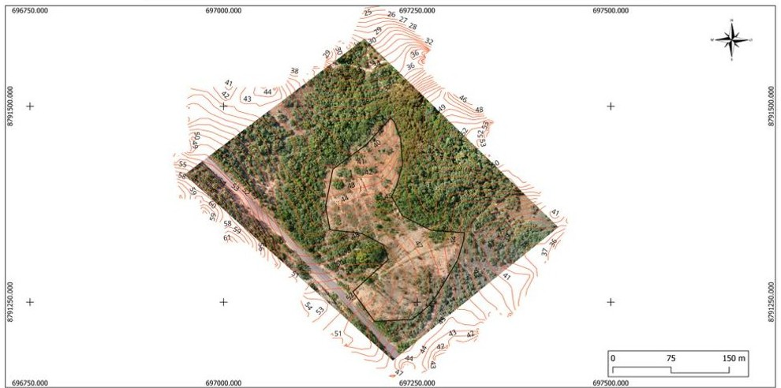

[Área de ocorrência de ravinas (São Cristóvão, SE)]{.pitch-caption}
[Erosão linear instalada em vertente de pastagem degradada]{.pitch-caption-sub}
:::
:::

## [Comparativo]{.pitch-tag} Paliçadas no Contexto da Bioengenharia {.smaller-text .lesson-slide}

::: {.pitch-grid-55}
::: {.pitch-table-box}

| Aspecto | Engenharia Convencional | Bioengenharia |
|---------|------------------------|---------------|
| **Material** | Concreto, gabião | Bambu, madeira, plantas |
| **Custo** | Alto | Baixo a moderado |
| **Impacto ambiental** | Elevado | Reduzido |
| **Durabilidade** | Longa (décadas) | Média ($3\text{--}5\text{ anos}$) |
| **Manutenção** | Baixa | Periódica |
| **Integração ecológica** | Pouca | Alta |

:::

::: {.pitch-stack-2}
::: {.pitch-card .pitch-card--forest}
[Vantagens operacionais]{.pitch-card-index}
[Por que usar paliçadas?]{.pitch-heading}

- Materiais disponíveis localmente e mão de obra não especializada
- Baixo custo de implantação e compatibilidade conservacionista
- Podem evoluir para **barreiras vivas** auto-sustentadas
:::

::: {.pitch-card .pitch-card--gold}
[Aplicações típicas]{.pitch-card-index}
[Áreas-alvo]{.pitch-heading}

Ravinas em pastagens degradadas, taludes de estradas, áreas de mineração e recuperação de áreas degradadas (RAD).
:::
:::
:::

# 2 · Princípios hidráulicos {.section-header rotulo="Hidráulica"}

## [Mecanismo]{.pitch-tag .pitch-tag--teal} Como as Paliçadas Funcionam? {.smaller-text .lesson-slide}

::: {.pitch-grid-55}
::: {.pitch-milestones}
::: {.pitch-milestone-item}
**1. Redução da declividade efetiva:** formam degraus sedimentares a montante, diminuem $\tau$ no leito e previnem a incisão vertical.
:::

::: {.pitch-milestone-item}
**2. Dissipação de energia:** a permeabilidade permite passagem filtrada da água, evita pressão hidrostática excessiva e reduz a velocidade.
:::

::: {.pitch-milestone-item}
**3. Retenção de sedimentos:** partículas grosseiras ficam retidas, formando cunha deposicional a montante e nivelando o canal.
:::
:::

::: {.pitch-formula}
**Equação da tensão cisalhante no leito:**

$$\tau = \gamma \cdot R_h \cdot S$$

- $\tau$: tensão cisalhante ($\text{N/m}^2$); $\gamma$: peso específico da água ($\text{N/m}^3$)
- $R_h$: raio hidráulico ($\text{m}$); $S$: declividade do canal ($\text{m/m}$)

Ao reduzir **$S$**, as paliçadas diminuem diretamente $\tau$ e a **capacidade de transporte** de sedimentos.
:::
:::

## [Sistema em Série]{.pitch-tag .pitch-tag--gold} Arranjo em Série: Efeito Cascata {.smaller-text .lesson-slide}

::: {.pitch-grid-55}
::: {.pitch-stack-2}
::: {.pitch-card}
[Por que em série?]{.pitch-card-index}
[Dissipação progressiva]{.pitch-heading}

Barreiras físicas **isoladas** não suportam a enxurrada em solos com:

- Drenagem interna lenta (ex.: Plintossolos)
- Forte declividade (relevo ondulado)
- Pastagem degradada (baixa cobertura vegetal)

O **arranjo sequencial** reduz progressivamente a carga erosiva recebida por cada barreira subsequente.
:::

::: {.pitch-band .pitch-band--navy}
**Princípio-chave:** a base de cada paliçada deve ficar **em nível com o topo da paliçada seguinte** (a jusante), permitindo o acúmulo de sedimentos no desnível formado.
:::
:::

::: {.pitch-media-card .pitch-media-card--tall}

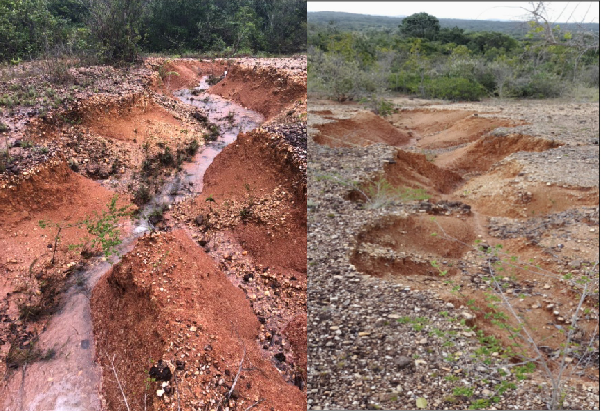

[Segmentação da ravina: superior, intermediário e inferior]{.pitch-caption}
[Posicionamento em série ao longo do perfil longitudinal]{.pitch-caption-sub}
:::
:::

## [Conectividade]{.pitch-tag .pitch-tag--teal} Conectividade Hidrossedimentológica {.smaller-text .lesson-slide}

::: {.pitch-grid-50}
::: {.pitch-card}
[Interrupção da conectividade]{.pitch-card-index}
[Mecanismos de controle]{.pitch-heading}

As paliçadas reduzem a ligação entre fontes de sedimento e áreas de deposição ao:

- **Interceptar** o fluxo concentrado no canal
- **Fragmentar** o percurso do sedimento
- **Aumentar** o tempo de residência hidráulica
- **Criar zonas de remanso** a montante de cada estrutura

*Ciclo interrompido:* pastagem degradada → compactação → baixa infiltração → escoamento → ravina → **paliçadas**.
:::

::: {.pitch-stack-2}
::: {.pitch-cards-2}
::: {.pitch-card}
[1 · Chuva]{.pitch-card-index}
[Escoamento]{.pitch-heading}

Precipitação gera escoamento superficial.
:::

::: {.pitch-card .pitch-card--alert}
[2 · Condição]{.pitch-card-index}
[Solo restritivo]{.pitch-heading}

Impermeável: fluxo concentrado e incisão (vs. infiltração).
:::

::: {.pitch-card .pitch-card--teal}
[3 · Intervenção]{.pitch-card-index}
[Paliçadas em série]{.pitch-heading}

Reduzem velocidade, retêm sedimentos e estabilizam perfil.
:::

::: {.pitch-card .pitch-card--forest}
[4 · Resposta]{.pitch-card-index}
[Recuperação]{.pitch-heading}

Deposição a montante e recuperação do canal.
:::
:::

::: {.pitch-band .pitch-band--teal}
Sem barreiras, a incisão conecta a vertente diretamente à rede de drenagem; em série, as paliçadas fragmentam o transporte sólido.
:::
:::
:::

## [Esquema Integrado]{.pitch-tag .pitch-tag--teal} Conectividade e Execução em Ravinas {.smaller-text .lesson-slide}

::: {.pitch-media-card .pitch-media-card--wide}

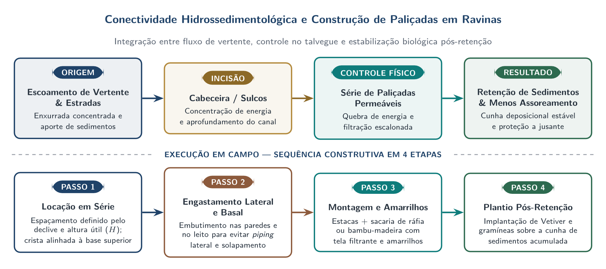

[Conectividade hidrossedimentológica e sequência construtiva em 4 etapas]{.pitch-caption}
[Integração entre fluxo de vertente, controle no talvegue e estabilização biológica pós-retenção]{.pitch-caption-sub}
:::

# 3 · Materiais e dimensionamento {.section-header rotulo="Materiais"}

## [Materiais]{.pitch-tag .pitch-tag--forest} Materiais Utilizados {.smaller-text .lesson-slide}

::: {.pitch-grid-55}
::: {.pitch-stack-2}
::: {.pitch-table-box}

| Bambu (*Bambusa vulgaris*) | Característica técnica |
|---------------|---------|
| **Disponibilidade** | Abundante em áreas rurais |
| **Resistência e custo** | Mecânica alta (novo); coleta local |
| **Crescimento e durabilidade** | Rápido (brota *in situ*); $3\text{--}5\text{ anos}$ sem tratamento |
| **Trabalhabilidade** | Fácil de cortar e amarrar |

:::

::: {.pitch-card .pitch-card--forest}
[Dupla função e seleção]{.pitch-card-index}
[Critérios de material]{.pitch-heading}

O bambu enterrado pode **brotar**, formando **barreira viva**. Materiais complementares: arame recozido, sacos de ráfia (face a montante), pinos de ferro ($30\text{ cm} \times \varnothing\,8\text{ mm}$) e estacas de madeira.

*Critérios:* disponibilidade, resistência, brotamento, manuseio e permeabilidade.
:::
:::

::: {.pitch-media-card .pitch-media-card--photo .pitch-media-card--tall}

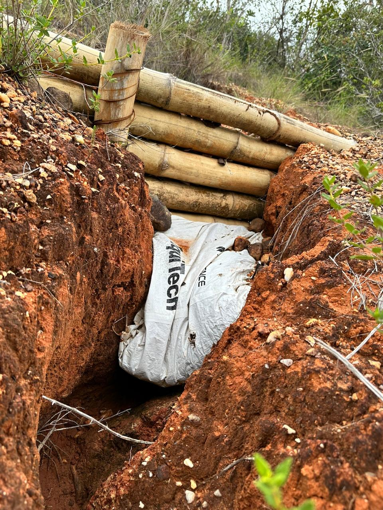

[Sacos de ráfia na face a montante]{.pitch-caption}
[Retenção adicional de sedimentos finos sem vedação total]{.pitch-caption-sub}
:::
:::

## [Dimensionamento]{.pitch-tag .pitch-tag--gold} Dimensionamento das Paliçadas {.smaller-text .lesson-slide}

::: {.pitch-grid-55}
::: {.pitch-formula}
**Largura, enterrio e espaçamento ($D$):**

$$L_{\mathrm{pal}} = L_{\mathrm{ravina}} + 2 \times 0{,}15\text{ m} \qquad h_{\mathrm{enterrio}} \ge 0{,}30\text{ m}$$
$$D = \frac{h_{\mathrm{pal}}}{\tan(\alpha)}$$

- $15\text{ cm}$ extras de cada lado garantem ancoragem nos taludes.
- $h_{\mathrm{pal}}$: altura útil; $\alpha$: declividade do canal.
- **Regra prática:** base da paliçada a montante em nível com o topo da paliçada a jusante.
:::

::: {.pitch-stack-2}
::: {.pitch-table-box}

| Segmento (estudo de caso) | Altura útil ($\text{cm}$) | Largura ($\text{m}$) |
|----------|:-----------------:|:-----------:|
| **Superior (SUP)** | 50 | Variável |
| **Intermediário (MED)** | 76 | Variável |
| **Inferior (INF)** | 36 | Variável |

:::

::: {.pitch-card}
[Dados necessários]{.pitch-card-index}
[Levantamento morfométrico]{.pitch-heading}

Planialtimetria (drone + GNSS-RTK), largura e profundidade dos segmentos, declividade longitudinal e classificação do solo em trincheira.
:::
:::
:::

# 4 · Etapas de instalação {.section-header rotulo="Instalação"}

## [Construção]{.pitch-tag .pitch-tag--forest} Passo a Passo da Construção {.smaller-text .lesson-slide}

::: {.pitch-grid-60}
::: {.pitch-media-card .pitch-media-card--tall}

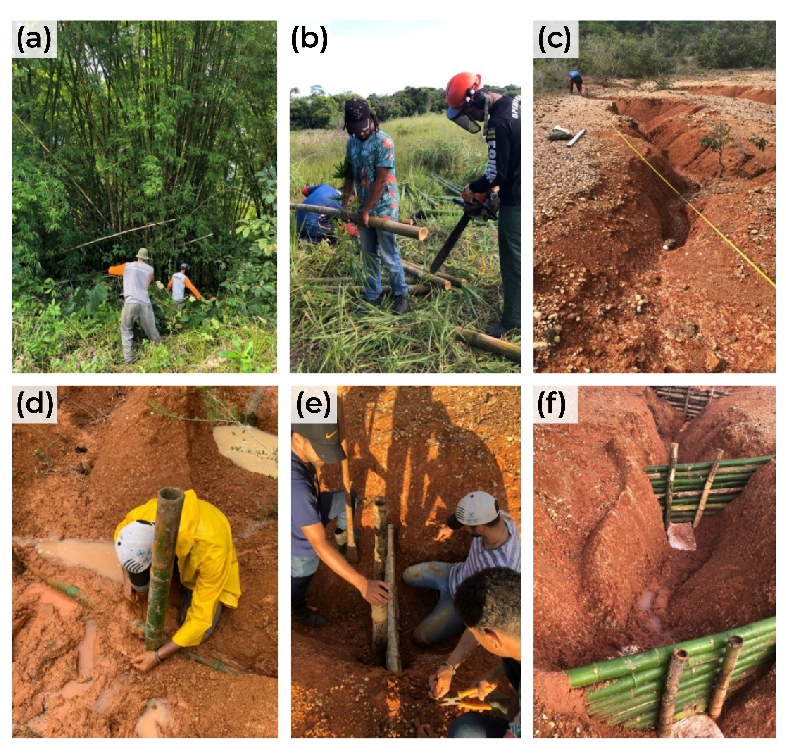

[Etapas de construção das paliçadas]{.pitch-caption}
[(a) Coleta; (b) Corte; (c) Morfometria; (d) Início; (e) Amarrio; (f) Paliçadas prontas]{.pitch-caption-sub}
:::

::: {.pitch-media-card .pitch-media-card--photo .pitch-media-card--tall}

[Paliçada de menor porte instalada]{.pitch-caption}
[Estrutura adaptada à seção transversal do segmento]{.pitch-caption-sub}
:::
:::

## [Etapa 1]{.pitch-tag} Etapa 1 · Planejamento e Levantamento {.smaller-text .lesson-slide}

::: {.pitch-grid-55}
::: {.pitch-stack-2}
::: {.pitch-card}
[Levantamento e segmentação]{.pitch-card-index}
[5 passos iniciais]{.pitch-heading}

1. **Aerofotogrametria** (drone ex.: DJI Air 2S) + GNSS-RTK ($\ge 3$ GCPs).
2. **Classificação e segmentação** da ravina (SUP, MED e INF) e medição morfométrica.
:::

::: {.pitch-table-box}

| Critério | Sulcos | Ravinas | Voçorocas |
|----------|--------|---------|-----------|
| **Profundidade** | $< 30\text{ cm}$ | $30\text{ cm}\text{--}\text{vários m}$ | $>$ vários m |
| **Lençol freático** | Não | Não | Sim |
| **Máquina transpõe?** | Sim | Não | Não |
| **Evolução** | Efêmero | Regressiva | Regressiva + lateral |

:::
:::

::: {.pitch-stack-2}
::: {.pitch-media-card .pitch-media-card--compact}

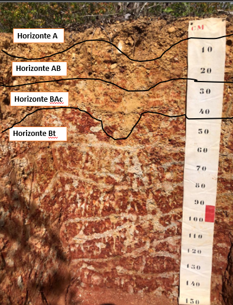

[Plintossolo Argilúvico distrófico ($1{,}5\text{ m}$)]{.pitch-caption}
:::

::: {.pitch-band .pitch-band--teal}
A descrição do solo revela retenção hídrica, erodibilidade, impedância hidráulica e potencial de estabilização.
:::
:::
:::

## [Etapa 2]{.pitch-tag .pitch-tag--gold} Etapa 2 · Coleta e Preparo do Bambu {.smaller-text .lesson-slide}

::: {.pitch-grid-50}
::: {.pitch-stack-2}
::: {.pitch-card}
[Procedimentos de preparo]{.pitch-card-index}
[Indução de brotamento]{.pitch-heading}

1. **Seleção de toras** de *Bambusa vulgaris* ($\varnothing\,8\text{--}12\text{ cm}$, corte seco, sem rachaduras/insetos).
2. **Corte:** horizontais = largura $+ 30\text{ cm}$; verticais = altura útil $+ 30\text{ cm}$ (enterrio).
3. **Tora basal:** perfurar entrenós, preencher com água, vedar e **enterrar por 2 meses** antes para enraizamento/brotamento.
:::

::: {.pitch-band .pitch-band--navy}
**Dupla função da tora basal:** propagação vegetativa da espécie e barreira mecânica imediata contra enxurradas.
:::
:::

::: {.pitch-stack-2}
::: {.pitch-card .pitch-card--forest}
[Armazenamento]{.pitch-card-index}
[Boas práticas]{.pitch-heading}

Manter entrenós intactos (exceto tora basal) e armazenar toras na vertical até a instalação em campo.
:::

::: {.pitch-table-box}

| Material (4 paliçadas / ~30 m) | Quantidade estimada |
|----------|:------------------:|
| **Toras de bambu** | $20\text{--}30$ unidades |
| **Arame recozido** | $10\text{--}15\text{ m}$ |
| **Sacos de ráfia** | $8\text{--}12$ unidades |
| **Pinos de ferro (monitoramento)** | $10\text{--}15$ unidades |

:::
:::
:::

## [Etapa 3]{.pitch-tag .pitch-tag--forest} Etapa 3 · Construção e Fixação {.smaller-text .lesson-slide}

::: {.pitch-grid-55}
::: {.pitch-milestones}
::: {.pitch-milestone-item}
**1. Toras verticais:** enterrar a $30\text{ cm}$ de profundidade com espaçamento de $20\text{--}30\text{ cm}$ na seção.
:::

::: {.pitch-milestone-item}
**2. Tora basal brotada:** posicionar em contato direto com o leito da ravina.
:::

::: {.pitch-milestone-item}
**3. Toras horizontais:** empilhar da base ao topo e amarrar com arame recozido às estacas verticais.
:::

::: {.pitch-milestone-item}
**4. Sacos de ráfia:** instalar na face a montante (com solo ou vazios) para reter finos.
:::

::: {.pitch-milestone-item}
**5. Nivelamento e pinos:** conferir nível com a paliçada a jusante e cravar pinos de monitoramento.
:::
:::

::: {.pitch-stack-2}
::: {.pitch-media-card .pitch-media-card--photo .pitch-media-card--compact}

[Sacos de ráfia na face a montante]{.pitch-caption}
:::

::: {.pitch-card .pitch-card--gold}
[Regra de ancoragem]{.pitch-card-index}
[Estabilidade lateral]{.pitch-heading}

Adicionar **$15\text{ cm}$ extras em cada lado** da ravina (embutidos nos taludes) para evitar erosão lateral (*piping*).
:::
:::
:::

# 5 · Monitoramento e eficiência {.section-header rotulo="Monitoramento"}

## [Método dos Pinos]{.pitch-tag} Método dos Pinos {.smaller-text .lesson-slide}

::: {.pitch-grid-50}
::: {.pitch-stack-2}
::: {.pitch-card}
[Protocolo de medição]{.pitch-card-index}
[Precisão milimétrica mensal]{.pitch-heading}

- Pinos de ferro de $30\text{ cm}$, cravados a $10\text{ cm}$ (**$20\text{ cm}$ expostos** como referência).
- Leituras **mensais** com régua graduada (precisão $1\text{ mm}$).
- Se altura exposta *diminui* → **deposição**; se *aumenta* → **erosão** localizada.
:::

::: {.pitch-table-box}

| Posição do pino | Função |
|---------|--------|
| **A montante** de cada paliçada | Estimar **deposição** |
| **Cabeceira** da ravina | Medir **erosão regressiva** |

:::
:::

::: {.pitch-stack-2}
::: {.pitch-media-card .pitch-media-card--compact}

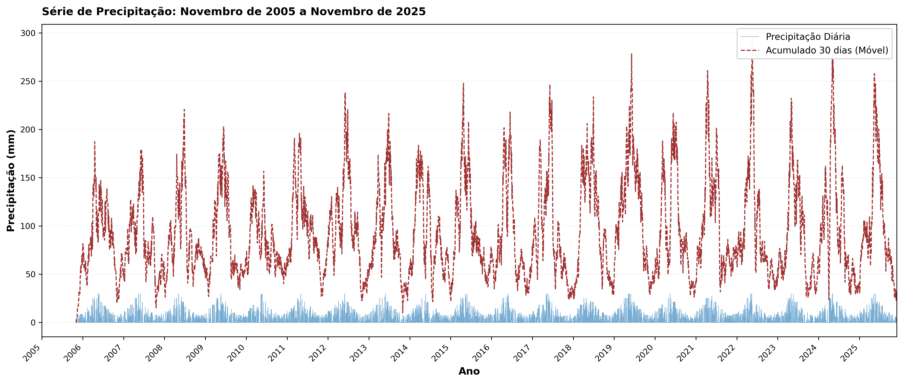

[Série de precipitação (2005–2025)]{.pitch-caption}
:::

::: {.pitch-card .pitch-card--teal}
[Dados complementares]{.pitch-card-index}
[Monitoramento integrado]{.pitch-heading}

Estação pluviométrica local, fotogrametria periódica com drone, inspeção visual da estrutura e registro fotográfico temporal.
:::
:::
:::

## [Resultados]{.pitch-tag .pitch-tag--forest} Resultados de Eficiência {.smaller-text .lesson-slide}

::: {.pitch-grid-50}
::: {.pitch-stack-2}
::: {.pitch-card .pitch-card--forest}
[Retenção em 2 anos (2023–2025)]{.pitch-card-index}
[Desempenho observado]{.pitch-heading}

- **Retenção vertical acumulada** de até **$76\text{ cm}$** nos segmentos intermediários
- **Estabilização geométrica** da feição erosiva
- Capacidade residual **$> 98\%$** em todos os segmentos
:::

::: {.pitch-table-box}

| Segmento | Contribuição ($\%$) | Eficiência ($\text{cm/mm}$) |
|----------|:-----------------:|:------------------:|
| Superior (SUP) | 37,7% | $1{,}12 \times 10^{-4}$ |
| Intermediário (MED) | 22,6% | $1{,}45 \times 10^{-4}$ |
| Inferior (INF) | 39,7% | $1{,}97 \times 10^{-4}$ |

:::
:::

::: {.pitch-stack-2}
::: {.pitch-media-card .pitch-media-card--compact}

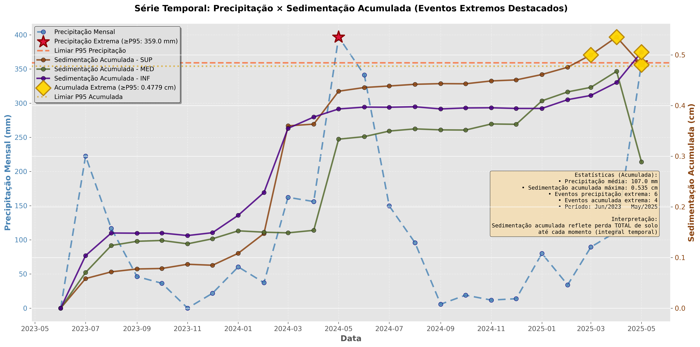

[Dinâmica deposicional e eventos extremos]{.pitch-caption}
:::

::: {.pitch-band .pitch-band--navy}
**Achado-chave:** apenas **4 episódios** acima do percentil 95 responderam por **$40{,}6\%$ da carga sólida total** retida; o amortecimento em série distribuiu o trabalho entre segmentos.
:::
:::
:::

## [Chuva × Deposição]{.pitch-tag .pitch-tag--gold} Interação Chuva × Deposição {.smaller-text .lesson-slide}

::: {.pitch-grid-50}
::: {.pitch-stack-2}
::: {.pitch-table-box}

| Classe de chuva | Faixa ($\text{mm/mês}$) | Sedimentação média ($\text{cm}$) |
|--------|:--------------:|:-----------------------:|
| Moderado | 70–151 | 0,0181 |
| Alto | 151–306 | 0,0669 |
| Muito Alto | 306–356 | 0,0053 |
| Extremo | > 356 | 0,0535 |

:::

::: {.pitch-card .pitch-card--alert}
[Comportamento não linear]{.pitch-card-index}
[*Bypass* e *scouring*]{.pitch-heading}

Em eventos muito intensos, a energia do fluxo supera a capacidade de decantação, mantendo finos em suspensão (*bypass*) ou remobilizando depósitos (*scouring*).
:::
:::

::: {.pitch-stack-2}
::: {.pitch-media-card .pitch-media-card--compact}

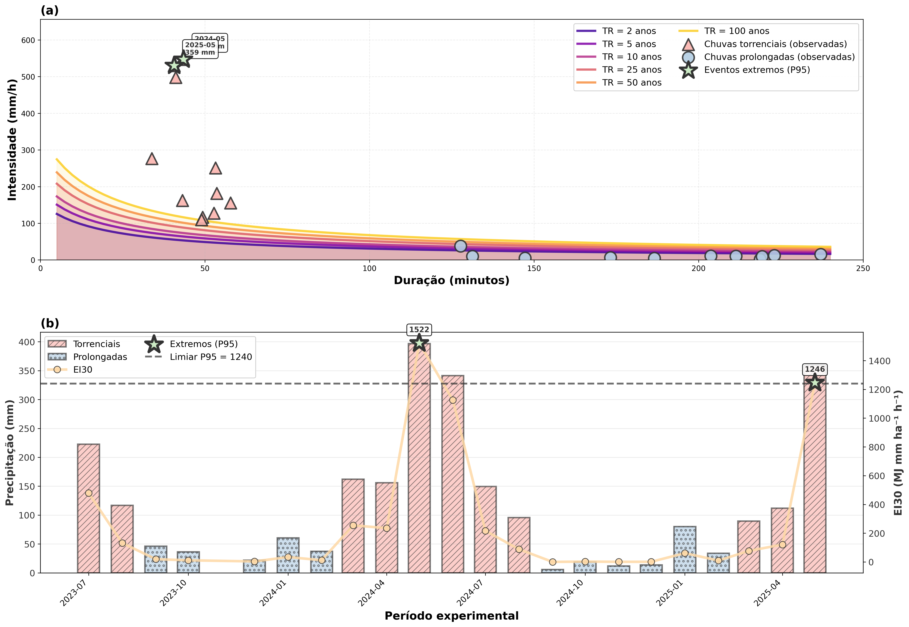

[Enquadramento IDF e série temporal]{.pitch-caption}
:::

::: {.pitch-card}
[Condições antecedentes]{.pitch-card-index}
[*Priming effect*]{.pitch-heading}

Chuvas moderadas prévias saturam o solo, reduzem a coesão dos agregados e preparam taxas de erosão desproporcionais nos eventos seguintes.
:::
:::
:::

# 6 · Manutenção e longevidade {.section-header rotulo="Manutenção"}

## [Manutenção]{.pitch-tag .pitch-tag--alert} Protocolo de Manutenção {.smaller-text .lesson-slide}

::: {.pitch-grid-50}
::: {.pitch-stack-2}
::: {.pitch-card}
[Ciclo de manutenção: 8 meses]{.pitch-card-index}
[Rotina periódica]{.pitch-heading}

1. **Inspeção visual** de toras e amarrações
2. **Substituição de arames** recozidos danificados
3. **Renovação dos sacos de ráfia** na face frontal
4. **Verificação do brotamento** do bambu
5. **Avaliação da capacidade residual** (leitura dos pinos)
:::

::: {.pitch-band .pitch-band--navy}
**Atenção ao segmento inferior (INF):** menor altura útil ($36\text{ cm}$) e maior eficiência fazem com que sature primeiro ($\sim 0{,}8\text{ ano}$ em P95).
:::
:::

::: {.pitch-stack-2}
::: {.pitch-table-box}

| Modo de falha | Causa principal | Tempo estimado |
|------|-------|:--------------:|
| **Assoreamento** | Saturação da capacidade | $0{,}8\text{--}4{,}8\text{ anos}$ |
| **Degradação do bambu** | Biodegradação | $4\text{--}5\text{ anos}$ |
| **Colapso estrutural** | Perda de resistência | $> 3\text{ anos}$ |
| **Bypass** | Fluxo supera a barreira | Eventos extremos |

:::

::: {.pitch-card .pitch-card--alert}
[Modo de falha primário]{.pitch-card-index}
[Transbordamento precoce]{.pitch-heading}

Sob eventos extremos, o **transbordamento por assoreamento** ocorre **antes** da falha estrutural do bambu.
:::
:::
:::

## [Transição]{.pitch-tag .pitch-tag--forest} Transição: Barreira Mecânica → Barreira Viva {.smaller-text .lesson-slide}

::: {.pitch-grid-50}
::: {.pitch-milestones}
::: {.pitch-milestone-item}
**1. Fase mecânica (0–3 anos):** bambu fornece resistência estrutural, retenção física de sedimentos e início do brotamento/enraizamento.
:::

::: {.pitch-milestone-item}
**2. Fase de transição (3–4 anos):** fator de vegetação cruza a curva de degradação; rizomas ancoram o solo e colmos aumentam a densidade.
:::

::: {.pitch-milestone-item}
**3. Fase biotécnica (> 4 anos):** estabilidade governada por **ancoragem de rizomas** e dissipação hidráulica pelos **colmos**, além da vida útil do material original.
:::
:::

::: {.pitch-stack-2}
::: {.pitch-media-card .pitch-media-card--compact}

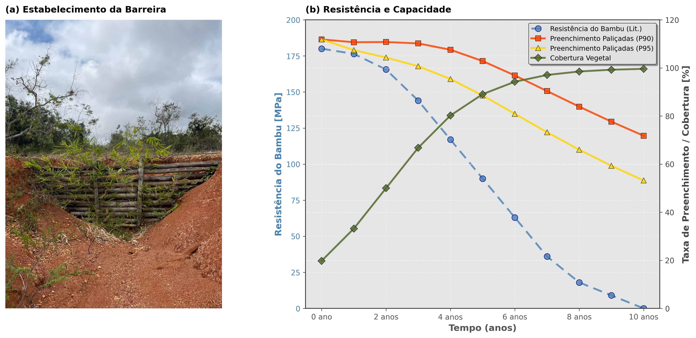

[Degradação mecânica vs. estabilização biológica]{.pitch-caption}
:::

::: {.pitch-band .pitch-band--teal}
**Ponto de cruzamento (~3 anos):** o sistema transita de barreira puramente mecânica para **estabilização biotécnica** permanente.
:::
:::
:::

## [Longevidade]{.pitch-tag .pitch-tag--gold} Cenários de Longevidade {.smaller-text .lesson-slide}

::: {.pitch-grid-55}
::: {.pitch-stack-2}
::: {.pitch-table-box}

| Segmento | Cenário Médio | P90 ($168\text{ mm}$) | P95 ($182\text{ mm}$) |
|----------|:------------:|:------------:|:-------------:|
| **SUP (50 cm)** | **4,8 anos** | 2,4 anos | 2,2 anos |
| **MED (76 cm)** | **2,2 anos** | 1,1 anos | 1,0 ano |
| **INF (36 cm)** | **1,7 anos** | 0,8 anos | 0,8 anos |

:::

::: {.pitch-card .pitch-card--alert}
[Conclusão operacional]{.pitch-card-index}
[Limitante crítico]{.pitch-heading}

O segmento inferior (**INF**) satura em menos de 1 ano sob P95. A **manutenção preventiva** (desassoreamento) deve priorizar esse segmento.
:::
:::

::: {.pitch-media-card .pitch-media-card--tall}

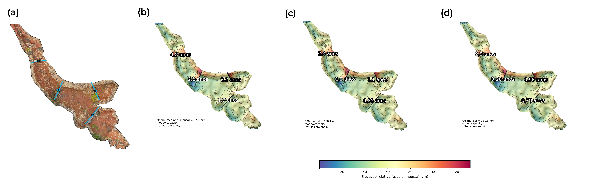

[Simulação de saturação (Médio, P90 e P95)]{.pitch-caption}
[Projeção do tempo até preenchimento completo da capacidade útil]{.pitch-caption-sub}
:::
:::

# 7 · Estudo de caso {.section-header rotulo="Estudo de caso"}

## [Caso UFS]{.pitch-tag .pitch-tag--teal} Localização e Solo — Campus Rural (UFS) {.smaller-text .lesson-slide}

::: {.pitch-grid-50}
::: {.pitch-stack-2}
::: {.pitch-card}
[Área experimental (São Cristóvão, SE)]{.pitch-card-index}
[$10^\circ55'28{,}8''\text{ S}$;\; $37^\circ11'58{,}9''\text{ O}$]{.pitch-heading}

- **Relevo e clima:** ondulado a muito ondulado; tropical úmido (*As*, Köppen-Geiger)
- **Precipitação e solo:** $\sim 1.092\text{ mm/ano}$ ($2005\text{--}2025$); **Plintossolo Argilúvico distrófico**
:::

::: {.pitch-table-box}

| Atributo | Ap (0–10) | AB (10–25) | Bt (40–150+) |
|----------|:---------:|:----------:|:------------:|
| **pH** | 5,2 | 4,5 | 4,6 |
| **Argila (%)** | 33,4 | 47,4 | 51,4 |
| **Al ($\text{cmol}_c/\text{dm}^3$)** | 0,56 | 2,9 | 5,9 |
| **Textura** | Fr. Arg. Aren. | Argilosa | Argilosa |

:::
:::

::: {.pitch-stack-2}
::: {.pitch-card .pitch-card--alert}
[Vulnerabilidade do Plintossolo]{.pitch-card-index}
[Impedância hidráulica]{.pitch-heading}

Horizonte Bt com **impedância hidráulica** dificulta drenagem interna e gera escoamento por **excesso de saturação**, aliado à baixa coesão efetiva (Ap/AB) e acidez alumínica.
:::

::: {.pitch-media-card .pitch-media-card--compact}

[Perfil do Plintossolo Argilúvico distrófico]{.pitch-caption}
:::
:::
:::

## [Espacialização]{.pitch-tag .pitch-tag--teal} Resultados Espaciais {.smaller-text .lesson-slide}

::: {.pitch-grid-50}
::: {.pitch-stack-2}
::: {.pitch-card}
[Simulação espacial]{.pitch-card-index}
[Limiares extremos]{.pitch-heading}

- **P90 ($168\text{ mm/mês}$):** picos de $2{,}75\text{ cm}$ (SUP) a $4{,}56\text{ cm}$ (MED)
- **P95 ($182\text{ mm/mês}$):** picos de $2{,}98\text{ cm}$ (SUP) a $4{,}93\text{ cm}$ (MED)

A deposição concentra-se onde o **gradiente hidráulico é abruptamente reduzido** pela estrutura.
:::

::: {.pitch-band .pitch-band--navy}
**Volume máximo armazenável:** $\sim 2{,}73\text{ m}^3$ no conjunto das 4 paliçadas ($0{,}56\text{--}0{,}86\text{ m}^3$ por estrutura).
:::
:::

::: {.pitch-media-card .pitch-media-card--tall}

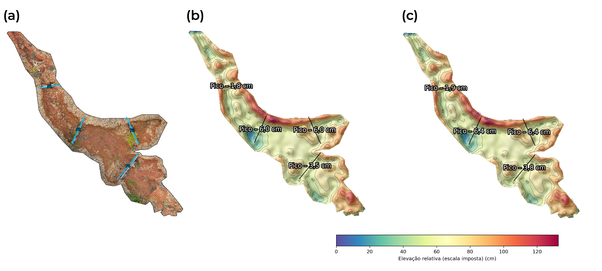

[Simulação espacial de deposição (P90 e P95)]{.pitch-caption}
[Distribuição longitudinal ao longo dos segmentos da ravina]{.pitch-caption-sub}
:::
:::

## [Preenchimento]{.pitch-tag} Evolução Temporal da Capacidade {.smaller-text .lesson-slide}

::: {.pitch-media-card .pitch-media-card--wide}

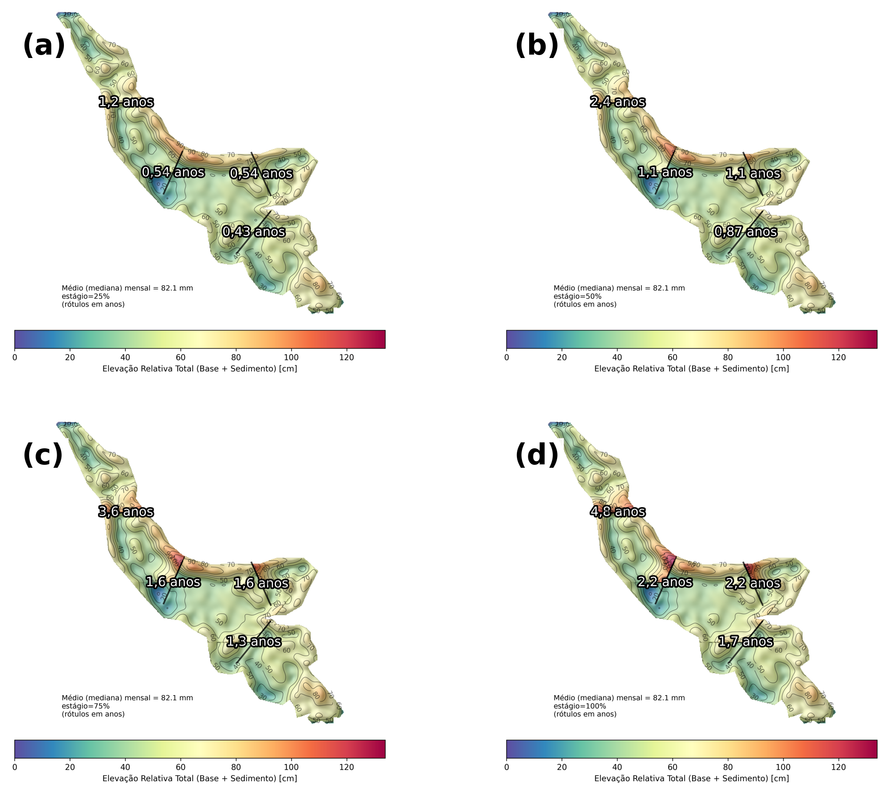

[Evolução temporal do preenchimento sedimentar: (a) 25%, (b) 50%, (c) 75% e (d) 100%]{.pitch-caption}
[Segmentos: **SUP** (coral, $50\text{ cm}$), **MED** (turquesa, $76\text{ cm}$) e **INF** (verde, $36\text{ cm}$), assumindo taxas constantes sem compactação ou remobilização]{.pitch-caption-sub}
:::

# 8 · Síntese e atividade {.section-header rotulo="Síntese"}

## [Síntese]{.pitch-tag .pitch-tag--forest} Resumo dos Pontos-Chave {.smaller-text .lesson-slide}

::: {.pitch-cards-2}
::: {.pitch-card}
[O que aprendemos?]{.pitch-card-index}
[8 fundamentos]{.pitch-heading}

- [1]{.circle} Barreiras permeáveis para controle de erosão linear
- [2]{.circle} Reduzem declividade, dissipam energia e retêm sedimentos
- [3]{.circle} Bambu (*B. vulgaris*) é acessível e pode brotar
- [4]{.circle} Dimensionamento depende da morfometria da ravina
- [5]{.circle} Monitoramento pelo método dos pinos é essencial
- [6]{.circle} Deposição dominada por eventos extremos (não linear)
- [7]{.circle} Manutenção periódica (ciclo de 8 meses) obrigatória
- [8]{.circle} Transição para barreira viva amplia a longevidade
:::

::: {.pitch-card .pitch-card--forest}
[Checklist de implantação]{.pitch-card-index}
[Aplicação prática]{.pitch-heading}

- [ ] Levantamento planialtimétrico e classificação solo/feições
- [ ] Segmentação da ravina e dimensionamento ($h$, $L$, $D$)
- [ ] Coleta, preparo e enterrio prévio da tora basal de bambu
- [ ] Construção em série + sacos de ráfia + pinos de controle
- [ ] Cronograma de manutenção (8 meses) + registro pluviométrico
:::
:::

## [Atividade]{.pitch-tag .pitch-tag--gold} Atividade Proposta {.smaller-text .lesson-slide}

::: {.pitch-grid-55}
::: {.pitch-card .pitch-card--gold}
[Exercício em grupo]{.pitch-card-index}
[Projeto de paliçadas em ravina]{.pitch-heading}

**Cenário:** ravina de $25\text{ m}$, 3 segmentos distintos, declividade média de $10\%$, solo argiloso de baixa infiltração, chuva média de $1.200\text{ mm/ano}$.

**Entregar:** (1) croqui de posicionamento; (2) dimensionamento (altura, largura, espaçamento); (3) quantificação de material; (4) cronograma de instalação/manutenção; (5) protocolo de monitoramento.
:::

::: {.pitch-stack-2}
::: {.pitch-table-box}

| Critério de avaliação | Peso |
|----------|:----:|
| Dimensionamento técnico | 30% |
| Viabilidade construtiva | 20% |
| Protocolo de monitoramento | 20% |
| Plano de manutenção | 15% |
| Apresentação e clareza | 15% |

:::

::: {.pitch-card}
[Referências sugeridas]{.pitch-card-index}
[Bibliografia de apoio]{.pitch-heading}

- Guerra, Bezerra & Jorge (2023) · Morgan (2005) · Emater (2006) · Piton et al. (2017)
:::
:::
:::

## {.center background-color="#1f4268" background-image="../../../assets/fundo.png" background-size="auto 100%" background-position="left center"}

::: {style="text-align: center;"}

[Obrigado!]{.obrigado-fit-text style="color: white;"}

**Prof. Luiz Diego Vidal Santos**

Universidade Estadual de Feira de Santana (UEFS)

[ldvsantos@uefs.br]{style="color: var(--uefs-amarelo); font-size: 1.2em;"}

:::
