## [Abertura]{.pitch-tag} Visão Geral da Aula {.smaller-text .lesson-slide}

::: {.pitch-grid-50}
::: {.pitch-card}
[Roteiro da aula]{.pitch-card-index}
[Tópicos estruturantes]{.pitch-heading}

- [1]{.circle} O que são bacias de captação?
- [2]{.circle} Princípios hidráulicos e funcionamento
- [3]{.circle} Materiais e dimensionamento
- [4]{.circle} Etapas de instalação
- [5]{.circle} Monitoramento e eficiência
- [6]{.circle} Manutenção e longevidade
- [7]{.circle} Estudo de caso: Campus Rural (UFS-SE)
- [8]{.circle} Síntese e atividade
:::

::: {.pitch-stack-2}
::: {.pitch-card .pitch-card--teal}
[Objetivo da aula]{.pitch-card-index}
[Drenagem e conservação em estradas rurais]{.pitch-heading}

Compreender o conceito de **bacias de captação** (*detention ponds*) como prática mecânica de conservação do solo e da água em estradas rurais, dominar os procedimentos de **dimensionamento**, critérios construtivos e protocolos de **monitoramento** para garantir eficiência e longevidade do sistema.
:::

::: {.pitch-pill-row}
[Barraginhas]{.pitch-pill}
[Recarga Hídrica]{.pitch-pill .pitch-pill--gold}
[VIB e IDF]{.pitch-pill}
[SIG e Priorização]{.pitch-pill}
:::
:::
:::

# 1 · O que são bacias de captação? {.section-header rotulo="Conceito"}

## [Conceito]{.pitch-tag .pitch-tag--teal} Definição e Contexto {.smaller-text .lesson-slide}

::: {.pitch-grid-55}
::: {.pitch-stack-2}
::: {.pitch-card}
[Estruturas mecânicas marginais]{.pitch-card-index}
[Objetivos das barraginhas]{.pitch-heading}

As **bacias de captação** (*barraginhas*, bacias de retenção ou acumulação) são estruturas escavadas nas margens de estradas rurais para:

- **Captar** o escoamento superficial direto
- **Armazenar** a água da enxurrada
- **Promover a infiltração** da água no solo
- **Reter sedimentos** carreados pelo escoamento
:::

::: {.pitch-band .pitch-band--navy}
Principal construção rural para adequação da drenagem de **estradas vicinais**, unindo proteção viária, recarga do lençol freático e proteção de corpos hídricos.
:::
:::

::: {.pitch-media-card .pitch-media-card--photo .pitch-media-card--tall}

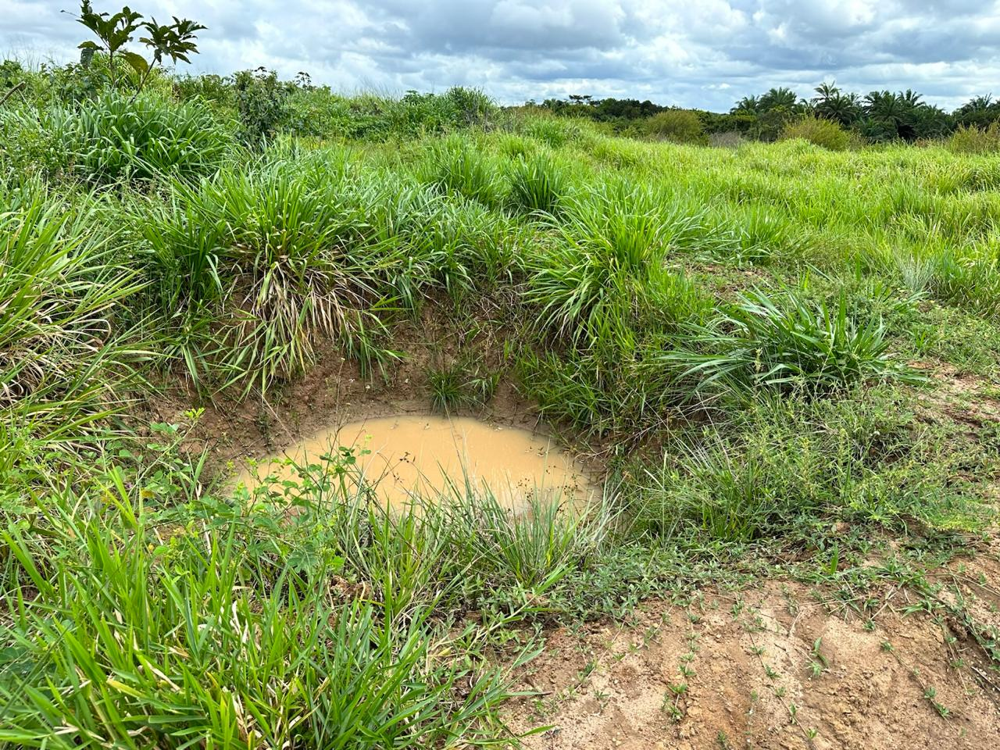

[Bacia de captação em margem de estrada rural]{.pitch-caption}
[Captação lateral do escoamento superficial antes da incisão erosiva]{.pitch-caption-sub}
:::
:::

## [Conservação]{.pitch-tag} Bacias no Contexto da Conservação {.smaller-text .lesson-slide}

::: {.pitch-grid-55}
::: {.pitch-stack-2}
::: {.pitch-table-box}

| Aspecto | Práticas Vegetativas | Práticas Mecânicas |
|---------|---------------------|-------------------|
| Princípio | Cobertura e raízes | Estrutura física |
| Tempo de resposta | Médio/longo | Imediato |
| Custo e manutenção | Baixo / baixa | Moderado-alto / periódica |
| Eficiência imediata | Parcial | Alta |
| Exemplos | Cordões, cobertura morta | Terraços, bacias, canais |

:::

::: {.pitch-card .pitch-card--teal}
[Eficiência comprovada]{.pitch-card-index}
[Fiener, Auerswald & Weigand (2005)]{.pitch-heading}

Retêm **50 a 80% dos sedimentos**; evitam erosão a jusante, promovem recarga freática e reduzem custos de manutenção de estradas e danos às lavouras.
:::
:::

::: {.pitch-media-card .pitch-media-card--photo .pitch-media-card--tall}

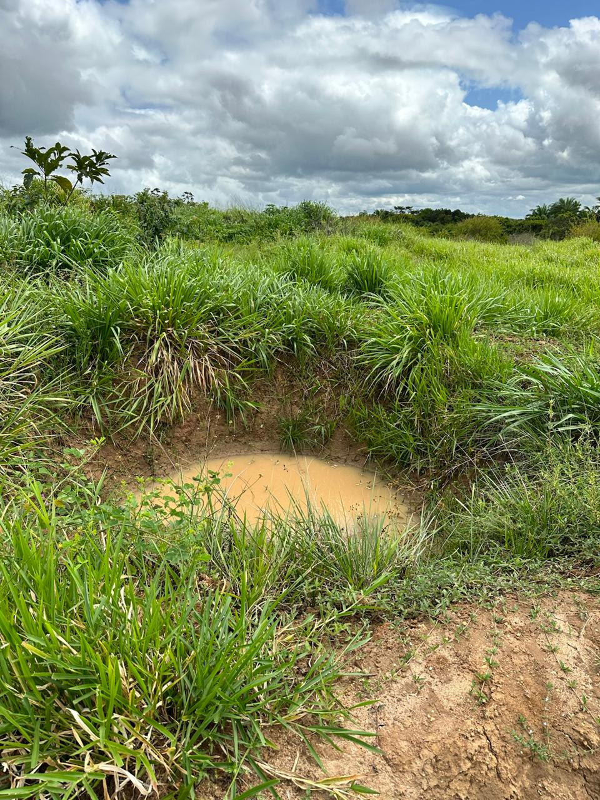

[Visão geral de barraginha implantada]{.pitch-caption}
[Reserva hídrica e contenção de sedimentos em área rural]{.pitch-caption-sub}
:::
:::

## [Comparativo]{.pitch-tag .pitch-tag--gold} Paliçadas × Bacias de Captação {.smaller-text .lesson-slide}

::: {.pitch-grid-55}
::: {.pitch-table-box}

| Critério | Paliçadas | Bacias de Captação |
|----------|-----------|-------------------|
| **Tipo e local** | Barreira permeável em ravinas | Reservatório escavado nas estradas |
| **Função principal** | Reduzir velocidade e reter sedimentos | Armazenar e infiltrar água |
| **Material e máquina** | Bambu/madeira · manual | Solo escavado · retroescavadeira |
| **Custo e manutenção** | Baixo · reposição de peças | Moderado-alto · dragagem |
| **Vida útil** | $3\text{--}5\text{ anos}$ (barreira viva) | Indefinida (com manutenção) |

:::

::: {.pitch-card .pitch-card--forest}
[Complementaridade na paisagem]{.pitch-card-index}
[Quando usar cada técnica?]{.pitch-heading}

- **Paliçadas:** erosão linear já instalada (ravinas e voçorocas).
- **Bacias de captação:** proteção preventiva de estradas rurais antes da formação de ravinas.
- **Combinação:** bacias a montante captam o escoamento da estrada (infiltração + retenção); o excesso não captado em ravinas existentes é controlado a jusante por **paliçadas** até a estabilização.
:::
:::

## [Integração]{.pitch-tag .pitch-tag--teal} Barraginhas vs. Paliçadas: Controle Integrado {.smaller-text .lesson-slide}

::: {.pitch-media-card .pitch-media-card--wide}

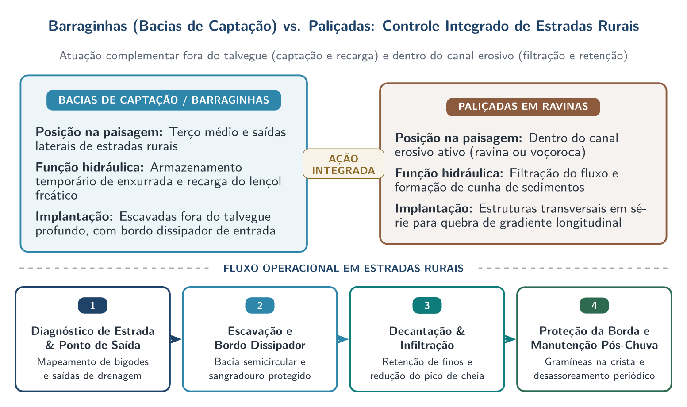

[Barraginhas vs. Paliçadas: ação integrada fora do talvegue e dentro do canal erosivo]{.pitch-caption}
[Fluxo operacional: diagnóstico da estrada → escavação e bordo dissipador → decantação e infiltração → proteção vegetal e manutenção]{.pitch-caption-sub}
:::

# 2 · Princípios hidráulicos {.section-header rotulo="Hidráulica"}

## [Diagnóstico Viário]{.pitch-tag .pitch-tag--alert} O Problema das Estradas Rurais {.smaller-text .lesson-slide}

::: {.pitch-grid-50}
::: {.pitch-stack-2}
::: {.pitch-card}
[Estradas não pavimentadas]{.pitch-card-index}
[Impacto na drenagem]{.pitch-heading}

Alteram padrões naturais de drenagem, concentrando e acelerando o escoamento e o transporte de sedimentos (Cunha et al., 2013).

A estrada deve integrar-se ao ambiente rural pela interferência mútua com as áreas marginais (Pruski et al., 2006).
:::

::: {.pitch-band .pitch-band--teal}
Coletar a água nas laterais e conduzir para **bacias de retenção** protege a via e cria reservas hídricas (Carvalho, 2017; Casarin & Oliveira, 2009).
:::
:::

::: {.pitch-table-box}

| Problema sem drenagem | Consequência direta |
|----------|-------------|
| **Sulcos e ravinas** | Destruição do leito da estrada |
| **Atoleiros** | Intransitabilidade no período chuvoso |
| **Assoreamento** | Degradação de nascentes e rios |
| **Perda de solo fértil** | Redução da produtividade agrícola |
| **Custo de reconstrução** | Gasto público elevado e recorrente |
| **Isolamento** | Comunidades sem acesso a serviços |

:::
:::

## [Ciclo Erosivo]{.pitch-tag .pitch-tag--gold} O Processo Erosivo em Estradas Rurais {.smaller-text .lesson-slide}

::: {.pitch-grid-50}
::: {.pitch-stack-2}
::: {.pitch-card}
[Sequência e balanço sedimentar]{.pitch-card-index}
[Bertoni & Lombardi Neto (2010); Santos (2015)]{.pitch-heading}

1. **Desagregação** (impacto da gota) → 2. **Transporte** (enxurrada) → 3. **Deposição**.

A estrada atua como **superfície impermeável linear** que canaliza vazões acima das condições naturais.

- Cap. transporte $>$ sedimentos → **erosão**
- Sedimentos $>$ cap. transporte → **deposição**
:::

::: {.pitch-band .pitch-band--navy}
Sem bacias, o fluxo concentrado causa erosão a jusante e assoreamento de rios e nascentes.
:::
:::

::: {.pitch-cards-2}
::: {.pitch-card}
[1 · Chuva]{.pitch-card-index}
[Desagregação]{.pitch-heading}

Impacto das gotas desagrega partículas e gera escoamento superficial.
:::

::: {.pitch-card .pitch-card--alert}
[2 · Estrada rural]{.pitch-card-index}
[Concentração]{.pitch-heading}

Fluxo concentra-se nos canais laterais (vs. difuso natural) e transporta sedimentos.
:::

::: {.pitch-card .pitch-card--teal}
[3 · Bacia]{.pitch-card-index}
[Interceptação]{.pitch-heading}

Retenção física de sedimentos e infiltração da água armazenada.
:::

::: {.pitch-card .pitch-card--forest}
[4 · Destino]{.pitch-card-index}
[Recarga hídrica]{.pitch-heading}

Recarga do lençol freático (vs. assoreamento a jusante sem bacia).
:::
:::
:::

## [Infiltração e EUPS]{.pitch-tag .pitch-tag--gold} Infiltração e Escoamento {.smaller-text .lesson-slide}

::: {.pitch-grid-50}
::: {.pitch-stack-2}
::: {.pitch-card}
[Capacidade de infiltração]{.pitch-card-index}
[Arnau-Rosalén et al. (2008)]{.pitch-heading}

Fator mais importante no controle do escoamento; depende de **porosidade, umidade antecedente, textura/estrutura, cobertura vegetal, atividade biológica e declividade**.
:::

::: {.pitch-band .pitch-band--teal}
Ao armazenar temporariamente a água, a bacia **aumenta o tempo de contato água–solo**, favorecendo infiltração mesmo em baixa permeabilidade.
:::
:::

::: {.pitch-stack-2}
::: {.pitch-formula}
**Equação Universal de Perda de Solo (EUPS):**

$$A = R \cdot K \cdot L \cdot S \cdot C \cdot P$$

- $A$: perda de solo ($\text{t/ha}\cdot\text{ano}$); $R$: erosividade; $K$: erodibilidade
- $L$: comprimento de rampa; $S$: declividade; $C$: cobertura; $P$: práticas conservacionistas
:::

::: {.pitch-band .pitch-band--navy}
As bacias **reduzem o fator $P$** e interceptam a enxurrada antes de percorrer longas distâncias, diminuindo o efeito do **fator $L$**.
:::
:::
:::

## [VIB]{.pitch-tag .pitch-tag--teal} Velocidade de Infiltração Básica (VIB) {.smaller-text .lesson-slide}

::: {.pitch-grid-55}
::: {.pitch-stack-2}
::: {.pitch-card}
[Infiltrômetro de anel concêntrico]{.pitch-card-index}
[Bernardo et al. (2008)]{.pitch-heading}

Anéis de $\varnothing\,20$ e $40\text{ cm}$ ($15\text{ cm}$ de altura): cravar, preencher com água e registrar a descida no anel interno ($1, 2, 3, 5, 10, 15, 20, 30\dots\text{ min}$) até estabilizar (**VIB**).
:::

::: {.pitch-table-box}

| Classificação | VIB ($\text{mm/h}$) |
|:------------:|:----------:|
| Muito alta | $> 30$ |
| Alta | $15\text{--}30$ |
| Média | $5\text{--}15$ |
| Baixa | $1\text{--}5$ |
| Muito baixa | $< 1$ |

:::
:::

::: {.pitch-stack-2}
::: {.pitch-card .pitch-card--teal}
[Relação com o dimensionamento]{.pitch-card-index}
[Esvaziamento e volume]{.pitch-heading}

- Define o **tempo de esvaziamento**, o **volume útil** e a **frequência de dragagem**.
- Solos com VIB baixa exigem **maior volume** de armazenamento.
:::

::: {.pitch-card .pitch-card--alert}
[Plintossolos (Campus Rural UFS)]{.pitch-card-index}
[Impedância hidráulica]{.pitch-heading}

Horizonte restritivo resulta em **VIB baixa**, exigindo bacias com maior capacidade de armazenamento.
:::
:::
:::

# 3 · Materiais e dimensionamento {.section-header rotulo="Dimensionamento"}

## [Construção]{.pitch-tag} Método Construtivo e Geometria {.smaller-text .lesson-slide}

::: {.pitch-grid-50}
::: {.pitch-stack-2}
::: {.pitch-card}
[Implantação (Griebeler, 2002)]{.pitch-card-index}
[Escavação e maquinário]{.pitch-heading}

1. Escavação marginal (**retroescavadeira** / pá carregadeira)
2. Conformação, nivelamento (**nível óptico / GNSS**) e compactação dos taludes
3. Conexão com os canais laterais da estrada

*Diferente das paliçadas:* requer maquinário pesado, elevando custo inicial, mas com eficiência imediata.
:::

::: {.pitch-card .pitch-card--teal}
[Componentes da bacia]{.pitch-card-index}
[Formas: trapezoidal, semicircular ou retangular]{.pitch-heading}

**Entrada** (canal lateral) · **Corpo** (volume útil) · **Vertedouro de emergência** · **Talude interno** ($\le 1:1\text{ V:H}$) · **Berma**.
:::
:::

::: {.pitch-card .pitch-card--gold}
[Seção transversal trapezoidal]{.pitch-card-index}
[Esquema geométrico]{.pitch-heading}

```text
      ←───── Berma ─────→
     ╱                     ╲
    ╱   ←── Talude ──→      ╲
   ╱                          ╲
  ╱         ←── Base ──→       ╲
  ════════════════════════════════
         (fundo da bacia)
```

Taludes estáveis e berma protegida evitam solapamento da borda e colapso em eventos de cheia.
:::
:::

## [Cálculo IDF]{.pitch-tag .pitch-tag--gold} Dimensionamento das Bacias {.smaller-text .lesson-slide}

::: {.pitch-grid-55}
::: {.pitch-formula}
**Equação IDF e volume de projeto** (Pruski et al., 1997; Pires & Souza, 2006):

$$i = \frac{K \cdot T_r^{a}}{(t + b)^{c}} \qquad V_{\mathrm{bacia}} = C \cdot i \cdot A_{\mathrm{drenagem}} \cdot t$$

- $i$: intensidade ($\text{mm/h}$); $T_r$: retorno (usual **$10\text{ anos}$**); $t$: duração ($\text{min}$); $K,a,b,c$: parâmetros regionais
- Considera um único evento intenso, área de drenagem, declividade e coeficiente de escoamento ($C$).
:::

::: {.pitch-stack-2}
::: {.pitch-table-box}

| Parâmetro (São Cristóvão-SE) | Valor típico |
|-----------|:-----:|
| Precipitação média anual (abr–set chuvoso) | $\sim 1.092\text{ mm}$ |
| $T_r$ e duração de projeto | $10\text{ anos}$ / $30\text{ min}$ |
| Coeficiente de escoamento ($C$) | $0{,}4\text{--}0{,}7$ |

:::

::: {.pitch-card}
[O que governa $C$?]{.pitch-card-index}
[Fatores contrastantes]{.pitch-heading}

- **Aumentam $C$:** solo compactado da estrada, baixa cobertura, declive alto, umidade antecedente alta.
- **Diminuem $C$:** boa cobertura, solo permeável, relevo plano, solo seco.
:::
:::
:::

## [Espaçamento]{.pitch-tag .pitch-tag--gold} Espaçamento entre Bacias {.smaller-text .lesson-slide}

::: {.pitch-grid-50}
::: {.pitch-stack-2}
::: {.pitch-table-box}

| Declividade ($\%$) | Espaçamento sugerido ($\text{m}$) |
|:---------------:|:------------------------:|
| $0\text{--}3$ | $80\text{--}120$ |
| $3\text{--}8$ | $50\text{--}80$ |
| $8\text{--}12$ | $30\text{--}50$ |
| $12\text{--}20$ | $20\text{--}30$ |
| $> 20$ | $15\text{--}20$ |

:::

::: {.pitch-card}
[Critérios locais]{.pitch-card-index}
[Variáveis de campo]{.pitch-heading}

Volume da bacia, declividade, largura e revestimento da plataforma, área das encostas laterais, solo e intensidade de tráfego. **Maior declividade → menor espaçamento.**
:::
:::

::: {.pitch-stack-2}
::: {.pitch-table-box}

| Dimensão típica | Faixa usual |
|-----------|:-----------:|
| Comprimento / largura | $3\text{--}8\text{ m}$ / $2\text{--}4\text{ m}$ |
| Profundidade / volume | $1\text{--}2\text{ m}$ / $5\text{--}30\text{ m}^3$ |
| Inclinação do talude | $1:1$ a $1:1{,}5$ |

:::

::: {.pitch-formula}
**Regra conservadora de Griebeler (2002):** armazenar todo o volume escoado desprezando a infiltração durante o evento:

$$V_{\mathrm{trecho}} = C \cdot P_{\max} \cdot (L_{\mathrm{estrada}} \times l_{\mathrm{faixa}})$$
:::
:::
:::

# 4 · Etapas de instalação {.section-header rotulo="Instalação"}

## [Visão Geral]{.pitch-tag .pitch-tag--forest} Passo a Passo da Implantação {.smaller-text .lesson-slide}

::: {.pitch-media-card .pitch-media-card--photo .pitch-media-card--wide}

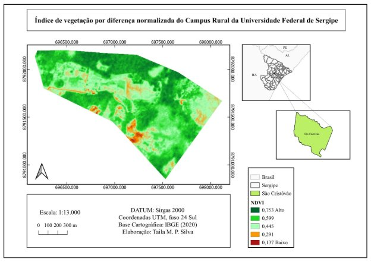

[Bacias de captação em diferentes estágios de implantação e operação]{.pitch-caption}
[Adequação sequencial das margens de estrada vicinal para captação do escoamento]{.pitch-caption-sub}
:::

## [Etapa 1]{.pitch-tag} Etapa 1 · Planejamento e Levantamento {.smaller-text .lesson-slide}

::: {.pitch-grid-50}
::: {.pitch-stack-2}
::: {.pitch-card}
[Levantamento de campo]{.pitch-card-index}
[Fluxo geoespacial]{.pitch-heading}

1. Aerofotogrametria (drone) + GNSS-RTK ($\ge 3$ GCPs)
2. MDT no Agisoft Metashape e mapa de declividade no QGIS ($0\text{--}3, 3\text{--}8, 8\text{--}20, 20\text{--}45, >45\%$)
3. Trechos críticos e classificação do solo (tradagem/trincheira) para VIB, fator $K$, estabilidade e impedância
:::

::: {.pitch-table-box}

| Dado | Fonte |
|------|-------|
| Precipitação máxima | Estação meteorológica / INPE-SIMA |
| Declividade / contribuição | MDT (drone + GNSS) / SIG (QGIS) |
| Solo e VIB | Tradagem / infiltrômetro de anel |
| Cobertura vegetal | NDVI (imagens Planet/drone) |

:::
:::

::: {.pitch-stack-2}
::: {.pitch-table-box}

| Parâmetro de voo (Almeida et al., 2020) | Valor |
|-----------|-------|
| Plataforma / Altura de voo | DJI Phantom 4 PRO / $120\text{ m}$ |
| Sobreposição frontal / lateral | $75\%$ / $70\%$ |
| Resolução (GSD) | $3{,}2\text{ cm}$ |
| GCPs | 41 (31 controle + 10 verificação) |
| RMSE (H / V) | $0{,}04$ / $0{,}11\text{ m}$ |

:::

::: {.pitch-band .pitch-band--teal}
A integração drone + GNSS + ensaios de solo permite locar bacias exatamente nos pontos de concentração de enxurrada.
:::
:::
:::

## [Etapa 2]{.pitch-tag .pitch-tag--gold} Etapa 2 · Locação e Demarcação {.smaller-text .lesson-slide}

::: {.pitch-grid-50}
::: {.pitch-stack-2}
::: {.pitch-card}
[Procedimentos e critérios]{.pitch-card-index}
[Locação em campo]{.pitch-heading}

1. Definir espaçamento e marcar com estacas ou cal.
2. Garantir fundo **abaixo** do canal lateral e coincidir entrada com a descarga.
3. Evitar afloramento rochoso, lençol superficial e áreas cultivadas; manter **$\ge 2\text{ m}$ da borda da estrada** e acesso para dragagem.
:::

::: {.pitch-band .pitch-band--navy}
A estrada e suas áreas marginais formam um sistema único de drenagem (Pruski et al., 2006).
:::
:::

::: {.pitch-card .pitch-card--teal}
[Diagrama de implantação (vista superior)]{.pitch-card-index}
[Conexão aos canais laterais]{.pitch-heading}

```text
    ════════════════════════════════════════
    ║          ESTRADA RURAL             ║
    ════════════════════════════════════════
         │                    │
         │  Canal lateral     │  Canal lateral
         │                    │
         ▼                    ▼
    ┌─────────┐          ┌─────────┐
    │ BACIA 1 │          │ BACIA 2 │
    │  (V m³) │          │  (V m³) │
    └─────────┘          └─────────┘
    
    ←── Espaçamento (E) ──→
```
:::
:::

## [Etapa 3]{.pitch-tag .pitch-tag--forest} Etapa 3 · Escavação e Conformação {.smaller-text .lesson-slide}

::: {.pitch-grid-55}
::: {.pitch-milestones}
::: {.pitch-milestone-item}
**1. Escavação:** retroescavadeira com $1\text{--}2\text{ m}$ de profundidade e taludes $1:1$ a $1:1{,}5$.
:::

::: {.pitch-milestone-item}
**2. Dique a jusante:** depositar solo escavado na borda a jusante (sem obstruir drenagem natural) para ampliar capacidade.
:::

::: {.pitch-milestone-item}
**3. Fundo e vertedouro:** conformar fundo plano/levemente inclinado e construir **vertedouro de emergência**.
:::

::: {.pitch-milestone-item}
**4. Conexão, compactação e pinos:** transição suave com canal lateral, compactar taludes internos e instalar pinos de monitoramento.
:::
:::

::: {.pitch-media-card .pitch-media-card--photo .pitch-media-card--tall}

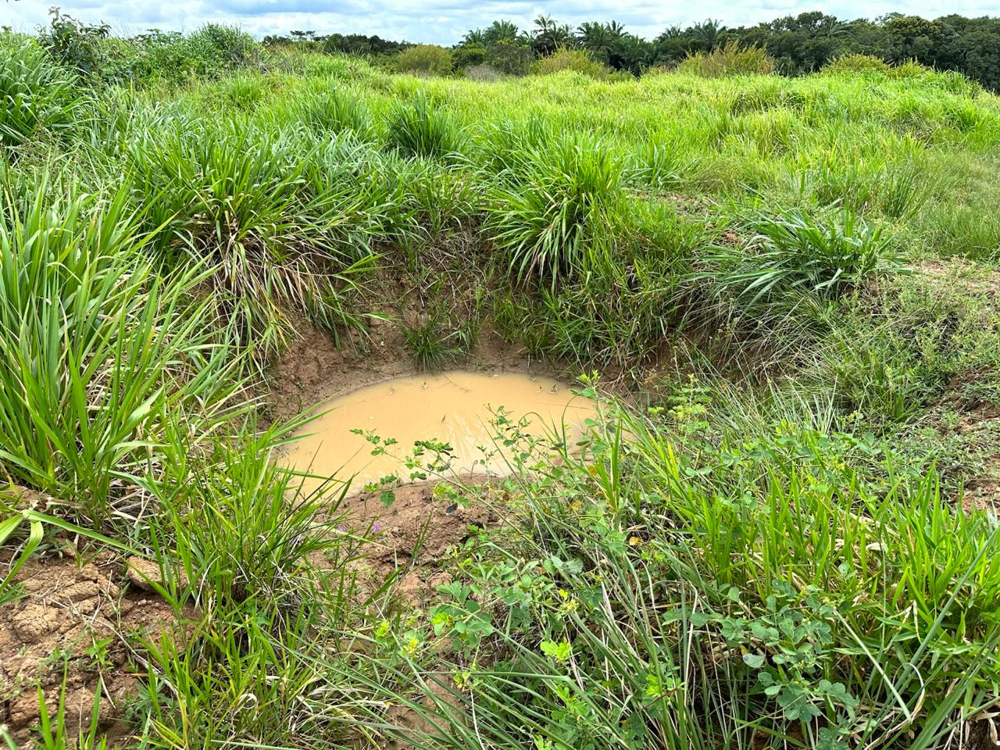

[Barraginha após escavação e conformação]{.pitch-caption}
[Reservatório escavado com taludes conformados e dique lateral]{.pitch-caption-sub}
:::
:::

## [Registro]{.pitch-tag .pitch-tag--forest} Registro Fotográfico da Implantação {.smaller-text .lesson-slide}

::: {.pitch-cards}
::: {.pitch-media-card .pitch-media-card--photo .pitch-media-card--compact}

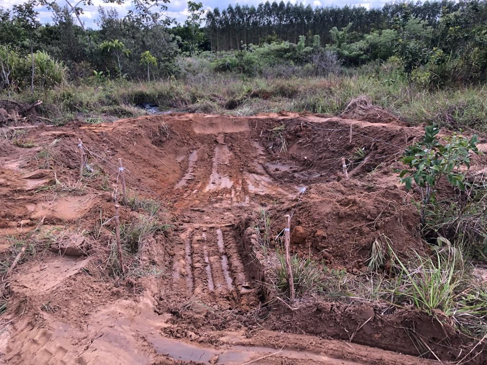

[Escavação inicial]{.pitch-caption}
[Conformação nas margens da estrada]{.pitch-caption-sub}
:::

::: {.pitch-media-card .pitch-media-card--photo .pitch-media-card--compact}

.jpeg)

[Ajuste de geometria]{.pitch-caption}
[Definição de profundidade útil]{.pitch-caption-sub}
:::

::: {.pitch-media-card .pitch-media-card--photo .pitch-media-card--compact}

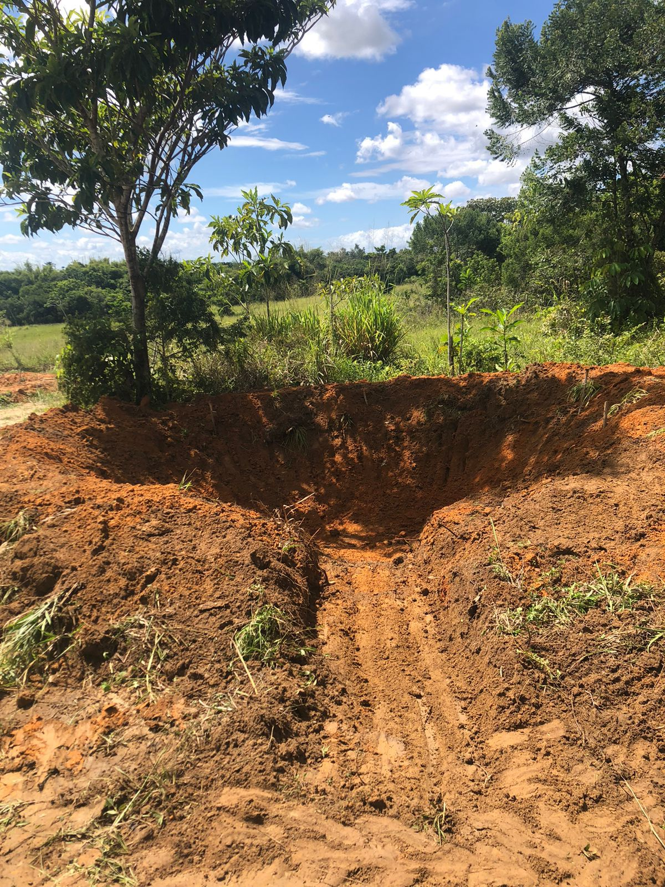

[Acabamento e conexão]{.pitch-caption}
[Taludes e canal lateral (Griebeler, 2002)]{.pitch-caption-sub}
:::
:::

::: {.pitch-band .pitch-band--teal}
**Sequência construtiva real:** escavação mecanizada, ajuste geométrico e acabamento dos taludes integrados ao sistema de drenagem viária.
:::

# 5 · Monitoramento e eficiência {.section-header rotulo="Monitoramento"}

## [Pinos e Stolf]{.pitch-tag} Método dos Pinos e Penetrômetro {.smaller-text .lesson-slide}

::: {.pitch-grid-50}
::: {.pitch-stack-2}
::: {.pitch-card}
[Monitoramento (Morgan, 2005; Costa et al., 2011)]{.pitch-card-index}
[Leitura mensal ($1\text{ mm}$)]{.pitch-heading}

Pinos de ferro de $30\text{ cm}$ cravados a $10\text{ cm}$ ($20\text{ cm}$ expostos). Altura exposta *diminui* → **deposição**; *aumenta* → **erosão**.
:::

::: {.pitch-table-box}

| Posição dos pinos | Repetições | Função |
|---------|:----------:|--------|
| Interior da bacia | 3 | Medir **assoreamento** |
| Face externa adjacente | 1 | Medir **erosão lateral** |
| Área nativa preservada | 3 | **Referência** (controle) |

:::
:::

::: {.pitch-stack-2}
::: {.pitch-formula}
**Resistência à penetração (Stolf):**

$$R = 0{,}1 \times [5{,}6 + 6{,}89 \times (10 \times NI / P)]$$

$R$ em $\text{MPa}$; $NI$: número de impactos; $P$: penetração ($\text{cm}$). Ensaios em 3 repetições internas vs. 3 em área preservada.
:::

::: {.pitch-card .pitch-card--teal}
[Dados complementares]{.pitch-card-index}
[Rede de observação]{.pitch-heading}

Pluviometria (INPE/SIMA), levantamentos com drone, observação visual dos taludes e registro fotográfico temporal.
:::
:::
:::

## [Sedimentos]{.pitch-tag .pitch-tag--gold} Análise de Carga de Fundo {.smaller-text .lesson-slide}

::: {.pitch-grid-50}
::: {.pitch-stack-2}
::: {.pitch-card}
[Coleta e peneiramento]{.pitch-card-index}
[Amostrador Van Veen no talvegue]{.pitch-heading}

Coleta com amostrador Van Veen → secagem ao ar → agitador mecânico (**NBR 6502/95**) + densímetro de **Bouyoucos (1927)** para areia, silte e argila.
:::

::: {.pitch-table-box}

| Abertura ($\text{mm}$) | Fração retida | Abertura ($\text{mm}$) | Fração retida |
|:---:|---|:---:|---|
| 19 | Cascalho | 0,6 | Areia média-fina |
| 2 | Areia grossa | 0,212 | Areia fina |
| 1 | Areia média | 0,053 | Areia muito fina / silte |

:::
:::

::: {.pitch-stack-2}
::: {.pitch-card .pitch-card--teal}
[Por que analisar?]{.pitch-card-index}
[Diagnóstico hidrossedimentológico]{.pitch-heading}

Quantifica assoreamento, taxa de perda de volume útil, qualidade da água e origem dos sedimentos (estrada vs. áreas marginais).
:::

::: {.pitch-formula}
**Umidade gravimétrica** (anéis indeformados $0\text{--}10$, $10\text{--}20$, $20\text{--}30\text{ cm}$):

$$U = \frac{M_a}{M_s}\quad (\text{g/g})$$
:::
:::
:::

## [Eficiência]{.pitch-tag .pitch-tag--forest} Eficiência das Bacias {.smaller-text .lesson-slide}

::: {.pitch-grid-50}
::: {.pitch-stack-2}
::: {.pitch-table-box}

| Indicador | Valor | Fonte |
|-----------|:-----:|-------|
| Retenção de sedimentos | **50 – 80%** | Fiener et al. (2005) |
| Redução do escoamento | Significativa | Fiener et al. (2005) |
| Prevenção erosão jusante | Alta | Casarin & Oliveira (2009) |
| Recarga freática | Positiva | Griebeler (2002) |

:::

::: {.pitch-band .pitch-band--navy}
**Relação não linear:** eventos extremos podem gerar *bypass* (transbordamento) ou remobilização de depósitos. A combinação com práticas vegetativas e edáficas reduz custos.
:::
:::

::: {.pitch-card .pitch-card--forest}
[Checklist de monitoramento]{.pitch-card-index}
[8 indicadores de desempenho]{.pitch-heading}

- [ ] Taxa de assoreamento ($\text{cm/mês}$) e volume útil residual ($\text{m}^3$)
- [ ] Granulometria do material retido e VIB no fundo da bacia
- [ ] Resistência à penetração (interior vs. referência)
- [ ] Precipitação acumulada × sedimentação
- [ ] Integridade dos taludes e funcionamento do vertedouro
:::
:::

## [Em Operação]{.pitch-tag .pitch-tag--teal} Bacias em Operação — Registros de Campo {.smaller-text .lesson-slide}

::: {.pitch-cards}
::: {.pitch-media-card .pitch-media-card--photo .pitch-media-card--compact}

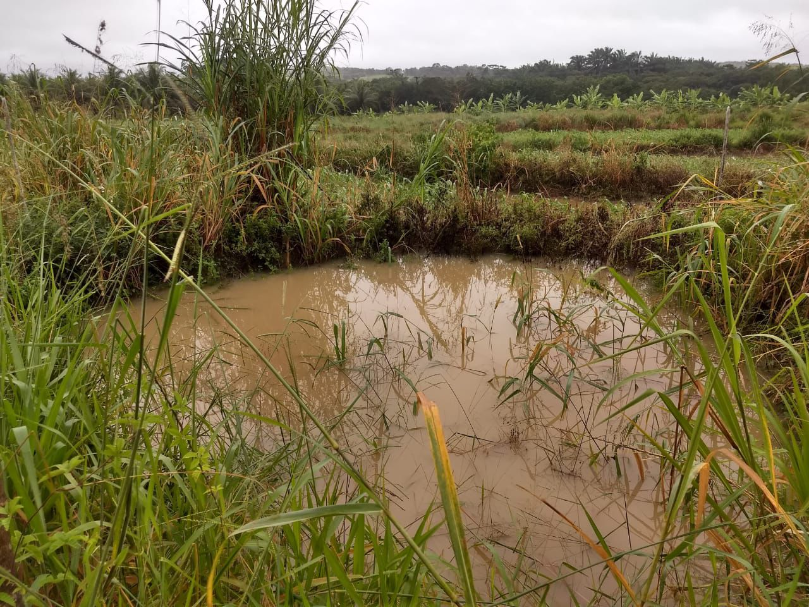

[Retenção pós-chuva]{.pitch-caption}
[Acúmulo e infiltração em progresso]{.pitch-caption-sub}
:::

::: {.pitch-media-card .pitch-media-card--photo .pitch-media-card--compact}

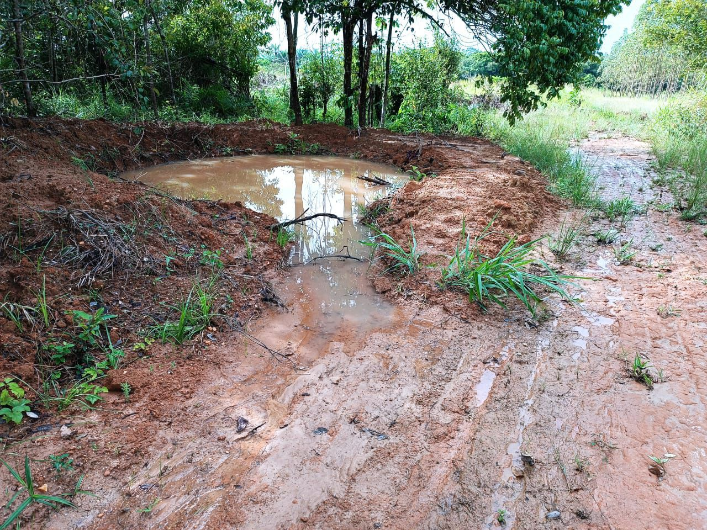

[Armazenamento em reservatório]{.pitch-caption}
[Volume retido em margem de via]{.pitch-caption-sub}
:::

::: {.pitch-media-card .pitch-media-card--photo .pitch-media-card--compact}

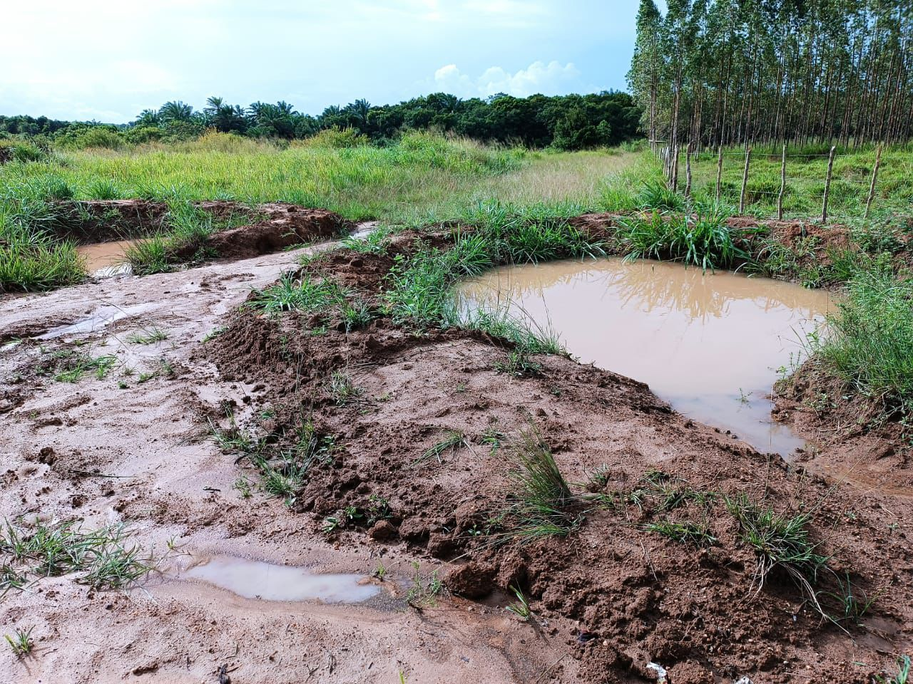

[Precipitação intensa]{.pitch-caption}
[Lâmina armazenada dentro da borda livre]{.pitch-caption-sub}
:::
:::

::: {.pitch-band .pitch-band--teal}
**Evidência de funcionamento:** o maior tempo de residência da água favorece tanto a **infiltração** quanto a **deposição gravitacional** dos sedimentos.
:::

# 6 · Manutenção e longevidade {.section-header rotulo="Manutenção"}

## [Manutenção]{.pitch-tag .pitch-tag--alert} Protocolo de Manutenção {.smaller-text .lesson-slide}

::: {.pitch-grid-50}
::: {.pitch-stack-2}
::: {.pitch-card}
[Ciclo operacional]{.pitch-card-index}
[6 ações essenciais]{.pitch-heading}

1. Inspeção visual (taludes, entrada e vertedouro)
2. Medição do assoreamento (pinos ou régua)
3. **Dragagem** ao atingir **$50\text{--}70\%$** da capacidade
4. Reparo de taludes, desobstrução da entrada e checagem do vertedouro
:::

::: {.pitch-band .pitch-band--navy}
**Principal ponto fraco:** o elevado custo de **dragagem periódica** dos sedimentos retidos (Casarin & Oliveira, 2009).
:::
:::

::: {.pitch-stack-2}
::: {.pitch-table-box}

| Atividade | Frequência |
|-----------|:----------:|
| Inspeção visual / leitura dos pinos | Mensal |
| Dragagem leve / drone | Semestral |
| Dragagem completa | Anual (ou conforme demanda) |
| Reparo de taludes | Conforme necessidade |

:::

::: {.pitch-card .pitch-card--forest}
[Destinação do material dragado]{.pitch-card-index}
[Reaproveitamento]{.pitch-heading}

Nivelamento de áreas degradadas, espalhamento marginal (se não contaminado), substrato para recuperação e monitoramento analítico.
:::
:::
:::

## [Custos]{.pitch-tag .pitch-tag--forest} Estratégias para Reduzir Custos {.smaller-text .lesson-slide}

::: {.pitch-grid-50}
::: {.pitch-stack-2}
::: {.pitch-table-box}

| Prática combinada | Efeito na bacia (Fiener et al., 2005) |
|-------------------|----------------|
| Cobertura vegetal / cordões | Filtram sedimentos antes da entrada |
| Terraços a montante | Reduzem volume de escoamento |
| Caixas secas / paliçadas | Distribuem retenção e contêm ravinas |

:::

::: {.pitch-band .pitch-band--teal}
A combinação com práticas vegetativas **reduz em $50\text{--}80\%$** o aporte sólido à bacia, multiplicando o intervalo entre dragagens.
:::
:::

::: {.pitch-stack-2}
::: {.pitch-card}
[Análise de custo-benefício]{.pitch-card-index}
[Valores referenciais]{.pitch-heading}

- **Implantação:** R\$ $500\text{--}2.000$/bacia · **Dragagem:** R\$ $200\text{--}800$/evento · **Rotina:** R\$ $100\text{--}300$/ano
- **Benefícios:** proteção viária, recarga hídrica, menos assoreamento fluvial e proteção agrícola.
:::

::: {.pitch-table-box}

| Cenário de manejo | Vida útil estimada |
|---------|:-----------------:|
| Sem manutenção | $1\text{--}3\text{ anos}$ |
| Manutenção anual | $5\text{--}10\text{ anos}$ |
| Manutenção + práticas combinadas | $10\text{--}20+\text{ anos}$ |

:::
:::
:::

# 7 · Estudo de caso {.section-header rotulo="Estudo de caso"}

## [Campus Rural]{.pitch-tag .pitch-tag--teal} Localização e Solo — Campus Rural (UFS) {.smaller-text .lesson-slide}

::: {.pitch-grid-50}
::: {.pitch-stack-2}
::: {.pitch-card}
[Área experimental (181 ha)]{.pitch-card-index}
[São Cristóvão, SE ($10^\circ55'\text{S}$;\; $37^\circ11'\text{O}$)]{.pitch-heading}

Clima tropical (*As'*), estação chuvosa abr–set ($\sim 1.092\text{ mm/ano}$), relevo plano a ondulado (Silva, 2021).
:::

::: {.pitch-table-box}

| Ordem de solo | Área ($\%$) | Relevo predominante |
|-------|:--------:|:-------------------:|
| Neossolo Flúvico | 27,3 | Plano |
| Argissolo Vermelho Amarelo | 25,9 | Suave ondulado |
| Argissolo + Plintossolo | 29,3 | Ondulado |
| Plintossolo Háplico | 11,1 | Fortemente ondulado |
| Gleissolo Háplico | 6,4 | Plano (várzea) |

:::
:::

::: {.pitch-stack-2}
::: {.pitch-card .pitch-card--alert}
[Plintossolo: classe mais crítica]{.pitch-card-index}
[Nascimento (2021)]{.pitch-heading}

Horizonte Bt com **impedância hidráulica** (escoamento por excesso de saturação) coincide com maior declividade e menor cobertura vegetal.
:::

::: {.pitch-table-box}

| Relevo | Declividade ($\%$) | Área ($\%$) |
|--------|:--------------:|:--------:|
| Plano / Suave ondulado | $0\text{--}3$ / $3\text{--}8$ | $20$ / $22$ |
| **Ondulado** | $8\text{--}20$ | **45** |
| Fortemente ondulado / Montanhoso | $20\text{--}45$ / $>45$ | $11$ / $2$ |

:::
:::
:::

## [Mapas]{.pitch-tag .pitch-tag--teal} Mapas Temáticos da Área {.smaller-text .lesson-slide}

::: {.pitch-grid-50}
::: {.pitch-stack-2}
::: {.pitch-media-card .pitch-media-card--compact}

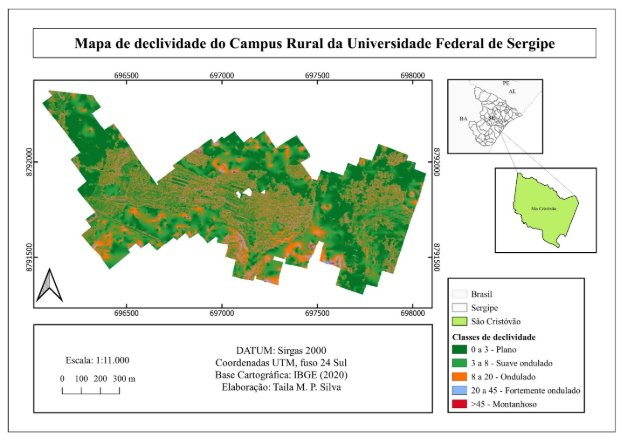

[Mapa de declividade (Silva, 2021)]{.pitch-caption}
:::

::: {.pitch-band .pitch-band--navy}
Relevo **ondulado a fortemente ondulado** ($56\%$ da área) concentra maior risco erosivo e prioridade para bacias.
:::
:::

::: {.pitch-stack-2}
::: {.pitch-media-card .pitch-media-card--compact}

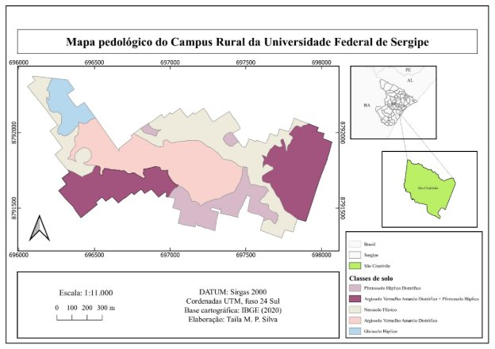

[Mapa pedológico (Silva, 2021)]{.pitch-caption}
:::

::: {.pitch-band .pitch-band--teal}
**Plintossolos nas áreas mais declivosas** representam a maior vulnerabilidade à erosão na área experimental.
:::
:::
:::

## [Uso e NDVI]{.pitch-tag .pitch-tag--forest} Uso do Solo e NDVI {.smaller-text .lesson-slide}

::: {.pitch-grid-50}
::: {.pitch-stack-2}
::: {.pitch-media-card .pitch-media-card--compact}

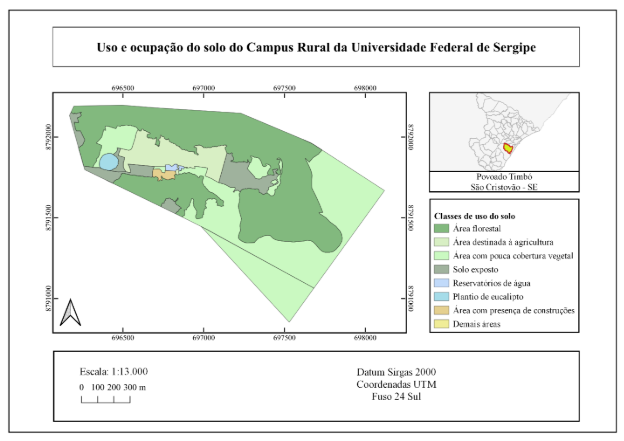

[Uso e ocupação do solo (Silva, 2021)]{.pitch-caption}
:::

::: {.pitch-table-box}

| Classe de uso | Área ($\%$) |
|--------|:--------:|
| Florestal / Pouca cobertura | $47$ / $36$ |
| Agricultura / Solo exposto / Outros | $8$ / $7$ / $2$ |

:::
:::

::: {.pitch-stack-2}
::: {.pitch-media-card .pitch-media-card--photo .pitch-media-card--compact}

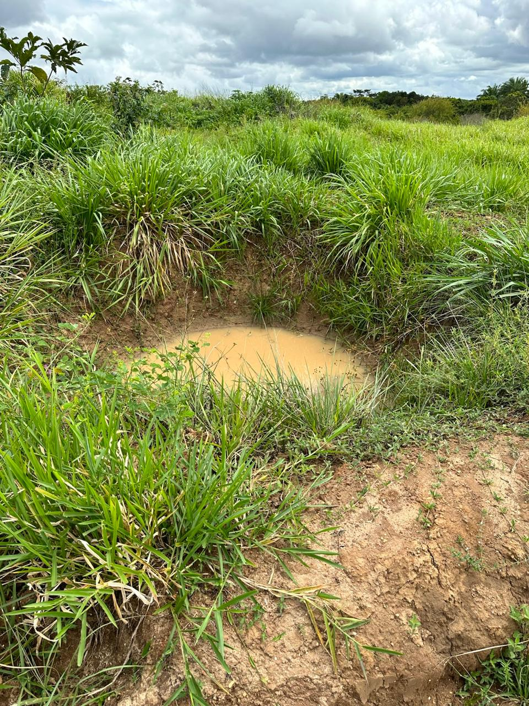

[Barraginha em operação]{.pitch-caption}
:::

::: {.pitch-formula}
$$NDVI = \frac{NIR - R}{NIR + R}$$

Variação na área: **$0{,}14$** (solo exposto) a **$0{,}75$** (vegetação arbórea). Áreas com baixo NDVI + alta declividade são prioritárias.
:::
:::
:::

## [Aerofotogrametria]{.pitch-tag} Vista Aérea do Sistema de Bacias {.smaller-text .lesson-slide}

::: {.pitch-grid-50}
::: {.pitch-media-card .pitch-media-card--photo}

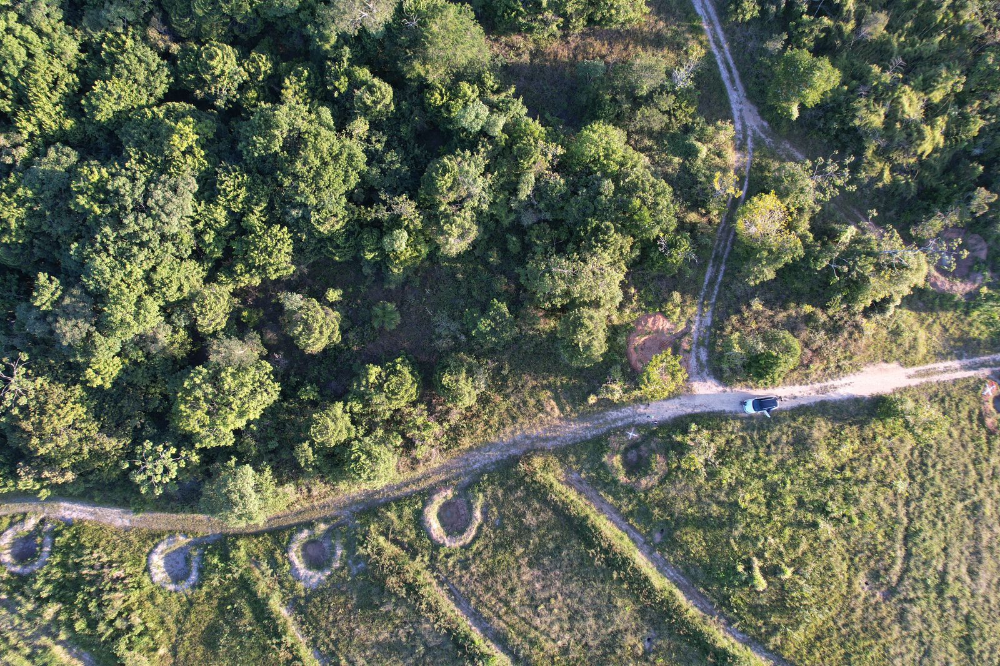

[Conjunto de bacias ao longo da malha viária]{.pitch-caption}
:::

::: {.pitch-media-card .pitch-media-card--photo}

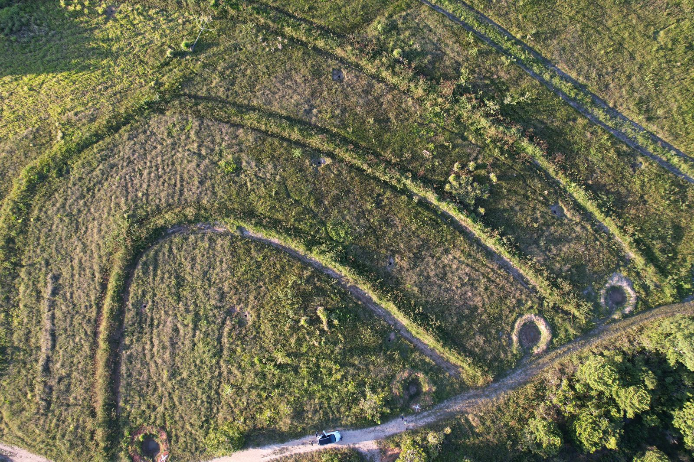

[Disposição conforme espaçamento e declividade]{.pitch-caption}
:::
:::

::: {.pitch-band .pitch-band--teal}
**Monitoramento por drone:** avalia a distribuição espacial das bacias, integridade dos taludes e trechos que demandam manutenção ou novas unidades.
:::

## [Priorização SIG]{.pitch-tag .pitch-tag--gold} Demandas Identificadas no Campus Rural {.smaller-text .lesson-slide}

::: {.pitch-grid-50}
::: {.pitch-stack-2}
::: {.pitch-card .pitch-card--alert}
[Critérios de priorização]{.pitch-card-index}
[Sobreposição de mapas no QGIS]{.pitch-heading}

1. Declividade $> 8\%$ no trecho
2. Solo tipo **Plintossolo** ou **Argissolo + Plintossolo**
3. $NDVI < 0{,}3$ (pouca cobertura vegetal)
4. Sinais de erosão (sulcos, ravinas)
5. Proximidade de nascentes ou corpos d'água
:::

::: {.pitch-band .pitch-band--navy}
O cruzamento no QGIS ($\text{declividade} \times \text{solo} \times \text{cobertura} \times \text{drenagem}$) gera o **mapa de prioridade** de locação.
:::
:::

::: {.pitch-cards-2}
::: {.pitch-card}
[1 · Aquisição]{.pitch-card-index}
[Sensores]{.pitch-heading}

Levantamento com drone + imagens Planet → **MDT + Ortomosaico**.
:::

::: {.pitch-card .pitch-card--teal}
[2 · Camadas]{.pitch-card-index}
[Temáticos]{.pitch-heading}

Mapas de **Declividade**, **Uso do Solo**, **NDVI** e **Pedológico**.
:::

::: {.pitch-card .pitch-card--gold}
[3 · Síntese SIG]{.pitch-card-index}
[Priorização]{.pitch-heading}

**Cruzamento SIG** das 4 camadas → **Mapa de Prioridade** para bacias.
:::

::: {.pitch-card .pitch-card--forest}
[4 · Engenharia]{.pitch-card-index}
[Execução]{.pitch-heading}

**Dimensionamento** → **Implantação** em campo → **Monitoramento**.
:::
:::
:::

# 8 · Síntese e atividade {.section-header rotulo="Síntese"}

## [Síntese]{.pitch-tag .pitch-tag--forest} Resumo dos Pontos-Chave {.smaller-text .lesson-slide}

::: {.pitch-cards-2}
::: {.pitch-card}
[O que aprendemos?]{.pitch-card-index}
[8 pontos fundamentais]{.pitch-heading}

- [1]{.circle} Estradas concentram fluxo; bacias armazenam e infiltram
- [2]{.circle} Protegem estradas, recarregam lençol e retêm $50\text{--}80\%$ dos sedimentos
- [3]{.circle} Dimensionamento via IDF ($T_r = 10\text{ anos}$), área e declividade
- [4]{.circle} Construção mecanizada (retroescavadeira) com base topográfica
- [5]{.circle} Monitoramento por pinos, granulometria, Stolf e VIB
- [6]{.circle} Dragagem periódica é o principal custo operacional
- [7]{.circle} Práticas vegetativas reduzem custos e ampliam eficiência
- [8]{.circle} SIG integra mapas temáticos para priorizar trechos
:::

::: {.pitch-card .pitch-card--teal}
[Checklist de implantação]{.pitch-card-index}
[12 verificações de projeto]{.pitch-heading}

- [ ] Drone/MDT, declividade, pedologia, uso/NDVI e VIB
- [ ] Chuva de projeto (IDF, $T_r = 10\text{ anos}$), volume e espaçamento
- [ ] Locação, escavação com retroescavadeira e pinos de controle
- [ ] Inspeção mensal, dragagem semestral e práticas combinadas
:::
:::

## [Atividade]{.pitch-tag .pitch-tag--gold} Atividade Proposta {.smaller-text .lesson-slide}

::: {.pitch-grid-55}
::: {.pitch-card .pitch-card--gold}
[Exercício em grupo · Campus Rural UFS]{.pitch-card-index}
[Dimensionamento de bacias em estrada rural]{.pitch-heading}

**Cenário:** trecho de $500\text{ m}$, declividade $8\%$, Argissolo + Plintossolo ($\text{VIB} = 5\text{ mm/h}$), chuva de projeto $60\text{ mm/h}$ ($T_r = 10\text{ anos}$, $t = 30\text{ min}$), faixa de contribuição $15\text{ m}$, $C = 0{,}55$.

**Entregar:** (1) volume por trecho; (2) dimensões da bacia; (3) número e espaçamento; (4) croqui/planta baixa; (5) protocolo de monitoramento; (6) cronograma de manutenção.
:::

::: {.pitch-stack-2}
::: {.pitch-table-box}

| Critério de avaliação | Peso |
|----------|:----:|
| Dimensionamento técnico | 30% |
| Viabilidade construtiva | 20% |
| Protocolo de monitoramento | 20% |
| Plano de manutenção | 15% |
| Apresentação e clareza | 15% |

:::

::: {.pitch-card}
[Referências sugeridas]{.pitch-card-index}
[Bibliografia]{.pitch-heading}

Pruski et al. (1997) · Griebeler (2002) · Pires & Souza (2006) · Casarin & Oliveira (2009) · Fiener et al. (2005) · Carvalho (2017) · Bertoni & Lombardi Neto (2010).
:::
:::
:::

## {.center background-color="#1f4268" background-image="../../../assets/fundo.png" background-size="auto 100%" background-position="left center"}

::: {style="text-align: center;"}

[Obrigado!]{.obrigado-fit-text style="color: white;"}

**Prof. Luiz Diego Vidal Santos**

Universidade Estadual de Feira de Santana (UEFS)

[ldvsantos@uefs.br]{style="color: var(--uefs-amarelo); font-size: 1.2em;"}

:::
