## Abertura Visão Geral da Aula {.smaller-text .academic-slide .lesson-slide}

::: {.pitch-grid-50}
::: {.pitch-card}
[Roteiro da aula]{.pitch-card-index}
[Tópicos estruturantes]{.pitch-heading}

- [1]{.circle} Premissas da bioengenharia vegetativa
- [2]{.circle} Técnicas de estabilização com vegetação
- [3]{.circle} Drenos verdes: conceito e confecção
- [4]{.circle} Sistema espinha de peixe
- [5]{.circle} Espécies vegetais para estacas vivas
- [6]{.circle} Monitoramento e bioensaios
- [7]{.circle} Estudo de caso: Campus Rural (UFS-SE)
- [8]{.circle} Síntese e atividade
:::

::: {.pitch-stack-2}
::: {.pitch-card .pitch-card--forest}
[Objetivo central]{.pitch-card-index}
[Estabilização e drenagem viva]{.pitch-heading}

Compreender as **técnicas de bioengenharia vegetativa** para estabilização de margens e encostas, incluindo estacas vivas, feixes vivos (*live fascines*), empacotamento de ramos, geogrelhas vegetadas, muros de suporte vivo e esteiras de ramagem, além de dominar o conceito e a confecção dos **drenos verdes** como sistema integrado de drenagem e revegetação.
:::

::: {.pitch-pill-row}
[Estacas e feixes vivos]{.pitch-pill}
[Drenos verdes · Taboa e bananeira]{.pitch-pill .pitch-pill--gold}
[Sistema espinha de peixe]{.pitch-pill}
:::
:::
:::

# 1 · Premissas da bioengenharia vegetativa {.section-header rotulo="Premissas"}

## Premissas Contexto e motivação da estabilização marginal {.smaller-text .academic-slide .lesson-slide}

::: {.pitch-grid-55}
::: {.pitch-stack-2}
::: {.pitch-card}
[Diagnóstico fluvial]{.pitch-card-index}
[O problema da erosão marginal]{.pitch-heading}

As margens dos rios podem ser consideradas estáveis se não houver mudanças perceptíveis na sua localização ao longo de **20 a 50 anos** (Lyn & Newton, 2015). A erosão marginal advém da adaptação do rio ao vale em que se situa ou às novas condições de escoamento impostas por atividades antrópicas.
:::

::: {.pitch-card .pitch-card--alert}
[Métodos convencionais]{.pitch-card-index}
[Limitações estruturais e ecológicas]{.pitch-heading}

Os métodos tradicionais de contenção (riprap, gabião, concreto, retificação) frequentemente transferem problemas erosivos para outras áreas e afetam a integridade ecológica dos cursos d'água (Li & Eddleman, 2002; Biedenharn et al., 1997).
:::
:::

::: {.pitch-stack-2}
::: {.pitch-table-box}
| Abordagem | Custo | Impacto ambiental | Habitat |
|---|---|---|---|
| Enrocamento | Alto | Elevado | Não |
| Concreto | Muito alto | Elevado | Não |
| Retificação | Alto | Severo | Destrói |
| **Bioengenharia** | **Baixo** | **Mínimo** | **Cria** |
:::

::: {.pitch-band .pitch-band--teal}
As técnicas de **bioengenharia** surgiram como alternativas **ambientalmente sensíveis** às abordagens convencionais, enfatizando elementos vegetativos para estabilização de margens (Lyn & Newton, 2015).
:::
:::
:::

## Premissas Fatores de sucesso e zonas ribeirinhas {.smaller-text .academic-slide .lesson-slide}

::: {.pitch-grid-50}
::: {.pitch-stack-2}
::: {.pitch-card}
[USDA (2007)]{.pitch-card-index}
[Condicionantes do estabelecimento]{.pitch-heading}

O sucesso das técnicas depende do **estabelecimento inicial** e do **desenvolvimento a longo prazo** da vegetação ripária:

- Espécies selecionadas e métodos de aquisição
- Técnicas de instalação e época do ano
- Tipo de solo, compactação e nutrientes
- Hidrologia, clima e localização no curso d'água
- Carga de sedimentos e acessibilidade à água
:::

::: {.pitch-band}
**Abordagem zonal:** a vegetação deve ser posicionada conforme a **elevação** e as relações com o nível d'água durante diferentes vazões. Na **zona submersa**, a bioengenharia requer combinação com elementos estruturais (USDA, 2007).
:::
:::

::: {.pitch-milestones}
::: {.pitch-milestone-item}
**01 · Zona de Terras Altas:** árvores de grande porte acima da cota máxima de inundação.
:::

::: {.pitch-milestone-item}
**02 · Zona Ribeirinha:** arbustos e árvores médias na transição da margem superior.
:::

::: {.pitch-milestone-item}
**03 · Zona de Banco:** gramíneas e arbustos resistentes ao fluxo periódico.
:::

::: {.pitch-milestone-item}
**04 · Zona de Nível de Cheia:** gramíneas tolerantes a submersões temporárias e arraste.
:::

::: {.pitch-milestone-item}
**05 · Zona Submersa:** combinação obrigatória de bioengenharia e suporte estrutural.
:::
:::
:::

# 2 · Técnicas de estabilização com vegetação {.section-header rotulo="Técnicas"}

## Técnicas · 2.1 Estacas vivas (*live stakes*) {.smaller-text .academic-slide .lesson-slide}

::: {.pitch-grid-55}
::: {.pitch-stack-2}
::: {.pitch-card .pitch-card--forest}
[Conceito e mecanismo]{.pitch-card-index}
[Reforço radicular direto (USDA, 1996; FISRWG, 1998)]{.pitch-heading}

Inserção e compactação de **estacas vegetativas** no solo, que enraízam e criam uma camada de raízes estabilizadora:

- Sistema radicular **reforça** e **liga** as partículas do solo
- Raízes **extraem excesso de umidade**, reduzindo a poropressão
- Parte aérea **intercepta** a precipitação e reduz impacto das gotas
- Indicada para reparar **pequenos deslizamentos** úmidos, fixar geotêxteis e conectar técnicas com baixo orçamento
:::

::: {.pitch-table-box}
| Parâmetro | Especificação |
|---|---|
| Comprimento / Diâmetro | 60–90 cm · Ø 2–5 cm |
| Profundidade de inserção | 2/3 do comprimento |
| Espaçamento | 0,6–1,2 m |
| Cortes (basal / apical) | Em ângulo na base · Reto no ápice |
:::
:::

::: {.pitch-media-card .pitch-media-card--tall}

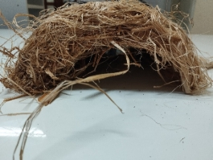

[Detalhes construtivos de estacas vivas]{.pitch-caption}
[Adaptado de USDA (1996)]{.pitch-caption-sub}
:::
:::

## Técnicas · 2.2 Feixes vivos (*live fascines*) {.smaller-text .academic-slide .lesson-slide}

::: {.pitch-grid-50}
::: {.pitch-stack-2}
::: {.pitch-card .pitch-card--forest}
[Conceito e ação]{.pitch-card-index}
[Barragens de contorno em trincheiras (USDA, 1996)]{.pitch-heading}

Longos feixes de ramos amarrados em **estruturas cilíndricas** (15–20 cm de diâmetro), instalados em **trincheiras de contorno**:

- Criam pequenas **barragens de contorno**, segmentando o comprimento do declive
- **Aprisionam e retêm** o solo na margem e facilitam a drenagem em taludes úmidos
- Favorecem a **colonização de vegetação nativa** pelo microclima criado
:::

::: {.pitch-table-box}
| Parâmetro | Valor |
|---|---|
| Diâmetro do feixe | 15–20 cm |
| Comprimento dos ramos | 1,6–3,2 m |
| Estacas de fixação | 75 cm |
:::
:::

::: {.pitch-cards-2}
::: {.pitch-media-card .pitch-media-card--compact}

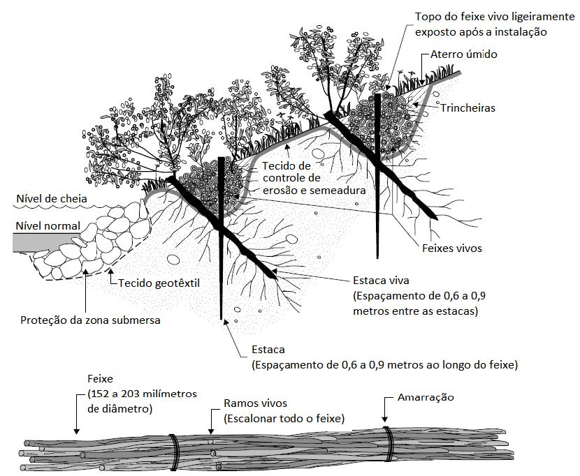

[Instalação em trincheira]{.pitch-caption}
[Adaptado de USDA (1996)]{.pitch-caption-sub}
:::

::: {.pitch-media-card .pitch-media-card--compact}

[Detalhe construtivo em campo]{.pitch-caption}
[Acervo da disciplina]{.pitch-caption-sub}
:::
:::
:::

## Técnicas · 2.3 Empacotamento de ramos (*branch packing*) {.smaller-text .academic-slide .lesson-slide}

::: {.pitch-grid-55}
::: {.pitch-stack-2}
::: {.pitch-card}
[Gray & Sotir (1996)]{.pitch-card-index}
[Camadas alternadas de ramos e solo]{.pitch-heading}

Camadas alternadas de **ramos vivos** e **solo compactado**, dispostas entre estacas verticais perpendiculares à face da inclinação. Produz **barreira de filtro** que retém sedimentos e forma uma **massa unificada** de raízes e aterro.
:::

::: {.pitch-card .pitch-card--gold}
[Sequência executiva]{.pitch-card-index}
[Procedimento em 4 etapas]{.pitch-heading}

1. Camada inicial de ramos vivos na base em **configuração cruzada**
2. Pontas de crescimento orientadas para a **face da inclinação**
3. Extremidades basais tocando o **solo não perturbado**
4. Camadas alternadas de solo compactado entre os ramos
:::

::: {.pitch-band}
Método **eficaz e econômico**, indicado para reparar pequenos deslizamentos e cavidades localizadas nas margens (USDA, 1996).
:::
:::

::: {.pitch-media-card .pitch-media-card--tall}

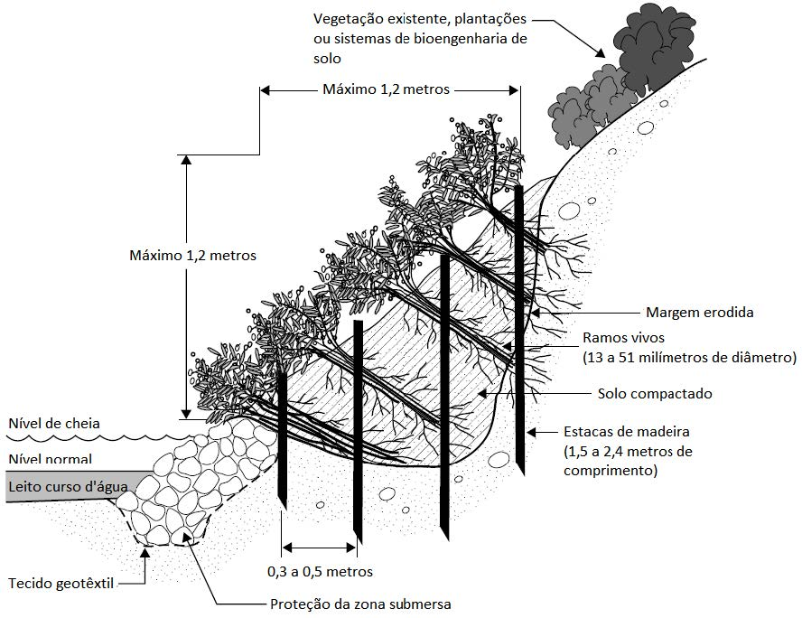

[Empacotamento de ramos (*branch packing*)]{.pitch-caption}
[Adaptado de USDA (1996)]{.pitch-caption-sub}
:::
:::

## Técnicas · 2.4 Geogrelha vegetada {.smaller-text .academic-slide .lesson-slide}

::: {.pitch-grid-55}
::: {.pitch-stack-2}
::: {.pitch-card .pitch-card--teal}
[Gray & Sotir (1996)]{.pitch-card-index}
[Reforço geossintético + biológico]{.pitch-heading}

Técnica semelhante ao empacotamento de ramos, porém com **materiais geotêxteis** (naturais ou sintéticos) envolvidos em torno de cada camada de solo entre ramos vivos:

- Geotêxtil confere **estabilidade imediata** durante o estabelecimento vegetal
- Combina **resistência mecânica** do geossintético com **reforço radicular**
- Viabiliza construção em **taludes mais íngremes**
:::

::: {.pitch-table-box}
| Condição do terreno | Viabilidade |
|---|---|
| Taludes íngremes (> 45°) | Excelente |
| Solos de baixa coesão | Excelente |
| Áreas com espaço restrito | Boa |
| Margens fluviais profundas | Boa com suporte estrutural |
:::
:::

::: {.pitch-media-card .pitch-media-card--tall}

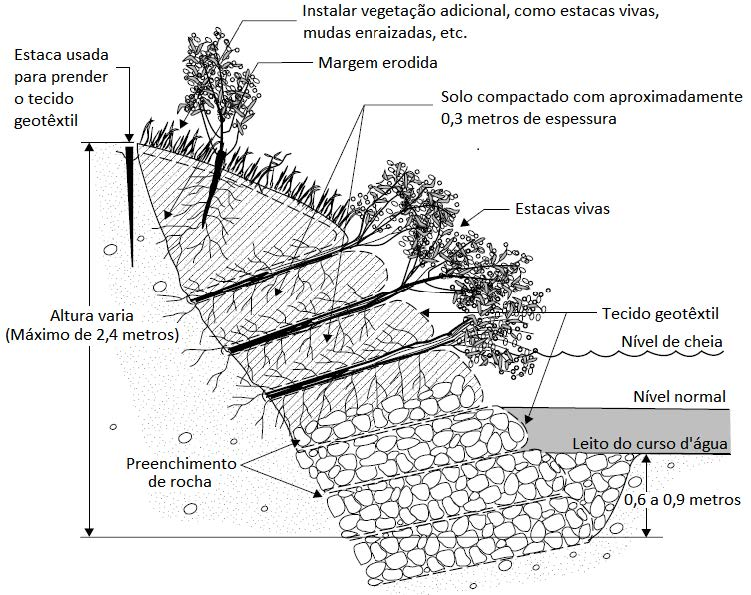

[Geogrelha vegetada em camadas]{.pitch-caption}
[Adaptado de USDA (1996)]{.pitch-caption-sub}
:::
:::

## Técnicas · 2.5 Muro de suporte vivo (*live crib wall*) {.smaller-text .academic-slide .lesson-slide}

::: {.pitch-grid-55}
::: {.pitch-stack-2}
::: {.pitch-card}
[FISRWG (1998)]{.pitch-card-index}
[Estrutura em caixa com ramos vivos]{.pitch-heading}

Arranjo de encaixe em **forma de caixa** de troncos de madeira, preenchido com aterro e camadas de ramos vivos que penetram no interior e se estendem até a encosta:

- Quando as estacas enraízam, a **vegetação assume gradualmente** as funções estruturais dos troncos
- A madeira dá **suporte imediato** mantendo aparência natural e habitat
:::

::: {.pitch-card .pitch-card--gold}
[Indicações de campo]{.pitch-card-index}
[Onde empregar]{.pitch-heading}

- **Curvas externas** de cursos d'água com correntes fortes
- Base da margem onde uma **parede baixa** é necessária
- Espaço **limitado** exigindo perfil mais vertical, **acima e abaixo** do N.A.
:::
:::

::: {.pitch-media-card .pitch-media-card--tall}

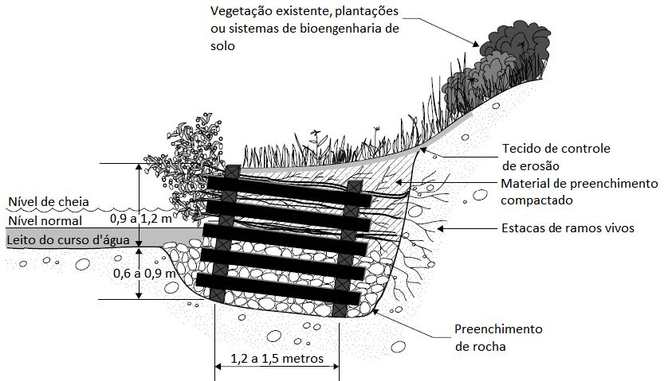

[Muro de suporte vivo (*live crib wall*)]{.pitch-caption}
[Adaptado de USDA (1996)]{.pitch-caption-sub}
:::
:::

## Técnicas · 2.6 Esteira de ramagem (*brushmattress*) {.smaller-text .academic-slide .lesson-slide}

::: {.pitch-grid-55}
::: {.pitch-stack-2}
::: {.pitch-card .pitch-card--forest}
[FISRWG (1998) · USDA (1996)]{.pitch-card-index}
[Cobertura integral da margem]{.pitch-heading}

Combinação de **estacas vivas, feixes vivos e recortes de ramos** para cobrir margens do nível de cheia até o topo:

- Forma **cobertura protetora imediata** e **captura sedimentos** em cheias
- Repõe rapidamente a vegetação, o habitat ribeirinho e a colonização nativa
:::

::: {.pitch-card}
[Execução em 5 passos]{.pitch-card-index}
[Procedimento construtivo]{.pitch-heading}

1. Escavar trincheira no contorno da base (nível de cheia)
2. Instalar estacas vivas e feixe na trincheira
3. Selecionar ramos flexíveis de **1,8–2,7 m** e **~2,5 cm** de diâmetro
4. Dispor camada de 1–2 ramos verticalmente na inclinação
5. Fixar com **arame esticado diagonalmente** entre estacas
:::
:::

::: {.pitch-media-card .pitch-media-card--tall}

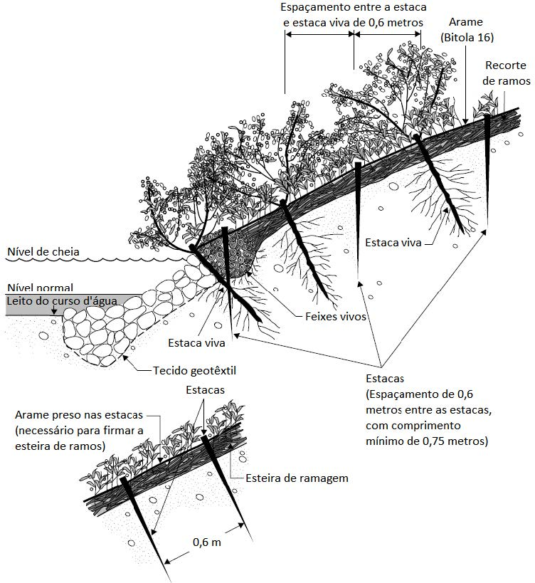

[Esteira de ramagem (*brushmattress*)]{.pitch-caption}
[Adaptado de USDA (1996)]{.pitch-caption-sub}
:::
:::

## Técnicas Resumo comparativo e integração de sistemas {.smaller-text .academic-slide .lesson-slide}

::: {.pitch-table-box}
| Técnica | Melhor aplicação | Complexidade |
|---|---|---|
| Estacas vivas | Pequenos deslizamentos, conexão entre técnicas | Baixa |
| Feixes vivos | Trincheiras de contorno, taludes úmidos | Média |
| Empacotamento de ramos | Cavidades e deslizamentos localizados | Média |
| Geogrelha vegetada | Taludes íngremes (> 45°), solos fracos | Alta |
| Muro de suporte vivo | Curvas externas, correntes fortes, base | Alta |
| Esteira de ramagem | Cobertura total de margens | Média-Alta |
:::

::: {.pitch-flow-4}
::: {.pitch-card}
[01 · Paliçadas]{.pitch-card-index}
[Barreiras em ravinas]{.pitch-heading}

Reduzem a velocidade do escoamento concentrado.
:::

::: {.pitch-card .pitch-card--teal}
[02 · Barraginhas]{.pitch-card-index}
[Captação e infiltração]{.pitch-heading}

Retêm água excedente e sedimentos a montante.
:::

::: {.pitch-card .pitch-card--forest}
[03 · Feixes vivos]{.pitch-card-index}
[Drenagem + raízes]{.pitch-heading}

Drenam a encosta úmida e enraízam no solo.
:::

::: {.pitch-card .pitch-card--gold}
[04 · Muro suporte]{.pitch-card-index}
[Contenção estrutural]{.pitch-heading}

Estabiliza a base e consolida o **controle integrado**.
:::
:::

# 3 · Drenos verdes: conceito e confecção {.section-header rotulo="Drenos Verdes"}

## Drenos Verdes Definição, fibras naturais e dupla função {.smaller-text .academic-slide .lesson-slide}

::: {.pitch-grid-50}
::: {.pitch-stack-2}
::: {.pitch-card .pitch-card--teal}
[Conceito integrado]{.pitch-card-index}
[Drenagem + substrato vivo]{.pitch-heading}

**Drenos verdes** (*green drains*) são dispositivos tubulares de **fibras naturais** que atuam simultaneamente como sistema de **drenagem superficial** e substrato de **retenção de umidade** para os feixes vivos, unindo engenharia geotécnica e restauração ecológica.
:::

::: {.pitch-card .pitch-card--forest}
[Matérias-primas regionais]{.pitch-card-index}
[Fibras lignocelulósicas]{.pitch-heading}

- **Taboa (*Typha dominguensis*):** macrófita aquática abundante no Nordeste, alta retenção hídrica, estrutura porosa e biodegradável.
- **Bananeira (*Musa paradisiaca*):** pseudocaule rico em fibras longas, boa drenagem e excelente custo-benefício.
:::
:::

::: {.pitch-cards-2}
::: {.pitch-media-card .pitch-media-card--photo .pitch-media-card--compact}

[Dreno verde de fibras naturais]{.pitch-caption}
[Estrutura tubular drenante]{.pitch-caption-sub}
:::

::: {.pitch-media-card .pitch-media-card--photo .pitch-media-card--compact}

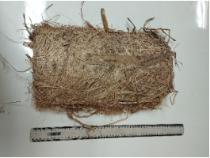

[Detalhe da parede fibrosa]{.pitch-caption}
[Porosidade e retenção hídrica]{.pitch-caption-sub}
:::
:::
:::

## Drenos Verdes Formulações e propriedades físicas {.smaller-text .academic-slide .lesson-slide}

::: {.pitch-grid-50}
::: {.pitch-stack-2}
::: {.pitch-table-box}
| Fração | Taboa (*Typha dominguensis*) |
|---|---|
| G1 | 24% limbo + 44% fibras folha + 20% resina + 6% solvente + 30% espessante |
| G2 | 24% limbo + 20% fibras bainha + 20% resina + 6% solvente + 30% espessante |
| G3 | G2 com água em vez de D'limoneno |
:::

::: {.pitch-table-box}
| Fração | Bananeira (*Musa paradisiaca*) |
|---|---|
| G1 | 24% limbo + 44% fibras folha + 20% resina + 6% solvente + 30% espessante |
| G2 | 24% limbo + 20% fibras pseudocaule + 20% resina + 6% solvente + 30% espessante |
| G3 | G2 com água em vez de D'limoneno |
:::
:::

::: {.pitch-stack-2}
::: {.pitch-card}
[Aglomerante e aditivos]{.pitch-card-index}
[Composição química]{.pitch-heading}

- **Resina natural:** bi-componente derivada de poliol vegetal de **mamona** (coesão entre fibras)
- **Solvente:** D'limoneno (95%) de origem natural
- **Espessante:** confere consistência estrutural à matriz
:::

::: {.pitch-table-box}
| Parâmetro físico | Valor |
|---|---|
| Espessura da parede ($\varepsilon$) | 5 mm |
| Diâmetro total ($\varnothing$) | 20 cm |
| Densidade aproximada | 0,062 g/cm³ (similar a lã de rocha/vidro) |
:::
:::
:::

## Drenos Verdes Etapas de fabricação e prensagem a frio {.smaller-text .academic-slide .lesson-slide}

::: {.pitch-grid-55}
::: {.pitch-stack-2}
::: {.pitch-milestones}
::: {.pitch-milestone-item}
**01–02 · Preparo das fibras:** coleta e secagem até ~12% de umidade, seguidas de tratamento com resina de mamona e espessante.
:::

::: {.pitch-milestone-item}
**03–04 · Mistura e moldagem:** homogeneização em encoladeira por 5 min e disposição nas formas de dreno.
:::

::: {.pitch-milestone-item}
**05–06 · Prensagem e cura a frio:** prensagem hidráulica em forma tipo **"U"** sem calor e cura de **24 horas**.
:::

::: {.pitch-milestone-item}
**07 · Produto acabado:** dreno verde poroso ($\varnothing = 20\text{ cm}$, $\varepsilon = 5\text{ mm}$) pronto para campo.
:::
:::
:::

::: {.pitch-cards-2}
::: {.pitch-media-card .pitch-media-card--compact}

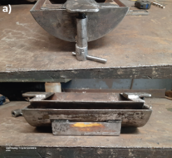

[Forma tipo "U" para prensagem]{.pitch-caption}
[Prensagem hidráulica a frio]{.pitch-caption-sub}
:::

::: {.pitch-media-card .pitch-media-card--compact}

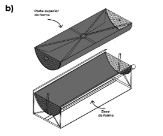

[Esquema de montagem]{.pitch-caption}
[Cura de 24 h sem calor]{.pitch-caption-sub}
:::
:::
:::

## Drenos Verdes Seção transversal e dupla função hidráulico-biológica {.smaller-text .academic-slide .lesson-slide}

::: {.pitch-cards-2}
::: {.pitch-card}
[Arquitetura tubular ($\varnothing = 20\text{ cm}$)]{.pitch-card-index}
[Seção transversal do dreno verde]{.pitch-heading}

- **Parede externa ($\varepsilon = 5\text{ mm}$):** compósito de fibras naturais prensadas (taboa ou bananeira).
- **Furos de infiltração:** distribuídos ao longo da parede para captar água subsuperficial e superficial.
- **Núcleo interno:** abrigo de **feixes vivos** envolvidos em **substrato úmido**, protegido contra dessecação.
:::

::: {.pitch-card .pitch-card--teal}
[Mecanismo acoplado]{.pitch-card-index}
[Dupla função em operação]{.pitch-heading}

1. **Água superficial excedente** infiltra pelos furos para o interior do dreno verde.
2. Parte do fluxo é **conduzida para o dreno polo principal** até a evacuação controlada na base da encosta.
3. A matriz fibrosa **retém umidade para os feixes vivos**, que enraízam e **estabilizam o solo**.
:::
:::

::: {.pitch-band .pitch-band--navy}
**Síntese mecânica:** enquanto a parede porosa alivia a poropressão por drenagem rápida, o interior úmido garante sobrevivência e brotação precoce das estacas vivas.
:::

# 4 · Sistema espinha de peixe {.section-header rotulo="Espinha de Peixe"}

## Espinha de Peixe Estrutura funcional e planta em espinha-de-peixe {.smaller-text .academic-slide .lesson-slide}

::: {.pitch-media-card .pitch-media-card--wide}

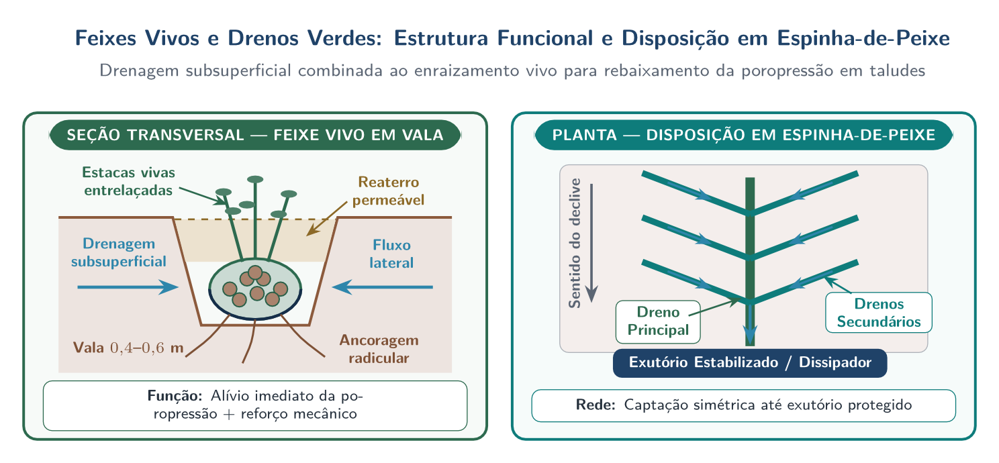

[Estrutura funcional e disposição em espinha-de-peixe]{.pitch-caption}
[Drenagem subsuperficial em vala (0,4–0,6 m) combinada a captação simétrica até o exutório estabilizado]{.pitch-caption-sub}
:::

::: {.pitch-band}
O padrão **espinha de peixe** (*fishbone pattern*) integra drenos secundários oblíquos ("costelas") ao dreno principal ("coluna vertebral"), reduzindo a poropressão e conduzindo o fluxo sem erosão.
:::

## Espinha de Peixe Arranjo de campo e registro em ravina {.smaller-text .academic-slide .lesson-slide}

::: {.pitch-grid-50}
::: {.pitch-stack-2}
::: {.pitch-card}
[Componentes do traçado]{.pitch-card-index}
[Drenos de polo e fascinas laterais]{.pitch-heading}

1. **Drenos de polo (principais):** instalados ao longo do eixo da **ravina** com feixes maiores para coletar e redirecionar o fluxo.
2. **Fascinas laterais (secundárias):** conectadas **obliquamente** aos drenos de polo para desviar água e promover infiltração.
:::

::: {.pitch-card .pitch-card--forest}
[Benefícios hidráulico-geotécnicos]{.pitch-card-index}
[Resposta integrada no terreno]{.pitch-heading}

- Redução da **velocidade do fluxo superficial**
- Favorecimento da **infiltração** e recarga local
- Enraizamento dos feixes e aumento da **coesão do terreno**
:::
:::

::: {.pitch-cards-2}
::: {.pitch-media-card .pitch-media-card--compact}

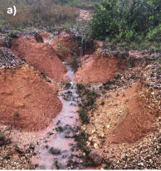

[Ravina e sulcos em campo]{.pitch-caption}
[Preparo dos canais de assentamento]{.pitch-caption-sub}
:::

::: {.pitch-media-card .pitch-media-card--compact}

[Arranjo espinha de peixe]{.pitch-caption}
[Convergência oblíqua para o dreno polo]{.pitch-caption-sub}
:::
:::
:::

## Espinha de Peixe Fluxo hídrico e dimensionamento geométrico {.smaller-text .academic-slide .lesson-slide}

::: {.pitch-grid-55}
::: {.pitch-flow-4}
::: {.pitch-card}
[01 · Precipitação]{.pitch-card-index}
[Escoamento superficial]{.pitch-heading}

Água da chuva gera enxurrada na encosta exposta.
:::

::: {.pitch-card .pitch-card--teal}
[02 · Fascinas laterais]{.pitch-card-index}
[Desvio oblíquo]{.pitch-heading}

Interceptam o fluxo, favorecem infiltração no solo e desviam para o dreno de polo.
:::

::: {.pitch-card .pitch-card--gold}
[03 · Dreno de polo]{.pitch-card-index}
[Evacuação controlada]{.pitch-heading}

Conduz a vazão reunida em segurança até a base da encosta.
:::

::: {.pitch-card .pitch-card--forest}
[04 · Feixes vivos]{.pitch-card-index}
[Solo reforçado]{.pitch-heading}

Raízes se desenvolvem ao longo da rede, consolidando a encosta.
:::
:::

::: {.pitch-stack-2}
::: {.pitch-table-box}
| Declividade | Espaçamento recomendado |
|---|---|
| 15°–25° | 2,0 – 3,0 m |
| 25°–35° | 1,5 – 2,0 m |
| 35°–45° | 1,0 – 1,5 m |
:::

::: {.pitch-band .pitch-band--teal}
**Ângulo de inserção:** as fascinas laterais devem conectar-se ao dreno de polo em **ângulo de 30°–45°**, evitando retorno de fluxo ou solapamento na junção.
:::
:::
:::

# 5 · Espécies vegetais para estacas vivas {.section-header rotulo="Espécies"}

## Espécies Seleção e preparo de estacas para tabuleiros costeiros {.smaller-text .academic-slide .lesson-slide}

::: {.pitch-grid-55}
::: {.pitch-table-box}
| Espécie | Nome popular | Uso principal |
|---|---|---|
| *Schinus terebinthifolius* | Aroeira | Estabilização |
| *Spondias mombin* | Cajá | Cobertura |
| *Inga marginata* | Ingá | Fixação de N₂ |
| *Tapirira guianensis* | Pau-pombo | Recomposição |
| *Lonchocarpus sericeus* | Falso-ingá | Fixação de N₂ |
| *Mimosa caesalpiniaefolia* | Sabiá | Cobertura rápida |
| *Genipa americana* | Genipapo | Revegetação |
:::

::: {.pitch-stack-2}
::: {.pitch-card}
[Critérios de matrizes]{.pitch-card-index}
[Seleção fitotécnica]{.pitch-heading}

- **Vigor:** árvores-matrizes saudáveis (3 matrizes/espécie)
- **Fitossanidade:** ausência de pragas e doenças
- **Propagação por estaquia** comprovada e **adaptação** ao semiárido/tabuleiros
:::

::: {.pitch-card .pitch-card--gold}
[Preparo das estacas]{.pitch-card-index}
[Padrão biométrico]{.pitch-heading}

Retirada da **porção basal**, **15–20 cm** de comprimento, **Ø 0,5–1,5 cm**, corte **reto no ápice** e **em ângulo na base**, acondicionadas em **água** até o plantio.
:::
:::
:::

## Espécies Galeria de espécies recomendadas — Grupo 1 {.smaller-text .academic-slide .lesson-slide}

::: {.pitch-cards}
::: {.pitch-media-card .pitch-media-card--photo .pitch-media-card--tall}

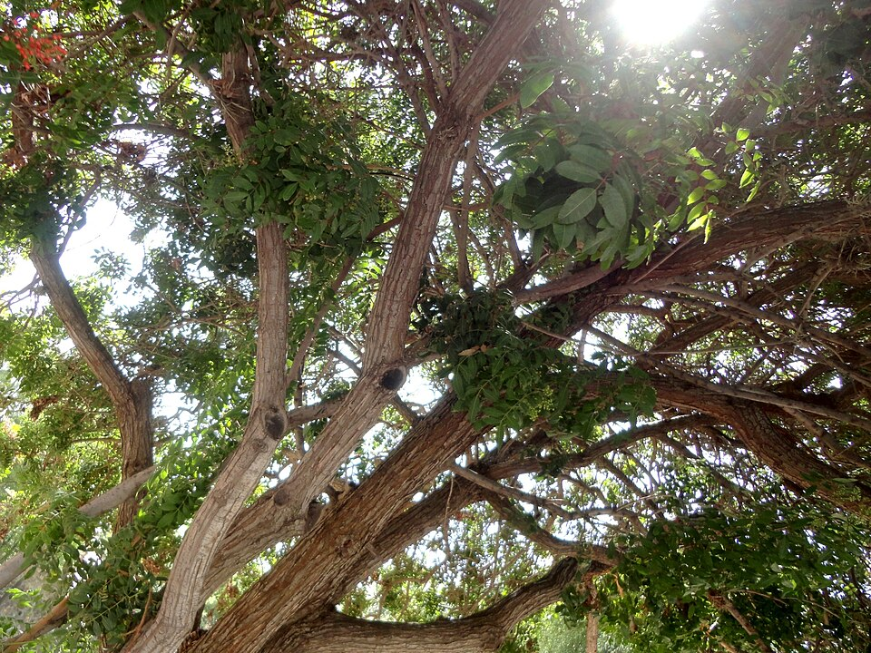

[*Schinus terebinthifolius* (Aroeira)]{.pitch-caption}
[Estabilização de taludes e margens · Foto: J.C. Fonseca Mata (CC BY-SA 4.0)]{.pitch-caption-sub}
:::

::: {.pitch-media-card .pitch-media-card--photo .pitch-media-card--tall}

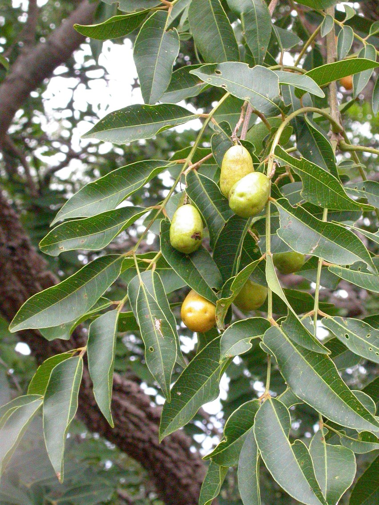

[*Spondias mombin* (Cajá)]{.pitch-caption}
[Cobertura vegetal e sombreamento · Foto: Marco Schmidt (CC BY-SA 2.5)]{.pitch-caption-sub}
:::

::: {.pitch-media-card .pitch-media-card--photo .pitch-media-card--tall}

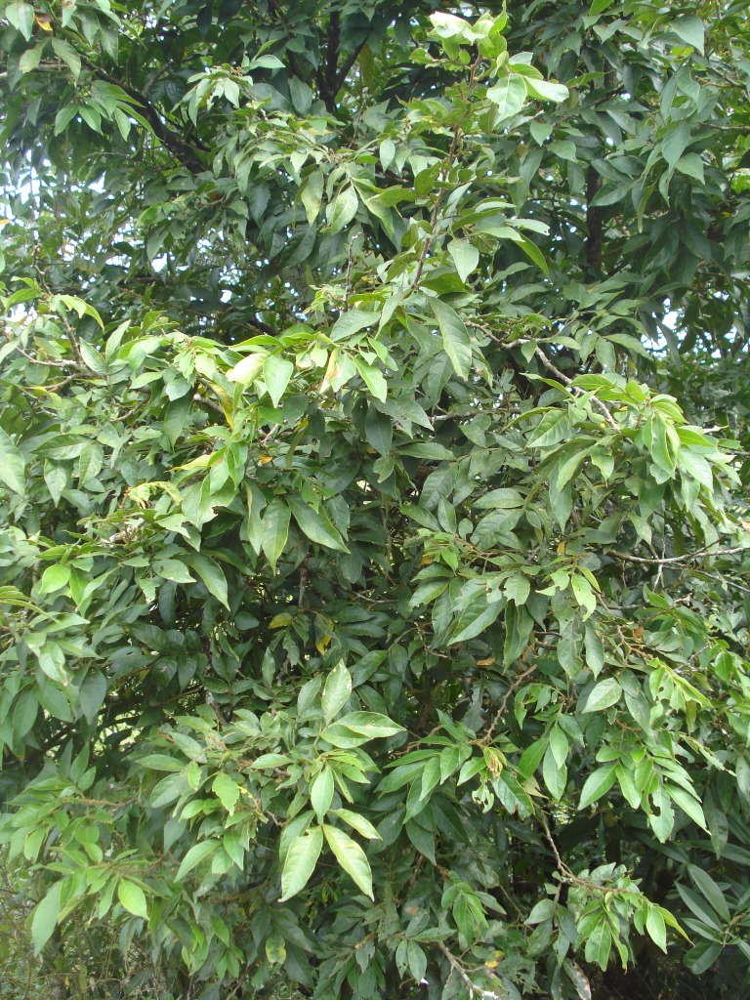

[*Inga marginata* (Ingá)]{.pitch-caption}
[Fixação biológica de N₂ e cobertura · Foto: Paulo Schwirkowski (CC BY 3.0)]{.pitch-caption-sub}
:::
:::

## Espécies Galeria de espécies recomendadas — Grupo 2 {.smaller-text .academic-slide .lesson-slide}

::: {.pitch-flow-4}
::: {.pitch-media-card .pitch-media-card--photo .pitch-media-card--tall}

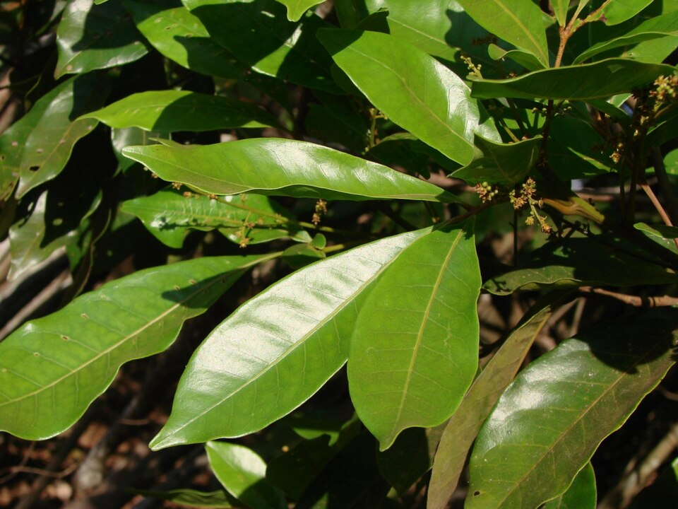

[*Tapirira guianensis* (Pau-pombo)]{.pitch-caption}
[Recomposição · Foto: João Medeiros (CC BY 2.0)]{.pitch-caption-sub}
:::

::: {.pitch-media-card .pitch-media-card--photo .pitch-media-card--tall}

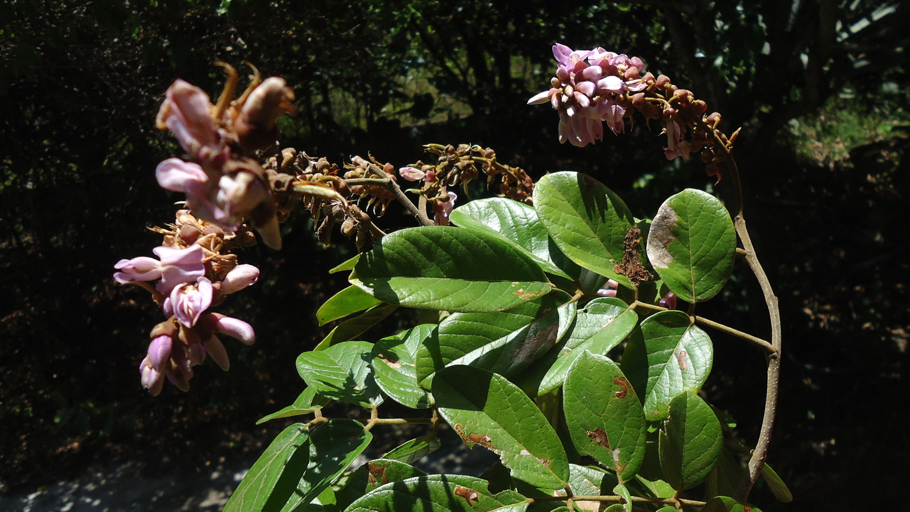

[*Lonchocarpus sericeus* (Falso-ingá)]{.pitch-caption}
[Fixação de N₂ · Foto: Alex Popovkin (CC BY 2.0)]{.pitch-caption-sub}
:::

::: {.pitch-media-card .pitch-media-card--photo .pitch-media-card--tall}

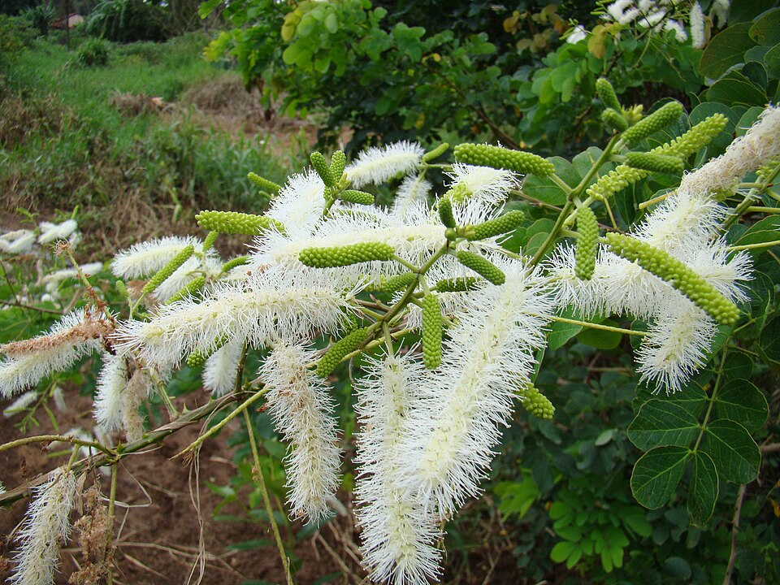

[*Mimosa caesalpiniaefolia* (Sabiá)]{.pitch-caption}
[Cobertura rápida · Foto: mauroguanandi (CC BY 2.0)]{.pitch-caption-sub}
:::

::: {.pitch-media-card .pitch-media-card--photo .pitch-media-card--tall}

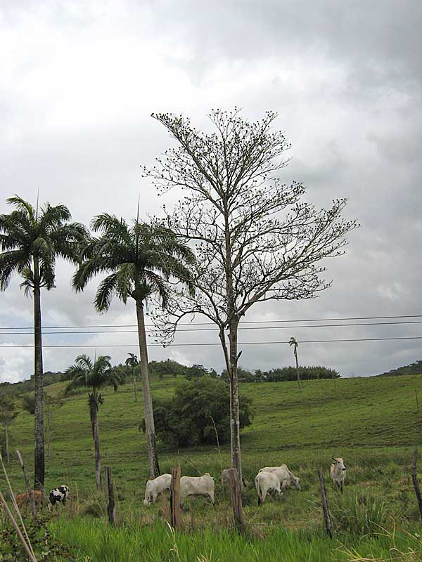

[*Genipa americana* (Genipapo)]{.pitch-caption}
[Revegetação · Foto: Alex Popovkin (CC BY 2.0)]{.pitch-caption-sub}
:::
:::

## Espécies Processo de estaquia e fatores de sucesso {.smaller-text .academic-slide .lesson-slide}

::: {.pitch-grid-50}
::: {.pitch-milestones}
::: {.pitch-milestone-item}
**01–02 · Matrizes e coleta:** seleção de árvores-matrizes vigorosas e coleta de estacas basais.
:::

::: {.pitch-milestone-item}
**03–04 · Preparo e corte:** padronização em **15–20 cm** ($\varnothing$ **0,5–1,5 cm**), corte reto no ápice e em ângulo na base.
:::

::: {.pitch-milestone-item}
**05–06 · Hidratação e plantio:** acondicionamento em água e inserção direta nos drenos verdes.
:::

::: {.pitch-milestone-item}
**07 · Acompanhamento:** monitoramento contínuo da brotação e do enraizamento.
:::
:::

::: {.pitch-stack-2}
::: {.pitch-table-box}
| Fator | Recomendação técnica |
|---|---|
| Época de coleta | Período de dormência |
| Número de gemas | Mínimo 3 por estaca |
| Hidratação | Permanente até o plantio |
| Substrato | Fibras naturais no dreno verde |
| Estimulante | Extrato de feijão ou tiririca |
:::

::: {.pitch-band .pitch-band--teal}
O uso de **estimulantes naturais** (extrato de feijão ou tiririca) eleva a taxa de enraizamento e substitui reguladores industriais onerosos (Araújo Filho et al., 2019).
:::
:::
:::

# 6 · Monitoramento e bioensaios {.section-header rotulo="Monitoramento"}

## Monitoramento Protocolo dos dois bioensaios experimentais {.smaller-text .academic-slide .lesson-slide}

::: {.pitch-grid-50}
::: {.pitch-stack-2}
::: {.pitch-card}
[1º Bioensaio · 40 dias]{.pitch-card-index}
[Germinação e crescimento em bandeja]{.pitch-heading}

| Sigla | Parâmetro avaliado |
|---|---|
| IGS | Início da germinação das sementes |
| G% | Porcentagem de germinação |
| IVG | Índice de velocidade de germinação |
| NFB | Número de folhas na bandeja |
| MSPAB | Massa seca parte aérea (bandeja) |
| CRB | Comprimento radicular (bandeja) |
| MSRB | Massa seca radicular (bandeja) |
| VRB / DRB | Volume e diâmetro radicular (bandeja) |
:::
:::

::: {.pitch-stack-2}
::: {.pitch-card .pitch-card--teal}
[2º Bioensaio · Vaso]{.pitch-card-index}
[Produção em substrato]{.pitch-heading}

| Sigla | Parâmetro avaliado |
|---|---|
| AV | Altura em vaso |
| NFV | Número de folhas em vaso |
| CRV | Comprimento radicular (vaso) |
| MSPAV | Massa seca parte aérea (vaso) |
| VRV / DRV | Volume e diâmetro radicular (vaso) |
| PFr | Precocidade da floração |
| NFl | Número de flores |
| DEN | Dependência de estimulante natural |
:::
:::
:::

## Monitoramento Índice de Velocidade de Germinação (IVG) e delineamento {.smaller-text .academic-slide .lesson-slide}

::: {.pitch-grid-50}
::: {.pitch-stack-2}
::: {.pitch-formula}
**Índice de Velocidade de Germinação (Maguire, 1962):**

$$IVG = \frac{N_1}{D_1} + \frac{N_2}{D_2} + \cdots + \frac{N_n}{D_n}$$

Onde $N_i$ = número de brotações no dia $i$ e $D_i$ = dias após a semeadura.
:::

::: {.pitch-band .pitch-band--teal}
**IVG alto** indica germinação rápida e uniforme, aumentando a probabilidade de sucesso no estabelecimento dos feixes vivos antes de eventos erosivos.
:::
:::

::: {.pitch-stack-2}
::: {.pitch-cards}
::: {.pitch-card}
[Tratamento CO]{.pitch-card-index}
[Controle]{.pitch-heading}

Sem estimulante · **8 repetições**.
:::

::: {.pitch-card .pitch-card--forest}
[Tratamento ENF]{.pitch-card-index}
[Extrato feijão]{.pitch-heading}

Estimulante natural · **8 repetições**.
:::

::: {.pitch-card .pitch-card--gold}
[Tratamento ENT]{.pitch-card-index}
[Extrato tiririca]{.pitch-heading}

Estimulante natural · **8 repetições**.
:::
:::

::: {.pitch-band}
**Delineamento Inteiramente Casualizado (DIC):** 3 tratamentos × 8 repetições, com avaliação diária do **1º ao 40º dia**.
:::
:::
:::

## Monitoramento Protocolo de IVG e análise morfométrica radicular {.smaller-text .academic-slide .lesson-slide}

::: {.pitch-media-card .pitch-media-card--wide}

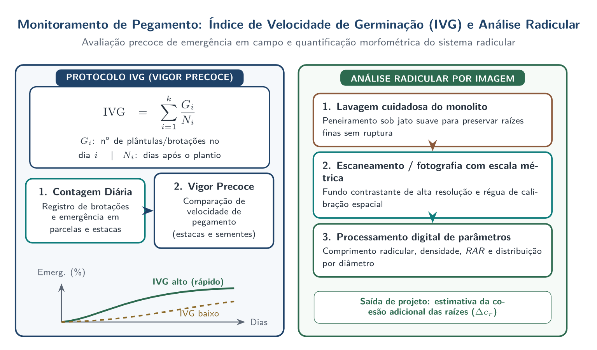

[Monitoramento de pegamento (IVG) e análise radicular por imagem]{.pitch-caption}
[Contagem diária de vigor precoce articulada à quantificação digital de raízes para estimativa de Δcr]{.pitch-caption-sub}
:::

::: {.pitch-band .pitch-band--navy}
A integração entre vigor precoce ($IVG$) e morfometria radicular ($RAR$, comprimento e densidade) permite estimar o incremento de coesão $\Delta c_r$ fornecido pelas raízes ao talude.
:::

## Monitoramento Análise radicular por imagem no sistema SAFIRA {.smaller-text .academic-slide .lesson-slide}

::: {.pitch-grid-55}
::: {.pitch-stack-2}
::: {.pitch-card}
[Jorge & Rodrigues (2008)]{.pitch-card-index}
[Sistema SAFIRA (sucessor do SIARCS®)]{.pitch-heading}

1. Raízes lavadas e separadas com preservação de raízes finas
2. Digitalização em **placa digitalizadora** de alta resolução
3. Extração de **volume radicular** (cm³), **diâmetro ponderado** (mm), **comprimento total** e **distribuição de diâmetros**
:::

::: {.pitch-formula}
**Densidade radicular ($\rho_r$):**

$$\rho_r = \frac{m_r}{V_r}$$

Onde $m_r$ = massa radicular (g) e $V_r$ = volume radicular (cm³).
:::
:::

::: {.pitch-stack-2}
::: {.pitch-cards-2}
::: {.pitch-card .pitch-card--forest}
[Atributo 1]{.pitch-card-index}
[Volume radicular]{.pitch-heading}

Raízes desenvolvidas ampliam a matriz de ancoragem em profundidade.
:::

::: {.pitch-card .pitch-card--teal}
[Atributo 2]{.pitch-card-index}
[Diâmetro radicular]{.pitch-heading}

Distribuição de classes finas e estruturais eleva o reforço mecânico.
:::
:::

::: {.pitch-band .pitch-band--navy}
**Cadeia mecânica:** maior volume radicular + maior distribuição de diâmetros $\rightarrow$ **maior reforço do solo** $\rightarrow$ **estabilização efetiva da encosta**.
:::
:::
:::

# 7 · Estudo de caso: Campus Rural (UFS-SE) {.section-header rotulo="Estudo de Caso"}

## Estudo de Caso Área experimental no Campus Rural da UFS {.smaller-text .academic-slide .lesson-slide}

::: {.pitch-grid-50}
::: {.pitch-stack-2}
::: {.pitch-card}
[Contexto e preparo]{.pitch-card-index}
[Antiga área de disposição de resíduos]{.pitch-heading}

Experimento conduzido no **Campus Rural da UFS** (Sergipe), em antigo lixão desativado:

1. **Remoção superficial** dos resíduos recentes e volumosos
2. **Redistribuição controlada** dos excedentes
3. **Compactação leve** e uniformização do terreno
:::

::: {.pitch-card .pitch-card--teal}
[Objetivos do experimento]{.pitch-card-index}
[Avaliação em escala real]{.pitch-heading}

- Avaliar eficácia dos drenos verdes na **drenagem superficial**
- Monitorar **enraizamento** dos feixes vivos
- Quantificar **retenção de umidade**, matéria orgânica e estabilidade da encosta
:::
:::

::: {.pitch-cards-2}
::: {.pitch-media-card .pitch-media-card--photo .pitch-media-card--compact}

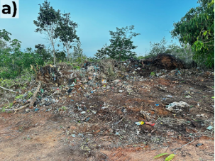

[Área degradada (antes)]{.pitch-caption}
[Disposição irregular de resíduos]{.pitch-caption-sub}
:::

::: {.pitch-media-card .pitch-media-card--photo .pitch-media-card--compact}

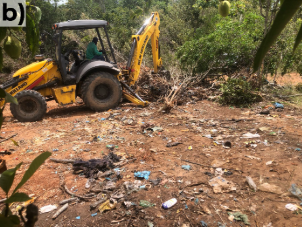

[Limpeza da área experimental]{.pitch-caption}
[Remoção de resíduos superficiais]{.pitch-caption-sub}
:::
:::
:::

## Estudo de Caso Preparação do terreno e etapas de campo {.smaller-text .academic-slide .lesson-slide}

::: {.pitch-grid-50}
::: {.pitch-media-card .pitch-media-card--photo .pitch-media-card--tall}

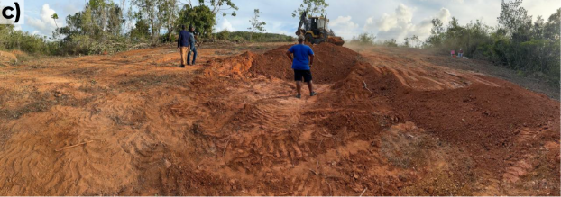

[Redistribuição controlada do terreno]{.pitch-caption}
[Conformação geotécnica prévia à abertura das valas]{.pitch-caption-sub}
:::

::: {.pitch-milestones}
::: {.pitch-milestone-item}
**01 · Limpeza:** remoção e triagem dos resíduos superficiais.
:::

::: {.pitch-milestone-item}
**02 · Terraplenagem:** regularização e compactação leve do talude.
:::

::: {.pitch-milestone-item}
**03 · Drenos de polo:** escavação e assentamento dos drenos principais.
:::

::: {.pitch-milestone-item}
**04 · Fascinas laterais:** conexão oblíqua em padrão espinha de peixe.
:::

::: {.pitch-milestone-item}
**05–06 · Feixes e monitoramento:** inserção das estacas vivas e avaliações periódicas.
:::
:::
:::

## Estudo de Caso Registro fotográfico de implantação em campo {.smaller-text .academic-slide .lesson-slide}

::: {.pitch-flow-4}
::: {.pitch-media-card .pitch-media-card--photo}

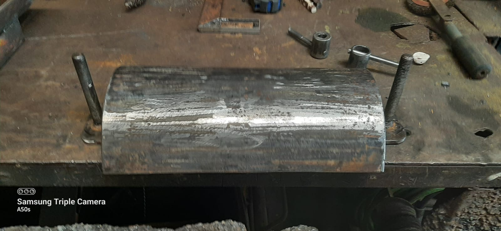

[Campo · Preparação]{.pitch-caption}
[Abertura e nivelamento]{.pitch-caption-sub}
:::

::: {.pitch-media-card .pitch-media-card--photo}

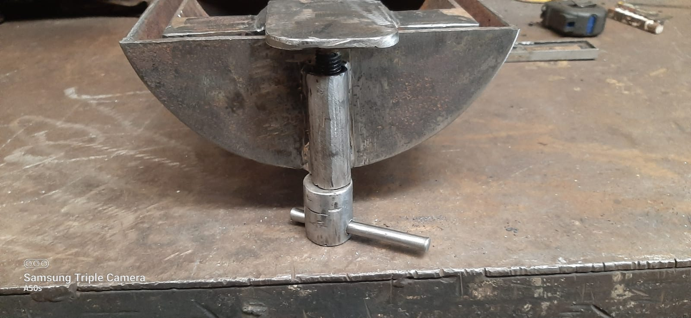

[Campo · Instalação]{.pitch-caption}
[Posicionamento em vala]{.pitch-caption-sub}
:::

::: {.pitch-media-card .pitch-media-card--photo}

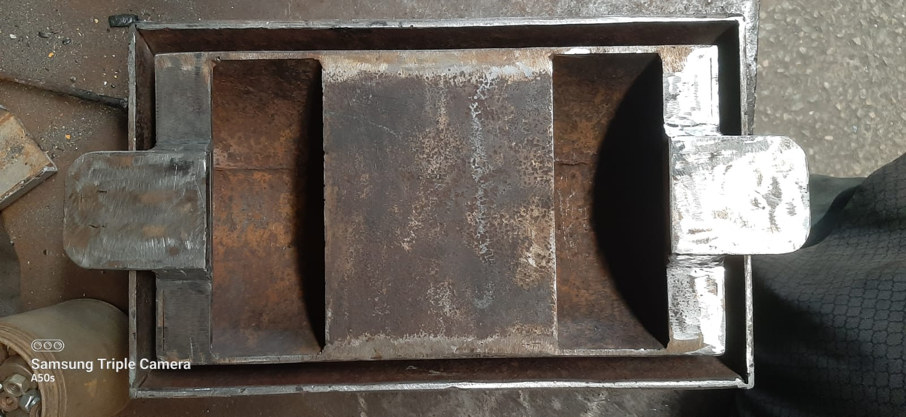

[Campo · Detalhe dreno]{.pitch-caption}
[Conexão hidráulica]{.pitch-caption-sub}
:::

::: {.pitch-media-card .pitch-media-card--photo}

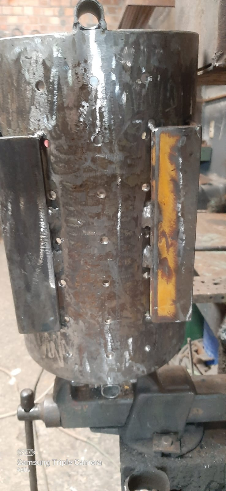

[Campo · Visão geral]{.pitch-caption}
[Rede em espinha de peixe]{.pitch-caption-sub}
:::
:::

::: {.pitch-band}
A sequência construtiva em campo confirma a exequibilidade manual dos drenos verdes e a adaptação topográfica das fascinas oblíquas ao relevo da ravina.
:::

## Estudo de Caso Pranchas e diagramas técnicos do projeto {.smaller-text .academic-slide .lesson-slide}

::: {.pitch-flow-4}
::: {.pitch-media-card}

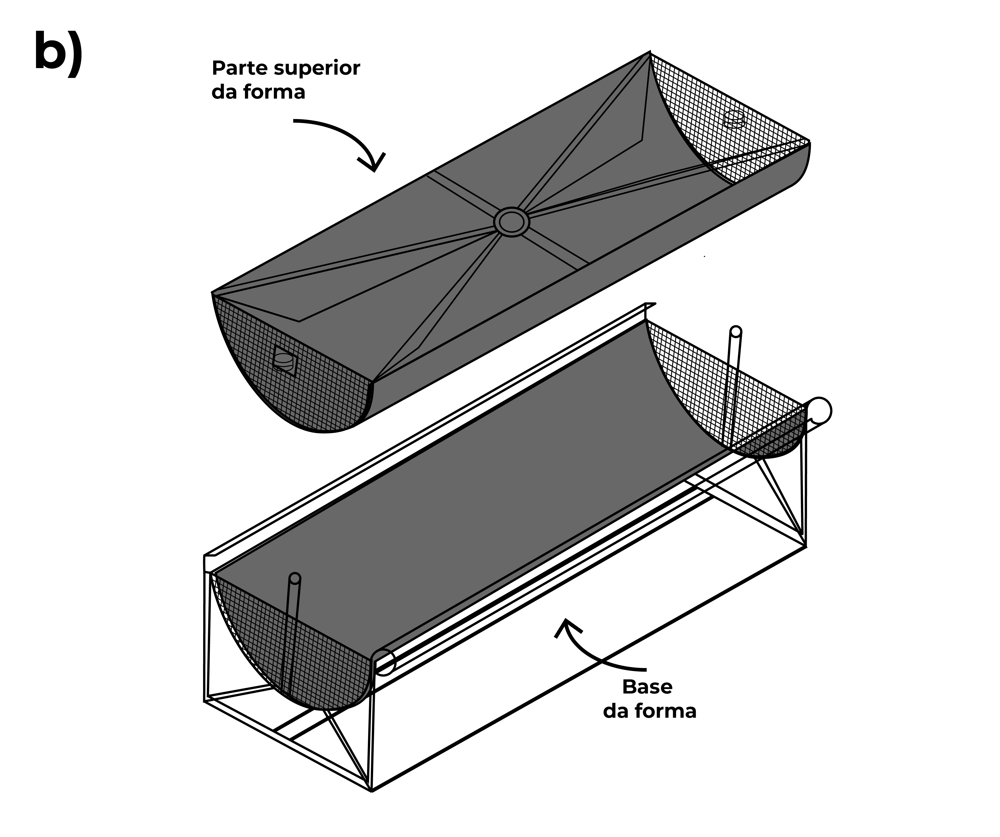

[Prancha 01 · Dreno verde]{.pitch-caption}
[Geometria da peça tubular]{.pitch-caption-sub}
:::

::: {.pitch-media-card}

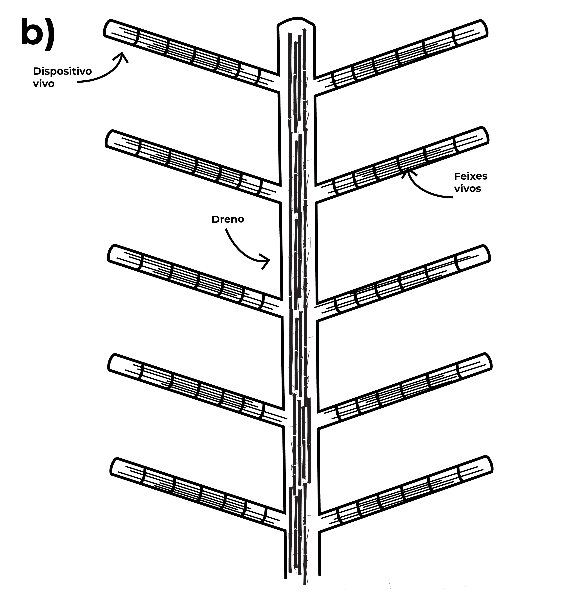

[Prancha 02 · Montagem]{.pitch-caption}
[Acoplamento dreno e feixe]{.pitch-caption-sub}
:::

::: {.pitch-media-card}

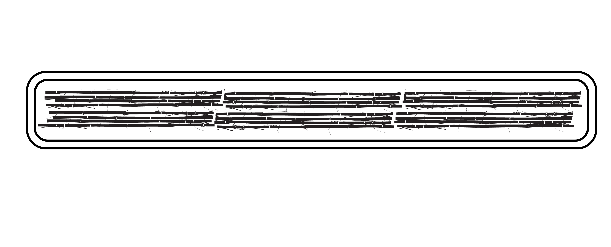

[Prancha 04 · Detalhamento]{.pitch-caption}
[Junção lateral e ancoragem]{.pitch-caption-sub}
:::

::: {.pitch-media-card}

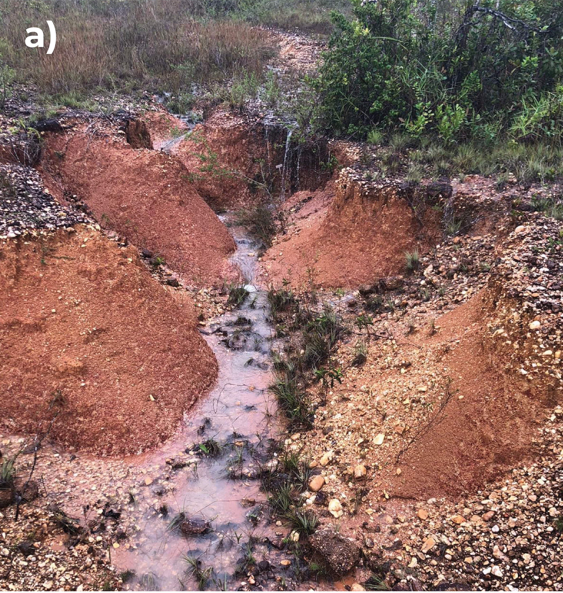

[Prancha 05 · Sistema completo]{.pitch-caption}
[Arranjo geral integrado]{.pitch-caption-sub}
:::
:::

::: {.pitch-band .pitch-band--teal}
As pranchas técnicas padronizam cortes, conexões e orientação dos feixes para replicação do protocolo em projetos de recuperação de áreas degradadas (PRAD).
:::

## Estudo de Caso Cronograma de monitoramento e indicadores de campo {.smaller-text .academic-slide .lesson-slide}

::: {.pitch-grid-55}
::: {.pitch-table-box}
| Período | Atividade de avaliação |
|---|---|
| Dia 0 | Instalação dos drenos verdes e feixes vivos |
| Dias 1–15 | Monitoramento diário de germinação e brotação |
| Dias 15–40 | Avaliação semanal (1º bioensaio) |
| Dia 40 | Transplante para vasos (2º bioensaio) |
| Dias 40–120 | Monitoramento quinzenal em campo |
| Dia 120 | Avaliação final integrada |
:::

::: {.pitch-card .pitch-card--forest}
[Metas de desempenho]{.pitch-card-index}
[Indicadores de sucesso]{.pitch-heading}

- Taxa de germinação **> 70%**
- Enraizamento **> 80%** das estacas
- Redução expressiva do **escoamento superficial**
- Aumento da **infiltração** e retenção de umidade
- **Estabilidade visível** da encosta ao fim de 120 dias
:::
:::

## Estudo de Caso Registro de acompanhamento evolutivo em campo {.smaller-text .academic-slide .lesson-slide}

::: {.pitch-flow-4}
::: {.pitch-media-card .pitch-media-card--photo}

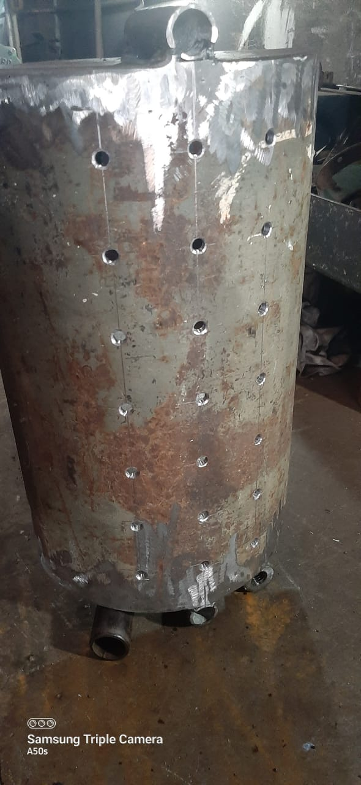

[Registro 01 · Implantação]{.pitch-caption}
[Estado inicial pós-montagem]{.pitch-caption-sub}
:::

::: {.pitch-media-card .pitch-media-card--photo}

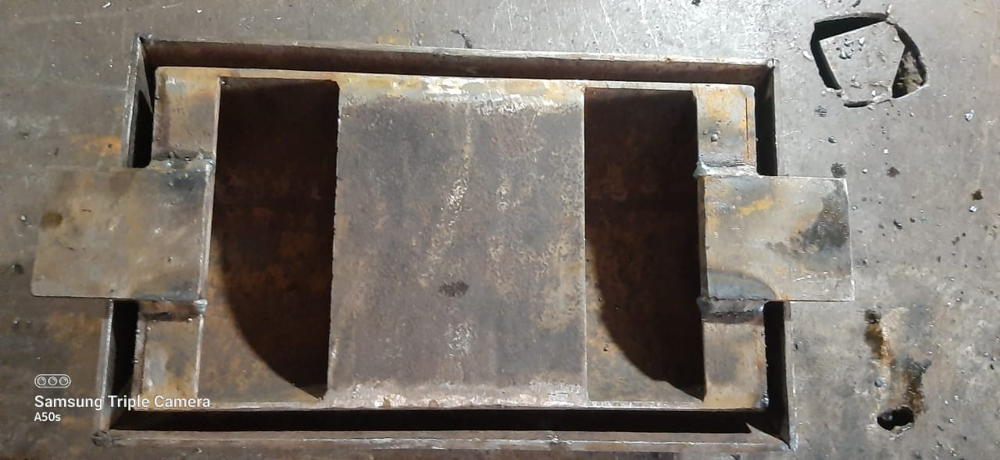

[Registro 02 · Acompanhamento]{.pitch-caption}
[Resposta ao escoamento]{.pitch-caption-sub}
:::

::: {.pitch-media-card .pitch-media-card--photo}

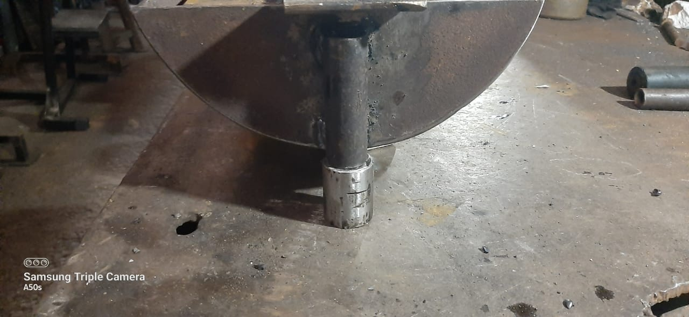

[Registro 03 · Brotação]{.pitch-caption}
[Emergência nos drenos]{.pitch-caption-sub}
:::

::: {.pitch-media-card .pitch-media-card--photo}

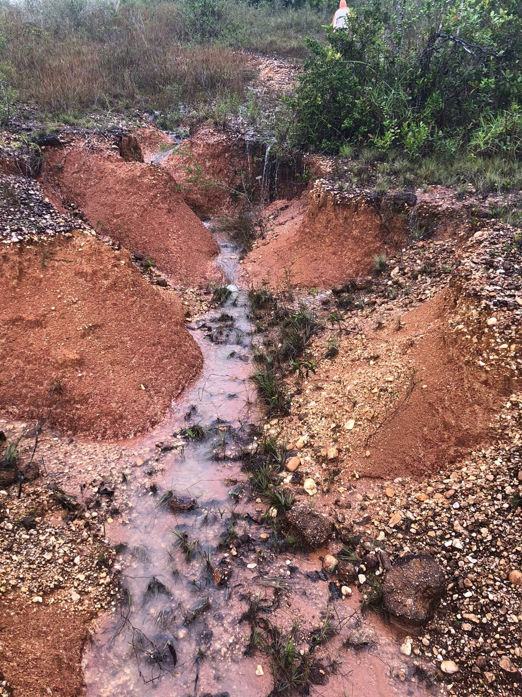

[Registro 04 · Enraizamento]{.pitch-caption}
[Integração raiz–substrato]{.pitch-caption-sub}
:::
:::

::: {.pitch-band}
O registro fotográfico temporal documenta a transição da estrutura drenante inerte para uma rede viva com brotação e retenção de sedimentos in situ.
:::

# 8 · Síntese e atividade {.section-header rotulo="Síntese"}

## Síntese Pontos fundamentais e fluxo conceitual integrado {.smaller-text .academic-slide .lesson-slide}

::: {.pitch-grid-50}
::: {.pitch-card}
[Síntese da aula]{.pitch-card-index}
[Seis pilares técnicos]{.pitch-heading}

1. **Seis técnicas de bioengenharia** vegetativa para estabilização de margens e encostas
2. **Drenos verdes** ($\varnothing = 20\text{ cm}$, $\varepsilon = 5\text{ mm}$) integram drenagem e substrato
3. O sistema **espinha de peixe** otimiza captação e condução hidráulica
4. **Fibras de taboa e bananeira** oferecem matriz econômica e biodegradável
5. **7 espécies nativas** com propagação por estaquia comprovada (15–20 cm)
6. **Bioensaios e SAFIRA** quantificam vigor precoce e morfologia radicular
:::

::: {.pitch-flow-4}
::: {.pitch-card}
[01 · Estruturas]{.pitch-card-index}
[Base física]{.pitch-heading}

Estacas, feixes, muros vivos, esteiras e drenos verdes.
:::

::: {.pitch-card .pitch-card--forest}
[02 · Espécies]{.pitch-card-index}
[Componente vivo]{.pitch-heading}

7 espécies nativas em feixes de estacas (15–20 cm).
:::

::: {.pitch-card .pitch-card--gold}
[03 · Arranjo]{.pitch-card-index}
[Espinha de peixe]{.pitch-heading}

Conexão hidráulica de drenos e fascinas oblíquas.
:::

::: {.pitch-card .pitch-card--teal}
[04 · Resultado]{.pitch-card-index}
[Duplo efeito]{.pitch-heading}

Estabilização da encosta e restauração ecológica.
:::
:::
:::

## Atividade Projeto em grupo — sistema de drenos verdes {.smaller-text .academic-slide .lesson-slide}

::: {.pitch-grid-55}
::: {.pitch-card}
[Estudo dirigido · 30 min projeto + 10 min apresentação]{.pitch-card-index}
[Cenário: aterro desativado (30 m · 25° · solo argiloso)]{.pitch-heading}

Encosta com erosão em sulcos. Projetem um sistema de drenos verdes com feixes vivos respondendo:

1. Quantos **drenos de polo** serão necessários?
2. Qual o **espaçamento** entre as fascinas laterais?
3. Qual o **ângulo** de inserção das fascinas?
4. Quais **3 espécies** escolheriam e por quê?
5. Qual **formulação** de dreno (G1, G2, G3) é mais adequada?
6. Qual o **cronograma de monitoramento** para 120 dias?
:::

::: {.pitch-table-box}
| Critério de avaliação | Peso |
|---|---|
| Coerência do dimensionamento | 25% |
| Justificativa das espécies | 20% |
| Escolha da formulação | 15% |
| Cronograma de monitoramento | 20% |
| Apresentação e clareza | 20% |
:::
:::

## Referências Referências bibliográficas {.smaller-text .academic-slide .lesson-slide}

::: {.pitch-cards-2}
::: {.pitch-card}
[Engenharia e bioengenharia]{.pitch-card-index}
[Manuais e fundamentos]{.pitch-heading}

- Biedenharn, D.S., Elliott, C.M., & Watson, C.C. (1997). *The WES Stream Investigation and Streambank Stabilization Handbook*. USACE.
- Evette, A. et al. (2009). History of Bioengineering Techniques for Erosion Control in Rivers. *Env. Management*, 43(6), 972–984.
- FISRWG (1998). *Stream Corridor Restoration: Principles, Processes, Practices*. USDA-NRCS.
- Gray, D.H. & Sotir, R.B. (1996). *Biotechnical and Soil Bioengineering Slope Stabilization*. Wiley.
- Li, M.H. & Eddleman, K.E. (2002). Biotechnical Engineering as an Alternative. *Landscape Urban Plan.*, 60(4), 225–242.
- Lyn, D.A. & Newton, J.F. (2015). *Approaches to the Design of Biotechnical Streambank Stabilization*. Purdue Univ.
- Morokong, T. & Blignaut, J.N. (2019). Benefits and costs of soil erosion control. *Land Use Policy*, 83, 512–522.
- Rey, F. et al. (2019). Soil and water bioengineering. *Science Total Env.*, 648, 1210–1218.
- USDA-NRCS (1996). *Streambank and Shoreline Protection*. Ch. 16, EFH Part 650.
- USDA-NRCS (2007). *Streambank Soil Bioengineering*. Technical Supplements, NEH Part 654.
:::

::: {.pitch-card .pitch-card--teal}
[Fibras, estaquia e análise radicular]{.pitch-card-index}
[Pesquisa aplicada]{.pitch-heading}

- Akil, H.M. et al. (2011). Kenaf fiber reinforced composites: A review. *Materials & Design*, 32(8–9), 4107–4121.
- Alqaisi, R., Le, T.M., & Khabbaz, H. (2020). *Applications of Recycled Sustainable Materials in Soil Stabilization*. Springer.
- Araújo Filho, R.N. et al. (2019). Effect of indolebutyric acid on rooting and budding of cuttings. *JEAP*, 297–303.
- Chokshi, S. et al. (2022). Chemical Composition and Mechanical Properties of Natural Fibers. *J. Natural Fibers*, 19(10), 3942–3953.
- Das, P.P. et al. (2021). *Influence of Moisture Uptake on Mechanical Properties of NF-Reinforced Composites*. CRC Press.
- Jorge, L.A.C. & Rodrigues, A.F.O. (2008). *SAFIRA: Sistema de Análise de Fibras e Raízes*. Embrapa.
- Lenz, L. et al. (2019). Bioengenharia de solos como alternativa sustentável. *XXIII SBRH*.
- Santos, L.D.V. et al. (2020). Prospecção tecnológica sobre PD&I em Recursos Hídricos. *Rev. Ibero-Am. Ciências Ambientais*.
:::
:::

## {.obrigado-fit-text .center}

::: {.columns}
::: {.column style="text-align: center;"}

[Obrigado!]{.obrigado-fit-text}

**Prof. Luiz Diego Vidal Santos**

📧 luiz.diego@uefs.br

🌐 [ldvsantos.github.io/cv](https://ldvsantos.github.io/cv)

:::
:::
