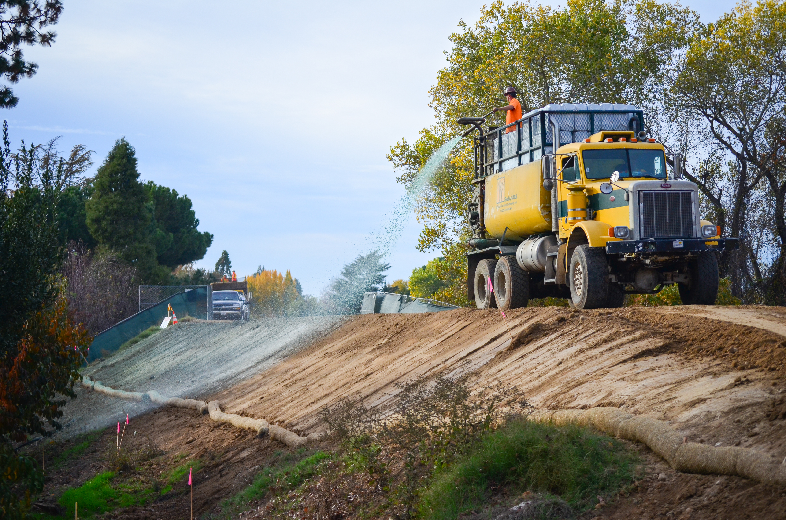
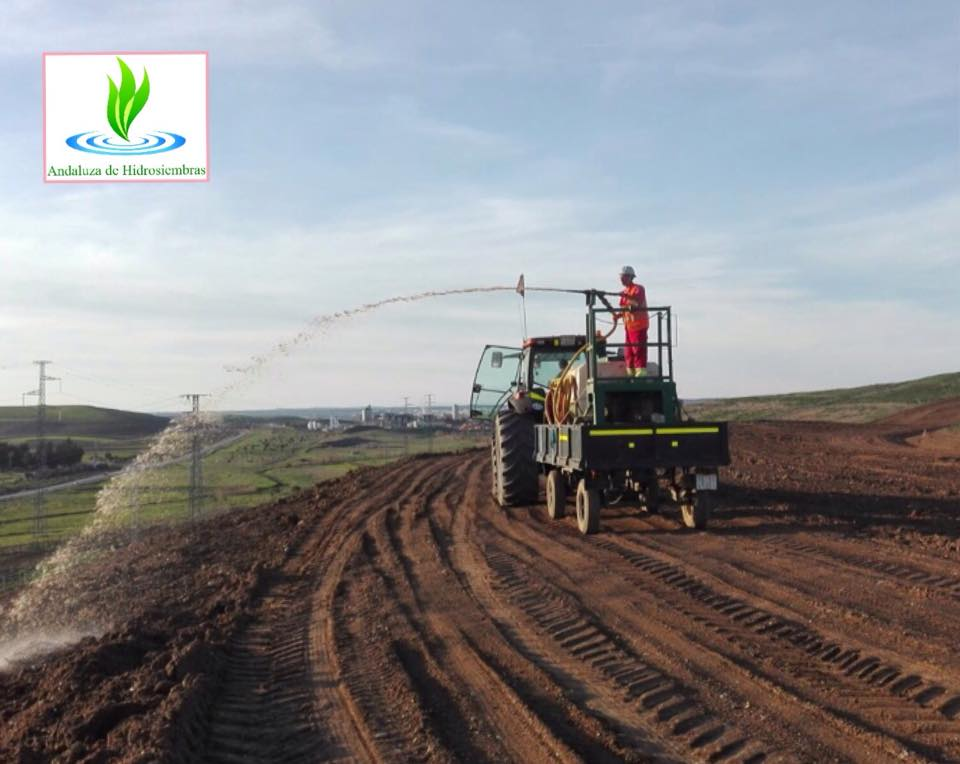
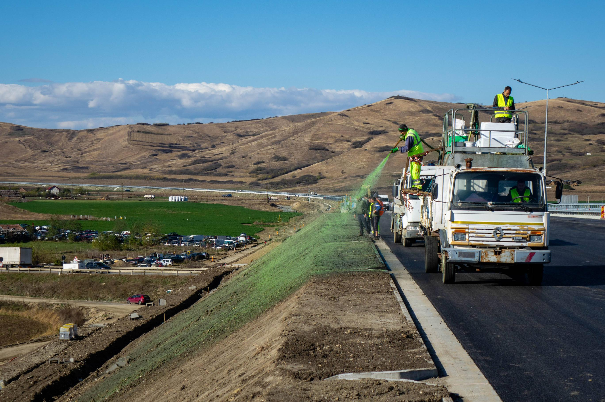
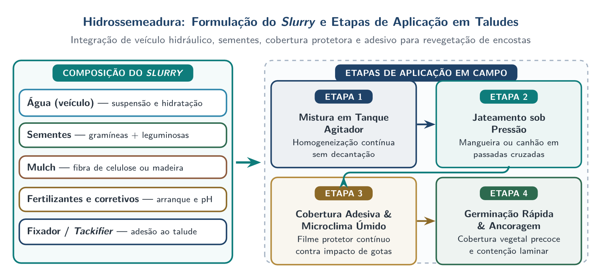

## Abertura Visão Geral da Aula {.smaller-text .academic-slide .lesson-slide}

::: {.pitch-grid-50}
::: {.pitch-card}
[Roteiro da aula]{.pitch-card-index}
[Tópicos estruturantes]{.pitch-heading}

- [1]{.circle} O que é hidrossemeadura?
- [2]{.circle} Composição da pasta (*slurry*)
- [3]{.circle} Tipos de mulch e fixadores
- [4]{.circle} Equipamentos e aplicação
- [5]{.circle} Dimensionamento e taxa de aplicação
- [6]{.circle} Hidrossemeadura em taludes rodoviários
- [7]{.circle} Monitoramento e manutenção
- [8]{.circle} Síntese e atividade
:::

::: {.pitch-stack-2}
::: {.pitch-card .pitch-card--forest}
[Objetivo central]{.pitch-card-index}
[Revegetação hidráulica em escala]{.pitch-heading}

Compreender os princípios da **hidrossemeadura** (*hydroseeding*) como técnica de **revegetação rápida** de grandes áreas e taludes íngremes, dominar a **formulação da pasta** (*slurry*), os critérios de **dimensionamento** e os protocolos de **aplicação e monitoramento** para garantir cobertura vegetal eficiente.
:::

::: {.pitch-pill-row}
[Slurry e tackifiers]{.pitch-pill}
[DNIT 071/2006-ES]{.pitch-pill .pitch-pill--gold}
[Taxa de aplicação (TA)]{.pitch-pill}
:::
:::
:::

# 1 · O que é hidrossemeadura? {.section-header rotulo="Conceito"}

## Conceito Definição, componentes e aplicações típicas {.smaller-text .academic-slide .lesson-slide}

::: {.pitch-grid-55}
::: {.pitch-stack-2}
::: {.pitch-card}
[Hydroseeding / Hydraulic mulch seeding]{.pitch-card-index}
[Aplicação por jateamento de pasta aquosa]{.pitch-heading}

Técnica de revegetação que projeta hidraulicamente sobre o talude uma mistura homogênea contendo:

- **Sementes** de gramíneas e/ou leguminosas
- **Mulch** (fibra protetora)
- **Fertilizantes** (NPK, calcário)
- **Fixadores** (aglutinantes / *tackifiers*)
- **Água** como veículo de transporte
:::

::: {.pitch-band .pitch-band--teal}
Ideal para **cobrir grandes áreas rapidamente** (até **5.000 m² h⁻¹** por equipamento; Bento, 2009), especialmente em taludes íngremes onde a semeadura manual é inviável.
:::
:::

::: {.pitch-table-box}
| Área de aplicação | Exemplo típico |
|---|---|
| Rodovias | Taludes de corte e aterro |
| Mineração | Recuperação de cavas e pilhas |
| Obras hidráulicas | Canais e barragens |
| Áreas urbanas | Encostas e lotes vagos |
| Aeroportos | Faixas de segurança |
| Ferrovias | Taludes laterais |
:::
:::

## Conceito Galeria: hidrossemeadura em campo {.smaller-text .academic-slide .lesson-slide}

::: {.pitch-cards}
::: {.pitch-media-card .pitch-media-card--photo .pitch-media-card--tall}

[Talude de dique (*levee*), EUA]{.pitch-caption}
[Fonte: USACE Sacramento District · Public Domain]{.pitch-caption-sub}
:::

::: {.pitch-media-card .pitch-media-card--photo .pitch-media-card--tall}

[Restauração pós-terraplenagem]{.pitch-caption}
[Fonte: Andaluza de Hidrosiembras · CC BY-SA 4.0]{.pitch-caption-sub}
:::

::: {.pitch-media-card .pitch-media-card--photo .pitch-media-card--tall}

[Talude rodoviário recém-aplicado]{.pitch-caption}
[Fonte: Kulja~rowiki · CC0 · Wikimedia Commons]{.pitch-caption-sub}
:::
:::

## Conceito Histórico e vantagens sobre a semeadura manual {.smaller-text .academic-slide .lesson-slide}

::: {.pitch-grid-55}
::: {.pitch-stack-2}
::: {.pitch-milestones}
::: {.pitch-milestone-item}
**1940s–1950s:** primeiras aplicações nos EUA para controle de erosão em rodovias (Connecticut, 1953).
:::

::: {.pitch-milestone-item}
**1960s–1980s:** difusão na mineração e introdução de *mulch* de fibra de madeira e fixadores poliméricos.
:::

::: {.pitch-milestone-item}
**1990s–2000s+:** chegada ao Brasil (DNER) e avanço com *mulch* biodegradáveis, sementes nativas e PRADs.
:::
:::

::: {.pitch-band}
No Brasil, a técnica consolidou-se com o licenciamento ambiental (**CONAMA 369/2006**) e os Programas de Recuperação de Áreas Degradadas (**PRAD**).
:::
:::

::: {.pitch-cards-2}
::: {.pitch-card .pitch-card--alert}
[Método convencional]{.pitch-card-index}
[Semeadura manual]{.pitch-heading}

Execução **lenta e desuniforme** $\rightarrow$ **cobertura parcial** $\rightarrow$ **falhas e retrabalho** erosivo no talude.
:::

::: {.pitch-card .pitch-card--forest}
[Método hidráulico]{.pitch-card-index}
[Hidrossemeadura]{.pitch-heading}

Aplicação **rápida e uniforme** $\rightarrow$ **cobertura total** $\rightarrow$ **menor erosão** e **germinação acelerada**.
:::
:::
:::

# 2 · Composição da pasta (slurry) {.section-header rotulo="Pasta (Slurry)"}

## Pasta (Slurry) Formulação do slurry e etapas de aplicação {.smaller-text .academic-slide .lesson-slide}

::: {.pitch-media-card .pitch-media-card--wide}

[Composição do *slurry* e etapas de aplicação em taludes]{.pitch-caption}
[Integração de água, sementes, mulch, corretivos e fixador em quatro etapas de campo até a ancoragem vegetal]{.pitch-caption-sub}
:::

::: {.pitch-band .pitch-band--teal}
A película formada pelo *slurry* cria um microclima úmido contínuo que protege as sementes contra impacto de gotas, vento e dessecação antes da emergência.
:::

## Pasta (Slurry) Ingredientes fundamentais e seleção de sementes {.smaller-text .academic-slide .lesson-slide}

::: {.pitch-grid-50}
::: {.pitch-stack-2}
::: {.pitch-table-box}
| Componente | Função | Proporção típica |
|---|---|---|
| **Água** | Veículo de transporte | 3.000–5.000 L ha⁻¹ |
| **Sementes** | Germinação e cobertura | 30–80 kg ha⁻¹ |
| **Mulch** | Proteção e retenção | 2.000–4.000 kg ha⁻¹ |
| **Fertilizante** | Nutrição inicial | 500–1.500 kg ha⁻¹ |
| **Fixador** | Adesão ao solo | 50–200 kg ha⁻¹ |
:::

::: {.pitch-band}
A proporção varia conforme **tipo de solo**, **declividade**, **regime pluviométrico** e **espécies selecionadas**.
:::
:::

::: {.pitch-stack-2}
::: {.pitch-card .pitch-card--forest}
[Mistura ideal: 60–70% gramíneas + 30–40% leguminosas]{.pitch-card-index}
[Espécies recomendadas (Einloft et al., 2009)]{.pitch-heading}

**Gramíneas (cobertura rápida):** *Brachiaria decumbens* (rústica), *Brachiaria humidicola* (solos úmidos), *Paspalum notatum* (batatais), *Cynodon dactylon* (bermuda, taludes secos).

**Leguminosas (fixação de N₂):** *Cajanus cajan* (guandu, raízes profundas), *Crotalaria juncea*, *Stylosanthes guianensis* (estilosantes), *Calopogonium mucunoides* (calopogônio).
:::
:::
:::

## Pasta (Slurry) Formulação prática (1 ha) e ordem de mistura no tanque {.smaller-text .academic-slide .lesson-slide}

::: {.pitch-grid-55}
::: {.pitch-stack-2}
::: {.pitch-table-box}
| Insumo (1 ha) | Quantidade | Observação |
|---|---|---|
| Água | 4.000 L | Limpa, sem cloro |
| Sementes (mix) | 50 kg | 35 kg gramínea + 15 kg leguminosa |
| Mulch de celulose | 2.500 kg | Fibra de madeira ou papel |
| NPK 04-14-08 + Calcário | 800 kg + 500 kg | Base nutricional e correção de pH |
| Fixador (*guar gum*) | 100 kg | Polímero natural |
:::

::: {.pitch-band .pitch-band--navy}
**Ordem no tanque:** **1.** Água (50% vol.) $\rightarrow$ **2.** Mulch (agitando) $\rightarrow$ **3.** Fertilizante + Calcário $\rightarrow$ **4.** Fixador (*tackifier*) $\rightarrow$ **5.** Sementes (**por último!**) $\rightarrow$ **6.** Água restante.
:::
:::

::: {.pitch-stack-2}
::: {.pitch-card}
[Controle pré-jateamento]{.pitch-card-index}
[Verificações de qualidade]{.pitch-heading}

1. **pH da mistura:** ideal entre 6,0 e 7,0
2. **Viscosidade:** fluidez sem entupir o canhão
3. **Temperatura da água:** < 35 °C
4. **Homogeneidade:** agitar por no mínimo 10 min
5. **Viabilidade:** lote de sementes com germinação > 80%
:::

::: {.pitch-card .pitch-card--gold}
[Armazenamento em obra]{.pitch-card-index}
[Segregação de insumos]{.pitch-heading}

Mulch e fixadores em local seco; sementes em câmara fria (< 15 °C, < 60% UR) e **separadas de fertilizantes** (evitar reação exotérmica e dano mecânico do agitador).
:::
:::
:::

# 3 · Tipos de mulch e fixadores {.section-header rotulo="Mulch e Fixadores"}

## Mulch e Fixadores Origem dos materiais, desempenho e tackifiers {.smaller-text .academic-slide .lesson-slide}

::: {.pitch-grid-50}
::: {.pitch-stack-2}
::: {.pitch-card}
[Fibra de madeira (*wood fiber*)]{.pitch-card-index}
[Uso geral equilibrado]{.pitch-heading}

Desfibramento mecânico, alta retenção hídrica, forma manta protetora ao secar e custo moderado.
:::

::: {.pitch-card .pitch-card--gold}
[Celulose (*paper mulch*)]{.pitch-card-index}
[Baixo custo · áreas suaves]{.pitch-heading}

Papel/papelão reciclado, menor custo, retenção moderada; indicado para áreas planas ou pouco inclinadas.
:::

::: {.pitch-card .pitch-card--forest}
[Fibra de coco]{.pitch-card-index}
[Taludes íngremes · 12–24 meses]{.pitch-heading}

Alta durabilidade, excelente retenção + drenagem e maior resistência ao arraste hidráulico.
:::
:::

::: {.pitch-stack-2}
::: {.pitch-table-box}
| Tipo de mulch | Retenção hídrica | Durabilidade | Custo |
|---|---|---|---|
| Fibra de madeira | Alta | 6–12 meses | Médio |
| Celulose / papel | Moderada | 3–6 meses | Baixo |
| Fibra de coco | Alta | 12–24 meses | Alto |
| Palha de arroz | Baixa | 2–4 meses | Baixo |
| Hidromulch BFM* | Muito alta | 12+ meses | Alto |
:::

::: {.pitch-table-box}
| Fixador (*tackifier*) | Origem | Durabilidade |
|---|---|---|
| Goma guar / Psyllium | Vegetal (natural) | 30–60 dias |
| Poliacrilamida (PAM) | Sintético | 90–180 dias |
| Emulsão asfáltica | Derivado de petróleo | 180+ dias |
:::

::: {.pitch-band .pitch-band--teal}
**BFM = *Bonded Fiber Matrix*.** Em restauração ecológica, prefira **fixadores naturais** (guar, psyllium) para preservar a microbiota do solo.
:::
:::
:::

# 4 · Equipamentos e aplicação {.section-header rotulo="Equipamentos"}

## Equipamentos Porte dos hidrossemeadores e cadeia operacional {.smaller-text .academic-slide .lesson-slide}

::: {.pitch-grid-55}
::: {.pitch-cards}
::: {.pitch-card}
[500–2.000 L]{.pitch-card-index}
[Pequeno porte]{.pitch-heading}

Pick-up ou reboque, agitador mecânico simples, alcance **15–30 m**, **1.000–2.000 m² h⁻¹**.
:::

::: {.pitch-card .pitch-card--teal}
[2.000–5.000 L]{.pitch-card-index}
[Médio porte]{.pitch-heading}

Caminhão, agitador hidráulico, alcance **30–50 m**, **3.000–5.000 m² h⁻¹**.
:::

::: {.pitch-card .pitch-card--gold}
[5.000–15.000 L]{.pitch-card-index}
[Grande porte]{.pitch-heading}

Caminhão dedicado + canhão torre, alcance **50–90 m**, **5.000–10.000 m² h⁻¹**.
:::
:::

::: {.pitch-stack-2}
::: {.pitch-band .pitch-band--navy}
**Fluxo hidráulico:** Tanque de mistura $\rightarrow$ Agitador mecânico/hidráulico $\rightarrow$ Bomba centrífuga $\rightarrow$ Mangueira flexível (aplicação manual dirigida) ou Canhão torre (área ampla).
:::

::: {.pitch-table-box}
| Parâmetro de operação | Faixa recomendada |
|---|---|
| Pressão de bombeio | 3–7 bar |
| Vazão do canhão | 200–600 L min⁻¹ |
| Rotação do agitador | 150–300 rpm |
| Ângulo de aplicação | 30°–60° em relação ao talude |
:::
:::
:::

## Equipamentos Técnicas de aplicação, restrições e taludes íngremes {.smaller-text .academic-slide .lesson-slide}

::: {.pitch-grid-50}
::: {.pitch-card}
[Execução em campo]{.pitch-card-index}
[Procedimento padrão em 4 etapas]{.pitch-heading}

1. **Preparo da superfície:** remoção de detritos, escarificação (solo compactado) e sulcos horizontais em taludes > 45°.
2. **1ª camada (base):** jateamento de baixo para cima, sobreposição de 10–15% entre faixas, espessura de **5–10 mm**.
3. **2ª camada (opcional):** somente *mulch* + fixador (sem sementes) em taludes > 60° ou chuva iminente.
4. **Compactação leve (opcional):** rolo liso apenas em áreas planas.
:::

::: {.pitch-stack-2}
::: {.pitch-card .pitch-card--alert}
[Condições impeditivas]{.pitch-card-index}
[Jamais aplicar quando houver]{.pitch-heading}

- Vento **> 25 km h⁻¹** (dispersão da pasta)
- Chuva forte (lavagem do material)
- Solo saturado (falta de aderência) ou temperatura **> 40 °C**
:::

::: {.pitch-cards}
::: {.pitch-card .pitch-card--forest}
[45°–60°]{.pitch-card-index}
[Íngreme]{.pitch-heading}

Hidrossemeadura + **Biomanta**.
:::

::: {.pitch-card .pitch-card--gold}
[60°–75°]{.pitch-card-index}
[Muito íngreme]{.pitch-heading}

Hidrossemeadura + **Tela metálica** + **Biomanta**.
:::

::: {.pitch-card}
[> 75°]{.pitch-card-index}
[Técnica mista]{.pitch-heading}

Hidrossemeadura + **Geogrelha** + **Solo grampeado**.
:::
:::
:::
:::

# 5 · Dimensionamento e taxa de aplicação {.section-header rotulo="Dimensionamento"}

## Dimensionamento Cálculo da taxa de aplicação (TA) e exemplo resolvido {.smaller-text .academic-slide .lesson-slide}

::: {.pitch-grid-55}
::: {.pitch-stack-2}
::: {.pitch-formula}
**Equação da Taxa de Aplicação:**

$$TA = TA_{base} \times f_d \times f_s \times f_c$$

Onde $TA_{base}$ = taxa base em terreno plano (kg ha⁻¹), $f_d$ = fator de declividade (1,0–2,5), $f_s$ = fator de solo (0,8–1,5) e $f_c$ = fator climático (0,8–1,3).
:::

::: {.pitch-table-box}
| Declividade do talude | Fator $f_d$ |
|---|---|
| 0°–15° | 1,0 |
| 15°–30° | 1,3 |
| 30°–45° | 1,6 |
| 45°–60° | 2,0 |
| > 60° | 2,5 |
:::
:::

::: {.pitch-stack-2}
::: {.pitch-card .pitch-card--gold}
[Exemplo numérico]{.pitch-card-index}
[Talude rodoviário · 2.000 m² · 35° · arenoso · semiárido]{.pitch-heading}

Com $TA_{base} = 3.000\text{ kg ha}^{-1}$ (mulch celulose), $f_d = 1,6$, $f_s = 1,3$ e $f_c = 1,2$:

$$TA = 3.000 \times 1,6 \times 1,3 \times 1,2 = 7.488 \text{ kg ha}^{-1}$$

Para $2.000\text{ m}^2$ ($0,2\text{ ha}$):

$$Q_{mulch} = 7.488 \times 0,2 = 1.498 \text{ kg}$$
:::

::: {.pitch-band}
Sempre arredondar para cima e adicionar **10% de margem** para perdas operacionais e sobreposições entre passadas.
:::
:::
:::

# 6 · Hidrossemeadura em taludes rodoviários {.section-header rotulo="Taludes Rodoviários"}

## Rodovias Desafios geotécnicos e protocolo DNIT 071/2006-ES {.smaller-text .academic-slide .lesson-slide}

::: {.pitch-grid-50}
::: {.pitch-stack-2}
::: {.pitch-card}
[Passivos rodoviários no Brasil]{.pitch-card-index}
[Cortes, aterros e extensão linear]{.pitch-heading}

Cortes expõem horizontes subsuperficiais (**saprolito**) e aterros apresentam material compactado pobre em matéria orgânica ao longo de quilômetros contínuos.
:::

::: {.pitch-table-box}
| Desafio | Impacto agronômico |
|---|---|
| Solo compactado | Dificulta penetração radicular |
| Baixa fertilidade | Germinação e arranque deficientes |
| Declividade elevada | Erosão laminar intensa |
| Insolação direta | Dessecação das sementes |
| Tráfego adjacente | Restrição logística de acesso |
:::
:::

::: {.pitch-stack-2}
::: {.pitch-milestones}
::: {.pitch-milestone-item}
**01–03 · Preparo agronômico:** conclusão da terraplenagem $\rightarrow$ análise de solo (pH, NPK, textura) $\rightarrow$ calagem + adubação + escarificação superficial.
:::

::: {.pitch-milestone-item}
**04–06 · Aplicação e proteção:** hidrossemeadura (1ª aplicação) $\rightarrow$ biomanta complementar (se declividade **> 45°**) $\rightarrow$ irrigação suplementar quando necessária.
:::

::: {.pitch-milestone-item}
**07 · Monitoramento 30/60/90 dias:** se cobertura **< 80%**, reaplicação localizada; se cobertura **$\ge$ 80%**, aceite final da obra.
:::
:::

::: {.pitch-band .pitch-band--teal}
Norma de referência: **DNIT 071/2006 - ES** (Tratamento Ambiental — Revegetação de Taludes em rodovias federais).
:::
:::
:::

# 7 · Monitoramento e manutenção {.section-header rotulo="Monitoramento"}

## Monitoramento Indicadores de sucesso, metas e ações corretivas {.smaller-text .academic-slide .lesson-slide}

::: {.pitch-grid-50}
::: {.pitch-stack-2}
::: {.pitch-table-box}
| Período | Indicador | Meta |
|---|---|---|
| 7 dias | Germinação visível | > 50% da área |
| 15 dias | Cobertura inicial | > 30% |
| 30 dias | Cobertura intermediária | > 60% |
| 60 dias | Cobertura consolidada | > 80% |
| 90 dias | Cobertura final | > 90% |
| 180 dias | Enraizamento estável | Prof. > 15 cm |
:::

::: {.pitch-card}
[Métodos de medição]{.pitch-card-index}
[Ferramentas de campo e sensoriamento]{.pitch-heading}

Quadrantes fixos (1 m²), **NDVI por drone**, interceptômetro de linhas e ensaio de arrancamento (kPa).
:::
:::

::: {.pitch-stack-2}
::: {.pitch-table-box}
| Problema | Causa provável | Solução |
|---|---|---|
| Germinação irregular | Sementes velhas / pH extremo | Novo lote + correção |
| Lavagem da pasta | Chuva forte pós-aplicação | Reaplicação + biomanta |
| Crosta superficial | Excesso de fixador | Escarificar + irrigar |
| Amarelecimento | Deficiência de N | Adubação de cobertura |
| Invasão de daninhas | Falhas na cobertura | Replantio localizado |
:::

::: {.pitch-band}
**Manutenção crítica no 1º ano:** irrigação em veranicos, **adubação de cobertura** (ureia **50 kg ha⁻¹** aos 45 dias) e replantio em falhas.
:::
:::
:::

# 8 · Síntese e atividade {.section-header rotulo="Síntese"}

## Síntese Pontos fundamentais e fluxo conceitual completo {.smaller-text .academic-slide .lesson-slide}

::: {.pitch-grid-50}
::: {.pitch-card}
[Resumo técnico]{.pitch-card-index}
[Seis diretrizes essenciais]{.pitch-heading}

1. **Hidrossemeadura** projeta pasta aquosa de sementes, *mulch*, fertilizantes e fixadores
2. A **composição da pasta** ajusta-se ao solo, declividade e clima
3. **Mulch de fibra de madeira** tem melhor custo-benefício para uso geral
4. **Fixadores naturais** (guar, psyllium) são preferíveis na restauração ecológica
5. A **taxa de aplicação** corrige a dose base por $f_d$, $f_s$ e $f_c$
6. O **monitoramento** acompanha a evolução até **90% mínimo** de cobertura
:::

::: {.pitch-flow-4}
::: {.pitch-card}
[01 · Insumos]{.pitch-card-index}
[Formulação]{.pitch-heading}

Sementes (gramíneas + leguminosas), *mulch*, NPK/calcário e *tackifier*.
:::

::: {.pitch-card .pitch-card--teal}
[02 · Slurry]{.pitch-card-index}
[Mistura e jato]{.pitch-heading}

Homogeneização no tanque e jateamento uniforme sobre o talude.
:::

::: {.pitch-card .pitch-card--forest}
[03 · Pegamento]{.pitch-card-index}
[7 a 90 dias]{.pitch-heading}

Germinação (7–15 d) e fechamento da cobertura vegetal (30–90 d).
:::

::: {.pitch-card .pitch-card--gold}
[04 · Estabilidade]{.pitch-card-index}
[Resultado final]{.pitch-heading}

Estabilização superficial e proteção anti-erosiva contínua.
:::
:::
:::

## Atividade Projeto de hidrossemeadura na BR-116 (BA) {.smaller-text .academic-slide .lesson-slide}

::: {.pitch-grid-55}
::: {.pitch-card}
[Estudo dirigido · 30 min projeto + 10 min apresentação]{.pitch-card-index}
[Talude Feira de Santana–Milagres · 500 m × 8 m · 40°]{.pitch-heading}

Solo saprolítico (areno-siltoso, **pH 4,8**), revegetação urgente pré-chuvas. Projetem:

1. **Mistura de sementes** recomendada (espécies e proporções)
2. **Tipo de mulch** mais adequado e justificativa
3. Cálculo da **taxa de aplicação ($TA$)** de *mulch*
4. Volume total de **litros de slurry** necessário
5. **Equipamento** indicado (porte e alcance) e necessidade de **biomanta complementar**
6. **Cronograma de monitoramento** para 180 dias
:::

::: {.pitch-table-box}
| Critério de avaliação | Peso |
|---|---|
| Seleção de espécies | 20% |
| Dimensionamento do *slurry* | 25% |
| Escolha de *mulch* e fixador | 15% |
| Cálculo da taxa de aplicação | 20% |
| Cronograma de monitoramento | 20% |
:::
:::

## Referências Referências bibliográficas {.smaller-text .academic-slide .lesson-slide}

::: {.pitch-card}
[Literatura técnica e normas]{.pitch-card-index}
[Base bibliográfica da aula]{.pitch-heading}

- Bento, M. A. B. (2009). Avaliação da qualidade de substratos e métodos para produção de mudas em hidrossemeadura. *Dissertação, UFV*.
- DNIT (2006). *DNIT 071/2006 - ES: Tratamento Ambiental - Revegetação de Taludes*. Departamento Nacional de Infraestrutura de Transportes.
- Einloft, R. et al. (2009). Recuperação de áreas degradadas pela mineração com hidrossemeadura. *Rev. Bras. Ciência do Solo*, 33(6), 1909–1917.
- Faucette, L. B. et al. (2007). Large-scale performance and design for construction activity erosion control best management practices. *J. Environ. Qual.*, 36(2), 525–533.
- Hälbich, F. B. (2014). Erosion control using hydromulch and biomantas. *Eng. Sanit. Ambien.*, 19(2), 155–163.
- Rickson, R. J. (2006). Controlling sediment at source: an evaluation of erosion control geotextiles. *Earth Surface Processes Landforms*, 31(5), 550–560.
- Vanini, M. et al. (2018). Hidrossemeadura para recuperação de taludes em rodovias no Rio Grande do Sul. *Ciência e Natura*, 40, e18.
:::

## {.obrigado-fit-text .center}

::: {.columns}
::: {.column style="text-align: center;"}

[Obrigado!]{.obrigado-fit-text}

**Prof. Luiz Diego Vidal Santos**

📧 luiz.diego@uefs.br

🌐 [ldvsantos.github.io/cv](https://ldvsantos.github.io/cv)

:::
:::
