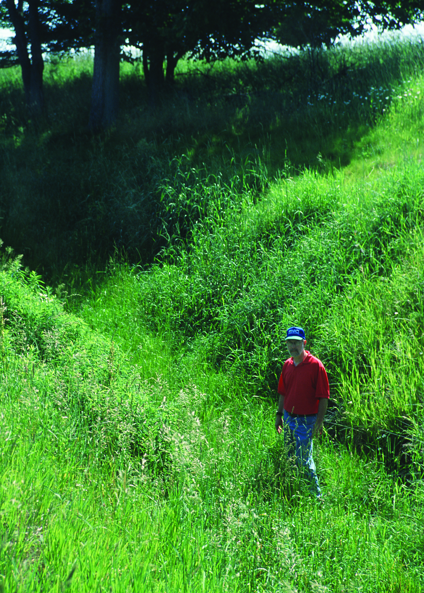
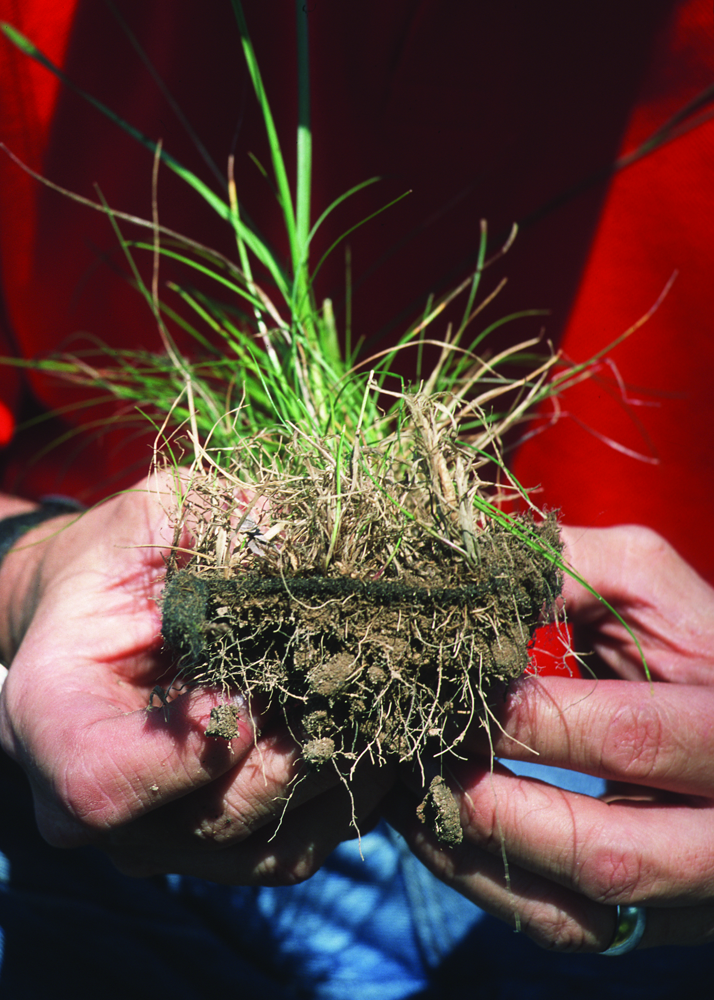
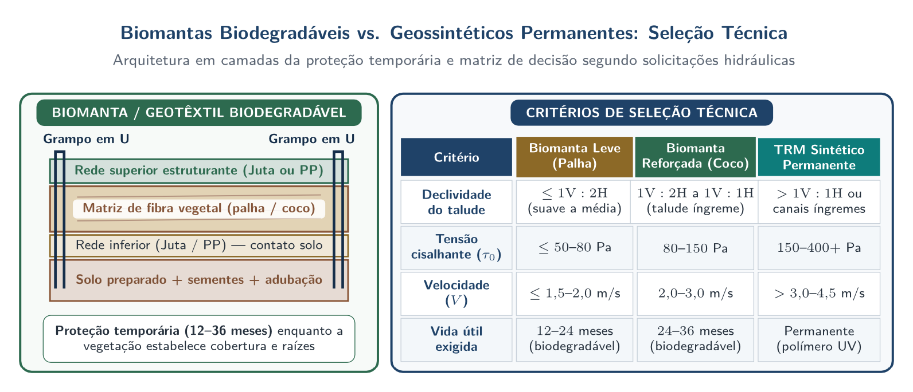
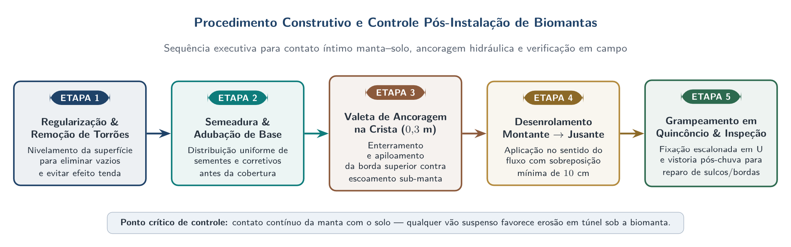

## Abertura Visão Geral da Aula {.smaller-text .academic-slide .lesson-slide}

::: {.pitch-grid-50}
::: {.pitch-card}
[Roteiro da aula]{.pitch-card-index}
[Tópicos estruturantes]{.pitch-heading}

- [1]{.circle} O que são biomantas?
- [2]{.circle} Biomanta × Geotêxtil sintético
- [3]{.circle} Tipos de biomantas e materiais
- [4]{.circle} Propriedades mecânicas e normas
- [5]{.circle} Projeto e dimensionamento
- [6]{.circle} Instalação em campo
- [7]{.circle} Monitoramento e biodegradação
- [8]{.circle} Síntese e atividade
:::

::: {.pitch-stack-2}
::: {.pitch-card .pitch-card--forest}
[Objetivo central]{.pitch-card-index}
[Proteção temporária e sucessão vegetal]{.pitch-heading}

Compreender os princípios de funcionamento das **biomantas** (*erosion control blankets*) como técnica de **proteção de superfície** contra a erosão laminar, diferenciar biomantas de **geotêxteis sintéticos**, dominar os critérios de **seleção**, **dimensionamento** e **instalação** para garantir a **sucessão vegetal** sob a manta.
:::

::: {.pitch-pill-row}
[ECBs · ABNT NBR 16.757:2020]{.pitch-pill}
[Coco · Sisal · Juta · Palha]{.pitch-pill .pitch-pill--gold}
[Biodegradação e MO]{.pitch-pill}
:::
:::
:::

# 1 · O que são biomantas? {.section-header rotulo="Conceito"}

## Conceito Definição e mecanismo de proteção superficial {.smaller-text .academic-slide .lesson-slide}

::: {.pitch-grid-55}
::: {.pitch-stack-2}
::: {.pitch-card .pitch-card--forest}
[Erosion Control Blankets (ECBs)]{.pitch-card-index}
[Tramas biodegradáveis de fibras naturais]{.pitch-heading}

- **Protegem** contra impacto direto das gotas de chuva (*splash erosion*)
- **Reduzem** a velocidade do escoamento superficial
- **Retêm** umidade e sementes, criando microclima favorável
- **Degradam-se** progressivamente, incorporando matéria orgânica
:::

::: {.pitch-band}
A biomanta é uma **proteção temporária** que cumpre sua função física até que a **vegetação se estabeleça** como cobertura permanente.
:::
:::

::: {.pitch-cards-2}
::: {.pitch-card .pitch-card--alert}
[Sem biomanta]{.pitch-card-index}
[Solo exposto]{.pitch-heading}

Chuva (energia cinética) $\rightarrow$ impacto direto no solo $\rightarrow$ desagregação de partículas $\rightarrow$ **erosão laminar**.
:::

::: {.pitch-card .pitch-card--forest}
[Com biomanta]{.pitch-card-index}
[Solo protegido]{.pitch-heading}

Energia dissipada na trama $\rightarrow$ solo protegido $\rightarrow$ germinação sob a manta $\rightarrow$ **vegetação permanente**.
:::
:::
:::

## Conceito Galeria: geotêxteis e biomantas em campo {.smaller-text .academic-slide .lesson-slide}

::: {.pitch-cards-2}
::: {.pitch-media-card .pitch-media-card--photo .pitch-media-card--tall}

[Canal de drenagem revestido (Michigan, EUA)]{.pitch-caption}
[Foto: Fred Gasper / USDA NRCS · Public Domain]{.pitch-caption-sub}
:::

::: {.pitch-media-card .pitch-media-card--photo .pitch-media-card--tall}

[Emergência de gramíneas através da malha]{.pitch-caption}
[Foto: Fred Gasper / USDA NRCS · Public Domain]{.pitch-caption-sub}
:::
:::

## Conceito Evolução histórica, ganhos e marco brasileiro {.smaller-text .academic-slide .lesson-slide}

::: {.pitch-grid-55}
::: {.pitch-stack-2}
::: {.pitch-milestones}
::: {.pitch-milestone-item}
**1950s–1960s:** primeiros geotêxteis sintéticos (polipropileno, poliéster).
:::

::: {.pitch-milestone-item}
**1970s–1980s:** biomantas de juta (Índia/Bangladesh) e introdução da fibra de coco de maior durabilidade.
:::

::: {.pitch-milestone-item}
**1990s–2000s+:** padronização ASTM/ECTC e biomantas pré-semeadas (*pre-seeded blankets*) regionalizadas.
:::
:::

::: {.pitch-table-box}
| Critério | Sem proteção | Com biomanta |
|---|---|---|
| Perda de solo | 20–80 t ha⁻¹ ano⁻¹ | 2–8 t ha⁻¹ ano⁻¹ |
| Germinação / Umidade | 30–50% · Baixa | 70–90% · Alta |
| Temp. do solo | Extrema | Moderada |
:::
:::

::: {.pitch-stack-2}
::: {.pitch-card}
[Normatização no Brasil]{.pitch-card-index}
[ABNT NBR 16.757:2020]{.pitch-heading}

Regula biomantas para controle de erosão, exigidas em:

- Licenciamento de rodovias (DNIT)
- Recuperação de mineração (IBAMA/ANM)
- Planos de Recuperação de Áreas Degradadas (PRAD)
- Obras de drenagem urbana
:::

::: {.pitch-band .pitch-band--teal}
A redução de perda de solo pode atingir **90–95%** com biomantas de fibra de coco bem instaladas (Lekha, 2004).
:::
:::
:::

# 2 · Biomanta × Geotêxtil sintético {.section-header rotulo="Comparação"}

## Comparação Arquitetura e critérios de seleção técnica {.smaller-text .academic-slide .lesson-slide}

::: {.pitch-media-card .pitch-media-card--wide}

[Biomantas biodegradáveis vs. geossintéticos permanentes]{.pitch-caption}
[Critérios hidráulicos e geotécnicos segundo declividade, tensão cisalhante (τ₀), velocidade (V) e vida útil]{.pitch-caption-sub}
:::

::: {.pitch-band}
A seleção entre biomanta leve (palha), biomanta reforçada (coco) e TRM sintético permanente depende diretamente da declividade e da tensão cisalhante atuante ($\tau_0$).
:::

## Comparação Biomanta (ECB) versus Geotêxtil sintético {.smaller-text .academic-slide .lesson-slide}

::: {.pitch-grid-50}
::: {.pitch-stack-2}
::: {.pitch-card .pitch-card--forest}
[Biomanta biodegradável (ECB)]{.pitch-card-index}
[Função temporária · R\$ 5–25 m⁻²]{.pitch-heading}

- **Material:** fibras naturais (coco, palha, juta, sisal)
- **Vida útil:** 6 meses a 5 anos · incorpora MO ao solo
- **Permeabilidade:** alta (infiltração e trocas gasosas)
- **Impacto ambiental:** baixo (material renovável)
:::

::: {.pitch-card}
[Geotêxtil sintético]{.pitch-card-index}
[Função permanente · R\$ 8–40 m⁻²]{.pitch-heading}

- **Material:** polipropileno, poliéster ou nylon (não biodegradável)
- **Vida útil:** 20–50+ anos · filtração, separação e reforço estrutural
- **Subtipos:** tecido (com vegetação associada) ou não tecido (sem vegetação)
:::
:::

::: {.pitch-stack-2}
::: {.pitch-table-box}
| Propriedade | Biomanta | Geotêxtil |
|---|---|---|
| Proteção erosiva | ★★★★★ | ★★★☆☆ |
| Retenção umidade | ★★★★★ | ★★☆☆☆ |
| Resistência mecânica | ★★☆☆☆ | ★★★★★ |
| Sustentabilidade | ★★★★★ | ★★☆☆☆ |
| Custo-benefício | ★★★★☆ | ★★★☆☆ |
:::

::: {.pitch-band .pitch-band--navy}
**Árvore de decisão:** função temporária com revegetação $\rightarrow$ **Biomanta** (coco, palha, juta, sisal). Função estrutural permanente $\rightarrow$ **Geotêxtil** (tecido se houver vegetação; não tecido se não houver).
:::
:::
:::

# 3 · Tipos de biomantas e materiais {.section-header rotulo="Materiais"}

## Materiais Classificação por fibra vegetal {.smaller-text .academic-slide .lesson-slide}

::: {.pitch-grid-55}
::: {.pitch-cards-2}
::: {.pitch-card .pitch-card--forest}
[Coco (*Cocos nucifera*)]{.pitch-card-index}
[2–5 anos · 100–200 kN m⁻¹]{.pitch-heading}

Excelente retenção hídrica e resistência microbiológica; ideal para taludes íngremes e margens fluviais.
:::

::: {.pitch-card .pitch-card--gold}
[Sisal (*Agave sisalana*)]{.pitch-card-index}
[2–4 anos · 120–180 kN m⁻¹]{.pitch-heading}

Boa retenção hídrica, fibra nacional (Nordeste brasileiro); taludes moderados a íngremes.
:::

::: {.pitch-card}
[Juta (*Corchorus spp.*)]{.pitch-card-index}
[1–2 anos · 80–150 kN m⁻¹]{.pitch-heading}

Boa retenção e trabalhabilidade; indicada para uso geral e canais.
:::

::: {.pitch-card .pitch-card--teal}
[Palha de arroz / trigo]{.pitch-card-index}
[3–12 meses · 20–50 kN m⁻¹]{.pitch-heading}

Retenção moderada, baixo custo e alta disponibilidade; áreas planas e taludes suaves.
:::
:::

::: {.pitch-stack-2}
::: {.pitch-table-box}
| Fibra | Durabilidade | Resistência | Custo |
|---|---|---|---|
| Coco | ★★★★★ | ★★★★☆ | ★★★☆☆ |
| Palha | ★★☆☆☆ | ★★☆☆☆ | ★★★★★ |
| Juta | ★★★☆☆ | ★★★☆☆ | ★★★★☆ |
| Sisal | ★★★★☆ | ★★★★☆ | ★★★☆☆ |
:::

::: {.pitch-band .pitch-band--teal}
No **Nordeste do Brasil**, **coco** e **sisal** são prioritários pela oferta regional, menor frete e fortalecimento da cadeia produtiva local.
:::
:::
:::

## Materiais Estrutura construtiva e biomantas pré-semeadas {.smaller-text .academic-slide .lesson-slide}

::: {.pitch-grid-50}
::: {.pitch-stack-2}
::: {.pitch-card}
[Arquitetura sanduíche]{.pitch-card-index}
[Componentes e fixação]{.pitch-heading}

- **Rede superior:** malha de contenção das fibras
- **Núcleo de fibras:** coco, palha, juta ou sisal
- **Rede inferior:** malha de suporte em contato com o solo
- **Grampos metálicos em "U":** ancoragem direta ao terreno
:::

::: {.pitch-table-box}
| Tipo | Redes | Fibra | Gramatura |
|---|---|---|---|
| Simples | 1 rede PP | Palha | 300–400 g m⁻² |
| Dupla | 2 redes PP | Coco | 400–700 g m⁻² |
| Reforçada | 2 redes + fio aço | Coco+palha | 700–1.000 g m⁻² |
:::
:::

::: {.pitch-stack-2}
::: {.pitch-card .pitch-card--forest}
[Biomantas com sementes (*pre-seeded*)]{.pitch-card-index}
[Sementes incorporadas entre camadas]{.pitch-heading}

**Vantagens:** elimina etapa de semeadura, garante distribuição uniforme e proteção imediata.

**Limitações:** custo superior, seleção de espécies restrita ao fabricante e prazo de validade das sementes.
:::

::: {.pitch-band}
Pesquisas testam biomantas com **sementes nativas do Cerrado e Caatinga**, ampliando a restauração ecológica pré-semeada (Oliveira et al., 2021).
:::
:::
:::

# 4 · Propriedades mecânicas e normas {.section-header rotulo="Normas"}

## Normas Ensaios laboratoriais e referências normativas {.smaller-text .academic-slide .lesson-slide}

::: {.pitch-grid-50}
::: {.pitch-stack-2}
::: {.pitch-table-box}
| Ensaio laboratorial | Norma | Parâmetro |
|---|---|---|
| Resistência à tração / Alongamento | ASTM D6818 | kN m⁻¹ / % |
| Gramatura | ASTM D6475 | g m⁻² |
| Espessura / Abertura de malha | ASTM D6525 / D6567 | mm |
| Degradação UV / Biodegradação | ASTM D4355 / ISO 17556 | % retenção / % massa |
:::

::: {.pitch-table-box}
| Propriedade típica (Coco) | Faixa |
|---|---|
| Gramatura / Espessura | 400–700 g m⁻² · 8–15 mm |
| Tração (MD) / Alongamento | 5–15 kN m⁻¹ · 15–40% |
| Abertura de malha | 10–20 mm |
:::
:::

::: {.pitch-stack-2}
::: {.pitch-card}
[Arcabouço normativo]{.pitch-card-index}
[Normas brasileiras e internacionais]{.pitch-heading}

- **Brasil:** ABNT **NBR 16.757:2020** (Biomanta), ABNT **NBR 12.553** (Terminologia), **DNIT 071/2006 - ES**.
- **Internacionais:** **ASTM D6459** (desempenho de RECPs), **ECTC** e **EN 13252** (drenagem).
:::

::: {.pitch-band .pitch-band--teal}
A classificação **ECTC** divide as biomantas de **Type A** (curta duração, $\le 12$ meses) a **Type D** (longa duração, $> 36$ meses).
:::
:::
:::

# 5 · Projeto e dimensionamento {.section-header rotulo="Dimensionamento"}

## Dimensionamento Critérios de seleção por declividade e cálculo de área {.smaller-text .academic-slide .lesson-slide}

::: {.pitch-grid-55}
::: {.pitch-flow-4}
::: {.pitch-card .pitch-card--forest}
[< 1V:3H (< 18°)]{.pitch-card-index}
[Talude suave]{.pitch-heading}

Biomanta de **palha ou juta leve** (300–400 g m⁻²).
:::

::: {.pitch-card}
[1V:3H–1V:2H (18°–27°)]{.pitch-card-index}
[Moderado]{.pitch-heading}

Biomanta de **coco simples** (400–500 g m⁻²).
:::

::: {.pitch-card .pitch-card--gold}
[1V:2H–1V:1H (27°–45°)]{.pitch-card-index}
[Íngreme]{.pitch-heading}

Biomanta de **coco dupla rede** (500–700 g m⁻²).
:::

::: {.pitch-card .pitch-card--alert}
[> 1V:1H (> 45°)]{.pitch-card-index}
[Escarpado]{.pitch-heading}

Biomanta **reforçada + grampeamento** (700–1.000 g m⁻²).
:::
:::

::: {.pitch-stack-2}
::: {.pitch-table-box}
| Fator de projeto | Influência na especificação |
|---|---|
| Declividade / Velocidade | Gramatura, rede e resistência ao arraste |
| Solo / Espécies | Abertura de malha para germinação |
| Pluviometria / Acesso | Durabilidade exigida e peso dos rolos |
:::

::: {.pitch-formula}
**Quantidade total de biomanta ($Q_{biom}$):**

$$Q_{biom} = A_{talude} \times (1 + f_s)$$

Onde $A_{talude}$ = área do talude (m²) e $f_s$ = fator de sobreposição ($0,10\text{–}0,20$).
:::
:::
:::

# 6 · Instalação em campo {.section-header rotulo="Instalação"}

## Instalação Procedimento construtivo e controle pós-instalação {.smaller-text .academic-slide .lesson-slide}

::: {.pitch-media-card .pitch-media-card--wide}

[Procedimento construtivo e controle pós-instalação]{.pitch-caption}
[Regularização, semeadura, valeta de ancoragem (0,3 m), desenrolamento montante-jusante e grampeamento em quincôncio]{.pitch-caption-sub}
:::

::: {.pitch-band .pitch-band--navy}
**Ponto crítico de controle:** contato contínuo da manta com o solo — qualquer vão suspenso ("efeito tenda") induz erosão em túnel sob a biomanta.
:::

## Instalação Detalhamento executivo e erros comuns em obra {.smaller-text .academic-slide .lesson-slide}

::: {.pitch-grid-55}
::: {.pitch-milestones}
::: {.pitch-milestone-item}
**01 · Preparo da superfície:** remover pedras/detritos, escarificar 2–3 cm e aplicar sementes/adubação.
:::

::: {.pitch-milestone-item}
**02 · Ancoragem superior:** abrir trincheira de 15–20 cm, enterrar 30 cm da borda superior e compactar.
:::

::: {.pitch-milestone-item}
**03 · Desenrolamento (cima $\rightarrow$ baixo):** garantir aderência sem bolsas de ar, sobreposição lateral $\ge 10\text{ cm}$ e longitudinal $\ge 15\text{ cm}$.
:::

::: {.pitch-milestone-item}
**04–05 · Grampeamento e pé:** grampos em "U" de aço (15–20 cm) a **1–2 grampos m⁻²** (reforçar bordas) e ancoragem na trincheira de pé.
:::
:::

::: {.pitch-table-box}
| Erro de instalação | Consequência erosiva |
|---|---|
| Manta solta (bolsas de ar) | Erosão por baixo da manta |
| Sem trincheira superior | Água penetra sob a manta |
| Sobreposição insuficiente | Exposição do solo nas juntas |
| Poucos grampos | Deslocamento com chuva |
| Manta esticada demais | Rompe por contração/dilatação |
:::
:::

# 7 · Monitoramento e biodegradação {.section-header rotulo="Monitoramento"}

## Monitoramento Acompanhamento, transição e ações corretivas {.smaller-text .academic-slide .lesson-slide}

::: {.pitch-grid-50}
::: {.pitch-stack-2}
::: {.pitch-table-box}
| Período | Verificação | Meta |
|---|---|---|
| 7 dias | Aderência e grampeamento | Sem deslocamento |
| 15 dias | Germinação sob a manta | > 40% visível |
| 30 dias | Cobertura vegetal | > 50% |
| 60 dias | Cobertura + integridade | > 70% cobertura |
| 90 dias | Início da biodegradação | Manta afrouxando |
| 180 dias | Biodegradação avançada | Vegetação dominante |
| 365 dias | Biodegradação completa* | Solo 100% vegetado |
:::

::: {.pitch-band .pitch-band--teal}
**Curva de transição (palha/juta; coco leva 2–5 anos):** Dia 0 (100% manta / 0% veg.) $\rightarrow$ Dia 90 (70% / 60%) $\rightarrow$ Dia 180 (40% / 85%) $\rightarrow$ Dia 365 (0% / 100%).
:::
:::

::: {.pitch-stack-2}
::: {.pitch-table-box}
| Problema observado | Ação corretiva |
|---|---|
| Manta levantada | Regrampear + compactar |
| Erosão sob a manta | Corrigir drenagem a montante |
| Germinação irregular | Semeadura complementar |
| Degradação prematura | Substituir trecho afetado |
| Fauna escavadora | Tela metálica complementar |
:::

::: {.pitch-band}
**Sucesso:** cobertura **> 80% em 90 dias**, sem erosão sub-manta; ao decompor-se, a manta incorpora **matéria orgânica** e húmus ao solo.
:::
:::
:::

## Integração Monitorar proteção e recuperação do substrato {.smaller-text .academic-slide .lesson-slide}

::: {.pitch-table-box}
| Função | Indicador | Como comparar |
|---|---|---|
| Proteção superficial | Cobertura, solo exposto e sulcos | Parcelas ou pontos fixos após chuvas |
| Retenção de material | Sedimento exportado e depositado | Área, período e chuva documentados |
| Condição física | Infiltração, agregação, densidade e RP | Mesmo método, profundidade e condição hídrica |
| Recuperação biológica | CBM, respiração, $qCO_2$ e enzimas | Protocolo e época comparáveis |
:::

::: {.pitch-band .pitch-band--navy}
**Retomada da Aula 03 e da antiga Aula 12.1 de Análise Ambiental:** separe eficiência física da manta, estabelecimento vegetal e recuperação biológica, incluindo parcela controle ou referência sempre que possível.
:::

# 8 · Síntese e atividade {.section-header rotulo="Síntese"}

## Síntese Pontos fundamentais e fluxo conceitual {.smaller-text .academic-slide .lesson-slide}

::: {.pitch-grid-50}
::: {.pitch-card}
[Resumo técnico]{.pitch-card-index}
[Seis conclusões centrais]{.pitch-heading}

1. **Biomantas** são tramas biodegradáveis de fibras naturais para proteção temporária
2. Diferem dos **geotêxteis sintéticos** por degradarem-se e favorecerem a revegetação
3. **Fibra de coco** é a mais durável; **palha** é a de menor custo
4. A escolha depende de **declividade**, **solo** e **durabilidade requerida**
5. Instalação **de cima para baixo** com trincheiras e grampos evita erosão sub-manta
6. A **biodegradação** agrega matéria orgânica ao solo restaurado
:::

::: {.pitch-flow-4}
::: {.pitch-card}
[01 · Fibras]{.pitch-card-index}
[Matéria-prima]{.pitch-heading}

Coco, palha, juta ou sisal em mantas de 300–1.000 g m⁻².
:::

::: {.pitch-card .pitch-card--teal}
[02 · Instalação]{.pitch-card-index}
[Ancoragem]{.pitch-heading}

Trincheiras de crista/pé + grampos em "U" mantendo contato pleno.
:::

::: {.pitch-card .pitch-card--forest}
[03 · Sucessão]{.pitch-card-index}
[Cobertura viva]{.pitch-heading}

Proteção contra impacto permite germinação e enraizamento.
:::

::: {.pitch-card .pitch-card--gold}
[04 · Solo]{.pitch-card-index}
[Restauração]{.pitch-heading}

Biodegradação incorpora MO e consolida o solo estabilizado.
:::
:::
:::

## Atividade Especificação técnica de biomanta em encosta urbana {.smaller-text .academic-slide .lesson-slide}

::: {.pitch-grid-55}
::: {.pitch-card}
[Estudo dirigido · 30 min projeto + 10 min apresentação]{.pitch-card-index}
[Encosta urbana · 200 m² · 30° · argiloso pH 5,5 · 800 mm ano⁻¹]{.pitch-heading}

Elaborem a especificação técnica completa para proteção urgente contra erosão laminar:

1. **Tipo de biomanta** (fibra, gramatura, nº de redes) e **mistura de sementes**
2. **Quantidade total** de biomanta (incluindo sobreposição) e **número de grampos**
3. **Esquema de instalação** (trincheiras, direção, sobreposições)
4. **Cronograma de monitoramento** para 1 ano
5. **Custo estimado** (biomanta + grampos + mão de obra)
:::

::: {.pitch-table-box}
| Critério de avaliação | Peso |
|---|---|
| Seleção da biomanta | 20% |
| Cálculo de quantidades | 20% |
| Esquema de instalação | 20% |
| Seleção de espécies | 15% |
| Cronograma de monitoramento | 15% |
| Estimativa de custo | 10% |
:::
:::

## Referências Referências bibliográficas {.smaller-text .academic-slide .lesson-slide}

::: {.pitch-card}
[Normas e literatura técnica]{.pitch-card-index}
[Base bibliográfica da aula]{.pitch-heading}

- ABNT (2020). *NBR 16.757:2020 - Geossintéticos - Biomanta para controle de erosão superficial*. Associação Brasileira de Normas Técnicas.
- ECTC (2014). *Erosion Control Technology Council - Standard Specification for RECPs*.
- Hälbich, F. B. (2014). Erosion control using hydromulch and biomantas. *Eng. Sanit. Ambien.*, 19(2), 155–163.
- Lekha, K. R. (2004). Field instrumentation and monitoring of soil erosion in coir geotextile stabilised slopes. *Geotextiles and Geomembranes*, 22(5), 399–413.
- Oliveira, R. A. et al. (2021). Biomantas com sementes nativas para restauração ecológica. *Rev. Bras. Eng. Agrícola Amb.*, 25(8), 567–574.
- Rickson, R. J. (2006). Controlling sediment at source: an evaluation of erosion control geotextiles. *Earth Surface Processes Landforms*, 31(5), 550–560.
- Subaida, E. A., Chandrakaran, S., & Sankar, N. (2008). Experimental investigation on tensile strength behavior of coir geotextiles. *Geomechanics and Geoengineering*, 3(1), 55–61.
- Vishnudas, S. et al. (2006). The protective and water-harvesting effect of biomantas installed on steep slopes. *Land Degrad. Dev.*, 17(1), 55–64.
:::

## {.obrigado-fit-text .center}

::: {.columns}
::: {.column style="text-align: center;"}

[Obrigado!]{.obrigado-fit-text}

**Prof. Luiz Diego Vidal Santos**

📧 luiz.diego@uefs.br

🌐 [ldvsantos.github.io/cv](https://ldvsantos.github.io/cv)

:::
:::
