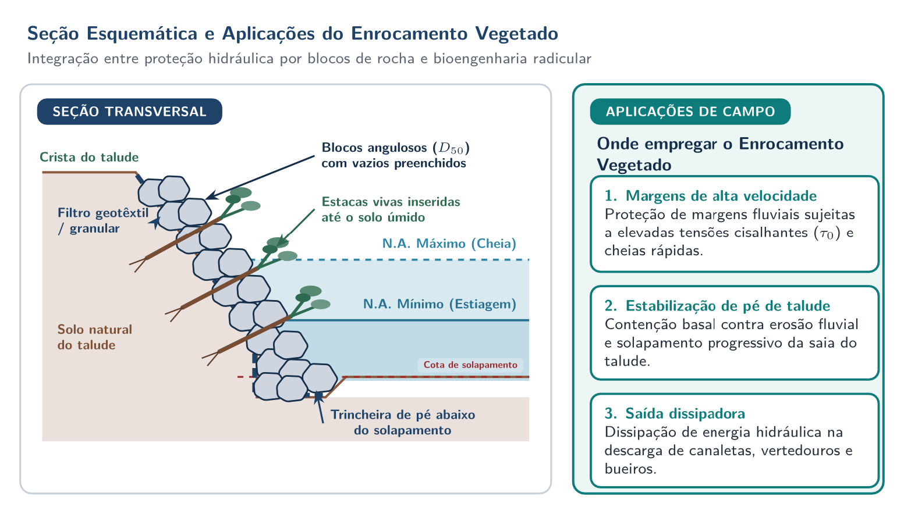
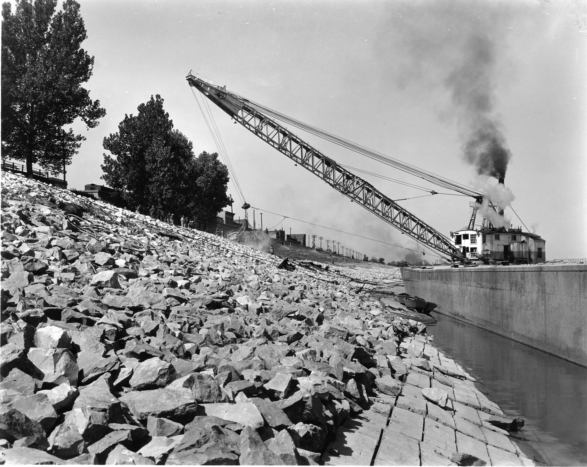
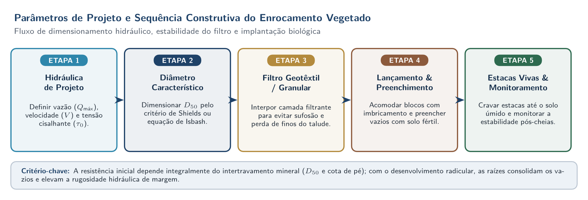

## Abertura Visão Geral da Aula {.smaller-text .academic-slide .lesson-slide}

::: {.pitch-grid-50}
::: {.pitch-card}
[Roteiro da aula]{.pitch-card-index}
[Tópicos estruturantes]{.pitch-heading}

- [1]{.circle} O que é enrocamento vegetado?
- [2]{.circle} Enrocamento convencional × vegetado
- [3]{.circle} Gradologia de pedras e filtros
- [4]{.circle} Espécies para estacas vivas
- [5]{.circle} Projeto e dimensionamento
- [6]{.circle} Construção e implantação
- [7]{.circle} Monitoramento e sucessão ecológica
- [8]{.circle} Síntese e atividade
:::

::: {.pitch-stack-2}
::: {.pitch-card .pitch-card--forest}
[Objetivo central]{.pitch-card-index}
[Proteção pétrea aliada ao reforço vivo]{.pitch-heading}

Compreender os princípios do **enrocamento vegetado** (*vegetated riprap*) como técnica de **bioengenharia** que combina a estabilidade estrutural das **pedras** com o enraizamento de **estacas vivas**, aprender a **dimensionar**, **construir** e **monitorar** o sistema para proteção de margens fluviais e bases de taludes.
:::

::: {.pitch-pill-row}
[Equação de Isbash ($D_{50}$)]{.pitch-pill}
[Filtro de Terzaghi]{.pitch-pill .pitch-pill--gold}
[Estacas vivas · APP]{.pitch-pill}
:::
:::
:::

# 1 · O que é enrocamento vegetado? {.section-header rotulo="Conceito"}

## Conceito Definição, componentes e evolução temporal {.smaller-text .academic-slide .lesson-slide}

::: {.pitch-grid-50}
::: {.pitch-stack-2}
::: {.pitch-card}
[Vegetated riprap / Live riprap]{.pitch-card-index}
[Sistema híbrido pedra–solo–raiz]{.pitch-heading}

- **Pedras** (enrocamento) para resistência mecânica imediata
- **Solo fértil** nos interstícios para suporte de vida
- **Estacas vivas** (*live stakes*) com propagação vegetativa
- **Raízes** que assumem progressivamente parte da função estrutural
:::

::: {.pitch-band .pitch-band--teal}
Transforma uma **estrutura inerte** em um **ecossistema vivo**: as raízes entrelaçam os blocos e geram **resiliência ecológica** após cheias e secas.
:::
:::

::: {.pitch-milestones}
::: {.pitch-milestone-item}
**Ano 0 · 100% pedras:** blocos lançados com estacas cravadas garantem estabilidade imediata ao fluxo.
:::

::: {.pitch-milestone-item}
**Ano 1 · Enraizamento inicial:** brotação aérea e emissão de raízes nos interstícios preenchidos com solo.
:::

::: {.pitch-milestone-item}
**Anos 2–3 · Entrelaçamento:** raízes amarram as pedras entre si e ancoram o filtro ao talude natural.
:::

::: {.pitch-milestone-item}
**Ano 5+ · 50% pedras + 50% raízes:** sistema vivo autossustentável com rugosidade hidráulica natural.
:::
:::
:::

## Conceito Seção esquemática e aplicações de campo {.smaller-text .academic-slide .lesson-slide}

::: {.pitch-media-card .pitch-media-card--wide}

[Seção transversal e aplicações do enrocamento vegetado]{.pitch-caption}
[Blocos (D₅₀), filtro geotêxtil/granular, trincheira de pé abaixo do solapamento e estacas vivas até o solo úmido]{.pitch-caption-sub}
:::

::: {.pitch-band}
A combinação de trincheira de pé (*toe*) abaixo da cota de solapamento e estacas vivas cravadas até o solo úmido protege o talude nos regimes de estiagem e cheia máxima.
:::

## Conceito Registro de campo e locais de aplicação {.smaller-text .academic-slide .lesson-slide}

::: {.pitch-grid-50}
::: {.pitch-media-card .pitch-media-card--photo .pitch-media-card--tall}

[Enrocamento em margem fluvial — Rio Ohio, 1935]{.pitch-caption}
[Fonte: USACE Memphis District · Public Domain]{.pitch-caption-sub}
:::

::: {.pitch-stack-2}
::: {.pitch-table-box}
| Local de aplicação | Função principal |
|---|---|
| Margens de rios / Reservatórios | Proteção fluvial e contra ondas |
| Base de taludes (*toe*) | Contenção basal anti-solapamento |
| Saídas de bueiros e canais | Dissipação de energia e revestimento |
| Trechos costeiros | Proteção litorânea |
:::

::: {.pitch-card .pitch-card--forest}
[Inspeção e conformidade em APP]{.pitch-card-index}
[Checklist de campo]{.pitch-heading}

Conferir estabilidade dos blocos e do pé, filtro/vazios, erosão nas extremidades e estabelecimento ciliar (**Lei 12.651/2012 — Código Florestal**).
:::
:::
:::

# 2 · Enrocamento convencional × vegetado {.section-header rotulo="Comparação"}

## Comparação Confronto técnico, ecológico e critérios de decisão {.smaller-text .academic-slide .lesson-slide}

::: {.pitch-grid-50}
::: {.pitch-stack-2}
::: {.pitch-card}
[Enrocamento convencional]{.pitch-card-index}
[Estrutura inerte · manutenção periódica]{.pitch-heading}

Camada de pedras com juntas preenchidas por brita ou argamassa; resistência mecânica imediata (30–50+ anos), sem componente biológico e com alto custo de transporte.
:::

::: {.pitch-card .pitch-card--forest}
[Enrocamento vegetado (*live riprap*)]{.pitch-card-index}
[Sistema vivo · 20–40% menor custo]{.pitch-heading}

Interstícios preenchidos com **solo fértil** e **estacas vivas**; proporciona autorreparação, habitat aquático/terrestre, filtragem de sedimentos e durabilidade crescente.
:::
:::

::: {.pitch-stack-2}
::: {.pitch-table-box}
| Critério | Convencional | Vegetado |
|---|---|---|
| Fluxo $V > 4\text{ m s}^{-1}$ | ★★★★★ | ★★★☆☆ |
| APP (exigência legal) | ★★☆☆☆ | ★★★★★ |
| Habitat / Paisagem | ★☆☆☆☆ | ★★★★★ |
| Custo inicial / Manutenção LP | ★★☆☆☆ / ★★★☆☆ | ★★★★☆ / ★★★★★ |
| Resistência imediata | ★★★★★ | ★★★★☆ |
:::

::: {.pitch-band .pitch-band--teal}
Em fluxos **$> 4\text{ m s}^{-1}$** ou ondas **$> 1\text{ m}$**, adote **solução mista**: convencional na base submersa e vegetado acima da cota média.
:::
:::
:::

# 3 · Gradologia de pedras e filtros {.section-header rotulo="Gradologia"}

## Gradologia Equação de Isbash, classes de pedra e filtro de Terzaghi {.smaller-text .academic-slide .lesson-slide}

::: {.pitch-grid-55}
::: {.pitch-stack-2}
::: {.pitch-formula}
**Diâmetro característico $D_{50}$ (Isbash, 1936):**

$$D_{50} = \frac{V^2}{2g \cdot C^2 \cdot (\gamma_s / \gamma_w - 1)}$$

Onde $V$ = velocidade (m s⁻¹), $g = 9,81\text{ m s}^{-2}$, $C$ = coef. de Isbash ($0,86$ fundo; $1,20$ talude), $\gamma_s \approx 2.650\text{ kg m}^{-3}$ e $\gamma_w = 1.000\text{ kg m}^{-3}$.
:::

::: {.pitch-table-box}
| Classe | $D_{50}$ (cm) | Massa média (kg) | $V_{adm}$ máxima |
|---|---|---|---|
| Rachão leve | 10–15 | 2–5 | 1,0–1,5 m/s |
| Rachão médio | 15–25 | 5–20 | 1,5–2,5 m/s |
| Rachão pesado | 25–40 | 20–80 | 2,5–3,5 m/s |
| Pedra de mão | 40–60 | 80–300 | 3,5–5,0 m/s |
:::
:::

::: {.pitch-stack-2}
::: {.pitch-card}
[Transição granulométrica]{.pitch-card-index}
[Camada filtrante anti-sufosão]{.pitch-heading}

Pedras grandes (externa) $\rightarrow$ Pedras médias (transição) $\rightarrow$ Brita/seixo (filtro granular) $\rightarrow$ Geotêxtil (filtro sintético) $\rightarrow$ Solo natural da margem.
:::

::: {.pitch-formula}
**Regras de filtro de Terzaghi:**

$$\frac{D_{15(\text{filtro})}}{D_{85(\text{solo})}} < 5 \qquad \text{e} \qquad \frac{D_{15(\text{filtro})}}{D_{15(\text{solo})}} > 4$$
:::

::: {.pitch-band}
Os interstícios **não levam argamassa**, mas sim **solo fértil** para enraizamento das estacas vivas.
:::
:::
:::

# 4 · Espécies para estacas vivas {.section-header rotulo="Espécies"}

## Espécies Seleção botânica, preparo e taxa de enraizamento {.smaller-text .academic-slide .lesson-slide}

::: {.pitch-grid-50}
::: {.pitch-stack-2}
::: {.pitch-table-box}
| Espécie | Nome popular | Habitat |
|---|---|---|
| *Salix humboldtiana* | Salgueiro | Margens fluviais |
| *Sebastiania commersoniana* | Branquilho | Mata ciliar |
| *Calliandra brevipes* | Esponjinha | Cerrado úmido |
| *Inga marginata* | Ingá-feijão | Mata Atlântica |
| *Schinus terebinthifolia* | Aroeira-pimenteira | Generalista |
| *Erythrina crista-galli* | Corticeira | Banhados |
| *Phyllanthus sellowianus* | Sarandi | Margens |
:::

::: {.pitch-band .pitch-band--teal}
Critérios: **propagação vegetativa**, tolerância à submersão periódica, crescimento rápido e raízes densas.
:::
:::

::: {.pitch-stack-2}
::: {.pitch-card .pitch-card--forest}
[Padrão das estacas]{.pitch-card-index}
[Especificações biométricas]{.pitch-heading}

- **Diâmetro:** 2–8 cm (ótimo: 3–5 cm) · **Comprimento:** 50–100 cm
- **Cortes:** diagonal na base (cravação) e reto no ápice
- **Coleta e guarda:** ramos em dormência; máx. **48 h** em local úmido e sombreado
:::

::: {.pitch-flow-4}
::: {.pitch-card}
[Mês 1]{.pitch-card-index}
[10–30%]{.pitch-heading}

Início da brotação.
:::

::: {.pitch-card .pitch-card--teal}
[Mês 3]{.pitch-card-index}
[40–60%]{.pitch-heading}

Emissão radicular.
:::

::: {.pitch-card .pitch-card--forest}
[Mês 6]{.pitch-card-index}
[70–85%]{.pitch-heading}

Ancoragem nos vazios.
:::

::: {.pitch-card .pitch-card--gold}
[Ano 1]{.pitch-card-index}
[80–95%]{.pitch-heading}

Sistema consolidado.
:::
:::
:::
:::

# 5 · Projeto e dimensionamento {.section-header rotulo="Projeto"}

## Projeto Fluxo de dimensionamento e sequência construtiva {.smaller-text .academic-slide .lesson-slide}

::: {.pitch-media-card .pitch-media-card--wide}

[Parâmetros de projeto e sequência construtiva]{.pitch-caption}
[Da hidráulica de projeto (Qmáx, V, τ₀) e D₅₀ ao filtro, imbricamento de blocos, estacas vivas e monitoramento]{.pitch-caption-sub}
:::

::: {.pitch-band .pitch-band--navy}
**Critério-chave:** a resistência inicial depende integralmente do intertravamento mineral ($D_{50}$ e cota de pé); com o avanço radicular, as raízes consolidam os vazios.
:::

## Projeto Geometria da seção, quantitativos e função de cada camada {.smaller-text .academic-slide .lesson-slide}

::: {.pitch-grid-55}
::: {.pitch-stack-2}
::: {.pitch-table-box}
| Parâmetro geométrico | Valor recomendado |
|---|---|
| Espessura mínima | $1,5 \times D_{50}$ ou 30 cm (o maior) |
| Inclinação do talude | 1V:1,5H a 1V:3H |
| Fundação (*toe*) | Enterrar $\ge 60\text{ cm}$ abaixo do leito |
| Coroamento / Extensão | Acima da cheia ($TR = 10$ anos) · $\ge 1\text{ m}$ |
:::

::: {.pitch-formula}
**Densidade de estacas ($2\text{–}4\text{ estacas m}^{-2}$) e volume de pedras:**

$$d_{estacas} = \frac{N}{A_{enroc}} \qquad\qquad V_{pedras} = A_{face} \times e_{camada} \times (1 - n)$$

Onde $n$ = porosidade do enrocamento ($0,35\text{–}0,45$).
:::
:::

::: {.pitch-stack-2}
::: {.pitch-milestones}
::: {.pitch-milestone-item}
**Coroamento:** acima do N.A. de cheia ($TR = 10$ anos) para impedir galgamento erosivo.
:::

::: {.pitch-milestone-item}
**Corpo do enrocamento:** blocos intertravados + solo fértil + estacas vivas.
:::

::: {.pitch-milestone-item}
**Filtro:** camada granular ou geotêxtil contra carreamento de finos.
:::

::: {.pitch-milestone-item}
**Fundação (*toe*):** enterrada $\ge 60\text{ cm}$ com blocos maiores na base — ponto crítico anti-colapso.
:::
:::
:::
:::

# 6 · Construção e implantação {.section-header rotulo="Construção"}

## Construção Etapas em obra, cravação de estacas e época de plantio {.smaller-text .academic-slide .lesson-slide}

::: {.pitch-grid-50}
::: {.pitch-stack-2}
::: {.pitch-milestones}
::: {.pitch-milestone-item}
**1–2 · Leito e filtro:** escavar o *toe*, perfilar o talude e assentar geotêxtil ou filtro granular.
:::

::: {.pitch-milestone-item}
**3–4 · Pedras e solo:** dispor blocos da **base para o topo** (travados, sem lançar do alto) e preencher vazios com solo fértil.
:::

::: {.pitch-milestone-item}
**5–7 · Estacas, mulch e rega:** abrir furo-guia, cravar **2–4 estacas m⁻²** (**2/3 no solo, 1/3 exposta**), compactar ao redor, aplicar *mulch* e irrigar se necessário.
:::
:::

::: {.pitch-band}
Coletar estacas na **dormência** (reservas de carboidratos), mas plantar no início da **estação úmida**.
:::
:::

::: {.pitch-stack-2}
::: {.pitch-table-box}
| Passo | Inserção da estaca nos interstícios |
|---|---|
| 1–2 | Preencher vazio com solo úmido e abrir furo-guia metálico |
| 3–5 | Inserir corte diagonal para baixo, compactar e aplicar *mulch* |
:::

::: {.pitch-table-box}
| Região do Brasil | Melhor época de plantio |
|---|---|
| Nordeste semiárido | Início das chuvas (mar–abr) |
| Sudeste / Sul | Out–dez / Set–nov |
| Amazônia | Transição seca $\rightarrow$ chuvosa |
:::
:::
:::

# 7 · Monitoramento e sucessão ecológica {.section-header rotulo="Monitoramento"}

## Monitoramento Cronograma, metas e fases da sucessão ecológica {.smaller-text .academic-slide .lesson-slide}

::: {.pitch-grid-50}
::: {.pitch-stack-2}
::: {.pitch-table-box}
| Período | Indicador | Meta |
|---|---|---|
| 15 dias | Brotação das estacas | > 50% |
| 60 dias | Enraizamento inicial | Raízes visíveis |
| 6 meses / 1 ano | Cobertura vegetal | > 40% / > 70% |
| 2 anos | Entrelaçamento raiz–pedra | Consolidação |
| 5 anos | Ecossistema autônomo | Autossustentável |
:::

::: {.pitch-band .pitch-band--teal}
**Sucesso:** > 80% de estacas brotadas, raízes > 30 cm no solo, blocos imóveis em cheias e retorno de fauna associada.
:::
:::

::: {.pitch-stack-2}
::: {.pitch-cards-2}
::: {.pitch-card}
[Fase 1 · 0–2 anos]{.pitch-card-index}
[Pioneira]{.pitch-heading}

Estacas vivas + gramíneas estabilizadoras.
:::

::: {.pitch-card .pitch-card--teal}
[Fase 2 · 2–5 anos]{.pitch-card-index}
[Herbácea]{.pitch-heading}

Arbustos e herbáceas espontâneas.
:::

::: {.pitch-card .pitch-card--forest}
[Fase 3 · 5–10 anos]{.pitch-card-index}
[Arbustiva]{.pitch-heading}

Arbustos densos e árvores jovens.
:::

::: {.pitch-card .pitch-card--gold}
[Fase 4 · 10+ anos]{.pitch-card-index}
[Arbórea]{.pitch-heading}

Mata ciliar em regeneração plena.
:::
:::

::: {.pitch-band}
As estacas vivas atuam como **pioneiras**, criando microclima e estrutura para espécies **climácicas** da mata ciliar.
:::
:::
:::

# 8 · Síntese e atividade {.section-header rotulo="Síntese"}

## Síntese Pontos fundamentais e fluxo conceitual {.smaller-text .academic-slide .lesson-slide}

::: {.pitch-grid-50}
::: {.pitch-card}
[Resumo técnico]{.pitch-card-index}
[Seis pilares do enrocamento vegetado]{.pitch-heading}

1. Combina **pedras** (resistência imediata) e **estacas vivas** (reforço biológico)
2. Interstícios preenchidos com **solo fértil**, nunca com argamassa
3. **$D_{50}$** dimensionado pela equação de **Isbash** conforme velocidade do fluxo
4. Seleção de espécies com **propagação vegetativa** e tolerância à submersão
5. Plantio alinhado ao início da **estação chuvosa**
6. Sistema ganha **resiliência crescente** via sucessão ecológica
:::

::: {.pitch-flow-4}
::: {.pitch-card}
[01 · Insumos]{.pitch-card-index}
[Estrutura base]{.pitch-heading}

Pedras ($D_{50}$), filtro, solo fértil e estacas pioneiras.
:::

::: {.pitch-card .pitch-card--teal}
[02 · Obra]{.pitch-card-index}
[Enrocamento vivo]{.pitch-heading}

Imbricamento da base ao topo + cravação nos vazios.
:::

::: {.pitch-card .pitch-card--forest}
[03 · Transição]{.pitch-card-index}
[Proteção dupla]{.pitch-heading}

Resistência mecânica imediata + enraizamento progressivo.
:::

::: {.pitch-card .pitch-card--gold}
[04 · Clímax]{.pitch-card-index}
[Autossustentável]{.pitch-heading}

Sucessão ecológica consolidando a margem ciliar.
:::
:::
:::

## Atividade Projeto de enrocamento no Rio Jacuípe (BA) {.smaller-text .academic-slide .lesson-slide}

::: {.pitch-grid-55}
::: {.pitch-card}
[Estudo dirigido · 30 min projeto + 10 min apresentação]{.pitch-card-index}
[Margem em APP · 80 m × 3 m · $V = 2,8\text{ m s}^{-1}$ ($TR = 10$ anos)]{.pitch-heading}

Solo areno-argiloso com erosão severa. Projetem o enrocamento vegetado:

1. Calcule o **$D_{50}$** pela fórmula de Isbash e defina a **classe de pedra**
2. Defina **espessura** e **geometria da seção transversal**
3. Escolha **3 espécies** para estacas vivas e justifique
4. Calcule a **quantidade de estacas** (estacas m⁻²) e defina a **época ideal**
5. Elabore um **cronograma de monitoramento** para 2 anos
:::

::: {.pitch-table-box}
| Critério de avaliação | Peso |
|---|---|
| Dimensionamento das pedras | 25% |
| Geometria da seção | 15% |
| Seleção de espécies | 20% |
| Procedimento construtivo | 20% |
| Cronograma de monitoramento | 20% |
:::
:::

## Referências Referências bibliográficas {.smaller-text .academic-slide .lesson-slide}

::: {.pitch-card}
[Normas e literatura de engenharia]{.pitch-card-index}
[Base bibliográfica da aula]{.pitch-heading}

- ABNT (2016). *NBR 9842:2016 - Enrocamento - Projeto e execução*.
- DNER (1996). *Manual de Proteção e Retaludamento de Encostas*. Departamento Nacional de Estradas de Rodagem.
- Fischenich, C. (2001). Stability thresholds for stream restoration materials. *EMRRP Technical Notes, ERDC TN-EMRRP-SR-29*.
- Gray, D. H. & Sotir, R. B. (1996). *Biotechnical and Soil Bioengineering Slope Stabilization*. John Wiley & Sons.
- Isbash, S. V. (1936). Construction of dams by depositing rock in running water. *2nd Congress on Large Dams, Washington*, 5, 123–136.
- Li, M. H. & Eddleman, K. E. (2002). Biotechnical engineering as an alternative to traditional engineering methods. *Landscape Urban Planning*, 60(4), 225–242.
- Schiechtl, H. M. & Stern, R. (1996). *Ground Bioengineering Techniques for Slope Protection and Erosion Control*. Blackwell Science.
:::

## {.obrigado-fit-text .center}

::: {.columns}
::: {.column style="text-align: center;"}

[Obrigado!]{.obrigado-fit-text}

**Prof. Luiz Diego Vidal Santos**

📧 luiz.diego@uefs.br

🌐 [ldvsantos.github.io/cv](https://ldvsantos.github.io/cv)

:::
:::
