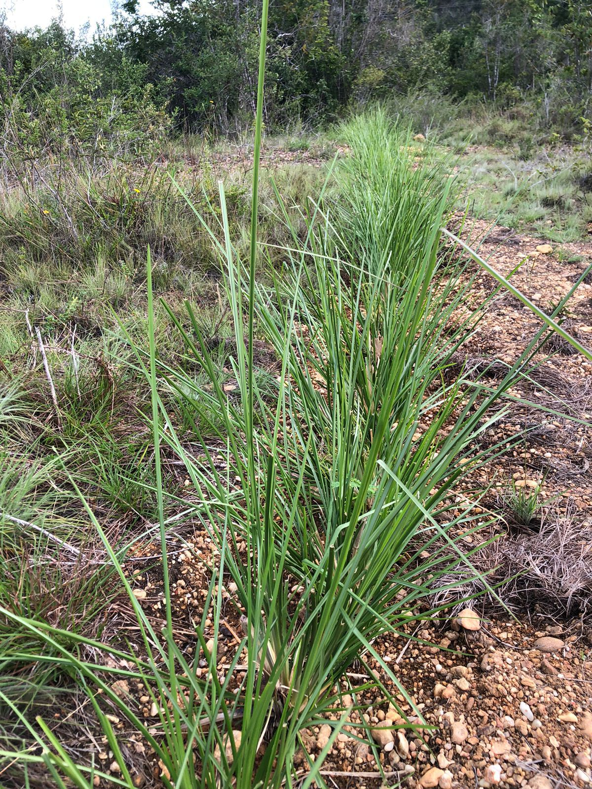
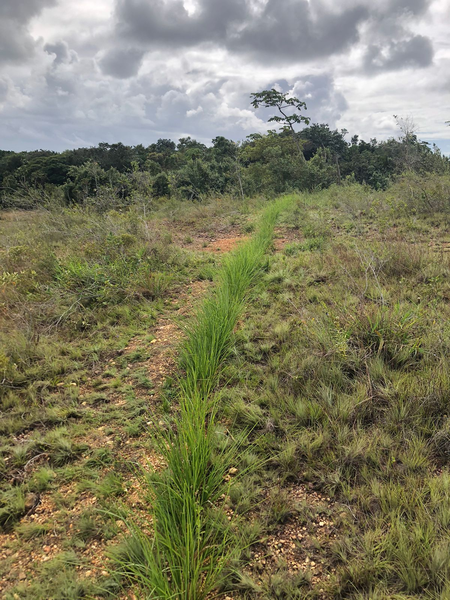
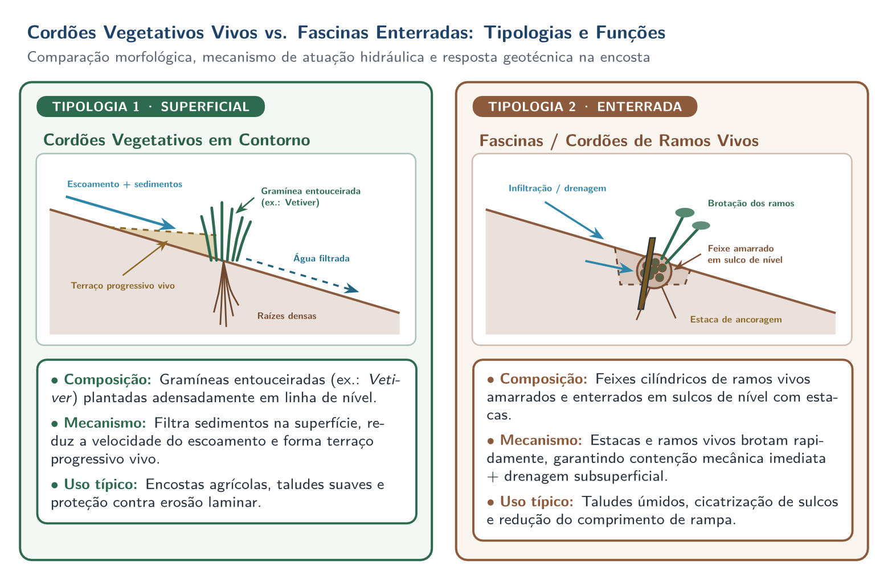
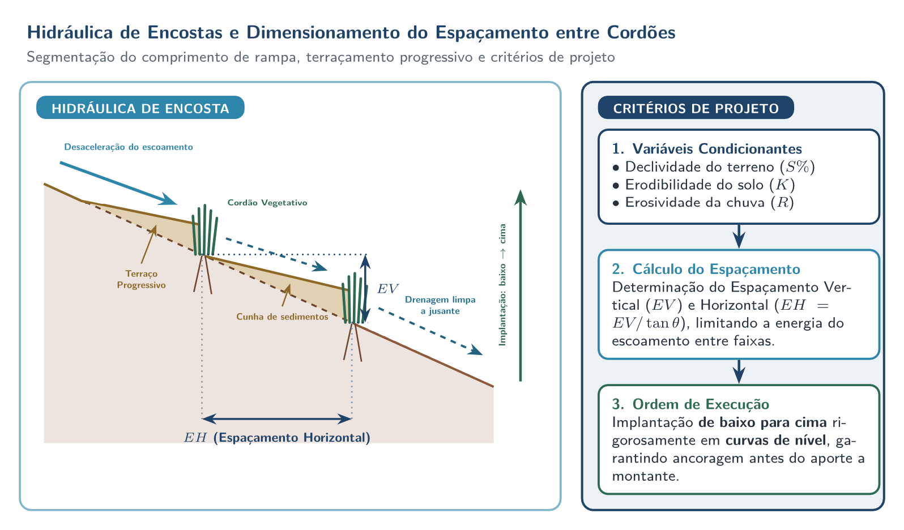

## Abertura Visão Geral da Aula {.smaller-text .academic-slide .lesson-slide}

::: {.pitch-grid-50}
::: {.pitch-card}
[Roteiro da aula]{.pitch-card-index}
[Tópicos estruturantes]{.pitch-heading}

- [1]{.circle} O que são cordões vegetativos?
- [2]{.circle} Fascinas mortas × fascinas vivas
- [3]{.circle} Mecanismo de dissipação de energia
- [4]{.circle} Dimensionamento e espaçamento
- [5]{.circle} Materiais e confecção
- [6]{.circle} Implantação em campo
- [7]{.circle} Monitoramento e eficiência
- [8]{.circle} Síntese e atividade
:::

::: {.pitch-stack-2}
::: {.pitch-card .pitch-card--forest}
[Objetivo central]{.pitch-card-index}
[Micro-barragens vivas em curvas de nível]{.pitch-heading}

Compreender os princípios dos **cordões vegetativos** (*wattle fences / contour fascines*) e das **fascinas de contenção** como técnicas de bioengenharia para **controlar o escoamento superficial**, **reter sedimentos** e promover a **estabilização progressiva de encostas** por meio do enraizamento das fascinas vivas.
:::

::: {.pitch-pill-row}
[Curvas de nível · Ev / Eh]{.pitch-pill}
[Chézy e v_crit]{.pitch-pill .pitch-pill--gold}
[Micro-terraços naturais]{.pitch-pill}
:::
:::
:::

# 1 · O que são cordões vegetativos? {.section-header rotulo="Conceito"}

## Conceito Definição, princípio hidráulico e inspeção em campo {.smaller-text .academic-slide .lesson-slide}

::: {.pitch-grid-50}
::: {.pitch-stack-2}
::: {.pitch-card .pitch-card--forest}
[Cordonas / Wattle fences / Contour fascines]{.pitch-card-index}
[Micro-barragens em nível na encosta]{.pitch-heading}

Degraus ou barreiras com **feixes de ramos** ou **solo ensacado** em **curvas de nível** para:

- **Reduzir** a velocidade do escoamento superficial
- **Reter** **0,5–2,0 m³ de sedimento por metro linear** (Florineth, 2004)
- **Criar** patamares de deposição que formam **terraços naturais**
- **Enraizar** (quando com ramos vivos), estabilizando o solo
:::

::: {.pitch-band .pitch-band--teal}
**Cascata na encosta:** Chuva $\rightarrow$ Escoamento $\rightarrow$ **Cordão 1 (topo)** reduz velocidade e eleva infiltração $\rightarrow$ **Cordão 2 (meio)** retém sedimentos $\rightarrow$ **Cordão 3 (base)** entrega fluxo controlado.
:::
:::

::: {.pitch-table-box}
| Aspecto de campo | Evidência de funcionamento | Possível falha |
|---|---|---|
| Implantação | Continuidade e nível conforme projeto | Descontinuidade e desvio lateral |
| Fixação | Estacas e ancoragens estáveis | Arrancamento ou deslizamento |
| Contato terreno | Fluxo distribuído e retenção local | Passagem de água por baixo |
| Material vegetal | Espécie adequada e brotação | Mortalidade / degradação precoce |
| Manutenção | Inspeção pós-chuva e reparo | Obstrução e erosão nas pontas |
:::
:::

## Conceito Cordões de contorno em campo (Semiárido) {.smaller-text .academic-slide .lesson-slide}

::: {.pitch-cards-2}
::: {.pitch-media-card .pitch-media-card--photo .pitch-media-card--compact}

[Interceptação inicial do escoamento superficial]{.pitch-caption}
[Cordão de contorno recém-implantado em encosta experimental]{.pitch-caption-sub}
:::

::: {.pitch-media-card .pitch-media-card--photo .pitch-media-card--compact}

[Formação de micro-terraço a montante]{.pitch-caption}
[Estágio avançado com acúmulo visível de sedimentos retidos]{.pitch-caption-sub}
:::
:::

::: {.pitch-band}
Os cordões de contorno documentados acima demonstram a transição da contenção física inicial para a formação progressiva de micro-terraços naturais em encostas do Semiárido.
:::

## Conceito Tipologias morfológicas: cordões superficiais vs. fascinas enterradas {.smaller-text .academic-slide .lesson-slide}

::: {.pitch-media-card .pitch-media-card--wide}

[Cordões vegetativos vivos vs. fascinas enterradas]{.pitch-caption}
[Comparação morfológica, mecanismo de atuação hidráulica e resposta geotécnica na encosta]{.pitch-caption-sub}
:::

::: {.pitch-band .pitch-band--teal}
**Cordões superficiais** (ex.: vetiver) filtram sedimentos na rampa, enquanto **fascinas enterradas** promovem contenção mecânica imediata + drenagem subsuperficial em taludes úmidos.
:::

## Conceito Classificação de materiais e integração territorial {.smaller-text .academic-slide .lesson-slide}

::: {.pitch-grid-55}
::: {.pitch-stack-2}
::: {.pitch-table-box}
| Tipo | Material | Mecanismo e indicação |
|---|---|---|
| Ramos mortos | Galhos secos | Barreira física (sem estaquia disponível) |
| Ramos vivos | Estacas vivas | Barreira + enraizamento (preferível!) |
| Sacos de terra/areia | Sacos cheios | Barreira por peso (emergência / íngreme) |
| Entrançado vivo | Ramos trançados | Barreira + cobertura (boa insolação/umidade) |
:::

::: {.pitch-band}
Cordões vegetativos, fascinas e entrançados têm geometrias distintas; descreva em projeto e campo a técnica efetivamente implantada.
:::
:::

::: {.pitch-cards}
::: {.pitch-card}
[Paliçadas]{.pitch-card-index}
[Em ravinas]{.pitch-heading}

Barreiras verticais para erosão linear concentrada.
:::

::: {.pitch-card .pitch-card--forest}
[Cordões]{.pitch-card-index}
[Em encostas]{.pitch-heading}

Degraus em nível contra erosão laminar e sulcos.
:::

::: {.pitch-card .pitch-card--teal}
[Barraginhas]{.pitch-card-index}
[Em estradas]{.pitch-heading}

Captação pontual de enxurrada e recarga hídrica.
:::
:::
:::

# 2 · Fascinas mortas × fascinas vivas {.section-header rotulo="Fascinas"}

## Fascinas Comparação funcional e evolução temporal {.smaller-text .academic-slide .lesson-slide}

::: {.pitch-grid-50}
::: {.pitch-stack-2}
::: {.pitch-card .pitch-card--gold}
[Fascinas mortas (*dead fascines*)]{.pitch-card-index}
[Barreira temporária · 2–5 anos]{.pitch-heading}

Ramos secos ou tratados, apenas **barreira mecânica** sem enraizamento; exige substituição periódica (estrutura de sacrifício).
:::

::: {.pitch-card .pitch-card--forest}
[Fascinas vivas (*live fascines*)]{.pitch-card-index}
[Solução definitiva · autorreparação]{.pitch-heading}

Ramos vivos com capacidade vegetativa: **barreira + enraizamento + revegetação**, com durabilidade crescente que elimina manutenção a longo prazo.
:::
:::

::: {.pitch-stack-2}
::: {.pitch-table-box}
| Período | Fascina morta | Fascina viva |
|---|---|---|
| Dia 0 | 100% funcional | 100% funcional |
| Ano 1 | 90% funcional | 100% + brotação |
| Ano 2–3 | 70% $\rightarrow$ 50% funcional | 120% (raízes) $\rightarrow$ 150% (cobertura) |
| Ano 5 | **Substituir** | **Ecossistema estabilizado** |
:::

::: {.pitch-band .pitch-band--teal}
**Trajetória da fascina viva:** Instalação $\rightarrow$ Brotação (2–4 sem.) $\rightarrow$ Enraizamento (2–6 meses) $\rightarrow$ Cobertura (6–12 meses) $\rightarrow$ **Micro-terraço estabilizado**.
:::
:::
:::

# 3 · Mecanismo de dissipação de energia {.section-header rotulo="Hidráulica"}

## Hidráulica Escoamento livre vs. interceptado e velocidades críticas {.smaller-text .academic-slide .lesson-slide}

::: {.pitch-grid-55}
::: {.pitch-stack-2}
::: {.pitch-formula}
**Escoamento livre (Chézy) e redução por cordões:**

$$v = C \sqrt{R \cdot S} \qquad\qquad v_{\max} = v_0 \times \left(\frac{L_{\text{cordão}}}{L_{\text{total}}}\right)^{0,5}$$

Onde $v$ = velocidade (m s⁻¹), $C$ = coef. de rugosidade de Chézy, $R$ = raio hidráulico (m), $S$ = declividade (m m⁻¹) e $L_{\text{cordão}}$ = espaçamento entre cordões.
:::

::: {.pitch-band .pitch-band--navy}
**Reset hidráulico:** Escoamento acelera com $L$ $\rightarrow$ Cordão 1 intercepta (**$v \approx 0$**) $\rightarrow$ Reinicia trecho seguinte $\rightarrow$ Cordão 2 intercepta $\rightarrow$ **$v$ sempre $< v_{crit}$**.
:::
:::

::: {.pitch-table-box}
| Tipo de solo | $v_{crit}$ de erosão (m s⁻¹) |
|---|---|
| Areia fina | 0,3 – 0,5 |
| Areia grossa | 0,5 – 0,8 |
| Silte | 0,6 – 1,0 |
| Argila mole | 0,8 – 1,2 |
| Argila compactada | 1,2 – 1,8 |
:::
:::

# 4 · Dimensionamento e espaçamento {.section-header rotulo="Dimensionamento"}

## Dimensionamento Hidráulica de encostas e espaçamento entre cordões {.smaller-text .academic-slide .lesson-slide}

::: {.pitch-media-card .pitch-media-card--wide}

[Hidráulica de encostas e dimensionamento do espaçamento]{.pitch-caption}
[Definição de EV e EH = EV/tan(θ), formação de cunha de sedimentos e ordem executiva de baixo para cima]{.pitch-caption-sub}
:::

::: {.pitch-band}
A implantação executada **de baixo para cima** em curvas de nível garante ancoragem da base antes do aporte de escoamento e sedimentos a montante.
:::

## Dimensionamento Cálculo de Ev, Eh, geometria e exemplo numérico {.smaller-text .academic-slide .lesson-slide}

::: {.pitch-grid-55}
::: {.pitch-stack-2}
::: {.pitch-table-box}
| Declividade ($\alpha$) | $E_v$ solo resistente | $E_v$ solo frágil |
|---|---|---|
| 15°–20° | 1,5–2,0 m | 1,0–1,5 m |
| 20°–30° | 1,0–1,5 m | 0,8–1,0 m |
| 30°–40° | 0,8–1,0 m | 0,5–0,8 m |
| 40°–50° | 0,5–0,8 m | 0,3–0,5 m |
:::

::: {.pitch-table-box}
| Parâmetro do cordão | Dimensão |
|---|---|
| Diâmetro do feixe / Comprimento ramos | 20–40 cm · 100–200 cm |
| Altura exposta / Prof. enterramento | 15–30 cm · 10–20 cm |
:::
:::

::: {.pitch-stack-2}
::: {.pitch-formula}
**Espaçamento horizontal ($E_h$) e exemplo (30°, solo frágil, $H = 10\text{ m}$):**

$$E_h = \frac{E_v}{\tan(\alpha)} = \frac{0,8}{\tan(30°)} = \frac{0,8}{0,577} = 1,39\text{ m}$$

$$N_{\text{cordões}} = \frac{10}{0,8} = 12,5 \approx 13 \text{ cordões}$$
:::

::: {.pitch-band}
Em perfis irregulares, siga as **curvas de nível reais** no terreno (do topo até a base com $E_v$ variável), nunca alinhamentos retos.
:::
:::
:::

# 5 · Materiais e confecção {.section-header rotulo="Materiais"}

## Materiais Confecção de fascinas vivas, sacos e espécies do Nordeste {.smaller-text .academic-slide .lesson-slide}

::: {.pitch-grid-50}
::: {.pitch-stack-2}
::: {.pitch-milestones}
::: {.pitch-milestone-item}
**1–2 · Coleta e amarração:** ramos vivos ($\varnothing$ 1–4 cm, comp. 1–2 m) amarrados em feixes de **$\varnothing$ 20–40 cm** com arame ou sisal.
:::

::: {.pitch-milestone-item}
**3–4 · Uniformização:** alternar pontas e bases e inserir estacas maiores no núcleo como "espinhas".
:::

::: {.pitch-milestone-item}
**5 · Amarração final:** atar a cada **30–50 cm** de intervalo até obter a fascina pronta.
:::
:::

::: {.pitch-table-box}
| Espécie (Nordeste) | Propagação | Crescimento |
|---|---|---|
| *Gliricidia sepium* | Estaca | Rápido |
| *Moringa oleifera* | Estaca | Muito rápido |
| *Erythrina velutina* | Estaca | Rápido |
| *Spondias tuberosa* | Estaca | Moderado |
| *Jatropha curcas* | Estaca | Rápido |
:::
:::

::: {.pitch-stack-2}
::: {.pitch-card}
[Cordões de sacos de terra]{.pitch-card-index}
[Alternativa emergencial]{.pitch-heading}

Sacos de ráfia/juta (60 × 40 cm) cheios a 2/3 com terra local, costurados/dobrados, dispostos em nível e escorados a jusante com estacas (sobreposição dupla se necessário).
:::

::: {.pitch-table-box}
| Material por metro linear | Quantidade |
|---|---|
| Ramos vivos ($\varnothing$ 1–4 cm) | 15–25 unidades |
| Arame galvanizado nº 12 | 2 m |
| Estacas-guia ($\varnothing$ 5–8 cm) | 2 unidades m⁻¹ |
| OU sacos de terra | 5–8 por metro |
:::
:::
:::

# 6 · Implantação em campo {.section-header rotulo="Implantação"}

## Implantação Passo a passo construtivo, seção e erros comuns {.smaller-text .academic-slide .lesson-slide}

::: {.pitch-grid-55}
::: {.pitch-milestones}
::: {.pitch-milestone-item}
**1 · Topografia:** marcar curvas de nível com nível óptico ou de mangueira no espaçamento $E_v$ / $E_h$ de projeto.
:::

::: {.pitch-milestone-item}
**2 · Trincheiras:** escavar com **10–20 cm** de profundidade, largura igual ao cordão, em nível (0%) ou 1–2% lateral.
:::

::: {.pitch-milestone-item}
**3 · Estacas-guia:** cravar **2/3 no solo** a cada **1–1,5 m** no lado de jusante do cordão.
:::

::: {.pitch-milestone-item}
**4–5 · Assentamento e reaterro:** encaixar a fascina ($\varnothing$ 20–40 cm), amarrar às estacas, compactar reaterro e aplicar *mulch* entre faixas.
:::
:::

::: {.pitch-stack-2}
::: {.pitch-table-box}
| Erro de execução | Consequência |
|---|---|
| Cordão fora de nível | Concentração de fluxo e ravina |
| Trincheira rasa / sem estacas | Deslocamento ou rolamento |
| Ramos secos / $E_v$ excessivo | Falha de brotação / erosão |
:::

::: {.pitch-band .pitch-band--alert}
**Erro mais grave:** instalar cordões **fora de nível** concentra a enxurrada em um único ponto e agrava a erosão original.
:::
:::
:::

# 7 · Monitoramento e eficiência {.section-header rotulo="Monitoramento"}

## Monitoramento Indicadores, cronograma e formação de micro-terraços {.smaller-text .academic-slide .lesson-slide}

::: {.pitch-grid-50}
::: {.pitch-stack-2}
::: {.pitch-table-box}
| Indicador | Método | Meta |
|---|---|---|
| Retenção de sedimento | Montante / jusante | > 70% |
| Velocidade / Erosão | Flutuador ou ADV / Pinos | Redução > 50% · < 5 t ha⁻¹ ano⁻¹ |
| Brotação / Cobertura | Visual / Quadrante 1 m² | > 60% (30 d) · > 50% (6 m) |
:::

::: {.pitch-table-box}
| Período | Atividade de acompanhamento |
|---|---|
| 15 – 30 dias | Integridade física, brotação e enraizamento |
| 60 dias – 6 meses | Sedimento retido e cobertura vegetal |
| 1 – 2 anos | Formação de terraço e autossustentabilidade |
:::
:::

::: {.pitch-stack-2}
::: {.pitch-cards-2}
::: {.pitch-card}
[Ano 0–1]{.pitch-card-index}
[Retenção inicial]{.pitch-heading}

Cordão em trincheira intercepta fluxo e acumula sedimento a montante.
:::

::: {.pitch-card .pitch-card--forest}
[Ano 2–3+]{.pitch-card-index}
[Micro-terraço]{.pitch-heading}

Cordão enraizado consolida terraço natural e vegetação densa.
:::
:::

::: {.pitch-band .pitch-band--teal}
Estudos na Europa Central mostram redução de **75–90% na perda de solo** e **60–80% na velocidade do escoamento** em taludes de 25°–35° (Florineth, 2004; Schiechtl & Stern, 1996).
:::
:::
:::

# 8 · Síntese e atividade {.section-header rotulo="Síntese"}

## Síntese Pontos fundamentais e fluxo conceitual {.smaller-text .academic-slide .lesson-slide}

::: {.pitch-grid-50}
::: {.pitch-card}
[Resumo técnico]{.pitch-card-index}
[Seis pilares dos cordões vegetativos]{.pitch-heading}

1. **Cordões vegetativos** são barreiras em curvas de nível que interceptam o escoamento
2. **Fascinas vivas** superam as mortas por enraizarem e dispensarem substituição
3. **Mecanismo hidráulico:** reiniciam o comprimento de rampa ($v < v_{crit}$) e retêm sedimentos
4. **Espaçamento ($E_v$, $E_h$)** varia conforme declividade e fragilidade do solo
5. **Instalação em nível** (com reaterro e estacas a jusante) é critério decisivo
6. Evolução progressiva gera **terraços naturais vegetados**
:::

::: {.pitch-flow-4}
::: {.pitch-card}
[01 · Confecção]{.pitch-card-index}
[Fascinas]{.pitch-heading}

Ramos vivos regionais em feixes de $\varnothing$ 20–40 cm.
:::

::: {.pitch-card .pitch-card--teal}
[02 · Locação]{.pitch-card-index}
[Em nível]{.pitch-heading}

Implantação em curvas de nível e interceptação do fluxo.
:::

::: {.pitch-card .pitch-card--forest}
[03 · Processos]{.pitch-card-index}
[Tripla ação]{.pitch-heading}

Retenção de sedimentos, maior infiltração e enraizamento.
:::

::: {.pitch-card .pitch-card--gold}
[04 · Resultado]{.pitch-card-index}
[Estabilidade]{.pitch-heading}

Formação de micro-terraços e encosta estabilizada.
:::
:::
:::

## Atividade Projeto de cordões em pastagem degradada {.smaller-text .academic-slide .lesson-slide}

::: {.pitch-grid-55}
::: {.pitch-card}
[Estudo dirigido · 30 min projeto + 10 min apresentação]{.pitch-card-index}
[Encosta · 150 m · 25° · solo siltoso · 700 mm/ano (4 meses)]{.pitch-heading}

Erosão laminar severa e sulcos incipientes. Projetem o sistema:

1. Calculem **$E_v$**, **$E_h$** e o **número de cordões** necessários
2. Escolham o **tipo de cordão** (viva, morta ou sacos) e **3 espécies** para fascinas vivas
3. Quantifiquem os **metros lineares** de fascina e **estacas-guia**
4. Descrevam o **procedimento de instalação** e o **cronograma de monitoramento** (2 anos)
:::

::: {.pitch-table-box}
| Critério de avaliação | Peso |
|---|---|
| Dimensionamento (espaçamento) | 25% |
| Seleção de materiais / espécies | 20% |
| Procedimento de instalação | 20% |
| Quantitativo de materiais | 15% |
| Cronograma de monitoramento | 20% |
:::
:::

## Referências Referências bibliográficas {.smaller-text .academic-slide .lesson-slide}

::: {.pitch-card}
[Manuais e artigos científicos]{.pitch-card-index}
[Base bibliográfica da aula]{.pitch-heading}

- Florineth, F. (2004). *Pflanzen statt Beton - Handbuch zur Ingenieurbiologie und Vegetationstechnik*. Patzer Verlag.
- Gray, D. H. & Sotir, R. B. (1996). *Biotechnical and Soil Bioengineering Slope Stabilization*. John Wiley & Sons.
- Norris, J. E. et al. (2008). *Slope Stability and Erosion Control: Ecotechnological Solutions*. Springer.
- Petrone, A. & Preti, F. (2010). Soil bioengineering for risk mitigation and environmental restoration in a humid tropical area. *Hydrology Earth System Sciences*, 14(2), 239–250.
- Schiechtl, H. M. & Stern, R. (1996). *Ground Bioengineering Techniques for Slope Protection and Erosion Control*. Blackwell Science.
- Stokes, A. et al. (2014). Ecological mitigation of hillslope instability: ten key issues facing researchers. *Plant Soil*, 377, 1–23.
- Zeh, H. (2007). *Soil Bioengineering Construction Type Manual*. European Federation for Soil Bioengineering (EFIB). vdf Hochschulverlag.
:::

## {.obrigado-fit-text .center}

::: {.columns}
::: {.column style="text-align: center;"}

[Obrigado!]{.obrigado-fit-text}

**Prof. Luiz Diego Vidal Santos**

📧 luiz.diego@uefs.br

🌐 [ldvsantos.github.io/cv](https://ldvsantos.github.io/cv)

:::
:::
